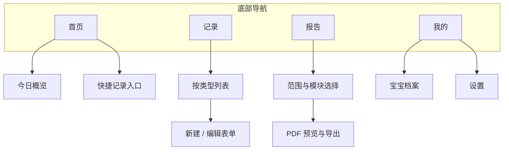

# 敏宝日记 MVP 版本 产品需求文档（PRD）

## 一、产品概述

### 1.1 产品定位与目标

**敏宝日记**是一款专为 0-1 岁牛奶蛋白过敏（CMPA）宝宝家庭打造的饮食生活记录和健康管理 APP。产品定位为「**敏宝家庭的结构化健康记录工具**」，核心目标是帮助照护者把饮食、症状、生长发育等信息**系统化记录并导出**，方便就医时携带与沟通。

**本版 MVP 约束**：**单人、单设备、本地使用**（无家庭共享、无云端同步、无多账号协作）。在此范围内，采用原生开发支持 iOS 和 Android 双平台，目标在 **1 个自然月内**完成可内测的 MVP。通过小范围验证敏宝家庭对垂直记录工具的需求，为后续迭代提供依据。

### 1.2 目标用户群体

**核心用户（父母）**：

* 年龄：25-35 岁，本科及以上学历，一线城市（北京 / 上海 / 广州 / 深圳）敏宝父母

* 特征：对科学育儿有强烈需求，严格遵循医生指导；**本版以单人记录为主**，同一照护者在一台手机上完成全部记录即可。

* 痛点：记录零散混乱、就医沟通效率低、转奶过程缺乏系统管理

**次要用户（祖辈）**（交互与适老化设计参考，**仍视为同一单人账号在同一设备上使用**）：

* 年龄：50-65 岁，可能承担白天主要照料工作

* 特征：智能手机操作不熟练，需要简单易用的记录工具

* 痛点：现有 APP 界面复杂，不会打字输入；本版通过大字体、少输入、语音等方式降低使用门槛（**不要求**多人协作或远程同步）。

### 1.3 核心价值主张

**全场景记录**：覆盖饮食（转奶、营养素）、睡眠、活动、生长、症状、医疗等敏宝护理全场景，支持手动、语音、图片等多种输入方式。

**结构化管理**：采用结构化模板设计，符合医学记录标准，可一键生成规范的 PDF 报告供医生参考。

**代际友好设计**：极简界面 + 大字体模式 + 语音输入，满足同一设备上不同照护者的操作习惯。

**数据存放**：健康相关数据默认**仅存本机**，不上传云端（与「无云端同步」一致）。

### 1.4 产品边界

本 MVP **仅面向单人单机**，范围如下：

* **P0 级（必做）**：宝宝档案管理、日常记录（饮食 / 睡眠 / 活动 / 症状）、生长记录、医疗记录、报告生成与本地导出 / 系统分享

**本版明确不做（后续迭代）**：

* 家庭多成员共享、账号体系、邀请链接、多端实时同步

* AI 分析、社区、电商、云端备份与同步等

* 合规与隐私政策、上架材料等专项：**不纳入本 PRD 撰写与评审范围**（可另行准备）

## 二、整体设计与核心交互流程

### 2.1 整体设计目标

在 **单人、单机、本地** 前提下，整体设计遵循：**首页快速到达记录、记录页类型清晰、报告一键生成、路径不超过 3 级**。所有数据写入默认关联当前选中的宝宝档案（若仅有一名宝宝可自动选中，无需每次切换）。

### 2.2 信息架构与导航

**底部 Tab（4 个）**与信息层级关系如下：

| Tab | 定位 | 主要下级内容 |
| --- | --- | --- |
| **首页** | 今日任务与快捷入口 | 今日时间线摘要、各类型「+ 记一条」快捷按钮、未完成提醒（若有） |
| **记录** | 按类型浏览与补录 | 饮食 / 睡眠 / 活动与状态 / 生长 / 医疗等分类列表，支持筛选日期与类型 |
| **报告** | 生成与历史 | 选择时间范围与模块 → 生成 PDF → 预览 → 系统分享 / 保存到文件 |
| **我的** | 档案与设置 | 宝宝档案编辑、大字体开关、数据清空、关于 |

**页面层级**：首页 → 具体记录表单 → 保存成功反馈（Toast / 简短动效）→ 回到首页或留在列表；**报告** → 参数页 → 预览页 → 分享面板，为独立支线，不与「记录」强耦合。

### 2.3 全局状态与关键规则

* **当前宝宝**：本地仅存多宝宝时的「当前选中」状态；新建记录均写入当前宝宝 ID。
* **时间基准**：记录以用户选择的「发生时间」为准；补录时默认当前时间，可改为历史时间。
* **今日定义**：以自然日 0:00–24:00（按系统时区）聚合首页「今日」统计。
* **返回与保存**：表单页左上角返回；未保存离开时弹出确认（可选实现，MVP 建议保留防误触）。

### 2.4 核心功能交互流程

以下为主路径步骤，异常与边界（网络不可用、存储满等）在实现层按第六、七章非功能要求处理。

#### 2.4.1 首次使用：创建档案并进入首页

1. 启动 App，检测到**无宝宝档案** → 展示引导页（价值说明 +「开始创建」）。
2. 进入档案表单：必填姓名、出生日期、性别、过敏类型（默认 CMPA）、过敏程度；可选当前身高、体重、头围。
3. 点击「保存」→ 校验通过后写入本地数据库 → **进入首页**，首页展示空状态或「今日尚无记录」提示。
4. 若已有档案（非首次启动）→ 直接进入首页，并加载当日摘要。

#### 2.4.2 从首页快速记录（以饮食为例）

1. 首页点击「饮食」或「+ 饮食」→ 进入**饮食记录表单**（可带当前时间预填）。
2. 选择 / 填写：喂养时间、奶粉类型、奶量；按需填写转奶比例、营养素、辅食等（与第三章 P0-002 字段一致）。
3. 点击「保存」→ 成功提示 → 返回首页或跳转「记录-饮食」列表（产品可选其一，建议**返回首页**以保持高频路径短）。
4. 若使用语音 / 扫码 / 拍照 → 在表单内完成识别结果回填后再保存（失败则保留手动输入）。

#### 2.4.3 睡眠记录（计时与补录）

**计时模式**：1）在睡眠表单点击「开始睡眠」→ 记录开始时间；2）再次进入或点击「结束睡眠」→ 写入结束时间，自动计算时长 → 保存。

**补录模式**：直接选择入睡与醒来时间（或选预设时长）→ 选睡眠质量 → 保存。

#### 2.4.4 活动与状态（含症状）

1. 从首页或「记录」进入 **活动 / 状态** 表单。
2. 分项勾选：排便性状、排尿 / 换尿布、精神状态图标；**过敏症状**多选 + 严重程度 + 可选拍照。
3. 保存后归入当日时间线，可在「记录」Tab 按日查看。

#### 2.4.5 生长数据

1. 「记录」→「生长」或首页快捷入口 → 表单填写测量日期、身高、体重、头围、测量机构（可选）。
2. 可选「上传测量报告照片」作为附件 → 保存。
3. 保存后若数据点 ≥2，在生长详情或报告模块中可绘制曲线（与第三章 P0-005 一致）。

#### 2.4.6 医疗记录

1. 进入医疗记录表单：检查类型、日期、机构、结果摘要、诊断结论（字段与第三章 P0-006 一致）。
2. 支持**拍照上传**病历 / 报告图 → 与结构化字段一并保存为一条记录。
3. 可选填写「下次复查」日期 → 写入本地提醒（若 MVP 实现提醒权限）。

#### 2.4.7 生成报告并导出 / 分享

1. **报告** Tab → 选择报告类型（日常护理 / 生长 / 症状 / 转奶等，与第三章 3.5 类型对齐）。
2. 选择时间范围（7 / 14 / 30 天或自定义起止日期）→ 勾选包含模块（饮食、睡眠、症状等）。
3. 点击「生成」→ 本地渲染 PDF → **预览页**。
4. 预览页操作：**保存到文件**、**系统分享**（微信、邮件、隔空投送等由系统面板提供）。
5. 可选「历史报告」列表：展示本机已生成文件或最近生成记录（实现二选一，以本地存储为准）。

#### 2.4.8 编辑宝宝档案与设置

1. **我的** → 点击宝宝卡片 → 进入档案编辑，修改后保存即全局生效（含报告封面信息）。
2. **大字体模式**开关立即生效，无需重启。
3. **清空本机数据**：二次确认后删除本地库（与第五章数据策略一致）。

### 2.5 与后续章节的对应关系

* **功能字段与业务规则**：见 **第三章** 各模块说明。
* **视觉、触控与输入控件的细化**：见 **第四章**。
* **数据表与存储**：见 **第五章**。

---

## 三、功能需求详细描述

### 3.1 宝宝档案管理模块

**功能 ID：P0-001**

**功能名称**：宝宝基础档案管理

**功能描述**：创建和管理敏宝的基础信息档案，包括过敏类型、过敏程度等核心数据

**输入项**：宝宝姓名、出生日期、性别、过敏类型（默认为 CMPA）、过敏程度、身高、体重、头围

**输出项**：标准化的宝宝档案信息

**优先级**：P0

**操作流程**：

1. 首次打开 APP 时引导用户创建宝宝档案

2. 提供预设的过敏类型选项（CMPA、其他食物过敏等）

3. 过敏程度采用滑动选择器（轻度 / 中度 / 重度）

4. 记录宝宝的出生数据和当前生长数据

5. 支持档案信息的编辑和修改

**业务规则**：

* 每个用户可创建多个宝宝档案（支持二胎家庭）

* 档案信息采用结构化存储，便于后续数据分析

* 过敏程度影响后续记录模板的默认选项

### 3.2 日常记录模块

#### 3.2.1 饮食记录子模块

**功能 ID：P0-002**

**功能名称**：敏宝饮食记录

**功能描述**：记录敏宝的转奶过程、奶量、营养素补充和辅食添加情况

**输入项**：转奶阶段、奶粉类型、奶量、喂养时间、营养素类型和剂量、辅食种类和分量

**输出项**：完整的饮食记录数据，支持按时间维度查询

**优先级**：P0

**转奶记录功能**：

* 采用进度条展示转奶阶段（AAF→eHF→pHF→普通奶）

* 记录每次转奶的日期、新旧奶粉比例、转奶阶段

* 自动计算并显示当前转奶进度百分比

* 支持转奶过程的回退操作（过敏反应时使用）

**奶粉记录功能**：

* 支持多种输入方式：手动输入、语音输入、扫码识别（拍奶粉罐）

* 记录每次喂养的时间、奶量、奶粉类型

* 提供常用奶量选项（60ml、90ml、120ml、150ml、180ml）

* 自动计算 24 小时总奶量

**营养素记录功能**：

* 预设常见营养素类型：铁、钙、益生菌、维生素 D 等

* 支持记录补充时间、剂量和品牌

* 提供周期提醒功能（如每日 / 隔日 / 每周）

**辅食记录功能**：

* 支持新食物标记和过敏风险提示

* 记录辅食种类、分量、进食时间

* 提供常见辅食的营养成分参考数据

#### 3.2.2 睡眠记录子模块

**功能 ID：P0-003**

**功能名称**：睡眠状态记录

**功能描述**：记录宝宝的睡眠时长、入睡 / 醒来时间和睡眠质量

**输入项**：入睡时间、醒来时间、睡眠时长、睡眠质量描述

**输出项**：睡眠记录统计报表和趋势分析

**优先级**：P0

**操作流程**：

1. 支持一键开启 / 结束睡眠记录（自动计算睡眠时长）

2. 提供预设的睡眠时长选项（0.5h/1h/1.5h/2h 等）

3. 支持手动补录历史睡眠记录

4. 记录睡眠质量（良好 / 一般 / 较差）

**交互设计**：

* 采用时间选择器选择入睡和醒来时间

* 支持快速选择常见的睡眠时段（如夜间睡眠、下午小睡）

* 自动计算并显示累计睡眠时间

#### 3.2.3 活动与状态记录子模块

**功能 ID：P0-004**

**功能名称**：日常活动与状态记录

**功能描述**：记录宝宝的排便、排尿、精神状态和过敏症状

**输入项**：排便次数、性状、排尿情况、精神状态、过敏症状

**输出项**：结构化的日常状态记录数据

**优先级**：P0

**排便记录功能**：

* 采用选项式勾选设计，避免打字输入

* 记录排便次数、性状（稀便 / 软便 / 便秘 / 血便等）

* 支持拍照记录（上传便便图片）

* 提供 Bristol 大便分级对照图作为参考

**排尿记录功能**：

* 记录换尿布次数和尿湿程度

* 支持自动关联到换尿布操作

* 提供尿湿预警功能（长时间未排尿）

**精神状态记录功能**：

* 采用简单的情绪图标选择（笑脸 / 中性 / 哭脸）

* 记录活动量（安静 / 正常 / 活跃）

* 支持简短的状态描述

**过敏症状记录功能**：

* 预设常见过敏症状：皮疹、呕吐、腹泻、咳嗽、喘息等

* 采用勾选方式选择出现的症状

* 记录症状严重程度（轻度 / 中度 / 重度）

* 支持拍照记录症状表现

### 3.3 生长发育记录模块

**功能 ID：P0-005**

**功能名称**：生长发育数据记录

**功能描述**：记录宝宝的身高、体重、头围等生长数据，自动生成生长曲线

**输入项**：身高、体重、头围、测量日期、测量机构

**输出项**：生长数据报表和与 WHO 标准对比的生长曲线

**优先级**：P0

**操作流程**：

1. 提供标准的测量数据输入界面

2. 支持手动输入和拍照上传测量报告

3. 自动关联到最近的儿保检查记录

4. 实时生成生长曲线并与 WHO 标准对比

**业务规则**：

* 采用 WHO 0-1 岁儿童生长标准作为对比基准

* 计算并显示各项指标的百分位数（P3-P97）

* 识别生长异常并给出预警提示

* 支持多维度生长数据分析（体重 / 身高 / 头围的协调性）

### 3.4 医疗记录模块

**功能 ID：P0-006**

**功能名称**：医疗检查和病历记录

**功能描述**：记录儿保检查、过敏科就诊、各项检查报告等医疗信息

**输入项**：检查类型、检查日期、检查机构、检查结果、诊断结论

**输出项**：结构化的医疗记录汇总和分类管理

**优先级**：P0

**儿保检查记录功能**：

* 预设常见儿保检查项目：听力筛查、视力检查、髋关节 B 超等

* 记录检查结果和医生建议

* 自动生成下次检查提醒

**过敏相关检查记录功能**：

* 支持记录过敏原检测结果（如皮肤点刺试验、血清特异性 IgE 等）

* 记录嗜碱性粒细胞活化试验（BAT）等生物标志物数据

* 提供检查结果的医学解读参考

**病历和处方记录功能**：

* 支持拍照上传病历和处方

* 手动录入主要诊断和治疗方案

* 记录用药情况和治疗效果

### 3.5 报告生成与导出模块

**功能 ID：P0-007**

**功能名称**：标准化报告生成与导出

**功能描述**：根据记录数据生成规范的 PDF 报告，用于就医和家庭管理

**输入项**：报告时间范围、报告类型、需要包含的内容模块

**输出项**：符合医疗标准的 PDF 报告文件

**优先级**：P0

**报告类型**：

1. **日常护理报告**：汇总每日的饮食、睡眠、活动、症状记录

2. **生长发育报告**：包含生长数据、生长曲线、营养评估

3. **过敏症状报告**：症状发生频率、严重程度、可能的诱因分析

4. **转奶进展报告**：转奶过程记录、过敏反应监测、转奶成功率评估

**报告内容结构**（参考 CMPA Baby APP）：

* 封面：宝宝基本信息、报告时间范围

* 目录：各章节内容导航

* 时间轴概览：每日主要事件和症状

* 详细记录：

  * 饮食记录汇总（奶量、辅食、营养素）

  * 睡眠记录统计（时长、质量）

  * 活动与状态记录（排便、精神状态）

  * 过敏症状记录（类型、程度、时间）

* 生长发育分析：身高体重头围的变化趋势

* 医疗检查汇总：历次检查结果

* 转奶进展追踪：当前转奶阶段和进展

**导出功能**：

* 支持 PDF 格式导出，文件大小控制在 20MB 以内

* 可选择导出内容范围（7 天 / 14 天 / 30 天 / 自定义）

* 支持通过微信、邮件等方式分享

* 提供打印功能，便于就医时使用

### 3.6 家庭共享与多成员（本版不做）

本 MVP 不实现家庭群组、多账号、权限体系或云端同步。若后续版本需要「家庭共享」，在独立 PRD 中定义账号、邀请与同步方案；详见 **第九章**。

## 四、交互设计规范

### 4.1 视觉设计原则

**设计风格**：采用现代扁平化设计风格，以蓝色为主色调（#3B82F6），配合绿色、橙色、红色等辅助色，形成和谐统一的视觉体系。

**色彩规范**：

* 主色：#3B82F6（蓝色 - 500）- 用于主要操作按钮、链接、强调元素

* 成功色：#34C759（绿色）- 用于确认、完成等操作

* 警告色：#FF3B30（红色）- 用于错误提示、风险警告

* 辅助色：#FFC107（橙色）- 用于提醒和强调

* 背景色：白色（浅色模式）/ 深灰色（暗色模式）

* 文字色：#000000（亮模式）/#FFFFFF（暗模式）

**字体规范**：

* 系统字体：SF Pro（iOS）/ Roboto（Android）

* 标题：20-34pt，Medium/Semibold 字重

* 正文：16pt，Regular 字重

* 按钮文字：14-16pt，Bold 字重

* 行高：1.5 倍行高，提升可读性

**图标规范**：

* 采用统一的图标库（如 Material Icons）

* 图标尺寸：24px（常规）、40px（大按钮）

* 图标颜色：深色系，与主色调协调

* 重要操作使用明确的表意图标

### 4.2 导航设计

**底部 Tab 导航**：

* 采用底部 Tab 导航，符合拇指热区操作原则

* 最多设置 5 个 Tab，当前 MVP 设置 4 个

* 高度：49pt（标准），适配不同屏幕尺寸

* 图标与文字结合显示，确保可识别性

**Tab 设置**：

1. **首页**：显示今日概览和快速记录入口

2. **记录**：所有记录功能的汇总页面

3. **报告**：报告生成和历史报告查看

4. **我的**：宝宝档案、设置等个人信息

**页面层级**：

* 采用扁平化设计，核心功能不超过 3 级

* 主要操作路径不超过 3 次点击

* 复杂操作采用模态弹窗或新页面

### 4.3 交互原则

**极简交互设计**：

1. **认知减负**：单个界面核心功能不超过 5 个，遵循 7±2 记忆法则

2. **操作简化**：核心操作不超过 2 步，减少键盘输入

3. **渐进式披露**：次要功能通过二级界面展开

4. **视觉层级明确**：通过字号、色阶区分信息优先级

**响应式设计**：

* 支持多种屏幕尺寸（375px、414px、768px 等）

* 采用 Flex 布局实现自适应

* 图片和图标支持自动缩放

* 确保在不同设备上的视觉一致性

**触控目标设计**：

* 核心功能图标直径不小于 72dp，符合 48×48dp 的触控标准

* 按钮高度不低于 44dp，确保触控准确性

* 采用大字体模式（可一键切换），适配祖辈用户

* 支持手势操作（滑动、长按、双击等）

### 4.4 输入方式设计

**多样化输入支持**：

1. **手动输入**：标准的文本输入框，支持自动完成和纠错

2. **语音输入**：支持语音识别录入，特别适合祖辈用户

3. **图片输入**：扫码识别奶粉罐信息，拍照记录症状和报告

4. **选项选择**：大量使用预设选项，避免键盘调用

5. **时间选择器**：专门的时间选择控件，支持快速选择

**智能交互设计**：

* 关联操作自动填充：如换尿布操作自动关联到排尿记录

* 常用选项记忆：记住用户的常用选择，减少重复操作

* 错误提示友好：使用用户能理解的语言，避免技术术语

* 操作撤销功能：支持误操作的撤销和恢复

## 五、数据需求

### 5.1 数据存储架构

**本地存储方案**：

* iOS：使用 Core Data 和 SQLite 组合

* Android：使用 Room 持久化库和 SQLite

* **单机版实现**：以系统提供的应用沙盒持久化为主；若需加强防护，再对字段或文件层加密，避免为 MVP 绑定过重实现成本。

**数据分层存储**：

1. **核心数据**：宝宝档案、医疗记录、过敏症状

2. **日常记录数据**：饮食、睡眠、活动

3. **配置数据**：用户设置、提醒规则

4. **缓存数据**：常用选项、缩略图等（LRU 管理）

### 5.2 核心数据表设计

#### 宝宝档案表（baby\_profile）

| 字段名               | 数据类型     | 说明                         | 约束       |
| ----------------- | -------- | -------------------------- | -------- |
| id                | INTEGER  | 主键，自增                      | NOT NULL |
| name              | TEXT     | 宝宝姓名                       | NOT NULL |
| birth\_date       | DATE     | 出生日期                       | NOT NULL |
| gender            | INTEGER  | 性别（0 - 女，1 - 男）            | NOT NULL |
| allergy\_type     | INTEGER  | 过敏类型（0-CMPA，1 - 其他）        | NOT NULL |
| allergy\_severity | INTEGER  | 过敏程度（1 - 轻度，2 - 中度，3 - 重度） | NOT NULL |
| created\_at       | DATETIME | 创建时间                       | NOT NULL |

#### 饮食记录表（feeding\_record）

| 字段名            | 数据类型     | 说明                                     | 约束       |
| -------------- | -------- | -------------------------------------- | -------- |
| id             | INTEGER  | 主键，自增                                  | NOT NULL |
| baby\_id       | INTEGER  | 宝宝 ID                                  | NOT NULL |
| record\_time   | DATETIME | 记录时间                                   | NOT NULL |
| milk\_type     | INTEGER  | 奶粉类型（0 - 氨基酸，1 - 深度水解，2 - 适度水解，3 - 普通） | NOT NULL |
| milk\_volume   | FLOAT    | 奶量（ml）                                 | NOT NULL |
| nutrient\_type | TEXT     | 营养素类型                                  | NULL     |
| nutrient\_dose | FLOAT    | 营养素剂量                                  | NULL     |
| 辅食内容           | TEXT     | 辅食种类和描述                                | NULL     |

#### 症状记录表（symptom\_record）

| 字段名          | 数据类型    | 说明          | 约束       |
| ------------ | ------- | ----------- | -------- |
| id           | INTEGER | 主键，自增       | NOT NULL |
| baby\_id     | INTEGER | 宝宝 ID       | NOT NULL |
| record\_date | DATE    | 记录日期        | NOT NULL |
| rash         | BOOLEAN | 皮疹          | NOT NULL |
| vomiting     | BOOLEAN | 呕吐          | NOT NULL |
| diarrhea     | BOOLEAN | 腹泻          | NOT NULL |
| cough        | BOOLEAN | 咳嗽          | NOT NULL |
| severity     | INTEGER | 严重程度（1-3 级） | NOT NULL |
| note         | TEXT    | 备注说明        | NULL     |

#### 生长数据表（growth\_record）

| 字段名                 | 数据类型    | 说明     | 约束       |
| ------------------- | ------- | ------ | -------- |
| id                  | INTEGER | 主键，自增  | NOT NULL |
| baby\_id            | INTEGER | 宝宝 ID  | NOT NULL |
| record\_date        | DATE    | 测量日期   | NOT NULL |
| height              | FLOAT   | 身高（cm） | NOT NULL |
| weight              | FLOAT   | 体重（kg） | NOT NULL |
| head\_circumference | FLOAT   | 头围（cm） | NOT NULL |
| measurement\_place  | TEXT    | 测量机构   | NOT NULL |

### 5.3 数据安全（技术实现，单机版）

**目标**：在单人单机前提下，采用常见实现即可，避免为 MVP 增加过重加密与审计开发量。

1. **存储**：健康数据存于应用本地数据库（如 iOS Core Data / Android Room），敏感配置可放在系统安全存储（Keychain / Keystore）。

2. **备份**：MVP 可优先支持 **手动导出备份包** 或 **随系统备份**；全自动每日加密备份可作为优化项。

3. **删除**：设置中提供「清空本机数据」，便于换机或弃用前处理。

4. **后续**：若上线云端同步，再补充传输加密、同步协议与冲突策略；本版不展开。

### 5.4 单机存储与容量（无同步）

**策略**：

1. **仅本地**：所有写入与查询均在当前设备完成，无多设备冲突问题。

2. **后续扩展**：若未来做多端同步，再预留版本号或增量同步接口；本版不实现。

3. **离线缓存**：图片与 PDF 等可按需缓存，避免重复生成即可。

**存储容量管理**：

1. **存储限制**：每个应用的内部存储空间默认限制为 100MB

2. **容量控制**：设置应用内存储上限为 500MB，避免占用过多空间

3. **清理策略**：默认不自动删除结构化健康记录；可对**图片缓存**提供「一键清理」以释放空间（避免误删就医所需记录）。

4. **容量预警**：存储空间不足时提示用户

## 六、性能需求

### 6.1 启动性能要求

**启动时间标准**：

* **冷启动**：≤1.5 秒（从点击图标到首页可交互）

* **热启动**：≤0.5 秒（从后台切换到前台）

* **首帧时间**：≤700 毫秒（第一帧内容显示）

**优化措施**：

1. 延迟加载非关键组件

2. 使用 Splash Screen 优化启动体验

3. 采用异步加载数据

4. 预加载常用配置数据

### 6.2 运行性能要求

**内存占用标准**：

* **峰值内存**：≤200MB（在中端设备上）

* **后台内存**：≤150MB（后台驻留内存）

* **内存增长**：无内存泄漏，内存使用稳定

**CPU 占用标准**：

* **前台运行**：≤30% CPU 占用率

* **后台运行**：≤5% CPU 占用率

* **静止状态**：≤1% CPU 占用率

**帧率要求**：

* **标准帧率**：≥60 FPS（满帧运行）

* **可接受范围**：≥50 FPS（无明显卡顿）

* **页面切换**：保持 60 FPS 流畅过渡

### 6.3 响应性能要求

**交互响应时间**：

* **点击响应**：≤100ms（视觉反馈）

* **界面切换**：≤300ms（页面跳转）

* **数据加载**：≤1 秒（常用数据）

* **复杂操作**：≤3 秒（如报告生成）

**网络请求标准**：

* **接口响应**：≤1 秒（假设后续添加网络功能）

* **超时设置**：3 秒超时，支持重试

* **缓存策略**：频繁访问的数据设置本地缓存

### 6.4 存储性能要求

**数据库性能**：

* **查询响应**：常用查询≤100ms

* **写入速度**：单次写入≤50ms

* **批量操作**：100 条记录批量插入≤1 秒

* **索引优化**：对常用查询字段建立索引

**文件存储性能**：

* **图片存储**：高清图片压缩后≤1MB

* **PDF 生成**：复杂报告生成≤2 秒

* **文件读写**：常用文件读写≤50ms

## 七、质量需求

### 7.1 易用性要求

**操作简便性**：

1. **学习成本**：新用户 3 分钟内可完成首次记录

2. **操作步骤**：核心功能 3 步内完成

3. **界面清晰**：功能图标表意明确，无需文字说明

4. **反馈及时**：操作后 0.3-0.5 秒内给出响应

**适老化设计**：

1. **大字体模式**：字体大小可一键切换至 20pt 以上

2. **语音操作**：主要功能支持语音控制

3. **简化流程**：为祖辈用户提供简化版操作流程

4. **容错设计**：支持误操作的快速撤销

**多语言支持**：

1. **默认语言**：简体中文

2. **备选语言**：英语（考虑国际化需求）

3. **语言切换**：在设置中可随时切换

4. **本地化**：日期、时间格式符合本地习惯

### 7.2 可靠性要求

**稳定性指标**：

* **崩溃率**：≤0.1%（行业标准）

* **ANR 率**：≤0.05%（Android 应用无响应）

* **故障率**：核心功能故障率≤0.01%

* **数据完整性**：数据存储准确率 100%

**错误处理机制**：

1. **输入验证**：所有输入都需要合法性检查

2. **异常捕获**：使用 try-catch 捕获运行时异常

3. **错误提示**：使用用户能理解的语言说明问题

4. **恢复机制**：出现错误后能快速恢复到正常状态

**备份恢复功能**：

1. **自动备份**：每日自动备份重要数据

2. **手动备份**：用户可随时创建备份

3. **数据恢复**：支持从备份文件恢复数据

4. **备份加密**：备份文件同样需要加密保护

### 7.3 可维护性要求

**代码质量标准**：

1. **代码规范**：遵循统一的代码风格和命名规范

2. **注释要求**：关键逻辑必须有清晰的注释

3. **模块化设计**：功能模块职责清晰，低耦合高内聚

4. **测试覆盖率**：单元测试覆盖率≥80%

**可扩展性设计**：

1. **接口设计**：所有对外接口都预留扩展空间

2. **数据结构**：数据模型支持未来功能扩展

3. **主题切换**：支持更换应用主题和皮肤

4. **插件机制**：预留第三方插件接入接口

**文档要求**：

1. **需求文档**：PRD、原型图等需求文档完整

2. **技术文档**：API 文档、数据库设计文档

3. **用户文档**：用户手册、常见问题解答

4. **维护文档**：版本更新日志、问题处理记录

### 7.4 兼容性要求

**系统版本支持**：

* **iOS 支持**：iOS 15.0 及以上版本

* **Android 支持**：Android 11.0 及以上版本

* **设备类型**：手机和平板设备

* **屏幕尺寸**：支持 375px 到 1024px 的各种尺寸

**硬件兼容性**：

1. **摄像头**：支持拍照和扫码功能

2. **麦克风**：支持语音输入功能

3. **传感器**：支持重力感应等基础传感器

4. **存储**：至少需要 100MB 可用存储空间

**第三方集成**：

1. **推送通知**：支持系统级推送

2. **分享功能**：支持微信、邮件等分享方式

3. **打印功能**：支持无线打印

4. **健康数据**：预留 HealthKit（iOS）和 Health（Android）集成接口

## 八、上线计划与验收标准

### 8.1 开发里程碑

| 时间节点（1 个自然月内） | 里程碑           | 交付物           | 负责人      |
| ------------- | ------------- | ------------- | -------- |
| 第 1 周 | 原型与 UI 定稿、工程脚手架、宝宝档案与一条记录链路打通 | 可交互原型或关键界面、双端工程可编译运行 | 产品、设计、开发 |
| 第 2 周 | 日常记录（饮食 / 睡眠 / 活动 / 症状）主流程完成 | 可录入与列表查看的内测包 | 开发 |
| 第 3 周 | 生长、医疗、报告生成与导出 / 系统分享 | 功能完整的内测包 | 开发、测试 |
| 第 4 周 | 联调优化、小范围内测与缺陷收敛 | 可对外小范围内测的 MVP、反馈纪要 | 全员 |

（人力为兼职时，允许合并周次或砍减非核心子能力，但**不改变「单人单机、1 个月内可交付」的目标**。）

### 8.2 功能验收标准

**核心功能验收**：

1. **宝宝档案**：可正常创建、编辑、删除宝宝档案

2. **饮食记录**：支持转奶、奶量、营养素、辅食记录

3. **睡眠记录**：支持睡眠时长和质量记录

4. **活动记录**：支持排便、排尿、精神状态记录

5. **症状记录**：支持过敏症状的勾选和拍照记录

6. **生长记录**：支持身高、体重、头围记录和曲线生成

7. **医疗记录**：支持检查报告和病历记录

8. **报告生成**：可生成规范的 PDF 报告并导出

**交互验收标准**：

1. **界面美观**：符合设计规范，视觉效果良好

2. **操作流畅**：无明显卡顿，响应及时

3. **功能可达**：所有功能都能通过合理路径访问

4. **错误处理**：错误提示友好，不影响正常使用

### 8.3 用户验证标准

**种子用户招募**：

1. **招募数量**：100 名符合目标画像的用户

2. **用户特征**：一线城市 0-1 岁 CMPA 宝宝父母

3. **使用时长**：连续使用至少 2 周

4. **反馈收集**：每周收集一次用户反馈

**核心指标验证**：

1. **7 日留存率**：≥30%

2. **日活跃率**：≥50%

3. **功能使用率**：核心记录功能使用率≥80%

4. **报告导出率**：≥20%

5. **用户满意度**：综合满意度≥4.0 分（5 分制）

### 8.4 风险控制措施

**技术风险**：

1. **开发延期**：预留 1 天缓冲时间应对技术难题

2. **性能问题**：准备性能优化方案，重点关注启动速度

3. **兼容性问题**：在主流设备上进行充分测试

4. **数据安全**：严格按照加密规范实施，进行安全审计

**市场风险**：

1. **需求不符**：通过种子用户验证快速调整

2. **竞争压力**：关注同类产品动态，保持差异化

3. **用户获取**：准备多渠道推广方案

**运营风险**：

1. **用户流失**：设计激励机制提高用户粘性

2. **反馈处理**：建立快速响应机制，及时改进产品

3. **成本控制**：严格控制开发和运营成本

4. **迭代规划**：根据验证结果制定清晰的迭代路线

## 九、后续迭代规划

### 9.1 版本迭代策略

**迭代原则**：

1. **数据驱动**：基于用户行为数据和反馈进行产品优化

2. **优先级管理**：根据用户需求紧急程度和价值进行排序

3. **快速验证**：每个版本都要有明确的验证目标

4. **持续改进**：建立产品优化的闭环机制

### 9.2 短期迭代计划（v1.1-v1.3）

**v1.1 版本（2 周后）**：

1. **功能优化**：根据用户反馈优化核心记录功能

2. **家庭共享**：实现完整的家庭多成员共享功能

3. **OCR 识别**：新增奶粉罐、药品、报告的 OCR 识别功能

4. **智能提醒**：添加转奶提醒、用药提醒等功能

**v1.2 版本（1 个月后）**：

1. **AI 分析**：初步的过敏症状分析和风险评估

2. **饮食建议**：基于记录数据的个性化饮食建议

3. **生长预测**：基于生长曲线的未来生长预测

4. **风险预警**：过敏反应的早期预警功能

**v1.3 版本（2 个月后）**：

1. **转奶管理**：完整的转奶流程管理和指导

2. **营养评估**：详细的营养摄入分析和建议

3. **医生对接**：与儿科医生、过敏专科医生的在线咨询功能

4. **社区功能**：敏宝父母交流社区

### 9.3 中长期发展规划（v2.0 及以后）

**v2.0 版本（3-6 个月后）**：

1. **平台化**：从工具型产品升级为服务平台

2. **生态构建**：整合医疗机构、特医食品、保险等资源

3. **国际化**：支持多语言，拓展海外市场

4. **硬件集成**：与智能体重秤、体温计等硬件设备集成

**v3.0 版本（6-12 个月后）**：

1. **AI 升级**：基于大数据的深度分析和个性化方案

2. **精准医疗**：与基因检测结合的精准过敏管理

3. **全生命周期**：从 0 岁到 18 岁的全年龄段过敏管理

4. **产业整合**：成为敏宝健康管理的行业标准平台

### 9.4 商业化路径

**收入模式规划**：

1. **基础功能免费**：核心记录功能永久免费

2. **高级功能付费**：AI 分析、专家咨询、个性化方案等

3. **电商导流**：特医食品、营养补充剂的推荐和销售分成

4. **数据服务**：脱敏后的匿名数据用于医学研究

5. **企业服务**：为医院、保险公司提供专业服务

**定价策略**：

1. **会员订阅**：98 元 / 月，688 元 / 年

2. **单次服务**：报告分析 38 元 / 次，医生咨询 98 元 / 次

3. **硬件销售**：智能设备套装 499 元起

4. **保险产品**：敏宝专属医疗保险，年费 1999 元

通过科学的产品规划和稳健的商业化策略，敏宝日记将成为中国敏宝家庭不可或缺的健康管理工具，同时实现可持续的商业发展。产品的成功不仅在于技术的先进性，更在于对用户需求的深刻理解和持续的价值创造。

> （注：文档部分内容可能由 AI 生成）