# 敏宝日记 MVP 版本 产品需求文档（PRD）

> ⚠️ **[已归档 · ARCHIVED]** 本文件为历史备份，不再主动维护。
> 当前权威 PRD 已拆分至 [`docs/`](docs/README.md) 目录，请以各模块文件为准。
>
> **MVP 已于 2026-04-28 完成并发布**，微信小程序为主分发平台（AppID: wxac792556967d5838）。
> 本文档中描述的全部 MVP 功能均已实现。

| 字段     | 内容                                         |
| -------- | -------------------------------------------- |
| 文档版本 | v1.2.1                                       |
| 创建日期 | 2026-03-28                                   |
| 最后更新 | 2026-05-03                                   |
| 文档状态 | 已归档（MVP 已完成，小程序已发布） |
| 作者     | 产品团队                                     |

---

## 一、产品概述

### 1.1 产品定位与目标

**敏宝日记**是一款专为 0-1 岁牛奶蛋白过敏（CMPA）宝宝家庭打造的饮食生活记录和健康管理 APP。产品定位为「**敏宝家庭的结构化健康记录工具**」，核心目标是帮助照护者把饮食、表现、生长发育等信息**系统化记录并导出**，方便就医时携带与沟通。

**本版 MVP 约束**：采用原生开发支持 iOS 和 Android 双平台，目标在 **1.5 个自然月内**完成可内测的 MVP。核心特性包括：**家庭多成员共享**（支持多人同步记录和查看同一宝宝数据）、云端数据同步、本地优先离线可用。

**技术架构策略**：MVP 阶段采用「本地优先 + 云端同步」架构，确保用户在离线状态下也能正常记录，网络恢复后自动同步。代码层面需设计完整的同步协议（冲突解决、增量同步），为后续功能扩展奠定基础。

### 1.2 目标用户群体

**核心用户（父母）**：

- 年龄：25-35 岁，本科及以上学历，一线城市（北京 / 上海 / 广州 / 深圳）敏宝父母

- 特征：对科学育儿有强烈需求，严格遵循医生指导；**本版支持多成员协作**，妈妈上班后可由奶奶、育儿嫂、月嫂等通过各自的设备同步记录和查看。

- 痛点：记录零散混乱、就医沟通效率低、转奶过程缺乏系统管理、多照护者间信息不同步

**协作用户（祖辈/保姆）**：

- 年龄：50-65 岁，可能承担白天主要照料工作

- 特征：智能手机操作不熟练，需要简单易用的记录工具

- 痛点：现有 APP 界面复杂，不会打字输入；本版通过大字体、少输入、语音等方式降低使用门槛，**支持独立账号接入家庭**，实现多人协作记录。

### 1.3 核心价值主张

**全场景记录**：覆盖饮食（转奶、营养素）、睡眠、活动、生长、表现、医疗等敏宝护理全场景，支持手动、语音、图片等多种输入方式。

**结构化管理**：采用结构化模板设计，符合医学记录标准，可一键生成规范的 PDF 报告供医生参考。

**代际友好设计**：极简界面 + 大字体模式 + 语音输入，满足不同照护者的操作习惯。

**家庭协作**：支持邀请家庭成员（奶奶、保姆、月嫂等）共同记录，数据实时同步，确保所有照护者信息互通。

**数据安全**：健康相关数据采用端到端加密存储，云端备份同样加密，确保隐私安全。

### 1.4 产品边界

本 MVP 核心范围如下：

- **P0 级（必做）**：宝宝档案管理、家庭共享与多成员协作、日常记录（饮食 / 睡眠 / 活动 / 尿布 / 健康 / 表现）、生长记录、医疗记录、统计报告生成与导出 / 分享

**本版明确不做（后续迭代）**：

- AI 分析、社区、电商、云端备份与同步等

- **任何形式的预警推送**：包括尿湿预警、喂养间隔超时提醒、转奶超期提示等主动推送功能——MVP 不申请推送权限、不实现预警逻辑；只展示静态数据供家长自行判断

- **激励机制与会员体系**：成就徽章、签到积分、会员订阅、解锁权益等——MVP 核心目标是验证产品雏形，不加入任何激励干扰

- 合规与隐私政策、上架材料等专项：**不纳入本 PRD 撰写与评审范围**（可另行准备）

## 二、整体设计与核心交互流程

### 2.1 整体设计目标

在 **家庭协作、云端同步** 前提下，整体设计遵循：**首页快速到达记录、记录页类型清晰、统计一键生成、路径不超过 3 级**。所有数据写入默认关联当前选中的宝宝档案（若仅有一名宝宝可自动选中，无需每次切换）。

### 2.2 信息架构与导航

**底部 Tab（4 个）**与信息层级关系如下：

| Tab      | 定位               | 主要下级内容                                                         |
| -------- | ------------------ | -------------------------------------------------------------------- |
| **首页** | 今日任务与快捷入口 | 今日时间线摘要、六大快捷记录入口（饮食/睡眠/活动/尿布/健康/表现）       |
| **记录** | 按类型浏览与补录   | 饮食 / 睡眠 / 活动 / 尿布 / 健康 / 表现 / 生长 / 医疗等分类列表，支持筛选日期与类型 |
| **统计** | 数据分析与报告     | 选择时间范围与模块 → 数据统计展示 → PDF 导出 → 系统分享 / 保存到文件         |
| **我的** | 档案与设置         | 宝宝档案编辑、家庭成员管理、大字体开关、数据清空、关于                             |

**页面层级**：首页 → 具体记录表单 → 保存成功反馈（Toast / 简短动效）→ 回到首页或留在列表；**报告** → 参数页 → 预览页 → 分享面板，为独立支线，不与「记录」强耦合。

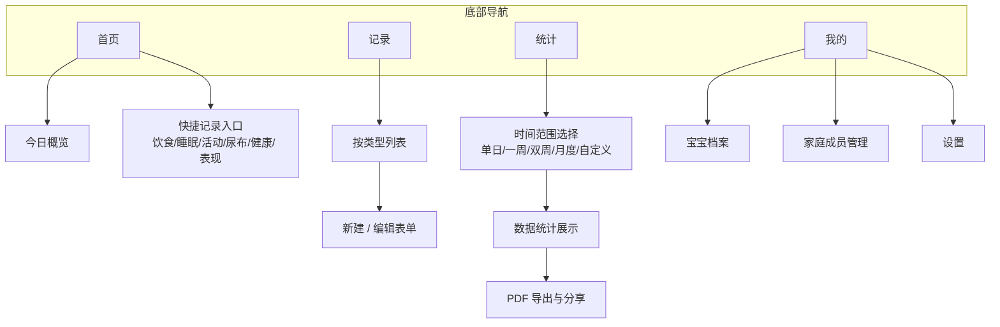

### 2.3 全局状态与关键规则

- **当前宝宝**：本地仅存多宝宝时的「当前选中」状态；新建记录均写入当前宝宝 ID。
- **时间基准**：记录以用户选择的「发生时间」为准；补录时默认当前时间，可改为历史时间。
- **今日定义**：以自然日 0:00–24:00（按系统时区）聚合首页「今日」统计。
- **返回与保存**：表单页左上角返回；未保存离开时弹出确认（可选实现，MVP 建议保留防误触）。

### 2.4 核心功能交互流程

以下为主路径步骤，异常与边界（网络不可用、存储满等）在实现层按第六、七章非功能要求处理。

#### 2.4.0 用户登录与注册

MVP 阶段仅支持**手机号**方式注册与登录，不支持微信/Apple 等第三方登录。

**登录方式**：
- **验证码登录**（默认）：输入手机号 → 获取短信验证码（60 秒倒计时）→ 填入验证码 → 登录；首次使用（未注册）时，登录即注册。
- **密码登录**（可选）：输入手机号 + 密码 → 登录；密码由首次注册后在「我的」中设置。

**业务规则**：
- 手机号格式校验：大陆 11 位手机号，不合法时禁用「获取验证码」按钮并给出红色提示。
- 登录成功后，若检测到**无宝宝档案** → 跳转引导页（2.4.1）；若有档案 → 直接进入首页。

**交互示意图**

```
┌──────────────────────────────┐
│  登录页                       │
│ ┌────────────────────────┐   │
│ │  [icon] 敏宝日记  插画区域 │   │
│ └────────────────────────┘   │
│                               │
│ [验证码登录]  [密码登录]        │ ← Tab 切换
│                               │
│ 手机号   [________________]   │
│ 验证码   [______] [获取验证码] │
│                               │
│ ┌────────────────────────┐   │
│ │         登  录          │   │
│ └────────────────────────┘   │
│                               │
│  没有账号？注册               │
└──────────────────────────────┘
```

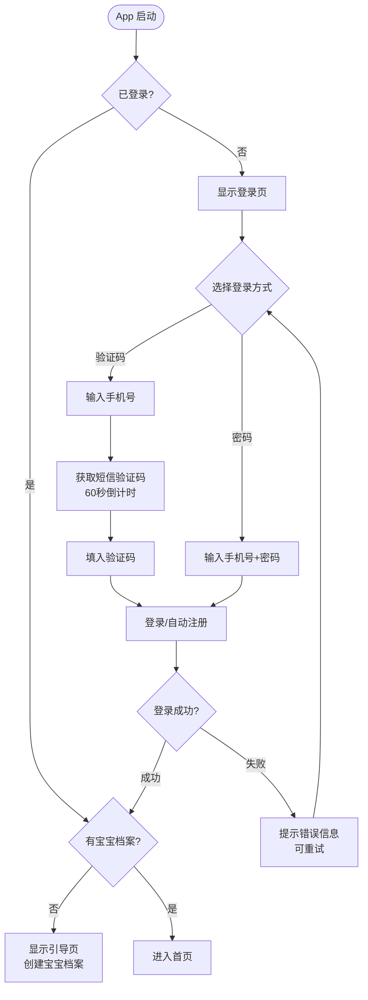

#### 2.4.1 首次使用：创建档案并进入首页

1. 启动 App，检测到**无宝宝档案** → 展示引导页（价值说明 +「开始创建」）。
2. 进入档案表单：**必填**姓名、出生日期、性别、过敏类型（默认「牛奶蛋白过敏」，界面不显示 CMPA 英文缩写）；**可选**过敏程度（轻度/中度/重度/未知）。
3. 点击「保存」→ 校验通过后写入本地数据库 → **进入首页**，首页展示空状态或「今日尚无记录」提示。
4. 若已有档案（非首次启动）→ 直接进入首页，并加载当日摘要。

**简化说明**：身高、体重、头围等生长数据不在注册页强制要求，移至后续的「生长记录」模块填写。过敏程度增加「未知」选项，并提供 CDC 评分标准链接或提示框供用户后续自测。

**交互示意图**

```
┌──────────────────────┐      ┌──────────────────────┐
│     引导页            │      │    宝宝档案创建页      │
│ ┌──────────────────┐ │      │ ┌──────────────────┐ │
│ │   [icon] App Logo  │ │      │ │  ← 返回           │ │
│ │                  │ │      │ └──────────────────┘ │
│ │  专为敏宝家庭设计  │ │      │                      │
│ │  · 结构化记录     │ │  ──▶ │ 宝宝姓名  [________] │
│ │  · 一键生成报告   │ │      │ 出生日期  [日期选择器]│
│ │  · 就医沟通更顺畅 │ │      │ 性  别    ○男  ○女   │
│ └──────────────────┘ │      │ 过敏类型  [牛奶蛋白过敏 ▼] │
│                      │      │ 过敏程度  ○轻 ○中 ○重 ○未知 │
│ ┌──────────────────┐ │      │ ── 提示 ──────────  │
│ │   开始创建档案    │ │      │ [i] 不确定过敏程度？ │
│ └──────────────────┘ │      │ [查看 CDC 评分标准]  │
│                      │      │                      │
└──────────────────────┘      │ ┌──────────────────┐ │
                               │ │     保 存          │ │
                               │ └──────────────────┘ │
                               └──────────────────────┘
```

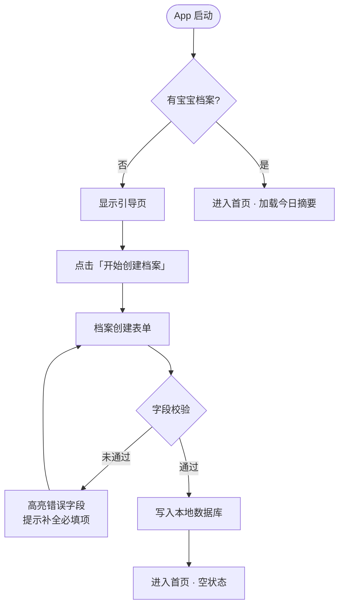

#### 2.4.2 从首页快速记录（以饮食为例）

首页快捷记录区采用 **2 行 × 4 列**（共 8 个入口）布局，入口顺序为：饮食、尿布、睡眠、活动（第一行）、生长、健康、医疗、表现（第二行）。标题栏右侧设「**更多 ›**」按钮，点击效果与底部 **+** 号相同，均打开"记录什么？"底部弹层（FAB Sheet），弹层中列出全部八大模块入口，方便用户选择非默认顺序的模块。

1. 首页点击「饮食」→ 进入**饮食记录表单**（可带当前时间预填）。
2. 在 Tab 页签中选择食物类型（奶粉 / 母乳 / 营养素 / 辅食），填写对应字段；奶粉模式下支持配比记录（与第三章 P0-002 字段一致）。
3. 点击「保存」→ 成功提示 → 返回首页或跳转「记录-饮食」列表（产品可选其一，建议**返回首页**以保持高频路径短）。

**交互示意图**

```
┌──────────────────────────────┐
│  首页（Tab 1）                │
│ ┌────────────────────────┐   │
│ │ 小宝  · 3月12天          │   │  ← 宝宝信息横幅（点击→档案）
│ │ 今日总奶量 480ml  睡眠 9h │   │
│ └────────────────────────┘   │
│                               │
│ 今日时间线                    │
│ ┌────────────────────────┐   │
│ │ 08:00  🍼 喂奶 120ml   │   │
│ │ 09:30  💤 小睡 1.5h    │   │
│ │ 今日尚无更多记录…       │   │
│ └────────────────────────┘   │
│                               │
│ 快捷记录        [更多 ›]       │  ← 核心操作区；「更多」= FAB 弹层
│ ┌────┐┌────┐┌────┐┌────┐    │
│ │🍼  ││🧷  ││💤  ││🏃  │    │
│ │饮食││尿布││睡眠││活动│    │
│ └────┘└────┘└────┘└────┘    │
│ ┌────┐┌────┐┌────┐┌────┐    │
│ │📏  ││💊  ││🩺  ││😊  │    │
│ │生长││健康││医疗││表现│    │
│ └────┘└────┘└────┘└────┘    │
│                               │
│ ┌────────────────────────┐   │
│ │  首页  │ 记录 │ 统计 │ 我的 │   │  ← 底部 Tab
│ └────────────────────────┘   │
└──────────────────────────────┘
```

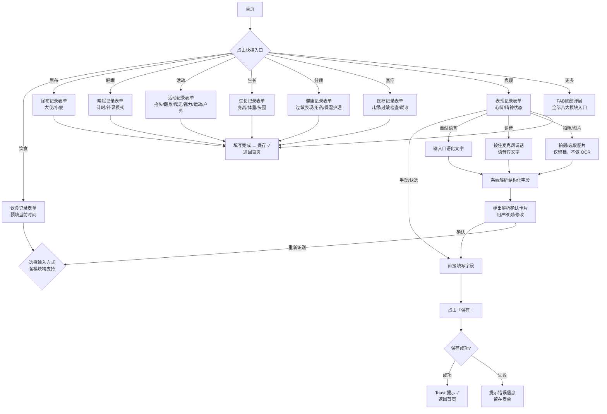

#### 2.4.3 睡眠记录（计时与补录）

**计时模式**：1）在睡眠表单点击「开始睡眠」→ 记录开始时间；2）再次进入或点击「结束睡眠」→ 写入结束时间，自动计算时长 → 保存。

**补录模式**：直接选择入睡与醒来时间（或选预设时长）→ 选睡眠质量 → 保存。

#### 2.4.4 活动

1. 从首页或「记录」进入 **活动** 表单。
2. 分项勾选：抬头、翻身、爬走、视力、运动、户外活动等。
3. 保存后归入当日时间线，可在「记录」Tab 按日查看。

#### 2.4.5 尿布

1. 从首页或「记录」进入 **尿布** 表单。
2. 分项记录：大便（次数、性状）、小便（次数、尿湿程度）。
3. 支持拍照记录大便性状（仅留档，不做 OCR）。
4. 保存后归入当日时间线。

#### 2.4.6 健康

1. 从首页或「记录」进入 **健康** 表单。
2. 分项记录：过敏表现（皮疹、呕吐、腹泻等）、用药情况、保湿护理。
3. 支持拍照记录表现情况。
4. 保存后归入当日时间线。

#### 2.4.7 表现

1. 从首页或「记录」进入 **表现** 表单。
2. 选择心情（开心/一般/低落）、精神状态（活跃/正常/安静）。
3. 保存后归入当日时间线。

#### 2.4.8 生长数据

1. 「记录」→「生长」或首页快捷入口 → 表单填写测量日期、身高、体重、头围、测量机构（可选）。
2. 可选「上传测量报告照片」作为附件 → 保存。
3. 保存后若数据点 ≥2，在生长详情或报告模块中可绘制曲线（与第三章 P0-005 一致）。

#### 2.4.9 医疗记录

1. 进入医疗记录表单：检查类型、日期、机构、结果摘要、诊断结论（字段与第三章 P0-006 一致）。
2. 支持**拍照上传**病历 / 报告图 → 与结构化字段一并保存为一条记录。
3. 可选填写「下次复查」日期 → 写入本地提醒（若 MVP 实现提醒权限）。

#### 2.4.10 查看统计与导出

1. **报告** Tab → 选择时间范围（单日 / 一周 / 双周 / 月度 / 自定义）。
2. 默认生成**综合报告**，包含全部已记录模块，无需手动勾选模块。
3. 点击「生成报告」→ 本地渲染 PDF → **预览页**。
4. 预览页操作：**保存到文件**、**系统分享**（微信、邮件、隔空投送等由系统面板提供）。
5. 历史报告列表中点击任意历史记录 → 打开包含全部模块的**完整综合报告**模态弹层。

#### 2.4.11 编辑宝宝档案与设置

1. **我的** → 点击宝宝卡片 → 进入档案编辑，修改后保存即全局生效（含统计报告封面信息）。
2. **家庭成员管理**：邀请家庭成员加入，设置权限（管理员/普通成员）。
3. **大字体模式**开关立即生效，无需重启。
4. **清空本机数据**：二次确认后删除本地库（与第五章数据策略一致）。

### 2.5 与后续章节的对应关系

- **功能字段与业务规则**：见 **第三章** 各模块说明。
- **视觉、触控与输入控件的细化**：见 **第四章**。
- **数据表与存储**：见 **第五章**。

---

## 三、功能需求详细描述

### 3.1 宝宝档案管理模块

**功能 ID：P0-001**

**功能名称**：宝宝基础档案管理

**功能描述**：创建和管理敏宝的基础信息档案，包括过敏类型、过敏程度等核心数据

**输入项**：宝宝姓名、出生日期、性别、过敏类型（默认为「牛奶蛋白过敏」，界面展示中文名称）、过敏程度（可选，含「未知」选项）

**输出项**：标准化的宝宝档案信息

**优先级**：P0

**操作流程**：

1. 首次打开 APP 时引导用户创建宝宝档案

2. 提供预设的过敏类型选项（牛奶蛋白过敏、其他食物过敏等），UI 中展示中文名称

3. 过敏程度采用滑动选择器（轻度 / 中度 / 重度 / 未知），选择「未知」时显示 CDC 评分标准链接

4. **身高、体重、头围等生长数据不在注册页强制要求**，移至「生长记录」模块填写

5. 支持档案信息的编辑和修改

**业务规则**：

- **本版 MVP 支持单个宝宝档案**；多宝宝管理（支持二胎家庭）留到后续迭代版本实现

- 档案信息采用结构化存储，便于后续数据分析

- 过敏程度「未知」不影响后续记录，可后续补充

- **家庭共享**：创建档案的用户为「管理员」，可邀请家庭成员共同管理

**交互示意图**

```
┌──────────────────────────────┐     ┌──────────────────────────────┐
│  我的（Tab 4）                │     │  宝宝档案编辑页               │
│ ┌────────────────────────┐   │     │ ┌────────────────────────┐   │
│ │         我的            │   │     │ │ ← 返回     编辑档案     │   │
│ └────────────────────────┘   │     │ └────────────────────────┘   │
│                               │     │                               │
│ ┌────────────────────────┐   │     │ 宝宝姓名  [小宝_________]    │
│ │ [icon] 小宝  3个月12天  │   │     │ 出生日期  [2025-12-16  ▼]   │
│ │ 牛奶蛋白过敏 · 中度     │   │  ──▶│ 性  别    ●男  ○女           │
│ │ 点击编辑档案 ›          │   │     │ 过敏类型  [牛奶蛋白过敏 ▼]  │
│ └────────────────────────┘   │     │ 过敏程度  ○轻度 ●中度        │
│                               │     │           ○重度 ○未知         │
│ ── 设置 ──────────────────── │     │ ── 提示 ──────────────────── │
│ 大字体模式    ◉ 开启          │     │ [i] 不确定过敏程度？          │
│ 家庭成员管理  →               │     │ [查看 CDC 评分标准]           │
│                               │     │                               │
│ ── 危险操作 ───────────────  │     │ ┌────────────────────────┐   │
│ 清空本机数据  →               │     │ │         保  存          │   │
│                               │     │ └────────────────────────┘   │
│ ── 关于 ───────────────────  │     └──────────────────────────────┘
│ 版本号        v1.0.0          │
│ 关于敏宝日记  →               │
│                               │
│ ┌────────────────────────┐   │
│ │  首页  │ 记录 │ 报告 │ 我的 │   │
│ └────────────────────────┘   │
└──────────────────────────────┘
```

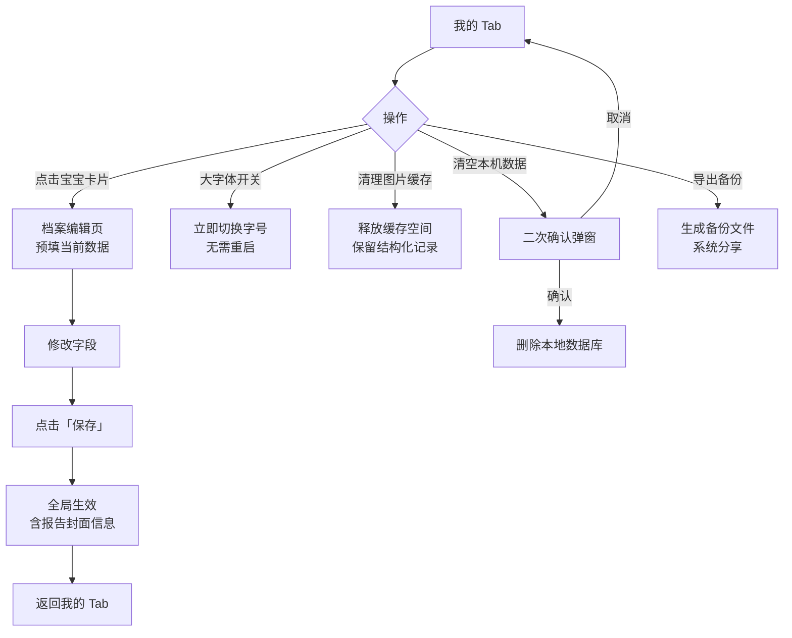

### 3.2 日常记录模块

**记录 Tab 页面示意图**

```
┌──────────────────────────────┐
│  记录（Tab 2）                │
│  ← 筛选: [全部 ▼] [日期 ▼]   │  ← 顶部筛选栏
│ ──────────────────────────── │
│  📅 2026年3月28日             │  ← 日期分组
│  ┌────────────────────────┐  │
│  │ 🍼 饮食  08:00  120ml  │  │  ← 记录卡片（可点击编辑）
│  │ 💤 睡眠  09:30  1.5h   │  │
│  │ 😊 状态  11:00  大便×1 │  │
│  └────────────────────────┘  │
│  📅 2026年3月27日             │
│  ┌────────────────────────┐  │
│  │ 🍼 饮食  08:30  150ml  │  │
│  │ …                      │  │
│  └────────────────────────┘  │
│                               │
│  ╔══════════════════════╗    │
│  ║   ＋ 新增记录         ║    │  ← 悬浮操作按钮
│  ╚══════════════════════╝    │
│ ┌────────────────────────┐   │
│ │  首页  │ 记录 │ 报告 │ 我的 │   │
│ └────────────────────────┘   │
└──────────────────────────────┘
```

**记录 Tab 与各子模块交互流程**

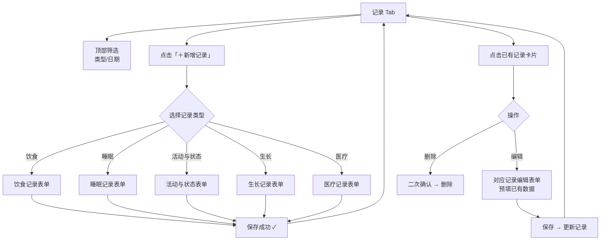

#### 3.2.1 饮食记录子模块

**功能 ID：P0-002**

**功能名称**：敏宝饮食记录

**功能描述**：记录敏宝的转奶过程、奶量、营养素补充和辅食添加情况

**输入项**：转奶阶段、奶粉类型、奶量、喂养时间、营养素类型和剂量、辅食种类和分量

**输出项**：完整的饮食记录数据，支持按时间维度查询

**优先级**：P0

**转奶记录功能**：

- 采用进度条展示转奶阶段（氨基酸奶粉 → 深度水解奶粉 → 适度水解奶粉 → 普通奶），界面全程显示中文名称，不展示 AAF/eHF/pHF 等英文缩写

- 记录每次转奶的日期、新旧奶粉比例、转奶阶段（名称均以中文展示）

- **支持配比记录**：需支持记录每一顿奶中不同奶粉的勺数或比例（如 3 勺深度水解 + 1 勺氨基酸）

- 自动计算并显示当前转奶进度百分比

- 支持转奶过程的回退操作（过敏反应时使用）

**引入方案参考**：

- 内置行业专家（如崔玉涛）的转奶方案供用户选择

- 支持用户自定义转奶周期和观察天数

**异常处理机制**：

- 转奶过程中若出现拉肚子、湿疹等异常，系统需支持记录并引导用户退回到上一个成功的阶段

- 提供异常记录和回退操作的完整历史追溯

**转奶核心业务规则**（参考中华医学会儿科学分会《中国婴幼儿牛奶蛋白过敏诊治循证建议》2013 及 ESPGHAN 2012）：

> ⚠️ 以下规则均为**临床参考默认值**，App 中所有相关提示须附注「请以就诊医生建议为准」。

**一、标准转奶路径**

```
氨基酸奶粉（稳定期 6～12 个月）
    ↓  2～4 周混合过渡期
深度水解奶粉（稳定期 3～6 个月）
    ↓  2～4 周混合过渡期
适度水解奶粉（稳定期 3 个月）
    ↓  2～4 周混合过渡期
普通奶粉（达成免疫耐受）
```

**二、混合过渡比例**（每 2～3 天调整一次）

| 天数     | 新奶粉占比 | 旧：新 比例 |
| -------- | ---------- | ----------- |
| Day 1～2 | 25%        | 3 : 1       |
| Day 3～4 | 50%        | 1 : 1       |
| Day 5～6 | 75%        | 1 : 3       |
| Day 7+   | 100%       | 0 : 1       |

**三、可以升级到下一阶段的条件（全部满足）**

1. 已在当前阶段完成最低稳定期（参见路径图各阶段时长）
2. **连续无表现 ≥ 14 天**（皮肤、消化道、呼吸道均无可疑反应）
3. 宝宝生长发育正常，体重增长达标

**四、转奶进度百分比计算规则**

- 进度 = 各阶段加权无表现天数之和 / 总目标天数
- 阶段权重：氨基酸奶粉阶段占 40%、深度水解阶段占 30%、适度水解阶段占 20%、普通奶粉过渡期占 10%
- **进度不自动累加**：仅在家长当日主动记录「今日无表现」后才计入无表现天数
- 进度达到 100% 后，仅显示「可咨询医生评估是否升级」提示，系统不自动触发升级操作

**五、发生过敏反应时的回退规则**

| 表现严重程度 | 判断标准                        | 回退操作                           | 等待重试时间                  |
| ------------ | ------------------------------- | ---------------------------------- | ----------------------------- |
| 轻度         | 轻微皮疹（< 体表 5%）、轻微腹痛 | 退回上一步混合比例（如 75% → 50%） | 表现消失 ≥ 48h 后可继续推进   |
| 中度         | 较广泛皮疹、呕吐 ≥ 2 次、腹泻   | 退回上一完整阶段（100% 旧奶粉）    | 无表现 ≥ 2 周后重新开始过渡期 |
| 重度         | 荨麻疹 + 血管性水肿、呼吸困难   | 立即退回氨基酸奶粉                 | ≥ 3 个月，需重新医学评估      |

- 中度及以上回退时，当前阶段内进度清零（退回阶段重新计算）
- App 不自动触发回退——用户需主动操作「记录过敏反应」并选择「执行回退」

**饮食记录整体设计**：

饮食记录表单采用 **Tab 页签**设计，将四大类饮食分开记录，每次仅记录一种食物类型：

| Tab | 内容 |
|-----|------|
| 奶粉 | 奶粉类型选择 + 配比勺数 + 奶量 |
| 母乳 | 哺乳侧（左/右/双侧）+ 时长 |
| 营养素 | 维生素D/铁/益生菌等剂量 |
| 辅食 | 食物名称 + 新食物标记 |

顶部导航栏移除语音/自然语言快捷入口按钮，页面内不再提供「自然语言」「语音」「拍照留档」输入模式。

**奶粉 Tab 功能**：

- **奶粉类型多选**：氨基酸奶粉 / 深度水解奶粉 / 适度水解奶粉 / 普通奶粉，支持同时选中多种类型（转奶过渡期场景）；未选中的奶粉类型，对应的配比输入行自动隐藏；取消选中时自动重置对应勺数为 0

- **深度水解奶粉 · 含乳糖选项**：选中「深度水解奶粉」后，在其配比行下方额外展示「含乳糖」勾选框（部分深度水解奶粉含乳糖，与不含乳糖的配方在临床意义上有所区分）；取消选中「深度水解奶粉」时，「含乳糖」勾选框随之隐藏并重置为未选状态

- **配比记录**：支持记录每一顿奶中不同奶粉的勺数（如 3 勺深度水解 + 1 勺氨基酸），系统自动计算并展示各奶粉比例百分比（如 75% : 25%）

- 奶量录入：提供常用快选（60ml、90ml、120ml、150ml、180ml）及步进器调整，自动计算 24 小时总奶量

**母乳 Tab 功能**：

- 记录哺乳侧（左侧 / 右侧 / 双侧）和哺乳时长

**营养素 Tab 功能**：

- 预设常见营养素类型：维生素 D、铁、益生菌、益生元、钙等

- 手动勾选并填写剂量；提供周期提醒功能（**后续迭代**，本版不实现）

**辅食 Tab 功能**：

- 支持新食物标记和过敏风险提示

- 记录辅食种类（手动输入或从历史记录选择）

- 提供常见辅食营养成分参考数据

**辅食新食物过敏排查业务规则**（参考中国营养学会《中国居民膳食指南 2022》婴幼儿喂养章节、中华医学会儿科学分会《婴幼儿过敏性疾病综合管理专家共识》2022）：

> ⚠️ 以下规则均为**临床参考默认值**，App 中所有过敏风险提示须附注「请以就诊医生建议为准」。

**一、新食物触发条件**

- **首次记录**：食物名称/品类在当前宝宝历史记录中从未出现 → 系统自动开启 **5 天观察期**并标记为「新食物 🟡」
- **八大高风险过敏原**（牛奶、鸡蛋、花生、坚果、鱼类、甲壳类、小麦、大豆）首次记录时，额外展示风险提示卡片（建议单独引入、白天引入、引入后在家观察 2 小时）
- **每次只引入一种新食物**：系统仅标记一个新食物观察期为「活跃」，若同时记录多种新食物，系统提示「建议每次只引入一种新食物，便于排查过敏来源」，但不强制阻止

**二、观察期状态机**

```
[未引入]
  ↓ 首次记录
[观察期中 🟡]  默认 5 天，可在 3～7 天间手动调整
  ↓ 观察期内无任何可疑表现记录 + 用户确认
[已耐受 ✅]
  ↓ 出现可疑过敏表现
[疑似过敏 🟠]
  ↓ 第 2 次引入仍出现表现
[确认过敏 🔴]  建议就医，6 个月内不主动引入
```

**三、观察期结束的转正条件**

观察期内满足以下全部条件，系统提示「观察期结束，是否确认无异常？」，用户主动确认后转为「已耐受」：

1. 已过完设定的观察天数（默认 5 天）
2. 期间无任何已记录的皮肤/消化道/呼吸道表现记录关联到该食物
3. 用户点击确认（系统不自动转正）

**四、发现疑似过敏后的处理规则**

| 情景                              | 操作                                   | 等待重试时间                         |
| --------------------------------- | -------------------------------------- | ------------------------------------ |
| 首次出现轻中度可疑表现            | 暂停该食物；系统标记「疑似过敏 🟠」    | 无表现 ≥ 4 周后可在白天少量重新引入  |
| 重新引入仍有反应                  | 标记「确认过敏 🔴」；建议就医          | 6 个月内不主动引入，后续可由医生评估 |
| 严重过敏反应（呼吸困难/全身水肿） | 触发「立即就医」提示弹窗（置顶强提示） | 不建议自行重新引入，须医生评估       |

**五、UI 标记规范**

| 状态         | 颜色/图标        | 卡片文案示例                                           |
| ------------ | ---------------- | ------------------------------------------------------ |
| 新食物观察期 | 🟡 黄色边框 + ⚠️ | 「南瓜泥观察期第 3 天，还有 2 天结束，今天有异常吗？」 |
| 已耐受       | 🟢 绿色 + ✅     | 正常显示，无特殊标记                                   |
| 疑似过敏     | 🟠 橙色 + ⚠️     | 「南瓜泥（疑似过敏，建议 4 周后再尝试）」              |
| 确认过敏     | 🔴 红色 + 🚫     | 「南瓜泥（疑似过敏，建议就医确认）」                   |

**交互示意图**

```
┌──────────────────────────────┐
│  饮食记录                     │
│ ┌────────────────────────┐   │
│ │ ← 返回      饮食记录    │   │
│ └────────────────────────┘   │
│                               │
│ ┌──────Tab页签──────────────┐ │
│ │[奶粉] [母乳] [营养素][辅食]│ │
│ └────────────────────────┘   │
│                               │
│ 喂养时间   [08:30  ▼]         │
│                               │
│ ── 奶粉 Tab（默认选中）──── │
│ ☑氨基酸  ☑深度水解           │  ← 多选，可同时选中多种
│ ☐适度水解 ☐普通奶粉          │
│                               │
│ ── 配比记录 ──────────────  │
│ 氨基酸奶粉  [3] 勺           │  ← 选中的奶粉显示配比行
│ 深度水解    [1] 勺           │
│   ☑ 含乳糖                    │  ← 选深度水解时出现
│ → 共4勺 75%:25%              │
│                               │
│ 奶  量   [60][90][120][150]  │
│          [−] 120ml [＋]      │
│                               │
│ ┌────────────────────────┐   │
│ │         保  存          │   │
│ └────────────────────────┘   │
└──────────────────────────────┘
```

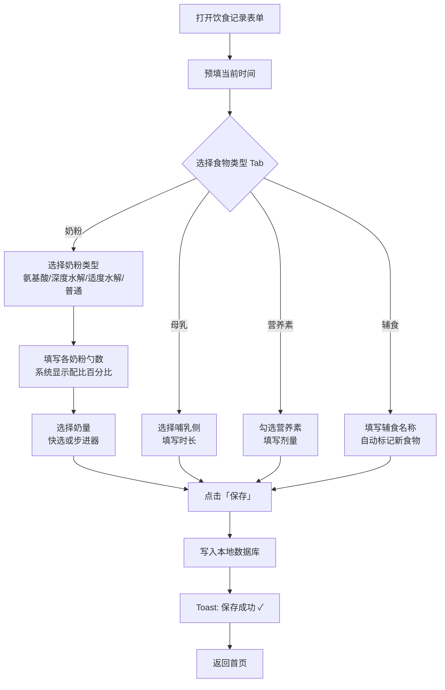

#### 3.2.2 活动记录子模块

**功能 ID：P0-003**

**功能名称**：活动记录

**功能描述**：记录宝宝的运动发育和活动情况

**输入项**：活动类型（抬头、翻身、爬走、视力、运动、户外活动等）、活动时长、活动描述

**输出项**：结构化的活动记录数据

**优先级**：P0

**活动类型**：

- **抬头练习**：记录抬头时长、状态
- **翻身练习**：记录翻身次数、方向
- **爬走练习**：记录爬行/学步时长
- **视力活动**：追视、看卡片等
- **运动活动**：被动操、游泳等
- **户外活动**：晒太阳、散步等

#### 3.2.3 尿布记录子模块

**功能 ID：P0-004**

**功能名称**：尿布记录

**功能描述**：记录宝宝的大便、小便情况

**输入项**：大便次数、大便性状、小便次数、尿湿程度

**输出项**：结构化的尿布记录数据

**优先级**：P0

**大便记录功能**：

- 采用选项式勾选设计，避免打字输入

- 记录排便次数、性状（稀便 / 软便 / 便秘 / 血便等）

- 支持拍照记录（上传便便图片，**仅做留档，不做 OCR 识别**）；也可语音快速说明（「便了 2 次，稀便」）→ 解析确认后保存

- 提供 Bristol 大便分级对照图作为参考

**小便记录功能**：

- 记录换尿布次数和尿湿程度

- 尿湿程度记录供家长参考；**MVP 不实现预警推送**（预警功能留到后续迭代）

#### 3.2.4 健康记录子模块

**功能 ID：P0-005**

**功能名称**：健康记录

**功能描述**：记录宝宝的过敏表现、用药情况和护理情况

**输入项**：过敏表现类型、严重程度、用药情况、保湿护理记录

**输出项**：结构化的健康记录数据

**优先级**：P0

**过敏表现记录功能**：

- 预设常见过敏表现：皮疹、呕吐、腹泻、咳嗽、喘息、湿疹等

- 采用勾选方式选择出现的**表现**；也可语音描述（「今天有皮疹，中度」）→ 解析**表现**类型和严重程度 → 确认

- 记录严重程度（轻度 / 中度 / 重度）

- 支持拍照记录**表现**情况（皮疹图片 → 与**表现**记录一并存储）

**用药记录功能**：

- 记录用药名称、剂量、频次

- 支持拍照药品标签（仅留档，不做 OCR）

> **2026-08-20 更新**：用药升级为**独立记录模块**（F14-medication，P1-004）——宝宝级药品清单（常用药库+自定义）+ 单次服药打卡 + 按日历史 + 首页今日用药卡片；服药提醒为后续版本。本节"健康记录附属用药字段"保留不动（随健康记录存 JSON），详见 `docs/features/F14-medication.md`。

**保湿护理功能**：

- 记录保湿护理时间、使用产品

#### 3.2.5 表现记录子模块

**功能 ID：P0-006**

**功能名称**：表现记录

**功能描述**：记录宝宝的心情和精神状态

**输入项**：心情状态、精神状态

**输出项**：结构化的表现记录数据

**优先级**：P0

**心情记录功能**：

- 采用简单的情绪图标选择（😊 开心 / 😐 一般 / 😢 低落）

- 支持自然语言输入

**精神状态记录功能**：

- 记录活动量（安静 / 正常 / 活跃）

- 支持简短的状态描述

#### 3.2.6 睡眠记录子模块

**功能 ID：P0-007**

**功能名称**：睡眠状态记录

**功能描述**：记录宝宝的睡眠时长、入睡 / 醒来时间和睡眠质量

**输入项**：入睡时间、醒来时间、睡眠时长、睡眠质量描述

**输出项**：睡眠记录统计报表和趋势分析

**优先级**：P0

**操作流程**：

1. 支持一键开启 / 结束睡眠记录（自动计算睡眠时长）

2. 提供预设的睡眠时长选项（0.5h/1h/1.5h/2h 等）

3. 支持手动补录历史睡眠记录

4. 记录睡眠质量（良好 / 一般 / 较差）

**计时模式中断与异常态处理规则**：

> App 在计时进行中可能被切后台或被系统杀死，需保证数据不丢失并在下次打开时提供明确引导。

1. **数据持久化**：点击「开始睡眠」后，立即将**开始时间戳**写入本地数据库（状态标记为 `sleeping`）；计时数值在 App 每次进入前台时根据当前时间与开始时间差实时计算，不依赖内存维持。

2. **重新进入时的状态恢复**：App 冷启动或从后台唤醒时，检测是否存在 `sleeping` 状态的未结束记录：
   - 若存在 → **首页顶部显示「进行中」横幅**（显示已睡时长），**睡眠快捷入口**变为「⏹ 结束睡眠」状态，优先引导用户操作
   - 若不存在 → 正常加载今日摘要，无额外提示

3. **超时自动异常标记**：计时开始后超过 **12 小时**仍未结束，系统自动将该记录标记为 `status = abnormal`，并在下次打开 App 时显示提示卡片：「有一条睡眠记录持续超过 12 小时，可能是忘记结束，请手动修正」；用户可选择「修改结束时间」或「标记为异常记录」。

4. **结束睡眠流程**：点击「结束睡眠」→ 写入结束时间戳 → 状态更新为 `completed` → 自动计算时长 → 弹出睡眠质量选择弹窗（可跳过）→ 保存成功 → 返回首页。

**输入方式**：

- **手动 / 快选**：时间选择器选择入睡和醒来时间，快速选择常见时段

- **自然语言**：输入如「昨晚 22 点半睡着，早上 8 点醒」→ 系统解析入睡时间、醒来时间、时长 → 解析确认卡片 → 确认保存

- **语音**：说出睡眠情况 → 语音转文字 → 解析 → 确认

- **拍照 / 图片**：拍摄纸质睡眠记录表 → **仅做图片留档，不做 OCR 识别**；时间字段需用户手动输入

**交互设计**：

- 采用时间选择器选择入睡和醒来时间

- 支持快速选择常见的睡眠时段（如夜间睡眠、下午小睡）

- 自动计算并显示累计睡眠时间

**交互示意图**

```
┌──────────────────────────────┐    ┌──────────────────────────────┐
│  睡眠记录（计时模式）          │    │  睡眠记录（补录模式）           │
│ ┌────────────────────────┐   │    │ ┌────────────────────────┐   │
│ │ ✕ 取消      睡眠记录    │   │    │ │ ✕ 取消      睡眠记录    │   │
│ └────────────────────────┘   │    │ └────────────────────────┘   │
│                               │    │                               │
│  ┌──────────────────────┐    │    │ ── 输入方式 ────────────────  │
│  │   💤 宝宝睡着了       │    │    │ [📝 手动] [💬 自然语言]       │
│  │   已睡  2h 30m        │    │    │ [🎤 语音] [📷 拍照/图片]      │
│  │   开始  09:30         │    │    │                               │
│  └──────────────────────┘    │    │ 入睡时间  [22:30  ▼]          │
│                               │    │ 醒来时间  [08:00  ▼]          │
│  ┌──────────────────────┐    │    │ 睡眠时长  自动计算  9h 30m    │
│  │   ⏹ 结束睡眠         │    │    │                               │
│  └──────────────────────┘    │    │ 睡眠时段  ○夜间  ○上午  ○下午 │
│                               │    │                               │
│  模式切换: [计时] [补录]       │    │ 睡眠质量  😴良好 😐一般 😿较差 │
└──────────────────────────────┘    │                               │
                                     │ 备  注  [__________________]  │
                                     │                               │
                                     │  ┌──────────────────────┐    │
                                     │  │       保  存           │    │
                                     │  └──────────────────────┘    │
                                     └──────────────────────────────┘
```

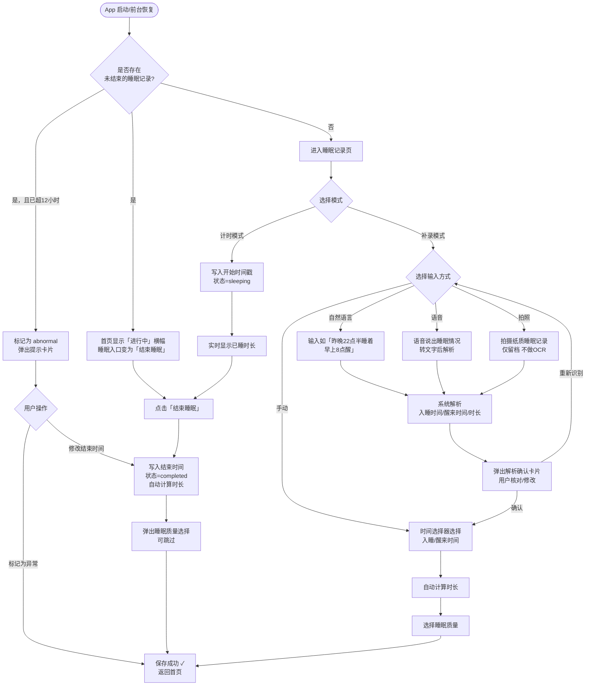

#### 3.2.3 活动与状态记录子模块

**功能 ID：P0-004**

**功能名称**：日常活动与状态记录

**功能描述**：记录宝宝的排便、排尿、精神状态和过敏表现

**输入项**：排便次数、性状、排尿情况、精神状态、过敏表现

**输出项**：结构化的日常状态记录数据

**优先级**：P0

**排便记录功能**：

- 采用选项式勾选设计，避免打字输入

- 记录排便次数、性状（稀便 / 软便 / 便秘 / 血便等）

- 支持拍照记录（上传便便图片，**仅做留档，不做 OCR 识别**）；也可语音快速说明（「便了 2 次，稀便」）→ 解析确认后保存

- 提供 Bristol 大便分级对照图作为参考

**排尿记录功能**：

- 记录换尿布次数和尿湿程度

- 支持自动关联到换尿布操作

- 记录尿湿程度供家长参考；**MVP 不实现预警推送**（预警功能留到后续迭代）

**精神状态记录功能**：

- 采用简单的情绪图标选择（笑脸 / 中性 / 哭脸）

- 记录活动量（安静 / 正常 / 活跃）

- 支持简短的状态描述；同样支持自然语言（「今天精神很好，很活跃」）→ 解析情绪和活动量 → 确认

**过敏表现记录功能**：

- 预设常见过敏表现：皮疹、呕吐、腹泻、咳嗽、喘息等

- 采用勾选方式选择出现的表现；也可语音描述（「今天有皮疹，中度」）→ 解析表现类型和严重程度 → 确认

- 记录表现严重程度（轻度 / 中度 / 重度）

- 支持拍照记录表现表现（皮疹图片 → 与表现记录一并存储）

**交互示意图**

```
┌──────────────────────────────┐
│  活动与状态记录               │
│ ┌────────────────────────┐   │
│ │ ✕ 取消     活动与状态   │   │  ← 导航栏
│ └────────────────────────┘   │
│ 记录时间   [11:00  ▼]         │
│                               │
│ ── 排便 ──────────────────── │
│ 次  数   [ - ] 1 [ + ]        │
│ 性  状   □稀便 □软便          │
│          □便秘 ☑血便          │  ← 多选勾选
│ 拍  照   📷 点击拍照           │
│ (Bristol 对照图 ?)            │  ← 帮助提示
│                               │
│ ── 排尿 ──────────────────── │
│ 换尿布   [ - ] 3 [ + ]        │
│ 尿湿程度 ○少 ●中 ○多          │
│                               │
│ ── 精神状态 ────────────────  │
│ 情  绪   😊 😐 😢             │  ← 图标单选
│ 活动量   ○安静 ●正常 ○活跃    │
│                               │
│ ── 过敏表现（有则勾选）────── │
│ □皮疹  □呕吐  □腹泻           │
│ □咳嗽  □喘息  □湿疹           │
│ 严重程度 ○轻度 ○中度 ○重度    │  ← 有表现时显示
│ 拍  照   📷 点击拍照           │
│                               │
│ ┌────────────────────────┐   │
│ │          保  存         │   │
│ └────────────────────────┘   │
└──────────────────────────────┘
```

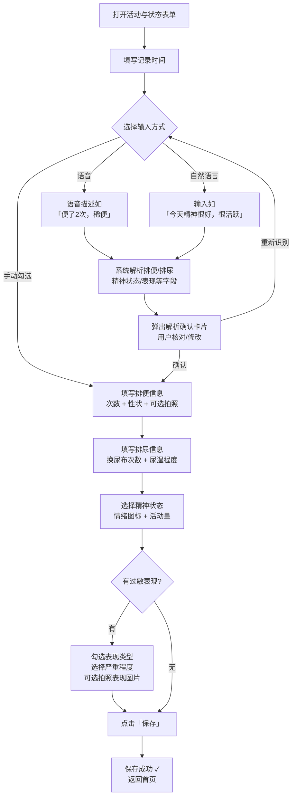

#### 3.2.7 生长发育记录子模块

**功能 ID：P0-008**

**功能名称**：生长发育数据记录

**功能描述**：记录宝宝的身高、体重、头围等生长数据，自动生成生长曲线

**输入项**：身高、体重、头围、测量日期、测量机构

**输出项**：生长数据报表和与 WHO 标准对比的生长曲线

**优先级**：P0

**操作流程**：

1. 提供标准的测量数据输入界面；支持以下输入方式：
   - **手动输入**：直接填写身高、体重、头围数字
   - **自然语言**：输入「今天量了身高 68cm，体重 7.5kg」→ 解析数值 → 确认
   - **语音**：说出测量数据 → 转文字 → 解析 → 确认
   - **拍照 / 图片**：拍摄儿保手册或测量报告单 → **仅做图片附件留档**；身高 / 体重 / 头围数值需用户手动输入（语音输入同样适用）

2. 拍照上传测量报告作为附件存档

3. 自动关联到最近的儿保检查记录

4. 实时生成生长曲线并与 WHO 标准对比

**业务规则**：

- 采用 WHO 0-1 岁儿童生长标准作为对比基准

- 计算并显示各项指标的百分位数（P3-P97）

- 本版仅展示生长曲线与百分位数，不做异常判断与预警（**后续迭代**）

- 多维度生长数据分析（体重 / 身高 / 头围的协调性）留到后续迭代

**交互示意图**

```
┌────────────────────────────────────┐
│  生长记录                           │
│ ┌──────────────────────────────┐   │
│ │ ✕ 取消       生长记录         │   │  ← 导航栏
│ └──────────────────────────────┘   │
│                                     │
│ 测量日期  [2026-03-28  ▼]           │  ← 日期选择器
│ 测量机构  [北京儿童医院___] (可选)   │
│                                     │
│ ── 测量数据 ─────────────────────  │
│ 身  高    [___] cm                  │  ← 数字键盘
│ 体  重    [___] kg                  │
│ 头  围    [___] cm                  │
│                                     │
│ 上传测量报告照片（可选）             │
│ ┌────────┐ ┌────────┐             │
│ │  📷    │ │  📷    │             │  ← 最多3张
│ │  添加  │ │  添加  │             │
│ └────────┘ └────────┘             │
│                                     │
│ ── 自动计算（保存后可见）──────────  │
│ 身高百分位  P[__]（WHO标准）        │
│ 体重百分位  P[__]（WHO标准）        │
│                                     │
│ ┌──────────────────────────────┐   │
│ │            保  存             │   │
│ └──────────────────────────────┘   │
└────────────────────────────────────┘
```

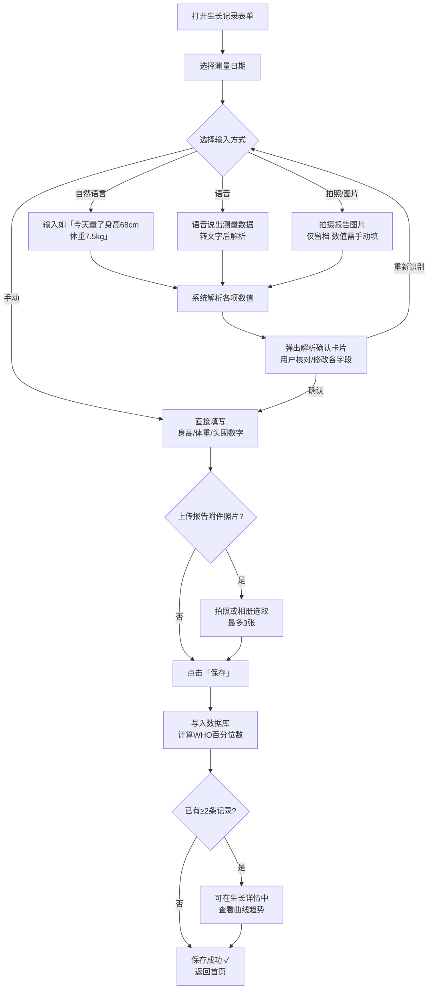

#### 3.2.8 医疗记录子模块

**功能 ID：P0-009**

**功能名称**：医疗检查和病历记录

**功能描述**：记录儿保检查、过敏科就诊、各项检查报告等医疗信息

**输入项**：检查类型、检查日期、检查机构、检查结果、诊断结论

**输出项**：结构化的医疗记录汇总和分类管理

**优先级**：P0

**儿保检查记录功能**：

- 预设常见儿保检查项目：听力筛查、视力检查、髋关节 B 超等

- 记录检查结果和医生建议；支持自然语言（「今天去儿保，身高 68 体重 7.5，医生说发育良好」）→ 解析各字段 → 确认

- 自动生成下次检查提醒

**过敏相关检查记录功能**：

- 支持记录过敏原检测结果（如皮肤点刺试验、血清特异性 IgE 等）

- 记录嗜碱性粒细胞活化试验（BAT）等生物标志物数据

- 提供检查结果的医学解读参考

**病历和处方记录功能**：

- ~~**拍照 / 图片输入**：拍摄病历、处方单、检查报告 → OCR 提取诊断结论、用药、下次复查日期等关键字段 → 解析确认卡片 → 确认保存（原始图片同步作为附件存储）~~

- **拍照 / 图片输入（2026-08-20 调整）**：拍摄或从相册上传病历、处方单、检查报告 → **仅图片留档保存（photo_ids），不做 OCR 识别**；诊断结论、用药、复查日期等结构化字段由用户手动 / 语音 / 自然语言填写

- **语音输入**：口述主要诊断和医嘱 → 转文字 → 解析字段 → 确认

- **自然语言输入**：输入「2026-03-28 北京儿童医院，牛奶蛋白过敏中度，继续氨基酸奶粉，下次 6 月复查」→ 解析 → 确认

- **手动输入**：直接填写结构化字段

- 记录用药情况和治疗效果

**交互示意图**

```
┌──────────────────────────────┐
│  医疗记录表单                 │
│ ┌────────────────────────┐   │
│ │ ✕ 取消      医疗记录    │   │  ← 导航栏
│ └────────────────────────┘   │
│                               │
│ 检查类型  [儿保检查 ▼]         │  ← 下拉选择
│           ○儿保 ○过敏检查      │
│           ○就诊 ○自定义        │
│                               │
│ 检查日期  [2026-03-28  ▼]     │
│ 检查机构  [_______________]   │
│                               │
│ ── 检查结果 ──────────────── │
│ 结果摘要  [_______________]   │
│           [_______________]   │  ← 多行文本
│ 诊断结论  [_______________]   │
│                               │
│ 用药情况  [_______________]   │  (可选)
│ 下次复查  [_______________]   │  (可选，填写后提醒)
│                               │
│ 上传病历/报告照片（可选）       │
│ ┌──────┐┌──────┐┌──────┐    │
│ │  📷  ││  📷  ││  ＋  │    │  ← 最多5张
│ └──────┘└──────┘└──────┘    │
│                               │
│ ┌────────────────────────┐   │
│ │         保  存          │   │
│ └────────────────────────┘   │
└──────────────────────────────┘
```

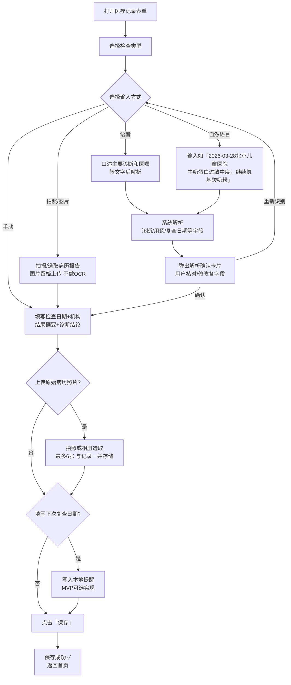

#### 3.2.9 统计报告生成子模块

**功能 ID：P0-010**

**功能名称**：统计报告生成与导出

**功能描述**：根据记录数据生成统计分析和 PDF 报告，用于就医和家庭管理

**输入项**：时间范围（单日/一周/双周/月度/自定义）

**报告类型**：固定为**综合报告**（包含所有已记录模块），不提供报告类型选择和包含模块勾选；历史报告点击后展示包含全部模块的完整综合报告

**输出项**：数据统计展示和符合医疗标准的 PDF 报告文件

**优先级**：P0

**时间范围选择**：

- 单日：查看某一特定日期的记录汇总
- 一周：最近 7 天的数据统计
- 双周：最近 14 天的数据统计
- 月度：最近 30 天的数据统计
- 自定义：用户自选起止日期

**报告内容结构**（参考 CMPA Baby APP）：

- 封面：宝宝基本信息、报告时间范围

- 目录：各章节内容导航

- 时间轴概览：每日主要事件和表现

- 详细记录：
  - 饮食记录汇总（奶量、辅食、营养素）

  - 睡眠记录统计（时长、质量）

  - 活动与状态记录（排便、精神状态）

  - 过敏表现记录（类型、程度、时间）

- 生长发育分析：身高体重头围的变化趋势

- 医疗检查汇总：历次检查结果

- 转奶进展追踪：当前转奶阶段和进展

**导出功能**：

- 支持 PDF 格式导出，文件大小控制在 20MB 以内

- 可选择导出内容范围（7 天 / 14 天 / 30 天 / 自定义）

- 支持通过微信、邮件等方式分享

- 提供打印功能，便于就医时使用

**交互示意图**

```
┌──────────────────────────────┐     ┌──────────────────────────────┐
│  报告 Tab                    │     │  历史报告 · 综合报告详情       │
│ ┌────────────────────────┐   │     │ ┌────────────────────────┐   │
│ │       报告              │   │     │ │ 小宝 · 综合报告  [✕]   │   │
│ └────────────────────────┘   │     │ └────────────────────────┘   │
│  生成综合报告 · 一键分享给医生│     │                               │
│                               │     │ ── 饮食 ────────────────── │
│ 时间范围                      │     │ 总奶量 3,360ml · 日均 480ml  │
│ [7天] [14天] [30天] [自定义]  │     │                               │
│                               │     │ ── 睡眠 ────────────────── │
│ 将生成综合报告，覆盖 7天，    │     │ 总睡眠 62.5h · 日均 8.9h    │
│ 包含全部模块约 4-6 页 PDF。   │     │                               │
│                               │     │ ── 活动/尿布/生长 ─────── │
│ ┌────────────────────────┐   │     │ 数据统计...                   │
│ │      生成报告            │   │ ──▶ │                               │
│ └────────────────────────┘   │     │ ── 健康/医疗/表现 ─────── │
│                               │     │ 本周无异常 ✓                  │
│ 历史报告                      │     │                               │
│ [综合报告 7天] [综合报告 30天]│     │ ┌──────────┐ ┌──────────┐   │
│                               │     │ │ 分享给医生│ │ 保存 PDF │   │
│ ┌────────────────────────┐   │     │ └──────────┘ └──────────┘   │
│ │  首页 │ 记录 │报告│ 我的│   │     └──────────────────────────────┘
│ └────────────────────────┘   │
└──────────────────────────────┘
```

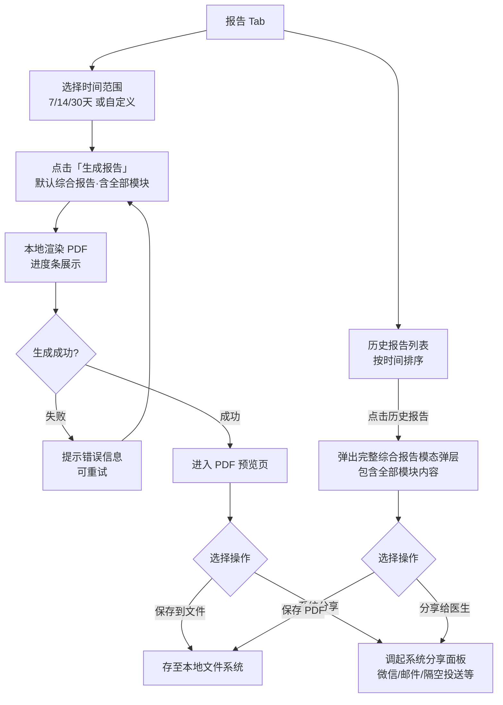

### 3.3 家庭共享与多成员协作模块

**功能 ID：P0-011**

**功能名称**：家庭共享与多成员协作

**功能描述**：支持家庭成员共同记录和查看同一宝宝的数据，实现多人协作

**输入项**：家庭成员邀请（手机号）、权限角色设置

**输出项**：家庭群组、成员权限管理

**优先级**：P0

**家庭群组功能**：

- 创建宝宝档案的用户自动成为「创建者」（最高权限，不可修改）

- **三级权限角色**：
  - **创建者**：管理所有成员、修改宝宝档案、查看和新增所有记录（唯一，不可转让）
  - **编辑者**：可查看和新增所有记录，适合主要照护者（如爸爸、奶奶）
  - **查看者**：只能浏览记录，无法新增或修改，适合远程关注的长辈

- **手机号邀请流程**：
  1. 「我的」页 → 「家庭成员管理」→ 「邀请家庭成员」按钮
  2. 输入对方手机号 → 选择权限角色（编辑者 / 查看者）→ 发送邀请
  3. 对方收到短信链接，点击后登录（或注册）即完成加入
  4. 邀请成功后，成员列表显示「待接受」状态，对方接受后更新为正式成员

- **成员管理操作**（仅创建者可操作）：
  - 修改已有成员的权限角色（编辑者 ↔ 查看者，不可修改创建者自身）
  - 移除成员（二次确认，移除后该成员立即失去访问权限）

**数据同步功能**：

- 所有记录实时同步到云端

- 支持离线记录，网络恢复后自动同步

- 同步冲突自动解决（以最后修改时间为准）

**成员标识功能**：

- 每条记录显示创建者信息（如「妈妈记录」「奶奶记录」）

- 支持查看记录的修改历史

**交互示意图**

```
┌──────────────────────────────┐     ┌──────────────────────────────┐
│  家庭成员管理                 │     │  邀请家庭成员                 │
│ ┌────────────────────────┐   │     │ ┌────────────────────────┐   │
│ │ ← 返回   家庭成员管理   │   │     │ │ ← 返回   邀请家庭成员   │   │
│ └────────────────────────┘   │     │ └────────────────────────┘   │
│                               │     │                               │
│ 当前成员（3人）               │     │ 手机号  [________________]   │
│ ┌────────────────────────┐   │     │                               │
│ │ [头像] 妈妈  创建者 ▶  │   │     │ 权限角色                     │
│ │ [头像] 爸爸  编辑者 ▶  │   │  ──▶│ ◉ 编辑者  可查看和新增记录  │
│ │ [头像] 外婆  查看者 ▶  │   │     │   查看者  只能浏览记录       │
│ └────────────────────────┘   │     │                               │
│                               │     │ 快速选择（通讯录联系人）     │
│ 等待接受（1人）               │     │ [爸爸] [奶奶] [姥姥]         │
│ ┌────────────────────────┐   │     │                               │
│ │ [头像] 奶奶  待接受 …  │   │     │ ┌────────────────────────┐   │
│ └────────────────────────┘   │     │ │         发送邀请         │   │
│                               │     │ └────────────────────────┘   │
│ ┌────────────────────────┐   │     └──────────────────────────────┘
│ │   + 邀请家庭成员        │   │
│ └────────────────────────┘   │
└──────────────────────────────┘
```

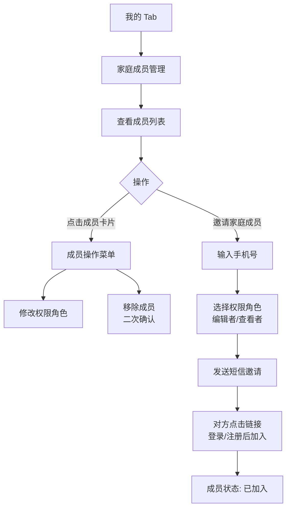

## 四、交互设计规范

### 4.1 视觉设计原则

**设计风格**：采用暖粉色系卡通亲切风格，主色调为玫瑰粉（#F87098），配合薄荷绿、暖黄、柔紫等辅助色，营造温馨、专业、易用的视觉体验。界面整体采用圆角卡片式布局，字体偏圆润，避免生硬感。

**色彩规范**：

- 主色：#F87098（玫瑰粉）- 用于主要操作按钮、关键强调、Tab 选中态
- 主色浅色：#FFF0F4 - 用于卡片背景、选中状态背景
- 主色中色：#F9A8C0 - 用于边框、分隔线
- 绿色辅助：#4CAF82 - 用于睡眠记录、成功状态、正向反馈
- 暖黄辅助：#DDB870 - 用于活动记录、警告提示
- 紫色辅助：#9B8ED8 - 用于生长记录、数据图表
- 警告红色：#E8507A / #F44 - 用于过敏提示、危险操作
- 背景色：#FBF5F7（极浅粉）- 全局页面背景
- 卡片背景：#FFFFFF - 内容卡片
- 文字主色：#3D2A2E - 深暖灰，避免纯黑造成生硬感
- 辅助文字：#9A8080 - 说明、时间等次要信息

**字体规范**：

- 系统字体：SF Pro（iOS）/ Roboto（Android）
- 一级标题：18-20pt，Bold（700）
- 二级标题：15-16pt，SemiBold（600）
- 正文内容：14pt，Regular（400）
- 辅助说明：12pt，Regular（400）
- 行高：1.5-1.6 倍行高，提升可读性

**图标规范**：

- **图标库**：采用 Lucide Icons（开源，SVG 格式，stroke 风格），不使用 emoji 替代功能性图标
- **全站图标化**：所有原使用 emoji 的功能性场景（警告提示、操作按钮、类型选择等）均替换为对应的 SVG 图标，确保跨平台一致性和色彩可控性
- **图标颜色**：使用 `currentColor` 继承或通过 `stroke` / `fill` 属性按语义赋色，与页面主题色保持一致；禁止使用系统 emoji 黄色系的默认配色
- 图标尺寸：16px（内联小图标）、20px（列表行内）、24px（常规操作）、32px（卡片图标）、48px（空状态、引导页大图）
- 图标描边宽度：`stroke-width: 2`（常规），重要警告场景可用 `2.5`
- 重要操作使用明确的表意图标（如删除用 trash-2、编辑用 pencil、警告用 triangle-alert）

### 4.2 导航设计

**底部 Tab 导航**：

- 采用底部 Tab 导航，符合拇指热区操作原则

- 最多设置 5 个 Tab，当前 MVP 设置 4 个

- 高度：49pt（标准），适配不同屏幕尺寸

- 图标与文字结合显示，确保可识别性

**Tab 设置**：

1. **首页**：显示今日概览和快速记录入口

2. **记录**：所有记录功能的汇总页面

3. **报告**：报告生成和历史报告查看

4. **我的**：宝宝档案、设置等个人信息

**页面层级**：

- 采用扁平化设计，核心功能不超过 3 级

- 主要操作路径不超过 3 次点击

- 复杂操作采用模态弹窗或新页面

### 4.3 交互原则

**极简交互设计**：

1. **认知减负**：单个界面核心功能不超过 5 个，遵循 7±2 记忆法则

2. **操作简化**：核心操作不超过 2 步，减少键盘输入

3. **渐进式披露**：次要功能通过二级界面展开

4. **视觉层级明确**：通过字号、色阶区分信息优先级

**响应式设计**：

- 支持多种屏幕尺寸（375px、414px、768px 等）

- 采用 Flex 布局实现自适应

- 图片和图标支持自动缩放

- 确保在不同设备上的视觉一致性

**触控目标设计**：

- 核心功能图标直径不小于 72dp，符合 48×48dp 的触控标准

- 按钮高度不低于 44dp，确保触控准确性

- 采用大字体模式（可一键切换），适配祖辈用户

- 支持手势操作（滑动、长按、双击等）

### 4.4 输入方式设计

**多样化输入支持**：所有涉及内容录入的功能均同时提供以下五种输入方式，用户可按习惯随时切换，系统负责将识别结果转换为标准结构化格式并经用户确认后写入。

1. **手动输入**：标准的文本输入框，支持自动完成和纠错

2. **自然语言输入**：用户在任意文本框内以口语化文字描述（如输入「早上八点喂了 120ml 深度水解」），系统自动解析为结构化字段（喂养时间 08:00、奶粉类型：深度水解奶粉、奶量：120ml），并在「解析确认卡片」中呈现预填结果，用户确认或修正后再保存

3. **语音输入**：按住麦克风按钮，说出记录内容，系统进行语音转文字后再走「自然语言解析 → 确认」流程；适合单手操作或祖辈用户

4. **拍照 / 图片输入**（~~分两种用途，边界明确~~ 2026-08-20 起统一为纯图片留档）：
   - ~~**OCR 文字提取（仅限医疗记录模块）**：拍摄病历、处方单、检查报告 → OCR 提取诊断结论、用药、下次复查日期等关键文字字段 → 弹出「解析确认卡片」供用户核对 → 确认保存；原始图片同步作为附件存储~~
   - **纯图片留档（所有模块，含医疗记录）**：病历 / 处方 / 报告照片、奶粉罐照片、便便照片、纸质记录表等 → **仅做附件存储，不做 OCR 识别**；结构化字段由用户通过手动 / 语音 / 自然语言方式填写
   - 相册选取：从相册选取已有图片，走对应模块的同规则处理流程

5. **选项 / 快捷选择**：大量使用预设选项（奶量快选、情绪图标、表现勾选等），避免频繁调起键盘

**智能解析确认机制**（适用于**自然语言输入、语音输入**；~~以及医疗记录模块的 OCR 文字提取~~ 2026-08-20 起医疗记录不再支持 OCR）：

> 系统将识别结果转换为标准格式后，**不直接保存**，而是以「解析确认卡片」形式展示，包含以下交互：

```
┌─────────────────────────────────────┐
│  📋 已为你识别出以下内容，请确认：    │
│                                     │
│  喂养时间    08:00          [修改]   │
│  奶粉类型    深度水解奶粉    [修改]   │
│  奶  量      120 ml         [修改]   │
│  (其他字段…)                         │
│                                     │
│  ┌─────────────┐  ┌─────────────┐  │
│  │  重新识别    │  │  确认并保存  │  │
│  └─────────────┘  └─────────────┘  │
└─────────────────────────────────────┘
```

- **字段可修改**：点击任意字段右侧「修改」即进入对应输入控件（选择器 / 数字键盘）
- **未识别字段**：无法识别的字段显示为空白，用户可手动补填后再确认
- **重新识别**：允许用户重拍或重新输入原始文本，重走识别流程
- **确认并保存**：所有必填字段有值后方可提交；点击后正常走保存流程

**智能辅助设计**：

- 关联操作自动填充：如换尿布操作自动关联到排尿记录

- 常用选项记忆：记住用户的常用选择，减少重复操作

- 错误提示友好：使用用户能理解的语言，避免技术术语

- 操作撤销功能：支持误操作的撤销和恢复

- 时间选择器：专门的时间选择控件，支持快速选择常用时间点

## 五、数据需求

### 5.1 数据存储架构

**本地优先架构 (Local-first)**：

- **核心理念**：应用以本地数据为主,确保离线可用;网络恢复后自动同步到云端,实现多设备、多成员协作
- **本地存储**：
  - iOS：使用 Core Data 和 SQLite 组合
  - Android：使用 Room 持久化库和 SQLite
- **云端同步**：
  - 采用增量同步策略,仅上传/下载变更数据
  - 基于时间戳的冲突解决机制
  - 支持离线操作队列,网络恢复后自动重试

**数据分层存储**：

1. **核心数据**：家庭群组、成员关系、宝宝档案、医疗记录、过敏表现

2. **日常记录数据**：饮食、睡眠、活动、尿布、健康、表现

3. **同步数据**：同步日志、冲突记录、操作队列

4. **配置数据**：用户设置、提醒规则、家庭成员权限

5. **缓存数据**：常用选项、缩略图等（LRU 管理）

### 5.2 核心数据表设计

#### 宝宝档案表（baby_profile）

| 字段名           | 数据类型 | 说明                                           | 约束     |
| ---------------- | -------- | ---------------------------------------------- | -------- |
| id               | INTEGER  | 主键，自增                                     | NOT NULL |
| family_id        | INTEGER  | 家庭群组 ID（关联 family_group 表）            | NOT NULL |
| name             | TEXT     | 宝宝姓名                                       | NOT NULL |
| birth_date       | DATE     | 出生日期                                       | NOT NULL |
| gender           | INTEGER  | 性别（0 - 女，1 - 男）                         | NOT NULL |
| allergy_type     | INTEGER  | 过敏类型（0 - 牛奶蛋白过敏，1 - 其他食物过敏） | NOT NULL |
| allergy_severity | INTEGER  | 过敏程度（1 - 轻度，2 - 中度，3 - 重度）       | NOT NULL |
| created_by       | INTEGER  | 创建者成员 ID（关联 family_member 表）         | NOT NULL |
| created_at       | DATETIME | 创建时间                                       | NOT NULL |
| updated_at       | DATETIME | 最后修改时间                                   | NOT NULL |
| sync_status      | INTEGER  | 同步状态（0 - 未同步，1 - 已同步，2 - 冲突）   | NOT NULL |
| last_sync_time   | DATETIME | 最后同步时间                                   | NULL     |

#### 饮食记录表（feeding_record）

| 字段名             | 数据类型 | 说明                                                                         | 约束     |
| ------------------ | -------- | ---------------------------------------------------------------------------- | -------- |
| id                 | INTEGER  | 主键，自增                                                                   | NOT NULL |
| baby_id            | INTEGER  | 宝宝 ID                                                                      | NOT NULL |
| recorded_by        | INTEGER  | 记录者成员 ID（关联 family_member 表）                                       | NOT NULL |
| record_time        | DATETIME | 记录时间                                                                     | NOT NULL |
| milk_type          | INTEGER  | 奶粉类型（0 - 氨基酸奶粉，1 - 深度水解奶粉，2 - 适度水解奶粉，3 - 普通奶粉） | NOT NULL |
| milk_volume        | FLOAT    | 奶量（ml）                                                                   | NOT NULL |
| nutrient_type      | TEXT     | 营养素类型                                                                   | NULL     |
| nutrient_dose      | FLOAT    | 营养素剂量                                                                   | NULL     |
| complementary_food | TEXT     | 辅食种类和描述                                                               | NULL     |
| created_at         | DATETIME | 创建时间                                                                     | NOT NULL |
| updated_at         | DATETIME | 最后修改时间                                                                 | NOT NULL |
| sync_status        | INTEGER  | 同步状态（0 - 未同步，1 - 已同步，2 - 冲突）                                 | NOT NULL |
| last_sync_time     | DATETIME | 最后同步时间                                                                 | NULL     |

#### 表现记录表（symptom_record）

| 字段名        | 数据类型 | 说明                                                                | 约束     |
| ------------- | -------- | ------------------------------------------------------------------- | -------- |
| id            | INTEGER  | 主键，自增                                                          | NOT NULL |
| baby_id       | INTEGER  | 宝宝 ID                                                             | NOT NULL |
| recorded_by   | INTEGER  | 记录者成员 ID（关联 family_member 表）                              | NOT NULL |
| record_time   | DATETIME | 记录时间（精确到分钟，支持补录历史时间）                            | NOT NULL |
| symptom_types | TEXT     | 表现列表（JSON 数组，如 \["rash","vomiting"\]，可扩展新增表现类型） | NOT NULL |
| severity      | INTEGER  | 严重程度（1 - 轻度，2 - 中度，3 - 重度）                            | NOT NULL |
| photo_paths   | TEXT     | 表现照片路径列表（JSON 数组，可为空）                               | NULL     |
| note          | TEXT     | 备注说明                                                            | NULL     |
| created_at    | DATETIME | 创建时间                                                            | NOT NULL |
| updated_at    | DATETIME | 最后修改时间                                                        | NOT NULL |
| sync_status   | INTEGER  | 同步状态（0 - 未同步，1 - 已同步，2 - 冲突）                        | NOT NULL |
| last_sync_time| DATETIME | 最后同步时间                                                        | NULL     |

> **symptom_types 预设值**：`rash`（皮疹）、`vomiting`（呕吐）、`diarrhea`（腹泻）、`cough`（咳嗽）、`wheeze`（喘息）、`eczema`（湿疹）、`other`（其他）。后续新增表现类型无需改表结构，直接扩展枚举值即可。

#### 生长数据表（growth_record）

| 字段名             | 数据类型 | 说明                                         | 约束     |
| ------------------ | -------- | -------------------------------------------- | -------- |
| id                 | INTEGER  | 主键，自增                                   | NOT NULL |
| baby_id            | INTEGER  | 宝宝 ID                                      | NOT NULL |
| recorded_by        | INTEGER  | 记录者成员 ID（关联 family_member 表）       | NOT NULL |
| record_date        | DATE     | 测量日期                                     | NOT NULL |
| height             | FLOAT    | 身高（cm）                                   | NOT NULL |
| weight             | FLOAT    | 体重（kg）                                   | NOT NULL |
| head_circumference | FLOAT    | 头围（cm）                                   | NOT NULL |
| measurement_place  | TEXT     | 测量机构（选填，家庭自测可为空）             | NULL     |
| photo_paths        | TEXT     | 测量报告照片路径列表（JSON 数组，最多 3 张） | NULL     |
| created_at         | DATETIME | 创建时间                                     | NOT NULL |
| updated_at         | DATETIME | 最后修改时间                                 | NOT NULL |
| sync_status        | INTEGER  | 同步状态（0 - 未同步，1 - 已同步，2 - 冲突） | NOT NULL |
| last_sync_time     | DATETIME | 最后同步时间                                 | NULL     |

#### 睡眠记录表（sleep_record）

| 字段名       | 数据类型 | 说明                                                                   | 约束                     |
| ------------ | -------- | ---------------------------------------------------------------------- | ------------------------ |
| id           | INTEGER  | 主键，自增                                                             | NOT NULL                 |
| baby_id      | INTEGER  | 宝宝 ID                                                                | NOT NULL                 |
| recorded_by  | INTEGER  | 记录者成员 ID（关联 family_member 表）                                 | NOT NULL                 |
| start_time   | DATETIME | 入睡时间（计时模式下为「开始睡眠」按下时间）                           | NOT NULL                 |
| end_time     | DATETIME | 醒来时间；计时模式下点击「结束睡眠」时写入                             | NULL（计时进行中时为空） |
| duration_min | INTEGER  | 睡眠时长（分钟）；保存时由 end_time - start_time 计算并持久化          | NULL（结束后写入）       |
| sleep_period | INTEGER  | 睡眠时段（0 - 夜间，1 - 上午小睡，2 - 下午小睡，3 - 其他）             | NULL                     |
| quality      | INTEGER  | 睡眠质量（1 - 良好，2 - 一般，3 - 较差）                               | NULL                     |
| status       | TEXT     | 计时状态（`sleeping` 计时中、`completed` 已结束、`abnormal` 异常超时） | NOT NULL                 |
| note         | TEXT     | 备注                                                                   | NULL                     |
| created_at   | DATETIME | 创建时间                                                               | NOT NULL                 |
| updated_at   | DATETIME | 最后修改时间                                                           | NOT NULL                 |
| sync_status  | INTEGER  | 同步状态（0 - 未同步，1 - 已同步，2 - 冲突）                           | NOT NULL                 |
| last_sync_time| DATETIME| 最后同步时间                                                           | NULL                     |

> **索引建议**：在 `(baby_id, start_time)` 上建立复合索引，支持按宝宝和日期范围高效查询。`status = 'sleeping'` 的记录在 App 启动时用于检测「未结束的睡眠计时」。

#### 活动记录表（activity_record）

| 字段名        | 数据类型 | 说明                                           | 约束     |
| ------------- | -------- | ---------------------------------------------- | -------- |
| id            | INTEGER  | 主键，自增                                     | NOT NULL |
| baby_id       | INTEGER  | 宝宝 ID                                        | NOT NULL |
| recorded_by   | INTEGER  | 记录者成员 ID（关联 family_member 表）         | NOT NULL |
| record_time   | DATETIME | 记录时间（精确到分钟，支持补录历史时间）       | NOT NULL |
| activity_type | INTEGER  | 活动类型（1 - 安静，2 - 正常，3 - 活跃）       | NOT NULL |
| duration_min  | INTEGER  | 活动时长（分钟）                               | NULL     |
| note          | TEXT     | 备注说明                                       | NULL     |
| created_at    | DATETIME | 创建时间                                       | NOT NULL |
| updated_at    | DATETIME | 最后修改时间                                   | NOT NULL |
| sync_status   | INTEGER  | 同步状态（0 - 未同步，1 - 已同步，2 - 冲突）   | NOT NULL |
| last_sync_time| DATETIME | 最后同步时间                                   | NULL     |

#### 尿布记录表（diaper_record）

| 字段名            | 数据类型 | 说明                                         | 约束     |
| ----------------- | -------- | -------------------------------------------- | -------- |
| id                | INTEGER  | 主键，自增                                   | NOT NULL |
| baby_id           | INTEGER  | 宝宝 ID                                      | NOT NULL |
| recorded_by       | INTEGER  | 记录者成员 ID（关联 family_member 表）       | NOT NULL |
| record_time       | DATETIME | 记录时间（精确到分钟，支持补录历史时间）     | NOT NULL |
| diaper_type       | INTEGER  | 尿布类型（0 - 小便，1 - 大便，2 - 混合）     | NOT NULL |
| stool_count       | INTEGER  | 排便次数（0 表示未排便）                     | NULL     |
| stool_types       | TEXT     | 大便性状列表（JSON 数组）                    | NULL     |
| stool_photo_paths | TEXT     | 大便照片路径（JSON 数组，仅留档，不做 OCR）  | NULL     |
| urine_level       | INTEGER  | 尿湿程度（1 - 少，2 - 中，3 - 多）           | NULL     |
| note              | TEXT     | 备注说明                                     | NULL     |
| created_at        | DATETIME | 创建时间                                     | NOT NULL |
| updated_at        | DATETIME | 最后修改时间                                 | NOT NULL |
| sync_status       | INTEGER  | 同步状态（0 - 未同步，1 - 已同步，2 - 冲突） | NOT NULL |
| last_sync_time    | DATETIME | 最后同步时间                                 | NULL     |

> **stool_types 预设值**：`loose`（稀便）、`soft`（软便）、`hard`（便秘）、`blood`（血便）、`mucus`（黏液便）、`normal`（正常）。

#### 健康记录表（health_record）

| 字段名        | 数据类型 | 说明                                         | 约束     |
| ------------- | -------- | -------------------------------------------- | -------- |
| id            | INTEGER  | 主键，自增                                   | NOT NULL |
| baby_id       | INTEGER  | 宝宝 ID                                      | NOT NULL |
| recorded_by   | INTEGER  | 记录者成员 ID（关联 family_member 表）       | NOT NULL |
| record_time   | DATETIME | 记录时间（精确到分钟，支持补录历史时间）     | NOT NULL |
| temperature   | FLOAT    | 体温（℃）                                    | NULL     |
| mood          | INTEGER  | 情绪状态（1 - 😊 良好，2 - 😐 一般，3 - 😢 低落） | NULL |
| note          | TEXT     | 备注说明                                     | NULL     |
| created_at    | DATETIME | 创建时间                                     | NOT NULL |
| updated_at    | DATETIME | 最后修改时间                                 | NOT NULL |
| sync_status   | INTEGER  | 同步状态（0 - 未同步，1 - 已同步，2 - 冲突） | NOT NULL |
| last_sync_time| DATETIME | 最后同步时间                                 | NULL     |

#### 医疗记录表（medical_record）

| 字段名          | 数据类型 | 说明                                                                               | 约束     |
| --------------- | -------- | ---------------------------------------------------------------------------------- | -------- |
| id              | INTEGER  | 主键，自增                                                                         | NOT NULL |
| baby_id         | INTEGER  | 宝宝 ID                                                                            | NOT NULL |
| recorded_by     | INTEGER  | 记录者成员 ID（关联 family_member 表）                                             | NOT NULL |
| visit_date      | DATE     | 就诊 / 检查日期                                                                    | NOT NULL |
| visit_type      | INTEGER  | 记录类型（0 - 儿保检查，1 - 过敏相关检查，2 - 门诊就诊，3 - 自定义）               | NOT NULL |
| institution     | TEXT     | 就诊机构                                                                           | NULL     |
| result_summary  | TEXT     | 检查结果摘要（支持多行文本）                                                       | NULL     |
| diagnosis       | TEXT     | 诊断结论                                                                           | NULL     |
| medication      | TEXT     | 用药情况（JSON 数组，每项含名称、剂量、频次）                                      | NULL     |
| next_visit_date | DATE     | 下次复查日期（填写后写入本地提醒，MVP 可选实现）                                   | NULL     |
| ~~photo_paths~~  | TEXT     | ~~病历 / 处方 / 报告照片路径列表（JSON 数组，最多 5 张；OCR 提取文字内容后附件存储）~~ | NULL     |
| ~~ocr_text~~     | TEXT     | ~~OCR 从照片中提取的原始文字（仅医疗记录模块支持 OCR，用于用户确认前展示）~~           | NULL     |

> 2026-08-20 注：实际落地字段为 `photo_ids`（JSON，CloudBase fileID 数组，最多 6 张，仅留档不做 OCR）；**不存在 `ocr_text` 字段**（与 migrations / DB-02-schema 权威定义一致）。
| note            | TEXT     | 备注说明                                                                           | NULL     |
| created_at      | DATETIME | 创建时间                                                                           | NOT NULL |
| updated_at      | DATETIME | 最后修改时间                                                                       | NOT NULL |
| sync_status     | INTEGER  | 同步状态（0 - 未同步，1 - 已同步，2 - 冲突）                                       | NOT NULL |
| last_sync_time  | DATETIME | 最后同步时间                                                                       | NULL     |

#### 家庭群组表（family_group）

| 字段名        | 数据类型 | 说明                                         | 约束     |
| ------------- | -------- | -------------------------------------------- | -------- |
| id            | INTEGER  | 主键，自增                                   | NOT NULL |
| name          | TEXT     | 家庭群组名称                                 | NOT NULL |
| created_by    | INTEGER  | 创建者成员 ID（关联 family_member 表）       | NOT NULL |
| created_at    | DATETIME | 创建时间                                     | NOT NULL |
| updated_at    | DATETIME | 最后修改时间                                 | NOT NULL |
| sync_status   | INTEGER  | 同步状态（0 - 未同步，1 - 已同步，2 - 冲突） | NOT NULL |
| last_sync_time| DATETIME | 最后同步时间                                 | NULL     |

#### 家庭成员表（family_member）

| 字段名        | 数据类型 | 说明                                                       | 约束     |
| ------------- | -------- | ---------------------------------------------------------- | -------- |
| id            | INTEGER  | 主键，自增                                                 | NOT NULL |
| family_id     | INTEGER  | 家庭群组 ID（关联 family_group 表）                        | NOT NULL |
| user_id       | TEXT     | 用户唯一标识（手机号 / 微信 openid / 系统生成的 UUID）     | NOT NULL |
| member_name   | TEXT     | 成员昵称（如"爸爸"、"妈妈"、"奶奶"）                       | NOT NULL |
| role          | INTEGER  | 角色（0 - 创建者，1 - 编辑者，2 - 查看者）                | NOT NULL |
| invite_phone  | TEXT     | 被邀请者手机号（邀请发出时记录）                           | NULL     |
| invite_status | INTEGER  | 邀请状态（0 - 待接受，1 - 已接受，2 - 已拒绝）            | NOT NULL |
| invited_by    | INTEGER  | 邀请者成员 ID（关联 family_member 表）                     | NULL     |
| joined_at     | DATETIME | 加入时间（接受邀请时设置）                                 | NULL     |
| created_at    | DATETIME | 创建时间                                                   | NOT NULL |
| updated_at    | DATETIME | 最后修改时间                                               | NOT NULL |
| sync_status   | INTEGER  | 同步状态（0 - 未同步，1 - 已同步，2 - 冲突）               | NOT NULL |
| last_sync_time| DATETIME | 最后同步时间                                               | NULL     |

> **权限说明**：创建者（role=0）可邀请/移除成员、修改宝宝档案、查看和新增所有记录，角色不可转让，唯一；编辑者（role=1）可查看和新增所有记录，无法修改档案和管理成员；查看者（role=2）仅可浏览记录，无法新增或修改任何数据。

#### 同步日志表（sync_log）

| 字段名          | 数据类型 | 说明                                                       | 约束     |
| --------------- | -------- | ---------------------------------------------------------- | -------- |
| id              | INTEGER  | 主键，自增                                                 | NOT NULL |
| table_name      | TEXT     | 关联的表名（如 `feeding_record`, `baby_profile`）          | NOT NULL |
| record_id       | INTEGER  | 关联的记录 ID                                              | NOT NULL |
| operation_type  | INTEGER  | 操作类型（0 - 新增，1 - 更新，2 - 删除）                   | NOT NULL |
| operated_by     | INTEGER  | 操作者成员 ID（关联 family_member 表）                     | NOT NULL |
| operated_at     | DATETIME | 操作时间（本地时间戳）                                     | NOT NULL |
| sync_status     | INTEGER  | 同步状态（0 - 未同步，1 - 已同步，2 - 冲突）               | NOT NULL |
| synced_at       | DATETIME | 同步完成时间（服务器时间戳）                               | NULL     |
| conflict_data   | TEXT     | 冲突时的原始数据（JSON 格式，用于冲突解决）                | NULL     |

> **索引建议**：在 `(table_name, record_id, operated_at)` 上建立复合索引，支持增量同步查询。在 `sync_status` 上建立索引，快速筛选未同步记录。

### 5.3 数据安全与同步机制

**本地安全**：

1. **存储**：健康数据存于应用本地数据库（如 iOS Core Data / Android Room），敏感配置可放在系统安全存储（Keychain / Keystore）。

2. **备份**：支持 **手动导出备份包** 或 **随系统备份**，支持家庭数据导出为加密包（AES-256）。

3. **删除**：设置中提供「清空本机数据」，便于换机或弃用前处理；管理员删除宝宝档案时需二次确认。

**云端同步安全**：

1. **传输加密**：所有数据传输使用 HTTPS（TLS 1.3），确保传输过程安全。

2. **冲突解决**：
   - 基于 `updated_at` 时间戳的"最后写入胜出"策略
   - 冲突记录保存到 `sync_log.conflict_data`，供用户手动选择
   - 高频冲突场景（如两人同时记录）提示用户协调操作

3. **离线支持**：
   - 离线操作写入本地数据库，同步状态标记为 `未同步`
   - 操作记录写入 `sync_log` 表，网络恢复后按时间顺序批量上传
   - 离线超过 7 天提示用户"存在未同步数据"

### 5.4 云端同步与存储容量

**同步策略**：

1. **增量同步**：仅同步变更数据（新增、更新、删除），减少流量消耗。

2. **冲突解决**：
   - 基于时间戳的"最后写入胜出"策略
   - 冲突记录保存原始数据供用户手动选择
   - 高频冲突场景提示用户协调操作

3. **离线支持**：
   - 离线操作写入本地数据库并标记为"未同步"
   - 网络恢复后自动批量上传
   - 离线超过 7 天提示用户"存在未同步数据"

**存储容量管理**：

1. **本地容量控制**：应用内本地存储上限为 500MB，避免占用过多空间

2. **云端存储**：家庭群组云端存储空间为 2GB（含所有宝宝数据）

3. **清理策略**：默认不自动删除结构化健康记录；可对**图片缓存**提供「一键清理」以释放空间（避免误删就医所需记录）

4. **容量预警**：当本地存储空间超过 **450MB**（即上限的 90%）时，在首页顶部展示提示横幅，引导用户清理图片缓存；**未达到上限前不拒绝任何写入操作**，确保记录不中断

## 六、性能需求

### 6.1 启动性能要求

**启动时间标准**：

- **冷启动**：≤1.5 秒（从点击图标到首页可交互）

- **热启动**：≤0.5 秒（从后台切换到前台）

- **首帧时间**：≤700 毫秒（第一帧内容显示）

**优化措施**：

1. 延迟加载非关键组件

2. 使用 Splash Screen 优化启动体验

3. 采用异步加载数据

4. 预加载常用配置数据

### 6.2 运行性能要求

**内存占用标准**：

- **峰值内存**：≤200MB（在中端设备上）

- **后台内存**：≤150MB（后台驻留内存）

- **内存增长**：无内存泄漏，内存使用稳定

**CPU 占用标准**：

- **前台运行**：≤30% CPU 占用率

- **后台运行**：≤5% CPU 占用率

- **静止状态**：≤1% CPU 占用率

**帧率要求**：

- **标准帧率**：≥60 FPS（满帧运行）

- **可接受范围**：≥50 FPS（无明显卡顿）

- **页面切换**：保持 60 FPS 流畅过渡

### 6.3 响应性能要求

**交互响应时间**：

- **点击响应**：≤100ms（视觉反馈）

- **界面切换**：≤300ms（页面跳转）

- **数据加载**：≤1 秒（常用数据）

- **复杂操作**：≤3 秒（如报告生成）

**网络请求标准**：

- **接口响应**：≤1 秒（假设后续添加网络功能）

- **超时设置**：3 秒超时，支持重试

- **缓存策略**：频繁访问的数据设置本地缓存

### 6.4 存储性能要求

**数据库性能**：

- **查询响应**：常用查询≤100ms

- **写入速度**：单次写入≤50ms

- **批量操作**：100 条记录批量插入≤1 秒

- **索引优化**：对常用查询字段建立索引

**文件存储性能**：

- **图片存储**：高清图片压缩后≤1MB

- **PDF 生成**：报告生成≤5 秒（含进度条提示，用户可感知进度）

- **文件读写**：常用文件读写≤50ms

## 七、质量需求

### 7.1 易用性要求

**操作简便性**：

1. **学习成本**：新用户 3 分钟内可完成首次记录

2. **操作步骤**：核心功能 3 步内完成

3. **界面清晰**：功能图标表意明确，无需文字说明

4. **反馈及时**：操作后 0.3-0.5 秒内给出响应

**适老化设计**：

1. **大字体模式**：字体大小可一键切换至 20pt 以上

2. **语音操作**：主要功能支持语音控制

3. **简化流程**：为祖辈用户提供简化版操作流程

4. **容错设计**：支持误操作的快速撤销

**多语言支持**：

1. **默认语言**：简体中文（本版 MVP 仅支持中文）

2. **本地化**：日期、时间格式符合中国大陆本地习惯

3. **国际化**：英语等多语言支持留到后续迭代（详见第九章），本版不实现

### 7.2 可靠性要求

**稳定性指标**：

- **崩溃率**：≤0.1%（行业标准）

- **ANR 率**：≤0.05%（Android 应用无响应）

- **故障率**：核心功能故障率≤0.01%

- **数据完整性**：数据存储准确率 100%

**错误处理机制**：

1. **输入验证**：所有输入都需要合法性检查

2. **异常捕获**：使用 try-catch 捕获运行时异常

3. **错误提示**：使用用户能理解的语言说明问题

4. **恢复机制**：出现错误后能快速恢复到正常状态

**备份恢复功能**（MVP 仅实现本地手动备份，自动备份与加密备份留后续迭代）：

1. **手动导出备份**：用户可在「我的」设置中随时触发「导出备份包」，将全部数据导出为本地文件（JSON 或 SQLite 格式），可通过系统分享存入文件 App / 本地文件夹

2. **随系统备份**：iOS 随 iCloud 备份、Android 随 Google/厂商备份自动纳入，无需额外开发

3. **数据恢复**：支持从已导出的备份包恢复数据（导入时提示「将覆盖当前数据，请确认」）

4. **后续迭代**：每日定时自动备份、备份文件加密、云端备份等功能留到后续版本实现

### 7.3 可维护性要求

**代码质量标准**：

1. **代码规范**：遵循统一的代码风格和命名规范

2. **注释要求**：关键逻辑必须有清晰的注释

3. **模块化设计**：功能模块职责清晰，低耦合高内聚

4. **测试覆盖率**：单元测试覆盖率≥80%

**可扩展性设计**：

1. **接口设计**：所有对外接口都预留扩展空间

2. **数据结构**：数据模型支持未来功能扩展

3. **主题切换**：支持更换应用主题和皮肤

4. **插件机制**：预留第三方插件接入接口

**文档要求**：

1. **需求文档**：PRD、原型图等需求文档完整

2. **技术文档**：API 文档、数据库设计文档

3. **用户文档**：用户手册、常见问题解答

4. **维护文档**：版本更新日志、问题处理记录

### 7.4 兼容性要求

**系统版本支持**：

- **iOS 支持**：iOS 15.0 及以上版本

- **Android 支持**：Android 11.0 及以上版本

- **设备类型**：手机和平板设备

- **屏幕尺寸**：支持 375px 到 1024px 的各种尺寸

**硬件兼容性**：

1. **摄像头**：支持拍照和扫码功能

2. **麦克风**：支持语音输入功能

3. **传感器**：支持重力感应等基础传感器

4. **存储**：至少需要 100MB 可用存储空间

**第三方集成**：

1. **推送通知**：支持系统级推送

2. **分享功能**：支持微信、邮件等分享方式

3. **打印功能**：支持无线打印

4. **健康数据**：预留 HealthKit（iOS）和 Health（Android）集成接口

## 八、上线计划与验收标准

### 8.1 开发里程碑

| 时间节点（1.5 个自然月内） | 里程碑                                                     | 交付物                                   | 负责人           |
| -------------------------- | ---------------------------------------------------------- | ---------------------------------------- | ---------------- |
| 第 1 周                    | 原型与 UI 定稿、工程脚手架、云端同步架构设计              | 可交互原型或关键界面、技术架构文档       | 产品、设计、开发 |
| 第 2 周                    | 宝宝档案、家庭群组、成员权限、基础同步机制                | 双端工程可编译运行、家庭共享基础功能     | 开发             |
| 第 3 周                    | 日常记录（饮食 / 睡眠 / 活动 / 尿布 / 健康 / 表现）主流程 | 可录入与列表查看的内测包                 | 开发             |
| 第 4 周                    | 生长记录、医疗记录（图片上传）、~~OCR 集成~~、云端同步完善      | 功能完整的内测包、同步功能稳定           | 开发、测试       |
| 第 5 周                    | 统计报告生成与导出、性能优化、冲突解决测试                | 报告功能完整、同步稳定                   | 开发、测试       |
| 第 6 周                    | 联调优化、小范围内测与缺陷收敛                             | 可对外小范围内测的 MVP、反馈纪要         | 全员             |

（人力为兼职时，允许合并周次或砍减非核心子能力，但**不改变「家庭协作、云端同步、1.5 个月内可交付」的目标**。）

### 8.2 功能验收标准

**核心功能验收**：

1. **宝宝档案**：可正常创建、编辑、删除宝宝档案

2. **饮食记录**：支持转奶、奶量、营养素、辅食记录

3. **睡眠记录**：支持睡眠时长和质量记录

4. **活动记录**：支持排便、排尿、精神状态记录

5. **表现记录**：支持过敏表现的勾选和拍照记录

6. **生长记录**：支持身高、体重、头围记录和曲线生成

7. **医疗记录**：支持检查报告和病历记录

8. **报告生成**：可生成规范的 PDF 报告并导出

**交互验收标准**：

1. **界面美观**：符合设计规范，视觉效果良好

2. **操作流畅**：无明显卡顿，响应及时

3. **功能可达**：所有功能都能通过合理路径访问

4. **错误处理**：错误提示友好，不影响正常使用

### 8.3 用户验证标准

**种子用户招募**：

1. **招募数量**：100 名符合目标画像的用户

2. **用户特征**：一线城市 0-1 岁牛奶蛋白过敏宝宝父母

3. **使用时长**：连续使用至少 2 周

4. **反馈收集**：每周收集一次用户反馈

**核心指标验证**：

1. **7 日留存率**：≥30%

2. **日活跃率**：≥50%

3. **功能使用率**：核心记录功能使用率≥80%

4. **报告导出率**：≥20%

5. **用户满意度**：综合满意度≥4.0 分（5 分制）

### 8.4 风险控制措施

**技术风险**：

1. **开发延期**：预留 1 天缓冲时间应对技术难题

2. **性能问题**：准备性能优化方案，重点关注启动速度

3. **兼容性问题**：在主流设备上进行充分测试

4. **数据安全**：严格按照加密规范实施，进行安全审计

**市场风险**：

1. **需求不符**：通过种子用户验证快速调整

2. **竞争压力**：关注同类产品动态，保持差异化

3. **用户获取**：准备多渠道推广方案

**运营风险**：

1. **用户流失**：设计激励机制提高用户粘性

2. **反馈处理**：建立快速响应机制，及时改进产品

3. **成本控制**：严格控制开发和运营成本

4. **迭代规划**：根据验证结果制定清晰的迭代路线

## 八.五、视觉设计规范

### 8.5.1 图标设计规范

**图标库选择**：采用 **Lucide Icons** 开源图标库，所有功能性图标统一使用此库

**全站图标化**：
- 将所有页面中的装饰性 Emoji 统一替换为 SVG 图标
- 包含页面：首页、登录、引导页、各记录表单、档案编辑、报告等

**图标样式规范**：
- **尺寸**：根据上下文灵活调整（如：标题图标 24px、按钮图标 18px、指示图标 16px）
- **描边宽度**：`stroke-width: 2` 或 `stroke-width: 2.5`，确保在小尺寸下清晰可见
- **色彩**：使用 `currentColor` 动态适配主题色和当前文本颜色
- **圆角**：使用 `stroke-linecap="round"` 和 `stroke-linejoin="round"` 增加柔和感

**已替换的页面与图标对应**：

| 页面 | 原 Emoji | 替换后图标 | 说明 |
|------|---------|---------|------|
| home.html | 🐣 🐥 ⚠️ 👋 | egg chick alert-circle wave | 首页宝宝和警告提示 |
| form-feeding.html | 👈 👉 🤱 ⚠️ | arrow-left arrow-right breastfeeding alert-circle | 哺乳侧选择和提示 |
| form-sleep.html | 😴 😐 😿 🌙 🌤 ☀️ | moon/sleep meh frown moon cloud-sun sun | 睡眠质量和时段 |
| form-activity.html | 🧗 👀 🏊 ☀️ 🐢 🐰 🦁 | activity eye droplets sun pause play trending-up | 活动类型和强度 |
| form-symptom.html | 😊 😐 😢 🐢 🐰 🦁 😴 | smile meh frown pause play trending-up moon | 心情和精神状态 |
| form-diaper.html | 💛 🟢 💧 ⚪ 🔴 🟤 | circle-fill (colored) | 尿布性状彩色圆点 |
| profile.html | 👴 ✅ | user check-circle | 成员头像和邀请成功 |
| report.html | 🍼 💤 🏃 📏 ❤️ 🏥 😊 ⚠️ | bottle moon activity ruler heart hospital smile alert-circle | 报告模块和健康记录 |
| onboarding.html | 🐥 📝 📊 🏥 🎉 ⚠️ 💡 | chick edit bar-chart hospital gift alert-circle lightbulb | 引导页功能说明 |
| records.html | ⚠️ ✏️ 🗑️ | alert-circle edit trash-2 | 记录列表操作 |

### 8.5.2 色彩适配

**主题色系**：
- 主色：`#FF6B6B`（暖粉，传递关爱）
- 辅助色：`#4CAF50`（绿色，用于成功状态）
- 中性色：灰度组 `#999`, `#CCC`, `#F5F5F5` 等

**图标色彩适配策略**：
- **普通状态**：使用 `currentColor` 自适应（继承文本颜色）
- **强调状态**：如警告、错误使用主色或红色
- **成功状态**：使用绿色 `#4CAF50`
- **禁用状态**：使用浅灰色

### 8.5.3 代码实现示例

```html
<!-- 基础 SVG 图标（自适应颜色） -->
<svg viewBox="0 0 24 24" fill="none" stroke="currentColor" 
     stroke-width="2.5" stroke-linecap="round" stroke-linejoin="round"
     style="width:20px;height:20px;color:inherit">
  <path d="..."/>
</svg>

<!-- 彩色图标（固定颜色） -->
<svg viewBox="0 0 24 24" fill="#4CAF50" 
     style="width:24px;height:24px">
  <circle cx="12" cy="12" r="10"/>
</svg>
```

## 九、后续迭代规划

### 9.1 版本迭代策略

**迭代原则**：

1. **数据驱动**：基于用户行为数据和反馈进行产品优化

2. **优先级管理**：根据用户需求紧急程度和价值进行排序

3. **快速验证**：每个版本都要有明确的验证目标

4. **持续改进**：建立产品优化的闭环机制

### 9.2 短期迭代计划（v1.1-v1.3）

**v1.1 版本（2 周后）**：

1. **功能优化**：根据用户反馈优化核心记录功能

2. **家庭共享**：实现完整的家庭多成员共享功能

3. ~~**OCR 扩展**：在 MVP 已有医疗记录 OCR 的基础上，扩展支持奶粉罐、药品标签等场景的 OCR 识别~~（2026-08-20 调整：医疗记录已改为纯图片上传不做 OCR；若未来再做 OCR 需重新立项评估）

4. **智能提醒**：添加转奶提醒、用药提醒等功能

**v1.2 版本（1 个月后）**：

1. **AI 分析**：初步的过敏表现分析和风险评估

2. **饮食建议**：基于记录数据的个性化饮食建议

3. **生长预测**：基于生长曲线的未来生长预测

4. **风险预警**：过敏反应的早期预警功能

**v1.3 版本（2 个月后）**：

1. **转奶管理**：完整的转奶流程管理和指导

2. **营养评估**：详细的营养摄入分析和建议

3. **医生对接**：与儿科医生、过敏专科医生的在线咨询功能

4. **社区功能**：敏宝父母交流社区

### 9.3 中长期发展规划（v2.0 及以后）

**v2.0 版本（3-6 个月后）**：

1. **平台化**：从工具型产品升级为服务平台

2. **生态构建**：整合医疗机构、特医食品、保险等资源

3. **国际化**：支持多语言，拓展海外市场

4. **硬件集成**：与智能体重秤、体温计等硬件设备集成

**v3.0 版本（6-12 个月后）**：

1. **AI 升级**：基于大数据的深度分析和个性化方案

2. **精准医疗**：与基因检测结合的精准过敏管理

3. **全生命周期**：从 0 岁到 18 岁的全年龄段过敏管理

4. **产业整合**：成为敏宝健康管理的行业标准平台

### 9.4 商业化路径

**收入模式规划**：

1. **基础功能免费**：核心记录功能永久免费

2. **高级功能付费**：AI 分析、专家咨询、个性化方案等

3. **电商导流**：特医食品、营养补充剂的推荐和销售分成

4. **数据服务**：脱敏后的匿名数据用于医学研究

5. **企业服务**：为医院、保险公司提供专业服务

**定价策略**：

1. **会员订阅**：98 元 / 月，688 元 / 年

2. **单次服务**：报告分析 38 元 / 次，医生咨询 98 元 / 次

3. **硬件销售**：智能设备套装 499 元起

4. **保险产品**：敏宝专属医疗保险，年费 1999 元

通过科学的产品规划和稳健的商业化策略，敏宝日记将成为中国敏宝家庭不可或缺的健康管理工具，同时实现可持续的商业发展。产品的成功不仅在于技术的先进性，更在于对用户需求的深刻理解和持续的价值创造。

> （注：文档部分内容可能由 AI 生成）
