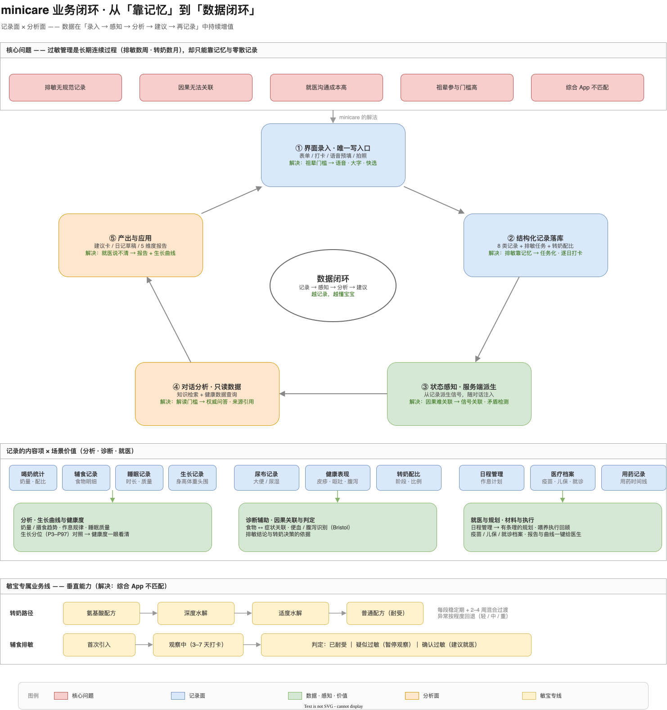

# minicare（敏宝日记 · MiniCare）

> 面向过敏体质婴幼儿（「敏宝」）家庭的**结构化健康记录 + AI 护理分析**平台：
> 把敏宝日常的饮食、转奶、症状、睡眠、生长等信息结构化记录下来，自动生成分析报告，
> 并由「敏宝助手」智能体做知识问答与数据解读——**科学排敏、规范转奶、高效就医、全家协同**。

- **主平台**：微信小程序（MVP 已于 2026-04-28 上线）
- **智能体**：「敏宝助手」已上线 CloudRun（知识问答 / 图片问诊 / 数据查询 / 每日日记）
- **内容生态**：公众号 CMPA 科普系列同步运营，形成「工具 + 内容」双轮
- 项目源自团队自身的敏宝养育经历，按「自己会用、家人能用、医生认可」的标准推进

---

## 一、解决什么问题

**过敏管理是长期、连续的过程**——辅食排敏持续数周、转奶以月计、症状需要回溯关联，但目前主要靠家长记忆和零散记录，说不清、对不上。中国 0–6 岁婴幼儿中过敏体质占比约 15%（对应超 1200 万家庭），牛奶蛋白过敏（CMPA）是最常见的食物过敏类型之一。

| 核心痛点 | 具体表现 |
|---|---|
| 排敏无规范记录 | 辅食添加、转奶过程全凭记忆，缺乏系统化手段 |
| 因果无法关联 | 难以回溯「吃了什么 → 出现什么反应」 |
| 就医沟通成本高 | 就诊时手动整理零散记录，信息不完整 |
| 祖辈参与门槛高 | 71.8% 的婴幼儿由祖辈承担主要照料，复杂工具难以上手 |
| 现有产品不匹配 | 综合母婴 APP 功能繁杂、广告多、无敏宝垂直能力 |

**目标用户**：核心是 25–35 岁的敏宝父母（注重科学育儿）；协作者是 50–65 岁的祖辈 / 保姆（要简单、大字、少打字、能语音）。

**北极星目标**（V3.0）：在安全前提下，帮敏宝**尽快从特殊医学配方回到普通配方**（转奶），并把**可摄入食物扩展到接近同龄**（排敏）。

---

## 二、解决思路：记录面 × 分析面

产品是一条「**记录 → 感知 → 分析 → 建议 → 再记录**」的闭环，两个面不对称分工——小程序负责记录，助手负责分析：



<sub>可编辑源文件：[`business-loop.drawio`](docs/assets/business-loop.drawio)（draw.io）</sub>

四条设计边界：**记录只从界面进**（表单 / 打卡 / 语音预填，不绕过界面写库）；**助手只读数据**；**建议不落库**（以「建议卡」呈现，采纳后带来源标记回界面执行）；**感知决定断言强度**（数据不足不下结论）。

### 核心能力

- **全场景结构化记录**：8 大类——饮食 / 睡眠 / 尿布 / 健康 / 表现 / 活动 / 生长 / 医疗（疫苗、儿保、就诊分型）；支持手输、自然语言、语音、拍照、快选 5 种输入
- **敏宝专属业务规则**（内置临床参考，提示以医生建议为准）：
  - **转奶路径**：氨基酸 → 深度水解 → 适度水解 → 普通配方；每段稳定期 + 2–4 周混合过渡；过敏反应按程度回退
  - **辅食排敏**：新食物自动建观察任务（默认 3 天、可配 3–7 天）→ 逐日打卡 → 耐受 / 疑似 / 确认过敏分级流转
- **家庭协作**：手机号邀请成员、三级权限（创建者 / 编辑者 / 查看者）、多端实时同步
- **数据分析**：5 维度图表报告 + 生长曲线（中国 2023 参考标准 P3–P97），直接服务就医沟通
- **敏宝助手**：知识问答（检索先行 + 来源引用 + 风险分级）、图片问诊、健康数据查询、周报 / 月报、每日日记；安全护栏（不诊断、不给药、不替代医生，高危症状强制就医引导）

---

## 三、实现方案


<sub>可编辑源文件：[`tech-architecture.drawio`](docs/assets/tech-architecture.drawio)（draw.io）</sub>

### 子仓一览

| 目录 | 技术栈 | 角色 |
|---|---|---|
| `minicare-mp/` | Taro 4.2 + React 18 + TypeScript | 微信小程序，**主平台**（记录 / 对话 / 报告 / 我的） |
| `minicare-server/` | NestJS v10 + mysql2（无 ORM） | 后端 API（CloudRun）：8 类记录 / 家庭 / 报告 / 存储 |
| `minicare-agent/` | Node.js + DeepSeek + Claude Agent SDK | 「敏宝助手」智能体服务 |
| `minicare-platform/` | FastAPI（Python 3.13）+ React 18 | 本机管理端：知识库 + Agent 测评（不做云端部署） |
| `minicare-web/` | React 18 + Vite 6 + Tailwind | Web 端（早期原型，维护模式） |

其余：`docs/` 全部文档（入口 [`docs/README.md`](docs/README.md)）；`Design-Reference/`、`ui-draft/` 历史设计与原型（仅参考）。

### 关键实现点

- **单一录入通道**：结构化记录只从界面进（表单 / 打卡 / 语音预填），保证数据质量与可追溯
- **知识供应链**：权威文献 → MinerU 解析 + 自研切块 → 入库 1586 条 → 全文 + 向量 RRF 混合检索（实测 Recall@10 97.8%）
- **质量闸门**：知识发布前过检索质检（不达标硬阻塞）；智能体由分层用例 harness + 测评台持续评测
- **鉴权与安全**：三层鉴权（JWT → 家庭成员 → 角色）防越权、参数化查询防注入、短信限流；儿童个人信息最小化收集
- **小程序工程化**：分包加载（主包仅 4 个 Tab 页）、ECharts 截图模式（规避 Canvas 层级问题）、双认证模式（dev 测试码 / 生产 SMS）
- **可观测性**：对话 trace 与 CLI transcript 汇聚至本地 Langfuse，全链路可查
- **单人维护友好**：管理端全界面操作（入库 / 质检 / 发布 / 回滚），不敲命令、改错可单步重跑

---

## 四、项目状态

| 里程碑 | 状态 |
|---|---|
| 小程序 MVP（8 类记录 / 家庭协作 / 报告） | 已上线（2026-04-28） |
| 「敏宝助手」智能体（对话 / 知识 / 数据 / 日记） | 已上线 CloudRun |
| 知识库平台化（语料 → 发布全流程） | 功能全量落地，真实路径待验收 |
| Agent 测评台（用例 / 运行 / 裁判 / 闸门） | 已落地，真实全量运行待验证 |
| 转奶 / 排敏教练 V3.0（状态感知） | 状态感知已落地，持续深化 |

进度跟踪 → [`docs/DEV-PLAN.md`](docs/DEV-PLAN.md)

---

## 五、开发入口

- **开发 / 部署前必读**：[`AGENTS.md`](AGENTS.md)（任务路由 · 领域规则 · 环境说明）
- **文档索引**：[`docs/README.md`](docs/README.md)
- **产品概述**：[`docs/product/overview.md`](docs/product/overview.md) ｜ **系统架构**：[`docs/architecture.md`](docs/architecture.md)

```bash
cd minicare-mp && npm run dev:weapp                       # 小程序（主平台）
cd minicare-server && npm run start:dev                   # 后端 :3001（需 .env.local）
cd minicare-platform/api && .venv/bin/kb-pipeline serve   # 本机管理端 :8787
cd minicare-agent && npm run start                        # 智能体 :3000
```
