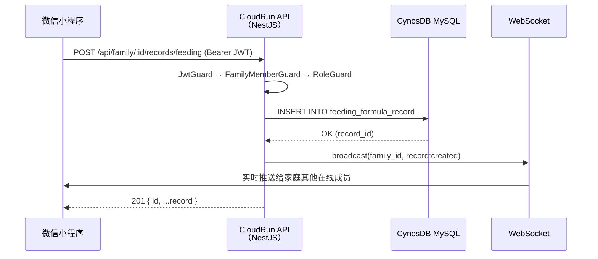

# 系统技术架构文档

> 最后更新：2026-05-03（MVP 已发布，小程序为主平台）

---

## 一、架构全景概览

```
┌─────────────────────────────────────────────────────────────────────────────┐
│                    minicare 系统架构（已发布 MVP）                            │
│                                                                             │
│  ┌─────────────────────────────────────────────────────────────────────┐    │
│  │                     客户端层（Client Layer）                         │    │
│  │                                                                     │    │
│  │  ┌──────────────────────────┐  ┌──────────────────────────────┐    │    │
│  │  │  微信小程序（主平台）      │  │   Web H5（维护模式）          │    │    │
│  │  │  Taro 4.2 + React 18     │  │   React 18 + Vite 6          │    │    │
│  │  │  ECharts 6 (截图模式)     │  │   Tailwind + Hash Router     │    │    │
│  │  │  @cloudbase/js-sdk (auth) │  │   PWA (service worker)       │    │    │
│  │  │  自定义 TabBar + FAB      │  │                              │    │    │
│  │  └──────────┬───────────────┘  └──────────────┬───────────────┘    │    │
│  └─────────────┼─────────────────────────────────┼────────────────────┘    │
│                │                                  │                         │
│                │ HTTPS REST API (JWT Bearer)      │                         │
│  ──────────────┼──────────────────────────────────┼────────────────────     │
│                ▼                                  ▼                         │
│  ┌─────────────────────────────────────────────────────────────────────┐    │
│  │            腾讯云 CloudBase · minicare-cloud-xxx                     │    │
│  │                                                                     │    │
│  │  ┌──────────────────────────────────────────────────────────────┐  │    │
│  │  │                CloudRun · minicare-api                       │  │    │
│  │  │           Node.js 20 · NestJS v10 · TypeScript               │  │    │
│  │  │                                                              │  │    │
│  │  │  /api/auth     /api/family    /api/baby    /api/records/*    │  │    │
│  │  │  /api/config   /api/report    /api/storage /health           │  │    │
│  │  │                                                              │  │    │
│  │  │  Guards: JWT → FamilyMember → Role(@MinRole)                 │  │    │
│  │  └──────┬──────────┬─────────────┬────────────────────────┘   │    │
│  │         │          │             │                             │    │
│  │  ┌──────▼──┐ ┌─────▼──────┐ ┌───▼──────────────────────────┐ │    │
│  │  │  MySQL  │ │  云存储+CDN │ │      CloudBase Auth           │ │    │
│  │  │ ~18张表 │ │ 照片/头像   │ │   手机号 SMS OTP 登录          │ │    │
│  │  │ CynosDB │ │             │ │   → 后端颁发自定义 JWT         │ │    │
│  │  └─────────┘ └────────────┘ └──────────────────────────────┘ │    │
│  └─────────────────────────────────────────────────────────────────┘    │
└─────────────────────────────────────────────────────────────────────────────┘
```

---

## 二、小程序前端架构（Taro · 主平台）

### 2.1 核心技术栈

| 层级 | 选型 | 版本 | 说明 |
|------|------|------|------|
| **跨端框架** | Taro | 4.2.0 | 目标平台为微信小程序（weapp） |
| **UI 框架** | React | 18.x | 函数组件 + Hooks |
| **语言** | TypeScript | 5.4+ | 全量类型覆盖 |
| **构建工具** | Webpack 5 | — | Taro 内置，配合 tsconfig-paths |
| **样式** | Sass | — | 不启用 pxtransform，直接使用 px |
| **图表** | ECharts | 6.x | 按需引入 Line/Bar/Scatter/Pie，Canvas 截图模式 |
| **认证 SDK** | @cloudbase/js-sdk | — | 仅引入 auth 模块，减少 ~600KB 体积 |
| **日期处理** | dayjs | — | 轻量时间格式化 |

### 2.2 项目结构

```
minicare-mp/
├── config/                  # Taro 构建配置
├── project.config.json      # 微信小程序配置（appid: wxac792556967d5838）
├── src/
│   ├── app.config.ts        # 页面路由 + 自定义 TabBar + 分包配置
│   ├── app.tsx              # 应用入口
│   ├── api/                 # API 层
│   │   ├── http.ts          # 统一 HTTP 封装（Taro.request + JWT + 401 处理）
│   │   ├── auth.ts          # 认证 API
│   │   ├── family.ts        # 家庭管理 API
│   │   ├── baby.ts          # 宝宝档案 API
│   │   ├── records.ts       # 8 类记录 CRUD
│   │   ├── sleep.ts         # 睡眠特殊流程（计时开始/结束/补录）
│   │   ├── report.ts        # 报告图表数据
│   │   └── appConfig.ts     # 全局枚举配置
│   ├── assets/icons/        # SVG 图标资源
│   ├── components/          # 全局共享组件
│   │   ├── TabBar/          # 自定义底部导航
│   │   ├── FabSheet/        # FAB 弹层（全类型记录入口）
│   │   ├── EcChart/         # ECharts 图表（截图模式）
│   │   ├── NavBar/          # 自定义导航栏
│   │   └── LoginGuide/      # 未登录引导
│   ├── lib/                 # 工具库
│   │   ├── constants.ts     # 枚举标签（所有类型集中定义）
│   │   ├── utils.ts         # 通用工具函数
│   │   ├── cloudbase.ts     # CloudBase SDK 初始化（仅 auth）
│   │   ├── echarts.ts       # ECharts 按需引入配置
│   │   ├── growth-standards.ts  # 中国 2023 版儿童生长参照标准
│   │   ├── useAppConfig.ts  # 全局配置 Hook（带缓存）
│   │   └── useQuickActionKeys.ts  # 月龄动态快捷操作
│   └── pages/               # 页面
│       ├── home/            # 首页（今日概览）
│       ├── records/list/    # 记录列表
│       ├── report/          # 数据分析
│       └── profile/         # 我的
```

### 2.3 关键架构决策

**分包加载**：主包仅含 4 个 TabBar 页面 + 一个 index 分发器。登录、引导、隐私政策、8 种记录表单全部放在 subPackages 中，首次加载体积最小化。

**ECharts 截图模式**：Canvas 在屏幕外区域渲染完成后截图为 Image 组件展示。彻底解决微信小程序 Canvas 层级覆盖问题和滚动延迟问题。

**自定义 TabBar**：使用微信小程序 `custom: true` 配置 + React 组件实现。中间设有 FAB 浮动按钮，点击弹出 FabSheet 展示全类型记录快捷入口。

**双认证模式**：开发环境使用 test 模式（固定验证码 123456 直接登录），生产环境使用 CloudBase SMS OTP 发送真实短信 + 后端 JWT 换发。

**游客预览**：未登录用户可查看首页功能布局，点击任何记录操作时通过 LoginGuide 组件引导登录。

**全局配置缓存**：`/api/config` 返回的枚举选项缓存到 Taro Storage，设置过期时间，避免每次进入页面重复请求。

### 2.4 认证流程

```
小程序启动 → 检查本地 Storage 中的 JWT Token
     ↓ (无 Token 或已过期)
展示游客模式首页（可浏览，不可操作）
     ↓ (用户点击需要登录的操作)
跳转登录页 → 用户输入手机号
     ↓
调用后端 POST /api/auth/send-code（生产环境触发 CloudBase SMS）
     ↓
用户输入验证码
     ↓
调用后端 POST /api/auth/verify-code
     ↓ (test 模式固定 123456 / sms 模式调 CloudBase 验证)
后端验证通过 → 查/创 user_account → 颁发 JWT (30天有效)
     ↓
小程序存储 Token 到 Storage → 后续请求自动携带 Bearer Token
     ↓ (401 响应)
清除 Token → 重新跳转登录页
```

---

## 三、后端架构（NestJS）

### 3.1 核心技术栈

| 层级 | 选型 | 版本 |
|------|------|------|
| **框架** | NestJS | 10.x |
| **语言** | TypeScript | 5.6+ (Node.js 20) |
| **数据库驱动** | mysql2/promise | 3.x（直连，无 ORM） |
| **数据库** | CynosDB Serverless | MySQL 兼容 |
| **认证** | passport-jwt | — |
| **实时通信** | Socket.IO (@nestjs/websockets) | — |
| **定时任务** | @nestjs/schedule | — |
| **API 文档** | @nestjs/swagger | 非生产环境 |
| **CloudBase SDK** | @cloudbase/node-sdk | SMS 验证 |

### 3.2 模块结构

```
minicare-server/src/
├── main.ts                      # 应用入口，监听 PORT，全局 /api 前缀
├── app.module.ts                # 根模块
├── auth/                        # 认证模块（send-code / verify-code / tcb-login / me）
├── family/                      # 家庭模块（CRUD + 手机号邀请成员）
├── baby/                        # 宝宝档案模块
├── records/                     # 记录模块（8 个子模块）
│   ├── feeding/                 # 喂养（4 子类型：breast/formula/food/supplement）
│   ├── sleep/                   # 睡眠（含计时状态机：start/end/ongoing/complete）
│   ├── diaper/                  # 尿布
│   ├── health/                  # 健康（体温/过敏表现）
│   ├── symptom/                 # 表现（精神状态/心情）
│   ├── activity/                # 活动
│   ├── growth/                  # 生长
│   └── medical/                 # 医疗
├── baby-foods/                  # 辅食食物库
├── storage/                     # 文件上传（CloudBase 对象存储）
├── websocket/                   # 实时事件推送
├── scheduler/                   # 定时任务
├── report/                      # 数据报告
└── app-config/                  # 应用配置（静态枚举数据端点）
```

### 3.3 三层鉴权 Guard 链

```
请求进入
  ↓
① JwtGuard: Authorization: Bearer <token> → 验签 + 查库确认用户存在 → 注入 req.user
  ↓
② FamilyMemberGuard: 从路由参数 :familyId 读取 → 查 family_member 确认 active 成员 → 注入 FamilyContext
  ↓
③ RoleGuard + @MinRole(): 比对 FamilyContext.role 与路由声明的最低角色要求（owner > member）
  ↓
Controller 方法执行
```

### 3.4 API 端点模式

全局前缀 `/api`，健康检查 `/health`（无前缀）。Swagger 文档在非生产环境可访问 `/api-docs`。

记录类端点格式：`/api/family/:familyId/records/:type`，支持标准 CRUD（POST / GET / GET:id / PATCH:id / DELETE:id）。

API 直接返回原始数据（无全局 response wrapper），列表返回 `T[]`。

---

## 四、数据库架构（CloudBase MySQL / CynosDB）

### 4.1 表层级依赖

```
Layer 0 · 账户层
└── user_account                   全局唯一用户（手机号注册）

Layer 1 · 家庭层
├── family_group                   家庭群组
└── family_member                  成员关系（role: owner/member, status: pending/active/left）

Layer 2 · 宝宝层
└── baby_profile                   宝宝档案（MVP: 每家庭限 1 个）

Layer 3 · 业务记录层（均含 baby_id + recorded_by）
├── feeding_breast_record          母乳喂养
├── feeding_formula_record         配方奶喂养
│   └── feeding_formula_mix        奶粉配比明细
├── feeding_food_record            辅食喂养
│   └── feeding_food_item          食物明细
├── feeding_supplement_record      营养素补充（supplement_items JSON）
├── sleep_record                   睡眠（含计时状态机）
├── diaper_record                  尿布
├── activity_record                活动
├── health_record                  健康
├── symptom_record                 表现
├── growth_record                  生长
└── medical_record                 医疗

Layer 4 · 衍生逻辑层
└── food_observation               辅食新食物观察期（4 态状态机：observing/safe/suspected/allergic）

共 ~18 张表
```

### 4.2 设计要点

所有主键 CHAR(36) UUID。枚举字段使用 VARCHAR 存储（如 gender、role、status 等，已从 TINYINT 迁移）。时区固定 UTC+8。

喂养记录采用 4 表拆分设计（Migration 008），每种喂养类型独立成表，避免大量 NULL 列，查询更高效。

### 4.3 数据流向



---

## 五、部署架构

### 5.1 环境规划

| 环境 | 用途 | 配置方式 |
|------|------|---------|
| **开发** | 本地调试 | Server: `.env.local` 连远程 CynosDB；MP: `npm run dev:weapp` |
| **生产** | 正式用户 | Server: CloudRun EnvParams；MP: 微信审核后发布 |

### 5.2 部署流程

**后端（CloudRun）**：
1. `cd minicare-server && npm run build`
2. `bash scripts/deploy.sh`（预检查）
3. CloudBase MCP `manageCloudRun(action='deploy', ...)` 部署
4. 验证：`queryCloudRun(detail)` + `curl /health`

**小程序（微信平台）**：
1. `cd minicare-mp && npm run build:weapp`
2. 微信开发者工具上传代码
3. 提交审核 → 审核通过后发布

### 5.3 CloudRun 资源配置

| 参数 | MVP 阶段 |
|------|---------|
| CPU | 0.25 vCPU |
| 内存 | 512 MB |
| 最小实例数 | 1（避免冷启动） |
| 最大实例数 | 5 |
| 并发请求/实例 | 80 |

---

## 六、安全设计

| 威胁 | 防护措施 |
|------|---------|
| 未授权访问 | JWT Guard + FamilyMember Guard + Role Guard 三层鉴权 |
| SQL 注入 | mysql2 参数化查询（Prepared Statements） |
| 短信轰炸 | `/api/auth/send-code` 限流：同手机号 60s 内 1 次 |
| JWT 泄露 | Token 30 天有效期；401 自动失效跳转登录 |
| 越权访问 | FamilyMemberGuard 确认 user_id + family_id 匹配 |
| 文件上传 | 预签名 URL 限定 MIME 类型和大小 |
| 敏感数据 | DB_PASS / JWT_SECRET 仅存 CloudRun 环境变量 |

---

## 七、技术选型决策摘要

### 为什么选 NestJS（而非 Fastify/Express）

核心原因是 minicare 的多层权限模型（3 层 Guard × 多表 × CRUD）。NestJS 的 Guards + 装饰器让权限逻辑声明一次复用全局，而 Fastify 需要在每条路由手动组合 preHandler。结合 CloudRun `MinNum=1` 消除冷启动劣势，NestJS 是最优选。

### 为什么选小程序（而非原生 APP / Web PWA）

微信小程序的优势：零安装门槛（适合祖辈用户）、微信生态内分享传播（家庭协作核心场景）、扫码即用。Taro 框架提供跨端扩展能力，未来可低成本覆盖支付宝/抖音小程序。

### 为什么选 ECharts 截图模式（而非 Canvas 直接渲染）

微信小程序 Canvas 存在固有的层级问题（原生组件覆盖在所有 Web 组件之上）和滚动同步延迟。截图模式将 Canvas 渲染移至屏幕外完成后转为 Image，彻底回避这些平台限制。

---

*→ 完整建表 DDL 见 `docs/tech/DB-02-schema.md`*
*→ 基础设施搭建执行清单见 `docs/tech/INFRA-cloudbase.md`*
*→ 小程序开发规范见 `.cursor/rules/miniapp-development.mdc`*
