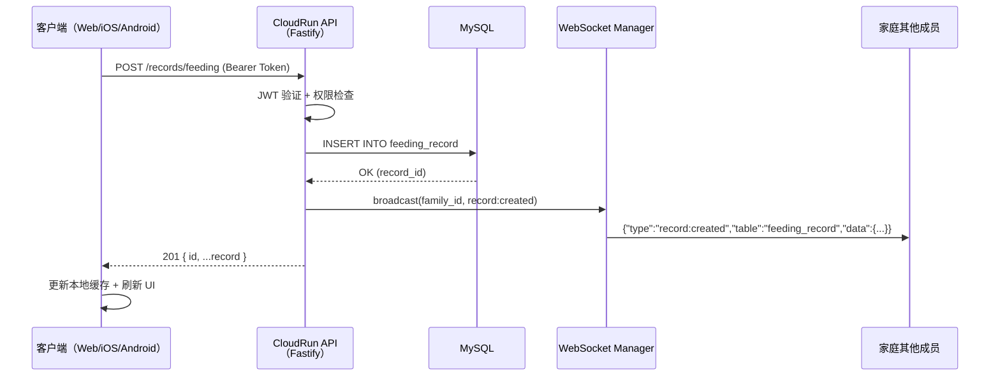
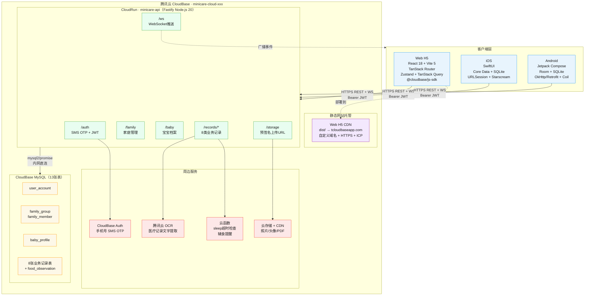
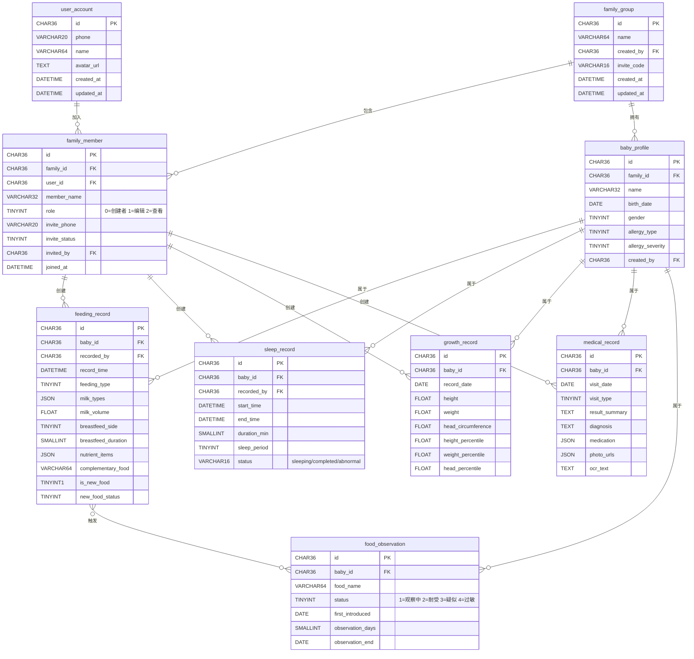

# 系统技术架构文档

> 来源：MVP-PRD.md §5 · 技术选型评审
> 最后同步：2026-03-29（v3：补充 React+Vite 前端架构 + Node.js 框架选型 + 完整架构图）

---

## 一、架构全景概览

```
┌─────────────────────────────────────────────────────────────────────────────┐
│                          minicare 系统架构（v3）                             │
│                                                                             │
│  ┌─────────────────────────────────────────────────────────────────────┐    │
│  │                     客户端层（Client Layer）                         │    │
│  │                                                                     │    │
│  │  ┌──────────────────────┐  ┌──────────────────┐  ┌──────────────┐  │    │
│  │  │   Web H5（主力）      │  │  iOS（Swift）    │  │Android(Kotlin│  │    │
│  │  │  React 18 + Vite 5   │  │  SwiftUI         │  │  Jetpack     │  │    │
│  │  │  TanStack Router     │  │  Core Data       │  │  Compose     │  │    │
│  │  │  Zustand + RQ        │  │  URLSession       │  │  Room + OkHttp│ │    │
│  │  │  @cloudbase/js-sdk   │  │  Starscream(WS)  │  │  Coil        │  │    │
│  │  └──────────┬───────────┘  └────────┬─────────┘  └──────┬───────┘  │    │
│  └─────────────┼──────────────────────┼─────────────────── ┼──────────┘    │
│                │                      │                     │               │
│                │ HTTPS REST API + WebSocket (JWT Bearer)    │               │
│  ──────────────┼──────────────────────┼─────────────────── ┼──────────     │
│                ▼                      ▼                     ▼               │
│  ┌─────────────────────────────────────────────────────────────────────┐    │
│  │            腾讯云 CloudBase（云开发）minicare-cloud-xxx              │    │
│  │                                                                     │    │
│  │  ┌──────────────────────────────────────────────────────────────┐  │    │
│  │  │                CloudRun · minicare-api                       │  │    │
│  │  │           Node.js 20 · NestJS · TypeScript                   │  │    │
│  │  │                                                              │  │    │
│  │  │  /auth        /family      /baby        /records             │  │    │
│  │  │  /storage     /ws          /health      /__health            │  │    │
│  │  │                                                              │  │    │
│  │  │  中间件：JWT验证 · 家庭权限 · 限流 · 请求日志                  │  │    │
│  │  └──────┬──────────┬─────────────┬────────────────────────┘   │    │
│  │         │          │             │                             │    │
│  │  ┌──────▼──┐ ┌─────▼──────┐ ┌───▼──────────────────────────┐ │    │
│  │  │  MySQL  │ │  云存储+CDN │ │      CloudBase Auth           │ │    │
│  │  │ 13张表  │ │ 照片/头像   │ │   手机号 SMS OTP 登录          │ │    │
│  │  │  (主库) │ │  PDF报告    │ │   JWT Token 颁发               │ │    │
│  │  └─────────┘ └────────────┘ └──────────────────────────────┘ │    │
│  │                                                               │    │
│  │  ┌──────────────────────┐  ┌───────────────────────────────┐ │    │
│  │  │  云函数（定时任务）    │  │     静态托管 · Web H5 CDN      │ │    │
│  │  │  sleep-timeout-check │  │     dist/ → tcloudbaseapp.com  │ │    │
│  │  │  food-obs-reminder   │  │     自定义域名 + HTTPS          │ │    │
│  │  └──────────────────────┘  └───────────────────────────────┘ │    │
│  └─────────────────────────────────────────────────────────────────┘    │
└─────────────────────────────────────────────────────────────────────────────┘
```

---

## 二、Web 前端技术选型（React + Vite）

### 2.1 核心技术栈

| 层级 | 选型 | 版本 | 理由 |
|------|------|------|------|
| **框架** | **React** | 18.x | 组件生态最丰富；CloudBase js-sdk 官方示例均基于 React；团队熟悉度高 |
| **构建工具** | **Vite** | 5.x | CloudBase web-development SKILL 明确推荐；HMR 极快；构建产物兼容静态托管 |
| **路由** | **TanStack Router** | 1.x | 类型安全路由；支持 Hash 模式（静态托管无需服务端配置）；比 React Router v6 更健壮 |
| **状态管理** | **Zustand** | 4.x | 轻量；无 Provider 嵌套地狱；适合 Cloud-first 无本地数据库方案 |
| **服务端状态** | **TanStack Query** | 5.x | 自动缓存 + 失效策略；与 CloudRun REST API 天然契合 |
| **UI 组件** | **Radix UI + Tailwind CSS** | latest | 无障碍支持；高度可定制；与 minicare 设计系统匹配 |
| **CloudBase SDK** | **@cloudbase/js-sdk** | 2.x | 官方 SDK；支持 Auth (SMS OTP)、MySQL、云存储、CloudRun 调用 |
| **HTTP 客户端** | **原生 fetch + TanStack Query** | — | CloudBase CloudRun 调用通过 `app.callContainer()` 或直接 fetch |
| **WebSocket** | **原生 WebSocket API** | — | 连接 CloudRun WebSocket 端点，接收家庭实时推送 |
| **图表** | **Recharts** | 2.x | 生长曲线图；轻量；React 专属 |
| **表单** | **React Hook Form + Zod** | latest | 高性能表单；类型安全校验；减少 re-render |

### 2.2 CloudBase 对 React + Vite 的支持确认

| 支持项 | 状态 | 说明 |
|--------|------|------|
| `@cloudbase/js-sdk` npm 安装 | ✅ 完全支持 | `npm install @cloudbase/js-sdk`，ES Module 格式，Vite 原生支持 |
| Vite 构建产物部署静态托管 | ✅ 完全支持 | `vite build` → `dist/` 目录 → `cloudbase hosting deploy ./dist` |
| Hash 路由（`#/`）兼容性 | ✅ 完全支持 | 静态托管无需 rewrite 配置，推荐使用 Hash 模式 |
| Tree-shaking 优化 | ✅ 支持 | SDK 支持按需引入，Vite + Rollup 自动 tree-shake |
| TypeScript 类型定义 | ✅ 支持 | `@cloudbase/js-sdk` 内置 `.d.ts` 类型文件 |
| 环境变量注入 | ✅ 支持 | Vite `import.meta.env.VITE_TCB_ENV_ID` → 构建时替换 |
| HMR 开发体验 | ✅ 无影响 | SDK 初始化为同步操作，不影响 Vite HMR |
| 生产构建压缩 | ✅ 支持 | Vite 默认 esbuild + Rollup；SDK 约 +80KB gzip |

> **关键约束**：`cloudbase.init()` 必须同步调用（不能 `async import`），在 `src/lib/cloudbase.ts` 中单例初始化，全局共享。

### 2.3 前端项目结构

```
minicare-web/
├── src/
│   ├── lib/
│   │   └── cloudbase.ts          # CloudBase SDK 单例初始化
│   ├── api/
│   │   ├── auth.ts               # 认证 API（SMS OTP 登录）
│   │   ├── family.ts             # 家庭管理 API
│   │   ├── baby.ts               # 宝宝档案 API
│   │   ├── records/
│   │   │   ├── feeding.ts
│   │   │   ├── sleep.ts
│   │   │   ├── diaper.ts
│   │   │   ├── health.ts
│   │   │   ├── symptom.ts
│   │   │   ├── activity.ts
│   │   │   ├── growth.ts
│   │   │   └── medical.ts
│   │   └── storage.ts            # 文件上传 URL 获取
│   ├── stores/
│   │   ├── auth.ts               # 认证状态（Zustand）
│   │   ├── family.ts             # 家庭/成员状态（Zustand）
│   │   └── websocket.ts          # WS 连接状态（Zustand）
│   ├── hooks/
│   │   ├── useRecords.ts         # TanStack Query hooks
│   │   ├── useFamily.ts
│   │   └── useWebSocket.ts       # WebSocket 实时推送 hook
│   ├── pages/
│   │   ├── login/
│   │   ├── home/
│   │   ├── records/              # 各记录类型页面
│   │   ├── profile/
│   │   └── report/
│   ├── components/               # 共享 UI 组件
│   └── main.tsx                  # 应用入口
├── vite.config.ts
├── tailwind.config.ts
├── tsconfig.json
└── package.json
```

### 2.4 CloudBase SDK 初始化规范

```typescript
// src/lib/cloudbase.ts — 全项目唯一入口
import cloudbase from '@cloudbase/js-sdk'

// ⚠️ 必须同步初始化，不能 async import，不能 lazy init
export const app = cloudbase.init({
  env: import.meta.env.VITE_TCB_ENV_ID,  // 构建时注入
  region: 'ap-shanghai',
  auth: { detectSessionInUrl: true },
})

export const auth = app.auth
```

### 2.5 认证流程（手机号 SMS OTP）

```
用户输入手机号
     ↓
auth.signInWithOtp({ phone: '138xxxx' })
     ↓
用户收到短信验证码
     ↓
data.verifyOtp({ token: '123456' })
     ↓
登录成功 → auth.getSession() 获取 access_token
     ↓
所有 API 请求自动携带 Bearer Token
（app.callContainer 自动注入，手动 fetch 需手动附加）
```

---

## 三、后端技术选型（Node.js · NestJS）

> **选型结论：NestJS v10**（更新于 2026-03-29）
> 初版评估基于"MVP 阶段轻量优先"选定 Fastify；经「后续沿用」维度重新评估，NestJS 在
> minicare 的权限模型复杂度和长期演进路径上更具优势。详见下方深度评估。

### 3.1 框架深度对比（minicare 视角）

#### 基础性能数据

| 框架 | 性能（req/s） | 冷启动时间 | MinNum=1 时差异 |
|------|------------|---------|----------------|
| Express | ~50k | ~150ms | 冷启动差距消失 |
| **Fastify** | ~80k | ~200ms | 冷启动差距消失 |
| **NestJS** | ~45k | ~800ms~1.5s | **冷启动差距消失** |
| Hono | ~100k | ~100ms | 冷启动差距消失 |

> ⚠️ **关键前提**：minicare 设置 `MinNum=1`（约 ¥10-20/月），CloudRun 常驻热实例，**冷启动差距完全消除**。
> minicare MVP 日活 < 1000，真实瓶颈在 MySQL 查询，不在框架层吞吐，性能数字对本项目无实质意义。

#### minicare 场景专项评估

| 维度 | Fastify | NestJS | minicare 影响分析 |
|------|---------|--------|-----------------|
| **多层权限复用** | ⚠️ 每路由手动 `addHook` 组合 | ✅ Guards 装饰器，声明一次全局复用 | **关键差异**：minicare 每个 API 需 4 层校验（JWT→family成员→role→baby归属），50+ 路由若每条手动组合将产生大量样板代码 |
| **横切关注点表达** | ⚠️ 需自建约定（plugin 注册顺序） | ✅ Module/Guard/Interceptor/Pipe 明确分层 | minicare 有日志、限流、权限、响应格式等横切需求，NestJS 内置最佳实践 |
| **WebSocket 支持** | ✅ `@fastify/websocket`，路由级 | ✅ `@nestjs/websockets` Gateway，内置 namespace/room | minicare WS 按 `family_id` 分组广播，Gateway 的 room 抽象更贴合业务语义 |
| **定时任务** | ❌ 需引入 `node-cron` 自行管理 | ✅ `@nestjs/schedule` + `@Cron()` 装饰器 | 睡眠超时检查、辅食观察期提醒若内置到主服务，NestJS 开箱即用 |
| **API 文档** | ⚠️ `fastify-swagger` 需手动写 JSON Schema | ✅ `@nestjs/swagger` + DTO 装饰器自动生成 OpenAPI | iOS/Android 开发者联调依赖 Swagger，NestJS 大幅降低文档维护成本 |
| **单元测试** | ⚠️ 无官方 Test Module，需手动 mock | ✅ `@nestjs/testing` 内置 IoC mock | 后续补充测试覆盖率时，NestJS 体验优势显著 |
| **可维护性（新人上手）** | ⚠️ 自由度高，需自建代码约定 | ✅ 强制分层约定，新成员 30 分钟内理解结构 | minicare 后续可能有 iOS/Android 开发者偶尔修改后端，强约定降低跨端沟通成本 |
| **类型安全 / DTO** | ✅ JSON Schema + ajv | ✅ class-validator + class-transformer | NestJS DTO 可与前端 Zod schema 对应，形成完整类型链 |
| **学习曲线** | ✅ 低，类 Express 思维 | ⚠️ 中，需理解 Module/Provider/Decorator | 有 Angular 或 Spring 背景可零成本迁移；纯 JS 背景约需 1-2 天熟悉 |
| **CloudRun 兼容性** | ✅ | ✅ | 两者均为标准 HTTP Server，监听 `PORT` 环境变量，无差异 |

#### minicare 权限模型：两框架的实现对比

minicare 每个业务 API 都需要以下 4 层校验，这是两个框架差距最大的地方：

```typescript
// ── Fastify 写法 ──────────────────────────────────────────────
// 每条路由必须手动组合，50+ 路由会产生大量重复样板
fastify.get('/records/feeding', {
  preHandler: [
    verifyJWT,           // ① JWT → user_id
    loadFamilyMember,    // ② 查 family_member 确认成员资格
    checkRole('viewer'), // ③ role >= 查看者
    checkBabyAccess,     // ④ baby_id 属于该 family
  ],
  schema: { querystring: FeedingQuerySchema },
}, async (req, reply) => { /* ... */ })

// ── NestJS 写法 ───────────────────────────────────────────────
// 权限逻辑集中声明，Controller 级或方法级一次生效，不重复
@Controller('records/feeding')
@UseGuards(JwtGuard, FamilyMemberGuard, BabyAccessGuard)
export class FeedingController {

  @Get()
  @MinRole(Role.VIEWER)   // 自定义装饰器，声明最低角色
  findAll(@CurrentFamily() family: FamilyContext) {
    return this.feedingService.findAll(family)
  }

  @Post()
  @MinRole(Role.EDITOR)   // 写操作需要编辑者角色
  create(@Body() dto: CreateFeedingDto, @CurrentFamily() family: FamilyContext) {
    return this.feedingService.create(dto, family)
  }
}
```

#### 演进路径对比

```
minicare 后端的合理演进（1年视角）：

MVP                    v1.1                  v2.0
────────────────────────────────────────────────────────
13张表 CRUD           + PDF 导出服务         + AI 分析接口
WebSocket 推送        + 推送通知服务         + 多宝宝数据隔离
SMS OTP 登录          + 微信登录             + 数据迁移 API

Fastify 的问题：
  - 每新增一个模块，需手动建立文件夹约定
  - 权限 Hook 如果没有严格约定，容易被新人遗漏
  - 定时任务/推送通知需要引入额外依赖并自行集成

NestJS 的优势：
  - Module 边界天然隔离各业务域（FeedingModule/SleepModule）
  - 新增 PDF 导出 → 只需新建 ReportModule，注入已有 Service
  - @nestjs/schedule 直接支持定时任务
  - @nestjs/swagger 自动维护 API 文档
```

### 3.2 选型决策：NestJS v10

**选用 NestJS 的核心理由（minicare 场景专属）**：

1. **权限模型的表达效率**：minicare 有 3 层角色 × 13张表 × CRUD 的权限校验矩阵，NestJS Guards 让这套逻辑声明一次复用全局，Fastify 需要在每条路由手动组合，50+ 路由后可维护性大幅下降

2. **`MinNum=1` 消除唯一劣势**：CloudRun 设置最小 1 实例（月增约 ¥15），NestJS 冷启动劣势完全消失，性能差异在 minicare 流量规模下无感知

3. **长期演进有路线图**：NestJS 的 Module 分层天然支撑后续的 AI 分析、PDF 报告、推送通知等复杂业务模块，无需重构架构

4. **移动端联调的 Swagger 需求**：`@nestjs/swagger` 从 DTO 自动生成 OpenAPI，iOS/Android 开发者可直接使用，Fastify 需要手动维护

**何时应该选 Fastify**（minicare 不符合这些条件）：
- CloudRun `MinNum=0`，对冷启动毫秒级有要求（serverless 场景）
- 后端极简，API < 20 个，1 人永久维护
- 团队明确抵制装饰器语法

### 3.3 后端项目结构（NestJS）

```
minicare-server/
├── src/
│   ├── main.ts                       # NestJS 应用入口，监听 process.env.PORT
│   ├── app.module.ts                 # 根模块，汇总所有业务 Module
│   │
│   ├── auth/                         # 认证模块
│   │   ├── auth.module.ts
│   │   ├── auth.controller.ts        # POST /auth/send-code, /auth/verify-code
│   │   ├── auth.service.ts
│   │   ├── jwt.guard.ts              # ① JWT 验证 Guard
│   │   ├── jwt.strategy.ts
│   │   └── dto/
│   │       ├── send-code.dto.ts
│   │       └── verify-code.dto.ts
│   │
│   ├── family/                       # 家庭模块
│   │   ├── family.module.ts
│   │   ├── family.controller.ts
│   │   ├── family.service.ts
│   │   ├── family-member.guard.ts    # ② family 成员资格 Guard
│   │   ├── role.guard.ts             # ③ 角色权限 Guard
│   │   ├── role.decorator.ts         # @MinRole() 自定义装饰器
│   │   └── dto/
│   │
│   ├── baby/                         # 宝宝档案模块
│   │   ├── baby.module.ts
│   │   ├── baby.controller.ts
│   │   ├── baby.service.ts
│   │   └── dto/
│   │
│   ├── records/                      # 业务记录模块（8类）
│   │   ├── records.module.ts
│   │   ├── feeding/
│   │   │   ├── feeding.controller.ts
│   │   │   ├── feeding.service.ts
│   │   │   └── dto/
│   │   ├── sleep/                    # 含计时状态机
│   │   ├── diaper/
│   │   ├── health/
│   │   ├── symptom/
│   │   ├── activity/
│   │   ├── growth/                   # 含 WHO 百分位计算
│   │   └── medical/                  # 含 OCR 触发
│   │
│   ├── storage/                      # 文件存储模块
│   │   ├── storage.module.ts
│   │   ├── storage.controller.ts     # GET /storage/upload-url
│   │   └── storage.service.ts
│   │
│   ├── websocket/                    # 实时推送模块
│   │   ├── websocket.module.ts
│   │   ├── events.gateway.ts         # @WebSocketGateway() 按 family_id 分组
│   │   └── ws-manager.service.ts
│   │
│   ├── scheduler/                    # 定时任务模块
│   │   ├── scheduler.module.ts
│   │   └── tasks.service.ts          # @Cron() 睡眠超时检查、辅食提醒
│   │
│   └── common/                       # 公共模块
│       ├── database/
│       │   └── database.module.ts    # mysql2 连接池 Provider
│       ├── cloudbase/
│       │   └── cloudbase.module.ts   # @cloudbase/node-sdk Provider
│       ├── decorators/
│       │   └── current-family.decorator.ts
│       └── interceptors/
│           └── response-format.interceptor.ts
│
├── Dockerfile                        # CloudRun 容器构建（node:20-alpine）
├── nest-cli.json
├── tsconfig.json
└── package.json
```

### 3.4 关键服务设计（NestJS 实现模式）

#### Auth 流程（自建 JWT，不依赖 CloudBase Auth Token 验证）

```
客户端 POST /auth/send-code { phone }
  → 调用 CloudBase Auth API 发送 SMS 验证码
  → 返回 { success: true }

客户端 POST /auth/verify-code { phone, code }
  → 调用 CloudBase Auth API 验证 OTP
  → 查/创 user_account 记录
  → 颁发 JWT { user_id, exp: 30d } 签名存入 HTTP-Only Cookie + Response Body
  → 返回 { token, user }
```

#### WebSocket 实时推送（NestJS Gateway）

```typescript
// websocket/events.gateway.ts
@WebSocketGateway({ namespace: '/ws' })
export class EventsGateway {
  // 按 family_id 分组管理连接
  private rooms = new Map<string, Set<Socket>>()

  @SubscribeMessage('join_family')
  handleJoin(@ConnectedSocket() client: Socket, @MessageBody() { familyId }: JoinDto) {
    client.join(`family:${familyId}`)   // Socket.IO room，自动管理生命周期
  }

  // 被业务 Service 调用（写入 MySQL 后广播）
  broadcast(familyId: string, event: WsEvent) {
    this.server.to(`family:${familyId}`).emit('record_change', event)
  }
}

// 消息类型（前后端共享 DTO）
type WsEvent =
  | { type: 'record:created'; table: string; data: Record<string, unknown> }
  | { type: 'record:updated'; table: string; data: Record<string, unknown> }
  | { type: 'member:joined'; member: FamilyMember }
```

### 3.4 关键环境变量

| 变量名 | 说明 | 示例 |
|--------|------|------|
| `PORT` | CloudRun 注入（不可修改） | `3000` |
| `TCB_ENV_ID` | CloudBase 环境 ID | `minicare-cloud-xxx` |
| `DB_HOST` | MySQL 内网地址 | `10.x.x.x` |
| `DB_PORT` | MySQL 端口 | `3306` |
| `DB_NAME` | 数据库名 | `minicare-cloud-xxx` |
| `DB_USER` | 数据库用户名 | — |
| `DB_PASS` | 数据库密码 ⛔勿提交 Git | — |
| `JWT_SECRET` | JWT 签名密钥（≥32位随机）⛔勿提交 Git | — |
| `TCB_SECRET_ID` | 腾讯云 API 密钥（OCR 调用） | — |
| `TCB_SECRET_KEY` | 腾讯云 API 密钥 ⛔勿提交 Git | — |

---

## 四、数据库架构（CloudBase MySQL）

> 详细 DDL 见 `docs/tech/DB-02-schema.md`

### 4.1 表层级依赖

```
Layer 0 · 账户层
└── user_account              全局唯一用户（手机号注册）

Layer 1 · 家庭层
├── family_group              家庭群组
└── family_member             成员 + 角色权限（0=创建者 1=编辑者 2=查看者）

Layer 2 · 宝宝层
└── baby_profile              宝宝档案（MVP: 每家庭限 1 个）

Layer 3 · 业务记录层（均含 baby_id + recorded_by）
├── feeding_record            饮食（奶粉/母乳/营养素/辅食）
├── symptom_record            表现记录（皮疹/呕吐/腹泻等）
├── growth_record             生长数据（含 WHO 百分位）
├── sleep_record              睡眠（含计时状态机）
├── activity_record           活动
├── diaper_record             尿布
├── health_record             健康（体温/情绪）
└── medical_record            医疗（含 OCR）

Layer 4 · 衍生逻辑层
└── food_observation          辅食新食物观察期状态机

共 13 张表
```

### 4.2 数据流向图



---

## 五、完整系统架构图（分层视角）



---

## 六、技术选型对比与决策摘要

### 6.1 前端框架最终决策

```
React 18 + Vite 5  ✅ 选用
────────────────────────────────────────────────────────────────
优势：
  ✅ CloudBase @cloudbase/js-sdk 完整 React 示例支持
  ✅ Vite + Hash Router 完美兼容 CloudBase 静态托管（无需服务端配置）
  ✅ 生态最丰富：Recharts 生长曲线、React Hook Form、Radix UI
  ✅ TypeScript 原生支持，与后端类型共享成本低
  ✅ Vite 构建速度极快，开发体验优秀

约束：
  ⚠️ @cloudbase/js-sdk 必须同步初始化（不影响 Vite HMR）
  ⚠️ 使用 Hash Router（#/路由），非 History 模式
```

### 6.2 后端框架最终决策

```
Fastify v4 + TypeScript  ✅ 选用（替代 Express）
────────────────────────────────────────────────────────────────
优势：
  ✅ 性能比 Express 快 60%（req/s），CloudRun 单实例更高吞吐
  ✅ 内置 JSON Schema 校验（ajv），减少手写验证代码
  ✅ @fastify/websocket 官方 WS 插件，与路由深度集成
  ✅ TypeScript 优先设计，类型安全贯穿全栈
  ✅ 冷启动更快（比 NestJS 轻量得多），对 MinNum=0 友好

对比排除：
  ❌ NestJS：过重，装饰器风格增加学习成本，MVP 阶段不适合
  ❌ Express：弱类型，WS 集成繁琐，性能略低
  ❌ Hono：生态尚不成熟，CloudRun 部署案例少
```

### 6.3 全栈技术栈一览

| 层级 | 技术 | 版本 |
|------|------|------|
| **前端框架** | React | 18.x |
| **构建工具** | Vite | 5.x |
| **前端路由** | TanStack Router | 1.x（Hash 模式） |
| **状态管理** | Zustand | 4.x |
| **服务端状态** | TanStack Query | 5.x |
| **UI 组件库** | Radix UI + Tailwind CSS | latest |
| **前端图表** | Recharts | 2.x |
| **表单校验** | React Hook Form + Zod | latest |
| **后端框架** | Fastify | 4.x |
| **后端语言** | TypeScript | 5.x（Node.js 20） |
| **数据库驱动** | mysql2/promise | 3.x |
| **数据库** | CloudBase MySQL | — |
| **CloudBase SDK（前端）** | @cloudbase/js-sdk | 2.x |
| **CloudBase SDK（后端）** | @cloudbase/node-sdk | 3.x |
| **WebSocket** | @fastify/websocket | 8.x |
| **容器部署** | CloudRun（Dockerfile） | Node 20 Alpine |
| **静态托管** | CloudBase 静态托管 + CDN | — |
| **认证** | CloudBase Auth（SMS OTP）+ JWT | — |
| **文件存储** | CloudBase 云存储 + CDN | — |
| **OCR** | 腾讯云 OCR API | — |

---

## 七、数据表关系图（ER Diagram）



> 完整 DDL 见 `docs/tech/DB-02-schema.md`（13张表全量字段）

---

## 八、部署架构与 CI/CD

### 8.1 环境规划

| 环境 | CloudBase 环境 | 用途 |
|------|---------------|------|
| **开发** | 本地 + `.env.local` | 本地 `vite dev` + Fastify 本地调试 |
| **测试** | `minicare-dev-xxx`（可选） | PR 合并前验证 |
| **生产** | `minicare-cloud-xxx` | 正式用户访问 |

### 8.2 部署流程

```
┌─────────────────────────────────────────────────────────────────┐
│                      CI/CD 流水线（GitHub Actions）              │
│                                                                 │
│  Push to main                                                   │
│       ↓                                                         │
│  ┌─────────────────────────────────────────────────────────┐    │
│  │  Job 1: 后端部署（minicare-server）                      │    │
│  │  1. npm ci + tsc build                                  │    │
│  │  2. Docker build (node:20-alpine)                       │    │
│  │  3. cloudbase run deploy minicare-api                   │    │
│  └─────────────────────────────────────────────────────────┘    │
│       ↓ 后端部署成功                                             │
│  ┌─────────────────────────────────────────────────────────┐    │
│  │  Job 2: 前端部署（minicare-web）                         │    │
│  │  1. npm ci                                              │    │
│  │  2. VITE_API_BASE_URL=$CLOUDRUN_URL vite build          │    │
│  │  3. cloudbase hosting deploy ./dist                     │    │
│  └─────────────────────────────────────────────────────────┘    │
└─────────────────────────────────────────────────────────────────┘
```

### 8.3 CloudRun 资源配置

| 参数 | MVP 阶段 | 规模化后 |
|------|---------|---------|
| CPU | 0.25 vCPU | 0.5~1 vCPU |
| 内存 | 512 MB | 1~2 GB |
| 最小实例数 | 1（避免冷启动） | 2（高可用） |
| 最大实例数 | 5 | 20 |
| 并发请求/实例 | 80 | 200 |

---

## 九、安全设计

| 威胁 | 防护措施 |
|------|---------|
| 未授权访问数据 | JWT 中间件校验；family_member 权限校验；用户只能访问自己家庭的数据 |
| SQL 注入 | 全程使用 mysql2 参数化查询（Prepared Statements） |
| 短信轰炸 | `/auth/send-code` 限流：同手机号 60s 内只能发 1 次；IP 维度 10次/分钟 |
| JWT 泄露 | Token 有效期 30 天；敏感操作二次校验；HTTP-Only Cookie（Web 端） |
| 越权访问 | `permission.ts` 中间件：查询 family_member 确认 user_id + family_id 匹配 |
| 文件上传恶意文件 | 预签名 URL 限定 MIME 类型（image/*）和大小（≤10MB） |
| 敏感数据泄露 | DB_PASS / JWT_SECRET 仅存 CloudRun 环境变量，禁止提交 Git |

---

## 十、架构升级要点（相较原设计）

| 维度 | 原设计 | 新设计（v3） |
|------|--------|-------------|
| 前端框架 | 纯 HTML/CSS（ui-draft） | **React 18 + Vite 5** |
| 前端路由 | 无 | **TanStack Router（Hash 模式）** |
| 前端状态 | 无 | **Zustand + TanStack Query** |
| 后端框架 | Express（计划中） | **Fastify v4**（性能+类型安全） |
| WebSocket | 计划中 | **@fastify/websocket + ws-manager** |
| 数据存储 | 仅本地 SQLite | **云端 MySQL（唯一写入源）** |
| 照片存储 | 本地路径 | **CloudBase 云存储 + CDN URL** |
| 主键类型 | INTEGER 自增 | **CHAR(36) UUID** |
| 多人协作 | ❌ | **✅ WebSocket 实时广播** |
| 无网行为 | 正常使用 | **提示无网络，禁止提交** |
| 离线队列 | N/A | **已移除（无需 sync_log）** |

---

*→ 完整建表 DDL 见 `docs/tech/DB-02-schema.md`*
*→ 基础设施搭建执行清单见 `docs/tech/INFRA-cloudbase.md`*
*→ Mock 数据与用户故事演练见 `docs/tech/DB-03-mock-data.md`*
