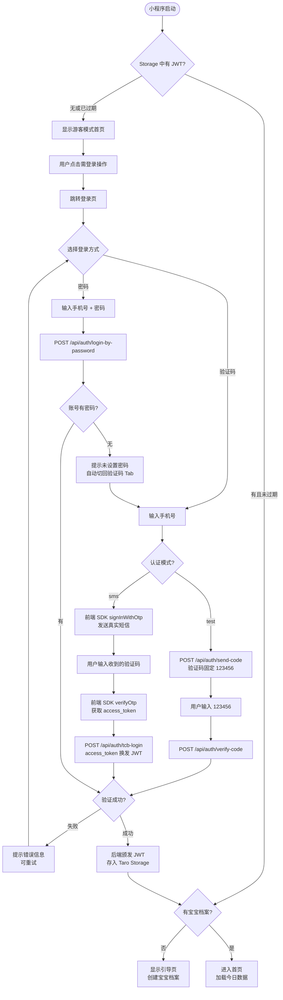

# F01 · 用户登录与注册

> 功能 ID：—（基础能力，无单独 ID）  
> 优先级：P0  
> 状态：**已完成** ✅  
> 最后更新：2026-10-09（新增「手机号 + 密码」登录，见 TECH-016）

## 功能描述

支持**两种**登录方式，**登录即注册**（首次使用自动创建账号）：

1. **手机号 + 短信验证码**（默认，主路径）—— 唯一能完成注册的方式
2. **手机号 + 密码**（效率补充）—— 仅对**已设置密码**的账号可用，不承担注册

不支持微信授权等其他第三方登录。

**平台实现**：微信小程序（主平台），通过 CloudBase SMS OTP + 后端自颁 JWT 完成认证。

## 登录方式

### 验证码登录（默认，承担注册）

输入手机号 → 获取短信验证码（60 秒倒计时）→ 填入验证码 → 登录。首次使用（未注册）时，登录即注册，自动创建账号。

### 密码登录（TECH-016）

输入手机号 + 密码 → 登录。**不承担注册**：

- 账号**未设置密码** → 返回 `NO_PASSWORD_SET`，前端提示「该账号未设置密码，请使用验证码登录」并**自动切回验证码 Tab**
- 账号不存在 → 与密码错误**同一文案**（「手机号或密码错误」），不泄露账号是否注册

**密码的设置与修改**：登录后在「我的 → 账号与安全」中操作（**不在注册流程中设置**）。

| 场景 | 所需凭证 |
|------|----------|
| 设置密码（尚未设置） | 短信验证码 **或** 最近 10 分钟内做过短信验证（免二次短信） |
| 修改密码（已设置） | 原密码 **或** 短信验证码 **或** 最近 10 分钟内做过短信验证 |
| 忘记密码（未登录） | 必须短信验证码（无登录态，不走 10 分钟免验证捷径） |

**密码强度**：8–20 位，必须同时包含字母与数字，允许 `!@#$%^&*._-`。
规则单一真相源：后端 `minicare-server/src/auth/password-policy.ts`，前端镜像 `minicare-mp/src/lib/passwordPolicy.ts`（**两处必须同改**）。

**错误锁定**：密码登录连续错误 5 次 → 锁定 **10 分钟**。
🚨 锁定**只作用于密码登录端点**，验证码登录完全不受影响（否则攻击者可恶意锁死他人账号）。
登录成功即清零。错误文案含剩余次数（「还可尝试 N 次」）。

### 忘记密码

登录页密码 Tab 的「忘记密码?」→ 重置页 → 手机号 + 验证码 + 新密码 → 重置成功后**自动登录**。
重置会使该账号所有旧会话失效（`token_version + 1`）。

### 双认证模式（开发效率优化）

- **生产模式（sms）**：调用 CloudBase Auth 发送真实短信验证码
- **测试模式（test）**：固定验证码 `123456`，跳过 SMS 发送，用于开发调试

模式通过环境变量 `TARO_APP_AUTH_MODE`（小程序端，值为 `test` 或 `sms`）/ `AUTH_TEST_MODE`（服务端，值为 `true` 时启用测试模式）控制。

> ⚠️ **服务端不接触短信验证码**：生产模式下短信的发送与校验全部由**前端 CloudBase JS SDK** 完成，
> 后端只接收 `access_token` 并用 `verifyTcbToken()` 反查手机号。
> 因此「设置/重置密码」所需的手机所有权证明统一抽象为 **phoneProof**：
> test 模式传 `code`（固定 123456），sms 模式传 `accessToken`。

## 游客预览模式

未登录用户可正常进入小程序首页，查看功能布局和界面：
- 首页展示空状态的统计卡片和功能入口
- 点击任何需要登录的操作（记录、编辑等）时，显示 `LoginGuide` 组件引导登录
- 游客模式不会创建任何服务端数据

## 认证流程（小程序端实现）

> 两个 Tab 的登录成功后走**同一段跳转逻辑** `minicare-mp/src/lib/afterLogin.ts`。

## 后端 API

| 端点 | 方法 | 鉴权 | 说明 |
|------|------|------|------|
| `/api/auth/send-code` | POST | 无 | 发送验证码（仅 test 模式有效，生产模式返回 400） |
| `/api/auth/verify-code` | POST | 无 | 验证码校验 + 登录/注册（test 模式主接口） |
| `/api/auth/tcb-login` | POST | 无 | CloudBase access_token 换发 JWT（生产 sms 模式主接口） |
| `/api/auth/login-by-password` | POST | 无 | **手机号 + 密码登录**（TECH-016） |
| `/api/auth/password-status` | GET | Bearer | **查询是否已设置密码**（TECH-016） |
| `/api/auth/password` | POST | Bearer | **设置 / 修改密码**（TECH-016），返回新 token |
| `/api/auth/reset-password` | POST | 无 | **忘记密码重置**（TECH-016），返回新 token |
| `/api/auth/me` | GET | Bearer | 获取当前用户信息 |

## Token 管理

- JWT 有效期 30 天；payload = `{ sub: userId, tv: tokenVersion }`
- 存储位置：Taro Storage（key: `minicare_token`），用户信息同步存储于 key `minicare_user`
- 每次 HTTP 请求通过 `http.ts` 自动附加 `Authorization: Bearer <token>`
- 收到 401 响应时：清除 `minicare_token` 和 `minicare_user` → 跳转登录页
- **`token_version`（`tv`）失效机制**（TECH-016）：
  - 修改/重置密码时 `user_account.token_version + 1`，使该账号**已签发的所有 JWT 立即失效**
  - `JwtGuard` 在原本就要执行的「用户是否存在」查询中一并比对 `payload.tv`，**零额外查询成本**
  - **向后兼容**：存量 token 无 `tv` → 按 0 处理，存量行默认值亦为 0 → 上线不会批量踢人
  - 🚨 因此设置/修改密码的接口**必须返回新签发的 token**，前端用 `adoptNewToken()` 覆盖本地，
    否则用户改完密码会立刻被自己踢回登录页
- 无 refresh token 机制

## 业务规则

- 手机号格式校验：大陆 11 位手机号，不合法时禁用「获取验证码」按钮
- 获取验证码按钮 60 秒倒计时，期间不可重复点击
- ~~服务端限流：同手机号 60s 内只能发 1 次~~（**实际未实现**，60s 仅为前端倒计时，TECH-016 §0 已记录该缺口）
- 未注册手机号验证码通过后自动创建 `user_account` 记录
- 登录成功后统一调用 `afterLogin()`：判断有无宝宝档案/待处理邀请，决定进引导页还是首页
- `verify-code` 返回值包含 `isNewUser`，用于判断跳转逻辑
- ~~`activatedFamilyIds` 用于判断跳转~~（**实际恒为空数组**，`auth.service.ts` 从未实现 pending 邀请自动激活；跳转由前端 `babyApi.getMine()` + `familyApi.getPendingInvites()` 决定）
- 密码登录额外规则见上「密码登录（TECH-016）」小节

## 验收标准（AC）

### 验证码登录（原有）
- [x] 大陆 11 位手机号格式校验生效，不合法时按钮置灰
- [x] 获取验证码按钮 60 秒倒计时，期间不可重复点击
- [x] 未注册手机号登录即注册，自动生成账号
- [x] 登录成功后：有档案 → 首页；无档案 → 引导页
- [x] 登录失败展示友好错误提示，支持重试
- [x] 游客可浏览首页，点击操作时引导登录
- [x] test 模式下固定验证码 123456 可正常登录
- [x] 401 响应自动清除 Token 并跳转登录页

### 密码登录（TECH-016，后端 20 项已实测通过）
- [x] 登录页两个 Tab 可切换，手机号在两个 Tab 间共用不丢失
- [x] 密码 Tab：手机号/密码非空校验、协议未勾选拦截、加载态、错误 toast
- [x] 未设置密码的账号 → 提示「该账号未设置密码，请使用验证码登录」并**自动切回验证码 Tab**
- [x] 不存在的手机号 → 与密码错误**同一文案**，不可枚举账号
- [x] 密码错误展示剩余次数；连续 5 次锁定 10 分钟
- [x] **锁定期间验证码登录仍可用**；锁定只影响单个账号
- [x] 密码登录成功后的跳转结果与验证码登录**完全一致**
- [x] 密码强度校验前端实时生效，后端 DTO 二次兜底（同一规则）
- [x] 「我的」显示「账号与安全」，副文案正确反映是否已设置密码
- [x] 「账号与安全」页：未设密码时标题为「设置密码」，已设时「修改密码」
- [x] 最近 10 分钟内短信验证过 → 设置/修改密码免二次验证码
- [x] 修改密码成功后**当前设备不掉线**（接口返回新 token 并已覆盖本地）
- [x] 修改/重置密码后**其他设备**的旧 token 立即 401
- [x] 「忘记密码?」→ 重置页 → 重置成功后自动登录，旧密码不再可用
- [x] test 模式与 sms 模式**两条路径**手工验证（sms 模式待真机短信复验）
- [x] 🐛 **401 文案正确**：密码/验证码/原密码错误时展示后端原始文案（如「手机号或密码错误（还可尝试 4 次）」），
      **不得**显示「登录已过期，请重新登录」，**不得**清空表单或清除本地 token
- [x] 🐛 **已登录用户输错原密码不被登出**（`POST /auth/password` 的 401 属业务错误）
- [x] 🐛 真 token 失效时仍走登出跳转（原行为完整保留）
- [ ] ⏳ 生产 `AUTH_TEST_MODE=false` 真机短信环境复验（上线前必做）

## 影响面清单

> 改动登录/鉴权相关功能前，按此清单逐项核对；并在改动后同步本清单。

| 层 | 消费点 |
|----|--------|
| **后端鉴权核心** | `minicare-server/src/auth/jwt.guard.ts`（🔴 **全站公共依赖**，30+ 控制器经它鉴权，任何改动必须跑全链路回归） |
| 后端认证模块 | `auth.service.ts` / `auth.controller.ts` / `password-policy.ts` / `dto/`（send-code、verify-code、phone-proof、login-by-password、set-password、reset-password） |
| 后端数据库 | `minicare-server/migrations/024_password_login.sql`（`user_account` 密码相关 6 列） |
| 小程序 API 层 | `src/api/auth.ts`（authApi + loginByCode / loginByPasswordAndPersist / sendVerificationCode / buildPhoneProof / adoptNewToken）、`src/api/http.ts`（🔴 **全端公共依赖**：ApiError + `redirectOn401` + token/user 存取 + 401 拦截）、`src/api/types.ts`（Family）、`src/api/index.ts` |
| 小程序页面层 | `src/pages/login/index.tsx`（含 index.scss）、`src/pages/login/forgot/*`、`src/pages/account/security/*`、`src/pages/profile/index.tsx` |
| 小程序组件 | `src/pages/profile/SettingsGroup.tsx`（图标表）、`src/pages/profile/types.ts`（`SettingsRowIcon`）、`src/components/LoginGuide/*` |
| 小程序工具 | `src/lib/afterLogin.ts`、`src/lib/passwordPolicy.ts`、`src/lib/safeArea.ts` |
| 小程序路由 | `src/app.config.ts`（`pages/login` 分包 + `pages/account` 分包） |
| 受 JwtGuard 影响需回归 | `pages/home/index.tsx`（`authApi.checkToken()`）、`pages/records/*`、`pagesReport/*`、`pages/chat`、`pages/diary`、`pages/dashboard`、`pages/device` |
| Web（维护模式，第 2 期） | `minicare-web/src/pages/login/useLoginLogic.ts`、`PwdPanel.tsx`（**当前仍是假逻辑**） |
| 文档 | 本文件、`docs/tech/TECH-016-password-login.md`、`docs/business/MVP-PRD.md`、`.agents/skills/minicare-dev/SKILL.md`（当前最新迁移） |

## 相关文件

- 小程序登录页：`minicare-mp/src/pages/login/index.tsx`
- 小程序忘记密码页：`minicare-mp/src/pages/login/forgot/index.tsx`
- 小程序账号与安全页：`minicare-mp/src/pages/account/security/index.tsx`
- 登录后跳转：`minicare-mp/src/lib/afterLogin.ts`
- 密码策略（前端镜像）：`minicare-mp/src/lib/passwordPolicy.ts`
- 小程序 HTTP 封装：`minicare-mp/src/api/http.ts`（⚠️ `redirectOn401` 决定 401 是「登录态失效」还是「业务错误」）
- 小程序认证 API：`minicare-mp/src/api/auth.ts`
- 401 语义回归测试：`minicare-mp/scripts/check-401-semantics.cjs`（`npm run check:401`）
- 服务端认证模块：`minicare-server/src/auth/`
- 密码策略（真相源）：`minicare-server/src/auth/password-policy.ts`
- 技术方案：`docs/tech/TECH-016-password-login.md`
- CloudBase SDK 初始化：`minicare-mp/src/lib/cloudbase.ts`
