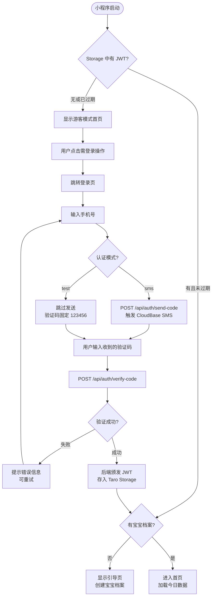

# F01 · 用户登录与注册

> 功能 ID：—（基础能力，无单独 ID）  
> 优先级：P0  
> 状态：**已完成** ✅  
> 最后更新：2026-05-03（对齐小程序实际实现）

## 功能描述

MVP 阶段支持**手机号 + 短信验证码**方式登录（登录即注册），不支持微信授权/密码等其他登录方式。

**平台实现**：微信小程序（主平台），通过 CloudBase SMS OTP + 后端自颁 JWT 完成认证。

## 登录方式

**验证码登录**（唯一方式）：输入手机号 → 获取短信验证码（60 秒倒计时）→ 填入验证码 → 登录。首次使用（未注册）时，登录即注册，自动创建账号。

**双认证模式**（开发效率优化）：
- **生产模式（sms）**：调用 CloudBase Auth 发送真实短信验证码
- **测试模式（test）**：固定验证码 `123456`，跳过 SMS 发送，用于开发调试

模式通过环境变量 `TARO_APP_AUTH_MODE`（小程序端）/ `AUTH_MODE`（服务端）控制。

## 游客预览模式

未登录用户可正常进入小程序首页，查看功能布局和界面：
- 首页展示空状态的统计卡片和功能入口
- 点击任何需要登录的操作（记录、编辑等）时，显示 `LoginGuide` 组件引导登录
- 游客模式不会创建任何服务端数据

## 认证流程（小程序端实现）

## 后端 API

| 端点 | 方法 | 说明 |
|------|------|------|
| `/api/auth/send-code` | POST | 发送短信验证码（body: `{ phone }`) |
| `/api/auth/verify-code` | POST | 验证码校验 + 登录/注册（body: `{ phone, code }`） |
| `/api/auth/tcb-login` | POST | CloudBase token 换发 JWT（备用） |
| `/api/auth/me` | GET | 获取当前用户信息（需 Bearer Token） |

## Token 管理

- JWT 有效期 30 天
- 存储位置：Taro Storage（key: `token`）
- 每次 HTTP 请求通过 `http.ts` 自动附加 `Authorization: Bearer <token>`
- 收到 401 响应时：清除本地 Token → 跳转登录页

## 业务规则

- 手机号格式校验：大陆 11 位手机号，不合法时禁用「获取验证码」按钮
- 获取验证码按钮 60 秒倒计时，期间不可重复点击
- 服务端限流：同手机号 60s 内只能发 1 次
- 未注册手机号验证通过后自动创建 `user_account` 记录
- 登录成功后：有宝宝档案 → 首页；无档案 → 引导页（Onboarding）

## 验收标准（AC）

- [x] 大陆 11 位手机号格式校验生效，不合法时按钮置灰
- [x] 获取验证码按钮 60 秒倒计时，期间不可重复点击
- [x] 未注册手机号登录即注册，自动生成账号
- [x] 登录成功后：有档案 → 首页；无档案 → 引导页
- [x] 登录失败展示友好错误提示，支持重试
- [x] 游客可浏览首页，点击操作时引导登录
- [x] test 模式下固定验证码 123456 可正常登录
- [x] 401 响应自动清除 Token 并跳转登录页

## 相关文件

- 小程序登录页：`minicare-mp/src/pages/login/index.tsx`
- 小程序 HTTP 封装：`minicare-mp/src/api/http.ts`
- 小程序认证 API：`minicare-mp/src/api/auth.ts`
- 服务端认证模块：`minicare-server/src/auth/`
- CloudBase SDK 初始化：`minicare-mp/src/lib/cloudbase.ts`
