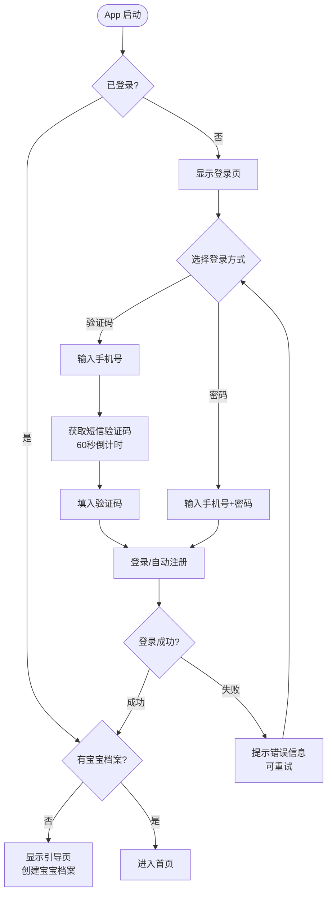

# F01 · 用户登录与注册

> 来源：MVP-PRD.md §2.4.0  
> 功能 ID：—（基础能力，无单独 ID）  
> 优先级：P0  
> 最后同步：2026-03-29

## 功能描述

MVP 阶段仅支持**手机号**方式注册与登录，不支持微信/Apple 等第三方登录。

## 登录方式

- **验证码登录**（默认）：输入手机号 → 获取短信验证码（60 秒倒计时）→ 填入验证码 → 登录；首次使用（未注册）时，登录即注册。
- **密码登录**（可选）：输入手机号 + 密码 → 登录；密码由首次注册后在「我的」中设置。

## 业务规则

- 手机号格式校验：大陆 11 位手机号，不合法时禁用「获取验证码」按钮并给出红色提示。
- 登录成功后，若检测到**无宝宝档案** → 跳转引导页（→ 见模块 02-onboarding）；若有档案 → 直接进入首页。

## 交互示意图

```
┌──────────────────────────────┐
│  登录页                       │
│ ┌────────────────────────┐   │
│ │  [icon] 敏宝日记  插画区域 │   │
│ └────────────────────────┘   │
│                               │
│ [验证码登录]  [密码登录]        │ ← Tab 切换
│                               │
│ 手机号   [________________]   │
│ 验证码   [______] [获取验证码] │
│                               │
│ ┌────────────────────────┐   │
│ │         登  录          │   │
│ └────────────────────────┘   │
│                               │
│  没有账号？注册               │
└──────────────────────────────┘
```

## 交互流程



## 验收标准（AC）

- [ ] 大陆 11 位手机号格式校验生效，不合法时按钮置灰
- [ ] 获取验证码按钮 60 秒倒计时，期间不可重复点击
- [ ] 未注册手机号登录即注册，自动生成账号
- [ ] 密码登录与验证码登录可自由切换
- [ ] 登录成功后：有档案 → 首页；无档案 → 引导页
- [ ] 登录失败展示友好错误提示，支持重试

## UI 对应文件

- `ui-draft/login.html`
