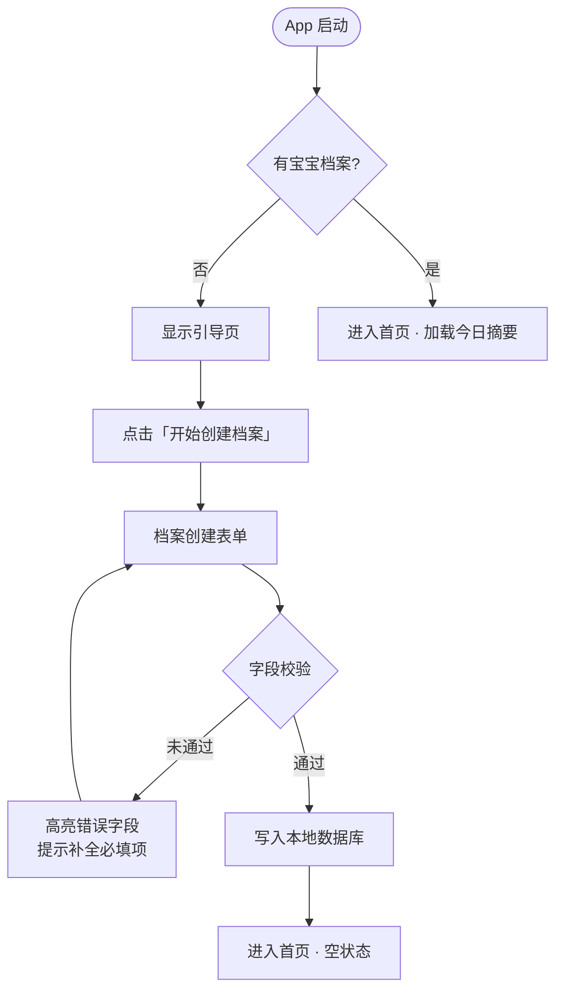

# F02 · 宝宝档案管理

> 来源：MVP-PRD.md §2.4.1、§2.4.11、§3.1  
> 功能 ID：P0-001  
> 优先级：P0  
> 最后同步：2026-03-29

## 功能描述

首次使用时展示引导页（价值说明），引导用户创建宝宝档案后进入首页。

## 操作流程

1. 启动 App，检测到**无宝宝档案** → 展示引导页（价值说明 + 「开始创建」）。
2. 进入档案表单：**必填** 姓名、出生日期、性别、过敏类型（默认「牛奶蛋白过敏」）；**可选** 过敏程度（轻度/中度/重度/未知）。
3. 点击「保存」→ 校验通过后写入本地数据库 → **进入首页**（显示空状态或「今日尚无记录」提示）。
4. 若已有档案（非首次启动）→ 直接进入首页，加载当日摘要。

## 业务规则

- **本版 MVP 支持单个宝宝档案**；多宝宝管理留到后续迭代版本实现
- 身高、体重、头围等生长数据**不在注册页强制要求**，移至「生长记录」模块填写
- 过敏程度「未知」不影响后续记录，可后续补充
- 过敏程度选择「未知」时，显示 CDC 评分标准链接供用户自测
- 创建档案的用户自动成为「创建者」（最高权限）
- **本版 MVP 支持单个宝宝档案**；多宝宝管理（支持二胎家庭）留到后续迭代

## 交互示意图

```
┌──────────────────────┐      ┌──────────────────────┐
│     引导页            │      │    宝宝档案创建页      │
│ ┌──────────────────┐ │      │ ┌──────────────────┐ │
│ │   [icon] App Logo  │ │      │ │  ← 返回           │ │
│ │                  │ │      │ └──────────────────┘ │
│ │  专为敏宝家庭设计  │ │      │                      │
│ │  · 结构化记录     │ │  ──▶ │ 宝宝姓名  [________] │
│ │  · 一键生成报告   │ │      │ 出生日期  [日期选择器]│
│ │  · 就医沟通更顺畅 │ │      │ 性  别    ○男  ○女   │
│ └──────────────────┘ │      │ 过敏类型  [牛奶蛋白过敏 ▼] │
│                      │      │ 过敏程度  ○轻 ○中 ○重 ○未知 │
│ ┌──────────────────┐ │      │ ── 提示 ──────────  │
│ │   开始创建档案    │ │      │ [i] 不确定过敏程度？ │
│ └──────────────────┘ │      │ [查看 CDC 评分标准]  │
└──────────────────────┘      │ ┌──────────────────┐ │
                               │ │     保 存          │ │
                               │ └──────────────────┘ │
                               └──────────────────────┘
```

## 交互流程



## 数据库表

`baby_profile` 表 — 见 `05-data-schema.md`

## 验收标准（AC）

- [ ] 无档案时必须展示引导页，不可跳过直接进入首页
- [ ] 宝宝姓名、出生日期、性别、过敏类型为必填，保存前校验
- [ ] 过敏类型默认选中「牛奶蛋白过敏」，界面展示中文
- [ ] 过敏程度选「未知」时展示 CDC 评分标准链接/提示框
- [ ] 身高/体重/头围不在此页显示
- [ ] 保存成功后进入首页，显示空状态（「今日尚无记录」）
- [ ] 已有档案时直接进入首页，不再展示引导页

## UI 对应文件

- `ui-draft/onboarding.html`（引导页 + 初始创建）
- `ui-draft/profile.html`（我的页面档案编辑入口）

---

## 档案编辑（已有档案时）

**入口**：「我的」Tab → 点击宝宝卡片 → 进入档案编辑页

### 可编辑字段

| 字段 | 必填 | 说明 |
|------|------|------|
| 宝宝姓名 | ✅ | 文本输入 |
| 出生日期 | ✅ | 日期选择器 |
| 性别 | ✅ | 男/女单选 |
| 过敏类型 | ✅ | 默认「牛奶蛋白过敏」，下拉选择 |
| 过敏程度 | ❌ | 轻度/中度/重度/未知 |

- 选择「未知」时显示 CDC 评分标准链接
- 修改后保存即全局生效（含统计报告封面信息）

### 交互示意图

```
┌──────────────────────────────┐     ┌──────────────────────────────┐
│  我的（Tab 4）                │     │  宝宝档案编辑页               │
│ ┌────────────────────────┐   │     │ ┌────────────────────────┐   │
│ │ [icon] 小宝  3个月12天  │   │     │ │ ← 返回     编辑档案     │   │
│ │ 牛奶蛋白过敏 · 中度     │   │     │ └────────────────────────┘   │
│ │ 点击编辑档案 ›          │   │  ──▶│                               │
│ └────────────────────────┘   │     │ 宝宝姓名  [小宝_________]    │
│                               │     │ 出生日期  [2025-12-16  ▼]   │
│ ── 设置 ──────────────────── │     │ 性  别    ●男  ○女           │
│ 大字体模式    ◉ 开启          │     │ 过敏类型  [牛奶蛋白过敏 ▼]  │
│ 家庭成员管理  →               │     │ 过敏程度  ○轻度 ●中度        │
│                               │     │           ○重度 ○未知         │
│ ── 危险操作 ───────────────  │     │                               │
│ 清空本机数据  →               │     │           保  存               │
│                               │     └──────────────────────────────┘
│ ── 关于 ───────────────────  │
│ 版本号        v1.0.0          │
└──────────────────────────────┘
```

---

## 应用设置

| 设置项 | 功能 |
|--------|------|
| 大字体模式 | 开关，立即生效，字体切换至 20pt+ |
| 家庭成员管理 | 进入成员列表页（→ 见 F12-family.md） |
| 清空本机数据 | 二次确认后删除本地数据库 |
| 手动导出备份 | 导出全部数据为 JSON/SQLite 格式文件 |
| 关于 | 显示版本号、关于页面 |

### 备份与恢复

MVP 仅实现本地手动备份：
1. **手动导出备份**：「我的」→「导出备份包」→ 导出为本地文件（JSON 或 SQLite），可通过系统分享存入文件 App
2. **随系统备份**：iOS 随 iCloud 备份、Android 随 Google/厂商备份自动纳入，无需额外开发
3. **数据恢复**：支持从已导出的备份包恢复数据（导入时提示「将覆盖当前数据，请确认」）

### 验收标准（AC）

- [ ] 点击「我的」页宝宝卡片进入档案编辑页
- [ ] 必填字段预填当前数据，保存后全局生效
- [ ] 大字体模式开关立即生效，无需重启
- [ ] 清空本机数据需二次确认弹窗
- [ ] 手动导出备份生成文件，可通过系统分享保存
