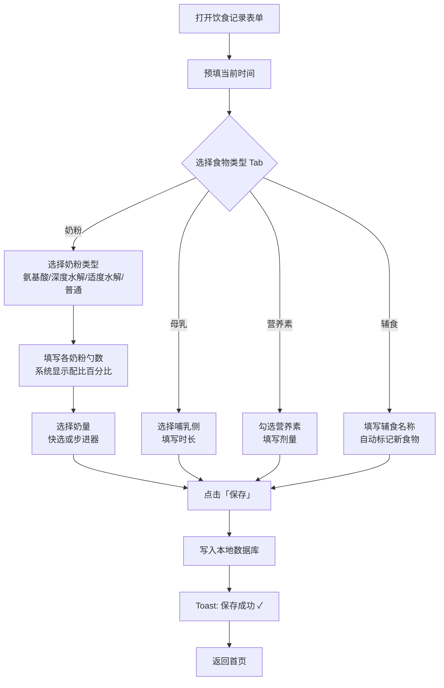

# F03 · 饮食记录

> 功能 ID：P0-002  
> 优先级：P0  
> 状态：**已完成** ✅  
> 最后更新：2026-05-03（对齐 4 表拆分实现 + 小程序端）
>
> **数据模型变更（Migration 008）**：原单表 `feeding_record` 已拆分为 4 张独立表：
> - `feeding_breast_record` — 母乳喂养
> - `feeding_formula_record` + `feeding_formula_mix` — 配方奶（含奶粉配比明细）
> - `feeding_food_record` + `feeding_food_item` — 辅食（含食物明细）
> - `feeding_supplement_record` — 营养素补充（supplement_items JSON）
>
> 每种喂养类型独立成表，避免大量 NULL 列，查询更高效。

## 功能描述

记录敏宝的转奶过程、奶量、营养素补充和辅食添加情况。小程序端通过 4 个 Tab 页签对应 4 种喂养类型，每次记录保存到对应的独立表中。

## 表单设计（Tab 页签）

饮食记录表单采用 **Tab 页签** 设计，将四大类饮食分开记录，每次仅记录一种食物类型：

| Tab | 内容 |
|-----|------|
| 奶粉 | 奶粉类型选择 + 配比勺数 + 奶量 |
| 母乳 | 哺乳侧（左/右/双侧）+ 时长 |
| 营养素 | 维生素D/铁/益生菌等剂量 |
| 辅食 | 食物名称 + 新食物标记 |

顶部导航栏移除语音/自然语言快捷入口按钮。

---

## 奶粉 Tab 功能

### 核心交互

- **奶粉类型多选**：氨基酸奶粉 / 深度水解奶粉 / 适度水解奶粉 / 普通奶粉，**支持同时选中多种类型**（转奶过渡期场景）
  - 未选中的奶粉类型，对应的配比输入行**自动隐藏**
  - 取消选中时**自动重置**对应勺数为 0

- **深度水解奶粉 · 含乳糖选项**：
  - 选中「深度水解奶粉」后，在其配比行下方额外展示「含乳糖」勾选框
  - 取消选中「深度水解奶粉」时，「含乳糖」勾选框随之**隐藏并重置为未选状态**

- **配比记录**：支持记录每一顿奶中不同奶粉的勺数（如 3 勺深度水解 + 1 勺氨基酸），系统自动计算并展示各奶粉比例百分比

- **奶量录入**：提供常用快选（60ml、90ml、120ml、150ml、180ml）及步进器调整，自动计算 24 小时总奶量

### 交互示意图

```
┌──────────────────────────────┐
│  饮食记录                     │
│ ┌────────────────────────┐   │
│ │ ← 返回      饮食记录    │   │
│ └────────────────────────┘   │
│                               │
│ ┌──────Tab页签──────────────┐ │
│ │[奶粉] [母乳] [营养素][辅食]│ │
│ └────────────────────────┘   │
│                               │
│ 喂养时间   [08:30  ▼]         │
│                               │
│ ── 奶粉 Tab（默认选中）──── │
│ ☑氨基酸  ☑深度水解           │  ← 多选，可同时选中多种
│ ☐适度水解 ☐普通奶粉          │
│                               │
│ ── 配比记录 ──────────────  │
│ 氨基酸奶粉  [3] 勺           │  ← 选中的奶粉显示配比行
│ 深度水解    [1] 勺           │
│   ☑ 含乳糖                    │  ← 选深度水解时出现
│ → 共4勺 75%:25%              │
│                               │
│ 奶  量   [60][90][120][150]  │
│          [−] 120ml [＋]      │
│                               │
│ ┌────────────────────────┐   │
│ │         保  存          │   │
│ └────────────────────────┘   │
└──────────────────────────────┘
```

---

## 母乳 Tab 功能

- 记录哺乳侧（左侧 / 右侧 / 双侧）和哺乳时长

---

## 营养素 Tab 功能

- 预设常见营养素类型：维生素 D、铁、益生菌、益生元、钙等
- 手动勾选并填写剂量
- 提供周期提醒功能（**后续迭代**，本版不实现）

---

## 辅食 Tab 功能

- 支持新食物标记和过敏风险提示
- 记录辅食种类（手动输入或从历史记录选择）

### 新食物观察期业务规则

> ⚠️ 以下规则均为**临床参考默认值**，App 中所有相关提示须附注「请以就诊医生建议为准」。

**触发条件**：食物名称/品类在当前宝宝历史记录中从未出现 → 系统自动开启 **5 天观察期**并标记为「新食物 🟡」

**八大高风险过敏原**（牛奶、鸡蛋、花生、坚果、鱼类、甲壳类、小麦、大豆）首次记录时，额外展示风险提示卡片

**观察期状态机**：

```
[未引入]
  ↓ 首次记录
[观察期中 🟡]  默认 5 天，可在 3～7 天间手动调整
  ↓ 无表现 + 用户确认
[已耐受 ✅]
  ↓ 出现可疑过敏表现
[疑似过敏 🟠]
  ↓ 第 2 次引入仍出现表现
[确认过敏 🔴]  建议就医，6 个月内不主动引入
```

---

## 转奶核心业务规则

> ⚠️ 以下规则均为**临床参考默认值**，App 中所有相关提示须附注「请以就诊医生建议为准」。

### 标准转奶路径

```
氨基酸奶粉（稳定期 6～12 个月）
    ↓  2～4 周混合过渡期
深度水解奶粉（稳定期 3～6 个月）
    ↓  2～4 周混合过渡期
适度水解奶粉（稳定期 3 个月）
    ↓  2～4 周混合过渡期
普通奶粉（达成免疫耐受）
```

### 混合过渡比例（每 2～3 天调整一次）

| 天数     | 新奶粉占比 | 旧：新 比例 |
| -------- | ---------- | ----------- |
| Day 1～2 | 25%        | 3 : 1       |
| Day 3～4 | 50%        | 1 : 1       |
| Day 5～6 | 75%        | 1 : 3       |
| Day 7+   | 100%       | 0 : 1       |

### 升级条件（全部满足）

1. 已在当前阶段完成最低稳定期
2. **连续无表现 ≥ 14 天**（皮肤、消化道、呼吸道均无可疑反应）
3. 宝宝生长发育正常，体重增长达标

### 进度百分比计算规则

- 进度 = 各阶段加权无表现天数之和 / 总目标天数
- 阶段权重：氨基酸 40%、深度水解 30%、适度水解 20%、普通奶粉过渡期 10%
- **进度不自动累加**：仅在家长当日主动记录「今日无表现」后才计入
- 进度达到 100% 后，仅显示「可咨询医生评估是否升级」提示，系统不自动触发升级

### 发生过敏反应时的回退规则

| 严重程度 | 判断标准 | 回退操作 | 等待重试时间 |
| -------- | -------- | -------- | ------------ |
| 轻度 | 轻微皮疹（< 体表 5%）、轻微腹痛 | 退回上一步混合比例（如 75% → 50%） | 表现消失 ≥ 48h 后可继续推进 |
| 中度 | 较广泛皮疹、呕吐 ≥ 2 次、腹泻 | 退回上一完整阶段（100% 旧奶粉） | 无表现 ≥ 2 周后重新开始过渡期 |
| 重度 | 荨麻疹 + 血管性水肿、呼吸困难 | 立即退回氨基酸奶粉 | ≥ 3 个月，需重新医学评估 |

- App 不自动触发回退——用户需主动操作「记录过敏反应」并选择「执行回退」

---

## 交互流程



## 数据库表

`feeding_record` 表 — 见 `05-data-schema.md`

## 验收标准（AC）

### 奶粉 Tab
- [ ] 四种奶粉类型可同时多选
- [ ] 选中某奶粉类型时，对应配比输入行出现
- [ ] 取消选中时，配比行隐藏，勺数重置为 0
- [ ] 选中「深度水解奶粉」后，其配比行下方出现「含乳糖」勾选框
- [ ] 取消选中「深度水解奶粉」时，「含乳糖」勾选框隐藏并重置
- [ ] 多种奶粉选中时，系统自动计算并展示比例百分比（如 75%:25%）
- [ ] 奶量快选（60/90/120/150/180ml）和步进器均可使用
- [ ] 自动计算并显示当日累计总奶量

### 母乳 Tab
- [ ] 可选择哺乳侧（左侧/右侧/双侧）
- [ ] 可填写哺乳时长

### 营养素 Tab
- [ ] 预设常见营养素类型可勾选
- [ ] 可填写剂量

### 辅食 Tab
- [ ] 可手动输入食物名称
- [ ] 首次录入新食物自动开启 5 天观察期
- [ ] 八大高风险过敏原首次录入展示风险提示卡片

### 通用
- [ ] 保存成功后显示 Toast 并返回首页

## UI 对应文件

- `ui-draft/form-feeding.html`
