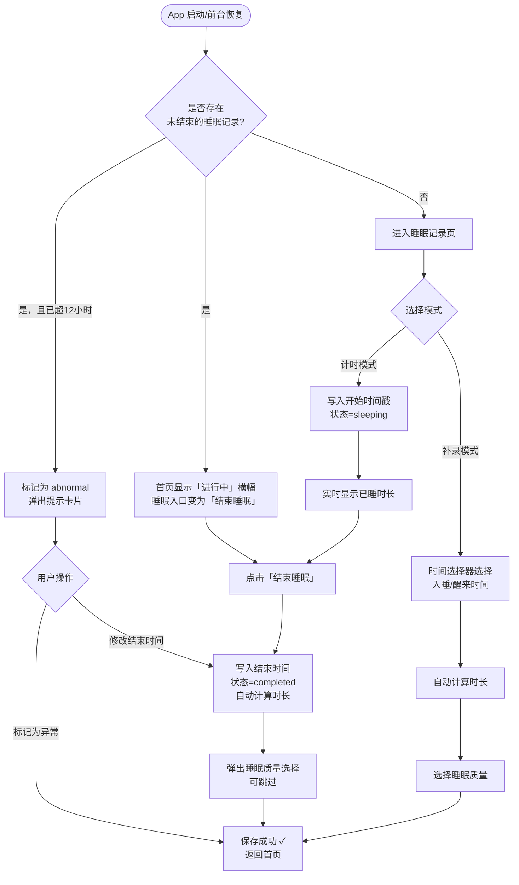

# F04 · 睡眠记录

> 来源：MVP-PRD.md §2.4.3、§3.2.6  
> 功能 ID：P0-007  
> 优先级：P0  
> 最后同步：2026-03-29

## 功能描述

记录宝宝的睡眠时长、入睡/醒来时间和睡眠质量；支持计时模式和补录模式。

## 核心功能

### 计时模式
1. 在睡眠表单点击「开始睡眠」→ **立即将开始时间戳写入本地数据库**（状态标记为 `sleeping`）
2. 实时显示已睡时长（根据当前时间与开始时间差计算，不依赖内存维持）
3. 再次进入或点击「结束睡眠」→ 写入结束时间，自动计算时长 → 保存

### 补录模式
- 直接选择入睡与醒来时间（或选预设时长）→ 选睡眠质量 → 保存

## 计时模式中断与异常态处理规则

1. **数据持久化**：点击「开始睡眠」后，立即将开始时间戳写入本地数据库（状态标记为 `sleeping`）

2. **重新进入时的状态恢复**：App 冷启动或从后台唤醒时，检测是否存在 `sleeping` 状态的未结束记录：
   - 若存在 → **首页顶部显示「进行中」横幅**（显示已睡时长），**睡眠快捷入口**变为「⏹ 结束睡眠」状态
   - 若不存在 → 正常加载今日摘要

3. **超时自动异常标记**：计时开始后超过 **12 小时**仍未结束，系统自动将该记录标记为 `status = abnormal`，下次打开时显示提示卡片：「有一条睡眠记录持续超过 12 小时，可能是忘记结束，请手动修正」；用户可选择「修改结束时间」或「标记为异常记录」

4. **结束睡眠流程**：点击「结束睡眠」→ 写入结束时间戳 → 状态更新为 `completed` → 自动计算时长 → 弹出睡眠质量选择弹窗（可跳过）→ 保存成功 → 返回首页

## 输入方式

- **手动/快选**：时间选择器选择入睡和醒来时间，快速选择常见时段
- **自然语言**：「昨晚 22 点半睡着，早上 8 点醒」→ 系统解析 → 确认卡片 → 确认保存
- **语音**：说出睡眠情况 → 语音转文字 → 解析 → 确认
- **拍照/图片**：拍摄纸质睡眠记录表 → **仅做图片留档，不做 OCR 识别**；时间字段需用户手动输入

## 交互示意图

```
┌──────────────────────────────┐    ┌──────────────────────────────┐
│  睡眠记录（计时模式）          │    │  睡眠记录（补录模式）           │
│                               │    │                               │
│  ┌──────────────────────┐    │    │ 入睡时间  [22:30  ▼]          │
│  │   宝宝睡着了          │    │    │ 醒来时间  [08:00  ▼]          │
│  │   已睡  2h 30m        │    │    │ 睡眠时长  自动计算  9h 30m    │
│  │   开始  09:30         │    │    │                               │
│  └──────────────────────┘    │    │ 睡眠时段  ○夜间  ○上午  ○下午 │
│                               │    │                               │
│  ┌──────────────────────┐    │    │ 睡眠质量  良好 / 一般 / 较差  │
│  │   ⏹ 结束睡眠         │    │    │                               │
│  └──────────────────────┘    │    │ 备  注  [__________________]  │
│                               │    │                               │
│  模式切换: [计时] [补录]       │    │         保  存                │
└──────────────────────────────┘    └──────────────────────────────┘
```

## 交互流程



## 数据库表

`sleep_record` 表 — 见 `05-data-schema.md`

关键字段：
- `status`：`sleeping`（计时中）/ `completed`（已结束）/ `abnormal`（异常超时）
- `start_time`：点击「开始睡眠」时立即写入
- `end_time`：结束时写入，NULL 表示计时进行中

## 验收标准（AC）

### 计时模式
- [ ] 点击「开始睡眠」立即将开始时间戳写入数据库，状态为 `sleeping`
- [ ] App 被杀死或后台唤醒后，仍能正确显示进行中横幅和已睡时长
- [ ] 计时超过 12 小时自动标记为 `abnormal`，下次打开时显示提示卡片
- [ ] 点击「结束睡眠」完成流程，弹出睡眠质量选择（可跳过）

### 补录模式
- [ ] 可通过时间选择器选择入睡/醒来时间，系统自动计算时长
- [ ] 可通过自然语言/语音输入，经解析确认卡片确认后保存
- [ ] 可上传纸质记录照片（仅留档，不做 OCR）

### 通用
- [ ] 支持快速选择常见睡眠时段（夜间/上午/下午）
- [ ] 保存成功后显示 Toast 并返回首页

## UI 对应文件

- `ui-draft/form-sleep.html`
