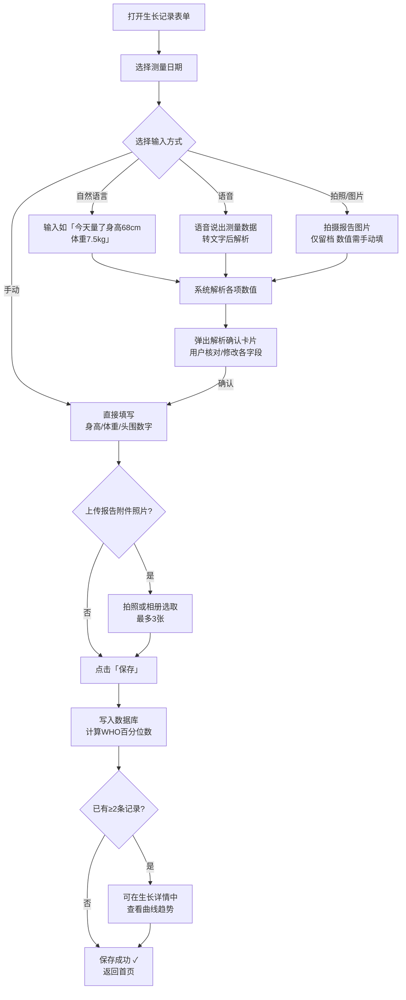

# F09 · 生长发育记录

> 来源：MVP-PRD.md §2.4.8、§3.2.7  
> 功能 ID：P0-008  
> 优先级：P0  
> 最后同步：2026-03-29

## 功能描述

记录宝宝的身高、体重、头围等生长数据，自动生成与 WHO 标准对比的生长曲线。

## 操作流程

1. 提供标准的测量数据输入界面；支持以下输入方式：
   - **手动输入**：直接填写身高、体重、头围数字
   - **自然语言**：输入「今天量了身高 68cm，体重 7.5kg」→ 解析数值 → 确认
   - **语音**：说出测量数据 → 转文字 → 解析 → 确认
   - **拍照/图片**：拍摄儿保手册或测量报告单 → **仅做图片附件留档**；身高/体重/头围数值需用户手动输入

2. 拍照上传测量报告作为附件存档
3. 自动关联到最近的儿保检查记录
4. 实时生成生长曲线并与 WHO 标准对比

## 业务规则

- 采用 **WHO 0-1 岁儿童生长标准**作为对比基准
- 计算并显示各项指标的**百分位数（P3-P97）**
- 本版仅展示生长曲线与百分位数，**不做异常判断与预警**（后续迭代）
- 多维度生长数据分析（体重/身高/头围的协调性）留到后续迭代

## 交互示意图

```
┌────────────────────────────────────┐
│  生长记录                           │
│                                     │
│ 测量日期  [2026-03-28  ▼]           │
│ 测量机构  [北京儿童医院___] (可选)   │
│                                     │
│ ── 测量数据 ─────────────────────  │
│ 身  高    [___] cm                  │
│ 体  重    [___] kg                  │
│ 头  围    [___] cm                  │
│                                     │
│ 上传测量报告照片（可选，最多3张）    │
│ ┌────────┐ ┌────────┐             │
│ │  添加  │ │  添加  │             │
│ └────────┘ └────────┘             │
│                                     │
│ ── 自动计算（保存后可见）──────────  │
│ 身高百分位  P[__]（WHO标准）        │
│ 体重百分位  P[__]（WHO标准）        │
│                                     │
│              保  存                  │
└────────────────────────────────────┘
```

## 交互流程



## 数据库表

`growth_record` 表 — 见 `05-data-schema.md`

## 验收标准（AC）

- [ ] 测量日期必填，默认为今日
- [ ] 身高/体重/头围为必填数字字段
- [ ] 测量机构为可选文本字段
- [ ] 支持自然语言/语音输入，经解析确认卡片确认后保存
- [ ] 可上传测量报告照片（最多 3 张，仅留档）
- [ ] 保存成功后自动计算 WHO 百分位数并展示
- [ ] 已有 ≥2 条记录时，可在生长详情中查看曲线

## UI 对应文件

- `ui-draft/form-growth.html`
