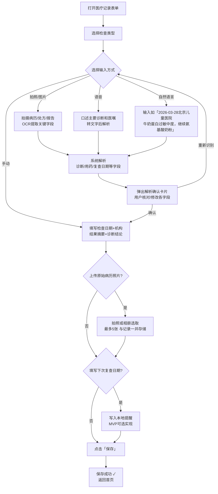

# F10 · 医疗记录

> 来源：MVP-PRD.md §2.4.9、§3.2.8  
> 功能 ID：P0-009  
> 优先级：P0  
> 最后同步：2026-03-29

## 功能描述

记录儿保检查、过敏科就诊、各项检查报告等医疗信息。

## 功能细节

### 儿保检查记录功能

- 预设常见儿保检查项目：听力筛查、视力检查、髋关节 B 超等
- 记录检查结果和医生建议；支持自然语言输入
- 自动生成下次检查提醒（**MVP 可选实现**）

### 过敏相关检查记录功能

- 支持记录过敏原检测结果（皮肤点刺试验、血清特异性 IgE 等）
- 记录嗜碱性粒细胞活化试验（BAT）等生物标志物数据
- 提供检查结果的医学解读参考

### 病历和处方记录功能

**输入方式**（按优先级）：

1. **拍照/图片输入**（医疗记录模块唯一支持 OCR 的场景）：
   - 拍摄病历、处方单、检查报告 → **OCR 提取**诊断结论、用药、下次复查日期等关键字段
   - 弹出「解析确认卡片」供用户核对 → 确认保存
   - 原始图片同步作为附件存储（最多 5 张）

2. **语音输入**：口述主要诊断和医嘱 → 转文字 → 解析字段 → 确认

3. **自然语言输入**：输入「2026-03-28 北京儿童医院，牛奶蛋白过敏中度，继续氨基酸奶粉，下次 6 月复查」→ 解析 → 确认

4. **手动输入**：直接填写结构化字段

## 交互示意图

```
┌──────────────────────────────┐
│  医疗记录表单                 │
│                               │
│ 检查类型  [儿保检查 ▼]         │
│           ○儿保 ○过敏检查      │
│           ○就诊 ○自定义        │
│                               │
│ 检查日期  [2026-03-28  ▼]     │
│ 检查机构  [_______________]   │
│                               │
│ ── 检查结果 ──────────────── │
│ 结果摘要  [_______________]   │
│           [_______________]   │
│ 诊断结论  [_______________]   │
│                               │
│ 用药情况  [_______________]   │
│ 下次复查  [_______________]   │
│                               │
│ 上传病历/报告照片（最多5张）   │
│ ┌──────┐┌──────┐┌──────┐    │
│ │  📷  ││  📷  ││  ＋  │    │
│ └──────┘└──────┘└──────┘    │
│                               │
│              保  存            │
└──────────────────────────────┘
```

## 交互流程



## 数据库表

`medical_record` 表 — 见 `05-data-schema.md`

关键字段：
- `visit_type`：0=儿保检查，1=过敏相关检查，2=门诊就诊，3=自定义
- `photo_paths`：JSON 数组，最多 5 张
- `ocr_text`：OCR 从照片中提取的原始文字（用于用户确认前展示）
- `next_visit_date`：下次复查日期，填写后写入本地提醒（MVP 可选实现）

## 验收标准（AC）

- [ ] 检查类型可选（儿保/过敏检查/就诊/自定义）
- [ ] 检查日期必填，默认今日
- [ ] 拍照 OCR 提取关键字段，弹出解析确认卡片
- [ ] 可语音/自然语言输入，经解析确认卡片确认后保存
- [ ] 可上传病历/报告照片（最多 5 张，与记录一并存储）
- [ ] 填写下次复查日期时，写入本地提醒（MVP 可选）
- [ ] 保存成功后显示 Toast 并返回首页

## 特别说明

**OCR 边界**：本 App 仅医疗记录模块支持 OCR 文字提取；其他所有模块的照片输入**仅做留档，不做 OCR**。

## UI 对应文件

- `ui-draft/form-medical.html`
