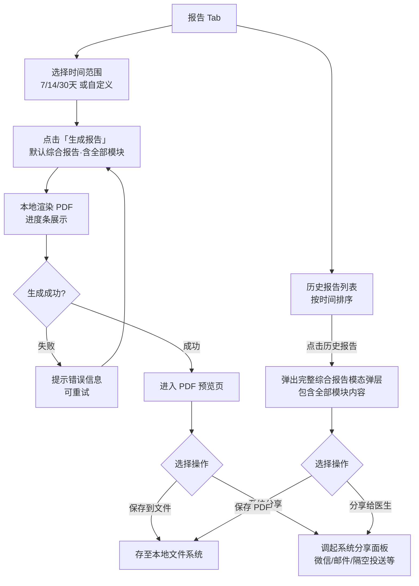

# F11 · 统计报告生成与导出

> 来源：MVP-PRD.md §2.4.10、§3.2.9  
> 功能 ID：P0-010  
> 优先级：P0  
> 最后同步：2026-03-29

## 功能描述

根据记录数据生成统计分析和 PDF 报告，用于就医和家庭管理。

## 报告类型

固定为**综合报告**（包含所有已记录模块），不提供报告类型选择和包含模块勾选；历史报告点击后展示包含全部模块的完整综合报告。

## 时间范围选择

- 单日：查看某一特定日期的记录汇总
- 一周：最近 7 天的数据统计
- 双周：最近 14 天的数据统计
- 月度：最近 30 天的数据统计
- 自定义：用户自选起止日期

## 报告内容结构

- **封面**：宝宝基本信息、报告时间范围
- **目录**：各章节内容导航
- **时间轴概览**：每日主要事件和表现
- **详细记录**：
  - 饮食记录汇总（奶量、辅食、营养素）
  - 睡眠记录统计（时长、质量）
  - 活动与状态记录（排便、精神状态）
  - 过敏表现记录（类型、程度、时间）
- **生长发育分析**：身高体重头围的变化趋势
- **医疗检查汇总**：历次检查结果
- **转奶进展追踪**：当前转奶阶段和进展

## 导出功能

- 支持 PDF 格式导出，文件大小控制在 **20MB 以内**
- 可选择导出内容范围（7 天/14 天/30 天/自定义）
- 支持通过微信、邮件等方式分享
- 提供打印功能，便于就医时使用

## 交互示意图

```
┌──────────────────────────────┐     ┌──────────────────────────────┐
│  报告 Tab                    │     │  历史报告 · 综合报告详情       │
│                               │     │                               │
│  生成综合报告 · 一键分享给医生│     │ ── 饮食 ────────────────── │
│                               │     │ 总奶量 3,360ml · 日均 480ml  │
│ 时间范围                      │     │                               │
│ [7天] [14天] [30天] [自定义]  │     │ ── 睡眠 ────────────────── │
│                               │     │ 总睡眠 62.5h · 日均 8.9h    │
│ 将生成综合报告，覆盖 7天，    │     │                               │
│ 包含全部模块约 4-6 页 PDF。   │     │ ── 活动/尿布/生长 ─────── │
│                               │     │ 数据统计...                   │
│       生成报告                 │     │                               │
│                               │     │ ── 健康/医疗/表现 ─────── │
│ 历史报告                      │     │ 本周无异常 ✓                  │
│ [综合报告 7天] [综合报告 30天]│     │                               │
└──────────────────────────────┘     │  分享给医生  │  保存 PDF      │
                                       └──────────────────────────────┘
```

## 交互流程



## 验收标准（AC）

- [ ] 报告 Tab 展示时间范围选择（7/14/30天/自定义）
- [ ] 点击「生成报告」触发本地 PDF 渲染，有进度条展示
- [ ] PDF 生成成功后可预览
- [ ] 预览页支持「保存到文件」和「系统分享」
- [ ] 历史报告列表按时间排序显示
- [ ] 点击历史报告打开包含全部模块的完整综合报告模态弹层
- [ ] PDF 文件大小 ≤20MB
- [ ] PDF 生成时间 ≤5 秒（含进度条提示）
- [ ] 支持通过微信、邮件等方式分享

## UI 对应文件

- `ui-draft/report.html`
