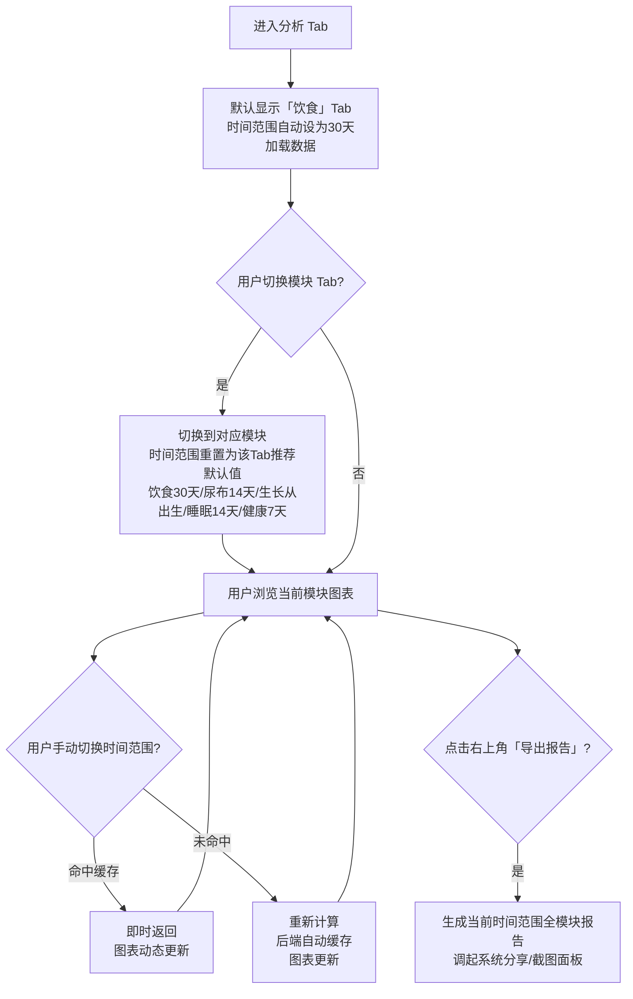

# F11 · 数据分析（原：统计报告）

> 功能 ID：P0-010  
> 优先级：P0  
> 状态：**已完成** ✅  
> 最后更新：2026-05-03（补充小程序 ECharts 截图模式实现说明）
>
> **小程序图表实现**：使用 ECharts 6 + Canvas 截图模式。Canvas 在屏幕外区域渲染完成后
> 截图为 Image 组件展示，彻底解决微信小程序 Canvas 层级覆盖问题和滚动延迟问题。
> 按需引入 Line/Bar/Scatter/Pie + Grid/Tooltip/Legend/Dataset，控制包体积。
>
> **API 设计**：chart-data 已拆分为 5 个独立端点 `/api/family/:id/report/chart-data/:category`，
> category 为 feeding/diaper/sleep/health/growth，按 Tab 独立请求。

---

## 一、功能定位与设计原则

**核心定位**：从"生成 PDF 报告"转变为**数据洞察驱动的成长分析看板**。帮助家长从持续记录的数据中发现规律、识别异常、感知成长——让每一条记录都产生价值，而不只是留存数字。

**设计原则**：

- **图表优先**：每个分析模块以图表为核心，数字为辅助
- **参考线指引**：生长曲线附百分位参考区间，奶量/睡眠附同龄推荐值参考线，让"是否正常"一目了然
- **异常可见**：通过颜色/标记点突出异常数据（发烧、奶量骤降、生长迟缓等），主动提示家长关注
- **模块横向切换**：各分析维度以横向 Tab 展示，聚焦单一主题，减少信息过载

**Tab 标签变更**：底部导航第三个 Tab 由「报告」改为「**分析**」。

---

## 二、时间范围选择

### 2.1 可选时间范围

| 选项       | 含义             | 适用场景                         |
| ---------- | ---------------- | -------------------------------- |
| **7天**    | 最近7天          | 快速查看近期状态                 |
| **14天**   | 最近14天         | 看短期趋势变化                   |
| **30天**   | 最近30天         | 月度复盘，分析趋势               |
| **从出生** | 宝宝出生至今全程 | 生长曲线等需要完整轨迹的场景     |
| **自定义** | 用户自选起止日期 | 特定阶段分析（如转奶期、生病期） |

### 2.2 各 Tab 差异化默认时间范围

> **设计原则**：时间范围应以「数据目的」为中心，而非统一框定。不同模块的数据价值密度和用户决策场景存在本质差异。

| Tab 模块 | 默认时间范围           | 核心理由                                                                                                                                                            |
| -------- | ---------------------- | ------------------------------------------------------------------------------------------------------------------------------------------------------------------- |
| **饮食** | **30天**               | 奶量波动在短期（7天）内受生病、生长加速等偶发因素干扰大；30天能平滑噪音，看到喂养结构从母乳→混合→配方的真实演变趋势                                                 |
| **尿布** | **14天**               | 大便频次在不同月龄变化极快（新生儿每天 8 次 vs 3月龄每1-2天一次）；30天会把「正常的频次降低」误读为「便秘趋势」；14天聚焦当前阶段的近期规律，异常更醒目             |
| **生长** | **从出生（完整曲线）** | 生长曲线的意义在于**轨迹**而非截面——P50附近稳定上行 vs 曲线突然平台期，只有看全程才能判断。WHO/国卫委的参考标准本身从出生起始，30天窗口会截断曲线，完全失去参照价值 |
| **睡眠** | **14天**               | 睡眠模式随月龄快速演变（昼夜颠倒→规律夜觉形成），14天能捕捉到作息节律的当前形态；30天会让近期的睡眠改善/退步被早期数据稀释                                          |
| **健康** | **7天**                | 健康数据（体温异常、情绪低落）本质是**异常信号监测**，不是趋势分析。家长看健康Tab几乎只有一个目的：最近几天宝宝有没有问题？7天已足够，更长反而干扰判断              |

### 2.3 生长 Tab 的时间选择器特殊设计

生长 Tab 的时间选择器选项与其他 Tab 不同，改为按阶段选择（而非按天数），并高亮「从出生」为默认：

| 选项             | 含义                 |
| ---------------- | -------------------- |
| **本月**         | 最近30天             |
| **3月**          | 最近3个月            |
| **6月**          | 最近6个月            |
| **从出生** ★默认 | 宝宝出生至今完整轨迹 |

> 原因：对一个100天的宝宝来说，「7天/14天」在生长曲线维度意义很弱；对一个1岁宝宝来说也不适用。按阶段选择更符合生长观察的实际需求。

### 2.4 Tab 切换时的时间范围行为

- **切换 Tab 时**：时间范围**自动重置为该 Tab 的推荐默认值**（例如：从饮食 Tab 切到生长 Tab，时间范围自动变为「从出生」）
- 用户可手动调整时间范围，调整后在当前 Tab 内有效
- 时间范围不跨 Tab 共享，每个 Tab 独立记忆用户最后一次选择（会话内）

---

## 三、分析模块详细规格

### 3.1 饮食分析

**模块色彩**：玫瑰粉 `#F87098`

#### 3.1.1 奶量趋势线（折线图）

| 属性     | 规格                                                                                            |
| -------- | ----------------------------------------------------------------------------------------------- |
| 图表类型 | 折线图（带填充渐变）                                                                            |
| X 轴     | 日期（7/14/30天对应不同密度）                                                                   |
| Y 轴     | 每日总奶量（ml）                                                                                |
| 数据来源 | `feeding_record.formula_ml`（feed_type=2 配方奶） + feed_type=1 母乳（母乳无法计 ml，显示次数） |
| 参考线   | 虚线：同月龄推荐奶量（见下表）                                                                  |
| 标注     | 奶量骤降（较前日下降 30% 以上）标记橙色警示点                                                   |

**同月龄推荐每日奶量参考（配方奶）**：

| 月龄    | 推荐每日奶量           | 数据来源          |
| ------- | ---------------------- | ----------------- |
| 0-1 月  | 450-600 ml             | 中国营养学会 2022 |
| 1-2 月  | 600-750 ml             | 同上              |
| 2-3 月  | 700-800 ml             | 同上              |
| 3-4 月  | 750-900 ml             | 同上              |
| 4-6 月  | 800-1000 ml            | 同上              |
| 6-12 月 | 600-800 ml（加辅食后） | 同上              |

#### 3.1.2 每日喂养结构（堆积柱状图）

| 属性     | 规格                                                                          |
| -------- | ----------------------------------------------------------------------------- |
| 图表类型 | 堆积柱状图                                                                    |
| X 轴     | 日期                                                                          |
| Y 轴     | 喂养次数（条形）或 ml（堆积）                                                 |
| 分层颜色 | 母乳：`#F9A8C0`（浅粉） / 配方奶：`#F87098`（主粉） / 辅食：`#DDB870`（暖黄） |
| 说明     | 直观看出各阶段喂养结构变化，适合辅食添加期观察                                |

#### 3.1.3 图表内嵌指标卡（图表底部悬浮显示）

> 不单独列「汇总数字」区块；关键结论直接内嵌在图表区域下方，作为图表的一部分展示。

- **日均奶量**（ml/天）+ 与同月龄推荐值的对比标注（达标 / 偏低）
- **今日最近一次奶量**（ml）

> 删除「期间总奶量」「喂养总次数」「占比」——总量计数对家长无决策价值；结构占比已由堆积柱状图直观呈现，无需重复。

---

### 3.2 尿布分析

**模块色彩**：薄荷绿 `#4CAF82`

#### 3.2.1 日均大便频次曲线（折线图）

| 属性       | 规格                                                         |
| ---------- | ------------------------------------------------------------ |
| 图表类型   | 折线图 + 柱状叠加（双轴可选）                                |
| X 轴       | 日期                                                         |
| Y 轴（左） | 当日大便次数（包含 diaper_type=2 大便 + diaper_type=3 混合） |
| 参考区间   | 填充区域：正常参考范围（见下表），超出范围的点标红           |
| 说明       | 便频异常是牛奶蛋白过敏的重要观察指标                         |

**同月龄正常大便频次参考（纯母乳/配方奶）**：

| 月龄    | 正常范围   | 说明                    |
| ------- | ---------- | ----------------------- |
| 0-1 月  | 1-10 次/天 | 新生儿多便正常          |
| 1-3 月  | 1-4 次/天  | 母乳宝宝可能 1-2 天一次 |
| 3-6 月  | 1-2 次/天  | 趋于规律                |
| 6-12 月 | 1-2 次/天  | 加辅食后逐渐减少        |

> ⚠️ 以上参考值来源：《中国0~6岁儿童营养发展报告》及中华医学会儿科学分会

#### 3.2.2 图表内嵌指标卡

> 尿布模块无独立汇总区块。图表本身已通过频次曲线 + 参考区间直观呈现状态，无需额外数字列表。

- 图表标题区显示：**近 N 天日均大便 X 次**（与参考范围对比，超出时字体变红）

> 删除「换尿布总次数」「大/小便次数分类计数」——纯计数型数字，家长不关心

---

### 3.3 生长发育分析

**模块色彩**：紫色 `#9B8ED8`

> ⚠️ **医学数据来源声明**：所有参考百分位曲线数据来源于 **国家卫生健康委员会《中国7岁以下儿童生长发育参照标准》（2023年版）**，适用中国儿童，与 WHO 参考标准分开呈现。

#### 3.3.1 体重趋势曲线（含百分位参考区间）

| 属性       | 规格                                                                                                                           |
| ---------- | ------------------------------------------------------------------------------------------------------------------------------ |
| 图表类型   | 折线图（数据点连线）                                                                                                           |
| X 轴       | 宝宝日龄（或月龄）；根据宝宝生日自动计算                                                                                       |
| Y 轴       | 体重（kg）                                                                                                                     |
| 参考区间带 | P3（警戒下线，红色虚线）/ P15（浅粉填充区下界）/ P50（中位参考线，绿色虚线）/ P85（浅粉填充区上界）/ P97（警戒上线，红色虚线） |
| 数据点标注 | 悬浮/点击显示：日期、体重值、对应百分位                                                                                        |
| 异常标记   | 连续 2 周体重不增加时，末尾数据点加橙色圆圈提示                                                                                |

#### 3.3.2 身高趋势曲线（含百分位参考区间）

与体重趋势曲线结构相同，Y 轴为身高（cm），参考区间使用国卫委 2023 年标准（按性别分区分显示，性别从宝宝档案读取）。

#### 3.3.3 头围趋势曲线（含百分位参考区间）

与体重趋势曲线结构相同，Y 轴为头围（cm）。

#### 3.3.4 生长状态卡（图表顶部固定显示，最显眼位置）

> 生长数据是「状态型」而非「汇总型」——家长最关心的是「宝宝现在在哪里」，不是「这段时间总增了多少」。状态卡直接回答当前位置，图表提供轨迹背景。

- **当前体重** X.X kg · **P XX**（百分位，颜色编码：P15~P85 绿色 / P3~P15 橙色 / <P3 红色）
- **较上次测量** + X g（Δ值，绿色上升箭头 / 红色平台警示）
- **测量日期**（距今 N 天）

> 此卡片随 [体重][身高][头围] 子 Tab 切换对应显示。无需「期间总增量」等汇总计算——Δ值相对上次测量更有意义。

**国家卫健委 2023 版生长参照表（男童，0-12月，部分关键节点）**：

> 以下数据为代码实现时的参考基准，实际实现需内嵌完整参照表（0-365天每日或按月龄的 P3/P15/P50/P85/P97 数据集）。

| 月龄 | 体重 P3 (kg) | P50 (kg) | P97 (kg) | 身高 P3 (cm) | P50 (cm) | P97 (cm) |
| ---- | ------------ | -------- | -------- | ------------ | -------- | -------- |
| 0月  | 2.5          | 3.3      | 4.4      | 46.1         | 50.0     | 53.7     |
| 1月  | 3.4          | 4.5      | 5.8      | 50.8         | 54.7     | 58.6     |
| 2月  | 4.3          | 5.6      | 7.1      | 54.4         | 58.4     | 62.4     |
| 3月  | 5.0          | 6.4      | 8.0      | 57.3         | 61.4     | 65.5     |
| 4月  | 5.6          | 7.0      | 8.7      | 59.7         | 63.9     | 68.0     |
| 6月  | 6.4          | 7.9      | 9.8      | 63.3         | 67.6     | 71.9     |
| 9月  | 7.2          | 8.9      | 11.0     | 68.3         | 72.3     | 76.5     |
| 12月 | 7.7          | 9.6      | 11.8     | 71.5         | 75.7     | 80.2     |

（女童数据与男童有差异，需分开维护；完整数据集见 `src/lib/growth-standards.ts`，待实现时补充）

---

### 3.4 睡眠分析

**模块色彩**：薄荷绿 `#4CAF82`（区别于排泄，可用深绿 `#3A9A72`）

#### 3.4.1 每日睡眠时长柱状图

| 属性     | 规格                                 |
| -------- | ------------------------------------ |
| 图表类型 | 柱状图                               |
| X 轴     | 日期                                 |
| Y 轴     | 每日总睡眠时长（小时）               |
| 参考线   | 同月龄推荐睡眠时长（见下表）虚线展示 |
| 颜色     | 达标：`#4CAF82`；低于推荐：`#F87098` |

**同月龄推荐每日睡眠时长（美国儿科学会 AAP 2022 / 参考国内儿科共识）**：

| 月龄    | 推荐总睡眠 | 夜间连续        | 日间小睡 |
| ------- | ---------- | --------------- | -------- |
| 0-3 月  | 14-17 小时 | 短阵 2-4h       | 多次     |
| 3-6 月  | 12-16 小时 | 开始拉长至 5-6h | 3-4 次   |
| 6-12 月 | 12-16 小时 | 可达 6-8h       | 2-3 次   |

#### 3.4.2 图表内嵌指标卡

> 关键结论内嵌在图表底部，不单独列汇总区块。

- **日均睡眠** X.X h（与推荐值 14-17h 对比，达标显绿色 ✓ / 不足显橙色 ↓）
- **近 N 天达标 X 天**（直接回答「睡够了吗」）

> 删除「期间总睡眠时长」「睡眠段数」——总时长加总无意义；段数属于细节记录而非分析洞察。

---

### 3.5 健康 & 表现分析

**模块色彩**：玫瑰粉 `#F87098`

#### 3.5.1 体温趋势（折线图）

- 每次健康记录的体温值连线
- 参考线：36.5正常体温，37.5°C（低烧阈值，橙色虚线）/ 38.5°C（高烧阈值，红色虚线）
- 高于 37.5°C 的点用橙色填充；高于 38.5°C 的点用红色填充

#### 3.5.2 情绪分布（环形图或堆积柱）

- 开心 / 平静 / 烦躁 / 哭闹 各占比
- 颜色：开心绿 / 平静蓝 / 烦躁黄 / 哭闹红

#### 3.5.3 图表内嵌指标卡

> 保留有判断价值的异常信号数字，删除无意义的统计汇总。

- **近 N 天发烧 X 次**（>37.5°C，内嵌在体温图表底部；发烧次数 >0 时红色高亮）
- **最高体温** X.X°C（醒目标注，便于向医生说明）

> 删除「平均体温」「情绪良好率」——平均体温对异常监测无实际意义；情绪良好率是凑数指标，家长不会据此做决策。

---

### 3.6 过敏观察（辅食引入期专项）

> 仅当存在辅食引入记录时展示此模块

**模块色彩**：暖黄 `#DDB870`

- 已引入食物列表（观察中 / 安全 / 疑似过敏）
- 每种食物的引入日期和当前状态
- 过敏反应次数统计

---

### 3.7 综合关注点（CMPA 专属分析）

> 本模块是敏宝日记区别于普通育儿 App 的核心差异化功能

针对牛奶蛋白过敏宝宝，额外关注以下组合指标，以便就医时提供结构化参考：

| 关注指标                | 数据来源                                    | 观察意义           |
| ----------------------- | ------------------------------------------- | ------------------ |
| 大便性状 + 频次变化     | `diaper_record.poop_type` + 频次            | 过敏反应的直接指标 |
| 奶量波动 + 体重增长关联 | feeding + growth                            | 营养吸收综合评估   |
| 皮肤症状记录频次        | `symptom_record`                            | 过敏外显观察       |
| 活动/精神与喂养关联     | activity + feeding                          | 消化不适的间接体现 |
| 换奶/转奶节点标注       | 可在图表 X 轴标注关键事件（如换配方奶日期） | 前后对比分析       |

**展现形式**：在各图表上，当存在过敏记录或换奶事件时，在对应时间点打上菱形标记；用户点击可查看该天的相关记录。

---

## 四、导出报告

### 4.1 定位

「导出报告」是一个**低频但高价值**的操作——家长在需要向儿科医生或医院说明宝宝近期状况时使用，平时不需要感知。因此入口设计为**克制型**：右上角图标按钮，而非页面主操作区。

### 4.2 导出内容

触发导出时，将**当前选中时间范围内所有分析模块**的图表和汇总数据合并为一份完整报告，包含：

- 饮食：奶量趋势图 + 喂养结构图 + 汇总数字
- 尿布：大便频次图 + 换尿布汇总
- 生长：体重/身高/头围曲线（含参考区间）+ 当前百分位
- 睡眠：睡眠时长图 + 汇总数字
- 健康：体温趋势图 + 情绪分布

### 4.3 导出形式（优先级排序）

| 优先级 | 方式             | 说明                          |
| ------ | ---------------- | ----------------------------- |
| P0     | 截图/长图（PNG） | 最通用，直接微信/钉钉发给医生 |
| P1     | 系统分享面板     | 调起原生分享，可发到任意 App  |
| P2     | PDF              | 格式更专业，适合正式就诊场合  |

---

## 五、后端数据缓存策略

> 替代「保存」按钮：用户无需感知「保存」概念，分析结果由后端自动缓存。

### 5.1 缓存触发时机

每次调用 `/report/chart-data` 接口成功返回后，后端自动以以下 key 缓存结果：

```
cache_key = `chart-data:${babyId}:${startDate}:${endDate}`
TTL = 1小时（兜底过期）
```

### 5.2 缓存失效时机（主动失效优先）

| 触发事件                             | 失效范围                         |
| ------------------------------------ | -------------------------------- |
| 写入新的喂养/睡眠/尿布/健康/生长记录 | 清除该 babyId 所有时间范围的缓存 |
| 更新/删除已有记录                    | 同上                             |
| 距上次写入已超过1小时                | TTL 自动过期，下次请求重新计算   |

> **实现方式**：在各记录模块的 `create/update/delete` service 方法中，写入后主动 `del` 对应 babyId 的缓存键前缀。

### 5.3 前端感知

- 命中缓存：接口正常返回，响应头可附加 `X-Cache: HIT`
- 未命中（首次查询/缓存失效）：正常计算，前端显示加载中骨架屏
- **前端不感知「保存」概念**，仅展示数据；无保存按钮、无保存状态。

---

## 六、页面结构（线框图）

### 6.1 总体布局

```
┌─────────────────────────────────────────┐
│  分析                        [导出报告]  │  ← 右上角：导出图标按钮
│  了解宝宝的成长数据，发现规律与变化      │
├─────────────────────────────────────────┤
│  [7天]  [14天]  [30天]  [自定义]          │  ← 时间范围（各Tab默认值不同，见§2.2）
├─────────────────────────────────────────┤
│  [饮食] [尿布] [生长] [睡眠] [健康]      │  ← 分析模块横向 Tab
├─────────────────────────────────────────┤
│                                         │
│            当前 Tab 内容区               │  ← 滚动区：单一模块图表+数据
│         （随模块 Tab 切换刷新）           │
│                                         │
└─────────────────────────────────────────┘
```

> ⚠️ **无历史记录区域，无保存按钮**。页面结构精简为：头部 + 时间选择 + 模块 Tab + 内容区，四层。

### 6.2 各 Tab 内容详图

**[饮食] Tab**：

```
┌─────────────────────────────────────────┐
│  每日奶量趋势                            │
│  ┌─────────────────────────────────┐   │
│  │  折线图：每日奶量（ml）           │   │
│  │  ～～～推荐区间（虚线）～～～     │   │
│  │  ●────●────●────●           │   │
│  └─────────────────────────────────┘   │
│  喂养结构                                │
│  ┌─────────────────────────────────┐   │
│  │  堆积柱：母乳/配方奶/辅食结构    │   │
│  │  ▓▓ ▓▓ ▓▓ ▓▓ ▓▓ ▓▓ ▓▓      │   │
│  └─────────────────────────────────┘   │
│  总奶量: 3,360ml  日均: 480ml  次数: 21 │
└─────────────────────────────────────────┘
```

**[尿布] Tab**：

```
┌─────────────────────────────────────────┐
│  每日大便频次                            │
│  ┌─────────────────────────────────┐   │
│  │  折线：每日大便次数曲线            │   │
│  │  ≡≡≡ 正常参考区间（填充）≡≡≡    │   │
│  └─────────────────────────────────┘   │
│  换尿布: 21次  大便: 14次  小便: 7次    │
└─────────────────────────────────────────┘
```

**[生长] Tab**：

```
┌─────────────────────────────────────────┐
│  [体重] [身高] [头围]  ← 子 Tab 切换    │
│  ┌─────────────────────────────────┐   │
│  │  体重曲线（含 P3/P50/P97 参考）   │   │
│  │  ····P97·····（红虚）            │   │
│  │  ~~~P50~~~（绿虚）               │   │
│  │  ●────●────●  ← 实际数据       │   │
│  │  ····P3······（红虚）            │   │
│  └─────────────────────────────────┘   │
│  当前: 5.6kg  P45  较上次 +320g        │
└─────────────────────────────────────────┘
```

**[睡眠] Tab**：

```
┌─────────────────────────────────────────┐
│  每日睡眠时长                            │
│  ┌─────────────────────────────────┐   │
│  │  柱状图：每日总睡眠时长（h）       │   │
│  │  ‾‾‾‾‾‾‾ 推荐值参考线 ‾‾‾‾‾‾‾   │   │
│  │  ██ ██ ██ ██ ██ ██ ██          │   │
│  └─────────────────────────────────┘   │
│  日均: 15.2h  推荐: 14-17h  达标: 5/7天 │
└─────────────────────────────────────────┘
```

**[健康] Tab**：

```
┌─────────────────────────────────────────┐
│  体温记录                                │
│  ┌─────────────────────────────────┐   │
│  │  折线图：体温趋势                 │   │
│  │  ------37.5°C 低烧线（橙）------│   │
│  └─────────────────────────────────┘   │
│  情绪分布                                │
│  ○ 开心 65%  ○ 平静 25%  ○ 哭闹 10%   │
│  发烧: 1次   最高: 38.2°C              │
└─────────────────────────────────────────┘
```

---

## 七、图表技术选型

| 图表类型           | 推荐方案                            | 说明                                |
| ------------------ | ----------------------------------- | ----------------------------------- |
| 折线图 / 柱状图    | **纯 SVG（自实现）**                | 轻量无依赖，与现有 SVG 图表保持一致 |
| 堆积柱状图         | 纯 SVG（自实现）                    | 同上                                |
| 环形图（情绪占比） | 纯 SVG `<circle>` stroke-dasharray  | 简单实现                            |
| 百分位参考区间     | SVG `<polygon>` 填充 + `<polyline>` | 渐变填充区域                        |

> **不引入第三方图表库**（如 ECharts/Chart.js）以控制包体积，所有图表用 SVG + React 自实现，保持与现有 `WeightTrendChart` 的实现风格一致。

---

## 八、数据接口规格

### 8.1 现有接口（已实现，部分待废弃）

```
GET  /api/family/:familyId/report/summary       — 聚合统计数据（继续使用）
POST /api/family/:familyId/report/save          — 保存快照（待废弃，改为自动缓存）
GET  /api/family/:familyId/report/history       — 历史列表（待废弃，功能已移除）
GET  /api/family/:familyId/report/history/:id   — 历史详情（待废弃，功能已移除）
```

### 8.2 新增接口需求

**图表数据接口（按日返回，用于绘图）**：

```
GET /api/family/:familyId/report/chart-data
  ?babyId=&startDate=&endDate=

返回：
{
  feeding: {
    daily: [{ date, formulaMl, breastCount, complementaryCount }],
  },
  diaper: {
    daily: [{ date, dirtyCount, wetCount, mixedCount }],
  },
  sleep: {
    daily: [{ date, totalMin }],
  },
  health: {
    daily: [{ date, temperature, mood }],
  },
  growth: {
    records: [{ date, weightG, heightMm, headMm }],  // 全量，用于曲线
  }
}
```

---

## 九、模拟数据规格（v2）

### 9.1 宝宝生日调整

当前模拟数据的宝宝生日需调整为 **100天前**（即 `今天 - 100天`），以便图表中的生长参考曲线能匹配 3 个多月龄段的标准值，让各项分析数据更贴近真实。

**需更新字段**：

- `baby` 表：`birth_date = CURDATE() - INTERVAL 100 DAY`
- 100天的喂养/睡眠/尿布/生长/健康模拟数据时间戳对应调整

### 9.2 模拟数据真实性要求

基于 3 个月龄宝宝（牛奶蛋白过敏，当前使用氨基酸配方奶）的真实数据规律：

| 维度     | 模拟规律                                          |
| -------- | ------------------------------------------------- |
| 每日奶量 | 700-900ml/天，5-7次喂养，随日龄缓慢增长           |
| 大便频次 | 1-3次/天，偶发稀便，约每15天出现一次明显异常      |
| 睡眠时长 | 14-16h/天，夜间逐渐拉长（模拟发育规律）           |
| 体重增长 | 出生约 3.3kg，100天约 5.5-6.0kg，每周增 150-200g  |
| 身高增长 | 出生约 50cm，100天约 60-62cm                      |
| 头围     | 出生约 34cm，100天约 39-41cm                      |
| 发烧次数 | 期间 2-3次 低烧（37.5-38.2°C），1次高烧（38.5°C） |
| 情绪     | 约 60% 开心，25% 平静，10% 烦躁，5% 哭闹          |

---

## 十、交互流程（更新版）



---

## 十一、验收标准（AC）

### 11.1 饮食分析

- [ ] 饮食分析模块显示折线图：X轴日期，Y轴每日奶量（ml）
- [ ] 图表上显示同月龄推荐奶量虚线参考线
- [ ] 堆积柱状图展示母乳/配方奶/辅食结构分层
- [ ] 奶量骤降（较前日-30%以上）时，对应点有橙色标记

### 11.2 尿布分析

- [ ] 日均大便频次折线图正确渲染
- [ ] 图表上有正常频次参考区间（填充色背景）
- [ ] 超出正常范围的点有红色标记
- [ ] 分析模块 Tab 标签显示为「尿布」，不显示「排泄」

### 11.3 生长发育

- [ ] 体重曲线含 P3/P50/P97 参考线（国卫委 2023 标准）
- [ ] 身高/头围曲线同样支持，通过 [体重][身高][头围] Tab 切换
- [ ] 参考线按宝宝实际月龄范围截取显示
- [ ] 当前百分位在图表旁显示

### 11.4 睡眠分析

- [ ] 每日睡眠柱状图正确渲染
- [ ] 睡眠时长低于推荐值时柱子变色（玫瑰粉警示）

### 11.5 通用

- [ ] 进入页面默认显示「饮食」Tab，时间范围自动设为30天，无需手动点击"生成"
- [ ] 切换到「尿布」Tab 时，时间范围自动重置为 **14天**
- [ ] 切换到「生长」Tab 时，时间范围自动重置为**从出生**，时间选择器切换为阶段选项（本月/3月/6月/从出生★）
- [ ] 切换到「睡眠」Tab 时，时间范围自动重置为 **14天**
- [ ] 切换到「健康」Tab 时，时间范围自动重置为 **7天**
- [ ] 各 Tab 时间范围独立，切换 Tab 后时间选择器高亮该 Tab 的当前选中值
- [ ] 用户在某 Tab 手动调整时间范围后，切换走再切换回时，恢复该 Tab 的默认值（不保留手动选择）
- [ ] 五个分析模块横向 Tab（饮食/尿布/生长/睡眠/健康）可正常切换，切换时内容区更新
- [ ] 时间范围切换后当前激活 Tab 的图表数据正确更新
- [ ] 页面无「保存」按钮，无历史记录区域
- [ ] 数据查询结果由后端自动缓存；再次请求同范围数据时响应明显更快
- [ ] 右上角「导出报告」按钮可触发导出/分享面板
- [ ] 所有图表在无数据时显示「暂无数据」占位提示
- [ ] 页面副标题为「了解宝宝的成长数据，发现规律与变化」，不出现「分享给医生」相关文案

---

## 十二、UI 对应文件

- `ui-draft/report.html`（原文件，v2 开发时需同步更新）

---

## 十三、待办（实现顺序）

1. **[x] 调整宝宝生日 + 重新生成模拟数据**（Python 脚本，写入 SQL）
2. **[x] 后端新增 `/report/chart-data` 接口**（按日返回各模块数据，含内存缓存层）
3. **[x] 前端重构分析页面**：`ReportPage` → `AnalysisPage`，各模块拆分子组件
4. **[x] 实现各图表组件**（自实现 SVG）
5. **[x] 内嵌生长参考数据集**（`src/lib/growth-standards.ts`）
6. **[x] 底部导航 Tab 文案改为「分析」**
7. **[ ] chart-data 接口按 Tab 拆分 + 移除内存缓存**（见下方 §十四）

---

## 十四、技术优化方案：chart-data 接口按 Tab 拆分

> 记录时间：2026-04-13

### 14.1 问题诊断

#### 问题一（P0）：缓存失效机制从未接入，数据实时性完全失效

`report.service.ts` 中定义了 `invalidateChartCache(babyId)` 方法，设计意图是在记录写入/更新/删除时调用以清除缓存。但经过 grep 全库确认，**该方法在整个 `src/` 目录中没有任何调用方**，所有记录 Service（feeding、sleep、diaper、growth、health）的写操作均未接入缓存失效。

后果：用户在「记录」Tab 新增或修改一条记录后，切到「分析」Tab，看到的仍然是最多 **1 小时前**的旧数据，直到缓存自然过期（TTL = 3600s）。

#### 问题二（P0）：健康模块 mood / spirit 类型前后端不一致

后端 `getDailyHealthData` 返回：
- `mood`：`number | null`（数据库 TINYINT 1/2/3/4，未做枚举映射）
- `spirit`：**字段不存在**（SQL 中根本未查询）

前端 `HealthTab` 期望：
- `mood`：`string | null`（如 `'happy'`/`'neutral'`/`'fussy'`/`'crying'`，用于 `MOOD_Y[d.mood]` 散点定位）
- `spirit`：`string | null`（用于 `SPIRIT_LABELS[d.spirit]` 精神状态分布统计）

后果：健康 Tab 所有情绪散点图数据错误（整数 key 永远匹配不到字符串映射），精神状态分布图始终为空。

#### 问题三（P1）：各 Tab 时间范围不同，但接口用统一时间窗口查全量数据

每次切换 Tab 或时间范围，前端发起 1 次 `GET /report/chart-data` 请求，后端**并行执行 7 个 SQL**（喂养 2 个 + 睡眠 2 个 + 尿布 1 个 + 健康 1 个 + 生长 1 个）。

各 Tab 默认时间范围不同（饮食 30 天、生长从出生），但所有模块都用同一个时间窗口查询。切换到「生长」Tab 时，查询范围是「从出生至今」（可能 365 天+），触发的 7 个 SQL 全部使用该超长时间窗口，其中饮食/睡眠/尿布等数据根本不被生长 Tab 消费，造成大量无效计算。

#### 问题四（P1）：进程内内存缓存在多实例部署下不可靠

`MemoryCache` 基于 Node.js 进程内 `Map` 实现。CloudRun 存在多实例（MinNum=0、MaxNum≥2），请求被路由到不同实例时各实例缓存互相独立：

- 实例 A 缓存了饮食数据
- 用户在实例 B 写入新记录，B 的缓存被清除（即使 `invalidateChartCache` 被调用）
- 下次请求命中实例 A，仍返回旧数据

此外，缓存 key 包含 `startDate:endDate`，而 `endDate` 通常为今天的日期。每天第一次访问都是新 key，永远 cache miss，实际命中率极低。

---

### 14.2 优化思路

**核心判断：拆分接口后，内存缓存的收益趋近于零，维护成本远大于收益，应当直接去除。**

拆分后每个接口只执行 1~2 个 SQL，对家庭级数据量（几百到几千条记录），每次查询耗时在 10~50ms 内可接受，不需要缓存来掩盖性能问题。

| 方向 | 说明 |
|------|------|
| 接口按 Tab 拆分 | 每个 Tab 对应独立接口，携带各自的时间参数，只查该 Tab 所需的数据 |
| 去除内存缓存 | 删除 `MemoryCache` 类及相关 `chartCache` 逻辑，直接查库返回 |
| 修复健康模块类型 | 后端补充 `spirit` 字段查询；`mood` 做 TINYINT → string 枚举映射后再返回 |

---

### 14.3 新接口设计

**原接口（废弃）**：
```
GET /api/family/:familyId/report/chart-data?babyId=&startDate=&endDate=
```

**新接口（5 个，各自独立时间窗口）**：

```
GET /api/family/:familyId/report/chart-data/feeding?babyId=&startDate=&endDate=
GET /api/family/:familyId/report/chart-data/diaper?babyId=&startDate=&endDate=
GET /api/family/:familyId/report/chart-data/sleep?babyId=&startDate=&endDate=
GET /api/family/:familyId/report/chart-data/health?babyId=&startDate=&endDate=
GET /api/family/:familyId/report/chart-data/growth?babyId=&startDate=&endDate=
```

**各接口响应结构**：

```jsonc
// feeding
{ "daily": [{ "date": "2026-04-01", "formulaMl": 720, "breastCount": 2, "formulaCount": 5, "complementaryCount": 1, "supplementCount": 0, "formulaMlByMilkType": { "氨基酸配方": 720 } }] }

// diaper
{ "daily": [{ "date": "2026-04-01", "wetCount": 6, "dirtyCount": 2, "mixedCount": 1 }] }

// sleep
{ "daily": [{ "date": "2026-04-01", "totalMin": 840, "sessionCount": 4, "nightSleepMin": 480 }] }

// health  ← mood/spirit 改为 string
{ "daily": [{ "date": "2026-04-01", "temperature": 37.2, "mood": "happy", "spirit": "active" }] }

// growth
{ "records": [{ "date": "2026-04-01", "weightG": 5600, "heightMm": 610, "headMm": 400 }] }
```

**健康模块 mood / spirit 映射表**（后端枚举，与现有 DTO 保持一致）：

| DB TINYINT | string 枚举值 |
|---|---|
| mood = 1 | `'happy'` |
| mood = 2 | `'neutral'` |
| mood = 3 | `'fussy'` |
| mood = 4 | `'crying'` |
| spirit = 1 | `'active'` |
| spirit = 2 | `'normal'` |
| spirit = 3 | `'tired'` |
| spirit = 4 | `'lethargic'` |

> spirit 需在 `health_record` 表中确认字段名（当前 `getDailyHealthData` SQL 未查该字段）。

---

### 14.4 执行计划

#### Task 1：后端 — 拆分 Controller 路由

**文件**：`minicare-server/src/report/report.controller.ts`

- 保留原 `GET /report/chart-data`（标记 `@deprecated`，兼容过渡期，下一版本删除）
- 新增 5 个路由方法：`getChartFeeding` / `getChartDiaper` / `getChartSleep` / `getChartHealth` / `getChartGrowth`，路径为 `chart-data/:module`

#### Task 2：后端 — 拆分 Service 方法 + 去除缓存

**文件**：`minicare-server/src/report/report.service.ts`

- 将 `getChartData()` 中的 5 个私有方法提升为 5 个 `public` 方法，直接返回，去掉 `chartCache.get/set`
- 删除 `MemoryCache` 类
- 删除 `chartCache` 实例属性
- 删除 `invalidateChartCache()` 方法

#### Task 3：后端 — 修复健康模块查询

**文件**：`minicare-server/src/report/report.service.ts`，`getDailyHealthData()`

- SQL 补充 `spirit` 字段
- 返回前做 TINYINT → string 枚举映射（`mood`、`spirit`）
- 更新 `DailyHealthData` interface 中 `mood` / `spirit` 类型为 `string | null`

#### Task 4：前端 — API 层改为按 Tab 调用各自接口

**文件**：`minicare-web/src/api/report.ts`

- 新增 5 个方法：`getFeedingChartData` / `getDiaperChartData` / `getSleepChartData` / `getHealthChartData` / `getGrowthChartData`
- 各方法只返回对应模块的数据类型

#### Task 5：前端 — 分析页面改为按 Tab 独立请求

**文件**：`minicare-web/src/pages/report/index.tsx`

- 废弃统一的 `chartData: ChartData` 状态，改为 5 个独立状态：`feedingData` / `diaperData` / `sleepData` / `healthData` / `growthData`
- `loadChartData` 仅请求当前激活 Tab 对应的接口，携带该 Tab 的时间范围
- Tab 切换时清空该 Tab 的旧数据（设为 `null`），触发加载

#### Task 6：前端 — 更新 HealthTab 类型引用

**文件**：`minicare-web/src/pages/report/tabs/HealthTab.tsx`

- `DailyHealthData.mood` 和 `spirit` 改为 `string | null`（与修复后的后端一致）
- 确认 `MOOD_Y[d.mood]` 和 `SPIRIT_LABELS[d.spirit]` 映射正确

---

### 14.5 验收标准（AC）

- [ ] 新增记录后，切换到对应分析 Tab，能立即看到更新后的数据（无延迟、无旧数据残留）
- [ ] 切换 Tab 时，只发起该 Tab 对应的 1 个接口请求，不再触发全模块查询
- [ ] 健康 Tab 情绪散点图正确渲染，精神状态分布图有数据
- [ ] 生长 Tab 使用「从出生」时间范围，只查 growth 接口，不拉取 365 天的饮食/睡眠数据
- [ ] 后端代码中 `MemoryCache` 类和 `chartCache`、`invalidateChartCache` 均已删除
- [ ] 原 `GET /report/chart-data`（全量接口）标记废弃注释或直接删除
