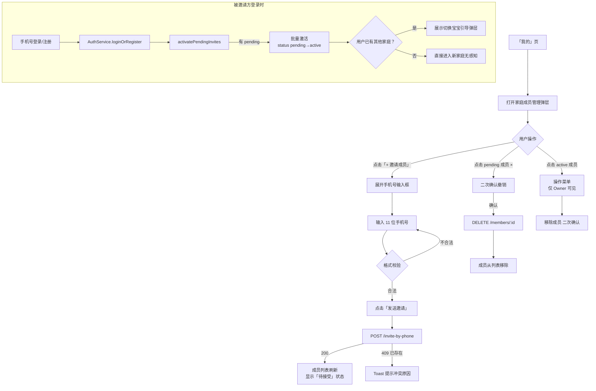

# F12 · 家庭共享与多成员协作

> 功能 ID：F12  
> 优先级：P0  
> 最后更新：2026-04-04  
> 状态：**设计评审中**（手机号邀请方案）

---

## 1. 背景与目标

### 1.1 背景

宝宝的日常护理通常由多名家庭成员共同参与（妈妈、爸爸、爷爷奶奶、外公外婆等）。敏宝日记需要支持「多人共同记录同一宝宝数据」的协作场景，确保家庭成员之间信息一致、不遗漏。

### 1.2 历史现状（邀请码模式）

当前版本实现了基于「邀请码」的加入流程：
- 创建者在「家庭成员管理」弹层中点击「邀请成员」，后端生成 6 位随机邀请码（24h 有效）
- 创建者手动复制邀请码并通过微信/短信等方式发送给被邀请人
- 被邀请人在 App 内找到「加入家庭」入口，手动输入邀请码

**存在问题：**
- 流程繁琐，需要创建者、被邀请方两端手动操作
- 邀请码容易过期、输错，操作门槛高
- 无「待接受」中间状态，无法追踪邀请进度
- 邀请人不清楚被邀请方是否已完成加入

### 1.3 目标

将邀请流程简化为：**创建者填写被邀请人手机号 → 被邀请人登录后自动加入**，降低操作门槛，提升协作转化率。

---

## 2. 功能说明

### 2.1 角色权限体系

| 角色 | role 值 | 权限 | 说明 |
|------|---------|------|------|
| **创建者**（Owner） | 1 | 管理成员、修改宝宝档案、查看和新增所有记录 | 每个家庭唯一，创建家庭时自动赋予 |
| **成员**（Member） | 2 | 可查看和新增所有记录 | 被邀请加入的家庭成员 |

> 注：现阶段 MVP 仅支持两种角色，后续可扩展查看者（Viewer）角色。

---

### 2.2 手机号邀请流程（核心改造）

#### 邀请方操作（创建者）

```
「我的」页
  → 点击「家庭成员管理」或「邀请家庭成员」
  → 打开「家庭成员管理」底部弹层
  → 点击「+ 邀请成员」按钮
  → 弹层内展开手机号输入表单
  → 输入 11 位手机号 → 点击「发送邀请」
  → 后端创建 pending 状态的成员记录
  → 成员列表刷新，该号码显示「待接受」徽章
```

#### 被邀请方体验（自动激活）

```
被邀请人打开 App → 手机号登录（或首次注册）
  → 登录成功后，后端检查该手机号是否有 pending 邀请
  → 若有 → 自动将 pending 记录激活（status: pending → active）
  → 前端感知到新家庭加入：
    ├─ 若被邀请人原本没有家庭/宝宝 → 直接进入新家庭，无感知
    └─ 若被邀请人已有其他家庭/宝宝 → 弹出「切换宝宝」引导弹层
```

---

### 2.3 宝宝切换引导（冲突处理）

**触发时机**：被邀请人激活邀请后，发现 `getMyFamilies()` 返回了多个家庭。

**交互设计**：

```
┌──────────────────────────────────┐
│  你被加入了新家庭 🎉              │
│                                  │
│  「张三家」邀请你加入             │
│                                  │
│  请选择当前使用的宝宝：            │
│  ┌──────────────────────────┐    │
│  │  [头像] 小米  · 我的家    │    │  ← 当前已有家庭
│  │  [头像] 宝宝  · 张三家   │    │  ← 新加入家庭
│  └──────────────────────────┘    │
│                                  │
│         暂不切换  /  确认切换      │
└──────────────────────────────────┘
```

- 用户可以随时在「我的」页切换当前宝宝（后续迭代支持）
- 本次选择不影响历史记录，仅切换当前操作上下文

---

### 2.4 成员管理操作

| 操作 | 可操作人 | 规则 |
|------|---------|------|
| 邀请成员（按手机号） | 仅创建者 | 同一手机号已被邀请且 pending 时，提示「已邀请，等待对方登录」 |
| 查看成员列表 | 所有成员 | 展示 active 成员 + pending 成员（分区展示） |
| 移除成员 | 仅创建者 | 二次确认；移除后立即失去访问权限；不可移除自身 |
| 撤销邀请 | 仅创建者 | 针对 pending 状态成员，可撤销（删除 pending 记录） |

---

## 3. 详细交互设计

### 3.1 家庭成员管理弹层（重构后）

```
┌──────────────────────────────────────┐
│  ▬▬▬▬  （把手）                       │
│  家庭成员管理         [+ 邀请成员]    │  ← 按钮触发手机号输入表单
│                                      │
│  ┌────────────────────────────────┐  │  ← 手机号输入区（点击「邀请」后展开）
│  │  手机号  [138________]  发送   │  │
│  └────────────────────────────────┘  │
│                                      │
│  当前成员（2人）                      │
│  ┌────────────────────────────────┐  │
│  │  [头像] 妈妈   138****5678     │  │
│  │                      [创建者]  │  │
│  ├────────────────────────────────┤  │
│  │  [头像] 爸爸   139****1234     │  │
│  │                      [成员] ▶ │  │  ← 可点击管理（移除）
│  └────────────────────────────────┘  │
│                                      │
│  待接受（1人）                        │  ← pending 成员独立分区
│  ┌────────────────────────────────┐  │
│  │  [头像] 137****9999            │  │
│  │                   [待接受] ×  │  │  ← × 撤销邀请
│  └────────────────────────────────┘  │
│                                      │
│  角色说明：创建者可管理成员权限；       │
│  成员可查看和新增所有记录。            │
│                                      │
│              关  闭                  │
└──────────────────────────────────────┘
```

### 3.2 手机号输入交互细节

- 输入框限制 11 位数字，实时校验格式（`/^1[3-9]\d{9}$/`）
- 格式不合法时「发送」按钮置灰
- 点击「发送」后按钮变为 loading 状态，防重复点击
- 成功后：输入框清空，成员列表自动刷新，Toast 提示「已发送邀请」
- 失败场景：
  - `409 Conflict`：「该成员已在家庭中」
  - `409 pending`：「已邀请，等待对方登录接受」
  - `404`：（手机号未注册）仍允许邀请，pending 等待注册

---

## 4. 技术方案

### 4.1 数据库层（无需 migration）

`family_member` 表现有字段已支持手机号邀请模式：

| 字段 | 类型 | 说明 |
|------|------|------|
| `user_id` | CHAR(36) NULL | 已注册用户 ID；pending 时为 NULL |
| `invite_phone` | VARCHAR(20) NULL | 被邀请手机号 |
| `status` | TINYINT | **1=pending**、2=active、3=left |
| `invited_by` | CHAR(36) NULL | 邀请人 user_id |
| `joined_at` | DATETIME NULL | 激活时间 |

索引：`idx_family_member_invite (invite_phone)` 已存在。

> ✅ 数据库无需变更，现有 DDL 已完整支持。

### 4.2 后端改动（`minicare-server`）

#### 新增接口：按手机号邀请成员

```
POST /api/family/:familyId/invite-by-phone
Authorization: Bearer <token>
权限：仅 Owner（role=1）

Request Body:
{
  "phone": "13812345678"
}

Response 200:
{
  "memberId": "uuid",
  "status": "pending"
}

Error Cases:
  409 - 已是活跃成员 / 已有 pending 邀请
  403 - 当前用户非 Owner
```

**`FamilyService.inviteByPhone(familyId, inviterId, phone)`**：
1. 查询 `family_member` 是否已有该家庭的 active/pending 记录（按 `invite_phone` 或已关联用户的 `phone`）
2. 若无冲突，插入 `status=1 (pending)` 记录，`user_id=NULL`，`invite_phone=phone`，`invited_by=inviterId`
3. （可选）后续接入短信通知服务

#### 改动：登录后自动激活 pending 邀请

**`AuthService.loginOrRegister()` 改动**：登录/注册成功后，调用 `activatePendingInvites(userId, phone)`。

**`FamilyService.activatePendingInvites(userId, phone)`**：
```sql
UPDATE family_member
SET user_id = :userId,
    status = 2,
    joined_at = NOW()
WHERE invite_phone = :phone
  AND status = 1
  AND user_id IS NULL
```
返回被激活的家庭 ID 列表，供前端判断是否需要展示切换引导。

#### 改动：`getMembers()` 返回 pending 成员

```sql
SELECT fm.id, fm.role, fm.status, fm.joined_at, fm.invite_phone,
       ua.id AS user_id, ua.nickname AS name, ua.avatar_url
FROM family_member fm
LEFT JOIN user_account ua ON fm.user_id = ua.id
WHERE fm.family_id = ?
  AND fm.status IN (1, 2)   -- pending + active
ORDER BY fm.status ASC, fm.role ASC, fm.joined_at ASC
```

#### 新增接口：撤销邀请

```
DELETE /api/family/:familyId/members/:memberId
权限：仅 Owner，且目标成员 status=pending
```

### 4.3 前端改动（`minicare-web`）

#### `api/family.ts` 新增

```typescript
// 按手机号邀请成员
inviteByPhone: (familyId: string, phone: string) =>
  request<{ memberId: string; status: 'pending' }>(
    `/api/family/${familyId}/invite-by-phone`,
    { method: 'POST', body: JSON.stringify({ phone }) }
  ),

// 撤销邀请（删除 pending 成员）
removeMember: (familyId: string, memberId: string) =>
  request<void>(`/api/family/${familyId}/members/${memberId}`, {
    method: 'DELETE',
  }),
```

#### `api/types.ts` 扩展 `FamilyMember`

```typescript
export interface FamilyMember {
  // ...existing fields...
  status?: 1 | 2 | 3  // 1=pending, 2=active, 3=left
  invite_phone?: string | null  // pending 时显示，代替 name
}
```

#### `MembersModal.tsx` 重构要点

- 移除邀请码相关 UI（`inviteCode`、`onInvite`、`onCopyCode` prop 全部删除）
- 新增 `onInviteByPhone: (phone: string) => Promise<void>` prop
- 新增 `onRemoveMember: (memberId: string) => Promise<void>` prop
- 成员列表分为「当前成员」和「待接受」两个分区
- pending 成员展示：手机号（脱敏）+ 「待接受」灰色徽章 + × 撤销按钮
- 标题栏「+ 邀请成员」按钮：点击后在弹层内部展开手机号输入表单（内联，非跳转）

#### `ProfilePage/index.tsx` 清理

- 移除 `inviteCode`、`inviteLoading` state
- 移除 `handleInvite()`、`copyInviteCode()` 方法
- 新增 `handleInviteByPhone(phone: string)` 方法
- 新增 `handleRemoveMember(memberId: string)` 方法
- `familyRows` 配置中「邀请家庭成员」与「家庭成员管理」合并为同一入口（打开同一弹层）

#### 登录后切换引导

- 登录成功后（`AuthResult` 返回时），调用 `familyApi.getMine()` 刷新家庭列表
- 若返回的家庭数量 > 1 且当前 `currentFamily` 非新家庭 → 展示宝宝切换引导弹层
- 弹层展示各家庭的宝宝信息，用户选择后更新 `store.currentFamily` 和 `store.currentBaby`

---

## 5. 边界情况与异常处理

| 场景 | 处理方式 |
|------|---------|
| 被邀请手机号尚未注册 | 允许创建 pending 记录；对方注册后自动激活 |
| 被邀请人已是该家庭活跃成员 | 后端返回 409，前端 Toast：「该成员已在家庭中」 |
| 同一手机号已有 pending 邀请 | 后端返回 409，前端 Toast：「已邀请，等待对方登录」 |
| 被邀请人已有其他家庭/宝宝 | 激活后前端引导切换宝宝 |
| 同一手机号收到多个家庭邀请 | 登录时全部 pending 记录批量激活，前端展示多宝宝切换 |
| 创建者试图邀请自己的手机号 | 后端返回 409，前端提示「不能邀请自己」 |
| 非 Owner 尝试邀请 | 后端 403，前端 Toast：「仅家庭创建者可邀请成员」 |
| 网络超时 | 前端 Toast：「网络异常，请重试」；按钮恢复可点击 |

---

## 6. 交互流程图



---

## 7. 验收标准（AC）

### 邀请流程

- [ ] 仅家庭创建者可见「邀请成员」入口
- [ ] 手机号格式校验通过前，「发送」按钮置灰
- [ ] 邀请成功后，成员列表新增「待接受」分区，展示被邀请手机号（脱敏）
- [ ] 重复邀请已邀请的手机号时，Toast 提示「已邀请，等待对方登录」
- [ ] 邀请已是成员的手机号时，Toast 提示「该成员已在家庭中」

### 自动激活

- [ ] 被邀请方登录后，无需任何额外操作，自动成为家庭成员（`status=active`）
- [ ] 被邀请方激活后，邀请方的成员列表中该成员状态从「待接受」更新为正式成员（含昵称）
- [ ] 被邀请方原本无家庭/宝宝时，登录后直接进入新家庭，无额外弹层

### 切换引导

- [ ] 被邀请方已有家庭/宝宝时，激活后弹出切换宝宝引导弹层
- [ ] 弹层展示各家庭的宝宝名称，用户可选择当前使用哪个宝宝
- [ ] 「暂不切换」保留当前宝宝上下文

### 撤销邀请

- [ ] 创建者可对 pending 成员点击「×」撤销邀请，需二次确认
- [ ] 撤销后，该手机号可重新被邀请

### 移除成员

- [ ] 创建者可移除 active 成员（含二次确认）
- [ ] 移除后该成员立即失去家庭访问权限
- [ ] 创建者不可移除自身

---

## 8. 废弃说明

以下邀请码相关能力随本次改造一并废弃：

| 废弃项 | 说明 |
|--------|------|
| `POST /api/family/:familyId/invite` | 生成邀请码接口，废弃 |
| `POST /api/family/join` | 邀请码加入接口，废弃 |
| `family_group.invite_code` 字段 | 可保留列但停止使用 |
| `MembersModal` inviteCode 相关 props | 全部移除 |

---

## 9. UI 对应文件

- `minicare-web/src/pages/profile/MembersModal.tsx` — 家庭成员管理弹层（重构）
- `minicare-web/src/pages/profile/index.tsx` — ProfilePage（清理邀请码逻辑）
- `minicare-web/src/api/family.ts` — Family API（新增接口）
- `minicare-server/src/family/family.service.ts` — 业务逻辑（新增方法）
- `minicare-server/src/family/family.controller.ts` — 路由（新增接口）
- `minicare-server/src/auth/auth.service.ts` — 登录后触发激活
