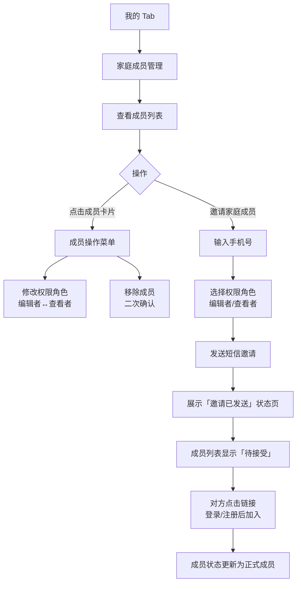

# F12 · 家庭共享与多成员协作

> 来源：MVP-PRD.md §2.4.11、§3.3  
> 功能 ID：P0-011  
> 优先级：P0  
> 最后同步：2026-03-29

## 功能描述

支持家庭成员共同记录和查看同一宝宝的数据，实现多人协作；通过手机号邀请成员加入。

## 三级权限角色

| 角色 | 权限 | 说明 |
|------|------|------|
| **创建者**（role=0） | 管理所有成员、修改宝宝档案、查看和新增所有记录 | 唯一，不可转让 |
| **编辑者**（role=1） | 可查看和新增所有记录 | 适合主要照护者（爸爸、奶奶） |
| **查看者**（role=2） | 只能浏览记录，无法新增或修改 | 适合远程关注的长辈 |

- 创建宝宝档案的用户自动成为「创建者」

## 手机号邀请流程

1. 「我的」页 → 「家庭成员管理」→「邀请家庭成员」按钮
2. 输入对方手机号 → 选择权限角色（编辑者 / 查看者）→ 发送邀请
3. 对方收到短信链接，点击后登录（或注册）即完成加入
4. 邀请成功后，成员列表显示「待接受」状态，对方接受后更新为正式成员

## 成员管理操作（仅创建者可操作）

- 修改已有成员的权限角色（编辑者 ↔ 查看者，不可修改创建者自身）
- 移除成员（二次确认，移除后该成员立即失去访问权限）

## 数据同步功能

- 所有记录实时同步到云端
- 支持离线记录，网络恢复后自动同步
- 同步冲突自动解决（以最后修改时间为准）

## 成员标识功能

- 每条记录显示创建者信息（如「妈妈记录」「奶奶记录」）
- 支持查看记录的修改历史

## 交互示意图

```
┌──────────────────────────────┐     ┌──────────────────────────────┐
│  家庭成员管理                 │     │  邀请家庭成员                 │
│ ┌────────────────────────┐   │     │ ┌────────────────────────┐   │
│ │ ← 返回   家庭成员管理   │   │     │ │ ← 返回   邀请家庭成员   │   │
│ └────────────────────────┘   │     │ └────────────────────────┘   │
│                               │     │                               │
│ 当前成员（3人）               │     │ 手机号  [________________]   │
│ ┌────────────────────────┐   │     │                               │
│ │ [头像] 妈妈  创建者 ▶  │   │     │ 权限角色                     │
│ │ [头像] 爸爸  编辑者 ▶  │   │  ──▶│ ◉ 编辑者  可查看和新增记录  │
│ │ [头像] 外婆  查看者 ▶  │   │     │   查看者  只能浏览记录       │
│ └────────────────────────┘   │     │                               │
│                               │     │ 快速选择（通讯录联系人）     │
│ 等待接受（1人）               │     │ [爸爸] [奶奶] [姥姥]         │
│ ┌────────────────────────┐   │     │                               │
│ │ [头像] 奶奶  待接受 …  │   │     │         发送邀请              │
│ └────────────────────────┘   │     └──────────────────────────────┘
│                               │
│    + 邀请家庭成员              │
└──────────────────────────────┘
```

## 邀请成功反馈示意图

```
┌──────────────────────────────┐
│  邀请成功                     │
│ ┌────────────────────────┐   │
│ │  [check] 邀请已发送     │   │
│ │  短信已发送至             │   │
│ │  138****5678            │   │
│ │  等待对方接受邀请...      │   │
│ └────────────────────────┘   │
│                               │
│         完  成                 │
└──────────────────────────────┘
```

## 交互流程



## 数据库表

`family_group`、`family_member` 表 — 见 `05-data-schema.md`

关键字段（`family_member`）：
- `role`：0=创建者，1=编辑者，2=查看者
- `invite_status`：0=待接受，1=已接受，2=已拒绝
- `invite_phone`：被邀请者手机号

## 验收标准（AC）

### 家庭成员管理页面
- [ ] 展示当前成员列表（含角色标识）
- [ ] 展示「待接受」的邀请列表
- [ ] 点击成员卡片弹出操作菜单（仅创建者可见修改/移除选项）
- [ ] 创建者可修改其他成员的角色（编辑者↔查看者）
- [ ] 创建者可移除成员（需二次确认）
- [ ] 移除成功后，该成员立即失去访问权限

### 邀请流程
- [ ] 可输入手机号（11 位大陆手机号格式校验）
- [ ] 可选择权限角色（编辑者/查看者，默认编辑者）
- [ ] 点击「发送邀请」发送短信并展示成功状态页
- [ ] 邀请成功后在成员列表显示「待接受」状态
- [ ] 对方接受后状态更新为正式成员

### 数据同步
- [ ] 多成员同时记录时数据实时同步
- [ ] 离线记录在网络恢复后自动同步
- [ ] 每条记录显示记录者信息

## UI 对应文件

- `ui-draft/profile.html`（家庭成员管理入口、邀请流程底部弹出层）
