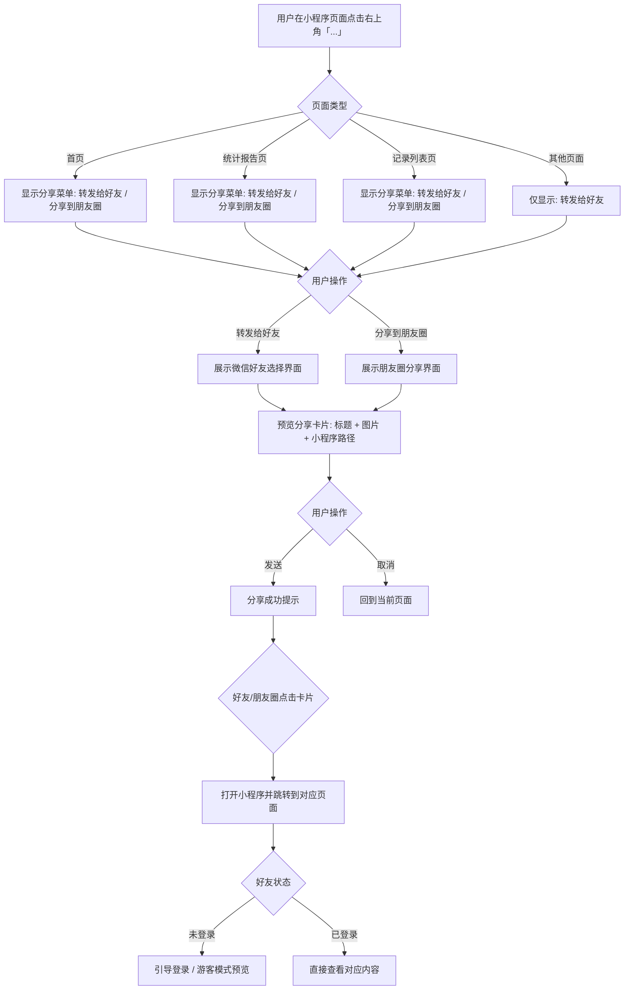
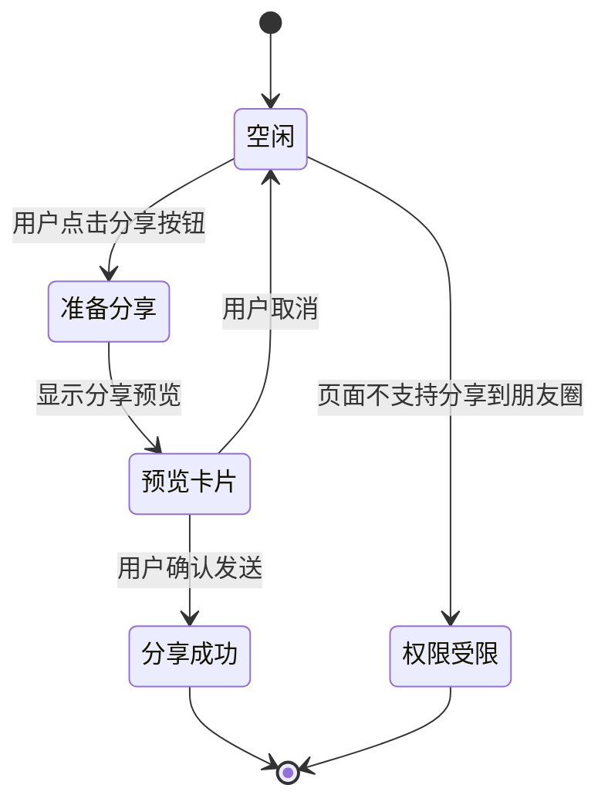
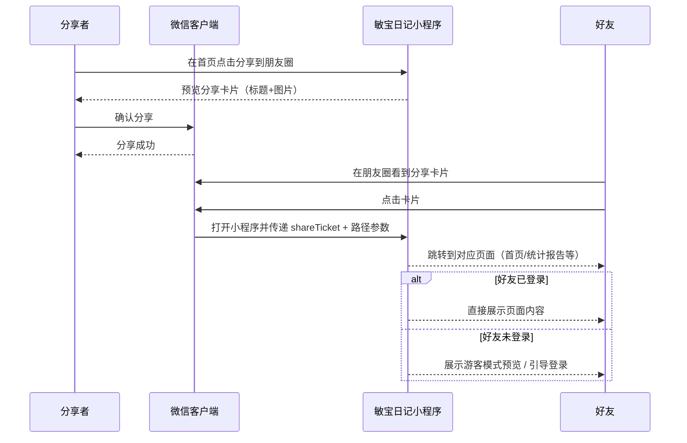

# 产品需求文档：微信小程序分享功能 - V1.0

> 来源：敏宝日记 docs/business/MVP-PRD.md 附录
> 功能 ID：P0-010
> 优先级：P1
> 最后同步：2026-05-12

## 1. 综述 (Overview)

### 1.1 项目背景与核心问题

敏宝日记 MVP 版本已上线，当前用户反馈希望能够**分享宝宝的护理记录给家人或医生**。微信小程序天然支持分享卡片传播，但当前小程序未实现分享能力，导致用户无法通过微信分享功能传播产品。

本需求旨在通过**实现小程序分享卡片功能**，让用户可以将宝宝的今日概览、统计报告等内容分享给家人或医生，验证小程序分享在敏宝日记场景的可行性。

### 1.2 核心业务流程 / 用户旅程地图

1. **阶段一：分享入口发现** — 用户在页面右上角点击「...」菜单，看到分享选项
2. **阶段二：分享内容预览** — 用户选择分享后，预览分享卡片（标题、图片、路径）
3. **阶段三：分享完成** — 用户发送给好友或分享到朋友圈，好友点击进入对应页面

### 1.3 Mermaid 图（流程/状态/时序）

#### 1.3.1 用户操作流（必填）



#### 1.3.2 分享状态机



#### 1.3.3 好友打开分享卡片时序



## 2. 用户故事详述 (User Stories)

### 阶段一：分享入口与能力启用

---

#### **US-01: 作为宝妈/宝爸，我希望在首页点击分享按钮即可将宝宝的今日概览分享给家人，以便于让家人了解宝宝今天的护理情况**

* **价值陈述 (Value Statement)**:
  * **作为**宝妈/宝爸
  * **我希望**在首页点击分享按钮即可将宝宝的今日概览分享给家人
  * **以便于**让不在身边的家人（如宝爸上班时、祖辈）也能了解宝宝今天的护理情况

* **业务规则与逻辑 (Business Logic)**:
  1. **前置条件**: 用户已登录小程序。
  2. **分享卡片内容**:
     * **标题**: 「我家宝宝今天的护理记录」（固定文案）
     * **图片**: 今日统计卡片截图（奶量/睡眠/尿布/表现数值）
     * **路径**: `/pages/home/index`
     * **描述**: 「敏宝日记 · 记录每一口，呵护每一天」
  3. **操作流程 (Happy Path)**:
     1. 用户在首页点击右上角「...」菜单。
     2. 弹出系统菜单，显示「发送给朋友」和「分享到朋友圈」选项。
     3. 用户选择「发送给朋友」，预览分享卡片后发送给微信好友。
     4. 或选择「分享到朋友圈」，生成朋友圈分享卡片。
  4. **异常处理 (Error Handling)**:
     * **用户未登录**: 分享卡片路径仍为首页，但好友打开时展示游客模式引导登录。
     * **今日无记录**: 分享卡片展示「暂无今日记录」占位图，文案调整为「今日暂无记录，快来记录吧」。
     * **网络异常**: 提示「分享失败，请重试」。

* **验收标准 (Acceptance Criteria)**:
  * **场景1: 成功分享首页给好友**
    * **GIVEN** 用户已登录且有今日记录
    * **WHEN** 用户在首页点击「发送给朋友」
    * **THEN** 展示分享卡片预览，包含标题「我家宝宝今天的护理记录」+ 今日统计图片 + 小程序路径
  * **场景2: 成功分享首页到朋友圈**
    * **GIVEN** 用户已登录且有今日记录
    * **WHEN** 用户在首页点击「分享到朋友圈」
    * **THEN** 生成朋友圈分享卡片，用户可发布到朋友圈
  * **场景3: 好友打开分享卡片**
    * **GIVEN** 好友点击分享卡片
    * **WHEN** 小程序打开并加载完成
    * **THEN** 跳转到首页，展示与分享者相同的今日数据（或游客模式）

---

#### **US-02: 作为宝妈/宝爸，我希望在统计报告页分享宝宝的数据分析报告，以便于将报告分享给医生或家人参考**

* **价值陈述 (Value Statement)**:
  * **作为**宝妈/宝爸
  * **我希望**在统计报告页分享宝宝的数据分析报告
  * **以便于**将报告分享给医生（如就医前）或家人，辅助沟通宝宝的生长发育情况

* **业务规则与逻辑 (Business Logic)**:
  1. **前置条件**: 用户已登录小程序，且至少有一条对应类型的记录。
  2. **分享卡片内容**:
     * **标题**: 「我家宝宝的{当前Tab}数据分析报告」（动态文案，如「饮食数据分析报告」）
     * **图片**: 当前统计图表的截图
     * **路径**: `/pagesReport/index?tab={当前Tab}&familyId={familyId}&babyId={babyId}`
     * **描述**: 「敏宝日记 · 查看{宝宝名}的{当前Tab}趋势分析」
  3. **支持分享的 Tab**:
     | Tab | 标题文案 | 描述文案 |
     |-----|---------|---------|
     | 饮食 | 饮食数据分析报告 | 奶量/辅食摄入趋势 |
     | 睡眠 | 睡眠数据分析报告 | 睡眠时长/质量趋势 |
     | 尿布 | 尿布数据分析报告 | 排便次数/性状趋势 |
     | 生长 | 生长发育分析报告 | 身高/体重/头围趋势 |
     | 健康 | 健康数据分析报告 | 体温/健康状态趋势 |
  4. **操作流程 (Happy Path)**:
     1. 用户在统计报告页切换到目标 Tab（如「饮食」）。
     2. 用户点击右上角「...」菜单，选择「发送给朋友」或「分享到朋友圈」。
     3. 分享卡片包含当前 Tab 的报告截图和对应路径。
  5. **异常处理 (Error Handling)**:
     * **当前 Tab 无数据**: 提示「暂无{类型}数据，无法分享」，不显示分享到朋友圈选项（仅转发给好友）。
     * **图表加载失败**: 使用默认占位图分享，标题改为「敏宝日记 · {宝宝名}的成长记录」。

* **验收标准 (Acceptance Criteria)**:
  * **场景1: 成功分享饮食报告给好友**
    * **GIVEN** 用户在统计报告页的「饮食」Tab，且有饮食记录
    * **WHEN** 用户点击「发送给朋友」
    * **THEN** 分享卡片标题为「我家宝宝的饮食数据分析报告」，路径携带 tab=feeding 参数
  * **场景2: 好友打开报告分享卡片**
    * **GIVEN** 好友点击报告分享卡片
    * **WHEN** 小程序打开并加载完成
    * **THEN** 自动跳转到统计报告页的对应 Tab，并展示报告数据
  * **场景3: 无数据时分享**
    * **GIVEN** 用户在统计报告页的「生长」Tab，但无生长记录
    * **WHEN** 用户点击分享
    * **THEN** 提示「暂无生长数据，无法分享到朋友圈」，但仍可发送给好友

---

#### **US-03: 作为宝妈/宝爸，我希望在记录列表页分享宝宝的护理记录，以便于将一段时间的记录分享给医生参考**

* **价值陈述 (Value Statement)**:
  * **作为**宝妈/宝爸
  * **我希望**在记录列表页分享宝宝的护理记录
  * **以便于**将一段时间的记录汇总分享给医生（如就医时需要展示近期饮食/用药情况）

* **业务规则与逻辑 (Business Logic)**:
  1. **前置条件**: 用户已登录小程序，且至少有 1 条记录。
  2. **分享卡片内容**:
     * **标题**: 「我家宝宝的护理记录」
     * **图片**: 记录列表截图（展示部分记录条目）
     * **路径**: `/pages/records/list/index?familyId={familyId}&babyId={babyId}`
     * **描述**: 「敏宝日记 · 查看{宝宝名}的{记录数量}条护理记录」
  3. **好友打开后的行为**:
     * 跳转到记录列表页。
     * 自动加载并展示与分享者相同的筛选条件（如有）和记录列表。
  4. **异常处理 (Error Handling)**:
     * **好友未登录**: 展示游客模式的记录列表预览（最近 7 天），引导登录查看完整数据。

* **验收标准 (Acceptance Criteria)**:
  * **场景1: 成功分享记录列表给好友**
    * **GIVEN** 用户在记录列表页且有记录
    * **WHEN** 用户点击「发送给朋友」
    * **THEN** 分享卡片包含记录列表截图 + 记录数量描述
  * **场景2: 好友打开分享卡片**
    * **GIVEN** 好友点击记录列表分享卡片
    * **WHEN** 小程序打开
    * **THEN** 跳转到记录列表页，展示记录数据

---

#### **US-04: 作为宝妈/宝爸，我希望在分享卡片中看到宝宝的头像和昵称，以便于家人一眼认出是哪个宝宝的记录**

* **价值陈述 (Value Statement)**:
  * **作为**宝妈/宝爸
  * **我希望**在分享卡片中看到宝宝的头像和昵称
  * **以便于**家人（可能有多个宝宝）一眼认出是哪个宝宝的记录

* **业务规则与逻辑 (Business Logic)**:
  1. **分享图片设计**:
     * 图片顶部展示宝宝头像（圆形，48x48px） + 宝宝昵称。
     * 下方展示对应页面的核心数据（统计数字/图表）。
     * 底部固定展示「敏宝日记」品牌标识 + 小程序码占位。
  2. **图片尺寸规范**:
     * 转发给好友: 5:4 比例（建议 500x400px）
     * 分享到朋友圈: 1:1 正方形（建议 500x500px）
  3. **数据展示优先级**:
     * 首页: 奶量 > 睡眠 > 尿布 > 表现（取今日有数据的指标）
     * 报告页: 当前 Tab 的核心图表

* **验收标准 (Acceptance Criteria)**:
  * **场景1: 首页分享图片包含宝宝信息**
    * **GIVEN** 用户在首页且已设置宝宝昵称
    * **WHEN** 用户分享首页
    * **THEN** 分享图片顶部显示宝宝头像 + 昵称
  * **场景2: 未设置宝宝昵称时**
    * **GIVEN** 用户未设置宝宝昵称（默认「宝宝」）
    * **WHEN** 用户分享首页
    * **THEN** 分享图片顶部显示默认头像 + 「宝宝」昵称

---

### 阶段二：技术实现要求

---

#### **US-05: 作为开发者，我需要在每个支持分享的页面实现 onShareAppMessage 和 onShareTimeline，以便于用户能够分享内容**

* **价值陈述 (Value Statement)**:
  * **作为**开发者
  * **我希望**在每个支持分享的页面实现分享生命周期函数
  * **以便于**用户能够通过微信分享功能分享内容给好友或朋友圈

* **业务规则与逻辑 (Business Logic)**:
  1. **技术实现要点**:
     * 在每个页面 `.tsx` 中导出 `onShareAppMessage` 函数（转发给好友）。
     * 在支持朋友圈分享的页面导出 `onShareTimeline` 函数（分享到朋友圈）。
     * 使用 `Taro.showShareMenu()` 在页面加载时启用分享菜单。
  2. **页面配置要求**:
     | 页面 | onShareAppMessage | onShareTimeline | 说明 |
     |------|------------------|----------------|------|
     | 首页 `/pages/home/index` | ✅ | ✅ | 支持朋友圈分享 |
     | 统计报告 `/pagesReport/index` | ✅ | ✅ | 支持朋友圈分享 |
     | 记录列表 `/pages/records/list/index` | ✅ | ❌ | 暂不支持朋友圈（记录列表不适合朋友圈场景） |
     | 登录页 `/pages/login/index` | ❌ | ❌ | 不支持分享 |
     | 引导页 `/pages/onboarding/index` | ❌ | ❌ | 不支持分享 |
     | 我的 `/pages/profile/index` | ❌ | ❌ | 不支持分享（保护隐私） |
  3. **分享路径参数规范**:
     * 所有路径必须携带 `familyId` 和 `babyId` 参数（除首页外）。
     * 路径参数通过 URL query string 传递，如 `?familyId=xxx&babyId=xxx&tab=feeding`。
     * 页面通过 `useRouter` 获取参数并加载对应数据。
  4. **图片生成方案**:
     * 使用 ECharts 的 Canvas 截图能力生成图表图片。
     * 首页统计卡片使用 Canvas 绘制生成图片。
     * 图片通过 `canvasToTempFilePath` 获取临时路径。

* **验收标准 (Acceptance Criteria)**:
  * **场景1: 首页分享功能验证**
    * **GIVEN** 用户在首页
    * **WHEN** 用户点击右上角「...」
    * **THEN** 显示「发送给朋友」和「分享到朋友圈」两个选项
  * **场景2: 报告页分享功能验证**
    * **GIVEN** 用户在统计报告页的「饮食」Tab
    * **WHEN** 用户点击「发送给朋友」
    * **THEN** 分享卡片标题为「我家宝宝的饮食数据分析报告」
  * **场景3: 我的页面无分享入口**
    * **GIVEN** 用户在「我的」页面
    * **WHEN** 用户点击右上角「...」
    * **THEN** 仅显示「发送给朋友」选项（隐藏朋友圈分享），或完全不显示分享按钮

---

#### **US-06: 作为开发者，我需要处理好友通过分享卡片打开小程序的场景，以便于好友能看到分享的对应内容**

* **价值陈述 (Value Statement)**:
  * **作为**开发者
  * **我希望**处理好友通过分享卡片打开小程序的场景
  * **以便于**好友能看到分享的对应内容，并正确展示数据或引导登录

* **业务规则与逻辑 (Business Logic)**:
  1. **分享参数解析**:
     * 小程序启动时，从 `options` 中获取 `path` 和 `query` 参数。
     * 从 `query` 中解析 `familyId` 和 `babyId`。
     * 若参数缺失，使用本地缓存的 `familyId` 和 `babyId`。
  2. **游客模式处理**:
     * 若好友未登录且 `familyId`/`babyId` 参数有效，尝试加载对应数据。
     * 若参数无效或数据加载失败，展示游客模式预览。
  3. **数据加载策略**:
     * 优先使用分享链接携带的参数加载数据。
     * 若加载失败，回退到本地缓存数据（若已登录）。
     * 若均失败，展示「数据加载失败」提示。

* **验收标准 (Acceptance Criteria)**:
  * **场景1: 已登录用户打开分享卡片**
    * **GIVEN** 好友已登录敏宝日记
    * **WHEN** 好友打开分享的报告卡片链接
    * **THEN** 跳转到对应 Tab 并展示报告数据
  * **场景2: 未登录用户打开分享卡片**
    * **GIVEN** 好友未登录敏宝日记
    * **WHEN** 好友打开分享的报告卡片链接
    * **THEN** 跳转到对应 Tab 并展示数据（或引导登录查看完整数据）

---

## 3. 非目标 (Non-Goals)

以下内容明确**不在**本次 MVP 范围内：

1. **PDF 报告导出**：本次仅实现小程序内分享，不支持导出为 PDF 文件
2. **分享到微信群**：仅支持好友一对一分享，不支持群聊分享
3. **分享内容编辑**：用户无法自定义分享卡片的标题、图片
4. **分享记录追踪**：不记录谁分享了、谁打开了
5. **深度链接跳转**：不支持跳转到具体某条记录的详情页
6. **多宝宝切换分享**：不支持在分享时切换宝宝（固定分享当前宝宝）
7. **分享激励**：不设计分享奖励/积分机制

## 4. 技术实现参考

### 4.1 微信小程序分享 API

```typescript
// 页面中导出分享给好友的配置
Page({
  onShareAppMessage(res) {
    return {
      title: '我家宝宝今天的护理记录',
      path: '/pages/home/index',
      imageUrl: '...', // 分享图片临时路径
    }
  },

  // 分享到朋友圈（仅部分页面支持）
  onShareTimeline() {
    return {
      title: '我家宝宝今天的护理记录',
      query: 'familyId=xxx&babyId=xxx',
      imageUrl: '...',
    }
  }
})
```

### 4.2 Taro 框架实现方式

```typescript
// minicare-mp/src/pages/home/index.tsx

// 在页面组件中添加分享配置
HomePage.config = {
  enableShareAppMessage: true,
  enableShareTimeline: true,
}

// 或在组件中导出
class HomePage extends Component {
  static options = {
    enableShareAppMessage: true,
    enableShareTimeline: true,
  }
}

// onShareAppMessage 生命周期函数
onShareAppMessage() {
  const baby = Taro.getStorageSync('minicare_baby')
  const familyId = getStoredFamilyId()

  return {
    title: '我家宝宝今天的护理记录',
    path: `/pages/home/index?familyId=${familyId}&babyId=${baby?.id}`,
    imageUrl: this.generateShareImage(), // 生成带宝宝头像和统计数据的图片
  }
}

// onShareTimeline 生命周期函数
onShareTimeline() {
  const baby = Taro.getStorageSync('minicare_baby')
  const familyId = getStoredFamilyId()

  return {
    title: '我家宝宝今天的护理记录',
    query: `familyId=${familyId}&babyId=${baby?.id}`,
    imageUrl: this.generateShareImage(),
  }
}
```

### 4.3 分享图片生成流程

```typescript
// 使用 Canvas 生成分享图片
async generateShareImage() {
  const ctx = Taro.createCanvasContext('shareCanvas')

  // 1. 绘制背景
  ctx.setFillStyle('#FFF0F4')
  ctx.fillRect(0, 0, 500, 400)

  // 2. 绘制宝宝头像区域
  ctx.beginPath()
  ctx.arc(40, 40, 24, 0, 2 * Math.PI)
  ctx.setFillStyle('#F87098')
  ctx.fill()
  // ... 加载并绘制头像

  // 3. 绘制宝宝昵称
  ctx.setFontSize(16)
  ctx.setFillStyle('#3D2B2E')
  ctx.fillText(babyName, 76, 46)

  // 4. 绘制统计数据
  // ...

  ctx.draw()

  // 5. 导出为临时文件
  const { tempFilePath } = await Taro.canvasToTempFilePath({
    canvasId: 'shareCanvas',
  })

  return tempFilePath
}
```

## 5. 开放问题与风险

| 编号 | 问题/风险 | 影响 | 建议 |
|------|----------|------|------|
| R-01 | 分享图片生成可能影响页面性能 | 用户点击分享后需要等待图片生成 | 使用本地缓存 + 异步生成，优先返回默认图片 |
| R-02 | 好友打开分享卡片时的数据权限 | 好友未登录时无法查看私人数据 | 实现游客模式或强制登录 |
| R-03 | 分享到朋友圈的曝光效果有限 | 朋友圈卡片样式固定，无法定制 | MVP 先验证基础分享能力，后续迭代优化图片设计 |
| R-04 | 多宝宝家庭的分享逻辑 | 目前 MVP 每个家庭限 1 个宝宝，无切换需求 | 后续支持多宝宝时需在分享图片中明确显示宝宝名 |
| R-05 | iOS 和 Android 分享行为差异 | 两端分享 API 行为可能不同 | 需在真机上测试两端兼容性 |

## 6. 页面分享内容汇总

| 页面 | 分享给好友 | 分享到朋友圈 | 分享标题 | 分享图片 | 路径参数 |
|------|----------|------------|---------|---------|---------|
| 首页 | ✅ | ✅ | 我家宝宝今天的护理记录 | 今日统计卡片截图 + 宝宝头像 | 无需参数（使用本地缓存） |
| 统计报告 | ✅ | ✅ | 我家宝宝的{当前Tab}数据分析报告 | 当前 Tab 图表截图 | tab, familyId, babyId |
| 记录列表 | ✅ | ❌ | 我家宝宝的护理记录 | 记录列表截图 | familyId, babyId |
| 我的 | ❌ | ❌ | — | — | — |
| 登录页 | ❌ | ❌ | — | — | — |
| 引导页 | ❌ | ❌ | — | — | — |
| 记录表单页 | ❌ | ❌ | — | — | — |

## 7. 开发任务分解

| 任务 ID | 任务描述 | 优先级 | 工作量 |
|---------|---------|-------|-------|
| T-01 | 在 app.config.ts 中启用全局分享菜单 | P0 | 0.5h |
| T-02 | 实现首页分享功能（onShareAppMessage + onShareTimeline） | P0 | 2h |
| T-03 | 实现统计报告页分享功能 | P0 | 2h |
| T-04 | 实现记录列表页分享功能 | P1 | 1h |
| T-05 | 开发分享图片生成组件（Canvas 绘制） | P0 | 3h |
| T-06 | 处理分享卡片打开时的参数解析与数据加载 | P0 | 2h |
| T-07 | 游客模式下的分享数据展示逻辑 | P1 | 1h |
| T-08 | 真机测试（iOS + Android） | P0 | 2h |
