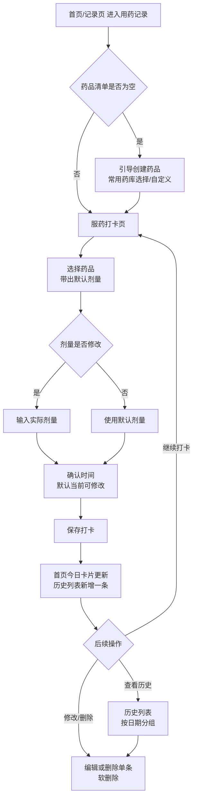

# F14 · 用药记录

> 功能 ID：P1-004  
> 优先级：P1  
> 状态：**已完成** ✅（2026-08-20 开发落地）
>
> **来源**：MVP-PRD.md §3.8（用药从健康记录附属字段升级为独立模块）  
> 功能 ID：P1-004  
> 优先级：P1  
> 最后同步：2026-08-20（新建：独立用药记录模块 PRD；同日开发完成）
>
> **2026-08-20 更新**：常用药库移除营养素类（益生菌/维生素D 等，归 F03 营养素模块），自定义录入不限制。
>
> **实现说明**：迁移 013 已落地（`medication` + `medication_record` 两表）；后端 `records/medication` 模块（清单 CRUD + 打卡 CRUD，软删除，timeline 物化支持）；小程序端**打卡表单页**（进入即表单，与 feeding/sleep 等表单页一致，`pages/records/medication`）；**历史不在本页展示**，统一由首页今日时间线与记录列表页承载；首页快捷区「用药」入口 + 今日用药统计卡；记录列表「用药」筛选。接口层已实测通过（含 409 去重、软删快照、今日聚合）。
>
> **2026-08-20 交互调整**：① 用药记录页直接展示打卡表单，无需点击按钮进入；② 页面不再承载历史列表，历史统一在今日时间线 + 记录列表页展示。
>
> **设计原则**：删除一律软删除（Migration 012 原则，新表自带 `deleted_at`）；
> 现有健康记录（F07）/ 医疗记录（F10）中的"用药"附属字段**保留不动**，互不影响。

## 功能描述

独立的用药记录模块：为宝宝维护**常用药品清单**（常用药库 + 自定义），按**单次服药**打卡记录实际用药（时间 + 药品 + 实际剂量），按日期查看服药历史，首页提供快捷入口与今日用药汇总卡片。

**平台实现**：微信小程序（主平台），数据通过 REST API 存入远程 MySQL。

**定位说明**：区别于健康/医疗记录里"就医时顺带记一笔"的用药字段，本模块面向**日常持续用药**场景（如敏宝长期服用抗过敏药、益生菌、维生素D 等），解决"今天几点吃了什么药、吃了几次、吃了多少"的记录与回顾问题。

## 用户旅程（3 阶段）



## 用户故事

### US-01 · 药品清单管理（宝宝级）

**业务规则**
- 药品清单按**宝宝**维护（`medication` 表，`baby_id` 归属），不同宝宝清单独立
- 创建药品两种方式：
  1. **常用药库**选择：内置常用药（见下表），选中即带出默认剂量占位，可修改后保存
  2. **自定义**：手动输入药品名称 + 默认剂量（可选）
- 字段：名称（必填 ≤50 字）、默认剂量（可选，如 "5ml"/"1袋"/"2.5ml"）、备注（可选 ≤200 字）
- 支持编辑、删除（**软删除** `deleted_at` 标记）；删除后历史打卡记录不受影响（记录冗余药品名快照）
- 权限：owner / member 均可管理（与记录类模块一致，`@MinRole(MEMBER)`）

**常用药库（建议初始值，可后续扩展）**

| 药品 | 默认剂量示例 | 适用 |
|------|-------------|------|
| 西替利嗪滴剂 | 5ml | 抗过敏 |
| 氯雷他定糖浆 | 5ml | 抗过敏 |
| 布洛芬混悬液 | 5ml | 退烧 |
| 对乙酰氨基酚 | 1ml | 退烧 |
| 蒙脱石散 | 1袋 | 止泻 |

> **药库边界（2026-08-20 评估确认）**：
> - 药库**不预置营养素/膳食补充剂类**（益生菌、维生素D、铁剂、钙剂等）——F03 饮食记录-营养素模块（`feeding_supplement_record`，含语音识别）已覆盖此类记录，避免同一物品两个入口、首页卡片语义重复、双数据源漂移
> - **自定义录入不限制**：存在治疗用途补充剂等边缘场景，家长可自行录入任意物品（营养素类也可自定义添加）
> - 药库为前端静态数据（类似 `baby-foods`），不含剂量建议，剂量由家长确认

**ASCII 线框图（药品清单管理页）**

```
┌────────────────────────────────┐
│ ‹ 药品清单            [+ 新建] │  ← 顶部：返回 + 新建
├────────────────────────────────┤
│ ┌──────────────────────────┐   │
│ │ 西替利嗪滴剂     5ml    › │   │  ← 已有药品（点击编辑）
│ │ 备注: 睡前服用           │   │
│ └──────────────────────────┘   │
│ ┌──────────────────────────┐   │
│ │ 维生素D           1粒    › │   │
│ └──────────────────────────┘   │
│                                │
│  常用药库（快捷添加）           │
│ ┌──────┬──────┬──────┐        │
│ │西替利嗪│氯雷他定│益生菌│     │  ← 点击 → 确认弹层（带默认剂量）
│ ├──────┼──────┼──────┤        │
│ │维生素D│布洛芬│蒙脱石散│     │
│ └──────┴──────┴──────┘        │
│        （+ 自定义录入）        │
└────────────────────────────────┘
```

**新建/编辑药品弹层（BottomSheet）**

```
┌────────────────────────────────┐
│ 新建药品            [保存]     │
├────────────────────────────────┤
│ 药品名称  [西替利嗪滴剂____]   │
│ 默认剂量  [5ml___________]     │
│ 备注      [睡前服用________]   │
│                                │
│        [取消] [确认保存]       │
└────────────────────────────────┘
```

### US-02 · 单次服药打卡

**业务规则**
- 入口：首页快捷区「用药」/ 用药记录页「+ 打卡」按钮
- 流程：选择药品（下拉/列表，仅显示未删除的清单药品）→ 自动带出默认剂量 → **可修改实际剂量**（记录本次真实服用量）→ 确认服药时间（默认当前时间，可修改，支持跨天补录）→ 保存
- 剂量允许留空（"按需"用药场景，如益生菌偶尔吃）
- 保存后：历史列表新增一条，首页今日卡片计数 +1
- 打卡时间范围限制：不允许晚于当前时间 5 分钟之后（防误填未来），允许补录过去任意时间
- 权限：owner / member 均可打卡（`@MinRole(MEMBER)`）

**ASCII 线框图（服药打卡页）**

```
┌────────────────────────────────┐
│ ‹ 用药记录             保存    │
├────────────────────────────────┤
│ 记录时间                       │
│ ┌──────────────────────────┐   │
│ │ 记录日期  2026-08-20     │   │
│ │ 记录时间  16:30          │   │
│ └──────────────────────────┘   │
│ 用药                           │
│ ┌──────────────────────────┐   │
│ │ 药品      [西替利嗪滴剂 ▾] │   │
│ │ 剂量      [5ml_________]   │   │
│ │ 备注      [午睡后______]   │   │
│ └──────────────────────────┘   │
│                                │
│        [保存记录]              │
└────────────────────────────────┘
```

### US-03 · 服药历史（今日时间线 + 记录列表）

**业务规则**
- **本模块不承载历史列表**：历史统一在首页今日时间线（今日服药记录实时展示）与记录列表页（「用药」筛选 tab，按日期分页）查看
- 今日时间线条目：用药图标 + 药名 tag + 剂量摘要；记录列表条目：药名 + 备注 tags + 剂量摘要
- 点击时间线/列表中的用药记录 → 进入打卡表单页**编辑模式**（回填时间/药品/剂量），可修改或删除（软删除，二次确认）
- 支持跨天补录（打卡时修改日期）

**ASCII 线框图（历史列表）**

```
┌────────────────────────────────┐
│ ‹ 用药记录            [+ 打卡] │
├────────────────────────────────┤
│ 8月20日 星期四                 │
│ ┌──────────────────────────┐   │
│ │ 08:00 西替利嗪滴剂 5ml   › │   │  ← 点击编辑
│ │      记录人: 妈妈          │   │
│ └──────────────────────────┘   │
│ ┌──────────────────────────┐   │
│ │ 16:30 益生菌    1袋      › │   │
│ └──────────────────────────┘   │
│ 8月19日 星期三                 │
│ ┌──────────────────────────┐   │
│ │ 08:05 西替利嗪滴剂 5ml   › │   │
│ └──────────────────────────┘   │
└────────────────────────────────┘
```

### US-04 · 首页今日用药卡片

**业务规则**
- 首页快捷记录区新增「用药」入口（与配方奶/母乳/尿布/睡眠/体温等同级）
- 首页宝宝卡片下方（或时间线头部）展示「今日用药」汇总：`今日已服药 N 次`，点击进入用药记录页
- 数据来源：扩展今日聚合接口 `GET /api/family/:familyId/records/today`，新增 `medication` 类型（与现有 8 类记录同机制）；今日次数由前端按类型计数

## 后端 API

| 端点 | 方法 | 说明 |
|------|------|------|
| `/api/family/:familyId/medications` | GET | 药品清单（未删除） |
| `/api/family/:familyId/medications` | POST | 创建药品 |
| `/api/family/:familyId/medications/:id` | PATCH | 更新药品 |
| `/api/family/:familyId/medications/:id` | DELETE | 删除药品（软删除） |
| `/api/family/:familyId/records/medication` | POST | 服药打卡 |
| `/api/family/:familyId/records/medication` | GET | 服药记录列表（支持 `?date=YYYY-MM-DD`） |
| `/api/family/:familyId/records/medication/:id` | PATCH | 编辑服药记录 |
| `/api/family/:familyId/records/medication/:id` | DELETE | 删除服药记录（软删除） |

> 权限：全部走 `JwtGuard + FamilyMemberGuard + RoleGuard`；清单/记录写操作 `@MinRole(MEMBER)`。
> 今日聚合：`/records/today` 扩展 `medication` 类型（detail 含 medication_name / dose / record_time）。

## DTO 字段

**CreateMedicationDto**（药品清单）：

| 字段 | 类型 | 必填 | 说明 |
|------|------|------|------|
| `name` | string | 是 | 药品名称（≤50 字，去重校验同宝宝同名称） |
| `default_dose` | string | 否 | 默认剂量（如 "5ml"/"1袋"，≤50 字） |
| `note` | string | 否 | 备注（≤200 字） |

**CreateMedicationRecordDto**（服药打卡）：

| 字段 | 类型 | 必填 | 说明 |
|------|------|------|------|
| `baby_id` | UUID string | 是 | 宝宝 UUID |
| `medication_id` | UUID string | 否 | 关联药品清单 ID（清单删除后可为空） |
| `medication_name` | string | 是 | 药品名称快照（不随清单改名/删除变化） |
| `dose` | string | 否 | 本次实际剂量（可空=按需，≤50 字） |
| `record_time` | string | 是 | 本地时间 `YYYY-MM-DDTHH:mm:ss`（默认当前，可补录） |
| `note` | string | 否 | 备注（≤200 字） |

> 更新时 `medication_id` 不强制（兼容清单已软删的历史记录）。

## 数据库设计（Migration 013）

**medication**（药品清单，宝宝级）：

| 字段 | 类型 | 说明 |
|------|------|------|
| `id` | CHAR(36) | UUID，应用层生成 |
| `baby_id` | CHAR(36) | 关联 baby_profile.id（索引） |
| `name` | VARCHAR(50) | 药品名称 |
| `default_dose` | VARCHAR(50) | 默认剂量（可空） |
| `note` | VARCHAR(200) | 备注 |
| `created_by` | CHAR(36) | 创建人 user_account.id |
| `created_at` | DATETIME | 创建时间 |
| `updated_at` | DATETIME | 更新时间 |
| `deleted_at` | DATETIME | **软删除时间（NULL=正常）** |

唯一约束：`uk_med_baby_name (baby_id, name)`（软删记录不占约束——MySQL 唯一键含 NULL 不冲突，需保证软删时 name 不变则冲突；**方案：软删时保留原 name，唯一键改为 `(baby_id, name, deleted_at)` 不可行（NULL 重复）；改用应用层查重（同宝宝同名称且未删除）**）

**medication_record**（服药打卡）：

| 字段 | 类型 | 说明 |
|------|------|------|
| `id` | CHAR(36) | UUID，应用层生成 |
| `baby_id` | CHAR(36) | 关联 baby_profile.id（索引） |
| `medication_id` | CHAR(36) | 关联 medication.id（可空，清单删除后保留） |
| `medication_name` | VARCHAR(50) | 药品名快照（展示用，不受清单变更影响） |
| `dose` | VARCHAR(50) | 本次实际剂量（可空） |
| `record_time` | DATETIME | 服药时间（默认当前，可补录） |
| `note` | VARCHAR(200) | 备注 |
| `recorded_by` | CHAR(36) | 记录人 user_account.id |
| `created_at` | DATETIME | 创建时间 |
| `updated_at` | DATETIME | 更新时间 |
| `deleted_at` | DATETIME | **软删除时间（NULL=正常）** |

索引：`idx_med_rec_baby_time (baby_id, record_time)`

> 不建外键（与现有记录表一致，靠应用层校验 + Guard 拦截）；
> `record_timeline` 物化表同步写入 `medication` 类型（同 009 机制），首页时间线复用。

## 前端组件结构

| 组件/页面 | 功能 |
|------|------|
| `pages/records/medication/index.tsx` | **打卡表单页**（进入即表单：时间/药品/剂量/备注；药品管理弹层内置；编辑模式回填） |
| `MedicationSheet`（内置弹层） | 药品清单管理（常用药库 + 自定义 + 编辑/删除） |
| 首页 `QuickActions` | 快捷区「用药」入口 |
| 首页 `TodayTimeline` / stats | 今日时间线用药条目 + 「今日用药」统计卡 |
| 记录列表页 | 「用药」筛选 tab + 条目摘要（复用现有列表） |

## 验收标准（AC）

- [x] 药品清单：常用药库一键添加 + 自定义录入
- [x] 药品清单：编辑、删除（软删除），删除后历史打卡仍正常展示（名称快照）
- [x] 药品清单：同宝宝同名去重（应用层校验，409）
- [x] 服药打卡：选药带出默认剂量，可修改实际剂量、可留空
- [x] 服药打卡：时间默认当前可修改，支持跨天补录
- [x] 服药历史：按日期分组展示，编辑/删除单条（软删除 + 二次确认）
- [x] 首页：快捷区「用药」入口 + 今日用药统计卡
- [x] 今日时间线 / 记录列表：medication 类型正常展示（含筛选 tab）
- [x] 权限：member 可打卡和管理清单，非成员被 Guard 拦截
- [x] 软删除：清单和打卡记录删除后均保留数据（deleted_at 标记）

## 非目标（后续版本）

- 服药提醒（订阅消息/本地通知）→ P1 后续
- 停药/漏服状态管理、疗效追踪
- 与健康记录（过敏反应）联动展示
- 用药统计报表（按药/按周期）

## 相关文件

- 打卡/历史/药品管理页：`minicare-mp/src/pages/records/medication/`
- API 模块：`minicare-mp/src/api/medication.ts`
- 服务端：`minicare-server/src/records/medication/`
- 迁移：`minicare-server/migrations/013_medication.sql`
- 时间线支持：`minicare-server/src/records/timeline/timeline.service.ts`（medication 类型）
