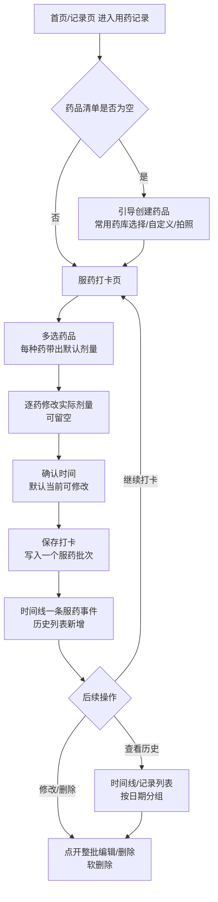

# F14 · 用药记录

> 功能 ID：P1-004  
> 优先级：P1  
> 状态：**已完成** ✅（2026-08-20 开发落地；2026-10-12 多药批次 + 药品照片增强）
>
> **来源**：docs/business/MVP-PRD.md §3.8（用药从健康记录附属字段升级为独立模块）  
> 功能 ID：P1-004  
> 优先级：P1  
> 最后同步：2026-10-12（多药同服批次 + 药品拍照：Migration 025）
>
> **2026-10-12 更新（多药同服 + 药品照片）**：
> ① 一次打卡支持**多选药品**（多药同服场景），保存为一个「服药批次」（共享 `batch_id`），
>    时间线 / 记录列表按批**聚合为一条服药事件**展示（药名并列 + 剂量并列），点击整批编辑/删除；
>    `batch_id=NULL` 的历史单药记录天然兼容（按单条处理）。
> ② 药品清单支持**拍照留档**（`medication.photo_id`）：药品管理、打卡选药 chip 均展示缩略图
>    （家里老人靠图区分药品）。上传走既有 `uploadOne`（压缩 + COS 直传）。
> ③ 新增批次端点：`POST /records/medication/batch`、`GET/PUT /records/medication/:id/batch`；
>    `DELETE /records/medication/:id` 语义升级为「删除批内任一条 = 删整批」（与合并展示对齐）。
> ④ 单条旧端点（POST / PATCH / GET :id）保留，兼容已发布版本。
>
> **2026-08-20 更新**：常用药库移除营养素类（益生菌/维生素D 等，归 F03 营养素模块），自定义录入不限制。
>
> **实现说明**：迁移 013 + **025** 已落地（`medication` + `medication_record` 两表）；后端 `records/medication` 模块（清单 CRUD + 打卡 CRUD + 批次端点，软删除，timeline 物化支持）；小程序端**打卡表单页**（进入即表单，与 feeding/sleep 等表单页一致，`pages/records/medication`）；**历史不在本页展示**，统一由首页今日时间线与记录列表页承载；首页快捷区「用药」入口；记录列表「用药」筛选。接口层已实测通过（含 409 去重、软删快照、今日聚合）。
>
> **2026-08-20 交互调整**：① 用药记录页直接展示打卡表单，无需点击按钮进入；② 页面不再承载历史列表，历史统一在今日时间线 + 记录列表页展示。
>
> **2026-10-09 调整**：首页顶部**状态栏下线「今日用药」统计项**（原为奶量/睡眠/换尿布之外的并列第 4 格），状态栏收敛为「今日奶量 / 今日睡眠 / 换尿布」3 项；用药入口仍保留在首页快捷区 + 今日时间线 + 记录列表页，功能不受影响。
>
> **设计原则**：删除一律软删除（Migration 012 原则，新表自带 `deleted_at`）；
> 现有健康记录（F07）/ 医疗记录（F10）中的"用药"附属字段**保留不动**，互不影响。

## 功能描述

独立的用药记录模块：为宝宝维护**常用药品清单**（常用药库 + 自定义，支持照片留档），按**单次服药**打卡记录实际用药（时间 + 药品 + 实际剂量，**支持一次服用多种药**），按日期查看服药历史，首页提供快捷入口。

**多药同服（2026-10-12）**：一次打卡 = 一个「服药批次」（`batch_id`），批内每药一条记录、各自独立剂量；时间线 / 记录列表按批聚合为一条服药事件展示；编辑 / 删除均以整批为单位。

**平台实现**：微信小程序（主平台），数据通过 REST API 存入远程 MySQL。

**定位说明**：区别于健康/医疗记录里"就医时顺带记一笔"的用药字段，本模块面向**日常持续用药**场景（如敏宝长期服用抗过敏药、益生菌、维生素D 等），解决"今天几点吃了什么药、吃了几次、吃了多少"的记录与回顾问题。

## 用户旅程（3 阶段）



## 用户故事

### US-01 · 药品清单管理（宝宝级）

**业务规则**
- 药品清单按**宝宝**维护（`medication` 表，`baby_id` 归属），不同宝宝清单独立
- 创建药品两种方式：
  1. **常用药库**选择：内置常用药（见下表），选中即带出默认剂量占位，可修改后保存
  2. **自定义**：手动输入药品名称 + 默认剂量（可选）
- 字段：名称（必填 ≤50 字）、默认剂量（可选，如 "5ml"/"1袋"/"2.5ml"）、**照片（可选，拍药盒留档，2026-10-12 新增）**、备注（可选 ≤200 字）
- **药品照片（2026-10-12）**：创建/编辑药品时拍照或从相册选择（1 张），压缩后直传 COS，`photo_id` 存 fileID；
  药品列表、打卡选药 chip 均展示缩略图，家里老人可以**靠图区分药品**；可删除照片（置空）
- 支持编辑、删除（**软删除** `deleted_at` 标记）；删除后历史打卡记录不受影响（记录冗余药品名快照）
- 权限：owner / member 均可管理（与记录类模块一致，`@MinRole(MEMBER)`）

**常用药库（建议初始值，可后续扩展）**

| 药品 | 默认剂量示例 | 适用 |
|------|-------------|------|
| 西替利嗪滴剂 | 5ml | 抗过敏 |
| 氯雷他定糖浆 | 5ml | 抗过敏 |
| 布洛芬混悬液 | 5ml | 退烧 |
| 对乙酰氨基酚 | 1ml | 退烧 |
| 蒙脱石散 | 1袋 | 止泻 |

> **药库边界（2026-08-20 评估确认）**：
> - 药库**不预置营养素/膳食补充剂类**（益生菌、维生素D、铁剂、钙剂等）——F03 饮食记录-营养素模块（`feeding_supplement_record`，含语音识别）已覆盖此类记录，避免同一物品两个入口、首页卡片语义重复、双数据源漂移
> - **自定义录入不限制**：存在治疗用途补充剂等边缘场景，家长可自行录入任意物品（营养素类也可自定义添加）
> - 药库为前端静态数据（类似 `baby-foods`），不含剂量建议，剂量由家长确认

**ASCII 线框图（药品清单管理页）**

```
┌────────────────────────────────┐
│ ‹ 药品清单            [+ 新建] │  ← 顶部：返回 + 新建
├────────────────────────────────┤
│ ┌──────────────────────────┐   │
│ │ 西替利嗪滴剂     5ml    › │   │  ← 已有药品（点击编辑）
│ │ 备注: 睡前服用           │   │
│ └──────────────────────────┘   │
│ ┌──────────────────────────┐   │
│ │ 维生素D           1粒    › │   │
│ └──────────────────────────┘   │
│                                │
│  常用药库（快捷添加）           │
│ ┌──────┬──────┬──────┐        │
│ │西替利嗪│氯雷他定│益生菌│     │  ← 点击 → 确认弹层（带默认剂量）
│ ├──────┼──────┼──────┤        │
│ │维生素D│布洛芬│蒙脱石散│     │
│ └──────┴──────┴──────┘        │
│        （+ 自定义录入）        │
└────────────────────────────────┘
```

**新建/编辑药品弹层（BottomSheet）**

```
┌────────────────────────────────┐
│ 新建药品            [保存]     │
├────────────────────────────────┤
│ 药品名称  [西替利嗪滴剂____]   │
│ 默认剂量  [5ml___________]     │
│ 药品照片  [📷 拍照 / 相册]     │  ← 2026-10-12 新增（1 张，可删除）
│ 备注      [睡前服用________]   │
│                                │
│        [取消] [确认保存]       │
└────────────────────────────────┘
```

### US-02 · 服药打卡（支持多药同服，2026-10-12）

**业务规则**
- 入口：首页快捷区「用药」/ 用药记录页
- 流程：**多选药品**（点击 chip 选中/取消，仅显示未删除的清单药品）→ 每种药自动带出默认剂量 → **逐药修改实际剂量**（记录本次真实服用量）→ 确认服药时间（默认当前时间，可修改，支持跨天补录）→ 保存为**一个服药批次**
- 多药同服：一次可选择多种药（批内上限 20），每药一条记录、共享 `batch_id`；批内任一种药的剂量可单独留空（"按需"场景）
- 保存后：时间线 / 记录列表**新增一条合并的服药事件**（药名并列展示），点击可**整批编辑**（改剂量/增删药/改时间）或**整批删除**
- 删除语义：删除批内任一条 = 删除整批（与合并展示对齐）；`batch_id=NULL` 的历史单药记录仍为单条删除
- 打卡时间范围限制：不允许晚于当前时间 5 分钟之后（防误填未来），允许补录过去任意时间
- 权限：owner / member 均可打卡（`@MinRole(MEMBER)`）

**编辑模式（整批 diff）**：点开合并条目 → 加载批内全部药品回填 → 保存时服务端 diff：
保留行更新（改剂量）/ 新增行插入 / 缺失行软删除；旧单药记录编辑时若新增了药，自动为该记录开辟批次并并入。

**ASCII 线框图（服药打卡页）**

```
┌────────────────────────────────┐
│ ‹ 用药记录             保存    │
├────────────────────────────────┤
│ 记录时间                       │
│ ┌──────────────────────────┐   │
│ │ 记录日期  2026-10-12     │   │
│ │ 记录时间  16:30          │   │
│ └──────────────────────────┘   │
│ 用药（可多选）  管理药品清单 ›  │
│ ┌──────────────────────────┐   │
│ │ [图]西替利嗪✓ [图]氯雷他定 │   │  ← 点击 chip 多选/取消
│ │ [图]蒙脱石散  [图]布洛芬   │   │
│ └──────────────────────────┘   │
│ 已选 2 种 · 可单独修改剂量      │
│ ┌──────────────────────────┐   │
│ │ 西替利嗪滴剂   [5ml]    × │   │  ← 每种药独立剂量
│ │ 蒙脱石散       [1袋]    × │   │
│ └──────────────────────────┘   │
│ 备注（可选）                    │
│ ┌──────────────────────────┐   │
│ │ 饭后服用                  │   │
│ └──────────────────────────┘   │
│        [保存记录]              │
└────────────────────────────────┘
```

### US-03 · 服药历史（今日时间线 + 记录列表）

**业务规则**
- **本模块不承载历史列表**：历史统一在首页今日时间线（今日服药记录实时展示）与记录列表页（「用药」筛选 tab，按日期分页）查看
- **多药批次聚合（2026-10-12）**：同 `batch_id` 的服药记录在时间线/列表**聚合为一条服药事件**：
  药名并列展示（多枚 tag）、剂量并列摘要（如 '5ml · 1袋'）；`batch_id=NULL` 的历史单药记录按单条展示
- 今日时间线条目：用药图标 + 药名并列 tag + 剂量并列摘要；记录列表条目：药名并列 + 备注 tags + 剂量摘要
- 点击时间线/列表中的用药条目 → 进入打卡表单页**编辑模式**（整批回填时间/药品/剂量），可修改或整批删除（软删除，二次确认）
- 支持跨天补录（打卡时修改日期）

**ASCII 线框图（历史列表）**

```
┌────────────────────────────────┐
│ 8月20日 星期四                 │
│ ┌──────────────────────────┐   │
│ │ 08:00 [西替利嗪][蒙脱石散] │   │  ← 多药批次聚合为一条
│ │       5ml · 1袋          › │   │  ← 点击整批编辑
│ └──────────────────────────┘   │
│ ┌──────────────────────────┐   │
│ │ 16:30 [益生菌]    1袋     › │   │  ← 历史单药记录按单条
│ └──────────────────────────┘   │
│ 8月19日 星期三                 │
│ ┌──────────────────────────┐   │
│ │ 08:05 [西替利嗪]  5ml     › │   │
│ └──────────────────────────┘   │
└────────────────────────────────┘
```

### US-04 · 首页用药入口

**业务规则**
- 首页快捷记录区新增「用药」入口（与配方奶/母乳/尿布/睡眠/体温等同级）
- ~~首页宝宝卡片下方（或时间线头部）展示「今日用药」汇总：`今日已服药 N 次`，点击进入用药记录页~~
  → **2026-10-09 变更**：顶部状态栏的「今日用药」统计项**已下线**（状态栏只保留今日奶量/今日睡眠/换尿布 3 项，见 §变更记录）。今日服药次数改由**今日时间线**中的用药条目承载，不再单独占状态栏一格。
- 数据来源：扩展今日聚合接口 `GET /api/family/:familyId/records/today`，新增 `medication` 类型（与现有 8 类记录同机制）；今日次数由前端按类型计数
- **2026-10-12**：`/records/today` 的 medication detail 增加 `batch_id`，前端按批聚合展示（聚合逻辑在前端，`lib/mergeBatches.ts`）

## 后端 API

| 端点 | 方法 | 说明 |
|------|------|------|
| `/api/family/:familyId/medications` | GET | 药品清单（未删除，含 `photo_id`） |
| `/api/family/:familyId/medications` | POST | 创建药品（可带 `photo_id`） |
| `/api/family/:familyId/medications/:id` | PATCH | 更新药品（`photo_id` 传空串=清除照片） |
| `/api/family/:familyId/medications/:id` | DELETE | 删除药品（软删除） |
| `/api/family/:familyId/records/medication` | POST | 服药打卡（单次，旧版兼容） |
| `/api/family/:familyId/records/medication` | GET | 服药记录列表（支持 `?date=YYYY-MM-DD`） |
| `/api/family/:familyId/records/medication/:id` | PATCH | 编辑服药记录（单条，旧版兼容） |
| `/api/family/:familyId/records/medication/:id` | DELETE | 删除服药记录（软删除；**多药批次删除整批**） |
| `/api/family/:familyId/records/medication/batch` | POST | **多药服药打卡**（2026-10-12）：一次多种药 → 返回 `{ batch_id, ids }` |
| `/api/family/:familyId/records/medication/:id/batch` | GET | **加载批次全部成员**（以批内任一条为锚点；历史单药返回单条数组） |
| `/api/family/:familyId/records/medication/:id/batch` | PUT | **整批保存（diff）**：保留行更新 / 新增行插入 / 缺失行软删；锚点无批且提交多行时自动开批并入 |

> 权限：全部走 `JwtGuard + FamilyMemberGuard + RoleGuard`；清单/记录写操作 `@MinRole(MEMBER)`。
> 今日聚合：`/records/today` 扩展 `medication` 类型（detail 含 medication_name / dose / batch_id）。

## DTO 字段

**CreateMedicationDto**（药品清单）：

| 字段 | 类型 | 必填 | 说明 |
|------|------|------|------|
| `name` | string | 是 | 药品名称（≤50 字，去重校验同宝宝同名称） |
| `default_dose` | string | 否 | 默认剂量（如 "5ml"/"1袋"，≤50 字） |
| `photo_id` | string | 否 | **药品照片 fileID（≤512 字符，2026-10-12 新增）**；更新传空串=清除照片 |
| `note` | string | 否 | 备注（≤200 字） |

**CreateMedicationRecordDto**（服药打卡，单条，旧版兼容）：

| 字段 | 类型 | 必填 | 说明 |
|------|------|------|------|
| `baby_id` | UUID string | 是 | 宝宝 UUID |
| `medication_id` | UUID string | 否 | 关联药品清单 ID（清单删除后可为空） |
| `medication_name` | string | 是 | 药品名称快照（不随清单改名/删除变化） |
| `dose` | string | 否 | 本次实际剂量（可空=按需，≤50 字） |
| `record_time` | string | 是 | 本地时间 `YYYY-MM-DDTHH:mm:ss`（默认当前，可补录） |
| `note` | string | 否 | 备注（≤200 字） |

> 更新时 `medication_id` 不强制（兼容清单已软删的历史记录）。

**CreateMedicationBatchDto**（多药批次创建，2026-10-12）：

| 字段 | 类型 | 必填 | 说明 |
|------|------|------|------|
| `baby_id` | UUID string | 是 | 宝宝 UUID |
| `record_time` | string | 是 | 服药时间（批级，所有成员共享） |
| `note` | string | 否 | 备注（批级，≤200 字） |
| `items` | `MedicationBatchItemDto[]` | 是 | 药品行列表（1~20 行）→ 服务端生成 `batch_id` |

**UpdateMedicationBatchDto**（整批保存）：

| 字段 | 类型 | 必填 | 说明 |
|------|------|------|------|
| `record_time` | string | 否 | 不传=保持原值；传则重写批内全部行 |
| `note` | string | 否 | 同上；空串=清空 |
| `items` | `MedicationBatchItemDto[]` | 是 | 整批最新状态（缺省的行将被软删除） |

**MedicationBatchItemDto**（批次行）：

| 字段 | 类型 | 必填 | 说明 |
|------|------|------|------|
| `record_id` | UUID string | 否 | 既有记录 id（编辑保留行回传；新增行为空） |
| `medication_id` | UUID string | 否 | 关联药品清单 ID |
| `medication_name` | string | 是 | 药品名称快照（≤50 字） |
| `dose` | string | 否 | 本次实际剂量（可空=按需，≤50 字） |

## 数据库设计（Migration 013 + 025）

**medication**（药品清单，宝宝级）：

| 字段 | 类型 | 说明 |
|------|------|------|
| `id` | CHAR(36) | UUID，应用层生成 |
| `baby_id` | CHAR(36) | 关联 baby_profile.id（索引） |
| `name` | VARCHAR(50) | 药品名称 |
| `default_dose` | VARCHAR(50) | 默认剂量（可空） |
| `photo_id` | VARCHAR(512) | **药品照片 fileID（迁移 025，NULL=未拍照）** |
| `note` | VARCHAR(200) | 备注 |
| `created_by` | CHAR(36) | 创建人 user_account.id |
| `created_at` | DATETIME | 创建时间 |
| `updated_at` | DATETIME | 更新时间 |
| `deleted_at` | DATETIME | **软删除时间（NULL=正常）** |

唯一约束：`uk_med_baby_name (baby_id, name)`（软删记录不占约束——MySQL 唯一键含 NULL 不冲突，需保证软删时 name 不变则冲突；**方案：软删时保留原 name，唯一键改为 `(baby_id, name, deleted_at)` 不可行（NULL 重复）；改用应用层查重（同宝宝同名称且未删除）**）

**medication_record**（服药打卡）：

| 字段 | 类型 | 说明 |
|------|------|------|
| `id` | CHAR(36) | UUID，应用层生成 |
| `baby_id` | CHAR(36) | 关联 baby_profile.id（索引） |
| `medication_id` | CHAR(36) | 关联 medication.id（可空，清单删除后保留） |
| `batch_id` | CHAR(36) | **同一次服药批次（迁移 025）**：多药同服共享同一 UUID；NULL=历史单药记录（天然兼容） |
| `medication_name` | VARCHAR(50) | 药品名快照（展示用，不受清单变更影响） |
| `dose` | VARCHAR(50) | 本次实际剂量（可空） |
| `record_time` | DATETIME | 服药时间（默认当前，可补录；批内各成员相同） |
| `note` | VARCHAR(200) | 备注（批级） |
| `recorded_by` | CHAR(36) | 记录人 user_account.id |
| `created_at` | DATETIME | 创建时间 |
| `updated_at` | DATETIME | 更新时间 |
| `deleted_at` | DATETIME | **软删除时间（NULL=正常）** |

索引：`idx_med_rec_baby_time (baby_id, record_time)`、`idx_medrec_batch (batch_id)`（025）

> 不建外键（与现有记录表一致，靠应用层校验 + Guard 拦截）；
> `record_timeline` 物化表同步写入 `medication` 类型（同 009 机制），首页时间线复用；
> 025 起物化 detail 额外携带 `batch_id`（timeline.service / family.service / feed.service 三处出口一致）。

## 前端组件结构

| 组件/页面 | 功能 |
|------|------|
| `pages/records/medication/index.tsx` | **打卡表单页**（进入即表单：时间/多选药品/逐药剂量/备注；药品管理弹层内置；编辑模式整批回填） |
| `MedicationSheet`（内置弹层） | 药品清单管理（常用药库 + 自定义 + 编辑/删除 + **药品拍照**） |
| `lib/mergeBatches.ts` | **批次聚合工具**（时间线/记录列表把同 batch_id 记录合并为一条服药事件；幂等、支持分页增量） |
| 首页 `QuickActions` | 快捷区「用药」入口 |
| 首页 `TodayTimeline` + `homeRecords.ts` | 今日时间线用药条目（合并展示：多药名 tag + 剂量并列摘要） |
| 记录列表页 + `recordListDisplay.ts` | 「用药」筛选 tab + 合并条目摘要 |

## 展示层影响面（2026-10-12 核对）

| 消费点 | 展示内容 | 数据来源 |
|--------|----------|----------|
| 今日时间线（首页） | 用药合并条目：label「用药」+ 药名并列 tags + 剂量并列摘要 | `GET /records/today` → medication detail（`medication_name`/`dose`/`batch_id`）→ `mergeMedicationBatches` 聚合 → `homeRecords.ts getTimelineRecordDisplay` |
| 记录列表页 | 同上（列表行：药名并列 tags + 右侧剂量并列摘要） | feed 接口 → `record_timeline` 物化 detail（025 起含 `batch_id`）→ `mergeMedicationBatches` 聚合 → `recordListDisplay.ts` |
| 表单页编辑回显 | 整批回填（多行药品 + 逐药剂量） | `GET /records/medication/:id/batch`（以批内任一条为锚点） |
| 表单页/列表删除 | 删除批内任一条 = 删整批 | `DELETE /records/medication/:id`（service 自动展开 batch） |
| 日程「用药」判定（服务端） | 匹配 `type='medication'`（批场景命中批内任一条即算完成；摘要取单条 `medication_name dose`） | `schedule-item-type.registry.ts`（**未改动**，批内多条记录按既有"已消费"机制配对） |
| 首页删除（RecordActionSheet） | 删除后调 `recordsApi.remove` → 后端整批软删 | `pages/home/index.tsx` onDelete |
| 记录列表删除 | 同上 | `pages/records/list/index.tsx` handleDelete |

> 兼容性：`batch_id=NULL` 的历史单药记录在所有消费点按单条展示；已发布旧版本小程序走旧端点（POST 单条 / PATCH 单条）不受影响。

## 验收标准（AC）

- [x] 药品清单：常用药库一键添加 + 自定义录入
- [x] 药品清单：编辑、删除（软删除），删除后历史打卡仍正常展示（名称快照）
- [x] 药品清单：同宝宝同名去重（应用层校验，409）
- [x] **药品清单：支持拍照/相册上传照片（photo_id），列表与选药 chip 展示缩略图，可删除照片**（2026-10-12）
- [x] 服药打卡：选药带出默认剂量，可修改实际剂量、可留空
- [x] **服药打卡：支持一次多选药品（多药同服），每药独立剂量，保存为一个批次**（2026-10-12）
- [x] **服药打卡：批次在时间线/记录列表聚合为一条服药事件（药名/剂量并列）**（2026-10-12）
- [x] **编辑模式整批回填/整批 diff 保存（增删药行）；删除批内任一条 = 删整批**（2026-10-12）
- [x] **旧单药记录（batch_id=NULL）全链路兼容：展示单条、编辑单行、允许加药时自动并入新批次**（2026-10-12）
- [x] 服药打卡：时间默认当前可修改，支持跨天补录
- [x] 服药历史：按日期分组展示，编辑/删除单条（软删除 + 二次确认）
- [x] 首页：快捷区「用药」入口
- [x] 首页顶部状态栏「今日用药」统计卡 —— **已下线**（2026-10-09，见 §变更记录）
- [x] 今日时间线 / 记录列表：medication 类型正常展示（含筛选 tab）
- [x] 权限：member 可打卡和管理清单，非成员被 Guard 拦截
- [x] 软删除：清单和打卡记录删除后均保留数据（deleted_at 标记）

## 变更记录

| 日期 | 变更 | 影响 |
|------|------|------|
| 2026-10-09 | 首页顶部状态栏下线「今日用药」统计项 | `minicare-mp/src/pages/home/index.tsx`（`stats` useMemo 由 4 项收敛为 3 项：今日奶量/今日睡眠/换尿布）；首页 `HeroSection` 自动按 3 格等分。用药的其余入口（快捷区、今日时间线、记录列表）不受影响 |
| 2026-10-12 | **多药同服批次（Migration 025）**：一次打卡可选多种药、批内每药独立剂量，时间线/列表聚合为一条服药事件；新增 batch 端点（POST/GET/PUT）；DELETE 升级为删整批 | 后端：`medication.service.ts`（createBatch/getBatch/updateBatch/removeRecord 批语义）、`medication-record.controller.ts`、`timeline.service.ts` + `family.service.ts` + `feed.service.ts`（detail 补 `batch_id`）；前端：`pages/records/medication/index.tsx`（多选表单）、`lib/mergeBatches.ts`（新）、`home/index.tsx`、`home/homeRecords.ts`、`records/list/index.tsx`、`recordListDisplay.ts` |
| 2026-10-12 | **药品照片（Migration 025）**：药品清单支持拍照留档（photo_id），管理列表/选药 chip 显示缩略图（老人靠图区分） | 后端：`medication.service.ts` 清单 CRUD 增列 photo_id；前端：`api/medication.ts`、`pages/records/medication/index.tsx`（上传/回显/删除，复用 `lib/uploadImage.ts uploadOne`） |

## 非目标（后续版本）

- 服药提醒（订阅消息/本地通知）→ P1 后续
- 停药/漏服状态管理、疗效追踪
- 与健康记录（过敏反应）联动展示
- 用药统计报表（按药/按周期）
- 药品照片多张 / 药品说明书 OCR（当前单张+人工确认）

## 相关文件

- 打卡/历史/药品管理页：`minicare-mp/src/pages/records/medication/`
- 批次聚合工具：`minicare-mp/src/lib/mergeBatches.ts`
- API 模块：`minicare-mp/src/api/medication.ts`
- 服务端：`minicare-server/src/records/medication/`
- 迁移：`minicare-server/migrations/013_medication.sql`、`025_medication_enhance.sql`
- 时间线支持：`minicare-server/src/records/timeline/timeline.service.ts`（medication 类型，含 batch_id）
