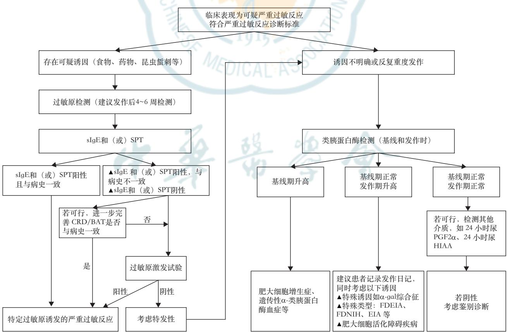
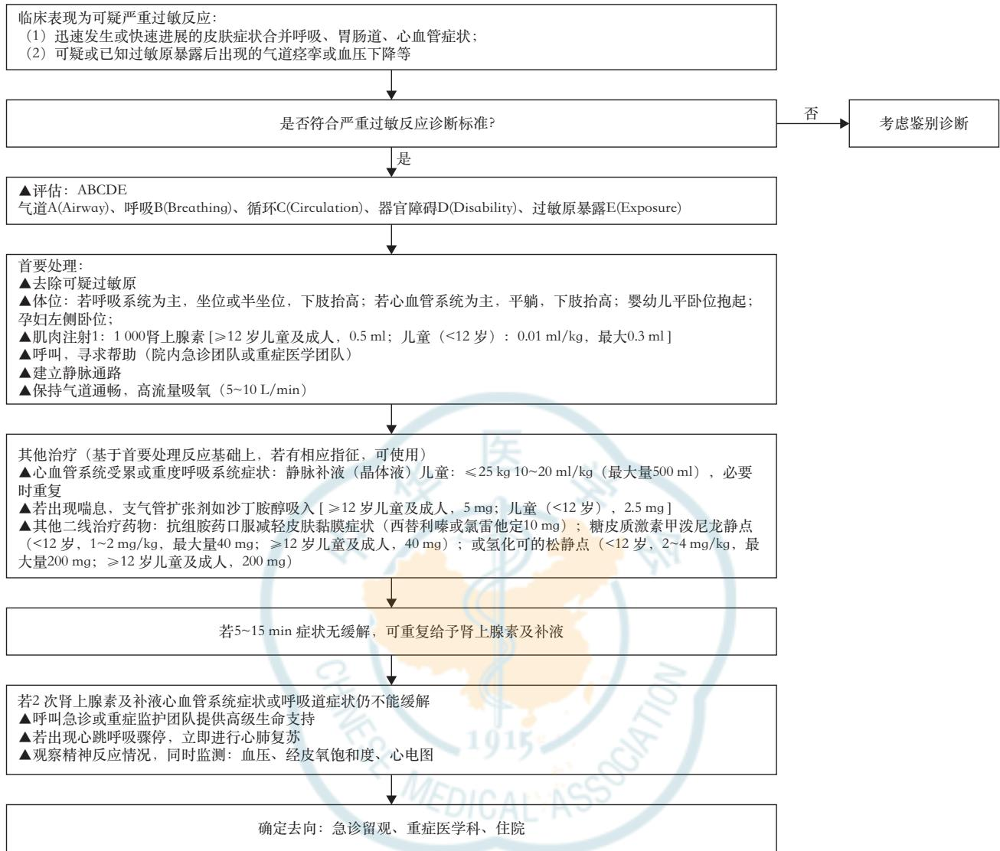

·标准·指南·共识·

# 严重过敏反应诊断和临床管理专家共识

中国康复医学会变态反应性疾病康复专业委员会 中华医学会变态反应学分会过敏原特异性诊断学组 中华预防医学会过敏病预防与控制专业委员会 国家儿童感染和过敏性疾病监测中心过敏疾病专业委员会 北京慢性病防治与健康教育研究会变态反应学专业委员会 福棠儿童医学发展研究中心过敏（变态）反应学科规范化建设研究组

通信作者：关凯，中国医学科学院北京协和医学院北京协和医院变态（过敏）反应科过敏性疾病精准诊疗研究北京市重点实验室 国家皮肤与免疫疾病临床医学研究中心，北京 100730，Email：dr\_guankai@126.com；祝戎飞，华中科技大学同济医学院附属同济医院过敏反应科，武汉 430030，Email： zrf13092@163.com；向莉，国家儿童医学中心首都医科大学附属北京儿童医院过敏反应科 儿童重大疾病研究教育部重点实验室国家呼吸系统疾病临床医学研究中心，北京 100045，Email：drxiangli@163.com

【摘要】　严重过敏反应在我国发病率逐年升高，目前国内对严重过敏反应尚存在认识不足和诊疗不规范问题。为了进一步规范严重过敏反应的诊治，本文基于国内外诊治实践参数以及循证指南，对严重过敏反应发病机制、诱因和危险因素、临床表现、诊断、治疗、预防等方面进行详细阐述，并提出了严重过敏反应的诊断和治疗建议，旨在提高临床医师对严重过敏反应的规范化管理水平，为未来制订我国严重过敏反应诊疗指南奠定基础。

【关键词】　严重过敏反应；　过敏原；　类胰蛋白酶；　专家共识

基金项目：北京市科技新星计划（20240484542）；北京市自然科学基金（7252045）；中国医学科学院临床与转化医学研究专项（2023‑I2M‑C&T‑B‑010）；国家自然科学基金面上项目（82370041、82070033）；中国医学科学院医学与健康科技创新工程项目（2021‑I2M‑1‑107）；中央高水平医院临床科研业务费(2022-PUMCH-B-088、2022-PUMCH-B-089):生机计划2023(202406170002):2023年北京市重大疑难疾病中西医协同攻关项目（儿童肺系过敏性疾病‑中西医协同攻关示范项目，2023BJSZDYNJBXTGG‑005）

# Expert consensus on the diagnosis and clinical management of anaphylaxis

Committee on Allergy, Chinese Association of Rehabilitation Medicine; Allergen Specific Diagnostics Group, Chinese Society of Allergology, Chinese Medical Association; Specialty Society of Allergic Disease Prevention and Control, Chinese Preventive Medicine Association; Committee on Allergy, National Center for Children′s Infectious and Allergic Diseases Surveillance; Committee on Allergy, Beijing Research Association for Chronic Diseases Control and Health Education; The Group of Standardized Construction for Allergic Diseases, Futang Research Center of Pediatric Development

Corresponding authors: Guan Kai, Department of Allergy, Peking Union Medical College Hospital, Chinese Academy of Medical Sciences & Peking Union Medical College, Beijing Key Laboratory of Precision Medicine for Diagnosis and Treatment of Allergic Disease, National Clinical Research Center for Dermatologic and Immunologic Diseases, Beijing 100730, China, Email: dr\_guankai@126.com; Zhu Rongfei,Department of Allergy, Tongji Hospital, Tongji Medical College, Huazhong University of Science and Technology, Wuhan 430030, China, Email: zrf13092@163. com; Xiang Li, Department of Allergy, Beijing Children′s Hospital, Capital Medical University, National Center for Children′s Health, Key Laboratory of Major Diseases in Children, Ministry of Education, National Clinical Research Center for Respiratory Diseases, Beijing 100045, China, Email: drxiangli@163.com

【Abstract】 Anaphylaxis has shown a steadily rising incidence in recent years, but remains under‑reported, under‑diagnosed and under‑treated in China. To improve the diagnosis and management of anaphylaxis, this consensus elaborates on the pathogenesis, triggers, risk factors, clinical manifestations, diagnosis, treatment and prevention of anaphylaxis based on previously published evidence‑based guidelines and practice parameters. Additionally, it proposes recommendations for the diagnosis and management of anaphylaxis specially for Chinese patients. This consensus aims to guide physicians in standardizing the management of anaphylaxis and to provide a framework for the development of new guidelines.

【Key words】 Anaphylaxis; Allergen; Tryptase; Expert consensus

Fund programs: Beijing Nova Program (20240484542); Beijing Natural Science Foundation (7252045); Chinese Academy of Medical Sciences (CAMS) Innovation Fund for Medical Sciences (CIFMS) (2023‑I2M‑C&T‑B‑010); Natural Science Foundation of China (82370041, 82070033); Chinese Academy of Medical Sciences Innovation Fund for Medical Sciences (2021‑I2M‑1‑107); National High Level Hospital Clinical Research Funding (2022‑PUMCH‑B‑088, 2022‑PUMCH‑B‑089); Vitality Plan 2023(202406170002); 2023 Beijing Collaborative Research Project of Integrated Traditional Chinese and Western Medicine on Major and Refractory Diseases (Children′s Pulmonary Allergic Diseases‑Collaborative Research Demonstration Project of Integrated Traditional Chinese and Western Medicine, 2023BJSZDYNJBXTGG‑005)

## 【要点】

## 一、定义

严重过敏反应是一种速发、危及生命、可累及全身多系统的超敏反应，多伴有皮肤系统表现，少数仅表现为单一呼吸系统或心血管系统症状及体征，免疫学机制多为IgE介导，少数为非IgE介导或混合机制介导。

## 二、发病机制

IgE介导的途径是最常见也是最经典的途径，其他非IgE介导的途径包括肥大细胞直接激活、细胞因子反应以及补体/缓激肽介导的反应等。

## 三 、诱 因

1. 食物：食物是儿童最常见的诱因，具有年龄特异性，婴幼儿最常见为牛奶、鸡蛋、小麦，学龄前及学龄期常见的诱因为水果/蔬菜、荞麦、坚果等，青少年及成人常见的是小麦、水果/蔬菜等。

药物：药物是成人及住院患者最常见的诱因，我国最常见的致敏药物为抗生素、中药、造影剂及抗肿瘤药物。

3. 昆虫蜇刺：昆虫蜇刺多由蜜蜂、黄蜂、马蜂等膜翅目昆虫和外来物种如火蚁等蛰刺，成人多于儿童，易导致重症严重过敏反应。

4. 特发性：未能明确诱因的严重过敏反应，定义为特发性严重过敏反应，部分患者存在肥大细胞

活化异常。

## 四、伴发因素

常见的伴发因素为运动、急性感染、非甾体类抗 炎 药 （non‑steroidal anti‑inflammatory drugs，NSAIDs）及饮酒等，其他因素如精神紧张、睡眠缺乏、脱水、月经周期等也可加重严重过敏反应症状。

## 五、高危人群

高危人群包括：特应性个体、存在基础疾病个体（如心肺基础疾病、肥大细胞活化异常疾病）、婴幼儿、老年人、使用β‑受体拮抗剂或血管紧张素转换 酶 抑 制 剂 （angiotensin converting enzymeinhibitor，ACEI）类药物人群。

## 六、临床表现及病程

1. 症状：皮肤黏膜症状及体征最为常见，可同时发生呼吸系统、胃肠道、心血管系统及神经系统症状。症状与诱因、基础疾病及年龄等因素相关。药物诱发的严重过敏反应心血管系统受累更为多见，婴幼儿症状因年龄特点有时难以识别。某些化疗 药 物 及 单 克 隆 抗 体（monoclonal antibodies，mAbs）诱发的严重过敏反应可叠加非典型症状如寒战、发热、头痛等。

2. 病程：可表现为单相、双相、持续性、难治性。

## 七、实验室检查

1. 类胰蛋白酶检测：推荐用于严重过敏反应的

诊断尤其是反复重度发作或诱因不明的患者。

2. 过敏原检测：主要适用于IgE介导的严重过敏反应。血清 检测可用于食物、吸入、蜂毒和药物（如抗生素、化疗药等）过敏原的检测。目前国内商品化sIgE检测试剂主要用于部分食物和吸入过敏原检测，药物及毒液sIgE检测试剂较少。当无商品化试剂可及或sIgE与病史不一致时，可考虑过敏原组分诊断和皮肤试验进行补充检测。需要结合病史解读过敏原检测结果，细胞因子反应和补体活化导致的严重过敏反应过敏原检测通常是阴性的。

过敏原激发试验：过敏原检测不能明确诱因时可在医疗监护下实施过敏原激发试验。由于过敏原激发试验本身可再次诱发严重过敏反应，操作医师需仔细评估操作风险和受试者获益，并充分获取患者或看护者知情同意后谨慎开展。

## 八 、诊 断

严重过敏反应临床诊断的主要依据详细的发作史，包括症状和体征，以及已知或可疑过敏原暴露史及伴发因素等。临床诊断标准：如果符合下述两种情况中的一种，则极有可能诊断为严重过敏反应：（1）典型的皮肤表现合并至少1个其他系统的表现（如呼吸系统、心血管系统、胃肠道系统等）；（2）暴露于已知或可疑过敏原，出现呼吸和/或心血

## 九 、治 疗

急救处理：肾上腺素是严重过敏反应的首选急救药物，应在诊断或高度可疑严重过敏反应时肌肉注射，使用1∶1 000肾上腺素（1 mg/ml），青少年及成人为0.5 mg/次，婴幼儿及儿童（≤12岁）剂量可按体重计算，为 0.01 mg/kg，单次最大剂量 0.3 mg，肾上腺素在婴幼儿及儿童中无绝对禁忌。糖皮质激素和抗组胺药物为二线治疗药物，不能替代肾上腺素。少数严重过敏反应患者对肌肉注射肾上腺素的初始治疗、静脉液体复苏和二线药物治疗无反应，应立即转诊至急诊、重症医学科治疗。伴有低血压或休克且对包括静脉液体复苏在内的基础治疗效果欠佳的患者，需要持续静脉输注肾上腺素，静脉输注肾上腺素有潜在致命性心率失常风险，必须经输液泵静脉输注，需要严密监测血压、心率等，并由有经验的医务人员操作。

## 2.特殊人群：

（1）妊娠期：大多数处理措施与非妊娠期相同，首要处理仍然是肾上腺素治疗。与非妊娠期的处理不同之处在于： 体位方面：患者取左侧卧位，以避免妊娠子宫压迫主动脉、腔静脉血管。②至少将孕 妇 收 缩 压 维 持 在 90 mmHg 以 上（1 mmHg=0.133 kPa），以维持子宫胎盘充分血流灌注。③必要时监测胎心率，以评估孕妇治疗后胎儿状况。

（2）婴幼儿：肾上腺素在治疗婴幼儿严重过敏反应时无绝对禁忌证。延迟使用肾上腺素可增加死亡风险。

（）心血管疾病患者：心血管疾病患者应用肾上腺素无绝对禁忌证，但需要权衡利弊，静脉注射肾上腺素比肌肉注射更易发生严重不良反应（包括室性心律失常和高血压），故建议首选肌肉注射，初始剂量可酌情减量，尤其是疾病急性期或病情不稳定者。治疗过程中需持续监测心电图、血压和心率，警惕心律失常或血压波动。

## 十、预防和管理

1. 过敏反应专科就诊：明确过敏原或诱发因 素，预防再发。

2. 患者教育及制定急救行动计划：患者及监护人应学会识别严重过敏反应症状，学会肾上腺素自动注射装置使用或学会注射肾上腺素，医生应给患者制定个体化书面的严重过敏反应急救行动计划。

3. 过 敏 原 免 疫 治 疗（allergen immunotherapy，AIT）：AIT用于食物、昆虫叮咬、药物（包括化疗药物、mAbs、抗生素）等诱发的严重过敏反应，主要适用于IgE介导的严重过敏反应，部分细胞因子反应和混合机制介导的严重过敏反应也适用。当过敏药物为基础疾病治疗必须用药时，需要考虑药物脱敏治疗。

4. 生物制剂治疗：生物制剂在预防严重过敏反应方面显示出一定的潜力，但亟待大样本的临床研究对其安全性和有效性加以证实，特别是长期疗效。

严重过敏反应（anaphylaxis）是累及全身多个系统的超敏反应综合征，临床症状轻重不同，可在几分钟之内从最轻微的皮肤症状迅速进展，甚至导致死亡［1‑2］，为过敏性疾病中发病最急，病情最严重的情况之一。严重过敏反应在世界范围内呈现上升趋势，终身患病率为0.05%\~2%［3］。我国严重过敏反应的发病率亦呈现上升趋势［4‑5］，在青少年群体中上升趋势最为显著［6］。近5年来，国内发表的急救指南大力推动了一线医师早期识别和急诊正确处理严重过敏反应［1，7‑8］。严重过敏反应诱因存在明显地域和年龄差异性，新的诱因如生物制剂等诱发的严重过敏反应也备受关注。近年来，药物（如生物制剂、化疗药等）诱发的严重过敏反应中叠加非典型症状以及非经典IgE途径介导的严重过敏反应的研究日益深入，但目前国内尚缺乏对严重过敏反应系统性认识的共识，且临床实践中仍存在着诊断不足和治疗不规范等诸多问题［9］。本共识基于国内外最新诊治指南和我国相关研究证据，结合我国临床实践，在广泛征求30余位国内专家意见基础上制订，旨在指导临床医师规范化诊断和管理严重过敏反应。

## 一、anaphylaxis 翻译和定义

1. anaphylaxis 翻 译 ：与“anaphylaxis”相 关 的ICD10 编码包括 T78.0、T78.2、T80.5、T88.5 等，曾被翻译为不同的中文名词，如“变态反应性休克”“过敏性休克”“过敏症”“过敏反应”“全身性过敏反应”等，目前临床最为常用的中文翻译为“严重过敏反应”，但“严重过敏反应”这个翻译仍存在一定局限性，易与症状较重的过敏症状，如全身荨麻疹、哮喘急性发作等相混淆。在本共识中，征求撰写专家组意见，将anaphylaxis翻译为“严重过敏反应”。

2.定义：对于严重过敏反应的定义，国际上仍未达成共识［2］。本共识将其定义为“严重过敏反应是一种速发、危及生命、可累及全身多系统的超敏反应，多伴有皮肤系统表现，少数仅表现为单一呼吸系统或心血管系统症状及体征，免疫学机制多为IgE介导，少数为非IgE介导或混合机制介导”。

## 二、发病机制

严重过敏反应可由IgE介导和非IgE介导。其中IgE介导途径是最常见、最经典的途径。其他发病机制包括诱因导致的肥大细胞直接激活、细胞因子反应以及补体/缓激肽介导的反应等，某些诱因可诱发IgE和非IgE混合机制介导过敏反应［10‑11］。

## （一）IgE介导

过敏原特异性 IgE（specific immunoglobulin E，sIgE）与效应细胞表面的FcεRI结合导致IgE交联，诱发肥大细胞或嗜碱性粒细胞活化并脱颗粒，释放预先合成的介质，主要为组胺、类胰蛋白酶，以及新产生的脂质衍生介质如前列腺素D2、血小板活化因子和白三烯等，并进一步活化募集嗜酸性粒细胞，释放更多细胞因子及炎症介质推动暴发性“连锁反应”，作用于靶器官出现症状。

## （二）非IgE介导

1. 肥大细胞直接激活：肥大细胞上表达的G耦联 受 体 MRGPRX2（Mas‑related G protein‑coupledreceptor X2， MRGPRX2），可被多种药物和阳离子蛋白直接激活，不依赖IgE或IgG。

2.细胞因子反应：主要由细胞因子（如TNF‑α、IL‑1β 和 IL‑6）介导的，参与细胞包括单核细胞、巨噬细胞、肥大细胞和其他具有Fcγ 受体（fragmentcrystallizable gamma receptor，FcγR）的免疫细胞。

3.补体/缓激肽介导的反应：某些诱因直接激活补体系统，产生可与补体受体结合的过敏毒素C3a和C5a，进而诱发肥大细胞或嗜碱性粒细胞脱颗粒。

## （三）IgE和非IgE混合机制介导

某些化疗药物和单克隆抗体（monoclonalantibodies， mAbs）可诱发 IgE 和细胞因子反应的混合反应，参与的细胞因子包括：肥大细胞 嗜碱性粒细胞介质以及促炎细胞因子和趋化因子（IL‑1β、IL‑6和 TNF‑α）。

## 三、严重过敏反应的诱因

严重过敏反应诱因主要包括食物、药物、昆虫蜇刺等，诱因与年龄、地域及发生场所相关，明确诱因是严重过敏反应诊断的关键环节。

## （一）食物

食物是儿童尤其是低龄儿童严重过敏反应最常见的诱因，0\~3岁婴幼儿中96%的严重过敏反应由食物诱发［9］。致敏食物谱存在显著地域和年龄差异，欧美国家婴幼儿最常见的致敏食物是牛奶、鸡蛋、花生［12］。亚洲国家如日本、中国，小麦是婴幼儿除牛奶、鸡蛋外第三大食物诱因［13‑15］。我国学龄前期及学龄期儿童与西方国家略有不同，最常见的食物诱因主要为水果/蔬菜、荞麦、坚果、水产品等［5‑6，15］。相对于原发食物过敏，某些食物过敏继发于吸入过敏原致敏，桦树花粉过敏患者最常见的过敏食物为桃、苹果、榛子、梨等。蒿属花粉过敏患者的过敏食物以桃和豆科植物（如豆类、花生）多见［16‑18］。某些尘螨或蟑螂过敏患者可合并虾过敏，罕见情况下吸入性真菌过敏患者可合并食用真菌（如蘑菇）过敏等［19‑20］。就致敏途径来说，食物一般通过食入途径诱发严重过敏反应，在重度食物过敏患者，食物过敏原（如小麦、牛奶、鸡蛋）也可通过吸入途径或皮肤接触诱发严重过敏反应［21］。食物诱发的严重过敏反应多为IgE介导。

## （二）药物

药物诱发的严重过敏反应在住院患者中更为多见，成人发病率高于儿童。常见药物包括

NSAIDs、抗生素、化疗药物、全身麻醉剂、造影剂等［22］。我国药物监管系统数据显示，药物诱发严重过 敏 反 应 常 见 种 类 为 抗 生 素（ ）、中 药（11.9%）、造 影 剂（11.9%）及 抗 肿 瘤 药 物（10.3%）［23］。诱发严重过敏反应的药物种类在门诊患者和住院患者略有不同，抗生素、AIT制剂和造影剂是门诊患者前 位的药物［5‑6］，抗生素、化疗药物和血液制品是住院患者前3位的药物［5］。除了药物本身过敏，药物常用辅料包括羧甲基纤维素、聚乙二醇、丙二醇以及其中隐藏的食物过敏原成分等也可诱发严重过敏反应［24‑25］。药物诱发的严重过敏反应机制多样，如抗生素、NSAIDs、化疗药物（如铂类、紫杉醇）、单克隆抗体（monoclonal antibodies，mAbs）、AIT药物多为IgE介导的。喹诺酮类抗生素、全身麻醉剂（如阿曲库溴铵、罗库溴铵）及具有四 氢 异 喹 啉（tetrahydroisoquinoline，THIQ）基 序 的药物可通过直接激活肥大细胞表面的G蛋白耦联受体MRGPRX2诱发严重过敏反应［26］。硫酸软骨素糖胺聚糖和造影剂可激活补体系统，产生可与补体受体结合的过敏毒素C3a和C5a，进而诱发组胺、白三烯和前列腺素的释放［27］。需要注意的是，同一种药物可通过多种免疫机制诱发过敏反应。

## （三）昆虫蜇刺

多由蜜蜂、黄蜂、马蜂等膜翅目昆虫和外来物种如火蚁等蛰刺诱发，成人比儿童更为多见［28］。在因严重过敏反应急诊就诊的患者中占1.5%\~50%不等，在致死病例中占比13%\~33%［29］。我国在门急诊就诊的严重过敏反应患者中，2.5%由昆虫蜇刺诱发［6］，因严重过敏反应住院的患者中，1.6%由昆虫蜇刺诱发［5］。膜翅目昆虫（如蜂蜇伤）是较为常见的诱因，多足纲唇足目的蜈蚣咬伤也是导致严重过敏反应的原因之一［6］。昆虫蜇刺诱发的严重过敏反应多为IgE介导。

## （四）其他诱因

环境过敏原如乳胶颗粒、动物皮毛（豚鼠、兔）、花粉等可通过呼吸道吸入诱发严重过敏反应［30‑31］，此部分诱因多由IgE介导。物理因素如寒冷暴露、运动等也可诱发严重过敏反应，免疫机制多为肥大细胞直接激活所致。

## （五）特发性

某些严重过敏反应即使经过详细的病史询问，完善相关辅助检查仍不能明确发病诱因，定义为特发性严重过敏反应（idiopathic anaphylaxis，IA）。IA成人发病率高于儿童［32］。因不能明确诱因，IA 的诊断和管理对医师更具有挑战性，也对患者安全造成更大的威胁。IA女性更多见，提示激素水平在发病中的潜在作用，可能的原因为肥大细胞和嗜碱性粒细胞表面存在雌激素和孕激素的受体［33］，激素水平波动时导致效应细胞异常活化。

## 四、伴发因素

伴发因素是指与严重过敏反应发生相关的个体因素或内环境。常见的伴发因素为运动、急性感染、 、饮酒等，其他因素如精神紧张、睡眠缺乏、脱水、月经周期等也可加重严重过敏反应症状［34］。运动是最早被人们认识也是目前研究最多的伴发因素，如食物依赖运动诱发的严重过敏反应（food dependent exercise induced anaphylaxis，FDEIA）。女性患者在经期前后出现严重过敏反应可诊断为月经相关的严重过敏反应，内源性和外源性的孕激素可能是过敏反应加重诱因［35］。伴发因素在严重过敏反应的作用尚未达成共识，可能的机制包括降低效应细胞活化的阈值、增加过敏原的生物利用度、增加血浆渗透性及增加食物 sIgE 水平等［36］。

## 五、高危人群

严重过敏反应发生的高危人群包括：特应性个体、合并心肺基础疾病个体（如心血管疾病、哮喘），患有肥大细胞活化异常疾病如系统性肥大细胞增多症（systemic mastocytosis， SM）的个体、婴幼儿、老年人、β‑受体拮抗剂或血管紧张素转换酶抑制剂（angiotensin converting enzyme inhibitor，ACEI）类药物使用人群［37］。近年来，SM患者发生严重过敏反应风险日益受到关注，SM可累及骨髓在内的一个或多个器官肥大细胞增生，90%以上SM的成人患者存在KIT基因变异 D816V［38］。约30% SM患者表现为不明原因或昆虫蜇刺后严重过敏反应［39］。因此不明原因或昆虫蜇刺导致重度潜在致死性的严重过敏反应时，可能需要评估KIT变异D816V，若为阳性，需要进一步行骨髓活检除外肥大细胞增多症［40］。此外，其他基因变异也提示严重过敏反应的发生风险，如卡铂过敏的卵巢癌患者，部分存在BRCA1/2基因变异［41］。

## 六、临床表现及病程

## （一）临床表现

严重过敏反应症状一般出现在暴露于过敏原2 h内，静脉用药及昆虫蜇刺诱发的严重过敏反应通常发生在 内。某些过敏原暴露会诱发迟发型的严重过敏反应，如α‑Gal综合征［42］。严重过敏反应症状和体征见表1。症状具有个体差异性，但同一患者再次发生严重过敏反应时，症状的严重程度及先后顺序可能与先前发作相同［43］。临床表现严重程度具有不可预测性，部分轻症患者可自行缓解；重症患者可在数分钟内累及呼吸系统或心血管系统，有潜在死亡风险［44］。致死性严重过敏反应罕见［29］，危险因素包括高龄、既往患有心血管疾病和延迟肾上腺素治疗等［29］，直接死因通常是循环衰竭及气道梗阻导致窒息［45］。

表1 严重过敏反应的症状和体征
<table><tr><td>受累系统</td><td>症状和体征</td></tr><tr><td>皮肤黏膜系统</td><td>·皮肤瘙痒(早期可出现手掌、脚底、头皮瘙 痒)、风团样皮疹、血管性水肿 ·结膜充血、流泪</td></tr><tr><td>呼吸系统</td><td>·口唇、舌、上颚瘙痒及肿胀 ·鼻痒、鼻塞、流涕、喷嚏 ·喉部瘙痒发紧、发音困难、声音嘶哑、喉鸣 ·气促、胸闷、持续性咳嗽、喘息、发绀、呼吸</td></tr><tr><td>胃肠道系统</td><td>骤停 腹痛、恶心、呕吐、腹泻、吞咽困难</td></tr><tr><td>心血管系统</td><td>胸痛、心悸、晕厥感、尿便失禁、休克、心跳 骤停</td></tr><tr><td>中枢神经系统</td><td>濒死感、烦躁不安、搏动性头痛、头晕、意识模</td></tr><tr><td>其他</td><td>糊、抽搐等 全身症状如发热、寒战、肌肉关节疼痛等</td></tr></table>

典型症状：通常表现多系统受累，最常见为皮肤黏膜症状合并至少一个系统（如呼吸系统、胃肠道受累、心血管系统及神经系统）同时受累。少见情况下，严重过敏反应可仅表现为呼吸系统或心血管系统受累。致死性严重过敏反应患者中，以单一系统受累表现的患者并不少见［46‑4 7］。症状存在个体差异性，也与诱因相关，如药物所致心血管系统受累更多见。严重过敏反应的早期识别非常重要，但会受到患者基础疾病及用药影响。如患有神经精神系统疾病、认知障碍的患者，镇静剂、抗抑郁药物及抗组胺药物的使用可能会干扰症状识别和判断。手掌、足底、头皮瘙痒，可能是严重过敏反应的早期表现［2］。严重的胃肠道症状（如剧烈腹绞痛，反复呕吐），尤其是在非食物过敏原暴露后，提示可能发生严重过敏反应［48］。儿童尤其是婴幼儿症状有时难以识别，持续性呕吐可能是唯一表现，非特异性的症状，如持续哭闹、嗜睡等亦可能是早期表现［9，49］。

非典型症状：某些化疗药物（如奥沙利铂、紫杉醇）、mAbs诱发的严重过敏反应除了典型症状外，还可叠加非典型症状如寒战、发热、头痛等。另外，罕见情况下，严重过敏反应期间可发生Kounis综合征，其是一种伴有胸痛的急性冠状动脉综合征，表现为不稳定心绞痛伴有肌钙蛋白升高。个体通常无冠状动脉疾病病史，一般在严重过敏反应发生的几个小时内恢复［50］。

## （二）病程

按照病程可将严重过敏反应可分为单相、双相（biphasic） 、 持 续 性 （persistent） 、 难 治 性（refractory）［51］。其中单相严重过敏反应最常见，约占所有发作的 。通常在症状出现后数小时内达到高峰，之后会在数小时内自行消退或在治疗后消退［52‑53］。部分可表现为双相、持续性、难治性严重过敏反应，具体诊断标准详见表2。

## 七、严重过敏反应的实验室检查

可用于严重过敏反应诊断的生物标志物包括：效应细胞（肥大细胞和嗜碱性粒细胞）释放的炎性介质如类胰蛋白酶检测、过敏原检测、嗜碱性粒细胞的活化标记物及高危基因等。目前尚无高敏感性和特异性的生物标记物用于诊断严重过敏反应，国内过敏原sIgE检测已广泛应用于临床，用于明确有IgE参与的严重过敏反应的诱因，类胰蛋白酶检测在国内尚未普遍开展。基于目前国内可及的检测手段，若临床表现和体征符合严重过敏反应诊断标准，且存在可疑诱因，建议进一步完善过敏原相关检测明确诱因，对于主要由IgE介导的过敏反应，首选sIgE及SPT检测，若sIgE及SPT不能明确诊断，可进一步行过敏原组分诊断（componentresolved diagnosis，CRD）或嗜碱性粒细胞活化试验（basophil activation test， BAT）明确诱因，对于上述检测仍不能明确诱因，可在医疗监护下行过敏原激发试验明确。对于反复重度发作或诱因不明的患者，可检测发作期及基线期类胰蛋白酶水平明确诊断，详见图1。

## （一）类胰蛋白酶

类胰蛋白酶检测推荐用于严重过敏反应的诊断尤其是反复重度发作或诱因不明的患者［54］。严重过敏反应症状出现的最初几分钟，肥大细胞和嗜碱性粒细胞释放的类胰蛋白酶即可被检测到，类胰蛋白酶升高通常为暂时的，一般在24\~48 h内降至正常，水平超过11.4 ng/ml被视为肥大细胞和嗜碱性粒细胞活化，需要注意的是，部分类胰蛋白酶基线水平低的患者在严重过敏反应发生时仍不能达到正常，因此类胰蛋白酶水平处于正常范围并不能排除严重过敏反应临床诊断，此情况下类蛋白酶水平超过 $2 \mathrm { n g } / \mathrm { m l } + 1 . 2$ 倍的基线水平被视为明显升高［55］。类胰蛋白酶检测具有高特异性，且存在诱因特异性，血清类胰蛋白酶水平升高最常见于昆虫蛰刺或药物诱发的严重过敏反应，以及伴有低血压或在食物诱发的严重过敏反应或血压正常的患者中，血清类胰蛋白酶水平可能不升高。血清类胰蛋白酶最好在严重过敏反应症状发生后1\~3 h内采集，临床症状和体征消退至少24 h后，应再测定一次基线血清类胰蛋白酶水平。如果发作时类胰蛋白酶水平高于11.4 ng/ml 或至少高于 2 ng/ml+1.2 倍基线水平，并且发作后恢复正常水平，则可确诊严重过敏反应。如果急性期和基线血清类胰蛋白酶水平均高于11.4 ng/ml，则应考虑遗传性α类胰蛋白酶血症或肥大细胞增多症等疾病。国外已有商品化的检测试剂可检测类胰蛋白酶水平，国内目前尚无类胰蛋白酶检测试剂可及。

表2 严重过敏反应诊断标准［2，51］
<table><tr><td>类型</td><td>诊断标准</td></tr><tr><td>严重过敏反应</td><td>1.数分钟至数小时内急性发作的皮肤和(或)黏膜症状(如全身荨麻疹、瘙痒或潮红、唇-舌-腭垂水肿)，并伴发以 下至少1种症状： (1)呼吸道症状(如呼吸困难、喘息/支气管痉挛、喘鸣)； (2)血压下降或伴终末器官功能不全(循环衰竭、晕厥、尿便失禁)： (3)严重的胃肠道症状(如剧烈腹绞痛，反复呕吐),尤其是在非食物过敏原暴露后。</td></tr><tr><td></td><td>典型的皮肤黏膜症状。 注：示大多发生暴露过敏原2h内，但对于某些食物过敏原比如  $\left( \alpha \mathrm { - } \mathrm { G a l } \right)$  迟发性反应；b示低血压定义：①婴儿和儿 童：收缩压低于年龄正常值或较基础值下降&gt;30%[儿童低收缩压定义：1月龄至1岁，小于70mmHg；1~10岁，小 于70mmHg+(2×年龄);11~17岁，小于90  $\mathrm { m m H g ] }$  ，②成人:收缩压小于90mmHg或较基础值下降&gt;30%；c示不 包括吸入过敏原导致的哮喘急性发作；示喉部症状包括：喉鸣，声音改变，吞咽困难。 符合以下4个标准，提示极有可能发生双相严重过敏反应：</td></tr><tr><td></td><td>1.新发或再发症状/体征符合以上严重过敏反应的诊断标准； 2.初始症状在新发或再发症状/体征出现前完全缓解； 3. 新发或再发症状/体征出现无过敏原暴露因素； 4.新发或再发症状/体征在初始症状完全缓解后1~48h出现。</td></tr><tr><td>持续性严重过敏反应</td><td>符合下列2个标准，提示极有可能发生持续性严重过敏反应： 符合以下2个标准，提示极有可能发生难治性严重过敏反应：</td></tr><tr><td></td><td>1.症状符合严重过敏反应诊断标准； 2. 严重过敏反应的症状持续4h以上。</td></tr></table>

## （二）过敏原检测

详细的病史问询大多可获得严重过敏反应的可疑诱因，病史提示有 $\mathrm { I g E }$ 参与的严重过敏反应，可对可疑诱因针对性进行过敏原检测，如 $\mathrm { s I g E }$ 、皮肤试验、激发试验及嗜碱性粒细胞活化试验等。

1.血清 $\mathrm { s I g E }$ 检测：血清 $\mathrm { s I g E }$ 检测与病史结合可辅助用于食物、吸入、蜂毒和药物（如抗生素、化疗药等）过敏原的检测［57］。目前国内商品化 $\mathrm { s I g E }$ 检测试剂主要用于部分食物和吸入过敏原检测。对于食物过敏原来说， $\mathrm { s I g E }$ 具有较高阴性预测值，可助于排除 $\mathrm { I g E }$ 介导的食物过敏。食物过敏原 $\mathrm { s I g E }$ 水平越高提示该食物过敏可能性越大，但不能预测临床严重程度。 可提供更为精准的食物过敏诊断，且某些食物过敏原致敏组分可辅助预测食物过敏的临床严重程度，如牛奶酪蛋白、坚果2S白蛋白、鱼小清蛋白致敏会增加患者对牛奶、坚果和鱼出现严重过敏反应的风险。ω‑5 醇溶蛋白（Tri a19） $\mathrm { s I g E }$ 对小麦依赖运动诱发严重过敏反应（wheatdependent exercise induced anaphylaxis，WDEIA）诊断 价 值 较 大［58‑59］，脂 质 转 移 蛋 白（lipid transferproteins， $\mathrm { L T P s } )$ 致敏提示花粉相关食物诱发严重过敏反应的风险［60］。已有多种过敏原组分检测试剂应用于临床［61］。目前我国商品化药物sIgE检测试剂缺乏，青霉素sIgE具有低敏感性，主要用于有皮肤试验禁忌证患者［62］。铂类 $\mathrm { s I g E }$ 检测的敏感性低于皮肤试验，但特异性较高［63］。血清 $\mathrm { s I g E }$ 的检测结果需要结合临床病史进行正确解读［64］。目前特异性 诱发的严重过敏反应途径尚未在人体得到充分证实且存在争议，因此不推荐特异性 $\mathrm { I g G }$ 检测用于严重过敏反应的诊断。

2.皮肤试验：皮肤试验包括皮肤点刺试验和皮内试验，可辅助诊断有 $\mathrm { I g E }$ 参与的严重过敏反应，如食物、药物（如铂类）、 $\cdot \beta - \mathcal { H }$ 酰胺类抗生素、全身用麻醉药及蜂毒等，不同过敏原皮肤试验特异性和敏感性不同，因此皮肤试验阴性并不能排除过敏，需要结合病史解读检测结果。细胞因子反应和补体活化导致的严重过敏反应皮肤试验通常是阴性的，混合机制介导的皮肤试验可能是阳性的［65］。

皮肤试验相对禁忌证：（）严重过敏反应发作期，若专科医师判断有必要进行，可在具有抢救设施和医疗人员的场所进行。（2）重度哮喘急性发作期或 1 秒率（FEV1/FVC，forced expiratory ratio）<预计值70%一般不宜进行，若专科医师判断有必要进行，则应在具备抢救设施和医疗人员的场所进行。（3）若局部皮肤炎症如泛发性荨麻疹或湿疹的皮损区或局部皮肤有色素沉着、瘢痕或手术切口等影响结果判读，不宜进行皮肤试验。（） 岁婴幼儿不宜进行皮肤试验［66］。

3.BAT：BAT 是应用流式细胞术检测 CD203c、等表面活化标志物判断嗜碱性粒细胞活化程度的一种过敏原体外检测方法。食物、环境、蜂毒或药物过敏原活化的嗜碱性粒细胞可经过表面活化的标志物或者释放的炎性介质如组胺、白介素等来检测。目前药物过敏的诊断受限于有限的sIgE检测试剂及标准化的皮试液，研究已显示 在某些药物过敏（如铂类）诊断方面的优势［67］。

过敏原激发试验：如上述检测仍不能明确诱因，可在医疗监护下实施激发试验。由于激发试验本身可再次诱发严重过敏反应，操作医师需仔细评估试验风险和受试者获益后，并充分获取患者或看护者知情同意后谨慎开展，主要包括口服食物激发试验和药物激发试验。激发试验的禁忌证包括：（1）1周内出现过严重过敏反应或严重过敏反应发生后，血液指标（如肝肾功能）尚未恢复；（2）生命体征不稳定；（3）哮喘未控制；（4）花粉症发作期；（5）患者皮肤疾病如湿疹、特应性皮炎、荨麻疹急性发作期或病情不稳定期，皮肤黏膜损伤尚未痊愈；（6）2周内曾接种疫苗；（7）中重度营养不良；（8）感染性疾病发作期；（9）患有慢性基础疾病，如不稳定心绞痛、先天性心脏病、心律失常、慢性肺部疾病、脑血管疾病及重要器官畸形；（10）慢性消化系统疾病；（11）患有遗传代谢病；（12）患有精神疾病；（13）妊娠期等［68‑69］。

## （三）其他

如高危基因检测，KIT克隆性变异可辅助用于 诊断SM，卵巢癌患者检测BRCA1/2基因突变评估

卡铂过敏风险［41］。

## 八、诊断与鉴别诊断

严重过敏反应临床诊断的主要依据是详细的发作时症状和体征，以及症状体征出现前数分钟至数小时内所有暴露的已知或可疑过敏原，伴发因素等。严重过敏反应需要与哮喘急性发作、晕厥与焦虑/惊恐发作相鉴别。对于儿童尤其是婴幼儿，鉴别疾病与成年有所不同，如累及呼吸系统或胃肠道系统症状需要与先天性疾病鉴别。

## （一）临床诊断标准

如果符合下述两种情况中的一种，则极有可能诊断为严重过敏反应：（1）典型的皮肤黏膜表现合并至少 个其他系统的表现（呼吸系统、心血管系统、胃肠道系统）；（）暴露于已知或可疑过敏原，出现呼吸和/或心血管系统症状，少数无典型皮肤黏膜症状。

## （二）鉴别诊断

严重过敏反应需要与哮喘急性发作、晕厥与焦虑 惊恐发作相鉴别［2］。哮喘急性发作有时不易与严重过敏反应相鉴别，因呼吸系统症状如喘息、咳嗽和气促均可发生于哮喘和严重过敏反应，但皮肤系统症状如瘙痒、荨麻疹、血管性水肿、腹痛、低血压等很少在哮喘急性发作中发生。焦虑 惊恐发作也可出现濒死感、呼吸急促、面潮红、心动过速和胃肠道症状，但荨麻疹、血管性水肿、腹痛和低血压等在焦虑/惊恐发作中很少出现。晕厥同样也可与严重过敏反应混淆，但通常伴有苍白和出汗，而不伴有荨麻疹、潮红、呼吸和消化系统症状，可自行缓解。对于儿童尤其是婴幼儿，先天性疾病（如幽门梗阻和旋转不良）、食物蛋白诱导的小肠结肠炎急性期、肠套叠均可表现为进食后持续性呕吐，与严重过敏反应的胃肠道症状容易混淆。具体鉴别诊断见表3。

## （三）严重过敏反应诊断流程［70］

严重过敏反应诊断流程（实验室诊断流程）详见图1。

## 九、严重过敏反应治疗［71‑72］

## （一）严重过敏反应的初始治疗流程

若有迅速发生或快速进展的皮肤症状合并呼吸系统、消化系统、心血管系统症状，或可疑过敏原暴露后出现气道痉挛或血压下降［绝对值低于90/60 mmHg或低于基础血压30%，婴幼儿及儿童收缩压：1月龄至1岁，小于70 mmHg，1\~10岁，小于70 mmHg+（2×年龄），1 mmHg=0.133 kPa］，需要高度怀疑严重过敏反应，处理的基本原则是维持气道、呼吸、循环稳定、避免器官功能障碍，尽快去除可疑过敏原，一线抢救用药为肾上腺素（具体剂量见下文）。初始治疗流程见图2，步骤及要点如下：

表3 严重过敏反应的鉴别诊断［90］
<table><tr><td>受累系统</td><td>鉴别疾病</td></tr><tr><td>皮肤黏膜系统</td><td>荨麻疹、肥大细胞增多症、遗传性血管性 水肿</td></tr><tr><td>呼吸系统</td><td>急性喉气管炎、喉部、气管或支气管梗 阻（如异物吸入、间歇性喉梗阻或声 带功能失调）、哮喘发作、先天性疾病</td></tr><tr><td>胃肠道系统</td><td>(如喉蹼、血管环等，儿童多见) 先天性疾病(如幽门梗阻和旋转不良)或 获得性因素：食物蛋白诱导的小肠结 肠炎急性期、肠套叠、急性阑尾炎等</td></tr><tr><td>心血管系统</td><td>血管迷走性晕厥、肺栓塞、心肌梗死、心 律失常、心源性休克、感染性休克、低</td></tr><tr><td>神经精神疾病</td><td>血容量休克、分布性休克等 过度通气综合征、焦虑和惊恐障碍、躯体 症状障碍(如心因性呼吸困难）、分离 转换性障碍(如癔球症)、癫痫、脑血管</td></tr><tr><td>内分泌系统疾病</td><td>事件、精神疾病 低血糖症、甲状腺危象、类癌综合征、血</td></tr><tr><td>药理性或毒理性反应</td><td>管活性肠肽瘤、嗜铬细胞瘤 酒精、组胺(如鲭鱼中毒)</td></tr></table>

1.院前治疗：一旦出现严重过敏反应，立即去除可疑过敏原，并尽早肌注肾上腺素（如患者自备肾 上 腺 素 自 动 注 射 器（epinephrine autoinjector，EAI），可同时应用抗组胺药辅助治疗。若患者出现呼吸心跳骤停，立即开始有效心肺复苏，若所在场所配备自动除颤仪，呼叫其他人员取除颤仪并拨打急救电话120救护车送往就近医院急诊。

2.院内治疗：严重过敏反应治疗的首要目的是维持有效通气及循环，处理流程如下：

（）去除可疑过敏原，注射肾上腺素（∶ ）：患者体位：平卧位，抬高下肢。婴幼儿可平卧位抱起，孕妇建议左侧卧位，意识丧失的患者头偏向一侧以防呕吐误吸，予心电监护。若在门诊、普通病房患者无静脉通路，≥12岁儿童及成人：0.5 ml，肌肉 注 射 ，每 5\~15 min 可 重 复 ，<12 岁 儿 童 ：0.01 ml/kg，肌肉注射（最大0.3 ml）。若在重症监护病房（intensive care unit， ICU）或手术室，患者有中

  
sIgE：specific IgE，特异性 IgE； SPT： skin prick test，皮肤点刺试验；CRD：component resolved diagnosis，过敏原组分诊断；BAT：basophilactivation test，嗜 碱 性 粒 细 胞 活 化 试 验 ；FDEIA：food dependent exercise induced anaphylaxis；FDNIH：food dependent NSAIDs inducedhypersensitivity，食 物 依 赖 非 甾 体 类 抗 炎 药 诱 发 的 超 敏 反 应 ；EIA：exercise induced anaphylaxis，运 动 诱 发 严 重 过 敏 反 应 ；PGF2α：prostaglandin F2α，前列腺素 F2α；5HIAA：5‑hydroxyindoleacetic acid，5‑羟基吲哚乙酸  
图1 严重过敏反应诊断流程（实验室诊断流程）

  
图2 严重过敏反应初始治疗流程

心静脉通路及心电监护，必要时可予静脉注射肾上腺素，同时密切监测心律、血压情况。判断意识、呼吸和颈动脉搏动，如出现异常立即启动院内急救系统，召集本科医生（尤其是高年资医生）和护士及相关科室如急诊、ICU医生，参与和组织抢救，准备除颤仪。

（2）建立静脉通道：无静脉通路的患者，应尽早开放静脉通道，并进行血压监测，监测血压每2\~5 min一次。晶体液快速滴注（成人：500\~1 000 ml，儿童<25 kg，每次 10\~20 ml/kg，最大 500 ml，必要时重复）。

（3）保持气道通畅、给氧：清理口咽分泌物及异物，仰头抬颏法；面罩给氧：5\~10 L/min或球囊面罩通气12\~16次/min；若患者存在喉水肿等气道阻塞因素，应立即联系相关专科科室行气管插管或气管切开，如无条件可先行环甲膜穿刺。

## （4）其他治疗：

①若出现喘息，解除支气管痉挛：雾化吸入β2受体激动剂（沙丁胺醇）或雾化吸入糖皮质激素。

②其他二线治疗药物：抗组胺药减轻伴随的皮疹、瘙痒等皮肤黏膜症状，可考虑单次口服西替利嗪或氯雷他定（<6岁儿童，5 mg；≥6岁儿童及成人，10 mg），如存在咽喉水肿或吞咽困难的情况下，可考虑选择口服液体制剂（滴剂/水剂），或给予肌注抗组胺药物；从预防双相反应或持续性反应角度，可考虑糖皮质激素：静脉输注甲泼尼龙（<12岁儿童 1\~2 mg/kg，最大量同成人；≥12 岁儿童及成人，40 mg）或氢化可的松（<12 岁儿童 2\~4 mg/kg，最大量200 mg；≥12岁儿童及成人，200 mg）。

（5）经以上处理5\~15 min仍无缓解，重复给予肾上腺素及补液。

（6）若2次肾上腺素及补液后症状仍无缓解，呼叫急诊或ICU团队提供高级生命支持，决定下一步去向：如急诊抢救室、ICU等。

（7）上述步骤中任一环节如出现心跳呼吸骤停，立即进行就地心肺复苏。

## （二）严重过敏反应主要治疗药物

1. 肾上腺素：肾上腺素是严重过敏反应的首选急救药物［2，56］，应在诊断或高度可疑严重过敏反应时肌肉注射，使用1∶1 000肾上腺素（1 mg/ml），≥12岁儿童及成人 0.5 ml/次，婴幼儿及儿童（<12岁）剂量按体重计算，为1∶1 000肾上腺素0.01 ml/kg，最大剂量 ，肾上腺素使用在婴幼儿及儿童没有绝对禁忌［2］。临床使用肾上腺素有常规安瓿肾上腺素注射液和预灌封肾上腺素注射液剂型，后者可缩短药物准备时间，操作更快。若患者自备EAI，可在院前使用，EAI在我国大陆尚不可及，若无EAI，需要尽快急诊就诊，第一时间给予肾上腺素肌肉注射。如果注射1次效果不佳，5\~15 min后可以重复注射，可重复注射3次。

未及时使用肾上腺素增加严重过敏反应致死、缺氧/缺血所致脑病及双相严重过敏反应的发生风险。我国仅有25%严重过敏反应在发作时应用了肾上腺素进行治疗，即使在重症病例，应用肾上腺素治疗的比例也仅有34%［73］。药物诱发的重症严重过敏反应中仅有60%使用肾上腺素治疗［74］。肾上腺素的治疗不足、治疗途径及剂量不当是我国目前临床治疗面临的主要问题。

治疗量的肾上腺素可引起轻度一过性药理作用，如焦虑、躁动、头痛、头晕、心悸、面色苍白和震颤。罕见情况下，肾上腺素可能导致室性心律失常、心绞痛、心肌梗死、肺水肿、血压突然急剧升高和颅内出血，严重不良反应最常见发生在静脉注射肾上腺素后。在特殊群体中更需要关注不良反应。如心血管疾病患者，静脉用肾上腺素更常引起心血管不良反应。存在某些疾病，如近期颅内手术、主动脉瘤、未控制的甲亢或高血压会增加肾上腺素不良反应风险［75］。

## 2. 辅助治疗药物：

（）糖皮质激素：我国 严重过敏反应的患者使用糖皮质激素进行治疗［73］，是使用最为广泛的急救药物［15，73，76‑77］，但由于糖皮质激素起效时间缓慢，对于初始症状和体征作用甚微，通常用于预防严重过敏反应的二次发作或持续性症状的治疗，但不能替代肾上腺素的治疗。

（2）抗组胺药：除糖皮质激素外，抗组胺药是国内治疗严重过敏反应第二常用药物［15，73，76‑77］，但由于它们起效较慢，不能起到急救的作用，并非严重过敏反应的首选药物。此外，抗组胺药的主要功能是抑制组胺受体活性，阻断组胺引发的过敏效应，但不能直接阻止肥大细胞脱颗粒，因此可用于缓解瘙痒、荨麻疹、水肿，无法治疗低血压或气道阻塞症状，更不能替代肾上腺素。组胺H 受体拮抗剂治疗严重过敏反应的循证医学证据不足，不推荐常规使用。

## （三）难治性严重过敏反应治疗

少数严重过敏反应患者对肌肉注射肾上腺素的基础初始治疗、静脉液体复苏和二线药物治疗无反应，应立即转诊至急诊、重症医学科治疗。当严重过敏反应患者有严重气道梗阻表现要及时气管插管或切开。伴有低血压或休克且对包括静脉液体复苏在内的基础治疗无效的患者，需要静脉输注肾上腺素，必要时应用血管活性药物如多巴胺或多巴酚丁胺等，根据治疗反应调整剂量［78］。胰高血糖素联合晶体液输注可应用于使用 肾上腺素受体阻滞剂、伴低血压和心动过缓且对肾上腺素治疗反应不佳的患者［2］，体外生命支持有时也作为急救措施［2］。

## （四）观察与监测

严重过敏反应有时可持续数日，且部分患者存在双相严重过敏反应风险，因此，在初始症状缓解后，需要在医疗机构继续观察、监测，尤其是重度或急救时需要 剂以上肾上腺素的患者，伴有呼吸或心血管系统受累的患者应至少监测4 h，若有必要，可监测8\~10 h或更长［56］。重度或症状迁延的患者可能需要持续数日监测［71‑72］。

## （五）特殊人群的治疗

1. 妊娠期：大多数处理措施与非妊娠期相同，首要处理仍然是肾上腺素治疗。与非妊娠期的处理不同之处在于：（1）体位方面：患者取左侧卧位，以避免妊娠子宫压迫主动脉、下腔静脉血管。（2）至少将孕妇收缩压维持在90 mmHg以上，以维持充分的子宫胎盘血流灌注。（3）必要时监测胎心率，以评估孕妇治疗后胎儿状况［79］。

2.婴幼儿：肾上腺素治疗婴幼儿严重过敏反应时使用无绝对禁忌。延迟使用肾上腺素可增加死亡风险［47］。

3.心血管疾病患者：心血管疾病患者发生严重或致死性过敏反应的风险增加，以及用于心血管疾病治疗的药物，包括β‑肾上腺素能阻滞剂和ACEI，可能会加重过敏反应或使其治疗更为困难。在严重过敏反应发生时，心血管疾病患者无肾上腺素绝对禁忌，但需要权衡利弊，严重的不良反应（包括室性心律失常和高血压）较为罕见，静脉注射比肌肉注射更容易发生，故建议首选肌肉注射，初始剂量可酌情减量，尤其是急性期或病情不稳定者。若需要静脉注射，需要持续监测心电图、血压和心率，警惕心律失常或血压波动［80］。

## 十、严重过敏反应的预防和管理

急性发作期后的随访管理主要是变态（过敏）反应专科门诊，管理随访的内容包括：（1）明确过敏原或诱发因素，预防再发。（2）制定急救行动计划及

## （一）避免接触过敏原或诱发因素

食物：一旦确定过敏食物，医生需嘱咐患儿严格回避过敏食物。建议避免进食和（或）接触过敏食物以及与其存在高交叉致敏风险的食物，同时需要注意隐藏在洗护用品和药物中微量的食物成分。牛奶和鸡蛋为婴幼儿严重过敏反应的主要过敏食物，当婴幼儿回避一种或多种食物时，常会导致营养风险及生长受限，故对于食物过敏儿童，应进行生长和营养监测，以防止可能的营养素缺乏，保证正常生长发育。在饮食回避过程中，多学科协作对症处理、营养咨询及家长教育、规律性随访对于促进儿童正常生长发育非常重要。国内外食物过敏指南均推荐营养师参与营养咨询或治疗，营养师、过敏医生、营养医生等多学科协作的诊疗、膳食评价及指导将有助于正确诊断和规范管理食物过敏［20］。

2.药物：医生应当在病历中明确记载患者的药物过敏史；患者应当严格避免使用曾引起严重过敏反应的药物，也应避免使用有交叉过敏的药物，可选择结构不同的另一类药物替代。如果因病情必须使用曾引起严重过敏反应的药物，可采用药物脱敏治疗。

3.昆虫蛰刺：昆虫蛰刺曾引起严重过敏反应的患者，应减少野外活动；同时避免在户外吃饭、使用香水或穿色彩鲜艳的服装，以降低再次被蛰的风险。

## （二）制定急救行动计划及患者教育

1.指导患者院前使用肾上腺素：与注射器在安瓿中抽取肾上腺素相比， 预存有固定剂量的肾上腺素，使用方便。 尚未在中国大陆上市，可教给家长如何从安瓿抽取合适剂量肾上腺素至注射器，紧急情况下可在院前自行给患儿注射，但对于无医学背景的看护者来说，可能存在抽取剂量不正确，或注射器中存在空气，不能正确注射等风险。相比从玻璃安瓿抽取肾上腺素再行注射，预灌封肾上腺素注射液省去抽取步骤，操作更快，而且患者或监护人更易接受。患者及监护人应学会识别严重过敏反应症状及学会肾上腺素自动注射装置的使用或学会注射肾上腺素［2］。

制定严重过敏反应的急救行动计划：医生应给患者制定个性化书面的严重过敏反应急救行动计划（anaphylaxis emergency action plan），列出常见的症状、体征，以及强调在严重过敏反应发生时快速启动治疗，并强调在过敏反应专科门诊长期随诊。

## （三）AIT

AIT用于食物、蜂毒及药物等诱发的严重过敏反应，主要适用于IgE介导的严重过敏反应。国内外多项食物过敏指南建议IgE介导的牛奶、鸡蛋、花生过敏尤其是严重过敏反应的患者可通过口服免疫治疗（oral immunotherapy，OIT）获益，OIT 可提高食物过敏原阈值，降低食物过敏严重程度并提高患者及家庭的生活质量［82‑83］。蜂毒免疫治疗（venom immunotherapy， VIT）可 用 于 膜 翅 目 昆 虫（大黄蜂、黄胡蜂、蜜蜂和马蜂）蜇刺引起严重过敏反应，治疗有效率可达 ，大大降低严重过敏反应发生概率［84］。当过敏药物为基础疾病治疗必须用药时，需要考虑药物脱敏治疗。药物脱敏可改变患者对药物的免疫应答，并诱导短暂耐受，从而使药物超敏反应（即药物过敏）患者能安全无间断地接受该药物治疗。药物脱敏治疗可采用口服、静脉给药、腹腔内给药或皮下注射。静脉给药是静脉用药物最常用的脱敏途径，标准化静脉脱敏方案已成功用于治疗多种药物过敏，如青霉素和其他β内酰胺类药物、铂类化疗药物（卡铂、顺铂和奥沙利铂）、生物制剂等［85］。

## （四）生物制剂

生物制剂在严重过敏反应中的使用多为小样本及病例报道的研究。有研究显示抗IgE治疗如奥马珠单抗可用于治疗特发性严重过敏反应，减少发作，提高生活质量［86］。WDEIA患者使用奥马珠单抗治疗可提高嗜碱性粒细胞活化阈值［87］。近期的病例报道提示在 的病例使用奥马珠单抗治疗可减少严重过敏反应的发作次数［88］。国外研究已显示IgE介导的严重食物过敏的患者使用奥马珠单抗治疗可提高食物阈值，减少意外暴露后严重过敏反应的发生风险。奥马珠单抗联合AIT（如食物、药物 ）方案的研究显示，相对于单一 ，叠加奥马珠单抗治疗可使得更快地达到维持剂量，耐受更高的初始剂量，减少治疗过程中的不良反应，但是否可实现长期耐受需要更多的证据。此外，少数病例报道也提示其他生物制剂如度普利尤单抗、利妥昔单抗可有效控制特发性严重过敏反应的再发［89‑90］。需要注意的是，生物制剂本身也可诱发严重过敏反应。尽管生物制剂在预防严重过敏反应发作显示出一定的潜力，但由于目前多为样本量较小的单中心研究及病例报道，因此，亟待更大规模的多中心研究去证实生物制剂治疗严重过敏反应的安全性和有效性，特别是长期疗效。

## （五）其他

特发性严重过敏反应患者，若频繁发作，即1年内发作>6次，或2个月内发作大于2次，可行预防性治疗，尚无统一预防方案，有研究显示口服糖皮质激素或 抗组胺药可减少严重过敏反应的发生频率，最常用的糖皮质激素为泼尼松，口服方案为40\~60 mg/d，维持1周以上或直至疾病稳定，之后隔日1次泼尼松口服，每周减量5\~10 mg，直至减停，约 患者属于激素依赖性 ，长期口服泼尼松需要关注激素不良反应。H1抗组胺药物可选择一代抗组胺药如苯海拉明25\~50 mg，二代抗组胺药物非索非那定180 mg或西替利嗪10 mg，建议与糖皮质激素联合应用，长程口服需要关注不良反应，肾功能不全的患者慎用［91］。

## （六）严重过敏反应依托分级诊疗模式的管理

随着我国医疗体制改革推进，分级诊疗模式已逐渐成型，该模式通过基层首诊、双向转诊、急慢分治和上下联动等措施，实现对医疗资源的合理分配和利用。这种模式不仅有利于慢病的早期诊治，也有利于慢病的长期管理。在此管理模式下，基层首诊快速识别严重过敏反应以实施快速治疗而防止病情加重和降低致死率，并通过“双向转诊”“急慢分治”“上下联动”预防及避免严重过敏反应的再次发作，同时进一步在分层诊疗背景下促进对严重过敏反应管理由“疾病治疗为主”向“健康管理为主”转变，强化“上下联动、医防融合”的全人群、全周期严重过敏反应防控体系建设［92］。

## 十一、结语

严重过敏反应目前在国内尚未被充分认识，缺乏中国的流行病学数据，缺少高质量临床和基础研

究数据发表，且中国人群严重过敏反应的诱因尚未充分阐明，肾上腺素作为首选治疗药物在临床中仍存在诊疗不规范的现状；绝大部分严重过敏反应的患者首诊于急诊或全科医生，患者大多未进一步过敏反应专科就诊明确过敏原及获得规范管理方案，同时由于类胰蛋白酶等检测试剂的缺乏，可能导致对严重过敏反应及肥大细胞活化综合征等相关疾病诊断不足。本共识旨在强调严重过敏反应的及时、正确诊断；尽早明确诱因、降低再发风险；强调肾上腺素为治疗基石，基于过敏反应专科联合急诊重症医学等多学科，对患者实施有效长程管理，预防再发及降低重症风险。目前对我国严重过敏反应需进一步基于国际前沿进展，建议数据库登记系统，在国内开展相关流行病学及相关研究，通过一段时间对“共识”的临床实践，以制定出适合我国国情的诊疗方案。

## 执笔人

姜楠楠（国家儿童医学中心 首都医科大学附属北京儿童医院过敏反应科 儿童重大疾病研究教育部重点实验室国家呼吸系统疾病临床医学研究中心）

王子熹（中国医学科学院北京协和医学院北京协和医院变态（过敏）反应科 过敏性疾病精准诊疗研究北京市重点实验室 国家皮肤与免疫疾病临床医学研究中心）

姜楠楠和王子熹对本文有同等贡献。

## 顾问专家组名单

程雷（南京医科大学第一附属医院 江苏省人民医院 变态反应（过敏）科）

孙宝清（广州医科大学附属第一医院临床检验中心 国家呼吸医学中心）

倪鑫（国家儿童医学中心 首都医科大学附属北京儿童医院耳鼻咽喉头颈外科）

## 撰写专家组名单（以下按姓氏拼音排序）

边赛男（中国医学科学院北京协和医学院北京协和医院变态（过敏）反应科）

陈如冲（广州医科大学附属第一医院变态反应科）

陈浩（华中科技大学同济医学院附属同济医院过敏反应科）

邓珊（大连医科大学附属第二医院变态反应科）

关凯（中国医学科学院北京协和医学院北京协和医院变态（过敏）反应科）

高亚东（浙江大学医学院附属第一医院变态反应（过敏）科）

高天霁（首都医科大学附属北京儿童医院保定医院风湿免疫科）

高翔（青岛大学附属医院变态（过敏）反应科）

刘昀（广州医科大学附属第二医院过敏反应科）

李旭（中国医学科学院北京协和医学院北京协和医院麻醉科）

梁俊琴（新疆维吾尔自治区人民医院变态反应（过敏）科）

赖建铭（首都儿科研究所附属儿童医院风湿免疫科）

马婷婷（首都医科大学附属北京世纪坛医院变态反应科）  
孟娟（四川大学华西医院过敏反应中心）  
钱素云（首都医科大学附属北京儿童医院重症医学科）  
石磊（上海中医药大学附属曙光医院医学检验科）  
魏庆宇（中国医科大学附属盛京医院过敏反应科）  
万文锦（南京医科大学第一附属医院 江苏省人民医院大外科 变态反应（过敏）科）  
王荃（首都医科大学附属北京儿童医院重症医学科）  
王晓阳（首都医科大学附属北京安贞医院皮肤性病科）  
王亚军（首都儿科研究所附属儿童医院呼吸内科）  
王鹏（首都医科大学附属复兴医院综合老年科）  
向莉（国家儿童医学中心 首都医科大学附属北京儿童医院过敏反应科）  
喜雷（北京市通州区妇幼保健院儿内科）  
徐军（中国医学科学院北京协和医学院北京协和医院急诊科）  
于艳艳（苏州市立医院儿科）  
祝戎飞（华中科技大学同济医学院附属同济医院过敏反应科）  
郑成中（北京京都儿童医院变态反应科）  
张焕萍（山西医科大学第三医院山西白求恩医院过敏反应科）  
张媛（首都医科大学附属北京同仁医院变态反应（鼻过敏）科）  
张书辰（武汉大学中南医院过敏反应科）  
张婕（杭州市儿童医院过敏免疫科）  
张斌（首都医科大学附属北京儿童医院皮  
撰写秘书组名单（以下按姓氏拼音排序）  
皇惠杰（国家儿童医学中心 首都医科大学附属北京儿童医院过敏反应科）  
史昱（中国医学科学院北京协和医学院北京协和医院变态（过敏）反应科）  
李泐（华中科技大学同济医学院附属同济医院过敏反应科）  
利益冲突 所有作者声明无利益冲突

## 参 考 文 献

[1] 向莉,万伟琳,曲政海,等.中国儿童严重过敏反应诊断与治疗建议[J]. 中华实用儿科临床杂志, 2021, 36(6): 410‑416.DOI: 10.3760/cma.j.cn101070‑20210203‑00157.

[2] Cardona V, Ansotegui IJ, Ebisawa M, et al. World allergy organization anaphylaxis guidance 2020[J]. World Allergy Organ J, 2020, 13(10): 100472. DOI: 10.1016/j. waojou.2020.100472.

[3] Dribin TE, Motosue MS, Campbell RL. Overview of Allergy and Anaphylaxis[J]. Immunol Allergy Clin North Am, 2023, 43(3): 435‑451.DOI: 10.1016/j.iac.2022.10.009.

[4] Wang Y, Koplin JJ, Ho MHK, et al. Increasing hospital presentations for anaphylaxis in the pediatric population in Hong Kong[J]. J Allergy Clin Immunol Pract, 2018, 6(3): 1050‑1052.e1052. DOI: 10.1016/j.jaip.2017.09.018.

[5] Li L, Huang N, Li W, et al. Incidence and trends of anaphylaxis among inpatients from 2003 to 2023 in Wuhan, China: A multicenter retrospective study [J]. World Allergy Organ J, 2024, 17(11): 100980. DOI:

10.1016/j.waojou.2024.100980.

[6] Li L, Chen H, Huang N, et al. Anaphylaxis in outpatients: A 5‑year retrospective study on incidence and clinical characteristics at a university hospital in Wuhan, China[J]. Allergy, 2024. DOI: 10.1111/all. 16152. Online ahead of print.

[7] 李晓桐, 翟所迪, 王强, 等 .《严重过敏反应急救指南》推荐意 见 [J]. 药 物 不 良 反 应 杂 志 , 2019, 21(2): 85‑91. DOI:10.3760/cma.j.issn.1008‑5734.2019.02.002.

[8] Li X, Ma Q, Yin J, et al. A Clinical Practice Guideline for the Emergency Management of Anaphylaxis (2020) [J]. Front Pharmacol, 2022, 13: 845689. DOI: 10.3389/ fphar.2022.845689.

[9] 姜楠楠, 向莉. 婴幼儿严重过敏反应的临床特征[J]. 中华临床 免 疫 和 变 态 反 应 杂 志 , 2020, 14(5): 447‑456. DOI:10.3969∕j.issn.1673‑8705.2020.05.006.

[10] Vitte J, Vibhushan S, Bratti M, et al. Allergy, Anaphylaxis, and Nonallergic Hypersensitivity: IgE, Mast Cells, and Beyond[J]. Med Princ Pract, 2022, 31(6): 501‑515. DOI: 10.1159/000527481.

[11] Nguyen SMT, Rupprecht CP, Haque A, et al. Mechanisms Governing Anaphylaxis: Inflammatory Cells, Mediators, Endothelial Gap Junctions and Beyond[J]. Int J Mol Sci, 2021, 22(15):7785. DOI: 10.3390/ijms22157785.

[12] Baseggio Conrado A, Patel N, Turner PJ. Global patterns in anaphylaxis due to specific foods: A systematic review[J]. J Allergy Clin Immunol, 2021, 148(6): 1515‑1525.e1513. DOI: 10.1016/j.jaci.2021.03.048.

[13] Jeon YH, Lee S, Ahn K, et al. Infantile Anaphylaxis in Korea: a Multicenter Retrospective Case Study[J]. J Korean Med Sci, 2019, 34(13): e106.DOI: 10.3346/jkms.2019.34. e106.

[14] Ebisawa M, Ito K, Fujisawa T. Japanese guidelines for food allergy 2017[J]. Allergol Int, 2017, 66(2): 248‑264. DOI: 10.1016/j.alit.2017.02.001.

[15] Jiang N, Xu W, Xiang L. Age‑related differences in characteristics of anaphylaxis in Chinese children from infancy to adolescence[J]. World Allergy Organ J, 2021, 14(11): 100605. DOI: 10.1016/j.waojou.2021.100605.

[16] 中华医学会变态反应学分会过敏原特异性诊断学组,福棠儿童医学发展研究中心过敏(变态)反应学科规范化建设研究组,北京慢性病防治与健康教育研究会变态反应学专业委员会,中国老年保健协会过敏性疾病分会. 花粉‑食物过敏综合征诊断及管理专家共识[J]. 中华预防医学杂志,2024, 58(6): 719‑734. DOI: 10.3760/cma. j.cn112150‑20231109‑00324.

[17] 姜楠楠, 向莉. 花粉‑食物过敏综合征[J]. 中华临床免疫和变态 反 应 杂 志 , 2023, 17(5): 455‑463. DOI: 10.3969/j.issn.1673‑8705.2023.05.011.

[18] 姜楠楠, 关凯,向莉 . 儿童花粉症并发自报食物过敏的临床特 征 [J]. 中 华 临 床 免 疫 和 变 态 反 应 杂 志 , 2020, 14(6):552‑559.DOI: 10.3969/j.issn.1673‑8705.2020.06.008.

[19] Xing H, Wang J, Sun Y, et al. Recent Advances in the Allergic Cross‑Reactivity between Fungi and Foods[J]. J Immunol Res, 2022, 2022: 7583400. DOI: 10.1155/2022/7583400.

[20] 福棠儿童医学发展研究中心过敏(变态)反应学科规范化建设研究组,中华医学会变态反应学分会过敏原特异性诊断学组, 中华预防医学会过敏病预防与控制专业委员会, 北京慢性病防治与健康教育研究会变态反应学专业委员会,中国康复医学会变态反应性疾病康复专业委员会. 儿童

IgE介导食物过敏诊断和管理专家共识[J]. 中华预防医学杂 志 , 2024, 58(12): 1807‑1824. DOI: 10.3760/cma. j.cn112150‑20240802‑00622.

[21] Jiang NN, Xiang L, Huang HJ, et al. Unusual anaphylaxis induced by food allergen inhalation or skin contact[J]. Asia Pac Allergy, 2024, 14(2): 93‑96. DOI: 10.5415/ apallergy.0000000000000118.

[22] Bulut I, Yegin Katran Z, Yavuz D. Anaphylaxis in a country where Asia and Europe meet: Evaluation according to World Allergy Organization (WAO) and European Academy of Allergy and Clinical Immunology (EAACI) diagnostic criteria[J]. World Allergy Organ J, 2024, 17(9): 100962.DOI:10.1016/j.waojou.2024.100962.

[23] Zhao Y, Sun S, Li X, et al. Drug‑induced anaphylaxis in China: a 10‑year retrospective analysis of the Beijing Pharmacovigilance Database[J]. Int J Clin Pharm, 2018, 40(5): 1349‑1358.DOI: 10.1007/s11096‑017‑0535‑2.

[24] Caballero ML, Krantz MS, Quirce S, et al. Hidden Dangers: Recognizing Excipients as Potential Causes of Drug and Vaccine Hypersensitivity Reactions[J]. J Allergy Clin Immunol Pract, 2021, 9(8): 2968‑2982. DOI: 10.1016/j. jaip.2021.03.002.

[25] 姜楠楠,向莉.药物辅料中的食物变应原成分[J].中华临床 免疫和变态反应杂志, 2021, 15(1): 82‑88.DOI: 10.3969/j. issn.1673‑8705.2021.01.015.

[26] Mcneil BD, Pundir P, Meeker S, et al. Identification of a mast‑cell‑specific receptor crucial for pseudo‑allergic drug reactions[J]. Nature, 2015, 519(7542): 237‑241.DOI: 10.1038/nature14022.

[27] Jimenez‑Rodriguez TW, Garcia‑Neuer M, Alenazy LA, et al. Anaphylaxis in the 21st century: phenotypes, endotypes, and biomarkers[J]. J Asthma Allergy, 2018, 11: 121‑142. DOI: 10.2147/jaa.S159411.

[28] Golden DB, Demain J, Freeman T, et al. Stinging insect hypersensitivity: A practice parameter update 2016[J]. Ann Allergy Asthma Immunol, 2017, 118(1): 28‑54. DOI: 10.1016/j.anai.2016.10.031.

[29] Turner PJ, Jerschow E, Umasunthar T, et al. Fatal Anaphylaxis: Mortality Rate and Risk Factors[J]. J Allergy Clin Immunol Pract, 2017, 5(5): 1169‑1178. DOI: 10.1016/j.jaip.2017.06.031.

[30] Ridolo E, Incorvaia C, Schroeder JW. Airborne anaphylaxis: highlighting an invisible enemy[J]. Curr Opin Allergy Clin Immunol, 2022, 22(5): 283‑290. DOI: 10.1097/aci.0000000000000848.

[31] Tang R, Li H. Anaphylaxis induced by inhaling guinea pig allergen[J]. Chin Med J (Engl), 2020, 134(2): 239‑240.DOI: 10.1097/cm9.0000000000000971.

[32] Gulen T, Akin C. Idiopathic Anaphylaxis: a Perplexing Diagnostic Challenge for Allergists[J]. Curr Allergy Asthma Rep, 2021, 21(2): 11. DOI: 10.1007/ s11882‑021‑00988‑y.

[33] Jensen F, Woudwyk M, Teles A, et al. Estradiol and progesterone regulate the migration of mast cells from the periphery to the uterus and induce their maturation and degranulation[J]. PLoS One, 2010, 5(12): e14409. DOI: 10.1371/journal.pone.0014409.

[34] 姜楠楠, 尹佳, 严重过敏反应的加重因素及作用机制[J]. 中 华临床免疫和变态反应杂志, 2016, 10(3): 269‑275. DOI: 10.3969/j.issn.1673‑8705.2016.03.015.

[35] Foer D, Buchheit KM, Gargiulo AR, et al. Progestogen

Hypersensitivity in 24 Cases: Diagnosis, Management, and Proposed Renaming and Classification[J]. J Allergy Clin Immunol Pract, 2016, 4(4): 723‑729. DOI: 10.1016/j. jaip.2016.03.003.

[36] Shin M. Food allergies and food‑induced anaphylaxis: role of cofactors[J]. Clin Exp Pediatr, 2021, 64(8): 393‑399. DOI: 10.3345/cep.2020.01088.

[37] Shaker MS, Wallace DV, Golden DBK, et al. Anaphylaxis‑a 2020 practice parameter update, systematic review, and Grading of Recommendations, Assessment, Development and Evaluation (GRADE) analysis[J]. J Allergy Clin Immunol, 2020, 145(4): 1082‑1123. DOI: 10.1016/j. jaci.2020.01.017.

[38] 任华丽,杨永仕,孙劲旅.肥大细胞活化综合征的研究新进展[J]. 中华预防医学杂志, 2021, 55(12): 1513‑1517.DOI:10.3760/cma.j.cn112150‑20210728‑00722.

[39] Zanotti R, Lombardo C, Passalacqua G, et al. Clonal mast cell disorders in patients with severe Hymenoptera venom allergy and normal serum tryptase levels[J]. J Allergy Clin Immunol, 2015, 136(1): 135‑139. DOI: 10.1016/j.jaci.2014.11.035.

[40] Castells MC, Hornick JL, Akin C. Anaphylaxis after hymenoptera sting: is it venom allergy, a clonal disorder, or both? [J]. J Allergy Clin Immunol Pract, 2015, 3(3): 350‑355. DOI: 10.1016/j.jaip.2015.03.015.

[41] Galvão VR, Phillips E, Giavina‑Bianchi P, et al. Carboplatin‑allergic patients undergoing desensitization: prevalence and impact of the BRCA 1/2 mutation[J]. J Allergy Clin Immunol Pract, 2017, 5(3): 816‑818. DOI: 10.1016/j.jaip.2016.08.012.

[42] Wilson JM, Schuyler AJ, Workman L, et al. Investigation into the α‑Gal Syndrome: Characteristics of 261 Children and Adults Reporting Red Meat Allergy[J]. J Allergy ClinImmunol Pract, 2019, 7(7): 2348‑2358. e2344. DOI: 10.1016/j.jaip.2019.03.031.

[43] Slapnicar C, Lebovic G, Mcparland A, et al. Reproducibility of Symptom Sequences Across Episodes of Recurrent Anaphylaxis[J]. J Allergy Clin Immunol Pract, 2022, 10(2): 534‑538.e531. DOI: 10.1016/j.jaip.2021.11.031.

[44] Simons FE. Anaphylaxis, killer allergy: long‑term management in the community[J]. J Allergy Clin Immunol, 2006, 117(2): 367‑377.DOI: 10.1016/j.jaci.2005.12.002.

[45] Mikhail I, Stukus DR, Prince BT. Fatal Anaphylaxis: Epidemiology and Risk Factors[J]. Curr Allergy Asthma Rep, 2021, 21(4): 28.DOI: 10.1007/s11882‑021‑01006‑x.

[46] Greenberger PA, Rotskoff BD, Lifschultz B. Fatal anaphylaxis: postmortem findings and associated comorbid diseases[J]. Ann Allergy Asthma Immunol, 2007, 98(3): 252‑257. DOI: 10.1016/s1081‑1206(10) 60714‑4.

[47] Greenhawt M, Gupta RS, Meadows JA, et al. Guiding Principles for the Recognition, Diagnosis, and Management of Infants with Anaphylaxis: An Expert Panel Consensus[J]. J Allergy Clin Immunol Pract, 2019, 7(4): 1148‑1156.e1145. DOI: 10.1016/j.jaip.2018.10.052.

[48] Muraro A, Roberts G, Clark A, et al. The management of anaphylaxis in childhood: position paper of the European academy of allergology and clinical immunology[J]. Allergy, 2007, 62(8): 857‑871. DOI: 10.1111/ j.1398‑9995.2007.01421.x.

[49] 姜楠楠, 向莉. 婴幼儿严重过敏反应:诊断与治疗面临挑战

[J]. 中华临床免疫和变态反应杂志, 2020, 14(4): 357‑365. DOI: 10.3969∕j.issn.1673‑8705.2020.04.011.

[50] Alblaihed L, Huis in ′ T Veld MA. Allergic Acute Coronary Syndrome‑Kounis Syndrome[J]. Immunol Allergy Clin North Am, 2023, 43(3): 503‑512. DOI: 10.1016/j. iac.2022.10.010.

[51] Dribin TE, Sampson HA, Camargo CA Jr, et al. Persistent, refractory, and biphasic anaphylaxis: A multidisciplinary Delphi study[J]. J Allergy Clin Immunol, 2020, 146(5): 1089‑1096. DOI: 10.1016/j.jaci.2020.08.015.

[52] Lee S, Bellolio MF, Hess EP, et al. Time of Onset and Predictors of Biphasic Anaphylactic Reactions: A Systematic Review and Meta‑analysis[J]. J Allergy Clin Immunol Pract, 2015, 3(3): 408‑416. e401‑402. DOI: 10.1016/j.jaip.2014.12.010.

[53] Kraft M, Scherer Hofmeier K, Ruëff F, et al. Risk Factors and Characteristics of Biphasic Anaphylaxis[J]. J Allergy Clin Immunol Pract, 2020, 8(10): 3388‑3395.e3386. DOI: 10.1016/j.jaip.2020.07.036.

[54] Golden DBK, Wang J, Waserman S, et al. Anaphylaxis: A 2023 practice parameter update[J]. Ann Allergy Asthma Immunol, 2024, 132(2): 124‑176. DOI: 10.1016/j. anai.2023.09.015.

[55] Passia E, Jandus P. Using Baseline and Peak Serum Tryptase Levels to Diagnose Anaphylaxis: a Review[J]. Clin Rev Allergy Immunol, 2020, 58(3): 366‑376. DOI: 10.1007/s12016‑020‑08777‑7.

[56] Lyons JJ, Yu X, Hughes JD, et al. Elevated basal serum tryptase identifies a multisystem disorder associated with increased TPSAB1 copy number[J]. Nat Genet, 2016, 48(12): 1564‑1569.DOI: 10.1038/ng.3696.

[57] Thorpe M, Movérare R, Fischer C, et al. History and Utility of Specific IgE Cutoff Levels: What is the Relevance for Allergy Diagnosis? [J]. J Allergy Clin Immunol Pract, 2023, 11(10): 3021‑3029.DOI: 10.1016/j.jaip.2023.05.022.

[58] 姜楠楠, 向莉, 张旭东, 等 基于过敏原组分检测诊断儿童小麦‑依赖运动诱发严重过敏反应一例[J]. 中国小儿急救医学 , 2024, 31(7): 552‑554. DOI: 10.3760/cma. j.issn.1673‑4912.2024.07.016.

[59] Jiang NN, Wen LP, Li H, et al. A New Diagnostic Criteria of Wheat‑Dependent, Exercise‑Induced Anaphylaxis in China [J]. Chin Med J (Engl), 2018, 131(17): 2049‑2054. DOI: 10.4103/0366‑6999.239304.

[60] Jiang N, Guan K, Xiang L. Food‑dependent exercise‑induced anaphylaxis (FDEIA) suspected triggered by lipid transfer protein in a Chinese child: A case report[J]. Asia Pac Allergy, 2024, 14(3): 148‑150. DOI: 10.5415/apallergy.0000000000000154.

[61] Eigenmann PA, Lack G, Mazon A, et al. Managing Nut Allergy: A Remaining Clinical Challenge[J]. J Allergy Clin Immunol Pract, 2017, 5(2): 296‑300. DOI: 10.1016/j. jaip.2016.08.014.

[62] Zhao Y, Qiao H. Detection of specific IgE antibodies to major and minor antigenic determinants in sera of penicillin allergic patients[J]. Chin Med J (Engl), 2003, 116(12): 1904‑1910.

[63] Caiado J, Venemalm L, Pereira‑Santos MC, et al. Carboplatin‑, oxaliplatin‑, and cisplatin‑specific IgE: cross‑reactivity and value in the diagnosis of carboplatin and oxaliplatin allergy[J]. J Allergy Clin Immunol Pract, 2013, 1(5): 494‑500.DOI: 10.1016/j.jaip.2013.06.002.

[64] 中国医师协会变态反应医师分会, 福棠儿童医学发展研究中心,北京医师协会变态反应专科医师分会.过敏原特异性IgE检测结果临床解读中国专家共识[J]. 中华预防医学杂志 , 2022, 56(6): 707‑725. DOI: 10.3760/cma. j.cn112150‑20220320‑00263.

[65] Sloane D, Govindarajulu U, Harrow‑Mortelliti J, et al. Safety, Costs, and Efficacy of Rapid Drug Desensitizations to Chemotherapy and Monoclonal Antibodies[J]. J Allergy Clin Immunol Pract, 2016, 4(3): 497‑504.DOI: 10.1016/j. jaip.2015.12.019.

[66] 王洪田, 马琳, 王成硕, 等 . 过敏原皮肤点刺试验的专家共识[J]. 北京医学, 2020,42 (10): 966‑985. DOI: 10.15932/j.0253‑9713.2020.10.912.

[67] Giavina‑Bianchi P, Galvão VR, Picard M, et al. Basophil Activation Test is a Relevant Biomarker of the Outcome of Rapid Desensitization in Platinum Compounds‑Allergy[J]. J Allergy Clin Immunol Pract, 2017, 5(3): 728‑736. DOI: 10.1016/j.jaip.2016.11.006.

[68] 中华预防医学会过敏疾病预防与控制专业委员会预防食物药物过敏学组.口服食物激发试验标准化流程专家共识[J]. 中 国 全 科 医 学 , 2018, 21(27): 3281‑3284. DOI:10.12114/j.issn.1007‑9572.2018.00.201.

[69] 中华预防医学会过敏病预防与控制专业委员会预防食物药物过敏学组. 药物激发试验专家共识[J]. 中华预防医学杂 志 , 2020, 54(10): 1060‑1068. DOI: 10.3760/cma. j.cn112150‑20200711‑00997.

[70] Lieberman JA, Bingemann TA, Wang J. Diagnostic Challenges in Anaphylaxis[J]. J Allergy Clin Immunol Pract, 2020, 8(4): 1177‑1184. DOI: 10.1016/j. jaip.2019.11.003.

[71] 王子熹,李旭,张秀华,等,神经肌肉阻滞剂及其拮抗剂严重过敏反应的诊治与预防的研究进展[J]. 中华预防医学杂

[72] 王良录,杨帆,孟娟, 等 . β 内酰胺类抗生素过敏与皮试[M].北京:中国协和医科大学出版社,2023.

[73] Jiang N, Yin J, Wen L, et al. Characteristics of Anaphylaxis in 907 Chinese Patients Referred to a Tertiary Allergy Center: A Retrospective Study of 1, 952 Episodes[J]. Allergy Asthma Immunol Res, 2016, 8(4): 353‑361. DOI: 10.4168/aair.2016.8.4.353.

[74] Wang T, Ma X, Xing Y, et al. Use of Epinephrine in Patients with Drug‑Induced Anaphylaxis: An Analysis of the Beijing Pharmacovigilance Database[J]. Int Arch Allergy Immunol, 2017, 173(1): 51‑60.DOI: 10.1159/000475498.

[75] Campbell RL, Bellolio MF, Knutson BD, et al. Epinephrine in anaphylaxis: higher risk of cardiovascular complications and overdose after administration of intravenous bolus epinephrine compared with intramuscular epinephrine[J]. J Allergy Clin Immunol Pract, 2015, 3(1): 76‑80.DOI: 10.1016/j.jaip.2014.06.007.

[76] Jiang N, Xu W, Huang H, et al. Anaphylaxis in Chinese Children with Pollen Sensitization: Triggers, Clinical Presentation, and Acute Management[J]. J Asthma Allergy, 2022, 15: 633‑643.DOI: 10.2147/jaa. S363113.

[77] Jiang N, Xu W, Huang H, et al. Anaphylaxis in Chinese Children: Different Clinical Profile Between Children with and without a History of Asthma/Recurrent Wheezing[J]. J Asthma Allergy, 2022, 15: 1093‑1104.DOI: 10.2147/jaa. S376495.

[78] Pouessel G, Dribin TE, Tacquard C, et al. Management of

Refractory Anaphylaxis: An Overview of Current Guidelines[J]. Clin Exp Allergy, 2024, 54(7): 470‑488.DOI: 10.1111/cea.14514.

[79] Kuder MM, Baird R, Hopkins M, et al. Anaphylaxis in Pregnancy[J]. Immunol Allergy Clin North Am, 2023, 43(1): 103‑116.DOI: 10.1016/j.iac.2022.07.004.

[80] Lieberman P, Simons FE. Anaphylaxis and cardiovascular disease: therapeutic dilemmas[J]. Clin Exp Allergy, 2015, 45(8): 1288‑1295.DOI: 10.1111/cea.12520.

[81] 姜楠楠,向莉, 儿童严重过敏反应预防和长程管理[J]. 中华预防医学杂志, 2021, 55(5): 566‑573. DOI: 10.3760/cma.j.cn112150‑20210308‑00228.

[82] Santos AF, Riggioni C, Agache I, et al., EAACI guidelines on the management of IgE‑mediated food allergy[J]. Allergy, 2025, 80(1): 14‑36.DOI: 10.1111/all.16345.

[83] Muraro A, De Silva D, Halken S, et al. Managing food allergy: GA(2)LEN guideline 2022[J]. World Allergy Organ J, 2022, 15(9): 100687. DOI: 10.1016/j. waojou.2022.100687.

[84] Kamga A, Bourrain JL, Demoly P, et al. Evidence‑based data support strategies for the prevention of Hymenoptera venom anaphylaxis[J]. Curr Opin Allergy Clin Immunol, 2024, 24(5): 330‑340. DOI: 10.1097/ aci.0000000000001011.

[85] Broyles AD, Banerji A, Barmettler S, et al. Practical Guidance for the Evaluation and Management of Drug Hypersensitivity: Specific Drugs[J]. J Allergy Clin Immunol Pract, 2020, 8(9s): S16‑s116. DOI: 10.1016/j. jaip.2020.08.006.

[86] Warrier P, Casale TB. Omalizumab in idiopathic anaphylaxis[J]. Ann Allergy Asthma Immunol, 2009, 102(3): 257‑258. DOI: 10.1016/s1081‑1206(10)60091‑9.

[87] Chinuki Y, Kohno K, Hide M, et al., Efficacy and safety of omalizumab in adult patients with wheat‑dependent exercise‑induced anaphylaxis: Reduction of in vitro basophil activation and allergic reaction to wheat[J]. Allergol Int, 2023, 72(3): 444‑450. DOI: 10.1016/j. alit.2022.11.013.

[88] Jiang N, Xiang L, Huang H, et al. The management of exercise‑induced anaphylaxis in a Chinese child with biologics: a case report[J]. Front Allergy, 2024, 5: 1453873.DOI: 10.3389/falgy.2024.1453873.

[89] Borzutzky A, Morales PS, Mezzano V, et al. Induction of remission of idiopathic anaphylaxis with rituximab[J]. J Allergy Clin Immunol, 2014, 134(4): 981‑983. DOI: 10.1016/j.jaci.2014.05.032.

Recurrent Anaphylaxis: A Case Report[J]. J Investig Allergol Clin Immunol, 2023, 33(3): 230‑232. DOI: 10.18176/jiaci.0840.

[91] Nwaru BI, Dhami S, Sheikh A. Idiopathic Anaphylaxis[J]. Curr Treat Options Allergy, 2017, 4(3): 312‑319. DOI: 10.1007/s40521‑017‑0136‑2.

[92] 姜楠楠, 向莉. 构建分级诊疗体系下的儿童严重过敏反应全程管理[J]. 中国小儿急救医学, 2024, 31(7): 482‑486.DOI: 10.3760/cma.j.issn.1673‑4912.2024.07.001.

