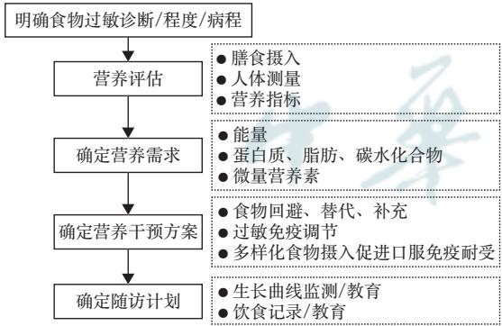

·过敏性疾病控制与预防·

# 婴幼儿牛奶蛋白过敏全程与序贯及主动营养管理策略

项盈 贾雪琦 洪莉

上海交通大学医学院附属上海儿童医学中心营养科，上海 200127

通信作者：洪莉，Email： hongli@scmc.com.cn

【摘要】　近年来，婴幼儿牛奶蛋白过敏（cow′s milk protein allergy， CMPA）的发病率急剧上升，对其营养管理提出了严峻挑战。本文深入梳理了近20年CMPA研究的国内外进展，结合临床实践，提出“全程、序贯、主动的营养干预策略”。该策略在常规CMPA诊疗基础上，强调母乳喂养、科学辅食添加、食物多样化、配方序贯以及促进口服免疫耐受的策略。并针对CMPA伴随生长迟缓介绍了个性化精准营养管理方案，以期为婴幼儿CMPA保障其生长发育、缩短病程、促进口服免疫耐受、提高生活质量提供解决方案。

【关键词】　牛奶蛋白过敏；　全程；　序贯；　主动

基金项目：国家重点研发计划“生育健康及妇女儿童健康保障”重点专项（ ）；国家重点研发计划“食品营养与安全关键技术研发”重点专项（2023YFF1104301）；福建省卫生健康重大科研专项资助计划（2022ZD01007）

# Whole‑process, sequential and proactive nutritional management strategies for cow′s milk protein allergy in infants and young children

Xiang Ying, Jia Xueqi, Hong Li

Clinical Nutrition Department, Shanghai Children′s Medical Center, School of Medicine, Shanghai Jiao Tong University, Shanghai 200127, China

Corresponding author: Hong Li, Email: hongli@scmc.com.cn

【Abstract】 In recent years, the incidence of cow′s milk protein allergy (CMPA) in infants and young children has soared dramatically, posing a formidable challenge to nutritiona management. This article thoroughly reviews the domestic and international progress in CMPA research over the past two decades and, in conjunction with clinical practice, proposes a "comprehensive, sequential, and proactive nutritional intervention strategy". This strategy, based on conventional CMPA diagnosis and treatment, emphasizes breastfeeding, scientific introduction of complementary foods, food diversification, formula sequencing, and strategies to promote oral immune tolerance. Additionally, it introduces a personalized and precise nutritional management plan tailored to CMPA accompanied by growth retardation, aiming to ensure optimal growth and development, shorten the disease duration, facilitate oral immune tolerance, and improve the quality of life for infants and young children with CMPA.

【Key words】 Milk protein allergy; Whole process; Sequential; Proactive

Fund programs: National Key Research and Development Program of China (2023YFC2706505); National Key Research and Development Program of China (2023YFF1104301); Health Major Scientific Research Special Funding Program of Fujian Province(2022ZD01007)

随着婴幼儿牛奶蛋白过敏（cow′s milk proteinallergy， CMPA）发病率的急剧增高，其管理挑战也日益显著。据统计，过敏性疾病在人群中的总体发生率高达30%，其中食物过敏占比可达10%，而在婴幼儿时期，牛奶是最常见的食物过敏原之一［1‑3］，全球CMPA的发生率为2.5%\~3.0%［4‑5］，国内报道0\~3 岁婴幼儿 CMPA发生率为 0.83%\~3.50%或更高［6］。面对这一日益严峻的健康问题，如何有效预防和治疗 CMPA，已成为儿科医学领域的重要课题。

## 一、CMPA营养管理的相关问题与挑战

1.CMPA管理的营养挑战：婴幼儿时期是生长发育的关键时期，食物中的蛋白质和矿物质对于孩子的健康成长至关重要。对于CMPA的患儿而言，回避牛奶饮食作为治疗手段，可能会限制食物种类，尤其是不合理的配方替代，导致能量、蛋白质以及其他关键营养素的摄入不足，无法提供充足均衡营养保证婴幼儿正常生长发育。与引起单纯的皮肤或呼吸道症状相比，表现为消化道症状为主的食物过敏更易导致营养不良［7‑8］，可能与消化功能紊乱、持续回避高营养价值食物、延迟摄入固体食物、喂养困难、不良饮食行为等多种营养问题有关。

与健康儿童相比，患有 CMPA 的幼儿更易出现生长迟缓和蛋白质能量营养不良已被多项研究证实［9‑12］。过敏并发的炎症反应一方面导致胃肠道通透性增加，营养物质过多流失，营养吸收利用度下降；另一方面可造成内分泌功能紊乱，生长发育相关的激素分泌不足或抵抗，导致生长发育缓慢。由于低敏配方区别于普通配方的口感，部分CMPA婴幼儿存在喂奶困难或奶制品量不达标，不能满足适宜的能量和营养素需求。CMPA婴幼儿随着年龄的增长可伴发其他特应性疾病（哮喘、特应性皮炎、嗜酸性胃肠炎、食物蛋白诱导的小肠结肠炎等）或功能性胃肠病，加剧营养风险。在CMPA伴有特应性皮炎（atopic dermatitis， AD）的患儿中观察到线性生长受损，可能跟睡眠质量恶化、能量和蛋白质需求增加相关。合并多种食物过敏的CMPA患儿，初始诊断年龄越小，回避食物种类越多，生长迟缓风险越高。

CMPA婴幼儿亦存在维生素、矿物质、微量元素缺乏的风险［9‑12］，尤其是B族维生素、维生素D和A、钙、铁、锌和碘等，主要由营养摄入不足、吸收不良、新陈代谢受损、营养流失或营养需求增加造成。既往有多项CMPA合并维生素 D 和钙缺乏导致的营养性佝偻病的病例报告。此外，还有研究评估了牛奶蛋白过敏儿童的骨矿物质状况，因诊断为而遵循回避饮食超过 年的儿童骨矿物质含量和密度较低，骨龄延迟了1.4年，钙摄入量仅占推荐值的25%。

挑食、喂养困难等问题在食物过敏患儿群体中较为常见，尤其是回避过多食物或不愿意扩展食物范围的过敏患儿。有研究表明婴幼儿期回避牛奶饮食对于饮食习惯、味觉发育、食物偏好有持续和长期的影响［13］。这种营养摄入的不均衡状态，最终可能加剧患儿营养不良的风险，影响孩子的生长发育和免疫力。

营养支持治疗在CMPA管理中占据核心地位。饮食作为可改变的环境因素之一，“营养免疫”的概念逐渐被人们熟知，蛋白质、矿物质和维生素的长期缺乏会促进 Th2炎症，为过敏致敏奠定基础［14］。饮食习惯在CMPA的发生中可能产生负面或正面影响，因此营养调节可以被认为是预防和管理CMPA的有效目标。然而，传统的治疗方法往往过于依赖水解蛋白配方，忽视了辅食的添加和喂养行为的培养，容易出现过敏原过度回避或回避不当、水解配方更替不合理等情况，延长患儿的过敏病程，还可能造成CMPA婴幼儿营养不良。因此，对于CMPA患儿的营养管理，需要采取更为全面和系统的策略。

2.CMPA管理的新进展：近10\~20年，国内外对于CMPA的诊断与治疗均给予了高度关注，并相继出 台 了 多 项 管 理 指 南 和 共 识 。 如 EAACI 和ESPGHAN 等关于 CMPA 的相关指南及更新文件［9，15‑17］、2011 版《婴幼儿食物过敏诊治建议》［18］、2013版《中国婴幼儿牛奶蛋白过敏诊治循证建议》［19］和2017版《食物过敏相关消化道疾病诊断与管理专家共识》［20］ 、2022版《中国婴儿轻中度非IgE介导的牛奶蛋白过敏诊断和营养干预指南》［21］、版《新生儿牛奶蛋白过敏诊断与管理专家共识》［22］等，均对CMPA的发生、临床表现、诊断、治疗及预防进行了相关描述，为CMPA患儿提供更为科学、规范的管理策略。

CMPA根据免疫机制呈现不同的表型：IgE介导、非IgE介导或两者混合介导。不同机制介导的CMPA在临床表现、诊断鉴别方式和疾病分度存在差异。IgE‑CMPA可表现为消化道（呕吐、腹泻等）、皮肤（即红斑、荨麻疹和血管性水肿）、呼吸和（或）全身症状，甚至出现过敏性休克等严重反应。

Non‑IgE‑CMPA的特征是消化道及皮肤受累为主，受影响的婴儿可能会出现血便、延迟呕吐、哭闹和慢性腹泻等亚急性或慢性胃肠道症状，伴或不伴有AD［23‑24］。临床病史采集、膳食回避‑口服试验激发（experimental dietary avoidance‑oral food challenge，EDA‑OFC）是早期诊断CMPA的重要方法。针对CMPA 的过敏原检测，包括皮肤点刺试验（skin， ）、有条件的中心可开展斑贴试验（patch test， PT）、特异性 IgE（specific IgE， sIgE）检测和组分分析等，可以辅助鉴别CMPA的类型［25］。其中过敏原检测SPT和过敏原sIgE检测仅适用于IgE介导的过敏反应，对non‑IgE介导的过敏反应无参 考 价 值 。 过 敏 原 特 异 性 IgG4（specific IgG4，sIgG4）的存在提示免疫耐受的机制被激活，该抗体可作为中和抗体与IgE竞争结合过敏原，从而阻止效应细胞（肥大细胞和嗜碱性粒细胞）的活化；还可以阻断sIgE复合物结合到B细胞，从而阻止IgE促进的T细胞活化；而sIgG4本身并不引起过敏症状，主要用于过敏原特异性免疫疗法中免疫耐受功能的评估，并不能作为慢性过敏反应（包括迟发性超敏反应和病程反复发作超过6个月的过敏性疾病）的指标。区别于IgE‑CMPA以临床表现轻重作为轻中重分度的依据，non‑IgE‑CMPA的分度是以存在过敏相关营养不良（如血红蛋白、白蛋白降低）和生长发育障碍，或消化道病理性改变为依据［21］。由于non‑IgE‑CMPA或新生儿CMPA的临床表现不典型、缺乏特异的实验室诊断手段，需要与新生儿坏死性小肠结肠炎、感染性肠炎、乳糖不耐受、胃食管返流病、胃肠道畸形等疾病相鉴别，临床存在误诊或过度诊疗现象。因此，早期规范地诊断CMPA是营养干预治疗的前提。

随着食物过敏疾病研究的深入，婴幼儿CMPA营养管理模式发生了转变，由既往传统模式（即被动地回避过敏原），转为新的主动管理与预防模式，即通过替代配方的序贯治疗、母乳喂养的干预、科学的辅食添加、食物多样化、营养素的补充应用，促进口服免疫耐受的建立，缩短疾病进程，并通过定期的营养评估和生长监测，保障CMPA婴幼儿正常的生长发育。针对过敏高风险患儿预防过敏性疾病的发生，部分指南也给出了相关建议。

## 二、婴幼儿CMPA的营养管理与治疗策略

全程营养管理的必要性：婴幼儿 的全程营养管理过程包括食物过敏的预防、早期诊断牛奶蛋白过敏、准确的营养评估、规范的营养干预以及定期的营养监测随访。不仅符合营养诊疗的标准流程，同时，其疾病的特殊性体现在营养管理的多个方面，如降低过敏风险的预防措施、食物的回避（限制程度及种类）、辅食的适时引入、水解配方的选择与过渡、过敏疾病的转归、生长发育及营养状况的监测等。鉴于婴幼儿免疫耐受的建立往往需要3\~5年时间［19‑20，26‑27］，且此阶段是其生长发育的黄金期，确保营养充足与均衡成为重中之重。营养医师应为CMPA患儿提供全面的营养治疗计划，兼顾医疗状况、食物避免策略、健康均衡饮食理念、适宜年龄层的营养需求、家庭生活环境等多方面，实现“全程、序贯、主动”的个体化营养干预，直至患儿建立口服免疫耐受。

此外，CMPA可有多系统累及，初诊及随访科室多样化，规范的诊疗往往需要消化、皮肤、呼吸、营养及儿童保健等多学科团队合作参与，从而缓解CMPA患儿的过敏症状，改善疾病预后，促进适宜生长。

的序贯营养治疗：一旦确诊 的人工（或混合）喂养婴幼儿，回避牛奶整蛋白的同时需要低敏配方（水解蛋白或氨基酸配方）进行营养替代，对于轻中度CMPA的患儿，在此推荐选用深度水解配方（extensively hydrolyzed protein formula，eHF）；而对于重度过敏和不能耐受eHF的患儿，则选用氨基酸配方（amino acid formula， AAF）；不推荐适度水解配方（partially hydrolyzed formula， pHF）和羊奶配方作为替代。初始疗程至少应持续6个月，或诊断后9\~12月龄［21，28］，在此强调早期、足量的治疗对于预防症状反复、缩短口服免疫耐受形成时间的重要性。

CMPA 的营养治疗秉承序贯配方理念。初始疗程结束后，根据患儿过敏症状体征、生长发育评估、目前饮食习惯或sIgE检测等情况，按照配方蛋白水解程度序贯过渡转奶（从AAF➝eHF➝pHF➝整蛋白配方）。部分国外指南建议维持低敏配方至少到2岁。足量序贯地回避替代治疗后，需要重新行OFC，以评估是否建立耐受并再次引入整蛋白配方 。 推 荐 依 据 iMAP（international management andprevention of Milk Allergy in Primary Care guideline，国际初级卫生保健中的牛奶过敏指南）指南［24］的“牛奶蛋白梯度引入”实例，并结合中国婴儿奶制品选择习惯，逐渐从少量开始再引入牛奶蛋白，逐步增加牛奶蛋白的摄入量，来评估其牛奶耐受性［21］。

3.过敏预防与母乳喂养：在过敏预防方面，母乳喂养的重要性不言而喻。研究显示，母乳喂养能有效降低牛奶蛋白过敏的风险［17，21，27］。首先，母乳作为人体的同种蛋白质，对婴幼儿免疫系统无刺激作用。其次，母乳中包含母亲所摄取食物的特异性抗原，即便微量，也能适当刺激婴儿的免疫系统，促进免疫发育和免疫耐受［29‑30］。此外，母乳中的低聚糖、分泌性IgA、细胞因子、益生菌等成分，均有助于降低婴儿食物过敏的风险［31‑32］。世界卫生组织（World Health Organization， WHO）建 议 婴 儿 出 生后尽早开始纯母乳喂养，并鼓励持续至满6月龄，继续母乳喂养的基础上逐步添加辅食，之后可继续母乳喂养至2岁［33‑34］。因此，无论是IgE‑CMPA还是non‑IgE‑CMPA，母乳喂养的婴儿一般不建议停母乳，根据母亲EDA‑OFC结果建议母亲膳食回避的程度，并为回避膳食的母亲提供有缺乏风险的营养素补充策略。

4.科学辅食添加与食物多样化：除了母乳喂养外，适时的辅食添加及食物多样化同样是预防过敏的重要环节。传统观念CMPA婴幼儿在辅食添加阶段通过回避易致敏食物的预防策略并没有积极影响，过度回避反而造成营养不良风险。近年来的研究显示，早期、持续规律地引入多种易致敏食物蛋白可能帮助降低食物过敏风险，婴儿期的食物多样化，尤其是易致敏食物的多样化，可以帮助降低未来食物过敏和过敏性疾病风险。农村环境中的抗 过 敏 研 究（Protection Against Allergy‑Study inRural Environments， PASTURE）［35‑36］表明，在生命的第一年，食物多样性的增加与哮喘的发生呈负相关，在食物过敏性疾病观察到类似的效果。婴幼儿时期食物多样化程度越高，发生过敏性疾病的概率越低。在 月龄时，多样化的辅食添加与 岁前发生食物过敏的风险降低相关。至1岁时，若饮食结构达到成人标准（每天12种食物，每周25种左右），则10岁前发生过敏性疾病的概率将降低33%。此外，近年来里程碑式的研究，如基于花生过敏的早期了解（learning early about peanut alllergy， LEAP）研 究［37］ 和 耐 受 探 索（enquiring about tolerance，EAT）研究［38］以及相关研究［39‑40］均证实，早期适量添加易致敏食物（如花生）可显著降低食物过敏的发生率。按时添加辅食，持续规律地摄入多样化食物，是促进形成口服免疫耐受和有效预防过敏（高危）婴幼儿发生过敏的重要举措。因此，建议CMPA婴幼儿在4\~6月龄添加辅食，不建议延迟添加或盲目回避易过敏食物。辅食添加原则与正常婴幼儿相同，应从富铁食物开始，逐渐增加食物量和种类、改变食物形状质地，引入新食物时需观察有无过敏反应，在辅食添加初期减少不必要的配方转换，避免混杂因素影响。

5.过敏免疫调节：目前研究显示益生菌、益生元或合生元、长链多不饱和脂肪酸、维生素 D对免疫调节有一定作用，但对过敏性疾病的作用需要进一步研究。益生菌在促进免疫系统及神经系统的发育成熟及产生免疫耐受方面发挥重要作用，有研究表明［41］食物过敏儿童的婴儿期肠道菌群中双歧杆菌丰度增加，而几种类杆菌和梭状芽孢杆菌丰度降低，且存在肠道菌群发育延迟。部分膳食相关的营养组分或功能性营养素（如微量元素、维生素）与过敏性疾病的发生发展有相关性。研究表明，维生素 与儿童 发病率呈 型线性关系，可影响肠道对维生素D的吸收，导致维生素D水平低于同龄正常儿［22］。丰富的微量营养条件可在淋巴细胞、巨噬细胞和肥大细胞中促进调节和抗炎表型，而缺乏微量营养素（尤其是铁和维生素A）则启动免疫系统。缺乏初期会产生Th1/Th17主导的免疫反应，导致B细胞转化为浆细胞并分泌IgG抗体。当营养贫乏的情况持续较长时间时，免疫反应会转向Th2（由于Th1细胞对营养更敏感）并促进嗜酸性粒细胞，以及向IgE抗体的类别转换［14］。过敏免疫调节的研究仍有广阔前景，迫切需要更积极主动的营养管理策略，改善和预防婴幼儿CMPA，以解决相关的健康风险和社会负担。

6.营养监测与生长评估：对于CMPA患儿（特别是合并营养不良），应在明确诊断的早期和营养治疗的进程中定期进行营养和生长发育评估，监测营养干预疗效。CMPA婴幼儿的营养评估应包含人体测量、实验室检测、膳食分析、临床疾病评估、家庭/环境因素评估等。通过营养评估和生长监测，了解CMPA患儿的能量及营养素摄入情况，评估其进食食物种类、不同餐次的营养分配是否达到该年龄段的要求，评估其饮食回避情况是否合理，评估其喂养行为模式，及时发现营养素缺乏和生长发育迟缓迹象，根据疾病缓解情况和发育阶段，调整饮食回避和营养支持方案。建议由营养医师提供专业饮食咨询，给予个体化的喂养指导，并促进多样化的饮食，以保证正常的生长发育。针对CMPA可能引起的营养不良问题，首要任务是确保患儿摄入充足的营养素。对于纯配方奶喂养的患儿，配方奶的摄入量应至少达到其营养需求量的

90%。具体而言，0\~6月龄的患儿应摄入配方奶120\~150 ml·kg-1·d-1；6 个月龄后开始添加辅食时，配方奶的日摄入量应维持在 600\~800 ml；接近1岁，开始三顿辅食后，配方奶的日摄入量可降至500\~600 ml。若患儿摄入量不足，可适度提高配方奶的能量密度，但务必注意控制渗透压和脂肪含量，避免可能带来的不良反应。

## 三、个性化综合干预方案助力儿童过敏管理

在上海儿童医学中心的过敏营养门诊，通过病史、实验室检测、饮食回避与激发等方法，明确患儿的食物过敏类型、过敏程度，通过详细的营养评估获得患儿营养状况评价，结合患儿疾病和生长发育阶段特点，明确营养需求，确定追赶性生长的目标。通过个体化的营养管理（食物限制水平、使用何种水解蛋白配方、添加物/浓度适当、食物强化/营养素补充、喂养策略等），进行合理的饮食回避及替代，促进食物多样化，及时补充缺乏关键营养素，调节免疫功能促进免疫耐受，保证过敏患儿的适宜生长。同时，注重进行家长教育，强调过敏营养治疗的序贯原则及辅食适宜时机添加的重要性，指导家长如何绘制孩子的生长曲线、记录日常饮食以及食物过敏的预防，引导家长选择适合患儿的替代食品，并鼓励家长在饮食中引入更多种类的食物，提高患儿的依从性。制定门诊随访计划，实现过敏营养的全程管理。具体流程如图1所示。

  
图1 食物过敏门诊诊疗流程

## 四、结语

CMPA婴幼儿的营养管理应贯穿“预防➝诊断➝治疗➝随访”的全程，从早期的被动回避模式转向主动预防与管理模式，通过母乳喂养、替代配方的序贯过渡、科学的辅食添加、增加食物多样化、过敏免疫调节等策略，促进口服免疫耐受的建立，培养良好的喂养习惯，改善过敏性疾病预后，促进CMPA 患儿的健康成长。结合临床实践，提出

CMPA“全程、序贯、主动”的个体化营养干预策略，旨在更为科学、规范地预防与管理CMPA患儿。利益冲突 所有作者声明无利益冲突

## 参 考 文 献

[1] 赵京.中国儿童食物过敏现况[J].中华临床免疫和变态反应 杂志, 2019, 13(4):271‑275.DOI: 10.3969/j.issn.1673‑8705. 2019. 04.005.

[2] 郑卉爽,朱雯靓,刘传合,等.IgE介导的牛奶蛋白过敏患儿临床特征分析[J]. 中华预防医学杂志, 2023, 57(8):1271‑1279.DOI: 10.3760/cma.j.cn112150‑20230514 ‑00370.

[3] 陈力嘉,陈俊,何思楠,等.儿童与青少年牛奶致敏特征分析[J]. 中 华 预 防 医 学 杂 志 , 2021, 55(9): 1077‑1082. DOI:10.3760/cma.j.cn112150‑20210406‑00328.

[4] Venter C, Arshad SH. Epidemiology of food allergy[J]. Pediatr Clin North Am, 2011, 58(2): 327‑349. DOI: 10.1016/j.pcl.2011.02.011.

[5] 陈同辛.婴幼儿牛奶蛋白过敏国内外指南解读———更好地 识 别 、 诊 断 和 治 疗 [J]. 临 床 儿 科 杂 志 , 2018, 36(10):805‑808.DOI: 10.3969/j.issn.1000‑3606.2018.10.019.

[6] 陈静, 廖艳, 张红忠,等.三城市两岁以下儿童食物过敏现状调 查 [J]. 中 华 儿 科 杂 志 , 2012, 50(1): 5‑9. DOI: 10.3760/cma.j.issn.0578‑1310.2012.01.002.

[7] Nowak‑Węgrzyn A, Katz Y, et al. Non‑IgE‑mediated gastrointestinal food allergy[J]. J Allergy Clin Immunol, 2015, 135(5):1114‑1124.DOI: 10.1016/j.jaci.2015.03.025.

[8] Meyer R, Fox AT, Chebar Loainsky A, et al. Non‑IgE‑mediated gastrointestinal allergies‑do they have a place in a new model of the Allergic March[J]. Pediatr Allergy Immunol, 2019, 30(2): 149‑158. DOI: 10.1111/ pai.13000.

[9] Vandenplas Y, Broekaert I, Domellöf M, et al.An ESPGHAN Position Paper on the Diagnosis, Management, and Prevention of Cow′s Milk Allergy[J]. J Pediatr Gastroenterol Nutr. 2024, 78(2): 386‑413. DOI: 10.1097/ MPG.0000000000003897.

[10] Parlak Z, Gürel Dİ, Soyer ÖU, et al. Nutritional risks in children with food allergy[J].Turk J Med Sci, 2023, 53(4): 845‑858.DOI: 10.55730/1300‑0144.5648.

[11] Venter C, Mazzocchi A, Maslin K, et al. Impact of elimination diets on nutrition and growth in children with multiple food allergies[J]. Curr Opin Allergy Clin Immunol. 2017, 17: 220‑226. DOI: 10.1097/ ACI.0000000000000358.

[12] Parlak Z, Gürel Dİ, Soyer ÖU, et al. Nutritional risks in children with food allergy[J].Turk J Med Sci, 2023, 53(4): 845‑858.DOI: 10.55730/1300‑0144.5648.

[13] Maslin K, Grundy J, Glasbey G, et al. Cows′ milk exclusion diet during infancy: is there a long‑term effect on children′s eating behaviour and food preferences? [J] Pediatr Allergy Immunol, 2016, 27(2): 141‑146. DOI: 10.1111/pai.12513.

[14] Vassilopoulou E, Venter C, Roth‑Walter F. Malnutrition and Allergies: Tipping the Immune Balance towards Health[J]. J Clin Med, 2024, 13(16): 4713. DOI: 10.3390/ jcm13164713.

[15] Santos AF, Riggioni C, Agache I, et al.EAACI guidelines on the diagnosis of IgE‑mediated food allergy[J]. Allergy,

2023, 78(12):3057‑3076. DOI: 10.1111/all.15902.

[16] Muraro A, Werfel T, Hoffmann‑Sommergruber K, et al. EAACI Food Allergy and Anaphylaxis Guidelines. Diagnosis and management of food allergy[J]. Allergy, 2014, 69(8):1008‑1025.DOI: 10.1111/all.12429.

[17] Halken S, Muraro A, de Silva D, et al. EAACI guideline: Preventing the development of food allergy in infants and young children (2020 update) [J]. Pediatr Allergy Immunol, 2021, 32(5):843‑858.DOI: 10.1111/pai.13496.

[18] 中华医学会儿科学分会儿童保健学组,《中华儿科杂志》编辑委员会.婴幼儿食物过敏诊治建设[J].中华儿科杂志,2011, 49(5):244‑248.DOI: 10.3760/cma.j.issn. 0578‑1310.2011.05.006.

[19] 中华医学会儿科学分会免疫学组, 中华医学会儿科学分会儿童保健学组, 中华医学会儿科学分会消化学组等.中国婴幼儿牛奶蛋白过敏诊治循证建议[J]. 中华儿科杂志,2013, 51(3):183‑186.DOI: 10.3760/cma.j.issn. 0578‑1310.2013.03.006.

[20] 中华医学会儿科学分会消化学组.食物过敏相关消化道疾病诊断与管理专家共识[J]. 中华儿科杂志, 2017, 55(7):487‑492.DOI: 10.3760/cma.j.issn.0578‑1310.2017.07.003.

[21] 陈同辛, 洪莉, 王华,等 .中国婴儿轻中度非 IgE介导的牛奶蛋白过敏诊断和营养干预指南[J].中华实用儿科临床杂志,2022, 37(4): 241‑250. DOI: 10.3760/cma. j. cn101070‑20220 106‑00016.

[22] 中华医学会儿科学分会新生儿学组, 中华儿科杂志编辑委员会.新生儿牛奶蛋白过敏诊断与管理专家共识(2023)[J].中 华 儿 科 杂 志 , 2024, 62(1): 12‑21. DOI: 10.3760/cma. j.cn112140‑20231007‑00257.

[23] 姜丽静, 杨曙芬.婴幼儿牛奶蛋白过敏诊治的研究进展[J].中国儿童保健杂志, 2018, 26(9):973‑976.DOI: 10.11852/zgetbjzz2018‑26‑09‑12.

[24] Venter C, Brown T, Meyer R, et al. Better recognition, diagnosis and management of non‑IgE‑mediated cow′s milk allergy in infancy: iMAP‑an international interpretation of the MAP(Milk Allergy in Primary Care) guideline[J].Clin Transl Allergy, 2017, 7:26.DOI: 10.1186/ s13601‑017‑0162‑y.

[25] 中华医学会儿科学分会临床营养学组,中国妇幼保健协会儿童营养专业委员会,中国优生科学协会妇幼健康管理分会.儿童过敏免疫诊疗中心/过敏免疫门诊规范化建设专家共识[J]. 中华实用儿科临床杂志 .2025, 40(4):246‑261.DOI: 10.3760/cma.j.cn101070‑20250204‑000 68.

[26] 陈同辛.婴幼儿牛奶蛋白过敏国内外指南解读——更好地识 别 、 诊 断 和 治 疗 [J]. 临 床 儿 科 杂 志 , 2018, 36(10):805‑808.DOI: 10.3969/j.issn.1000‑3606.2018.10.019.

[27] 姜雅楠,邢燕 .早产儿牛奶蛋白过敏诊疗进展[J].中华预防医 学 杂 志 , 2021, 55(5): 583‑591. DOI: 10.3760/cma. j.cn112150‑20210301‑00204.

[28] Fox A, Brown T, Walsh J, et al. An update to the milk allergy in primary care guideline[J]. Clin Transl Allergy, 2019, 9(1):40.DOI: 10.1186/s13601‑019‑0281‑8.

[29] Järvinen KM, Martin H, Oyoshi MK. Immunomodulatory

effects of breast milk on food allergy[J]. Ann Allergy Asthma Immunol, 2019, 123(2):133‑143.DOI: 10.1016/j. anai.2019. 04.022.

[30] 孙建华,谢恩萍.母乳喂养与新生儿免疫[J].临床儿科杂志, 2012, 30(3):204‑207.DOI: 10.3969/j.issn.1000‑3606.2012. 03.002.

[31] Lyons KE, Ryan CA, Dempsey EM, et al. Breast milk, a source of beneficial microbes and associated benefits for infant health[J]. Nutrients, 2020, 12(4): 1039. DOI: 10.3390/nu12041039.

[32] 王静, 罗晓明, 古桂雄.母乳成分及测定方法[J].中国妇幼健康 研 究 , 2015, 26(3): 641‑643, 656. DOI: 10.3969/j.issn.1673‑5293.2015.03.087.

[33] 中国营养学会膳食指南修订专家委员会妇幼人群指南修订专家工作组.7‑24 月龄婴幼儿喂养指南[J].临床儿科杂志 , 2016, 34(5): 381‑387. DOI: 10.3969/j. issn. 1000‑3606.2016. 05.016.

[34] Vandenplas Y, Al‑Hussaini B, Al‑Mannaei K, et al. Prevention of allergic sensitization and treatment of cow′s milk protein allergy in early life: the Middle‑East Step‑Down consensus[J]. Nutrients, 2019, 11(7): 1444. DOI: 10.3390/nu11071444.

[35] Roduit C, Frei R, Depner M, et al.Increased food diversity in the first year of life is inversely associated with allergic diseases[J]. J Allergy Clin Immunol, 2014, 133(4): 1056‑1064.DOI: 10.1016/j.jaci.2013.12.1044.

[36] Roduit C, Frei R, Loss G, et al. Development of atopic dermatitis according to age of onset and association with early‑life exposures[J]. J Allergy Clin Immunol, 2012, 130(1):130‑6.e5.DOI: 10.1016/j.jaci.2012.02.043.

[37] Koplin JJ, Peters RL, Dharmage SC, et al. Understanding the feasibility and implications of implementing early peanut introduction for prevention of peanut allergy[J]. J Allergy Clin Immunol, 2016, 138(4): 1131‑1141. e2. DOI: 10.1016/j.jaci.2016.04.011.

[38] Perkin MR, EAT Study Team. Randomized Trial of Introduction of Allergenic Foods in Breast‑Fed Infants[J]. N Engl J Med, 2016, 374(18): 1733‑1743. DOI: 10.1056/ NEJM oa1514210.

[39] Greenhawt M, Shaker M. Determining Levers of Cost‑effectiveness for Screening Infants at High Risk for Peanut Sensitization Before Early Peanut Introduction[J]. JAMA Netw Open, 2019, 2(12): e1918041. DOI: 10.1001/ jamanetworkopen.2019.18041.

[40] 甘辉, 刘光辉 .婴幼儿食物早期摄入预防食物过敏[J].中华预防医学杂志, 2021, 55(5):561‑565.DOI: 10.3760/cma.j.cn112150‑20201229‑01493.

[41] Joseph CL, Sitarik AR, Kim H, et al. Infant gut bacterial community composition and food‑related manifestation of atopy in early childhood[J]. Pediatr Allergy Immunol, 2022, 33(1): e13704. DOI: 10.1111/pai. 13704/v3/ response1.