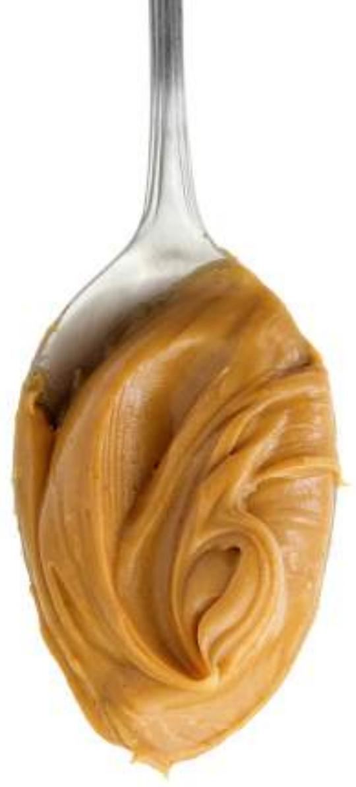
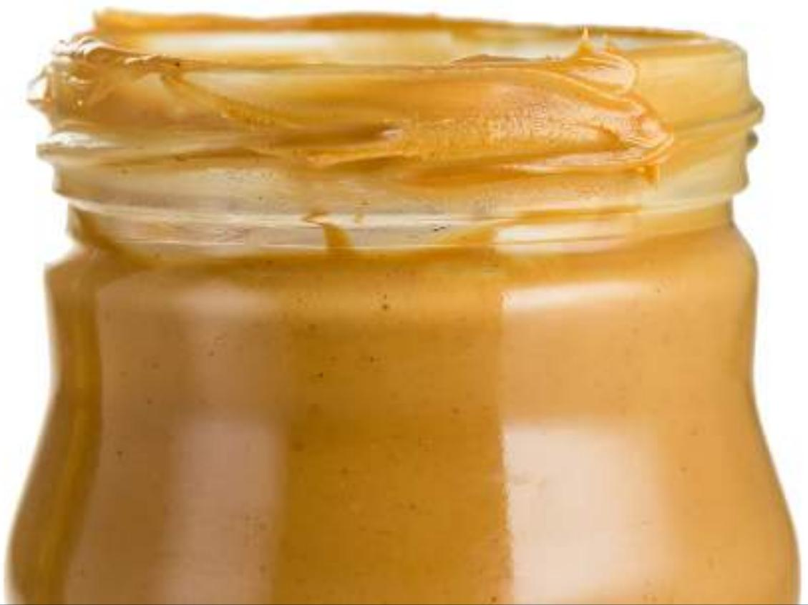
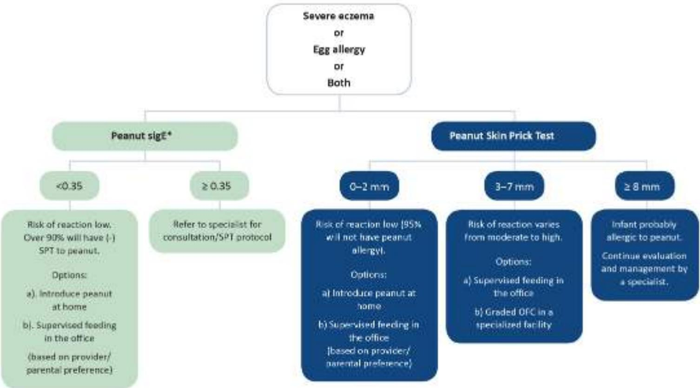
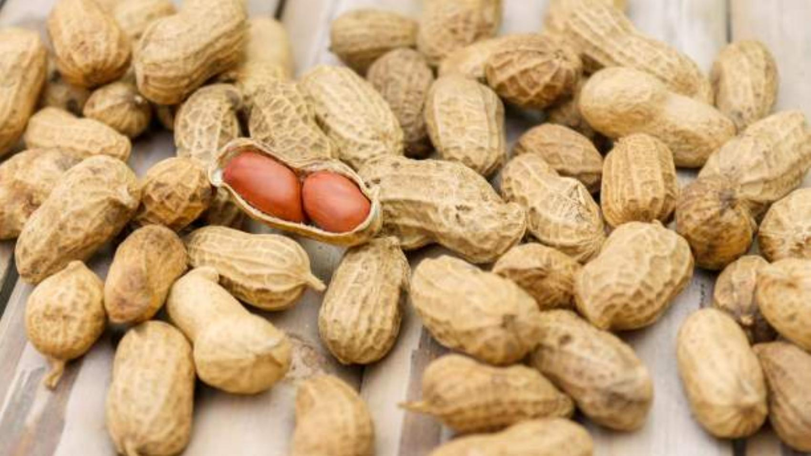
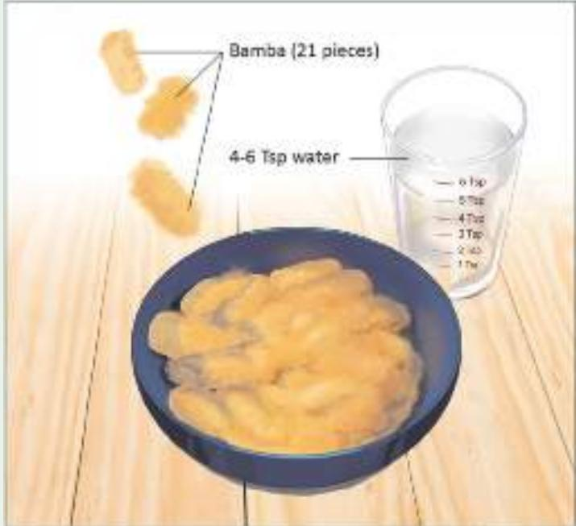
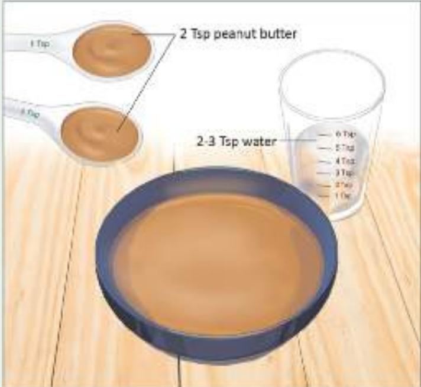
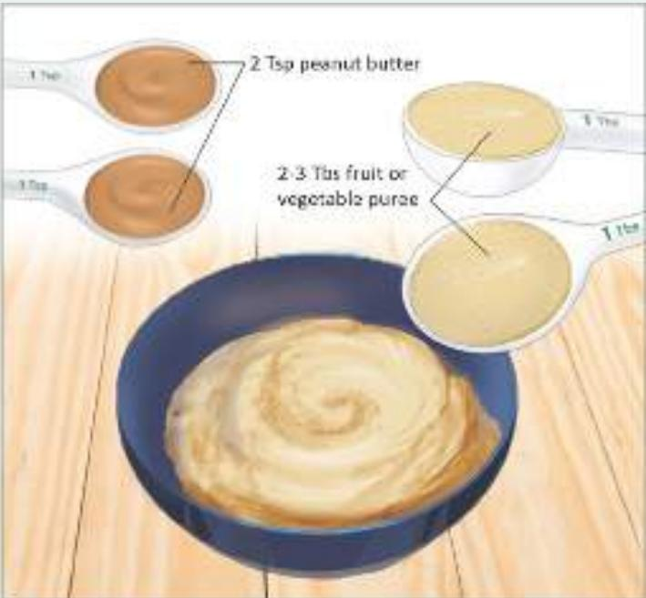
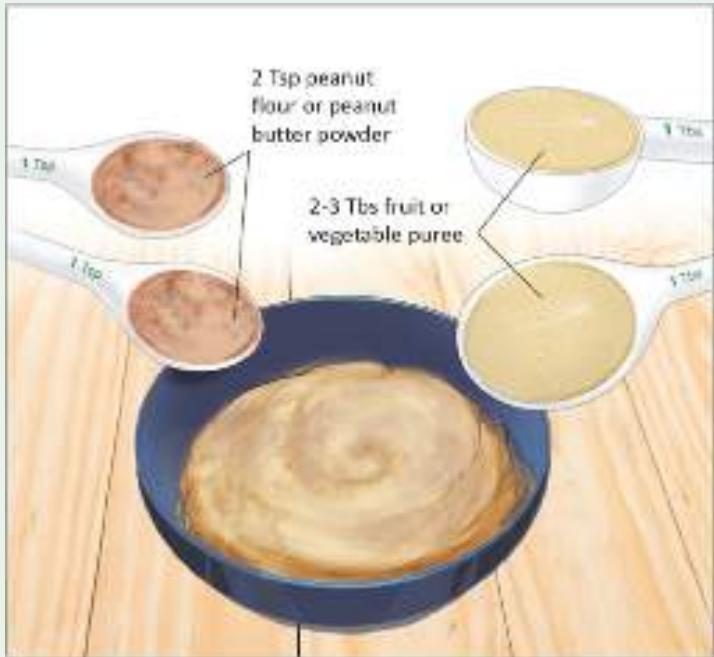
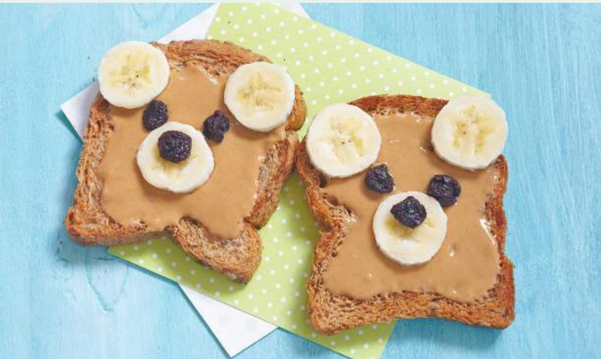
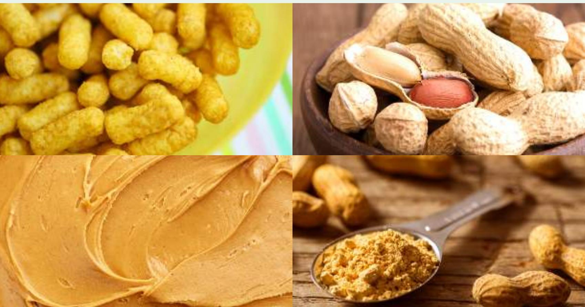

# Addendum Guidelines for the Prevention of Peanut Allergy in the United States

Report of the NIAID-Sponsored Expert Panel

# ADDENDUM GUIDELINES FOR THE PREVENTIONOF PEANUT ALLERGY IN THE UNITEDSTATES: REPORT OF THE NATIONALINSTITUTE OF ALLERGY AND INFECTIOUSDISEASES-SPONSORED EXPERT PANEL

Alkis Togias, MD,ª Susan F. Cooper, MSc,a,\* Maria L. Acebal, JD,b Amal Assa’ad, MD, James R. Baker, Jr, MD,d Lisa A. Beck, MD,º Julie Block, Carol Byrd-Bredbenner, PhD, RD, FAND,º Edmond S. Chan, MD, FRCPC,h Lawrence F. Eichenfield, MD,' David M. Fleischer, MD,' George J. Fuchs III, MD, Glenn T. Furuta, MD,' Matthew J. Greenhawt, MD, MBA, MSc,' Ruchi S. Gupta, MD, MPH," Michele Habich, DNP, APN/CNS, CPN," Stacie M. Jones, MD,º Kari Keaton,º Antonella Muraro, MD, PhD,ª Marshall Plaut, MD,ª Lanny J. Rosenwasser, MD,' Daniel Rotrosen, MD,ª Hugh A. Sampson, MD,s Lynda C. Schneider, MD,t Scott H. Sicherer, MD," Robert Sidbury, MD, MPH,' Jonathan Spergel, MD, PhD," David R. Stukus, MD,\* Carina Venter, PhD, RD,' and Joshua A. Boyce, MD

Bethesda, Md; McLean, Va; Cincinnati and Columbus, Ohio; Ann Arbor, Mich; San Rafael and San Diego, Calif; New Brunswick, NJ; Vancouver, British Columbia, Canada; Aurora, Colo; Lexington, Ky; Chicago and Winfield, Ill; Little Rock, Ark; Rockville, Md; Padua, Italy; Kansas City, Mo; New York, NY; Boston, Mass; Seattle, Wash; and Philadelphia, Pa

Background: Food allergy is an important public health problem because it affects children and adults, can be severe and even life-threatening, and may be increasing in prevalence. Beginning in 2008, the National Institute of Allergy and Infectious Diseases, working with other organizations and advocacy groups, led the development of the first clinical guidelines for the diagnosis and management of food allergy. A recent landmark clinical trial and other emerging data suggest that peanut allergy can be prevented through introduction of peanut-containing foods beginning in infancy.

Objectives: Prompted by these findings, along with 25 professional organizations, federal agencies, and patient advocacy groups, the National Institute of Allergy and Infectious Diseases facilitated development of addendum guidelines to specifically address the prevention of peanut allergy.

Results: The addendum provides 3 separate guidelines for infants at various risk levels for the development of peanut allergy and is intended for use by a wide variety of health care providers. Topics addressed include the definition of risk categories, appropriate use of testing (specific IgE measurement, skin prick tests, and oral food challenges), and the timing and approaches for introduction of peanut-containing foods in the health care provider's office or at home. The addendum guidelines provide the background, rationale, and strength of evidence for each recommendation.

Conclusions: Guidelines have been developed for early introduction of peanut-containing foods into the diets of infants at various risk levels for peanut allergy.

Key words: Food, peanut, allergy, prevention, guidelines

From the National Institute of Allergy and Infectious Diseases, Bethesda, Md;ª the Board of Directors, Food Allergy Research & Education, McLean;b the Division of Allergy and Immunology Cincinnati Children's Hospital Medical Center, University of Cincinnati:º Food Allergy Research & Education. McLean, and the Division of Allergy and Clinical Immunology, University of Michigan Health System, Ann Arbor;ª the Department of Dermatology, University of Rochester Medical Center;º the National Eczema Association, San Rafael;f the Department of Nutritional Sciences, Rutgers University, New Brunswick;® the Division of Allergy and Immunology, Department of Pediatrics, BC Children's Hospital, University of British Columbia, Vancouver;h the Departments of Dermatology and Pediatrics, University of California, San Diego School of Medicine, Rady Children's Hospital, San Diego;' the Section of Allergy and Immunology, Department of Pediatrics, Children's Hospital Colorado, University of Colorado Denver School of Medicine, Aurora;i the Division of Gastroenterology, Hepatology, and Nutrition, Department of Pediatrics, University of Kentucky College of Medicine, Kentucky Children's Hospital, Lexington;k the Digestive Health Institute, Children's Hospital Colorado, Aurora, and the Section of Pediatric Gastroenterology, University of Colorado Denver School of Medicine, Aurora, Colo;' the Division of Academic General Pediatrics and Primary Care, Department of Pediatrics, and the Ann and Robert H. Lurie Children's Hospital of Chicago, Northwestern University Feinberg School of Medicine, Chicago;ⁿ Northwestern Medicine, Central DuPage Hospital,Winfield;ⁿ the Division of Allergy and Immunology, Department of Pediatrics, University of Arkansas for Medical Sciences, Arkansas Children's Hospital, Little Rock;º Metro DC Food Allergy Support Group, Rockville;º the Food Allergy Referral Centre, Department of Women and Child Health, Padua University Hospital;ª University of Missouri-Kansas City School of Medicine, Kansas City;' the Division of Allergy and Immunology, Department of Pediatrics,⁵ and the Division of Pediatric Allergy and Immunology, Icahn School of Medicine at Mount Sinai, New York;º the Division of Allergy and Immunology, Boston Children's Hospital;t the Department of Pediatrics, Division of Dermatology, Seattle Children's Hospital, University of Washington School of Medicine, Seattle;" the Division of Allergy and Immunology, Department of

## Abbreviations used:

CC: Coordinating Committee EP: Expert Panel   
GRADE: Grading of Recommendations Assessment, Development and Evaluation EAP: Learning Early about Peanut Allergy   
NIAID: National Institute of Allergy and Infectious Diseases OFC: Oral food challenge slgE: Specific IgE SPT: Skin prick test

Pediatrics, Children's Hospital of Philadelphia, Perelman School of Medicine at University of Pennsylvania, Philadelphia;" the Department of Pediatrics, Section of Allergy and Immunology, Nationwide Children's Hospital, Ohio State University College of Medicine, Columbus;\* the Division of Allergy and Immunology, Cincinnati Children's Hospital Medical Center;' and the Departments of Medicine and Pediatrics, Harvard Medical School, Boston.

Published on behalf of the American Academy of Allergy, Asthma & Immunology; American College of Allergy, Asthma & Immunology; Canadian Society of Allergy and Clinical Immunology; Society for Pediatric Dermatology; World Allergy Organization; and Society of Pediatric Nurses. Copublished in the Journal of Allergy and Clinical Immunology; Annals of Allergy, Asthma & Clinical Immunology; Allergy, Asthma & Clinical Immunology; World Allergy Organization Journal; Pediatric Dermatology; and the Journal of Pediatric Nursing.

Disclosure of potential conflict of interest: A. Assa’ad received travel support from the American College of Allergy, Asthma & Immunology (ACAAl); was an elected member of the Board of Directors for the American Academy of Allergy, Asthma, & Immunology (AAAAl) from March 2012 to March 2016; has consultant arrangements with Aimmune; is employed by Cincinnati Children's Hospital Medical Center; has received grants from DBV Technologies, Aimmune, Stanford Foundation, TEVA Pharmaceuticals, GlaxoSmithKline, the National Institutes of Health (NIH), Astellas, and Food Allergy Research & Education (FARE): and has received payment for lectures from the ACAAI. C. Byrd-Bredbenner and G. J. Fuchs III have received travel support from the NIH/National Institute of Allergy and Infectious Disease (NIAID). E. S. Chan has received travel support from the NIAID, has received grants from DBV Technologies, and has received payment for lectures from Pfizer, Sanofi, Mead Johnson, and Nestle. D. M. Fleischer has received travel support from the NIAID; is a board member for the National Peanut Board, the FAACT Medical Advisory Board, and the FARE Medical Advisory Board; has consultant arrangements with Adamis Pharmaceuticals Corporation, INSYS Therapeutics, DBV Technologies, Aimmune Therapeutics, Intrommune Therapeutics, and Kaleo Pharma; is employed by University Physicians; has received grants from Monsanto Company, Nestle Nutrition Institute, DBV Technologies, and Aimmune Therapeutics; has received payment for lectures from Nestle Nutrition Institute; and has received royalties from UpToDate. M. J. Greenhawt has received a grant from the Agency for Healthcare Research and Quality (1K08HS024599-01, Career Development Award); has received travel support from the NIAID and the Joint Taskforce on Allergy Practice Parameters; has a board membership with the National Peanut Board; has consultant arrangements with Adamis Pharmaceuticals, the Canadian Transportation Agency, Nutricia, Nestle/Gerber, Aimmune, Kaleo Pharmaceutical, and Monsanto; is an Associate Editor for the Annals of Allergy, Asthma, and Immunology; has received payment for lectures from the ACAAl, Reach MD, Thermo Fisher Scientific, the California Society for Allergy and Immunology,

the Allergy and Asthma Network, the New England Society for Allergy, UCLA/Harbor Heiner Lectureship, Medscape, the Western Michigan School of Medicine, the Canadian Society of Allergy and Clinical Immunology, and the Pennsylvania Society for Allergy and Immunology. R. S. Gupta has consultant arrangements with BEFORE Brands and DBV Technologies; has received grants from the NIH, FARE, and Mylan LLC; has received payment for lectures from Grand Rounds; and has received royalties from Createspace Independent Publishing Platform. S. M. Jones is on the Research Advisory Board for FARE; is on the Scientific Advisory Board for Aimmune; has consultant arrangements with Stallergenes; has received grants from the NIH/NIAID (Consortium of Food Allergy Research and Immune Tolerance Network-IMPACT Trial), FARE, Aimmune Technologies, DBV Technologies, and the National Peanut Board; has received payment for lectures from the Kansas City Allergy Society, Mercy Children's Hospital, Riley Children's Hospital, Southwester Medical School– Children's Medical Center, the European Academy of Allergy & Clinical Immunology, the New York Allergy & Asthma Society, the University of lowa Paul M. Seebohm Lectureship in Allergy, and the lowa Society of Allergy, Asthma, and Immunology. A. Muraro has consultant arrangements with Meda, Novartis, and Menarini; is employed by Padua University Hospital; and has received payment for lectures from Meda and Menarini. L. J. Rosenwasser is a board member for the World Allergy Organization. H. A. Sampson has consultant arrangements with Allertein Therapeutics, Genentech/Roche, Sanofi, Stallergenes, Danone, and Merck; is employed part time as Chief Scientific Officer for DBV Technologies; has received grants from the NIAID and the Immune Tolerance Network; has received royalties from UpToDate and Elsevier; has been offered stock options in DBV Technologies; and is chairman of PhARF Award Selection Committee for Thermo Fisher. L. C. Schneider is on the Medical Advisory Board for FARE, has received a grant from DBV Technologies, and has received stock/stock options in Antera Therapeutics. S. H. Sicherer has received grants from the NIAID, FARE, and HAL Allergy; has received royalties from UpToDate; and is serving as Associate Editor for the Journal of Allergy and Clinical Immunology: In Practice. R. Sidbury has received travel support from the NIH and the Hawaii Dermatology Seminar, has consultant arrangements with Anacor, has provided expert witness testimony on behalf of Roche in Accutane-inflammatory bowel disease cases, has received a grant from Epidermolysis Bullosa Research Partnership, has received payment for lectures from the Taiwanese Dermatological Society, and has received royalties from UpToDate. J. Spergel has consultant arrangements with DBV Technologies and Danone; has received grants from DBV Technologies, Aimmune Therapeutics, and the NIH; has received payment for lectures for Dartmouth College, the ACAAl, and the Florida Allergy Society; and has received stock/stock options in DBV Technologies. D. R. Stukus has received payment for lectures from the ACAAl. C. Venter has consultant arrangements with Danone and Nestle, has received payment for lectures from Mead Johnson, and has received travel support from Thermo Fisher. The rest of the authors declare that they have no relevant conflicts of interest

Received for publication September 16, 2016; accepted for publication October 18, 2016.

\* Corresponding author:   
Susan F. Cooper, MSc,   
Division of Allergy, Immunology, and Transplantation, National Institute of Allergy and Infectious Diseases, National Institutes of Health,   
5601 Fishers Lane, Room 7C28, Rockville, Md 20892. E-mail: coopersu@niaid.nih.gov

## INTRODUCTION

Peanut allergy is a growing public health problem. In 1999, peanut allergy was estimated to affect 0.4% of children and 0.7% of adults in the United States,¹ and by 2010, peanut allergy prevalence had increased to approximately 2% among children in a national survey,² with similar results reported in a regional cohort.³ Peanut allergy is the leading cause of death related to food-induced anaphylaxis in the United States,4,⁵ and although overall mortality is low, the fear of life-threatening anaphylactic reactions contributes significantly to the medical and psychosocial burden of disease. In the majority of patients, peanut allergy begins early in life and persists as a lifelong problem. Therefore, cost-effective measures to prevent peanut allergy would have a high effect in terms of improving public health, reducing personal suffering, and decreasing health care use and costs.

The “Guidelines for the diagnosis and management of food allergy in the United States"⁶ were published in December 2010 by an Expert Panel and a Coordinating Committee convened by the National Institute of Allergy and Infectious Diseases (NIAID). These guidelines did not offer strategies for the prevention of food allergy and particularly peanut allergy because of a lack of definitive studies at the time. The guidelines indicated that “insufficient evidence exists for delaying introduction of solid foods, including potentially allergenic foods, beyond 4 to 6 months of age, even in infants at risk of developing allergic disease." This statement differed from previous clinical practice guidelines in the United Kingdom? and United States,8 which recommended the exclusion of allergenic foods from the diets of infants at high risk for allergy and is consistent with more recent recommendations regarding primary allergy prevention.9-12

In February 2015, the New England Journal of Medicine published the results of the Learning Early about Peanut Allergy (LEAP) trial.13 This trial was based on a prior observation¹⁴ that the prevalence of peanut allergy was 10-fold higher among Jewish children in the United Kingdom compared with Israeli children of similar ancestry. In Israel, peanut-containing foods are usually introduced in the diet when infants are approximately 7 months of age and consumed in substantial amounts, whereas in the United Kingdom children do not typically consume any peanut-containing foods during their first year of life. The LEAP trial randomized 640 children between 4 and 11 months of age with severe eczema, egg allergy, or both to consume or avoid peanut-containing foods until 60 months of age, at which time a peanut oral food challenge (OFC) was conducted to determine the prevalence of peanut allergy. LEAP trial participants were stratified at study entry into 2 separate study cohorts on the basis of pre-existing sensitization to peanut, as determined by means of skin prick testing: one cohort consisted of infants with no measureable skin test wheal to peanut (negative skin test response) and the other consisted of those with measurable wheal responses (1-4 mm in diameter). Infants with a 5 mm wheal diameter or greater were not randomized because the majority of infants at this level of sensitization were presumed to be allergic to peanut. Among the 530 participants in the intention-to-treat population with negative baseline skin test response to peanut, the prevalence of peanut allergy at 60 months of age was 13.7% in the peanut avoidance group and 1.9% in the peanut consumption group (P < .001; an 86.1% relative reduction in the prevalence of peanut allergy). Among the 98 participants with a measurable peanut skin test response at entry, the prevalence of peanut allergy was 35.3% in the avoidance group and 10.6% in the consumption group (P = .004; a 70% relative reduction in the prevalence of peanut allergy).

The LEAP trial was the first randomized trial to study early allergen introduction as a preventive strategy. Because of the size of the observed effect and the large number of study participants, its outcome received wide publicity in both the medical community and the press. This raised the need to operationalize the LEAP findings by developing clinical recommendations focusing on peanut allergy prevention. To achieve this goal and its wide implementation, the NIAID invited the members of the 2010 Guidelines Coordinating Committee and other stakeholder organizations to develop this addendum on peanut allergy prevention to the 2010 “Guidelines for the diagnosis and management of food allergy in the United States." Twenty-six stakeholder organizations participated in this 2015- 2016 Coordinating Committee. Of note, unrelated to this effort, a consensus statement on behalf of 9 international professional societies regarding the implications and implementation of the LEAP trial findings was published as well.15

Additional evidence on early introduction of allergenic foods comes from the LEAP-On study,¹⁶which demonstrated the durability of oral tolerance to peanut achieved in the LEAP trial and the Enquiring About Tolerance study,¹7 which assessed the potential benefits of early introduction of 6 allergenic foods in a non-high-risk cohort.

# DEVELOPMENT OF THE 2O17 ADDENDUM TO THE 2O1O “GUIDELINES FOR THE DIAGNOSIS AND MANAGEMENT OF FOOD ALLERGY"

The process to develop the 2017 Addendum closely followed that used in the 2010 Guidelines.⁶

## Coordinating Committee (CC)

The NIAID established a Coordinating Committee (CC), the members of which are listed in Appendix A, to oversee the development of the addendum; review drafts of the addendum for accuracy, practicality, clarity, and broad utility of the recommendations in clinical practice; review and approve the final addendum; and disseminate the addendum. The CC members represented 26 professional organizations, advocacy groups, and federal agencies.

## Expert Panel (EP)

The CC convened an Expert Panel (EP) in June 2015 that was chaired by Joshua Boyce, MD. The 26 panel members, listed in Appendix B, were specialists from a variety of relevant clinical, scientific, and public health areas. Panel members were nominated by the CC organizations, and the composition of the panel received unanimous approval by the CC member organizations.

The charge to the EP was to use the literature review prepared by the NIAID (see the next section) in conjunction with consensus expert opinion and EP-identified supplementary documents to (1) develop evidence-based recommendations for the early introduction of dietary peanut to prevent peanut allergy; (2) agree on principles for grading the evidence; (3) achieve consensus while allowing ample opportunity for consideration of divergent opinions; (4) determine whether the recommendations could extend beyond peanut to other food allergens; and (5) keep patient and societal interests at the forefront. The new recommendations are intended to supplement and modify guidelines 37 to 40 in Section 5.3.4 of the 2010 guidelines: “Prevention of food allergy."

## Literature Review

NIAID staff conducted a literature search of PubMed limited to the years 2010 (January) to 2016 (June). Using the following specific search terms ([food allergy or milk allergy or egg allergy or peanut allergy] OR [eczema or atopic dermatitis] AND prevention), PubMed returned more than 1500 articles. NIAID staff reviewed 1506 abstracts and assessed each for relevance to the topic of food allergy prevention with an emphasis on peanut allergy. Sixtyfour publications (original research articles, editorials/letters, and systematic reviews) were deemed relevant and placed into 2 tiers: tier 1 contained 18 items considered highly relevant to the early

introduction of peanut or other allergenic foods (see Appendix C), and tier 2 contained 46 items on related topics, such as food allergy or eczema prevention.

## Assessing the Quality of the Body of Evidence

For each of the 18 tier 1 references, the EP assessed quality by using the Grading of Recommendations Assessment, Development and Evaluation (GRADE) approach.18 GRADE provides a comprehensive and transparent methodology to develop recommendations for the diagnosis, treatment, and management of patients. In assessing the body of evidence of a group of relevant articles or of a single article, GRADE considers study design and other factors, such as the precision, consistency, and directness of the data. By using this approach, GRADE then provides a categorical assessment of the contribution of individual publications and the overall quality and strength of the body of evidence.

Each publication was assigned a grade according to the following criteria19,20:

• High—Further research is very unlikely to have an effect on the quality of the body of evidence, and therefore the confidence in the recommendation is high and unlikely to change.

• Moderate—Further research is likely to have an effect on the quality of the body of evidence and may change the recommendation.

• Low—Further research is very likely to have an important effect on the body of evidence and is likely to change the recommendation.

A GRADE designation of “low” for the quality of evidence does not imply that an article is not factually correct or lacks scientific merit. For example, a well-designed and executed single-site study of a treatment in a small cohort of highly selected subjects may still yield an overall GRADE rating of “low." This is because such a study is characterized as providing “sparse" data, and the patient population may not be representative of the at-risk population. Each of these factors reduces the level of evidence from “high," which is the initial designation for evidence from randomized controlled trials. It is worth emphasizing that these 2 limitations are not of the study per se but of the body of evidence.

## Preparation of the Draft Addendum

The draft version of the addendum, prepared by the NIAID, contained 3 new guidelines and was reviewed, modified, and endorsed by the EP members. The EP-approved document was forwarded to the CC members for review.

## Public Comment Period, Addendum Revision, and Final Approval

Concurrent with CC member review, the draft addendum was posted to the NIAID Web site in March 2016 for a period of 45 days to allow for public review and comment. One hundred four comments were received. All comments were reviewed by the EP and the CC, and some contributed to the final revision of the addendum. The final addendum was reviewed and approved by the EP and the CC.

## Dissemination of the Addendum to the Guidelines

The final addendum is published herein and available through the Internet.

## Defining the Strength of Each Clinical Guideline

The EP has used the verb “recommends” or “suggests" for each clinical recommendation.

These words convey the strength of the recommendation, defined as follows:

• Recommend is used when the EP strongly recommended for or against a particular course of action.

• Suggest is used when the EP weakly recommended for or against a particular course of action.

# ADDENDUM GUIDELINES

Table I provides a summary of the 3 addendum guidelines to be used as a quick reference.

The EP came to consensus on the following 3 definitions used throughout the addendum guidelines.

• Severe eczema is defined as persistent or frequently recurring eczema with typical morphology and distribution assessed as severe by a health care provider and requiring frequent need for prescription-strength topical corticosteroids, calcineurin inhibitors, or other anti-inflammatory agents despite appropriate use of emollients.

Egg allergy is defined as a history of an allergic reaction to egg and a skin prick test (SPT) wheal diameter of 3 mm or greater with egg white extract, or a positive oral egg food challenge result.

• A specialist is defined as a health care provider with the training and experience to (1) perform and interpret SPTs and OFCs and (2) know and manage their risks. Such persons must have appropriate medications and equipment on site.

## Addendum Guideline 1

The EP recommends that infants with severe eczema, egg allergy, or both have introduction of age-appropriate peanut-containing food as early as 4 to 6 months of age to reduce the risk of peanut allergy. Other solid foods should be introduced before peanutcontaining foods to show that the infant is developmentally ready. The EP recommends that evaluation with peanut-specific IgE (peanut slgE) measurement, SPTs, or both be strongly considered before introduction of peanut to determine if peanut should be introduced and, if so, the preferred method of introduction. To minimize a delay in peanut introduction for children who may test negative, testing for peanut slgE may be the preferred initial approach in certain health care settings, such as family medicine, pediatrics, or dermatology practices, in which skin prick testing is not routine. Alternatively, referral for assessment by a specialist may be an option if desired by the health care provider and when available in a timely manner.

Fig 1 provides recommended approaches for evaluation of children with severe eczema, egg allergy, or both before peanut introduction.

A peanut slgE level of less than 0.35 kU/L has strong negative predictive value for the diagnosis of peanut allergy.²¹ Therefore, peanut slgE testing may help in certain health care settings (eg, family medicine, pediatric, or dermatology practices, where skin prick testing is not routine) to reduce unnecessary referrals of children with severe eczema, egg allergy, or both and to minimize a delay in

peanut introduction for children who may have negative test results. However, the EP emphasizes that a peanut slgE level of 0.35 kU/L or greater lacks adequate positive predictive value for the diagnosis of peanut allergy, and an infant with a value of 0.35 kU /L or greater should be referred to a specialist.

Thus, peanut slgE testing can place an infant into one of 2 categories (Fig 1):

slgE Category A: If the peanut slgE level is less than 0.35 kU/L (ImmunoCAP), the EP recommends that peanut should be introduced in the diet soon thereafter, with a cumulative first dose of approximately 2 g of peanut protein given in this feeding. This can be given as a feeding at home (Appendix D), considering the low likelihood of a severe allergic reaction. If the caregiver or health care provider has concerns, a supervised feeding can be offered at the health care provider's office (Appendix E).

• slgE Category B: If the peanut slgE level is 0.35 kU/L or greater (ImmunoCAP), the EP recommends that the child be referred to a specialist for further consultation and possible skin prick testing.

The EP does not recommend food allergen panel testing or the addition of slgE testing for foods other than peanut because of their poor positive predictive value, which could lead to misinterpretation, overdiagnosis of food allergy, and unnecessary dietary restrictions.⁶

SPTs with peanut extract can place an infant in one of 3 categories (Fig 1):

SPT Category A: If an SPT to peanut extract produces a wheal diameter of 2 mm or less above saline control, the EP recommends that peanut be introduced in the diet soon after testing, with a cumulative first dose of approximately 2 g of peanut protein given in this feeding. This can be given at home (Appendix D), considering the low likelihood of a severe allergic reaction. If the caregiver or health care provider has concerns, a supervised feeding can be offered at the health care provider's office (Appendix E).

SPT Category B: If an SPT to peanut extract produces a wheal diameter of 3 to 7 mm greater than that elicited by the saline control, the EP suggests that a supervised peanut feeding or a graded OFC be undertaken at a specialist's office or a specialized facility (see Appendices E and G, respectively). Infants in this category can be sensitized without being allergic to peanut and might benefit from early peanut consumption. If the supervised peanut feeding or graded OFC yields no reaction, the EP recommends that peanut should be added to the child's diet. If the supervised peanut feeding or the graded OFC results in an allergic reaction, the EP recommends that the child should strictly avoid dietary peanut and the family should be counseled regarding food allergy management.

Fig 1. Recommended approaches for evaluation of children with severe eczema and/or egg allergy before peanut introduction  
  
\* To minimize a delay in peanut introduction for children who may test negative, testing for peanut-specific IgE be the preferred initial approach in certain health care settings. Food allergen panel testing or the addition slgE testing for foods otherthan peanut is not recommended due to poor positive predictive value.

Table I. Summary of addendum guidelines 1, 2, and 3
<table><tr><td rowspan=1 colspan=4>Earliest age of peanutAddendum guideline                  Infant criteria                    Recommendationsintroduction</td></tr><tr><td rowspan=1 colspan=1>1</td><td rowspan=1 colspan=1>Severe eczema, egg allergy, orboth</td><td rowspan=1 colspan=1>Strongly consider evaluationby slgE measurement and/orSPT and, if necessary, an OFC.Based on test results, introducepeanut-containing foods.</td><td rowspan=1 colspan=1>4-6 months</td></tr><tr><td rowspan=1 colspan=1>2</td><td rowspan=1 colspan=1>Mild-to-moderate eczema</td><td rowspan=1 colspan=1>Introduce peanut-containing foods</td><td rowspan=1 colspan=1>Around 6 months</td></tr><tr><td rowspan=1 colspan=1>3</td><td rowspan=1 colspan=1>No eczema or any food allergy</td><td rowspan=1 colspan=1>Introduce peanut-containing foods</td><td rowspan=1 colspan=1>Age appropriate and in accordancewith family preferences andcultural practices</td></tr></table>

• SPT Category C: If an SPT produces a wheal diameter 8 mm or greater than that elicited by the saline control, the likelihood of peanut allergy is high. Children in this category should continue to be evaluated and managed by a specialist.21-23

## Important Considerations for Skin Prick Testing

SPT reagents, testing devices, and methodology can differ significantly among health care providers in the United States or elsewhere.²² The EP recommends that specialists adjust their SPT categorization criteria according to their own training and experience.

Health care providers conducting OFCs in infants with 3 mm or greater SPT responses should be aware that the probability of a positive challenge response increases with wheal size. These data come from the HealthNuts Study in children 12 to 18 months of age; of note, the severity of these reactions was relatively mild.21,23

How much dietary peanut protein to introduce. If the decision is made to introduce dietary peanut based on the recommendations of addendum guideline 1, the total amount of peanut protein to be regularly consumed per week should be approximately 6 to 7 g over 3 or more feedings (see Appendix F). In the LEAP trial, at evaluations conducted at 12 and 30 months of age, 75% of children in the peanut consumption group reported eating at least this amount of peanut, based on analysis of a 3-day food diary recorded just before the evaluation.

Rationale. Infants with severe eczema, egg allergy, or both are at high risk for the development of peanut allergy. Significant evidence on this group is available from the infants who participated in the LEAP trial or were screened for the LEAP trial but not enrolled because of a large SPT response (>4 mm). At 60 months of age, approximately 23% of peanut avoiders and those infants not enrolled had food allergy.²⁴

Balance of benefits and harms. In the LEAP trial, among the 530 participants in the intention-to-treat population with negative baseline SPT responses to peanut, 13.7% of the avoidance group and 1.9% of the consumption group had peanut allergy at 60 months of age (P < .001; a 12.6% absolute risk reduction and an 86.1% relative risk reduction in the prevalence of peanut allergy, resulting in a number needed to treat of 8.5 [number of infants needed to have early introduction of peanut to prevent peanut allergy in one child]). Among the 98 participants with

positive peanut SPT responses at entry, 35.3% of the avoidance group and 10.6% of the consumption group had peanut allergy at 60 months of age (P = .004; a 24.7% absolute risk reduction and a 70% relative risk reduction in the prevalence of peanut allergy, resulting in a number needed to treat of 4).

The LEAP-On study²⁴ demonstrated that the benefits achieved in the LEAP trial persisted when LEAP trial peanut consumers subsequently avoided peanut for 1 year from 60 to 72 months of age. This indicates that the oral tolerance achieved in the LEAP trial was durable.

The LEAP trial did not include infants with SPT wheals greater than 4 mm, and therefore no data are available on the potential effectiveness of peanut consumption in preventing peanut allergy in this group. However, EP members believe it is possible that some of these infants may benefit from early introduction of peanut provided that they tolerate oral peanut.

As shown in Fig 1, the EP recommends that infants with severe eczema, egg allergy, or both, with peanut slgE levels of less than 0.35 kU/L or with a peanut SPT wheal of 2 mm or less have dietary peanut introduced as early as 4 to 6 months of age without a need for further evaluation. This recommendation is supported by expert opinion and analysis of the LEAP population findings. In the LEAP trial, infants consuming peanut in this post hoc defined category had a relative risk reduction of 79% of having peanut allergy at 60 months of age compared with infants who avoided peanut.

In the LEAP trial, at study entry, all infants randomly assigned to the consuming group had a baseline peanut OFC. Of the 272 infants with no wheal induced by peanut SPT and who received a baseline oral peanut challenge, only 1 had a reaction presenting as an erythematous urticarial rash that was graded as a “moderate" adverse event and was treated successfully with chlorpheniramine. Among the 29 infants with a wheal diameter of 1 to 2 mm who received a baseline oral peanut challenge, 2 had reactions, which also presented with mild symptoms not requiring treatment with epinephrine. Therefore, for the SPT Category A children, the risk of a severe reaction to peanut at first introduction is low, and introduction of peanut at home is an option. However, it is understandable that some caregivers of infants with severe eczema, egg allergy, or both may be uncomfortable introducing dietary peanut at home. In such cases the health care provider should offer the option of a supervised feeding of a peanut-containing food in the office.

The rate of positive peanut OFC results at baseline for infants with a 3 to 4 mm wheal diameter (4/17 infants) was higher than in infants with 0 to 2 mm wheal diameters (3/301 infants), but the elicited symptoms were mild. Infants with larger wheal diameters (>4 mm) were not included in the LEAP trial, and therefore no safety data are available from this group. However, based on the Australian HealthNuts study, which conducted peanut OFCs in a large number of older (12-18 months old) children from the general Australian population, the rate of reactions to peanut is expected to be substantially higher with increasing SPT wheal diameter.21,23In the HealthNuts study²³ an SPT wheal diameter of 8 mm or greater had a 95% positive predictive value for peanut allergy (positive oral peanut challenge result). Therefore, the EP recommends that for SPT Category B infants (3 to 7 mm SPT wheal diameter), a supervised feeding or a graded peanut OFC should be conducted in a specialist's office or a specialized facility (Appendix G). SPT Category C infants are considered high risk for established allergy to peanut and should not receive peanut-containing foods in their diet, unless such foods are recommended by a specialist after further evaluation.

Quality of evidence: Moderate. The designation of the quality of evidence as “moderate" (as opposed to “high”) is based on the fact that this recommendation derives primarily from a single randomized, open-label study: the LEAP trial. However, it should be noted that the assessment of the LEAP trial's primary outcome was based on a double-blind, placebo-controlled OFC. Furthermore, confidence in this recommendation is bolstered by the large effect size demonstrated in the LEAP trial and prior epidemiologic data that peanut allergy is relatively infrequent in Israel, where early childhood consumption of peanut is common.

Contribution of expert opinion. Significant.

## Additional comments:

1. Breast-feeding recommendations: The EP recognizes that early introduction of peanut may seem to depart from recommendations for exclusive breast-feeding through 6 months of age.25,2⁶However, it should be noted that data from the nutrition analysis of the LEAP cohort²7 indicate that introduction of peanut did not affect the duration or frequency of breast-feeding and did not influence growth or nutrition.

2. Age of peanut introduction: For children with severe eczema, egg allergy, or both, the EP recommends that introduction of solid foods begins at 4 to 6 months of age, starting with solid food other than peanut, so that the child can demonstrate the ability to consume solid food without evidence of nonspecific signs and symptoms that could be confused with IgE-mediated food allergy. However, it is important to note that infants in the LEAP trial were enrolled between 4 and 11 months of age and benefitted from peanut consumption regardless of age at entry. Therefore, if the 4- to 6-month time window is missed for any reason, including developmental delay, infants may still benefit from early peanut introduction. On the other hand, older age at screening is associated with larger wheal diameters induced by peanut SPT and hence a higher likelihood of established peanut allergy.²⁸A practical consideration for applying this guideline at 4 to 6 months of age is that infants visit their health care provider for well-child evaluations and infant immunizations at this time. This provides a fortuitous opportunity for eczema evaluation, caregiver reporting of egg allergy, and, if needed, referral to a specialist for peanut allergy evaluation before dietary introduction of peanut.

3. Considerations for family members with established peanut allergy: The EP recognizes that many infants eligible for early peanut introduction under this guideline will have older siblings or caregivers with established peanut allergy. The EP recommends that in this situation caregivers discuss with their health care providers the overall benefit (reduced risk of peanut allergy in the infant) versus risk (potential for further sensitization and accidental exposure of the family member to peanut) of adding peanut to the infant's diet.

4. Children identified as allergic to peanut: For children who have been identified as allergic to peanut, the EP recommends strict peanut avoidance. This may include those children in SPT Category B who fail the supervised peanut feeding or the OFC, or those children in SPT Category C who, on further evaluation by a specialist, are confirmed as being allergic to peanut. These children should be under long-term management by a specialist.

## Addendum Guideline 2

The EP suggests that infants with mild-to-moderate eczema should have introduction of age-appropriate peanut-containing food around 6 months of age, in accordance with family preferences and cultural practices, to reduce the risk of peanut allergy. Other solid foods should be introduced before peanut-containing foods to show that the infant is developmentally ready. The EP recommends that infants in this category may have dietary peanut introduced at home without an in-office evaluation. However, the EP recognizes that some caregivers and health care providers may desire an in-office supervised feeding, evaluation, or both.

Rationale. The LEAP trial did not target infants with mild or moderate eczema. The EP considered the potential risk/benefit ratio of early dietary peanut introduction in infants with mild-to-moderate eczema and concluded that the individual and societal benefits of introducing peanut in this population would be significant. The EP has no reason to believe that the mechanisms of protection of early dietary peanut differ in infants with mild-to-moderate eczema from those that lead to protection in infants at higher risk of peanut allergy.

Balance of benefits and harms. The LEAP trial included only infants with severe eczema or egg allergy based on careful medical history. Therefore, some infants who participated in the LEAP trial based on the presence of egg allergy had atopic dermatitis severity scores (SCORAD scores²9) at screening that would have placed them in the moderate or mild eczema category. The EP considered the outcomes of these children and concluded that infants with mild-to-moderate eczema would likely benefit from early peanut introduction.

Quality of evidence. Low.

The quality of evidence is low because this recommendation is based on extrapolation of data from a single study.

Contribution of expert opinion. Significant.

Additional comment. Additional support for early introduction of peanut in infants who do not have severe eczema comes from the Enquiring About Tolerance study,¹7 which enrolled infants from the general population at 3 months of age and sequentially introduced 6 allergenic foods beginning at the time of enrollment. These children were not intentionally selected based on increased risk of food allergy or atopy. Although the intention-to-treat group did not show benefit, most likely because of relatively poor compliance with feeding recommendations, the children in the per-protocol group who had peanut introduced early in infancy showed a significant reduction in peanut sensitization and peanut allergy at age 3 years. This study also provides support for guideline 3 below.

## Addendum Guideline 3

The EP suggests that infants without eczema or any food allergy have age-appropriate peanut-containing foods freely introduced in the diet together with other solid foods and in accordance with family preferences and cultural practices.

Rationale. No evidence exists for restricting allergenic foods in infants without known risks for food allergy. The probability for development of peanut allergy in such children is very low. However, approximately 14% of all children with peanut allergy at age 12 to 18 months in the HealthNuts Study lacked known risk factors for food allergy.¹⁶ Consequently, because such children constitute a significant majority of any birth cohort, they contribute substantially to the overall societal burden of peanut allergy. The EP finds no evidence to suggest that mechanisms of oral tolerance induction would differ in these infants from the immunologic mechanisms that are protective in infants at higher risk of peanut allergy. Thus, the early introduction of dietary peanut in children without risk factors for peanut allergy is generally anticipated to be safe and to contribute modestly to an overall reduction in the prevalence of peanut allergy. Furthermore, in countries such as Israel, where peanut products are a popular component of the diet and where they are introduced early in life, the prevalence of peanut allergy is low.14

Balance of benefits and harms. The EP acknowledges that any analysis of benefit and harm in this population relies primarily on expert opinion and is subject to current differences in regional/societal rates of peanut consumption and peanut sensitization. In countries where peanut products are not widely consumed by adults, early dietary introduction of peanut could lead to an increase in sensitization and allergic

manifestations. Hence the EP cautions that this guideline be implemented in the context of societal routines/norms.

Quality of evidence. Low.

Contribution of expert opinion. Significant.

Clinical implications: These guidelines will help health care providers with early introduction of peanut-containing foods in infants at various risk levels for peanut allergy. Early introduction of peanut will result in the prevention of peanut allergy in a large number of infants.

## References

1. Sicherer SH, Muñoz-Furlong A, Burks AW, Sampson HA. Prevalence of peanut and tree nut allergy in the US determined by a random digit dial telephone survey. J Allergy Clin Immunol 1999;103:559-62.

2. Gupta RS, Springston EE, Warrier MR, Smith B, Kumar R, Pongracic J, et al. The prevalence, severity, and distribution of childhood food allergy in the United States. Pediatrics 2011;128:e9-17.

3. Bunyavanich S, Rifas-Shiman SL, Platts-Mills TA, Workman L, Sordillo JE, Gillman MW, et al. Peanut allergy prevalence among school-age children in a US cohort not selected for any disease. J Allergy Clin Immunol 2014;134:753-5.

4. Bock SA, Muñoz-Furlong A, Sampson HA. Fatalities due to anaphylactic reactions to foods. J Allergy Clin Immunol 2001;107:191-3.

5. Bock SA, Muñoz-Furlong A, Sampson HA. Further fatalities caused by anaphylactic reactions to food, 2001-2006. J Allergy Clin Immunol 2007;119:1016-8.

6. Boyce JA, Assa’ad A, Burks AW, Jones SM, Sampson HA, Wood RA, et al. Guidelines for the diagnosis and management of food allergy in the United States: report of the NIAID-sponsored expert panel. J Allergy Clin Immunol 2010;126(suppl):S1-58.

7. Committee on Toxicity of Chemicals in Food, Consumer Products and the Environment. Peanut allergy, 1998. Available at:https://cot.food.gov.uk/sites/default/files/cot/ cotstatement200807peanut.pdf. Accessed July 2015.

8. American Academy of Pediatrics. Committee on Nutrition. Hypoallergenic infant formulas. Pediatrics 2000;106:346-9.

9. Greer FR, Sicherer SH, Burks AW. American Academy of Pediatrics Committee on Nutrition; American Academy of Pediatrics Section on Allergy and Immunology. Effects of early nutritional interventions on the development of atopic disease in infants and children: the role of maternal dietary restriction, breastfeeding, timing of introduction of solid foods, and hydrolyzed formulas. Pediatrics 2008; 121:183-91.

10. Chan ES, Cummings C. Canadian Paediatric Society, Community Paediatrics Committee and Allergy Section. Dietary exposures and allergy prevention in high-risk infants: a joint statement with the Canadian Society of Allergy and Clinical Immunology. Paediatr Child Health 2013;18:545-54.

11. Fleischer DM, Spergel JM, Assa’ad AH, Pongracic JA. Primary prevention of allergic disease through nutritional interventions. J Allergy Clin Immunol Pract 2013;1:29-36.

12. Muraro A, Halken S, Arshad SH, Beyer K, Dubois AE, Du Toit G, et al. EAACI food allergy and anaphylaxis guidelines. Primary prevention of food allergy. Allergy 2014;69:590-601.

13. Du Toit G, Roberts G, Sayre PH, Bahnson HT, Radulovic S, Santos AF, et al. Randomized trial of peanut consumption in infants at risk for peanut allergy. N Engl J Med 2015;372:803-13.

14. Du Toit G, Katz Y, Sasieni P, Mesher D, Maleki SJ, Fisher HR, et al. Early consumption of peanuts in infancy is associated with a low prevalence of peanut allergy. J Allergy Clin Immunol 2008;122:984-91.

15. Fleischer DM, Sicherer S, Greenhawt M, Campbell D, Chan E, Muraro A, et al. Consensus communication on early peanut introduction and prevention of peanut allergy in high-risk infants. J Allergy Clin Immunol 2015;136:258-61.

16. Du Toit G, Sayre PH, Roberts G, Sever ML, Lawson K, Bahnson HT, et al. Effect of avoidance on peanut allergy after early peanut consumption. N Engl J Med 2016;374:1435-43.

17. Perkin MR, Logan K, Tseng A, Raji B, Ayis S, Peacock J, et al. Randomized trial of introduction of allergenic foods in breast-fed infants. N EngI J Med 2016;374: 1733-43.

18. GRADE working group [Internet 2000-present]. Available at: http://www. gradeworkinggroup.org. Accessed July 2015.

19. Schünemann HJ, Oxman AD, Brozek J, Glasziou P, Jaeschke R, Vist GE, et al. Grading quality of evidence and strength of recommendations for diagnostic tests and strategies. BMJ 2008;336:1106-10.

20. Brozek JL, Akl EA, Alonso-Coello P, Lang D, Jaeschke R, Williams JW, et al. Grading quality of evidence and strength of recommendations in clinical practice guidelines. Part 1 of 3. An overview of the GRADE approach and grading quality of evidence about interventions. Allergy 2009;64:669-77.

21. Koplin JJ, Peters RL, Dharmage SC, Gurrin L, Tang MLK, Ponsonby AL, et al. Understanding the feasibility and implications of implementing early peanut introduction for prevention of peanut allergy. J Allergy Clin Immunol 2016;138: 1131-41.e2.

22. Tversky JR, Chelladurai Y, McGready J, Hamilton RG. Performance and pain tolerability of current diagnostic allergy skin prick test devices. J Allergy Clin Immunol Pract 2015;3:888-93.

23. Peters RL, Allen KJ, Dharmage SC, Tang ML, Koplin JJ, Ponsonby AL, et al. Skin prick test responses and allergen-specific IgE levels as predictors of peanut, egg, and sesame allergy in infants. J Allergy Clin Immunol 2013;132:874-80.

24. Du Toit G, Tsakok T, Lack S, Lack G. Prevention of food allergy. J Allergy Clin Immunol 2016;137:998-1010.

25. American Academy of Pediatrics. Breastfeeding and the use of human milk. Policy statement. Pediatrics 2012;129:e827-41.

26. The World Health Organization's infant feeding recommendation. May 1, 2001. Available at: http://www.who. int/nutrition/topics/infantfeeding recommendation/ en/index. html. Accessed May 2016.

27. Feeney M, Du Toit G, Roberts R, Sayre PH, Lawson K, Bahnson HT, et al. Impact of peanut consumption in the LEAP study: feasibility, growth and nutrition. J Allergy Clin Immunol 2016;138:1108-18.

28. Du Toit G, Roberts G, Sayre PH, Plaut M, Bahnson HT, et al. Identifying infants at high risk of peanut allergy: the Learning Early About Peanut Allergy (LEAP) screening study. J Allergy Clin Immunol 2013;131:135-43, e1-12.

29. Severity scoring of atopic dermatitis: the SCORAD index. Consensus Report of the European Task Force on Atopic Dermatitis. Dermatology 1993;186:23-31.

30. Bird JA, Groetch M, Allen KJ, Bock SA, Leonard A, Nowak-Wegrzyn AH, et al. Conducting an oral food challenge to peanut in an infant: a work group report. J Allergy Clin Immunol Pract 2016 [In press].

# APPENDIX A. COORDINATING COMMITTEE MEMBER ORGANIZATIONS AND REPRESENTATIVES

Academy of Nutrition and Dietetics http://www.eatright.org/ Alison Steiber, PhD, RD

Allergy & Asthma Network Mothers of Asthmatics (AANMA) http://www.allergyasthmanetwork.org/main/ Tonya A. Winders, MBA

American Academy of Allergy, Asthma & Immunology (AAAAl)   
https://www.aaaai.org/home.aspx   
Hugh A. Sampson, MD   
David Fleischer, MD

American Academy of Family Physicians (AAFP) http://www.aafp.org/home.html Jason Matuszak, MD

American Academy of Dermatology (AAD)   
https://www.aad.org/   
Lawrence F. Eichenfield, MD, FAAD   
Jon Hanifin, MD   
American Academy of Emergency Medicine (AAEM)   
http://www.aaem.org/   
Joseph P. Wood, MD, JD

American Academy of Pediatrics (AAP) https://www.aap.org Scott H. Sicherer, MD, FAAP

American Academy of Physician Assistants (AAPA) https://www.aapa.org/ Gabriel Ortiz, MPAS, PA-C, DFAAPA

American College of Allergy, Asthma and Immunology (ACAAI)   
http://acaai.org/   
Amal Assa’ad, MD   
American College of Gastroenterology (ACG)   
http://gi.org/   
Steven J. Czinn, MD, FACG   
American Partnership for Eosinophilic Disorders (APFED)   
http://apfed.org/   
Wendy Book, MD

American Society for Nutrition (ASN) http://www.nutrition.org/ George J. Fuchs III, MD

Asthma and Allergy Foundation of America (AAFA)   
http://www.aafa.org/   
Meryl Bloomrosen, MBA, MBI   
David R. Stukus, MD   
Canadian Society of Allergy and Clinical Immunology (CSACI)   
http://www.csaci.ca/   
Edmond Chan, MD, FRCPC   
Eunice Kennedy Shriver National Institute of Child Health and   
Human Development (NICHD)   
https://www.nichd.nih.gov   
Gilman Grave, MD   
European Academy of Allergy and Clinical Immunology (EAACI)   
http://www.eaaci.org/   
Antonella Muraro, MD, PhD   
Food Allergy Research & Education (FARE)   
https://www.foodallergy.org/   
James R. Baker, MD   
Mary Jane Marchisotto

National Eczema Association (NEA) http://nationaleczema.org/ Julie Block

National Heart, Lung, and Blood Institute (NHLBI)   
http://www.nhlbi.nih.gov/   
Janet M. de Jesus, MS, RD   
National Institute of Allergy and Infectious Diseases (NIAID)   
http://www.niaid.nih.gov/   
Daniel Rotrosen, MD   
Alkis Togias, MD   
Marshall Plaut, MD   
National Institute of Arthritis and Musculoskeletal   
and Skin Diseases (NIAMS)   
http://www.niams.nih.gov/   
Ricardo Cibotti, PhD   
National Institute of Diabetes and Digestive   
and Kidney Diseases (NIDDK)   
www.niddk.nih.gov   
Frank Hamilton, MD, MPH   
Margaret A. McDowell, PhD, MPH, RD (retired)   
Rachel Fisher, MS, MPH, RD   
North American Society for Pediatric Gastroenterology,   
Hepatology and Nutrition (NASPGHAN)   
http://www.naspghan.org/   
Glenn Furuta, MD

Society of Pediatric Nurses (SPN) http://www.pedsnurses.org/ Michele Habich, DNP, APN/CNS, CPN

United States Department of Agriculture (USDA) http://www.usda.gov/ Soheila J. Maleki, PhD

World Allergy Organization (WAO) http://www.worldallergy.org/ Lanny J. Rosenwasser, MD

# APPENDIX B. EXPERT PANEL, JUNE 2015

## Chair

Joshua A. Boyce, MD   
Professor of Medicine and Pediatrics   
Harvard Medical School   
Director, Inflammation and Allergic Disease Research Section   
Director, Jeff and Penny Vinik Center for Allergic Disease Research   
Specialty: Allergy/pediatric pulmonology

## Panelists

## Maria Acebal, JD

Board of Directors, Food Allergy Research & Education Member of NIAID Advisory Council Former CEO of Food Allergy and Anaphylaxis Network Specialty: Advocacy

## Amal Assa’ad, MD

Professor, University of Cincinnati Department of Pediatrics Director, FARE Center of Excellence in Food Allergy Director of Clinical Services, Division of Allergy and Immunology Associate Director, Division of Allergy and Immunology Cincinnati Children's Hospital Medical Center Specialty: Allergy/pediatrics

James R. Baker, Jr, MD   
CEO and Chief Medical Officer   
Food Allergy Research & Education,   
McLean VA   
Founding Director, Mary H. Weiser   
Food Allergy Center, University of Michigan   
Professor of Internal Medicine,   
Division of Allergy and Clinical Immunology   
University of Michigan Health System   
Specialty: Allergy/advocacy/education

## Lisa A. Beck, MD

Professor, Department of Dermatology University of Rochester Medical Center School of Medicine and Dentistry Specialty: Dermatology

## Julie Block

President and CEO National Eczema Association Specialty: Advocacy/education

## Carol Byrd-Bredbenner, PhD, RD, FAND

Professor of Nutrition/Extension Specialist Rutgers University, School of Environmental and Biological Sciences Specialty: Nutrition/health communication/behavioral science

## Edmond S. Chan, MD, FRCPC

Clinical Associate Professor   
Head, Division of Allergy and Immunology   
Department of Pediatrics   
BC Children's Hospital   
University of British Columbia   
Specialty: Allergy/pediatrics

## Lawrence F. Eichenfield, MD

Professor of Pediatrics and Dermatology Chief, Pediatric and Adolescent Dermatology Rady Children's Hospital, San Diego University of California, San Diego School of Medicine Specialty: Dermatology/pediatrics

## David M. Fleischer, MD

Associate Professor of Pediatrics University of Colorado School of Medicine Children's Hospital Colorado, Aurora, CO Specialty: Allergy/pediatrics

George J. Fuchs III, MD   
Professor of Pediatrics   
University of Kentucky College of Medicine   
Chief, Gastroenterology, Nutrition & Hepatology   
Kentucky Children's Hospital   
Specialty: Gastroenterology/pediatrics

## Glenn T. Furuta, MD

Professor of Pediatrics   
Director, Gastrointestinal Eosinophilic   
Diseases Program   
University of Colorado School of Medicine   
Children’s Hospital Colorado, Aurora, CO   
Specialty: Gastroenterology/pediatrics

## Matthew J. Greenhawt, MD, MBA, MSc

Assistant Professor of Pediatrics Allergy Section University of Colorado School of Medicine Children's Hospital Colorado, Aurora, CO Specialty: Allergy/pediatrics

## Ruchi Gupta, MD, MPH

Associate Professor of Pediatrics and Medicine Director, Food Allergy Outcomes Research Program Ann and Robert H. Lurie Children's Hospital of Chicago Northwestern Medicine, Northwestern University Specialty: Pediatrics

## Michele Habich, DNP, APN/CNS, CPN

Advanced Practice Nurse Northwestern Medicine, Central DuPage Hospital Specialty: Nursing/pediatrics/education

## Stacie M. Jones, MD

Professor of Pediatrics University of Arkansas for Medical Sciences Chief, Allergy and Immunology Arkansas Children's Hospital Specialty: Allergy/pediatrics

## Kari Keaton

Facilitator, Metro DC Food Allergy Support Group Specialty: Advocacy/education

## Antonella Muraro, MD, PhD

President of European Academy of Allergy and Clinical Immunology (EAACI) Professor of Allergy and Pediatric Allergy Head of the Veneto Region Food Allergy Centre of Excellence for Research and Treatment University Hospital of Padua, Italy Specialty: Allergy/pediatrics

## Lanny J. Rosenwasser, MD

Immediate Past President,   
World Allergy Organization   
Professor of Medicine   
University of Missouri-Kansas City-School of Medicine   
Specialty: Allergy/pediatrics

## Hugh A. Sampson, MD

Professor of Pediatrics,   
Allergy and Immunology   
Icahn School of Medicine at Mount Sinai   
Director, Jaffe Food Allergy Institute   
Specialty: Allergy/pediatrics

## Lynda C. Schneider, MD

Professor of Pediatrics Harvard Medical School Director, Allergy Program Boston Children's Hospital Specialty: Allergy/pediatrics

## Scott H. Sicherer, MD

Professor Pediatrics, Allergy and Immunology Icahn School of Medicine at Mount SinaiDivision Chief, Pediatric Allergy and Immunology Specialty: Allergy/pediatrics

## Robert Sidbury, MD, MPH

Professor   
Department of Pediatrics   
Chief, Division of Dermatology   
Seattle Children's Hospital   
University of Washington School of Medicine   
Specialty: Dermatology/pediatrics

## Jonathan Spergel, MD, PhD

Stuart Starr Professor of Pediatrics   
Chief, Allergy Section   
Director, Center for Pediatric Eosinophilic Disorders   
The Children's Hospital of Philadelphia   
Perelman School of Medicine, University of Pennsylvania   
Specialty: Allergy/pediatrics

## David R. Stukus, MD

Assistant Professor of Pediatrics Section of Allergy/Immunology Nationwide Children's Hospital Columbus Specialty: Allergy/pediatrics

## Carina Venter, PhD, RD

Allergy Specialist, Dietitian Cincinnati Children's Hospital Medical Center University of Cincinnati College of Medicine Specialty: Allergy/dietitian/pediatrics

## APPENDIX C: TIER 1 REFERENCES

Feeney M, Du Toit G, Roberts R, Sayre PH, Lawson K, Bahnson HT, et al. Impact of peanut consumption in the LEAP study: feasibility, growth and nutrition. J Allergy Clin Immunol 2016;138:1108-18.

Koplin JJ, Peters RL, Dharmage SC, Gurrin L, Tang MLK, Ponsonby AL, et al. Understanding the feasibility and implications of implementing early peanut introduction for prevention of peanut allergy. J Allergy Clin Immunol 2016;138:1131-41.e2.

Perkin MR, Logan K, Tseng A, Raji B, Ayis S, Peacock J, et al. Randomized trial of introduction of allergenic foods in breastfed infants. N Eng/ J Med 2016;374:1733-43.

Du Toit G, Sayre PH, Roberts G, Sever ML, Lawson K, Bahnson HT, et al. Effect of avoidance on peanut allergy after early peanut consumption. N Eng/ J Med 2016;374:1435-43.

Chang YS, Trivedi MK, Jha A, Lin YF, Dimaano L, García-Romero MT. Synbiotics for prevention and treatment of atopic dermatitis: a meta-analysis of randomized clinical trials. JAMA Pediatr 2016;170:236-42.

• O’Connor C, Kelleher M, O’B Hourihane J. Calculating the effect of populationlevel implementation of the Learning Early About Peanut Allergy (LEAP) protocol to prevent peanut allergy. J Allergy Clin Immunol 2016;137:1263-4.e2.

Grimshaw KE, Bryant T, Oliver EM, Martin J, Maskell J, Kemp T, et al. Incidence and risk factors for food hypersensitivity in UK infants: results from a birth cohort study. Clin Trans/ Allergy 2016;6:1.

Rabinovitch N, Shah D, Lanser BJ. Look before you LEAP: risk of anaphylaxis in high-risk infants with early introduction of peanut. J Allergy Clin Immunol 2015;136:822.

Peters RL, Allen KJ, Dharmage SC, Lodge CJ, Koplin JJ, Ponsonby AL, et al. Differential factors associated with challenge-proven food allergy phenotypes in a population cohort of infants: a latent class analysis. Clin Exp Allergy 2015;45:953-63.

Peters RL, Allen KJ, Dharmage SC, Koplin JJ, Dang T, Tilbrook KP, et al. Natural history of peanut allergy and predictors of resolution in the first 4 years of life: a population-based assessment. J Allergy Clin Immunol 2015;135:1257-66.e2.

Du Toit G, Roberts G, Sayre PH, Bahnson HT, Radulovic S, Santos AF, et al. Randomized trial of peanut consumption in infants at risk for peanut allergy. N Eng/ J Med 2015;372:803-13.

Martin PE, Eckert JK, Koplin JJ, Lowe AJ, Gurrin LC, Dharmage SC, et al. Which infants with eczema are at risk of food allergy? Results from a population-based cohort. Clin Exp Allergy 2015;45:255-64.

Grimshaw KE, Maskell J, Oliver EM, Morris RC, Foote KD, Mills EN, et al. Introduction of complementary foods and the relationship to food allergy. Pediatrics 2013;132:e1529-38.

Palmer DJ, Metcalfe J, Makrides M, Gold MS, Quinn P, West CE, et al. Early regular egg exposure in infants with eczema: a randomized controlled trial. J Allergy Clin Immunol 2013;132:387-92.e1.

Du Toit G, Roberts G, Sayre PH, Plaut M, Bahnson HT, Mitchell H, et al. Identifying infants at high risk of peanut allergy: the Learning Early About Peanut Allergy (LEAP) screening study. J Allergy Clin Immunol 2013;131:135-43, e1-12.

• Joseph CL, Ownby DR, Havstad SL, Woodcroft KJ, Wegienka G, MacKechnie H, et al. Early complementary feeding and risk of food sensitization in a birth cohort. J Allergy Clin Immunol 2011;127:1203-10.e5.

Koplin JJ, Osborne NJ, Wake M, Martin PE, Gurrin LC, Robinson MN, et al. Can early introduction of egg prevent egg allergy in infants? A population-based study. J Allergy Clin Immunol 2010;126:807-13.

Katz Y, Rajuan N, Goldberg MR, Eisenberg E, Heyman E, Cohen A, et al. Early exposure to cow's milk protein is protective against IgE-mediated cow's milk protein allergy. J Allergy Clin Immunol 2010;126:77-82.e1.

# APPENDIX D. INSTRUCTIONS FOR HOME FEEDING OF PEANUT PROTEIN FOR INFANTS AT LOW RISK OF AN ALLERGIC REACTION TO PEANUT

These instructions for home feeding of peanut protein are provided by your doctor. You should discuss any questions that you have with your doctor before starting. These instructions are meant for feeding infants who have severe eczema or egg allergy and were allergy tested (blood test, skin test, or both) with results that your doctor considers safe for you to introduce peanut protein at home (low risk of allergy).

## General Instructions

1. Feed your infant only when he or she is healthy; do not do the feeding if he or she has a cold, vomiting, diarrhea, or other illness.

2. Give the first peanut feeding at home and not at a day care facility or restaurant.

3. Make sure at least 1 adult will be able to focus all of his or her attention on the infant, without distractions from other children or household activities.

4. Make sure that you will be able to spend at least 2 hours with your infant after the feeding to watch for any signs of an allergic reaction.

## Feeding Your Infant

1. Prepare a full portion of one of the peanut-containing foods from the recipe options below.

2. Offer your infant a small part of the peanut serving on the tip of a spoon.

3. Wait 10 minutes.

4. If there is no allergic reaction after this small taste, then slowly give the remainder of the peanut-containing food at the infant's usual eating speed.

What are symptoms of an allergic reaction? What should I look for?

• Mild symptoms can include:

o a new rash

or

o a few hives around the mouth or face

More severe symptoms can include any of the following alone or in combination:

o lip swelling

vomiting

widespread hives (welts) over the body

o face or tongue swelling

o any difficulty breathing

o wheeze

o repetitive coughing

o change in skin color (pale, blue)

o sudden tiredness/lethargy/seeming limp

If you have any concerns about your infant's response to peanut, seek immediate medical attention/call 911.

# Four Recipe Options, Each Containing Approximately 2g of Peanut Protein

Note: Teaspoons and tablespoons are US measures (5 and 15 mL for a level teaspoon or tablespoon, respectively).

Option 1: Bamba (Osem, Israel), 21 pieces (approximately 2 g of peanut protein)

Note: Bamba is named because it was the product used in the LEAP trial and therefore has proven efficacy and safety. Other peanut puff products with similar peanut protein content can be substituted.

a. For infants less than 7 months of age, soften the Bamba with 4 to 6 teaspoons of water.

b. For older infants who can manage dissolvable textures, unmodified Bamba can be fed. If dissolvable textures are not yet part of the infant's diet, softened Bamba should be provided.

Option 2: Thinned smooth peanut butter, 2 teaspoons (9-10 g of peanut butter; approximately 2 g of peanut protein)

a. Measure 2 teaspoons of peanut butter and slowly add 2 to 3 teaspoons of hot water.

b. Stir until peanut butter is dissolved, thinned, and well blended.

c. Let cool.

d. Increase water amount if necessary (or add previously tolerated infant cereal) to achieve consistency comfortable for the infant.

Option 3: Smooth peanut butter puree, 2 teaspoons (9-10 g of peanut butter; approximately 2 g of peanut protein)

a. Measure 2 teaspoons of peanut butter.

b. Add 2 to 3 tablespoons of pureed tolerated fruit or vegetables to peanut butter. You can increase or reduce volume of puree to achieve desired consistency.

Option 4: Peanut flour and peanut butter powder, 2 teaspoons (4 g of peanut flour or 4 g of peanut butter powder; approximately 2 g of peanut protein)

Note: Peanut flour and peanut butter powder are 2 distinct products that can be interchanged because they have a very similar peanut protein content.

a. Measure 2 teaspoons of peanut flour or peanut butter powder.

b. Add approximately 2 tablespoons (6-7 teaspoons) of pureed tolerated fruit or vegetables to flour or powder. You can increase or reduce volume of puree to achieve desired consistency.

# APPENDIX E. FOR HEALTH CARE PROVIDERS: IN-OFFICE SUPERVISED FEEDING PROTOCOL USING 2G OF PEANUT PROTEIN

## General Instructions

1. These recommendations are reserved for an infant defined in guideline 1 as one with severe eczema, egg allergy, or both and with negative or minimally reactive (1 to 2 mm) SPT responses and/or peanut slgE levels of less than 0.35 kUA/L. They also may apply to the infant with a 3 to 7 mm SPT response if the specialist health care provider decides to conduct a supervised feeding in the office (as opposed to a graded OFC in a specialized facility [see Fig 1]).

These recommendations can also be followed for infants with mild-to-moderate eczema, as defined in guideline 2, when caregivers and health care providers may desire an in-office supervised feeding.

2. Proceed only if the infant shows no evidence of any concomitant illness, such as an upper respiratory tract infection.

a. Start with a small portion of the initial peanut serving, such as the tip of a teaspoon of peanut butter puree/ softened Bamba.

b. Wait 10 minutes; if there is no sign of reaction after this small portion is given, continue gradually feeding the remaining serving of peanut-containing food (see options below) at the infant's typical feeding pace.

c. Observe the infant for 30 minutes after 2 g of peanut protein ingestion for signs/symptoms of an allergic reaction.

## Four Recipe Options, Each Containing Approximately 2g of Peanut Protein

Note: Teaspoons and tablespoons are US measures (5 and 15 mL for a level teaspoon or tablespoon, respectively).

Option 1: Bamba (Osem, Israel), 21 pieces (approximately 2 g of peanut protein)

Note: Bamba is named because it was the product used in the LEAP trial and therefore has known peanut protein content and proven efficacy and safety. Other peanut puffs products with similar peanut protein content can be substituted for Bamba.

a. For infants less than 7 months of age, soften the Bamba with 4 to 6 teaspoons of water.

b. For older infants who can manage dissolvable textures, unmodified Bamba can be fed. If dissolvable textures are not yet part of the infant's diet, softened Bamba should be provided.

Option 2: Thinned smooth peanut butter, 2 teaspoons (9-10 g of peanut butter; approximately 2 g of peanut protein)

a. Measure 2 teaspoons of peanut butter and slowly add 2 to 3 teaspoons hot water.

b. Stir until peanut butter is dissolved and thinned and well blended.

c. Let cool.

d. Increase water amount if necessary (or add previously tolerated infant cereal) to achieve consistency comfortable for the infant.

Option 3: Smooth peanut butter puree, 2 teaspoons (9-10 g of peanut butter; approximately 2 g of peanut protein)

a. Measure 2 teaspoons of peanut butter.

b. Add 2 to 3 tablespoons of previously tolerated pureed fruit or vegetables to peanut butter. You can increase or reduce volume of puree to achieve desired consistency.

Option 4: Peanut flour and peanut butter powder, 2 teaspoons (4 g of peanut flour or 4 g of peanut butter powder; approximately 2 g of peanut protein)

Note: Peanut flour and peanut butter powder are 2 distinct products that can be interchanged because they have, on average, a similar peanut protein content.

a. Measure 2 teaspoons of peanut flour or peanut butter powder.

b. Add approximately 2 tablespoons (6-7 teaspoons) of pureed tolerated fruit or vegetables to flour or powder. You can increase or reduce the volume of puree to achieve desired consistency.

# APPENDIX F. PEANUT PROTEIN IN PEANUT-CONTAINING FOODS

If the decision is made to introduce dietary peanut to the infant's diet, the total amount of peanut protein to be regularly consumed per week should be approximately 6 to 7 g over 3 or more feedings. In the LEAP trial, at evaluations conducted at 12 and 24 months of age, 75% of children in the peanut consumption group reported eating at least this amount of peanut.

## Be Aware of Choking Risks

• Whole nuts should not be given to children less than 5 years of age.

• Peanut butter directly from a spoon or in lumps/dollops should not be given to children less than 4 years of age.

If, after a week or more eating peanut, your infant or child displays mild allergic symptoms within 2 hours of eating peanut, you should contact your health care provider.

Typical peanut-containing foods, their peanut protein content, and feeding tips for infants are provided in Table S-I, and their nutritional content is found in Table S-II.

Table S-I. Typical peanut-containing foods, their peanut protein content, and feeding tips for infants
<table><tr><td rowspan=1 colspan=5>Peanut flour or peanutBamba                 Peanut butter                 Peanutsbutter powder</td></tr><tr><td rowspan=1 colspan=1>Amount containingapproximately 2 g ofpeanut protein</td><td rowspan=1 colspan=1>17 g or ½ of a 28-g (1-oz)bag or 21 sticks</td><td rowspan=1 colspan=1>9-10 g or 2 teaspoons</td><td rowspan=1 colspan=1>8 g or ~10 whole peanuts(2½ teaspoons of groundedpeanuts)</td><td rowspan=1 colspan=1>4 g or 2 teaspoons</td></tr><tr><td rowspan=1 colspan=1>Typical serving size</td><td rowspan=1 colspan=1>1 bag (28 g)</td><td rowspan=1 colspan=1>Spread on a slice of breador toast (16 g)</td><td rowspan=1 colspan=1>2½ teaspoons of groundpeanuts (8 g)</td><td rowspan=1 colspan=1>No typical serving size</td></tr><tr><td rowspan=1 colspan=1>Peanut protein per typicalserving</td><td rowspan=1 colspan=1>3.2 g</td><td rowspan=1 colspan=1>3.4 g</td><td rowspan=1 colspan=1>2.1 g</td><td rowspan=1 colspan=1>No typicalserving size</td></tr><tr><td rowspan=1 colspan=1>Feeding tips</td><td rowspan=1 colspan=1>For a smooth texture, mixwith warm water (thenlet cool) or breast milkor infant formula andmash well.Pureed or mashed fruit orvegetables can be added.Older children can beoffered sticks of Bamba.</td><td rowspan=1 colspan=1>For a smooth texture, mixwith warm water (then letcool) or breast milk orinfant formula.For older children, mixwith pureed or mashedfruit or vegetables or anysuitable family foods,such as yogurt or mashedpotatoes.</td><td rowspan=1 colspan=1>Use blender to create apowder or paste.2-2½ teaspoons of groundpeanuts can be added to aportion of yogurt or pureedfruit or savory meal.</td><td rowspan=1 colspan=1>Mix with yogurt or applesauce.</td></tr></table>

Notes: Bamba (Osem, Israel) is named because it was the product used in the LEAP trial and therefore has known peanut protein content and proven efficacy and safety. Other peanut puff products with similar peanut protein content can be substituted for Bamba.

Teaspoons and tablespoons are US measures (5 and 15 mL for a level teaspoon or tablespoon, respectively).

Table S-II. Nutritional content of peanut-containing foods
<table><tr><td rowspan=1 colspan=6>Per approximately 2 g                                                                               Peanut butterBamba* (17 g)      Peanut butter (10 g)      Peanuts (8 g)                                Peanut flour (4 g)of peanut protein                                                                                  powder (4 g)</td></tr><tr><td rowspan=1 colspan=1>kcal</td><td rowspan=1 colspan=1>93</td><td rowspan=1 colspan=1>59</td><td rowspan=1 colspan=1>45</td><td rowspan=1 colspan=1>15</td><td rowspan=1 colspan=1>13</td></tr><tr><td rowspan=1 colspan=1>Sugar (g)</td><td rowspan=1 colspan=1>0.4</td><td rowspan=1 colspan=1>0.65</td><td rowspan=1 colspan=1>0.38</td><td rowspan=1 colspan=1>0.4</td><td rowspan=1 colspan=1>0.33</td></tr><tr><td rowspan=1 colspan=1>Salt (mg)</td><td rowspan=1 colspan=1>68</td><td rowspan=1 colspan=1>48</td><td rowspan=1 colspan=1>1</td><td rowspan=1 colspan=1>31</td><td rowspan=1 colspan=1>7</td></tr><tr><td rowspan=1 colspan=1>Fat (g)</td><td rowspan=1 colspan=1>6.1</td><td rowspan=1 colspan=1>4.95</td><td rowspan=1 colspan=1>3.94</td><td rowspan=1 colspan=1>0.49</td><td rowspan=1 colspan=1>0.02</td></tr></table>

\* The nutritional content of peanut puff products (other than Bamba) can be obtained from their manufacturers.

# APPENDIX G. GRADED OFC PROTOCOL

From “Conducting an oral food challenge to peanut in an infant: a work group report."30

## General Instructions

1. A graded OFC should be performed only by a specialist with the training and experience to (1) perform and interpret skin prick testing and OFCs and (2) know and manage their risks. Such persons must have appropriate medications and equipment on site.

2. Four peanut preparations are provided:

a. Option 1: Smooth peanut butter mixed with either a previously tolerated pureed fruit or vegetable.

b. Option 2: Smooth peanut butter dissolved carefully with hot water and cooled.

c. Option 3: Peanut flour mixed with either a previously tolerated pureed fruit or vegetable. Peanut butter powder can be used instead of the peanut flour.

d. Option 4: Bamba peanut snack dissolved in hot water and cooled or even as a solid (ie, as a stick).

Note: Bamba (Osem, Israel) is named because it was the product used in the LEAP trial and therefore has known peanut protein content and proven efficacy and safety. Other peanut puff products with similar peanut protein content can be substituted for Bamba.

3. The peanut protein content of the graded OFC protocol is identical for all peanut preparations provided below, except that the volume of food ingested per dose is different. The protocol consists of 5 incremental doses, given 15 to 20 minutes apart, with a cumulative peanut protein total of approximately 4 g per the 3.9 g total in the LEAP trial.

4. Refer to Table S-IIl and direct parents to discontinue specific medications for the prescribed amount of time before the graded OFC. Note that certain medications are allowed.

## Be Prepared in Case of a Severe Reaction (see Table S-IV)

Note: Teaspoons and tablespoons are US measures (5 and 15 mL for a level teaspoon or tablespoon, respectively).

Option 1: Measures for smooth peanut butter puree
<table><tr><td rowspan=1 colspan=5>Equivalent weight of peanutPeanut butter                                                                Pureed fruit or vegetableDose                                       butter (g [peanut protein content                                               Total volumevolume*                                                                           volumein grams])†</td></tr><tr><td rowspan=1 colspan=1>1</td><td rowspan=1 colspan=1>½ teaspoon</td><td rowspan=1 colspan=1>0.67 (0.15)</td><td rowspan=1 colspan=1>½ teaspoon</td><td rowspan=1 colspan=1>% teaspoon</td></tr><tr><td rowspan=1 colspan=1>2</td><td rowspan=1 colspan=1>½ teaspoon</td><td rowspan=1 colspan=1>1.33 (0.29)</td><td rowspan=1 colspan=1>3 teaspoon</td><td rowspan=1 colspan=1>1 teaspoons</td></tr><tr><td rowspan=1 colspan=1>3</td><td rowspan=1 colspan=1>½ teaspoon</td><td rowspan=1 colspan=1>2.67 (0.59)</td><td rowspan=1 colspan=1>1 teaspoons</td><td rowspan=1 colspan=1>1½ teaspoons</td></tr><tr><td rowspan=1 colspan=1>4</td><td rowspan=1 colspan=1>1 teaspoon</td><td rowspan=1 colspan=1>5.33 (1.17)</td><td rowspan=1 colspan=1>2 teaspoons</td><td rowspan=1 colspan=1>3 teaspoons </td></tr><tr><td rowspan=1 colspan=1>5</td><td rowspan=1 colspan=1>1½ teaspoons</td><td rowspan=1 colspan=1>8 (1.6)</td><td rowspan=1 colspan=1>4 teaspoons</td><td rowspan=1 colspan=1>5½ teaspoons</td></tr><tr><td rowspan=1 colspan=1></td><td rowspan=1 colspan=1></td><td rowspan=1 colspan=1>Total protein: 3.96 g</td><td rowspan=1 colspan=1></td><td rowspan=1 colspan=1></td></tr></table>

\* Amounts (volume) of peanut butter measured as teaspoons are approximate measures to keep the dosing as practical as possible.  
† Peanut protein content is calculated on the average amount of protein for a range of butters using “Report: 16167, USDA Commodity, Peanut Butter, smooth," from the USDA Nutrition Database (http://ndb.nal.usda.gov/ndb/foods).  
Three teaspoons = 1 tablespoon.

Option 2: Measures for smooth thinned peanut butter
<table><tr><td rowspan=1 colspan=5>Equivalent weight of peanutPeanut butter                                                               Pureed fruit or vegetableDose                                       butter (g [peanut protein content                                               Total volumevolume*                                                                           volumein grams])†</td></tr><tr><td rowspan=1 colspan=1>1</td><td rowspan=1 colspan=1>½ teaspoon</td><td rowspan=1 colspan=1>0.67 (0.15)</td><td rowspan=1 colspan=1>½ teaspoon</td><td rowspan=1 colspan=1>½ teaspoon</td></tr><tr><td rowspan=1 colspan=1>2</td><td rowspan=1 colspan=1>1½ teaspoon</td><td rowspan=1 colspan=1>1.33 (0.29)</td><td rowspan=1 colspan=1>½ teaspoon</td><td rowspan=1 colspan=1>½ teaspoon</td></tr><tr><td rowspan=1 colspan=1>3</td><td rowspan=1 colspan=1>½ teaspoon</td><td rowspan=1 colspan=1>2.67 (0.59)</td><td rowspan=1 colspan=1>½teaspoon</td><td rowspan=1 colspan=1>1 teaspoon</td></tr><tr><td rowspan=1 colspan=1>4</td><td rowspan=1 colspan=1>1 teaspoon</td><td rowspan=1 colspan=1>5.33 (1.17)</td><td rowspan=1 colspan=1>1 teaspoon</td><td rowspan=1 colspan=1>2 teaspoons</td></tr><tr><td rowspan=1 colspan=1>5</td><td rowspan=1 colspan=1>1½ teaspoons</td><td rowspan=1 colspan=1>8 (1.76)</td><td rowspan=1 colspan=1>1½ teaspoons</td><td rowspan=1 colspan=1>3 teaspoons </td></tr><tr><td rowspan=1 colspan=1></td><td rowspan=1 colspan=1></td><td rowspan=1 colspan=1>Total protein: 3.96 g</td><td rowspan=1 colspan=1></td><td rowspan=1 colspan=1></td></tr></table>

\* Amounts (volume) of peanut butter measured as teaspoons are approximate measures to keep the dosing as practical as possible.  
† Peanut protein content is calculated on the average amount of protein for a range of butters using “Report: 16167, USDA Commodity, Peanut Butter, smooth," from the USDA Nutrition Database (http://ndb.nal.usda.gov/ndb/foods).

Three teaspoons = 1 tablespoon.

Option 3: Measures for peanut flour or peanut butter powder
<table><tr><td rowspan=1 colspan=1>Dose</td><td rowspan=1 colspan=1>Peanut flour or peanutbutter powder volume*</td><td rowspan=1 colspan=1>Equivalent weight peanut flour or peanut butterpowder† (g [peanut protein content in grams])</td><td rowspan=1 colspan=1>Pureed fruit orvegetable volume</td><td rowspan=1 colspan=1>Total volume</td></tr><tr><td rowspan=1 colspan=1>1</td><td rowspan=1 colspan=1>½ teaspoon</td><td rowspan=1 colspan=1>0.25 (0.13)</td><td rowspan=1 colspan=1>½ teaspoon</td><td rowspan=1 colspan=1>3 teaspoon</td></tr><tr><td rowspan=1 colspan=1>2</td><td rowspan=1 colspan=1> teaspoon</td><td rowspan=1 colspan=1>0.5 (0.25)</td><td rowspan=1 colspan=1>1 teaspoon</td><td rowspan=1 colspan=1>1½4 teaspoons</td></tr><tr><td rowspan=1 colspan=1>3</td><td rowspan=1 colspan=1>½ teaspoon</td><td rowspan=1 colspan=1>1.0 (0.5)</td><td rowspan=1 colspan=1>2 teaspoons</td><td rowspan=1 colspan=1>2½ teaspoons</td></tr><tr><td rowspan=1 colspan=1>4</td><td rowspan=1 colspan=1>1 teaspoon</td><td rowspan=1 colspan=1>2.0 (1.0)</td><td rowspan=1 colspan=1>3 teaspoons </td><td rowspan=1 colspan=1>4 teaspoons</td></tr><tr><td rowspan=1 colspan=1>5</td><td rowspan=1 colspan=1>2 teaspoons</td><td rowspan=1 colspan=1>4.0 (2.0)</td><td rowspan=1 colspan=1>6 teaspoons §</td><td rowspan=1 colspan=1>8 teaspoons</td></tr><tr><td rowspan=1 colspan=1></td><td rowspan=1 colspan=1></td><td rowspan=1 colspan=1>Total protein: 3.88 g</td><td rowspan=1 colspan=1></td><td rowspan=1 colspan=1></td></tr></table>

\* Amounts (volume) of peanut flour or peanut butter powder measured as teaspoons are approximate measures to keep the dosing as practical as possible.

† Information regarding peanut powder and flour reflects averages obtained from the producers. Most brands of peanut flour/peanut butter powder are approximately 50% peanut protein by weight. However, weight can vary based on the fat content and also the brand chosen. Therefore a weight measurement can be more accurate than household measurements.

Three teaspoons = 1 tablespoon.

§ Six teaspoons = 2 tablespoons.

# Protocol Instructions for Options 1, 2, and 3

1. Measure peanut butter, peanut flour, or peanut butter powder for dose 1.

2. Prepare the first dose:

a. If using option 1, add previously tolerated pureed fruit or vegetable to measured dose 1 peanut butter and stir until well blended. You can increase or reduce volume of puree to achieve desired consistency. Note: Increasing the volume may increase the difficulty of getting through the entire protocol with a young baby.

b. If using option 2, slowly add hot water to measured dose 1 peanut butter and stir until peanut butter is dissolved, thinned, and well blended. Let the mixture cool. You can increase water volume (or add previously tolerated infant cereal) to achieve desired consistency.

c. If using option 3, add previously tolerated pureed fruit or vegetable to measured dose 1 peanut flour or peanut butter powder and stir until well blended. You can increase or reduce volume of puree to achieve desired consistency. Note: Increasing the volume may increase the difficulty of getting through entire protocol with a young baby.

3. Label dose 1.

4. Repeat steps 1 to 3 for the remaining doses 2 through 5, labeling each dose appropriately and before proceeding to the preparation of the next dose.

5. Feed dose 1 to infant and observe for symptoms of reactivity for 15 to 20 minutes.

6. If no symptoms appear, repeat with dose 2 and observe for 15 to 20 minutes.

7. Continue in this manner with doses 3, 4, and 5.

Option 4: Bamba peanut snack (Osem, Israel)
<table><tr><td rowspan=1 colspan=5>Bamba, no. of   Equivalent weight (peanut proteinVolume of hot water (approximate, will need to be   Approximate finalDosesticks                 content [g])*                          adjusted for each child)                      volume</td></tr><tr><td rowspan=1 colspan=1>1</td><td rowspan=1 colspan=1>1 stick</td><td rowspan=1 colspan=1>0.81 (0.1)</td><td rowspan=1 colspan=1>½ teaspoon</td><td rowspan=1 colspan=1>3 teaspoon</td></tr><tr><td rowspan=1 colspan=1>2</td><td rowspan=1 colspan=1>3 sticks</td><td rowspan=1 colspan=1>2.43 (0.3)</td><td rowspan=1 colspan=1>1 teaspoon</td><td rowspan=1 colspan=1>1½ teaspoons</td></tr><tr><td rowspan=1 colspan=1>3</td><td rowspan=1 colspan=1>5 sticks</td><td rowspan=1 colspan=1>4.05 (0.5)</td><td rowspan=1 colspan=1>1½ teaspoons</td><td rowspan=1 colspan=1>2½ teaspoons</td></tr><tr><td rowspan=1 colspan=1>4</td><td rowspan=1 colspan=1>10 sticks</td><td rowspan=1 colspan=1>8.1 (1.0)</td><td rowspan=1 colspan=1>3 teaspoons </td><td rowspan=1 colspan=1>4 teaspoons</td></tr><tr><td rowspan=1 colspan=1>5</td><td rowspan=1 colspan=1>21 sticks</td><td rowspan=1 colspan=1>17.01 (2.0)</td><td rowspan=1 colspan=1>6 teaspoons §</td><td rowspan=1 colspan=1>8½ teaspoons</td></tr><tr><td rowspan=1 colspan=1></td><td rowspan=1 colspan=1></td><td rowspan=1 colspan=1>Total protein: 3.9 g</td><td rowspan=1 colspan=1></td><td rowspan=1 colspan=1></td></tr></table>

Note: Other peanut puffs products with equivalent peanut protein content can be substituted for Bamba.  
\* The amount of Bamba sticks is an approximate measure looking at a range of Bamba products. Bamba snacks from different parts of the world have a varied peanut protein content.³º The peanut protein content of Bamba was calculated according to the publication by Du Toit et al.13

## Protocol Instructions for Option 4

1. Count Bamba sticks for dose 1.

2. Prepare the first dose by slowly adding hot water to measured Bamba and stirring until Bamba is dissolved, thinned, well blended, and cooled. You can increase water volume to achieve desired consistency. Note: Increasing the volume may increase the difficulty of getting through the entire protocol with a young baby.

3. Label dose 1.

4. Repeat steps 1 to 3 for the remaining doses 2 through 5, labeling each dose appropriately and before proceeding to the preparation of the next dose.

5. Feed dose 1 to the infant and observe for symptoms of reactivity for 15 to 20 minutes.

6. If no symptoms appear, repeat with dose 2 and observe for 15 to 20 minutes.

7. Continue in this manner with doses 3, 4, and 5.

Table S-III. Medication discontinuation considerations before OFC
<table><tr><td rowspan=1 colspan=2>Medications to be discontinued                                               Last dose before OFC</td></tr><tr><td rowspan=1 colspan=1>Cetirizine</td><td rowspan=1 colspan=1>5 days</td></tr><tr><td rowspan=1 colspan=1>Cyproheptadine</td><td rowspan=1 colspan=1>10 days</td></tr><tr><td rowspan=1 colspan=1>Diphenhydramine</td><td rowspan=1 colspan=1>3 days</td></tr><tr><td rowspan=1 colspan=1>Fexofenadine</td><td rowspan=1 colspan=1>3 days</td></tr><tr><td rowspan=1 colspan=1>Loratadine</td><td rowspan=1 colspan=1>7 days</td></tr><tr><td rowspan=1 colspan=1>Short-acting bronchodilator (eg, albuterol)</td><td rowspan=1 colspan=1>8 hours</td></tr><tr><td rowspan=1 colspan=1>Medications that can be continued</td><td rowspan=1 colspan=1></td></tr><tr><td rowspan=1 colspan=1>Antihistamine eye drops</td><td rowspan=1 colspan=1></td></tr><tr><td rowspan=1 colspan=1>Inhaled/intranasal corticosteroids</td><td rowspan=1 colspan=1></td></tr><tr><td rowspan=1 colspan=1>Topical (cutaneous) steroids</td><td rowspan=1 colspan=1></td></tr><tr><td rowspan=1 colspan=1>Topical (cutaneous) pimecrolimus, tacrolimus</td><td rowspan=1 colspan=1></td></tr></table>

Table S-IV. Emergency medications for a severe reaction during an office-based infant OFC
<table><tr><td rowspan=1 colspan=3>Medication                                                       Dose</td></tr><tr><td rowspan=1 colspan=1>First-linetreatment</td><td rowspan=1 colspan=1>Epinephrine (1:1000concentration)</td><td rowspan=1 colspan=1>0.01 mg/kg IM in the mid-outer thigh in health care settingsor0.15 mg of autoinjector IM in the mid-outer thigh in community settingsEpinephrine doses may need to be repeated every 5-15 minutes</td></tr><tr><td rowspan=7 colspan=1>Adjunctivetreatment</td><td rowspan=1 colspan=1>Albuterol nebulization</td><td rowspan=1 colspan=1>0.15 mg/kg every 20 min × 3 doses (minimum of 2.5 mg per dose) over 5-15 min</td></tr><tr><td rowspan=1 colspan=1>Albuterol MDI inhalation</td><td rowspan=1 colspan=1>2 puffs, 90 μg per puff, with face mask</td></tr><tr><td rowspan=1 colspan=1>Oxygen</td><td rowspan=1 colspan=1>8-10 L/min through a face mask</td></tr><tr><td rowspan=1 colspan=1>Diphenhydramine</td><td rowspan=1 colspan=1>1.25 mg/kg administered orally</td></tr><tr><td rowspan=1 colspan=1>Cetirizine</td><td rowspan=1 colspan=1>2.5 mg administered orally</td></tr><tr><td rowspan=1 colspan=1>Normal saline (0.9% isotonicsolution) or lactated ringers</td><td rowspan=1 colspan=1>20 ml/kg per dose administered over 5 min intravenously</td></tr><tr><td rowspan=1 colspan=1>Steroids</td><td rowspan=1 colspan=1>Prednisolone 1 mg/kg administered orallyorSolu-Medrol 1 mg/kg administered intravenously</td></tr></table>

[This page intentionally left blank]

