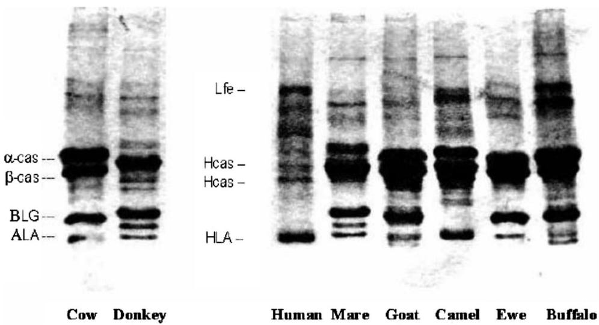
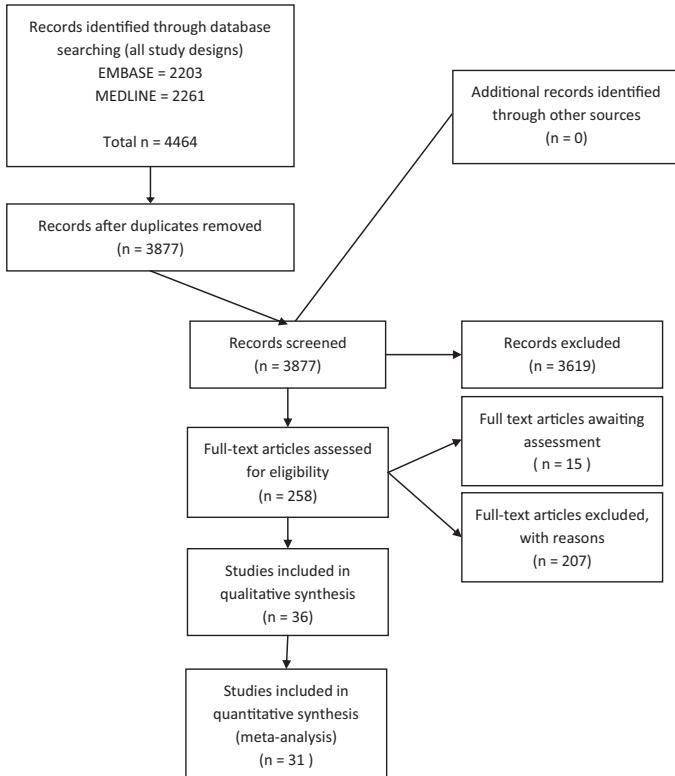
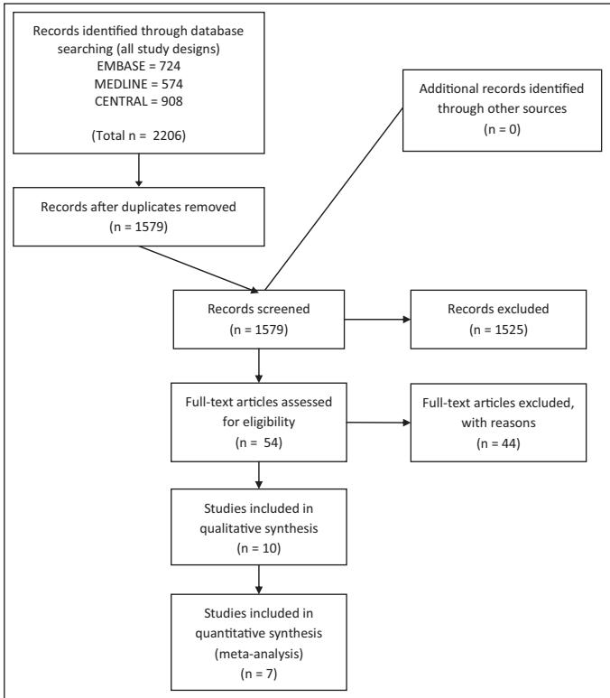
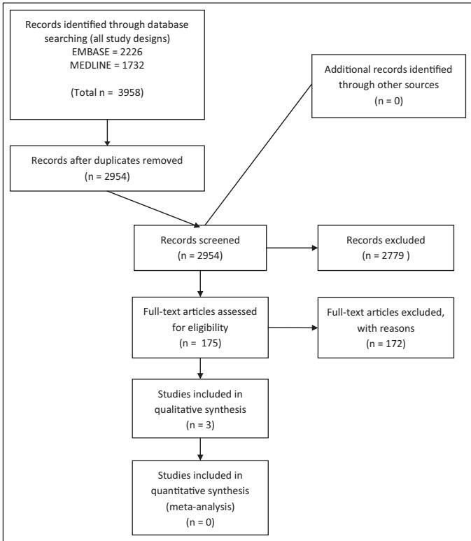
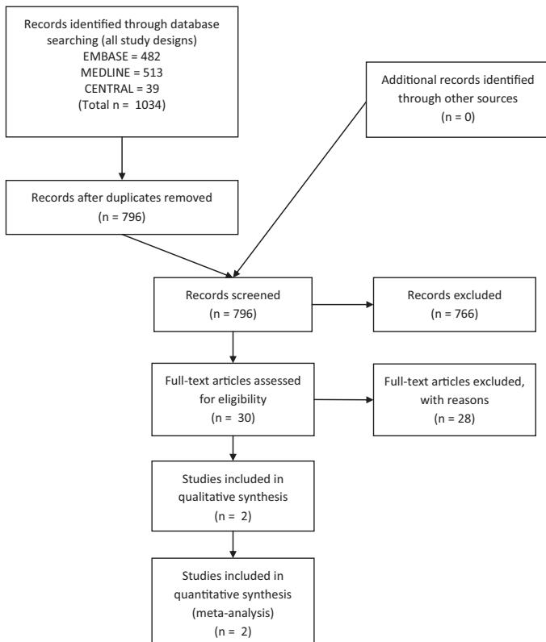

# World Allergy Organization (WAO) Diagnosis and Rationale for Action against Cow’s Milk Allergy (DRACMA) Guidelines

Alessandro Fiocchi, (Chair), Jan Brozek, Holger Schu¨nemann, (Chair), Sami L. Bahna, Andrea von Berg, Kirsten Beyer, Martin Bozzola, Julia Bradsher, Enrico Compalati, Motohiro Ebisawa, Maria Antonieta Guzman, Haiqi Li, RalfG. Heine, Paul Keith, Gideon Lack, Massimo Landi, Alberto Martelli, Fabienne Rancé, Hugh Sampson, Airton Stein, Luigi Terracciano, and Stefan Vieths

Keywords: Cow milk allergy; oral food challenge; epidemiology; DBPCFC; amino acid formula; hydrolyzed milk formula; hydrolyzed rice formula; hydrolyzed soy formula; skin prick test; specific IgE; OIT; SOTI; GRADE

## Authorship

Alessandro Fiocchi, MD, Pediatric Division, Department of Child and Maternal Medicine, University of Milan Medical School at the Melloni Hospital, Milan 20129, Italy.

Holger Sch¨unemann, MD,a Department of Clinical Epidemiology & Biostatistics, McMaster University Health Sciences Centre, 1200 Main Street West Hamilton, ON L8N 3Z5, Canada.

Sami L. Bahna, MD, Pediatrics & Medicine, Allergy & Immunology, Louisiana State University Health Sciences Center, Shreveport, LA 71130.

Andrea Von Berg, MD, Research Institute, Childrens department , Marien-Hospital, Wesel, Germany.

Kirsten Beyer, MD, Charite´ Klinik fu¨r Pa¨diatrie m.S. Pneumologie und Immunologie, Augustenburger Platz 1, D-13353 Berlin, Germany.

Martin Bozzola, MD, Department of Pediatrics, British Hospital-Perdriel 74-CABA-Buenos Aires, Argentina.

Julia Bradsher, PhD, Food Allergy & Anaphylaxis Network, 11781 Lee Jackson Highway, Suite 160, Fairfax, VA 22033.

Jan Brozek, MD,a Department of Clinical Epidemiology & Biostatistics, McMaster University Health Sciences Centre, 1200 Main Street West Hamilton, ON L8N 3Z5, Canada.

Enrico Compalati, MD,a Allergy & Respiratory Diseases Clinic, Department of Internal Medicine. University of Genoa, 16132, Genoa, Italy.

Motohiro Ebisawa, MD, Department of Allergy, Clinical Research Center for Allergy and Rheumatology, Sagamihara National Hospital, Kanagawa 228-8522, Japan.

Maria Antonieta Guzman, MD, Immunology and Allergy Division, Clinical Hospital University of Chile, Santiago, Chile. Santos Dumont 999.

Haiqi Li, MD, Professor of Pediatric Division, Department of Primary Child Care, Children’s Hospital, Chongqing Medical University, China, 400014.

Ralf G. Heine, MD, FRACP, Department of Allergy & Immunology, Royal Children’s Hospital, University of Melbourne, Murdoch Children’s Research Institute, Melbourne, Australia.

Paul Keith, MD, Allergy and Clinical Immunology Division, Department of Medicine, McMaster University, Hamilton, Ontario, Canada.

Gideon Lack, MD, King’s College London, Asthma-UK Centre in Allergic Mechanisms of Asthma, Department of Pediatric Allergy, St Thomas’ Hospital, London SE1 7EH, United Kingdom.

Massimo Landi, MD, National Pediatric Healthcare System, Italian Federation of Pediatric Medicine, Territorial Pediat ric Primary Care Group, Turin, Italy.

Alberto Martelli, MD, Pediatric Division, Department of Child and Maternal Medicine, University of Milan Medical School at the Melloni Hospital, Milan 20129, Italy.

Fabienne Rance´, MD, Allergologie, Hoˆpital des Enfants, Poˆle Me´dicochirurgical de Pe´diatrie, 330 av. de Grande Bretagne, TSA 70034, 31059 Toulouse CEDEX, France.

Hugh Sampson, MD, Jaffe Food Allergy Institute, Mount Sinai School of Medicine, One Gustave L. Levy Place, NY 10029-6574.

Airton Stein, MD, Conceicao Hospital, Porto Alegre, Brazil.

Luigi Terracciano, MD,a Pediatric Division, Department of Child and Maternal Medicine, University of Milan Medical School at the Melloni Hospital, Milan 20129, Italy.

Stefan Vieths, MD, Division of Allergology, Paul-Ehrlich-Institut, Federal Institute for Vaccines and Biomedicines, Paul-Ehrlich-Str. 51-59, D-63225 Langen, Germany.

aMember of the Grades of Recommendation, Assessment, Development and Evaluation (GRADE) Working Group

## Revision Panel

Amal Assa’ad, MD, Division of Allergy and Immunology, Cincinnati Children’s Hospital Medical Center, Cincinnati, Ohio, USA.

Carlos Baena-Cagnani, MD, LIBRA foundation Argentina, Division of Immunology and Respiratory Medicine, De-

9: Guidelines for Diagnosing CMA, p. 89.

partment of Pediatric, Infantile Hospital Cordoba, Santa Rosa 381, 5000 Cordoba, Argentina.

GR Bouygue, MSc, Pediatric Division, Department of Child and Maternal Medicine, University of Milan Medical School at the Melloni Hospital, Milan 20129, Italy.

Walter Canonica, MD, Allergy & Respiratory Diseases Clinic, Department of Internal Medicine. University of Genoa, 16132, Genoa, Italy.

Christophe Dupont, MD, Service de gastroente´rologie et nutrition, Hoˆpital Saint Vincent de Paul, 82, avenue Denfert-Rochereau, 75674, Paris CEDEX 14, France.

Yehia El-Gamal, MD, Department of Pediatrics, Faculty of Medicine, Ain Shams University, Cairo, Egypt.

Matthew Fenton, MD, Asthma, Allergy and Inflammation Branch, National Institute of Allergy and Infectious Diseases, NIH, 6610 Rockledge Dr., Bethesda, MD 20892.

Rosa Elena Huerta Hernandez, MD, Pediatric Allergy Clinic, Mexico City, Mexico.

Manuel Martin-Esteban, MD, Allergy Department, Hospital Universitario La Paz, Madrid, Spain.

Anna Nowak-Wegrzyn, MD, Jaffe Food Allergy Institute, Mount Sinai School of Medicine, One Gustave L. Levy Place, NY 10029-6574.

Ruby Pawankar, MD, Department of Otolaryngology, Nippon Medical School, 1-1-5 Sendagi, Tokyo, 113 Japan.

Susan Prescott, MD, School of Pediatrics and Child Health, University of Western Australia, Princess Margaret Hospital for Children, Perth, Australia.

Patrizia Restani, PhD, Department of Pharmacological Sciences, Universita\` degli Studi di Milano.

Teresita Sarratud, MD, Department of Pediatrics, University of Carabobo Medical School at the Carabobo Hospital, Valencia, Venezuela.

Aline Sprikkelmann, MD, Department of Pediatric Respiratory Medicine and Allergy, Emma Children’s Hospital Academic Medical Centre, Amsterdam, The Netherlands.

## SECTIONS

1: Introduction, p. 58.

2: Methodology, p. 59.

3: Epidemiology of CMA, p. 61.

4: Allergens of Cow’s Milk, p. 65.

5: Immunological Mechanisms of CMA, p. 71.

6: Clinical History and Symptoms of CMA, p. 76.

7: Diagnosis of CMA According to Preceding Guidelines, p. 85.

8: The Elimination Diet in Work-Up of CMA, p. 88.

10: Oral Food Challenge Procedures in Diagnosis of CMA, p. 100.

11: Natural History of CMA, p. 108.

12: Treatment ofCMA According to Preceding Guidelines, p. 112.

13: When Can Milk Proteins Be Eliminated From Diet Without Substituting Cow’s Milk?, p. 117.

14: Guidelines for Choosing a Replacement Formula, p. 119.

15: Milks From Different Animals for Substituting Cow’s Milk, p. 124.

16: Nutritional Considerations in CMA Treatment, p. 128.

17: Choosing the Appropriate Substitute Formula in Different Presentations, p. 130.

18: Grade Recommendations on Immunotherapy for CMA, p. 131.

19: Unmet Needs, Recommendations for Research, Implementation of DRACMA, p. 133.

Acknowledgements, p. 134

Appendix 1: Cow’s Milk Allergy Literature Search Algorithms, p. 135

Appendix 2: Evidence Profiles: Diagnosis of CMA, p. 144

Appendix 3: Evidence Profiles: Treatment of CMA, p. 154

Appendix 4: Evidence Profiles: OIT for Treatment of CMA, p. 160

## SECTION 1: INTRODUCTION

A guidance for the management of food allergy.1,2 Guide- llergy and clinical immunology societies have issued lines are now regarded as translational research instruments, designed to provide cutting-edge benchmarks for good practice and bedside evidence for clinicians to use in an interactive learning context with their national or international scientific communities. In the management of cow’s milk allergy (CMA), both diagnosis and treatment would benefit from a reappraisal of the more recent literature, for “current” guidelines summarize the achievements of the preceding decade, deal mainly with prevention,3– 6 do not always agree on recommendations and date back to the turn of the century.7,8 In 2008, the World Allergy Organization (WAO) Special Committee on Food Allergy identified CMA as an area in need of a rationale-based approach, informed by the consensus reached through an expert review of the available clinical evidence, to make inroads against a burdensome, world-wide public health problem. It is in this context that the WAO Diagnosis and Rationale for Action against Cow’s Milk Allergy (DRACMA) Guidelines was planned to provide physicians everywhere with a management tool to deal with CMA from suspicion to treatment. Targeted (and tapped for their expertise), both on the DRACMA panel or as nonsitting reviewers, were allergists, pediatricians (allergists and generalists), gastroenterologists, dermatologists, epidemiologists, methodologists, dieticians, food chemists, and representatives of allergic patient organizations. Ultimately, DRACMA is dedicated to our patients, especially the younger ones, whose burden of issues we hope to relieve through an ongoing and collective effort of more interactive debate and integrated learning.

## Definitions

Adverse reactions after the ingestion of cow’s milk can occur at any age from birth and even among infants fed exclusively at the breast, but not all such reactions are of an allergic nature. A revision of the allergy nomenclature was issued in Europe in 20019 and was later endorsed by the WAO10 under the overarching definition of “milk hypersensitivity,” to cover nonallergic hypersensitivity (traditionally termed “cow’s milk intolerance”) and allergic milk hypersensitivity (or “cow’s milk allergy”). The latter definition requires the activation of an underlying immune mechanism to fit. In DRACMA, the term “allergy” will abide by the WAO definition (“allergy is a hypersensitivity reaction initiated by specific immunologic mechanisms”). In most children with CMA, the condition can be immunoglobulin E (IgE)-mediated and is thought to manifest as a phenotypical expression of atopy, together with (or in the absence of) atopic eczema, allergic rhinitis and/or asthma. A subset of patients, however, have non-IgE mediated (probably cell-mediated) allergy and present mainly with gastro-intestinal symptoms in reaction to the ingestion of cow’s milk.

## REFERENCES, SECTION 1

1. American College of Allergy, Asthma, & Immunology. Food allergy: a practice parameter. Ann Allergy Asthma Immunol. 2006;96(Suppl 2):S1– S68.

2. Mukoyama T, Nishima S, Arita M, Ito S, Urisu A, et al. Guidelines for diagnosis and management of pediatric food allergy in Japan. Allergol Int. 2007;56:349–361.

3. Prescott SL. The Australasian Society of Clinical Immunology and Allergy position statement: Summary of allergy prevention in children. Med J Aust. 2005;182:464–467.

4. Muraro A, Dreborg S, Halken S, Høst A, Niggemann B, et al. Dietary prevention of allergic diseases in infants and small children. Part III: Critical review of published peer-reviewed observational and interventional studies and final recommendations. Pediatr Allergy Immunol. 2004;15:291–307.

5. Muraro A, Dreborg S, Halken S, Høst A, Niggemann B, et al. Dietary prevention of allergic diseases in infants and small children. Part I: immunologic background and criteria for hypoallergenicity. Pediatr Allergy Immunol. 2004;15:103–11.

6. Muraro A, Dreborg S, Halken S, Høst A, Niggemann B, Aalberse R, et al. Dietary prevention of allergic diseases in infants and small children. Part II. Evaluation of methods in allergy prevention studies and sensitization markers. Definitions and diagnostic criteria of allergic diseases. Pediatr Allergy Immunol. 2004;15:196–205.

7. Høst A, Koletzko B, Dreborg S, Muraro A, Wahn U, et al. Dietary products used in infants for treatment and prevention of food allergy. Joint Statement of the European Society for Paediatric Allergology and Clinical Immunology (ESPACI) Committee on Hypoallergenic Formulas and the European Society for Paediatric Gastroenterology, Hepatology and Nutrition (ESPGHAN) Committee on Nutrition. Arch Dis Child. 1999;81:80–84.

8. American Academy of Pediatrics Committee on Nutrition. Hypoallergenic infant formulae. Pediatrics. 2000;106:346–349.

9. Johansson SG, Hourihane JO, Bousquet J. A revised nomenclature for allergy. An EAACI position statement from the EAACI nomenclature task force. Allergy. 2001;56:813–824.

10. Johansson SG, Bieber T, Dahl R. Revised nomenclature for allergy for global use: report of the Nomenclature Review Committee of the World Allergy Organization, 2003. J Allergy Clin Immunol. 2004;113:832– 836.

## SECTION 2: METHODOLOGY

considered opinion of the whole panel. Narrative parts, that is, sections 1–8, 9–13, 15–17, and 19 included the relevant CMA literature as searched using the algorithms reported in Appendix 1. For these sections, the relative weight of the suggestions retained for the purpose of DRACMA reflects the expert opinion of the panel. They may contain general indications, but no evidence-based recommendations. The consensus on these indications was expressed by the panelists using a checklist itemizing the clinical questions considered relevant after analysis of the literature. The collective judgment of the panel is expressed as a percentage of agreement among panelists. The panel decided to use a GRADE methodology for defining some treatments and diagnostic questions.

The DRACMA worked with the GRADE members on this panel the clinical questions and their scope after various fine-tuning stages. The GRADE panelists independently searched the relevant literature for sections 9, 14, 18. Their analysis was independent of the other panel lists. For question formulation, guideline panel members explicitly rated the importance of all outcomes on a scale from 1–9, where the upper end of the scale (7–9) identifies outcomes of critical importance for decision making, ratings of 4 –6 represent outcomes that are important but not critical and ratings of 1–3 are items of limited importance. Evidence summaries were prepared following the GRADE Working Group’s approach1– 6 based on systematic reviews done by an independent team of the GRADE Working Group members (JLB and HJS supported by 5 research associates).

The GRADE approach suggests that before grading the quality of evidence and strength of each recommendation, guideline developers should first identify a recent well-done systematic review of the appropriate evidence answering the relevant clinical question, or conduct one when none is available. This should be followed by preparing a transparent evidence summary, such as creation of GRADE evidence profiles, on which the guideline panel will base their judgments.7 We prepared 3 systematic reviews addressing the clinical questions covered by the guideline (about the diagnosis, use of formula and immunotherapy of the CMA). We searched MEDLINE, EMBASE, and the Cochrane Library (including Cochrane Central Register of Controlled Trials, DARE, NHS EED) for relevant studies. We included studies published up to September 2009. We developed GRADE evidence profiles (summary of findings tables) for the clinical questions based on the systematic reviews. The summaries of evidence were reviewed by the panel members and corrections and comments were incorporated.

We assessed the quality of the evidence according to the methodology described by the GRADE system.1–3,8 In this system quality of supporting evidence is assessed based on explicit methodological criteria and classified as either “high,” “moderate,” “low,” or “very low.”

The DRACMA guideline panel reviewed the evidence summaries and the draft guidelines, and made recommendations. We reached consensus on all recommendations. Formulating the recommendations included explicit consideration of the quality of evidence, benefits, harms, burden, cost, and values and preferences described as the “Underlying values and preferences” or in the “Remarks” sections of each recommendation as outlined earlier.9 Statements about the underlying values and preferences and the remarks are integral parts of the recommendations and serve to facilitate accurate interpretation of the recommendations. They cannot be omitted when citing or translating DRACMA guidelines. In this document, the expression “values and preferences” refers to the relative weight one attributes to particular benefits, harms, burdens, and costs to determine their balance. We used the decision framework described previously to determine the strength of recommendations.1,10

Little information about costs of diagnosis and treatment of IgE-mediated cow’s milk allergy was available to the panel and it is very likely that it varies considerably across geographical areas and jurisdictions. Cost, therefore, plays a limited role in these recommendations. However, whenever we considered cost and resource expenditure, we used health system perspective.11 For individual patients, cost may not be an issue if the service or treatment strategy is provided at reduced price or free of charge. Clinicians and patients should consider their local resource implications when interpreting these recommendations.

After the GRADE approach we classified recommendations in these guidelines as either “strong” or “conditional” (also known as weak)/weak. The strength of recommendations depends on a balance between all desirable and all undesirable effects of an intervention (ie, net clinical benefit), quality of available evidence, values and preferences, and cost (resource utilization).1 In general, the higher the quality of the supporting evidence, the more likely it is for the recommendation to be strong. Strong recommendations based on low or very low quality evidence are rare, but possible.12

For strong recommendations we used words “we recommend” and for conditional recommendations, “we suggest.” We offer the suggested interpretation of “strong” and “weak” recommendations in Table 2-1. Understanding the interpretation of these 2 grades (strong or conditional) of the strength of recommendations is essential for clinical decision making.

TABLE 2-1. Interpretation of “Strong” and “Weak” Recommendations
<table><tr><td>Implications</td><td>Strong Recommendation</td><td>Weak Recommendation</td></tr><tr><td>For patients</td><td>Most individuals in this situation would want the recommended course of action and only a small proportion would not. Formal decision aids are not likely to be needed to help individuals make decisions consistent</td><td>The majority of individuals in this situation would want the suggested course of action, but many would not.</td></tr><tr><td>For clinicians</td><td>Most individuals should receive the intervention. Adherence to this recommendation according to the guideline could be used as a quality criterion or performance indicator.</td><td>Recognize that different choices will be appropriate for individual patients, and that you must help each patient arrive at a management decision consistent with his or her values and preferences. Decision aids may be useful helping individuals making decisions consistent with their</td></tr><tr><td>For policy makers</td><td>The recommendation can be adapted as policy in most situations.</td><td>Policy making will require substantial debates and involvement of various stakeholders.</td></tr></table>

## How to Use These Recommendations

The DRACMA guidelines are not intended to impose a standard of care for individual countries and jurisdictions. They should, as any guideline, provide a basis for rational decisions for clinicians and their patients about the management of cow’s milk allergy. Clinicians, patients, third-party payers, institutional review committees, other stakeholders, or the courts should never view these recommendations as dictates. Strong recommendations based on high quality evidence will apply to most patients for whom these recommendations are made, but they may not apply to all patients in all circumstances. No recommendation can take into account all of the often-compelling unique features of individual clinical circumstances. Therefore, nobody charged with evaluating clinicians’ actions should attempt to apply the recommendations from the DRACMA guidelines as rote or in a blanket fashion.

## REFERENCES, SECTION 2

1. Guyatt GH, Oxman AD, Kunz R, Falck-Ytter Y, Vist GE, Liberati A, Schunemann HJ. Going from evidence to recommendations BMJ. 2008; 336:1049–1051.

2. Guyatt GH, Oxman AD, Kunz R, Vist GE, Falck-Ytter Y, Schunemann HJ. What is “quality of evidence” and why is it important to clinicians? BMJ. 2008;336:995–998.

3. Guyatt GH, Oxman AD, Vist GE, Kunz R, Falck-Ytter Y, Alonso-Coello P, Schunemann HJ. GRADE: an emerging consensus on rating quality of evidence and strength of recommendations BMJ. 2008;336: 924–926.

4. Schu¨nemann HJ, Fretheim A, Oxman AD. Improving the use of research evidence in guideline development: 9. Grading evidence and recommendations. Health Res Policy Syst. 2006;4:21.

5. Schu¨nemann HJ, Oxman AD, Fretheim A. Improving the use of research evidence in guideline development: 6. Determining which outcomes are important. Health Res Policy Syst. 2006;4:18.

6. World Health Organization. Global Programme on Evidence for Health Policy. Guidelines for WHO Guidelines. EIP/GPE/EQC/2003.1. Geneva, 2003.

7. Schu¨nemann HJ, Hill SR, Kakad M, Vist GE, Bellamy R, et al. Transparent development of the WHO rapid advice guidelines. PLoS Med. 2007;4:e119.

8. Schu¨nemann HJ, Oxman AD, Brozek J, Glasziou P, Jaeschke R, et al. Grading quality of evidence and strength of recommendations for diagnostic tests and strategies. BMJ. 2008;336:1106–1110.

9. Schu¨nemann HJ, Munger H, Brower S, O’Donnell M, Crowther M, Cook D, Guyatt G. Methodology for guideline development for the Seventh American College of Chest Physicians Conference on Antithrombotic and Thrombolytic Therapy: the Seventh ACCP Conference on Antithrombotic and Thrombolytic Therapy. Chest. 2004;126:174S– 178S.

10. Schu¨nemann HJ, Jaeschke R, Cook DJ, Bria WF, El-Solh AA, et al. An official ATS statement: grading the quality of evidence and strength of recommendations in ATS guidelines and recommendations. Am JRespir Crit Care Med. 2006;174:605–614.

11. Guyatt GH, Oxman AD, Kunz R, Jaeschke R, Helfand M, Liberati A, Vist GE, Schunemann HJ. Incorporating considerations of resources use into grading recommendations. BMJ. 2008;336:1170–1173.

12. Brozek JL, Baena-Cagnani CE, Bonini S, Canonica GW, Rasi G, et al. Methodology for development of the Allergic Rhinitis and its Impact on Asthma guideline 2008 update. Allergy. 2008;63:38–46.

## SECTION 3: EPIDEMIOLOGY OF CMA

## Overview

here are no surveys of population and geographical trends in food allergy in adults or children (though the situation is different in pediatric asthma and rhinitis) and this unmet need is particularly felt for CMA. The perception of milk allergy is far more frequent than confirmed CMA. Patient reports of CMA range between 1 and 17.5%, 1 and 13.5%, and 1 to 4% in preschoolers, at children 5 to 16 years of age and adults respectively. Cow’s milk-specific IgE sensitization point prevalence progressively decreased from about 4% at 2 years to less than 1% at 10 years of age in the German Multi-Centre Allergy Study. The most reliable data in epidemiology are those from birth cohorts that are free from selection bias. There are 5 such challenge-confirmed studies. The CMA prevalence during infancy ranged from 1.9% in a Finnish study, 2.16% in the Isle of Wight, 2.22% in a study from Denmark, 2.24% in the Netherlands, and up to 4.9% in Norway.

Patients with CMA develop gastrointestinal symptoms in 32 to 60% of cases, skin symptoms in 5 to 90%, and anaphylaxis in 0.8 to 9% of cases. This frequency of anaphylaxis is the main concern pointed out in many CMA studies. In a review, nearly one third of children with atopic dermatitis (AD) received a diagnosis of CMA after an elimination diet and an oral food challenge, and about 40 to 50% of children less than a year of age with CMA also had AD. Finally, with actual population and geographical trends remaining unknown, allergists are primarily in need of more detailed epidemiological surveys on a global scale. One large such epidemiological study supported by the European Commission is ongoing and aims to furnish the first prevalence data regarding the suspicion of CMA, sensitization to cow’s milk, and oral food challenge-confirmed diagnosis in 10 European birth cohorts.

## Introduction

Around 11–26 million of the European population are estimated to suffer from food allergy.1 If this prevalence was consistent around the world and projected to the 6,659,040,000 people of the world’s population,2 it translates into 220 –520 million people and represents a major global health burden. Although there are surveys on the natural history and prevalence trends for symptoms of asthma, allergic rhinoconjunctivitis, and eczema in childhood,3 we do not have a study assessing the prevalence of food allergy and its time-trends. The problem is complicated by the fact that perceived food allergy (ie, the self-reported feeling that a particular food negatively influences health status) is not actual food allergy. Allergy prevalence is much greater in the public’s belief than it has ever been reported by double-blind studies. Back in the 1980s, the perceived incidence of allergy to food or food additives in mothers with young children was reported between 174 and 27.5%.5 Thirty percent of women reported that they or some member of their family were allergic to some food product.6 In the after decade, a British study using a food allergy questionnaire reported a 19.9% incidence of food allergy.7 From the mid-1990s onwards, self reports began to be compared with challenge-confirmed diagnoses; reported incidence data of between 12.4 and 25% could be confirmed by oral food challenge in only 1.5 to 3.5% of cases, illustrating how reports of adverse reactions overestimate true food allergy.8,9 This was further confirmed when prevalence figures of 2.3 to 3.6% were confirmed by challenge procedures in unselected patient populations.10,11 In the 1990s, it was also confirmed that only a minority of subjects who report food-related illness also test positive by skin prick test using the same food.12

Thus, 2 separate “food allergy epidemiologies” can be distinguished:

a. Self-reported food allergy; although this does not represent actual food allergy epidemiology, it is useful as a proxy measure of the potential demand for allergy medical services, and may guide public health allergy service users between general and specialist medicine,13 and more generally for public health planning.

b. Actual food allergy (ie, confirmed by a positive oral food challenge) represents the real extent of this clinical problem.

In general, food allergy is more frequent in the pediatric, rather than the adult, population. According to a recent Japanese multicenter trial, the prevalence of CMA is 0.21% in newborns and 0.35% amid extremely premature babies (-1000 g).14 Food allergies are a cause of particular concern for children. Incidence is estimated to be greater in toddlers (5– 8%) than it is in adults (1–2%).15–17 Earlier prospective challenge-based studies have shown that in a population of 480 newborns followed up in the setting of a U.S. general pediatric practice through their third birthday, a parental report of 28% food allergy translates into a challenge-confirmed CMA rate of 8%,18,19 with 2.27 to 2.5% occurring in the first 2 years of life.

## Perceived Cow’s Milk Allergy

Similar considerations can be applied to cow’s milk allergy perception. Self-report is common. In a large European survey of above 44,000 telephone contacts, 5 million European respondents claimed to be milk-allergic, with adult women as the group making most of these claims. There were also wide national differences ranging from 13.8% of reports from Greece to 52.3% from Finland. In this survey milk was the most often reported offending food in children (38.5% of reports) and the second food most often implicated by adults (26%).20 In a group of 600 children less than 4 years, CMA was reported by the parents of 18 children (3%).21 Milk reactions were reported by the parents of 2% of children without wheeze and by 16% of wheezers.22

In the literature, the bulk of studies based only on self-reports of CMA is staggering, compared with reports that include an objective measure to assess the condition.23 Currently, at least a score of studies have evaluated the selfperception of CMA over the last 20 years in preschoolers,24 –33 school-age children (5–16 years),20,34 –38 and young adults.20,39 – 45 From these studies, reviewed in the only metaanalysis in the field,35 the prevalence of self-reports varies between 1 to 17.5% in preschoolers, 1 and 13.5% in 5 to 16-year-olds, and between 1 and 4% in adults.

The children from these studies neither underwent sensitization testing nor oral food challenge. In a population of 6-year-olds, 1 out of 7 cases was based on self-reports whereas less than one out of 2 children with a positive cow’s milk specific skin prick test was confirmed allergic by DBPCFC, thereby confirming that most parent-reported symptoms of CMA are unreliable.46 Not only parents, but also health care professionals, allergists, and nonallergists alike, cite cow’s milkinduced reactions as the most common food allergy affecting children.47 Thus, the incidence of self-reports of CMA remains of interest for public health authorities, health maintenance organizations and the processed food industry as a metric for policy planning, planning diagnostic services;48 tabling labeling legislation and even meeting the demand for milk-free products. However, as such, this proxy cannot represent the full extent of the clinical issues at stake.

## Sensitization to Cow’s Milk Proteins

The number of studies on CM sensitization in unselected populations is limited. The meta-analysis carried out by Rona and colleagues23 identified 7 studies reporting a sensitization rate of 0.5 to 2% of preschoolers, of 0.5% at 5 to 16 years of age, and in less than 0.5% of adults.23,25–33 In a later cohort of 543 children from the Isle of Wight followed-up from birth and tested at 1, 2, and 3 years ofage, a positive milk sensitization test was found in 2 infants at 12 months (0.37%), in 5 at 2 years (0.92%), and in 3 at 3 years (0.55%).49 In the German Multicenter Allergy Study, 1314 children initially recruited were followed from birth for 13 years. The longitudinal data were analyzed for 273 children testing positive for serum cow’s milk specific IgE antibody and were obtained at age 2, 5, 7, and 10. The point prevalence of sensitization to cow’s milk progressively decreased from about 4% at 2 years to less than 1% at 10 years.50

## Epidemiology of Challenge-Confirmed CMA

The epidemiology of oral food challenge-confirmed CMA of the last 10 years consists of the following 5 studies:

a. In a Danish study of 1,749 newborns followed for 12 months, 39 (or 2.22%) were confirmed allergic51

b. In a study from Finland 6,209 newborns followed for 15 months, 118 (1.9%) had positive DBPCFC52

c. In a Norwegian study of 193 premature and 416 fullterm infants, 27 of 555 (or 4.9%) were diagnosed with an allergic reaction to cow’s milk on the basis of an open challenge but not all children were tested; interestingly, all had symptoms before 6 months of age53

d. In an Isle of Wight cohort of 969 newborns followed for 12 months, 21 (2.16%) reported CMA but only 2 (0.21%) were actually with IgE-mediated CMA54

e. In a newborn cohort from the Netherlands 1,158 infants prospectively followed through 12 months of age reporting “cow’s milk protein intolerance” (defined as two positive cow’s milk elimination/challenge tests) reported 26 allergic children (or 2.24%) of 211 (or 18.2%) suspected cases.33

In this series of challenge-based studies, the Danish study further suggested that reproducible clinical reactions to CMP in human milk were reported in 0.5% of breast-fed infants.55 Data from cross-sectional studies (analyzed by Rona and coworkers2) demonstrated a rate of 0.6 to 2.5% prevalence in preschoolers, 0.3% at 5 to 16 years of age, and of less than 0.5% in adults.23,56 –58

While most of our information on cow’s milk allergy prevalence comes from northern European and Spanish studies, there are methodological and geographical differences in clinical evaluation, which must be considered in assessing the epidemiological features we discuss here. Some studies may consider only immediate reactions, while others include delayed reactions; not all studies include IgE sensitization assessments; some studies are based on open oral food challenges, some performed blinded oral food challenge tests. Methods used across studies in this literature of oral food challenges with59 cow’s milk are not standardized (see section on Diagnosis).

Thus, among the unmet needs of epidemiological research in this field are high-quality community studies based on patient data objectively confirmed by DBPCFC to close the current knowledge gap on the prevalence of CMA in the population. To address this, the European Commission launched the EuroPrevall Project (www.europrevall.org) in 2005 in concert with more than 60 partners including patient organizations, the food industry and research institutions from across Europe, Russia, Ghana, India, and China. This translational endeavor involves basic and clinical research components, and large epidemiological studies of both children and adults.60 The first results, will include data on suspicion of CMA, on sensitization to cow’s milk and of oral food challenge-confirmed diagnosis from 10 birth cohorts.61

## Different Clinical Presentations of CMA

In a Danish birth cohort, 60% of children with CMA presented with gastrointestinal symptoms, 50 to 60% with skin issues, and respiratory symptoms present in 20 to 30% while 9% developed anaphylaxis.62,63 In the Norwegian cohort noted above, young infants experienced pain (48%), gastrointestinal symptoms (32%), respiratory problems (27%), and atopic dermatitis (4.5%).53 In the Finnish cohort, presentation symptoms included urticaria (45.76%), atopic dermatitis (89.83%), vomiting and/or diarrhea (51.69%), respiratory symptoms (30.50%), and anaphylaxis (2.54%). The same children reacted at oral food challenge with symptoms of urticaria (51.69%), atopic dermatitis (44.06%), vomiting and/or diarrhea (20.33%), respiratory symptoms (15.25%), and anaphylaxis (0.84%).52 In the British study quoted above, infants reacted to oral food challenges with eczema (33%), diarrhea (33%), vomiting (23.8%), and urticaria in 2 children who immediately reacted to the challenge meal (one with wheeze and the other with excessive crying).54 Dutch infants with CMA from the study noted above developed gastrointestinal (50%), skin (31%), and respiratory (19%) symptoms.33

Several other studies have assessed the incidence of CMA in populations selected for referral by other care givers to a tertiary institution for specialist assessment of their symptoms and therefore requires caution in generalizing the results of such studies. As a case in point, in a long-term study of 97 children with challenge-confirmed CMA, 21% had atopic dermatitis at the final follow-up evaluation (at 8 years).62 In another follow-up study of 42 infants with IgEmediated CMA, 57% of children had developed atopic dermatitis at the median age of 3.7 years.63

Thus, CMA appears with GI symptoms in 32 to 60% of cases, cutaneous symptoms in 5 to 90%, anaphylaxis in 0.8 to 9% of cases. Respiratory complaints, including asthma, are not rare. Clearly, in most of the populations studied, there are overlapping presenting symptoms and multiple symptoms are often confirmed during challenge.

## CMA in Different Clinical Conditions

Reversing the point of view, milk sensitization and CMA are reported with different frequencies in different clinical presentations. In 2184 young children aged 13–24 months with atopic dermatitis, the frequency of positive serum IgE responses against cow’s milk protein was 3%.64 Among 59 breast-fed children with moderate-severe AD, 5 (8,5%) were SPT-positive with milk extracts.65 In a consecutive series with moderate atopic eczema referred to a University-affiliated dermatology department, SPT showed 16% of infants with IgE against CMP.66 In a group of infants and children (mean age 17.6 months) with AD and no other allergic manifestations, 20/54 children (37%) had a diagnosis of CMA.67 Among 90 children with IgE-mediated food allergy, 17% were allergic to cow’s milk.68 Thus, as reviewed some years ago, nearly one third of AD children have a diagnosis of CMA according to elimination diet and challenge tests, and about 40 –50% of children -1 year of age with CMA have AD.67

An exception to the uncertainty of information about epidemiology of CMA is anaphylaxis. In a prospective survey of hospital admissions for food-allergic reactions, conducted through the British Pediatric Surveillance Unit, covering the 13 million children in the United Kingdom and Ireland, 229 cases were reported by 176 physicians in 133 departments, yielding a rate of 0.89 hospital admissions per 100,000 children per year. With a 10% rate, milk was the third most frequent allergenic trigger, after peanut (21%) and tree nuts (16%).69 In the UK, there are 13 million individuals less than 16 years of age, and over the past 10 years 8 children died of anaphylaxis (incidence of 0.006 deaths per 100 000 children 0 –15 years per year). Milk caused the greatest number of fatal reactions (four of eight),70 in line with reports of both the frequency and severity71 of reactions to milk.

## Secular Trends of CMA

In such a leopard-skin epidemiological context, it is hardly surprising that there is no continuum that can be identified across studies regarding time variations in CMA frequency.72 Is CMA prevalence on the rise? Utilizing surrogate indicators, we can only infer changes in CMA prevalence based on studies of general food allergy. Among those, a British study found that the admission rates per million population between 1990 and 2004 rose form 5 to 26 for anaphylaxis, from 5 to 26 for food allergy, and from 16 to 107 specifically for pediatric food allergy.73 Reinforcing this picture, eczema rose from 13% in 1991 to 16% in 2003.3

TABLE 3-1. Comparison of the Three Main Food Allergens In Children Studies75
<table><tr><td>Country</td><td>1st</td><td>2nd</td><td>3rd</td></tr><tr><td>USA</td><td>Egg</td><td>Cow&#x27;s milk</td><td>Peanuts</td></tr><tr><td>Germany</td><td>Egg</td><td>Cow&#x27;s milk</td><td>Wheat</td></tr><tr><td>Spain</td><td>Egg</td><td>Cow&#x27;s milk</td><td>Fish</td></tr><tr><td>Switzerland</td><td>Egg</td><td>Cow&#x27;s milk</td><td>Peanuts</td></tr><tr><td>Israel</td><td>Egg</td><td>Cow&#x27;s milk</td><td>Sesame</td></tr><tr><td>Japan</td><td>Egg</td><td>Cow&#x27;s milk</td><td>Wheat</td></tr></table>

## Geographical Trends in CMA

Is milk the most important offender in food allergy in children? From self-reports, it appears that this may be the case. However, given the paucity of epidemiological studies, we do not have sufficient information to argue the relative importance of CMA in different parts of the world. The maximum information comes from Spain, Scandinavian countries, the UK, and Germany. Inadequate information from different areas in the world are available, including Italy, Australia and North America where many cross-sectional and referral studies come from. Table 3-1 shows the comparison of the 3 main food allergens in the child studies. The pan-European RedAll survey estimated milk as the most frequently reported offender in children (38.5% of reports) and the second in adults (26.2%).20 In France, 29/182 school aged children with reported food allergy are milk-allergic in 11.9% of cases.24 Accordingly, the Rona23 metanalysis indicates milk as the major food offender in challenge-based studies, followed by egg and fish. However, cow’s milk accounts for less than one third of any food that can be blamed for food allergy among the studies significantly combined (P - 0.001).74 Similarly a review of studies of various designs (surveys, reviews, clinico-epidemiological studies) indicated egg as the most frequently found allergen in children.75 The pattern is repeated in Japan, where CM accounts for 22.6% of children with food allergy.76 The same may not be true in other parts of the world, where the prevalence will largely reflect local factors such as exposure to foods, mode of preparation, and cultural attitudes. As an example, in Israel sesame is the third most frequently implicated offending food, probably because of its widespread consumption. Among young Australian adults, the major offender was peanut, followed by shrimp, wheat, egg, and milk.44 In Iranian children CM is the most common offender identified during diagnostic provocation challenge.77 Thus, it may be said that the most representative allergen is a hand-maiden to local customs.

REFERENCES, SECTION 3

1. Eigenmann PA. Future therapeutic options in food allergy. Allergy. 2003;58:1217–1223.

2. WHO, World Health Statistics 2009. Available at http://www.who.int/ whosis/whostat/2009/en/print.html, accessed June 30, 2009.

3. ISAAC Phase Three Study Group. Worldwide time trends in the prevalence of symptoms of asthma, allergic rhinoconjunctivitis, and eczema in childhood: ISAAC Phases One and Three repeat multicountry crosssectional surveys. Lancet. 2006;368:733–743.

4. Good Housekeeping Institute, Consumer Research Department. Childcare findings V, Children and Food. New York: A Good Housekeeping Report. 1989.

5. Good Housekeeping Institute, Consumer Research Department. Women’s opinions of food allergens. New York: A Good Housekeeping Institute Publication. 1984.

6. Sloan AE, Powers ME, Sloan AE, Powers MD. A perspective on popular perceptions on adverse reaction to food. J Allergy Clin Immunol. 1986;78:128–133.

7. Young E, Stoneham MD, Petruckeirtch A, et al. A population study of food intolerance. Lancet. 1994;343:1127–31.

8. Jansen JJ, Kardinnal AF, Huijbers G, Vlieg-Boerstra BJ, Martens BP, Ockhuizen T. Prevalence of food allergy and intolerance in the adult Dutch population. J Allergy Clin Immunol. 1994;93:446 – 456.

9. Bjornsson E Janson C, Plaschke P, Norrman E, Sjo¨berg O. Prevalence of sensitization to food allergens in adult Swedes. Ann Allergy, Asthma Immunol. 1996;77:327–332.

10. Osterballe M. The clinical relevance of sensitization to pollen-related fruits and vegetables in unselected pollen-sensitized adults. Allergy. 2005;60:218–225.

11. Zuberbier T. Prevalence of adverse reactions to food in Germany. Allergy. 2004;59:338–345.

12. Woods RK, Stoney RM, Raven J, Walters EH, Abramson M, Thien FC. Reported adverse reactions overestimate true food allergy in the community. Eur J Clin Nutr. 2002;56:31–36.

13. Fiocchi A, Bouygue GR, Terracciano L, Sarratud T, Martelli A. The march of allergic children - excluding allergy in paediatric practice. Allergy Asthma Proc. 2006;27:306–311.

14. Miyazawa T, Itahashi K, Imai T. Management of neonatal cow’s milk allergy in high-risk neonates. Pediatr Int. 2009;51:544–547.

15. Brugman E, Meulmeester JF, Spee-van der WA, Beuker RJ, Radder JJ, Verloove-Vanhorick SP. Prevalence of self-reported food hypersensitivity among school children in The Netherlands. Eur J Clin Nutr. 1998; 52:577–581.

16. Eggesbo M, Botten G, Halvorsen R, Magnus P. The prevalence of allergy to egg: a population-based study in young children. Allergy. 2001;56:403–411.

17. Halmerbauer G, Gartner C, Schierl M, Arshad H, Dean T, et al. Study on the Prevention of Allergy in Children in Europe (SPACE): Allergic sensitization in children at 1 year of age in a controlled trial of allergen avoidance from birth. Pediatr Allergy Immunol. 2002;13(s15):47–54.

18. Bock SA. The natural history of food sensitivity. J Allergy Clin Immunol. 1982;69:173–177.

19. Bock SA. Prospective appraisal of complaints of adverse reactions to foods in children during the first three years of life. Pediatrics. 1987; 79:683–688.

20. Steinke M, Fiocchi A, the REDALL group. Perceived Food allergy in children. A report on a representative telephone survey in 10 European countries. Int Arch Allergy Asthma Immunol. 2007;143:290–295.

21. Kilgallen I, Gibney MJ. Parental perception of food allergy or intolerance in children under 4 years ofage. JHum Nutr Diet. 1996;9:473–478.

22. Sandin A, Annus T, Bjo¨rkste´n B, Nilsson L, Riikja¨rv MA, van Hage-Hamsten M, Bråba¨ck L. Prevalence of self-reported food allergy and IgE antibodies to food allergens in Swedish and Estonian schoolchildren. Eur J Clin Nutr. 2005;59:399–403.

23. Rona RJ, Keil T, Summers C, Gislason D, Zuidmeer L, et al. The prevalence of food allergy: a meta-analysis. J Allergy Clin Immunol. 2007;120:638–646.

24. Rance´ F, Grandmottet X, Grandjean H. Prevalence and main characteristics of schoolchildren diagnosed with food allergies in France. Clin Exp Allergy. 2005;35:167–172.

25. Dalal I, Binson I. Food allergy is a matter of geography after all: sesame

as a major cause of severe IgE-mediated food allergic reactions among infants and young children in Israel. Allergy. 2002;57:362–365.

26. Tariq SM, Matthews SM. Egg allergy in infancy predicts respiratory allergic disease by 4 years of age. Pediatr Allergy Immunol. 2000;11: 162–167.

27. Garcia Ara MC, Boyano Martinez MT. Incidence of allergy to cow’s milk protein in the first year of life and its effect on consumption of hydrolyzed formulae. Ann Pediatr (Barc). 2003;58:100–105.

28. Kristjansson I, Ardal B, Jonsson JS, Sigurdsson JA, Foldevi M, Bjorksten B. Adverse reactions to food and food allergy in young children in Iceland and Sweden. Scand J Prim Health Care. 1999;17:30–34.

29. Eggesbø M, Halvorsen R, Tambs K, Botten G. Prevalence of parentally perceived adverse reactions to food in young children. Pediatr Allergy Immunol. 1999;10:122–132.

30. Høst A, Halken SA. A prospective study of cow milk allergy in Danish infants during the first year of life. Allergy. 1990;45:587–596.

31. Bival’kevich VG. Allergic diathesis in infants in the first year of life. Vestn Dermatol Venerol. 1990;4:49–52.

32. Frongia O, Bellomo AR. Food allergies and intolerance in infants and children. Medico Bambino. 2005;24:533–538.

33. Schrander JJ, Van Den Bogart JP. Cow’s milk protein intolerance in infants under 1 year of age: a prospective epidemiological study. Eur J Pediatr. 1993;152:640–644.

34. Penard-Morand C, Raherison C, Kopferschmitt C, Caillaud D, Lavaud F, et al. Prevalence of food allergy and its relationship to asthma and allergic rhinitis in schoolchildren. Allergy. 2005;60:1165–1171.

35. Roehr CC, Edenharter G, Reimann S, Ehlers I, Worm M, et al. Food allergy and non-allergic food hypersensitivity in children and adolescents. Clin Exp Allergy. 2004;34:1534–1541.

36. Santadusit S, Atthapaisalsarudee S, Vichyanond P. Prevalence of adverse food reactions and food allergy among Thai children. J Med Assoc Thai. 2005;88(Suppl 8):S27–S32.

37. Isolauri E, Huurre A. The allergy epidemic extends beyond the past few decades. Clin Exp Allergy. 2004;34:1007–1010.

38. van Bockel-Geelkerken M, Meulmeester JF. Prevalence of putative hypersensitivity in young children. Ned Tijdschr Geneeskd. 1992;136: 1351–1356.

39. Pereira B, Venter C, Grundy J, Clayton CB, Arshad SH, Dean T. Prevalence of sensitization to food allergens, reported adverse reaction to foods, food avoidance, and food hypersensitivity among teenagers. J Allergy Clin Immunol. 2005;116:884–892.

40. Gislason D, Bjornsson E, Gislason S. Allergy and intolerance to food in an Icelandic urban population 20 – 44 years of age. Icelandic Med J. 2000;86:851–857.

41. Woods RK, Abramson M, Bailey M, Walters EH, on behalf of the European Community Respiratory Health Survey (ECRHS). International prevalence of reported food allergies and intolerances: comparisons arising from the European Community Respiratory Health Survey (ECRHS) 1991–1994. Eur Respir J. 2001;55:298–304.

42. Falcao H, Lunet N, Lopes C, Barros H. Food hypersensitivity in Portuguese adults. Eur J Clin Nutr. 2004;58:1621–1625.

43. Altman DR, Chiaramonte LT. Public perception of food allergy. J Allergy Clin Immunol. 1996;97:1247–1251.

44. Woods RK, Thien F, Raven J, Walters H, Abramson M. Prevalence of food allergies in young adults and their relationship to asthma, nasal allergies, and eczema. Ann Allergy Asthma Immunol. 2002;88:183–189.

45. Marklund B, Ahlstedt S, Nordstrom G. Health-related quality of life among adolescents with allergy-like conditions: with emphasis on food hypersensitivity. Health Qual Life Outcomes. 2004;2:65.

46. Venter C. Prevalence of sensitization reported and objectively assessed food hypersensitivity amongst six-year-old children: a population-based study. Pediatr Allergy Immunol. 2006;17:356 –363.

47. Wilson BG, Cruz NV, Fiocchi A, Bahna SL; American College of Allergy, Asthma & Immunology Adverse Reactions to Food Committee. Survey of physicians’ approach to food allergy, Part 2: Allergens, diagnosis, treatment, and prevention. Ann Allergy Asthma Immunol. 2008;100:250–255.

48. Hourihane JO’B. Prevalence and severity of food allergy: need for control. Allergy. 1998;53(Suppl 48):84 – 88.

49. Dean T, Venter C, Pereira B, Arshad SH, Grundy J, Clayton CB, Higgins B. Patterns of sensitization to food and aeroallergens in the first 3 years of life. J Allergy Clin Immunol. 2007;120:1166–1171.

50. Matricardi PM, Bockelbrink A, Beyer K, Keil T, Niggemann B, Gru¨ber C, Wahn U, Lau S. Primary versus secondary immunoglobulin E sensitization to soy and wheat in the Multi-Centre Allergy Study cohort. Clin Exp Allergy. 2008;38:493–500.

51. Høst A, Halken S, Jacobsen HP, Christensen AE, Herskind AM, Plesner K. Clinical course ofcow’s milk protein allergy/intolerance and atopic diseases in childhood. Pediatr Allergy Immunol. 2002;13(Suppl 15):23–28.

52. Saarinen KM, Juntunen-Backman K, Ja¨rvenpa¨a¨ AL, Kuitunen P, et al. Supplementary feeding in maternity hospitals and the risk of cow’s milk allergy: a prospective study of 6209 infants. J Allergy Clin Immunol. 1999;104:457–461.

53. Kvenshagen B, Halvorsen R, Jacobsen M. Adverse reactions to milk in infants. Acta Paediatr. 2008;97:196–200.

54. Venter C, Pereira B, Grundy J, Clayton CB, Roberts G, Higgins B, Dean T. Incidence of parentally reported and clinically diagnosed food hypersensitivity in the first year of life. J Allergy Clin Immunol. 2006;117: 1118–1124.

55. Høst A. Frequency of cow’s milk allergy in childhood. Ann Allergy Asthma Immunol. 2002;89(Suppl 1):33–37.

56. Osterballe M, Hansen TK, Mortz CG, Høst A, Bindslev-Jensen C. The prevalence of food hypersensitivity in an unselected population of children and adults. Pediatr Allergy Immunol. 2005;16:567–573.

57. Madrigal BI, Alfaro AN. Adverse reactions to food in daycare children. Rev Alerg Mex. 1996;43:41–44.

58. Altintas D. A prospective study of cow’s milk allergy in Turkish infants. Acta Paediatr. 1995;84:1320–1321.

59. Martelli A, Bouygue GR, Fiocchi A, Restani P, Sarratud T, Terracciano L. Oral food challenges in children in Italy. Allergy 2005;60:907–911.

60. Clare Mills EN, Mackie AR, Burney P, Beyer K, Frewer L, Madsen C, et al. The prevalence, cost and basis of food allergy across Europe. Allergy. 2007;62:717–722.

61. Keil T, McBride D, Grimshaw K, Niggemann B, Xepapadaki P, et al. The multinational birth cohort of EuroPrevall: background, aims and methods. Allergy, 2010;65:482– 490.

62. Bishop JM, Hill DG, Hosking CS. Natural history of cow milk allergy. Clinical outcome. J Pediatr. 1990;116:862–867.

63. Hill DJ, Bannister DG, Hosking CS, Kemp AS. Cow milk allergy within the spectrum of atopic disorders. Clin Exp Allergy. 1994;24: 1137–1143.

64. Wahn U, Warner J, Simons FE, de Benedictis FM, Diepgen TL, et al. IgE antibody responses in young children with atopic dermatitis. Pediatr Allergy Immunol. 2008;19:332–336.

65. Rennick GJ, Moore E, Orchard DC. Skin prick testing to food allergens in breast-fed young infants with moderate to severe atopic dermatitis. Australas J Dermatol. 2006;47:41–45.

66. Hill DJ, Heine RG, Hosking CS, Brown J, Thiele L, et al. IgE food sensitization in infants with eczema attending a dermatology department. J Pediatr. 2007;151:359–363.

67. Novembre E, Vierucci A. Milk allergy/intolerance and atopic dermatitis in infancy and childhood. Allergy. 2001;56(Suppl 67):105–108.

68. Hill DJ, Hosking CS. Food allergy and atopic dermatitis in infancy: an epidemiologic study. Pediatr Allergy Immunol. 2004;15:421– 427.

69. Colver AF, Nevantaus H, Macdougall CF, Cant AJ. Severe food-allergic reactions in children across the UK and Ireland, 1998 –2000. Acta Paediatr. 2005;94:689–695.

70. Macdougall CF, Cant AJ, Colver AF. How dangerous is food allergy in childhood? The incidence of severe and fatal allergic reactions across the UK and Ireland. Arch Dis Child. 2002;86:236–239.

71. Stewart AG, Ewan PW. The incidence, aetiology and management of anaphylaxis presenting to an accident and emergency department. QJM. 1996;89:859–864.

72. Madsen CH. Prevalence of food allergy: an overview. Proc Nutr Soc. 2005;64:413–417.

73. Gupta R. Time trends in allergic disorders in the UK. Thorax. 2007;62: 91–96.

74. Thong BY, Hourihane JO. Monitoring of IgE-mediated food allergy in childhood. Acta Paediatr. 2004;93:759–764.

75. Ebisawa M, Ikematsu K, Takanori I, Tachimoto H. Food allergy in Japan. Allergy Clin Immunol Int – J World Allergy Org. 2003;15:214 –217.

76. Iikura Y, Imai Y, Imai T, Akasawa A, Fujita K, et al. Frequency of immediate-type food allergy in children in Japan. Int Arch Allergy Immunol. 1999;118:251–252.

77. Pourpak Z, Farhoudi A, Arshi S, Movahedi M, Gharegozlou M, Yazdani F, Mesdaghi M. Common Food Allergens in Iranian Children. IJMS. 2003;28:17–22.

## SECTION 4: ALLERGENS OF COW’S MILK

## Overview

he main allergens of cow’s milk are distributed among the whey and casein fractions.   
The whey allergens include:

a. Alpha-lactalbumin (Bos d 4): its role in milk allergy is controversial and prevalence data across studies vary between 0 and 80% of patients reacting to this protein.

b. Beta-lactoglobulin (Bos d 5), the most abundant cow’s milk whey protein; it occurs in the milk of many other species but is not present in human milk. Thirteen to 76% of patients are found to react to this protein.

c. Bovine serum albumin (Bos d 6): involved in other allergies such as beef; it accounts for between 0 and 88% of sensitization events, while clinical symptoms occur in up to 20% of patients.

d. Bovine immunoglobulins (Bos d 7): are seldom held responsible for clinical symptoms in CMA.

The casein allergens (collectively known as Bos d 8) consist of 4 different proteins (alphas1, alphas2, beta, and kappa casein) which share little sequential homology. Despite this, simultaneous sensitization to these caseins is frequently observed. Patients are more often sensitized to alpha (100%) and kappa caseins (91.7%).

Of clinical relevance, milk allergens of various mammalian species cross-react. The greatest homology is among cow’s, sheep’s and goat’s milks protein as Bos (oxen), Ovis (sheep), and Capra (goat) are genera belonging to the Bovidae family of ruminants. Proteins in their milks have less structural similarity with those from the Suidae (pig), Equidae (horse and donkey), and Camelidae (camel and dromedary) families and also from those of humans. Its noteworthy that the milks of camels and dromedaries (and human milk) do not contain Bos d 5. All this is relevant for later considerations on formula (section 13).

There is no clear relationship between digestibility and protein allergenicity. Milk allergens are known to preserve their biologic activity even after boiling, pasteurization, ultra-high-temperature processing, or evaporation for the production of powdered infant formula. To obtain hypoallergenic formulas, extensive hydrolysis and further processing, such as heat treatment, ultrafiltration, and application of high pressure are necessary. Attempts have been made to classify formulas into partial and extensively hydrolyzed products according to their degree of protein fragmentation, but there is no agreement on the criteria on which to base this classification. Nevertheless, hydrolyzed formulas have until now proven to be a useful and widely used protein source for infants suffering from CMA (section 12).

TABLE 4-1. The Proteins of Cow’s Milk
<table><tr><td>Fraction</td><td>Protein</td><td>Allergen10</td><td>g/L</td><td>% Total Protein</td><td>MW (kDa)</td><td>#AA</td><td>pI</td></tr><tr><td>Caseins</td><td></td><td>Bos d 8</td><td>~30</td><td>80</td><td></td><td></td><td></td></tr><tr><td></td><td>αs1-casein</td><td></td><td>12-15</td><td>29</td><td>23.6</td><td>199</td><td>4.9-5.0</td></tr><tr><td></td><td>αs2-casein</td><td></td><td>3-4</td><td>8</td><td>25.2</td><td>207</td><td>5.2-5.4</td></tr><tr><td></td><td>β-casein</td><td></td><td>9-11</td><td>27</td><td>24.0</td><td>209</td><td>5.1-5.4</td></tr><tr><td></td><td>γ1-casein</td><td></td><td></td><td></td><td>20.6</td><td>180</td><td>5.5</td></tr><tr><td></td><td>γ₂-casein</td><td></td><td>1-2</td><td>6</td><td>11.8</td><td>104</td><td>6.4</td></tr><tr><td></td><td>γ3-casein</td><td></td><td></td><td></td><td>11.6</td><td>102</td><td>5.8</td></tr><tr><td></td><td>k-casein</td><td></td><td>3-4</td><td>10</td><td>19.0</td><td>169</td><td>5.4-5.6</td></tr><tr><td>Whey proteins</td><td></td><td></td><td>~5.0</td><td>20</td><td></td><td></td><td></td></tr><tr><td></td><td>Alpha-lactalbumin</td><td>Bos d 4</td><td>1-1.5</td><td>5</td><td>14.2</td><td>123</td><td>4.8</td></tr><tr><td></td><td>Beta-lactoglobulin</td><td>Bos d 5</td><td>3-4</td><td>10</td><td>18.3</td><td>162</td><td>5.3</td></tr><tr><td></td><td>Immunoglobulin</td><td>Bos d 7</td><td>0.6-1.0</td><td>3</td><td>160.0</td><td>一</td><td>—</td></tr><tr><td></td><td>BSA*</td><td>Bos d 6</td><td>0.1-0.4</td><td>1</td><td>67.0</td><td>583</td><td>4.9-5.1</td></tr><tr><td></td><td>Lactoferrin</td><td></td><td>0.09</td><td>Traces</td><td>800.0</td><td>703</td><td>8.7</td></tr></table>

\*Bovine serum albumin.

## Introduction

Milk can give rise to several food hypersensitivities, usually classified as milk allergy or milk intolerance.1 The mechanism of intolerance to cow’s milk is not IgE antibodymediated and has been blamed on the functionality of a specific enzyme deficiency, commonly lactose intolerance, attributable to beta-galactosidase (lactase) deficiency. DRACMA will not address lactase deficiency or other cow’s milk-induced hypersensitivity not mediated by immune mechanisms, which have been described in detail elsewhere.2–5 Cow’s milk allergy is an adverse clinical reaction associated with the binding of immunoglobulin (IgE) to antigens capable of eliciting an immune response.6 Where allergy is not mediated by IgE, other classes of immunoglobulin, immune complexes, or a cell-mediated reaction have been proposed to be involved. In IgE-mediated allergy, circulating antibodies recognize specific molecular regions on the antigen surface (epitopes), which are classified according to their specific amino acid sequence (sequential epitopes) or the folding and configuration of their protein chains (conformational epitopes). In this section, we describe the chemical characteristics of cow’s milk allergens, how they are involved in cross-reactivity among mammalian species, their resistance to digestion and proteolysis and their response to technological processing.

## Chemical Characterization of Cow’s Milk Allergens

Cow’s milk contains several proteins that could each in principle elicit an allergic reaction in a sensitized individual. Some of these proteins are considered major allergens, some minor ones, while others have rarely or never been associated with reports of clinical reactions. The casein and whey proteins of cow’s milk are listed in Table 4-1. Each of these 2 fractions contains 5 major components.7–9 The casein fraction contains 80% of the total protein of cow’s milk while alpha and beta-casein make up for 70% of this fraction. Whey proteins are less abundant, and beta-lactoglobulin (BLG) accounts for 50% of this fraction. Because BLG is not present in human milk, this protein was previously considered the most important cow’s milk allergen, but it has since been shown that other proteins, such as the caseins, are also critically involved in the etiology of the disease.

By convention, allergens in the international nomenclature are designated by an abbreviation formed by the genus (capitalized; abbreviated to the first 3 letters) and species (reduced to one letter) names of the Linnaean taxonomical system in italics, followed by an Arabic numeral reflecting the chronological order in which the allergen was identified and characterized (eg, Bos d[omesticus] 4).10

## Alpha-Lactalbumin (Bos d 4)

Alpha-lactalbumin (A-LA) is a whey protein belonging to the lysozyme superfamily. It is a regulatory subunit of lactose synthase and is, able to modify the substrate specificity of galactosyl-transferase in the mammary gland, making glucose a good acceptor substrate for this enzyme and allowing lactose synthase to synthesize lactose.11,12 A-LA is produced by the mammary gland and has been found in all milks analyzed so far. Table 4-2 shows its main chemical characteristics.

TABLE 4-2. Characteristics of Alpha-Lactalbumin (Bos d 4)
<table><tr><td>Parameter</td><td>Description</td></tr><tr><td>Allergen nomenclature</td><td>Bos d 4</td></tr><tr><td>Entry name</td><td>LALBA_BOVIN</td></tr><tr><td>Synonyms</td><td>Lactose Synthase B protein</td></tr><tr><td rowspan="3">Sequence databases</td><td>Genbank: M18780</td></tr><tr><td>PIR: A27360, LABO</td></tr><tr><td>Swiss-Prot: P00711</td></tr><tr><td>Number of aminoacids Molecular weight</td><td>123 residues</td></tr><tr><td></td><td>14.2 kDa</td></tr><tr><td>Isoelectric point</td><td>4.8</td></tr><tr><td>Involvement in allergic sensitization to cow&#x27;s milk</td><td>0–80% CM allergic subjects 75% CM allergic children by SPT</td></tr></table>

A-LA contains 8 cysteine groups, all forming internal disulphide bonds, and 4 tryptophan residues. It contains high-affinity calcium binding sites stabilizing its highly ordered secondary structure. The role of A-LA in milk allergy is controversial and prevalence data across studies vary between 0 and 80% of patients reacting to this protein (reviewed in13). This heterogeneity is probably linked to whether skin prick test, specific IgE determinations, immunoblotting, or other method of sensitization assessment was used.

## Beta-Lactoglobulin (Bos d 5)

Beta-lactoglobulin (BLG) is the most abundant cow’s milk whey protein; it occurs in the milk of many other mammalian species but is not present in human milk. Bos d 5 belongs to the lipocalin allergen family and is synthesized by the mammalian gland. Its function is unknown, although it may be involved in retinol transport, with which it readily binds.14 Table 4-3 shows its main physical and chemical characteristics. It contains 2 internal disulphide bonds and one free–SH group. Under physiological conditions, BLG exists as an equilibrium mixture of monomer and dimer forms but, at its isoelectric point, the dimers can further associate to octamers. There are 2 main isoforms of this protein in cow’s milk, the genetic variants A and B, which differ only by 2 point mutations at amino acids 64 and 118. Because it is lacking from human milk, BLG has long been believed to be the most important cow’s milk allergen. The literature indicates that the prevalence of allergic subjects reacting to this protein is between 13 and 76%.15

## Bovine Serum Albumin (Bos d 6)

Bovine serum albumin (BSA) is the main protein of whey. It can bind water, fatty acids, hormones, bilirubin, drugs, and $\mathrm { C a } ^ { 2 + }$ , K, and Na. Its main function is the regulation of the colloidal osmotic pressure in blood.15 The tertiary structure of BSA is stable, and its 3-dimensional conformation is well documented. The protein is organized into 3 homologous domains (I to III) and consists of 9 loops connected by 17 covalent disulphide bridges. Most of the disulphide bonds are well protected in the core of the protein and are not readily accessible to the solvent. Table 4-4 shows some of its characteristics.

TABLE 4-3. Characteristics of Beta-Lactoglobulin (Bos d 5)
<table><tr><td>Parameter</td><td>Description</td></tr><tr><td>Allergen nomenclature</td><td>Bos d 5</td></tr><tr><td>Entry name</td><td>LACB_BOVIN</td></tr><tr><td>Synonyms</td><td></td></tr><tr><td rowspan="2">Sequence databases</td><td>Genbank: X14712 PIR: S10179, LGBO</td></tr><tr><td>Swiss-Prot: P02754</td></tr><tr><td>Number of aminoacids</td><td>162 residues</td></tr><tr><td>Molecular weight</td><td>18.3 kDa</td></tr><tr><td>Isoelectric point</td><td>5.13–5.23 (variants)</td></tr><tr><td>Involvement in allergic sensitization to cow&#x27;s milk 73.7% CM allergic children by SPT</td><td>13–76% CM allergic subjects</td></tr></table>

TABLE 4-4. Characteristics of Bovine Serum Albumin (Bos d 6)
<table><tr><td>Parameter</td><td>Description</td></tr><tr><td>Allergen nomenclature</td><td>Bos d 6</td></tr><tr><td>Entry name</td><td>ALBU_BOVIN</td></tr><tr><td>Synonyms</td><td>BSA</td></tr><tr><td rowspan="2">Sequence databases</td><td>Genbank: M73993</td></tr><tr><td>PIR: A38885, ABBOS Swiss-Prot: P02769</td></tr><tr><td>Number of aminoacids Molecular weight</td><td>583 residues</td></tr><tr><td></td><td>67.0 kDa</td></tr><tr><td>Isoelectric point Involvement in allergic sensitization</td><td>4.9-5.1</td></tr><tr><td>to cow&#x27;s milk</td><td>0–88% CM allergic subjects 62.5% CM allergic children by</td></tr></table>

Bos d 6 is involved not only in milk allergy but also in allergic reactions to beef.15 It induced immediate allergic symptoms (lip edema, urticaria, cough, and rhinitis) in children allergic to beef who received the protein in a doubleblind placebo-controlled food challenge (DBPCFC).16 The prevalence of patients with cow’s milk who react to this protein ranges from 0 to 88%, while clinical symptoms may be found in as many as 20% of patients.17

## Immunoglobulins (Bos d 7)

Bovine immunoglobulins are present in blood, tissues, fluids, and secretions such as milk. Some characteristics of the bovine IgG are shown in Table 4-5. Bovine IgG seldom cause clinical symptoms in CMA.18

## Caseins (Bos d 8)

Most of the casein aggregates as colloidal particles (the casein micelle) and its biologic function is to transport calcium phosphate to the mammalian newborn. More than 90% of the calcium content of skim milk is attached to or included in casein micelles. Caseins consist of 4 different proteins (alpha , alpha , beta, and kappa casein) with little sequential homology. Another group, the gamma caseins, are present in very low quantities in milk and are by-products of beta casein proteolysis. A distinguishing feature of all caseins is their low solubility at pH 4.6; another common characteristic is that caseins are conjugated proteins, most with phosphate groups esterified to the amino acid serine. Caseins contain no disulphide bonds, while the high number of proline residues causes pronounced bending of the protein chain, which inhibits the formation of close-packed, ordered secondary structures. Characteristics of Bos d 8 are reported in Table 4-6.

TABLE 4-5. Characteristics of Cow’s Milk Immunoglobulin G
<table><tr><td>Parameter</td><td>Description</td></tr><tr><td>Allergen nomenclature</td><td>Bos d 7</td></tr><tr><td>Entry name</td><td></td></tr><tr><td>Synonyms</td><td>IgG</td></tr><tr><td>Sequence databases Number of aminoacids</td><td></td></tr><tr><td>Molecular weight</td><td></td></tr><tr><td>Isoelectric point</td><td>160.0 kDa</td></tr><tr><td>Involvement in allergic sensitization to cow&#x27;s milk</td><td>Frequency unknown</td></tr></table>

TABLE 4-6. Allergenic Characteristics of Caseins
<table><tr><td>Parameter</td><td>αs1-casein</td><td>αs2-casein</td><td>β-casein</td><td>k-casein</td></tr><tr><td>Allergen nomenclature</td><td>Bos d 8</td><td>Bos d 8</td><td>Bos d 8</td><td>Bos d 8</td></tr><tr><td>Entry name</td><td>CAS1_BOVIN</td><td>CAS2_BOVIN</td><td>CASB_BOVIN</td><td>CASK_BOVIN</td></tr><tr><td>Synonyms</td><td>None</td><td>None</td><td>None</td><td>None</td></tr><tr><td rowspan="3">Sequence databases</td><td>G X00564/M33123</td><td>GM16644</td><td>G M16645/X06359</td><td>G X14908/M36641</td></tr><tr><td>P S22575/KABOSB</td><td>P JQ2008/KABOS2</td><td>PI45873/KBBOA2</td><td>P S02076/KKBOB</td></tr><tr><td>S P02662</td><td>S P02663</td><td>S P02666</td><td>S P02668</td></tr><tr><td>No. aminoacids</td><td>199</td><td>207</td><td>209</td><td>169</td></tr><tr><td>Molecular weight</td><td>23.6 kDa</td><td>25.2 kDa</td><td>24.0 kDa</td><td>19.0 kDa</td></tr><tr><td>Isoelectric point</td><td>4.9-5.0</td><td>5.2-5.4</td><td>5.1-5.4</td><td>5.4-5.6</td></tr><tr><td>Involvement in allergic sensitization to cow&#x27;s milk–1. whole casein</td><td>65-100%</td><td>65-100%</td><td>65-100%</td><td>65-100%</td></tr><tr><td>Involvement in allergic sensitization</td><td>54%</td><td>54%</td><td>39%</td><td>NT</td></tr><tr><td>to cow&#x27;s milk–2. single casein</td><td>100%</td><td>100%</td><td>66.7%</td><td>91.7%</td></tr></table>

Despite the poor sequence homology between proteins of the casein fraction, poly-sensitization to many caseins is frequently observed; this may be because of cross-sensitization through shared or closely related epitopes.8 Patients are almost always sensitized to alpha (100%) and kappa caseins (91.7%).19

## Cross-Reactivity Between Milk Proteins from Different Animal Species

Cross-reactivity occurs when 2 proteins share part of their amino acid sequence (at least, the sequence containing the epitopic domain) or when the 3-dimensional conformation makes 2 molecules similar in binding capacity to specific antibodies. In general, cross-reactivity between mammalian proteins reflects the phylogenetic relationships between animal species and evolutionary conserved proteins that are often cross-reactive.20 Table 4-7 shows the sequence similarity (expressed in percentages) between milk proteins from different mammalian species.22

The greatest homology is between cow’s, sheep’s and goat’s milk proteins as Bos (oxen), Ovis (sheep), and Capra (goat) that are genera belonging to the Bovidae family of ruminants. The proteins in their milks consequently have less structural similarity with those from the Suidae (pig), Equidae (horse and donkey), and Camelidae (camel and dromedary) families and also with those in human milk. It is noteworthy that the milks of camels and dromedaries (as well as human milk) do not contain BLG.

However, phylogeny does not explain everything. In 1996, a clinical trial in France showed that 51/55 children with cow’s milk allergy tolerated goat’s milk for periods ranging from 8 days to 1 year,22 but subsequent research showed that other subjects allergic to cow’s milk did not tolerate goat’s and sheep’s milks.23 This is consistent with the pattern of IgE cross-reactivity shown by several independent studies in vitro, for instance the cross-reactivity between milk proteins from different mammalian species (including goat’s milk).24 Furthermore, selective allergy to goat’s and sheep’s milk but not to cow’s milk has also been reported in 28 older children with severe allergic reactions, including anaphylaxis. In one study, IgE antibodies recognized caseins from goat’s milk but cow’s milk caseins were not or scarcely recognized.25 This is not an isolated finding,26,27 however, and a case report of an adult with goat’s milk allergy without CMA found specific IgE to caprine ALA.28 Finally, allergy to sheep’s milk can also evolve into allergy to cow’s milk.29 Mare’s and donkey’s milks have proved sometimes useful to some patients,30 –32 but uncertainties remain about chemical composition and hygienic control. The same considerations apply to Camellidae (camel and dromedaries) milks, which could represent an alternative to cow’s milk for allergic subjects because of their low sequence homology with cow’s milk and the absence of BLG, if problems related to availability and technological processing to avoid new sensitization.33

TABLE 4-7. Sequence Homology Between Mammalian Milk Proteins (in Percentage, Relative To Cow’s Milk Proteins)
<table><tr><td>Protein</td><td>Goat</td><td>Ewe</td><td>Buffalo</td><td>Sow</td><td>Mare</td><td>Donkey</td><td>Dromedary</td><td>Human</td></tr><tr><td>ALA</td><td>95.1</td><td>97.2</td><td>99.3</td><td>74.6</td><td>72.4</td><td>71.5</td><td>69.7</td><td>73.9</td></tr><tr><td>BLG</td><td>94.4</td><td>93.9</td><td>96.7</td><td>63.9</td><td>59.4</td><td>56.9</td><td>Absent</td><td>Absent</td></tr><tr><td>Serum alb.</td><td>一</td><td>92.4</td><td>一</td><td>79.9</td><td>74.5</td><td>74.1</td><td></td><td>76.6</td></tr><tr><td>α s1 CAS</td><td>87.9</td><td>88.3</td><td></td><td>47.2</td><td>一</td><td>一</td><td>42.9</td><td>32.4</td></tr><tr><td>αs2 CAS</td><td>88.3</td><td>89.2</td><td>一</td><td>62.8</td><td>一</td><td>一</td><td>58.3</td><td>一</td></tr><tr><td>βCAS</td><td>91.1</td><td>92.0</td><td>97.8</td><td>67.0</td><td>60.5</td><td>一</td><td>69.2</td><td>56.5</td></tr><tr><td>κ CAS</td><td>84.9</td><td>84.9</td><td>92.6</td><td>54.3</td><td>57.4</td><td></td><td>58.4</td><td>53.2</td></tr></table>

  
FIGURE 4-1. SDS-PAGE of mammalian milk samples. Hcas  human casein; HLA  human lactalbumin; Lfe  human lactoferrin; -cas  bovine alpha casein; --cas  bovine beta casein; BLG  bovine -lactoglobulin; ALA  bovine -lactalbumin.

Figure 4-1 shows the electrophoretic patterns of milk from several mammalian species. The pronounced similarity is evident for milk from cows, goats, and sheep, while the protein profiles of mare’s, donkey’s, and camel’s milks present some specificities. The low cross-immunoreactivity of horse/donkey milk and the absence of BLG in camel’s and human milk is easily visible in immunoblots using antibodies against bovine BLG.

## Structural Modifications and Cow’s Milk Protein Allergenicity

The 3-dimensional structure of most antigenic proteins is unknown, even where the amino acid sequence has been precisely identified, because the conformation is not immutable but is influenced by the surrounding environment. This problem is even more significant for milk proteins since their organization is complex and the presence of micelles in caseins makes their investigation difficult. We discuss here the structural modifications brought about by gastrointestinal digestion or technological treatments and their role in allergenic potential where this is known or can be inferred.

## Digestibility and Cow’s Milk Protein Allergenicity

Food proteins are digested by gastrointestinal enzymes; it is generally believed that proteins resistant to proteolysis are the more powerful allergens. However, it has been shown that there is no clear relationship between in vitro digestibility and protein allergenicity.34 Caseins are thought to be easily digestible, but they coagulate in an acidic medium (at gastric pH). Acidification increases the solubility of minerals, so that the calcium and phosphorus contained in the micelles gradually become soluble in the aqueous phase. As a result, casein micelles disintegrate and casein precipitates. Whey proteins are more soluble in saline solution than caseins and theoretically they should be more easily digested by proteases that work in aqueous medium. However, the correlation between water solubility and digestibility is not linear. Caseins are digested faster than whey proteins by the commonest foodgrade enzymes (eg, pepsin, trypsin, and thermolysin).35

Although BSA is very soluble in water and rich in amino acids broken-down by gastrointestinal enzymes, it is also relatively resistant to digestion. Sequential epitopes were unaffected for at least 60 minutes when BSA was digested with pepsin.36 Its 9 loops are maintained by disulphide bonds, which are not easily reduced under physiological conditions, and slow the fragmentation of BSA into short peptides that have decreased antigenic activity.

## Heating and Cow’s Milk Protein Allergenicity

Cow’s milk is only marketed after it has been subjected to technological process, usually pasteurization, which reduces potential pathogen load (70–80°C for 15–20 seconds). Ultra-high-temperature (UHT) processing with flash heating (above 100°C for a few seconds), evaporation for the production of powdered infant formula (dry blending or wet mixing–spray drying process) have a minor or no effect on the antigenic/allergenic potential of cow’s milk proteins. Boiling milk for 10 minutes reduces the SPT response in patients who react to BSA and beta-lactoglobulin, whereas wheal diameter remains the same in those sensitized to caseins.37 Comparative studies have shown no difference in antigenicity between raw and heated milks,38 however, and in some cases the aggregation of new protein polymers capable of binding specific IgE have been demonstrated. After boiling BSA at 100°C for 10 minutes, dimeric, trimeric, and higher polymeric forms increased, and all maintained their IgEbinding properties.39

The persistence of allergenicity in heat-treated milk is clinically confirmed by the fact that in some children CMA develops after the ingestion of heat-treated milk. Furthermore, heating processes can only modify conformational epitopes, which might lose their binding capacity to specific IgE antibody, while sequential epitopes maintain their allergenic potential even after heating (Fig. 4-2).40 Milk proteins contain both types of epitopes and, even though a slight reduction of antigenicity can be observed with whey proteins, insignificant alterations in binding properties are reported with caseins. To complicate the picture, vigorous heating (such as that used for certain sterilization processes [121°C for 20 minutes]) but also the less drastic pasteurization process, have also been shown to enhance some allergenic characteristics.41 Furthermore, milk proteins can be oxidized during industrial treatment, resulting in the formation of modified/oxidized amino acid residues, particularly in BLG, which may be responsible for the development of new immunologically reactive structures.42

## Technological Treatments and Cow’s Milk Protein Allergenicity

Hypoallergenic formulas can be prepared by hydrolysis and further processing, such as heat treatment, ultrafiltration, and application of high pressure. Attempts have been made to classify formulas into partial and extensively hydrolyzed products according to the degree of protein fragmentation, but there is no agreement on the criteria on which to base this classification (see section “CM hydrolyzed formula”). Nevertheless, hydrolyzed formulas have until now proved a useful and widely used protein source for infants suffering from CMA. Because undigested protein can still be present as residue at the end of proteolysis,43 further processing is necessary in combination with e enzymatic treatment. Another attempt to eliminate antigenicity involves the use of proteolysis combined with high pressure. Different authors have shown increased fragmentation of BLG if proteolysis occurs after or during the application of high pressure.44 The partial ineffectiveness of proteolysis under ordinary atmospheric conditions may be because of the inability of enzymes to reach epitopes that are less exposed. Heat treatment is also often combined with proteolysis to unfold the protein and modify the 3-dimensional structure of conformational epitopes. However, thermal denaturation can also cause the formation of aggregates with greater resistance to hydrolytic attack, as is the case with BLG.45

## REFERENCES, SECTION 4

1. Bahna SL. Cow’s milk allergy versus cow milk intolerance. Ann Allergy Asthma Immunol. 2002;89(Suppl 1):56–60.

2. Vesa TH, Marteau P, Korpela R. Lactose intolerance. J Am Coll Nutrit. 2000;19:165S–175S.

3. Shukla H. Lactose Intolerance in health and disease. Nutr Food Sci. 1997;2:66–70.

4. Swallow DM, Hollox EJ. The Metabolic and Molecular Bases of Inherited Disease. New York: McGraw-Hill; 2001.

5. Cox TM. Food Allergy and Intolerance (chapt 25). London: Saunders; 2002.

6. Johansson SG, Bieber T, Dahl R. Revised nomenclature for allergy for global use: report of the Nomenclature Review Committee of the World Allergy Organization, 2003. J Allergy Clin Immunol. 2004;113:832– 836.

7. International Union of Immunological Societies Allergen Nomenclature Sub-Committee. Allergen Nomenclature. Retrieved from http://www.allergen.org/Allergen.aspx. Accessed 2009.

8. Wal J-M. Cow’s milk proteins/allergens. Ann Allergy Asthma Clin Immunol. 2002;89(Suppl 9):3–10.

9. Restani P, Ballabio C, Di Lorenzo C, Tripodi S, Fiocchi A. Molecular aspects of milk allergens and their role in clinical events. Anal Bioanal Chem. 2009 Jul 5. [Epub ahead of print]

10. Chapman MD, Pome´s A, Breiteneder H, Ferreira F. Nomenclature and structural biology ofallergens. JAllergy Clin Immunol. 2007;119:414–420.

11. McKenzie HA. Alpha-lactalbumins and lysozymes. EXS. 1996;75:365– 409.

12. UniProt Knowledgebase, Available online from http://www.uniprot.org/ uniprot/P00711&formathtml.

13. Besler M, Eigenmann P, Schwartz RH. Internet Symposium on Food Allergens. 2002;4:19.

14. UniProt Knowledgebase, Available online from http://www.uniprot.org/ uniprot/P02754&formathtml

15. Restani P, Ballabio C, Tripodi S, Fiocchi A. Meat allergy. Curr Opin Allergy Clin Immunol. 2009;9:265–269.

16. Fiocchi A, Restani P, Riva E, Qualizza R, Bruni P, Restelli AR, Galli CL. Meat allergy: I - Specific IgE to BSA and OSA in atopic, beefsensitive children. J Am Coll Nutr. 1995;14:239–244.

17. Martelli A, De Chiara A, Corvo M, Restani P, Fiocchi A. Beef allergy in children with cow’s milk allergy. Cow’s milk allergy in children with beef allergy. Ann Allergy, Asthma & Immunology. 2002;89:S38 –S43.

18. Bernhisel-Broadbent J, Yolken RH, Sampson HA. Allergenicity of orally administered immunoglobulin preparations in food-allergic children. Pediatrics. 1991;87:208–214.

19. Restani P, Velona\` T, Plebani A, Ugazio AG, Poiesi C, Muraro A, Galli CL. Evaluation by SDS-PAGE and immunoblotting of residual antigenicity in hydrolysed protein formulas. Clin Exp Allergy. 1995;25:651.

20. Spitzauer S. Allergy to mammalian proteins: at the borderline between foreign and self? Int Arch Allergy Immunol. 1999;120:259–269.

21. Swiss Institute of Bioinformatics. ExPASy Proteomics Server, binary alignment (SIM  LANVIEW). Retrieved from http://www.expasy. org/. Accessed July 20, 2009.

22. Freund G. Proceeding of the meeting Interest nutritionnel et dietetique dulait de chevre Niort, France. 7 November 1996, INRA Paris France p. 119.

23. Bellioni-Businco B, Paganelli R, Lucenti P, Giampietro PG, Perborn H, Businco L. Allergenicity of goat’s milk in children with cow’s milk allergy. J Allergy Clin Immunol. 1999;103:1191–1194.

24. Restani P, Gaiaschi A, Plebani A, Beretta B, Cavagni G, et al. Cross reactivity between milk proteins from different animal species. Clin Exp Allergy. 1999;29:997–1004.

25. Ah-Leung S, Bernard H, Bidat E, Paty E, Rance F, Scheinmann P. Allergy to goat and sheep milk without allergy to cow’s milk. Allergy. 2006;61:1358–1365.

26. Bidat E, Rance´ F, Barane\`s T, Goulamhoussen S. Goat’s milk and sheep’s milk allergies in children in the absence of cow’s milk allergy. Rev Fr Allergol Immunol Clin. 2003;43:273–277.

27. Alvarez MJ, Lombardero M. IgE-mediated anaphylaxis to sheep’s and goat’s milk. Allergy. 2002;57:1091–1092.

28. Tavares B, Pereira C, Rodrigues F, Loureiro G, Chieira C. Goat’s milk allergy. Allergol Immunopathol. (Madr) 2007;35:113–116.

29. Fiocchi A, Decet E, Mirri GP, Travaini M, Riva E. Allergy to ewe’s milk can evolve into allergy to cow’s milk. Allergy. 1999;54:401–402.

30. Vita D, Passalacqua G, Di Pasquale G, Caminiti L, Crisafulli G, Rulli I. Ass’s milk in children with atopic dermatitis and cow’s milk allergy: crossover comparison with goat’s milk. Pediatr Allergy Immunol. 2007; 18:594–598.

31. Monti G, Bertino E, Muratore MC, Coscia A, Cresi F, Silvestro L. Efficacy of donkey’s milk in treating highly problematic cow’s milk allergic children: an in vivo and in vitro study. Pediatr Allergy Immunol. 2007;18:258–264.

32. Carroccio A, Cavataio F, Montalto G, D’Amico D, Alabrese L, Iacono G. Intolerance to hydrolysed cow’s milk proteins in infants: clinical characteristics and dietary treatment. Clin Exp Allergy. 2000;30:1597–1603.

33. Restani P, Beretta B, Fiocchi A, Ballabio C, Galli CL. Cross-reactivity between mammalian proteins. Ann Allergy Asthma Immunol. 2002;89(6 Suppl 1):11–15.

34. Fu TJ, Abbott UR, Hatzos C. Digestibility of food allergens and nonallergenic proteins in simulated gastric fluid and simulated intestinal fluid-a comparative study. J Agric Food Chem. 2002;50:7154 –7160.

35. Bonomi F, Fiocchi A, Frokiaer H, et al. Reduction of immunoreactivity of bovine beta-lactoglobulin upon combined physical and proteolytic treatment. J Dairy Res. 2003;70:51–59.

36. Beretta B, Conti A, Fiocchi A, Gaiaschi A, Galli CL, et al. Antigenic determinants of bovine serum albumin. Intern Arch Allergy Immunol. 2001;126:188–195.

37. Norgaard A, Bernard H, Wal JM, Peltre G, Skov PS, Poulsen LK, Bindslev-Jensen C. Allergenicity of individual cow milk proteins in DBPCFC-positive milk allergic adults. J Allergy Clin Immunol. 1996; 97(Pt 3):237.

38. Werfel SJ, Cooke SK, Sampson HA. Clinical reactivity to beef in children allergic to cow’s milk. J Allergy Clin Immunol. 1997;99:293–300.

39. Restani P, Ballabio C, Cattaneo A, Isoardi P, Terracciano L, Fiocchi A. Characterization of bovine serum albumin epitopes and their role in allergic reactions. Allergy. 2004;59(Suppl 78):21–24.

40. Sampson HA. Update on food allergy. J Allergy Clin Immunol. 2004; 113:805–819.

41. Roth-Walter F, Berin MC, Arnaboldi P, Escalante CR, Dahan S, Rauch J, Jensen-Jarolim E, Mayer L. Pasteurization of milk proteins promotes allergic sensitization by enhancing uptake through Peyer’s patches. Allergy. 63:882–890.

42. Fenaille F, Parisod V, Tabet J-C, Guy PA. Carbonylation of milk powder proteins as a consequence of processing conditions. Proteomics. 2005; 5:3097–3104.

43. Restani P, Velona\` T, Plebani A, Ugazio AG, Poiesi C, Muraro A, Galli CL. Evaluation by SDS-PAGE and immunoblotting of residual antigenicity in hydrolysed protein formulas. Clin Exp Allergy. 1995;25:651– 658.

44. Penas E, Restani P, Ballabio C, Prestamo G, Fiocchi A, Gomez R. Evaluation of the residual antigenicity of dairy whey hydrolysates obtained by combination of enzymatic hydrolysis and high-pressure treatment. J Food Prot. 2006;69:1707–1712.

45. Restani P, Ballabio C, Fiocchi A. Milk allergens: chemical characterization, structure modifications and associated clinical aspects. In: Pizzano R, ed. Immunochemistry in dairy research. Research Signpost, Kerala. 2006;61–76.

## SECTION 5: IMMUNOLOGICAL MECHANISMS OF COW’S MILK ALLERGY

## Overview

CMA designates objectively reproducible symptoms orsigns initiated by exposure to cow’s milk protein at antibody-mediated or cell-mediated; occasionally both mechanisms may be involved. CMA may be mediated by any of the 4 basic types of immunologic reactions, as outlined by Gell and Coombs: 1) Type I or IgE-mediated hypersensitivity, 2) Type II (cytotoxic reactions), 3) Type III (Arthus-type reactions), and 4) Type IV (delayed T cell reactions). Type I reactions are the best characterized and represent the classic immediate allergic reactions. The 3 other types, collectively described as non-IgE-mediated allergy, are less well understood.

The suppression of adverse immune responses to nonharmful ingested food antigens is termed oral tolerance. Ingested milk proteins are normally degraded by gastric acid and luminal digestive enzymes. The exact mechanisms involved in tolerance development remain unclear. The primary immunologic mechanisms include deletion, anergy, suppression, “ignorance,” and apoptosis of T-cells. The balance between tolerance (suppression) and sensitization (priming) depends on several factors, including: 1) genetic background, 2) nature and dose of the antigen, 3) frequency of administration, 4) age at first antigen exposure, 5) immunologic status of the host, and 6) antigen transmission via breast milk.

The acquisition of tolerance to milk is seen as a $\mathrm { T _ { H } } 1$ (T helper cells type 1)-skewed immune response. After intestinal mucosal exposure to cow’s milk antigens, antigen-presenting cells (APCs) interact with subepithelial T and B lymphocytes. Recognition of antigens by the T cell receptors (TCR) involves major histocompatibility complex (MHC) molecules. Activated T and B cells of lymphoid follicles migrate via the lymphatic system, and then via the circulation to several target organs, including the gastrointestinal tract, respiratory system or skin. If tolerance is not achieved, T and B cells will be activated and give rise to an inflammatory reaction in the target organ, resulting in the clinical manifestations of CMA.

The innate immune system has the ability to modulate adaptive immune responses to food proteins. In this process, dendritic cells (DC) and Toll-like receptors (TLR) play a central role. Intestinal microbiota have been shown to exert diverse effects on TLRs and regulatory T cell responses. TLR can recognize specific pathogen-associated molecular patterns (PAMP). The mechanisms by which TLRs influence Treg responses are incompletely understood. Treg promote tolerance to milk antigens via the production of tolerogenic cytokines, including interleukin (IL)-10 and transforming growth factor beta (TGF--).

CMA is believed to result from either the failure to develop normal tolerogenic processes, or their later breakdown. In the case of IgE-mediated CMA, activation of milk-specific T helper cells type-2 $( \mathrm { T } _ { \mathrm { H } } 2 )$ leads to the production of milk-specific IgE. Non-IgE-mediated reactions may be because of $\mathrm { \Delta \breve { T } _ { H } 1 }$ -mediated inflammation. Decreased Treg activity has been identified as a factor in both allergy mechanisms. The development of tolerance in children with a history of CMA was associated with the up-regulation of Treg responses.

The events after intestinal allergen exposure are complex as digestion and cooking may modify the allergenicity of bovine proteins. Intact allergenic epitopes on food proteins will interact with the mucosal immune system. Dietary proteins that escape proteolysis can be taken up by intestinal epithelial cells. Early exposure to relatively large doses of soluble protein is thought to promote tolerance. Factors that modulate the risk of sensitization include: 1) nature and dose of the antigen, 2) efficiency of protein digestion, 3) immaturity of the host, 4) rate of absorption of milk proteins, 5) antigen processing in the gut, and 6) the immunosuppressive milieu of Peyer’s patches. The type of gut microbiota may also modulate the risk of sensitization in young infants.

## Introduction

Acquired immunologic tolerance of environmental agents is an active mechanism ofadaptive immunity that is mediated by polarized cells of the T helper type I lymphocyte subset but when, in an atopic individual, the predisposition to secrete IgE antibody to cow’s milk antigen goes into overdrive, homeostasis breaks down and mast cells can become sensitized anywhere in the body, thereby expressing an often baffling array of symptoms in one or more organs which the clinician identifies as CMA.1 A basic understanding the underlying cellular and mediator mechanisms of CMA is therefore necessary to be proactive about diagnostic and treatment options.

## GUT BARRIER

The mucosal immune system must adapt and be able to discriminate between pathogens and harmless antigens and respond accordingly, that is, to protect the neonate from enteric pathogens while establishing a state of tolerance to dietary proteins and commensal bacteria. This important task is undertaken by cells of the gut-associated lymphoid tissue, the largest immunologic organ in the body.2 Many studies have reported increased macromolecular transport across the gut barrier in children with atopy3,4 which is thought to be because of mucosal damage induced by local hypersensitivity reaction to foods.5 Dual sugar intestinal permeability studies (lactulose/mannitol) showed that in breast-fed infants with atopy, gut barrier function improved when breast-feeding was stopped and hypoallergenic formula started.6

## ORAL TOLERANCE

The mucosa allows nutrients to be transferred from the intestinal lumen to the systemic circulation, while protecting against pathogens by inducing immune responses. Any down-regulation of immune responses to nonharmful ingested antigens is termed oral tolerance.7 Normally, mature lymph node lymphocytes become hyporesponsive after oral administration of these antigens.8

Ingested milk proteins are degraded and their conformational epitopes are destroyed by gastric acid and luminal digestive enzymes, which often results in the destruction of immunogenic epitopes. In animal models, disrupting the process of digestion can inhibit milk tolerance and lead to hypersensitivity. Untreated bovine serum albumin (BSA) is immunogenic when administered to mice by means of ileal injection, but administering a peptic digest of the protein in the same manner results in immune tolerance.9

Regulatory events after mucosal exposure to antigen have not been well characterized and remain controversial. In general, the acquisition of tolerance to milk is seen as a T 1-skewed response, which on the one hand may prevent harmful mucosal immune reactions but on the other may contribute to adverse responses in a susceptible individual. The process starts with the contact of milk allergens with the intestinal mucosa. Here they interact with mucosal T and B cells either directly or through antigen-presenting cells (APCs): macrophages, dendritic cells, or microfold cells (M cells). T cell recognition of antigen by T cell receptors (TCR) involves the major histocompatibility complex (MHC) molecules (class I and II) of APCs. Activated T and B cells of lymphoid follicles migrate first via the lymphatic system and then via the circulation to any of several target organs including the gastrointestinal tract, the respiratory system, the skin, and the central nervous system, a process referred to as “homing.” If tolerance is not achieved, T and B cells will activate at a homing site upon contact with their specific food antigen and release their cytokines, vasoactive peptides and antibodies, giving rise to an inflammatory reaction in the affected organ and resulting in the clinical manifestations of food hypersensitivity.10

In this context, dendritic cells play a central role in taking up milk proteins and migrating to the draining mesenteric lymph nodes, where they induce regulatory CD4 T-cell differentiation. The primary mechanisms by which tolerance may be mediated include deletion, anergy, suppression, “ignorance,” and apoptosis of T-cells.11

The balance between tolerance (suppression) and sensitization (priming) depends on several factors, such as: 1) genetic background, 2) nature and dose of antigen, 3) frequency of administration, 4) age at first antigen exposure, 5) immunologic status of the host, 6) antigen transmission via breast milk, and others.

Overall, there is evidence in rodents that multiple lowdose feeds are likely to induce regulatory cytokines (eg, TGF--, IL-10, IL-4) in part secreted by CD4CD25 T-regulatory cells. Despite the powerful suppressive effects of oral autoantigen exposure observed in experimental models of autoimmune diseases (including bystander suppression), their translation into clinical trials of autoimmune diseases has not yet yielded the expected beneficial results. The same can be said for CMA.12

In normal individuals with tolerance, systemic and secretory food-specific IgA antibodies are generally absent, indicating that mucosal IgA production is regulated similarly to that of systemic immunity.13 However, mucosal IgA response to foreign antigens remains active.14 In population surveys, more allergic sensitization was seen in subjects with an IgA level at the lower end of the normal range.15–17 The significance of IgM, IgG, and IgG subclass antibodies (eg, the role of IgG4) in food allergy is less well understood and remains controversial. It has long been known that milkspecific IgM and IgG antibodies are produced after single or repeated feedings of relatively large doses of milk proteins in both healthy and allergic persons.18

Thus, unresponsiveness of the immune system to milk antigens (“oral tolerance”) is believed to involve the deletion or switching off (anergy) of reactive antigen-specific T cells and the production of regulatory T cells (Treg) that suppress inflammatory responses to benign antigens.19,20

## INNATE IMMUNITY AND TOLERANCE DEVELOPMENT

The innate immune system has the ability to modulate adaptive immune responses to food proteins. In this process, dendritic cells (DC) play a central role.21 In addition, TLR directly interact with innate immune cells. TLR recognize food antigens, and specific bacterial surface markers, socalled PAMP.21 However, the exact mechanisms by which TLR influence Treg responses are incompletely understood. Regulatory T-cells are involved in the control of immune responses to food antigens via the production of tolerogenic cytokines, including IL-10 and TGF--.22,23 Intestinal microbiota may have a diverse effect on TLR and immune responses. Several types of intestinal Bifidobacteria have been shown to promote tolerogenic immune responses. The type of gastrointestinal microbiota of the newborn infant is crucial in this context. The probiotic effects of complex oligosaccharides in human milk promote the establishment of a bididogenic microbiota which, in turn, induces a milieu of tolerogenic immune responses to foods. Several probiotic bacterial strains have been shown to have similar properties. For example, Lactobacillus paracasei inhibits $\mathrm { T _ { H } } 1$ and $\mathrm { T } _ { \mathrm { H } } 2$ cytokine production, and induces $\mathrm { C D 4 ^ { ( + ) } }$ T cells to produce TGF- and IL-10, that is, induces a tolerogenic response.24 It appears possible that the recent decrease in exposure to early childhood infections and harmless environmental microorganisms in the westernized environment has contributed to an increase in T-cell dysregulatory disorders and autoimmunity.25,26

## DYSFUNCTIONAL TOLERANCE

CMA is believed to result from the failure to develop normal tolerogenic processes or their later breakdown. In the case of IgE-mediated CMA, a deficiency in regulation and a polarization of milk-specific effector T cells toward type-2 T helper cells $( \mathrm { T _ { H } } 2 )$ both lead to B-cell signaling to produce milk protein-specific IgE.27,28 Non-IgE-mediated reactions may be because of $\mathrm { T _ { H } } 1$ 1-mediated inflammation.29 Dysfunctional Treg cell activity has been identified as a factor in both allergy mechanisms.30 Additionally, the induction of tolerance in children who have outgrown their CMA has been shown to be associated with the development of Treg cells.31,32 Much research is currently focused on manipulating the activity of dendritic cells (specialized antigen-presenting cells important in programming immune responses) to induce Treg cells and/or to redress $\mathrm { T _ { H } } ^ { = } 1 / \mathrm { T _ { H } } 2$ imbalances to promote tolerance to allergenic foods.

## ALLERGEN EXPOSURE AND SENSITIZATION

The events after allergen exposure in the gut are complex. Digestion33 and cooking preparation34,35 slightly modifies the allergenicity of bovine proteins. Proteins that are not digested and processed in the lumen of the gut will come in contact with the epithelium and mucosal immune system in various ways. In the gut, dendritic cells can sample antigens by extending processes through the epithelium and into the lumen. M cells that overlie Peyer’s patches can take up particulate antigens and deliver them to subepithelial dendritic cells. Soluble antigens possibly cross the epithelium through transcellular or paracellular routes to encounter T cells or macrophages in the lamina propria. Dietary proteins that escape proteolysis in the gut can be taken up by intestinal epithelial cells. The epithelial cells can act as nonprofessional APCs and can present antigen to primed T cells. Thus, food allergens (and microorganisms and nonviable particulate antigens) reach CD4 and $\mathrm { C D 8 ^ { + } ~ T }$ cells in the Peyer’s patch, resulting in active immune responses.36 Early gastrointestinal encounters with relatively large doses of soluble protein almost always induce tolerance.37 Data from rodent models suggest that the effect of milk allergen exposure on the host depends on many factors, including:

a. Nature and dose of the antigen b. Efficiency of digestion c. Immaturity of the host

d. Rate of absorption of milk proteins

e. Antigen processing in the gut

f. The immunosuppressive milieu of the Peyer patch.38

All of these factors can favor the induction of peripheral tolerance to dietary proteins rather than systemic hypersensitivity. In this context, the presence of commensal flora in the gut can lower the production of serum milk-specific IgE during the primary immune response; also, IgE production persists longer in germ-free mice. Conversely, the absence of gut microbiota significantly increases the milk-specific immune response in mice.39 This raises the possibility of prevention and treatment of milk allergy through the manipulation of the gastrointestinal flora.

## MILK ALLERGY

An effect of dysfunctional tolerance, “milk allergy” designates objectively reproducible symptoms or signs initiated by exposure to cow’s milk at a dose tolerated by normal persons.40 The term CMA is appropriate when specific immunologic mechanisms have been demonstrated (see “definitions” in introductory section). Milk allergy can be either antibody-mediated or cell-mediated, or occasionally both may be involved. If IgE is involved in the reaction, the term “atopic food allergy” is appropriate. If immunologic mechanisms other than IgE are predominantly involved, the term “non-IgE-mediated food allergy” should be used. All other reactions should be regarded to as nonallergic food hypersensitivity.41

Enhanced immune-mediated reactivity may come about though any, or a combination of, the 4 basic types of immunologic reactions outlined by Gell and Coombs:

a. Type I or IgE-mediated hypersensitivity leads to immediate symptoms, such as urticaria, angioedema and/or other anaphylactic reaction

b. In type II (cytotoxic) reactions, the antigen binds to the cell surface and the presence of antibodies (IgG, IgM, or IgA) disrupts the membrane, leading to cell death

c. In type III (Arthus-type) reactions, antigen-antibodycomplement immune complexes (IgG, IgM, IgA, and IgE antibodies) get trapped in small blood vessels or renal glomeruli.

d. Type IV (delayed) reactions are mediated by sensitized T lymphocytes.

Type I reactions are the best understood, and they are often referred to as the most common and classic allergic reactions. The 3 other types, collectively described as non-IgE-mediated allergy, are more difficult to investigate and hence less well understood. In an individual, several types of immune responses may be activated, although IgE-mediated reactions are more usually measured.

## IGE-MEDIATED CMA (IMMEDIATE HYPERSENSITIVITY)

IgE-mediated allergy is the best understood allergy mechanism and, in comparison to non-IgE-mediated reactions, is relatively easily diagnosed. Since the onset of symptoms is rapid, occurring within minutes to an hour after allergen exposure, IgE-mediated allergy is often referred to as “immediate hypersensitivity.”42 It occurs in 2 stages. The first, “sensitization,” occurs when the immune system is aberrantly programmed to produce IgE antibodies to milk proteins. These antibodies attach themselves to the surface of mast cells and basophils, arming them with an allergenspecific trigger. Subsequent exposure to milk proteins leads to “activation” when the cell-associated IgE binds the allergenic epitopes on the milk proteins and triggers the rapid release of powerful inflammatory mediators.

IgE-mediated, acute onset CM allergies can affect several target organs: the skin (urticaria, angioedema), respiratory tract (rhinitis/rhinorrhea, asthma/wheeze, laryngoedema/ stridor), gastrointestinal tract (oral allergy syndrome, nausea, vomiting, pain, flatulence, and diarrhea), and/or the cardiovascular system (anaphylactic shock).43,44 Life-threatening anaphylactic reactions to cow’s milk may occur, but are fortunately rare.45 Since reactions to cow’s milk proteins can occur on contact with the lips or mouth, strategies to reduce allergenicity by improving protein digestibility in the gut are unlikely to be effective for all allergic individuals. Simple diagnostic procedures, such as skin-prick tests (SPT) and specific serum IgE determinations (immuno-CAP), can be used to identify individuals with IgE-mediated CMA, although either of these tests can produce false-positive results.46 Food elimination and challenge testing are sometimes required to confirm milk allergy, and double-blind, placebocontrolled, food challenge (DBPCFC) testing remains the gold standard for diagnosis. IgE-mediated CMA may occur in neonates on first postnatal exposure to the food.47 IgEmediated reactions account for about half of the CMA cases in young children,48 but are rare in adults.49,50 In contrast to adults, atopic CMA in childhood (often a part of the “allergic march”) resolves in more than 85% of cases.51,52

## NON-IGE-MEDIATED CMA(DELAYED HYPERSENSITIVITY)

A significant proportion of infants and the majority of adults with CMA do not have circulating milk proteinspecific IgE and show negative results in skin prick tests and serum IgE determinations (immune-CAP).53,54 These non-IgE-mediated reactions tend to be delayed, with the onset of symptoms occurring from 1 hour to several days after ingestion of milk. Hence, they are often referred to as “delayed hypersensitivity.” As with IgE-mediated reactions, a range of symptoms can occur, but are most commonly gastrointestinal or cutaneous.55 The gastrointestinal symptoms, such as nausea, bloating, intestinal discomfort, and diarrhea, mimic many symptoms of lactose intolerance and may lead to diagnostic mislabeling. Anaphylaxis is not a feature of non-IgE mediated mechanisms. IgE- and non-IgE-mediated reactions are not mutually exclusive and reactions to milk can involve a mixture of immunologic mechanisms.

The precise immunologic mechanisms of non-IgE-mediated CMA remain unclear. A number of mechanisms have been suggested, including $\mathrm { T _ { H } } 1$ -mediated reactions (Fig. 5-1),56 – 63 the formation of immune complexes leading to the activation of complement,64,65 or T-cell/mast cell/neuron interactions inducing functional changes in smooth muscle action and intestinal motility.1,66,67 A necessarily incomplete picture of such mechanisms indicates that T cells act through secretion of cytokines such as IL-3, IL-4, IL-5, IL-13, and GM-CSF, activating eosinophils, mastocytes, basophils, and macrophages. Macrophages, activated by CM protein allergens by cytokines, are able to secrete in turn vasoactive mediators (PAF, leukotriens) and cytokines (IL-1, IL-6, IL-8, GM-CSF, TNF-) that are able to increase the cellular phl ogosis. This involves epithelial cells, which release cytokines (IL-1, IL-6, IL-8, IL-11, GM-CSF), chemokines (RANTES, MCP-3, MCP-4, eotaxin) and other mediators (leukotrienes, PGs, 15-HETE, endothelin-1). This mechanism results in chronic cellular inflammation (at GI, cutaneous, and respiratory levels) and ultimately in CMA symptoms. When the inflammatory process is localized at GI level, immune phlogosis can contribute to maintaining epithelial hyper-permeability and potentially to increased exposure to antigenic CM proteins. This involves TNF- and IFN-, antagonists of TGF-- and IL-10 in mediating oral tolerance.68 It has been shown that the pattern of TNF- secretion is different in children with CMA manifested by digestive or cutaneous symptoms, and the use of TNF- secretion in response to cow’s milk antigens has been proposed as a predictive test of relapse in CMA children undergoing oral provocation.69 In addition, CMP sensitization of $\mathrm { \bar { T _ { H } } \bar { l } }$ and $\mathrm { T } _ { \mathrm { H } } 2$ lymphocytes has been shown at the systemic level in conditions out of the CMA spectrum as neonatal necrotizing enterocolitis.70

From the discrepancy between reportedly higher rates of natural recovery during childhood from non-IgE-mediated CMA than in IgE-mediated CMA71–73 and the predominance of non-IgE-mediated CMA in adult populations49 it has been postulated that a non-IgE-mediated CMA population emerges later in life. One study reported an increasing incidence of non-IgE-mediated food allergies with increasing age.50 However, the emergence of a new CMA population in adults remains to be conclusively demonstrated. Good epidemiological data for non-IgE-mediated CMA in both adults and children remain scarce because laborious DBPCFC trials remain the only conclusive diagnostic tests to confirm this form of allergy. In many cases, gastrointestinal food allergy remains undiagnosed or is classified as irritable bowel syn drome.

## REFERENCES, SECTION 5

1. Crittenden RG, Bennett LE. Cow’s milk allergy: a complex disorder. J Am Coll Nutr. 2005;24(Suppl):582S–591S.

2. van Wijk F, Knippels L. Initiating mechanisms of food allergy: Oral tolerance versus allergic sensitization. Biomed Pharmacother. 2007;61: 8–20.

3. Majamaa H, Isolauri E. Evaluation of gut mucosal barrier: evidence for increased antigen transfer in children with atopic eczema. J Allergy Clin Immunol. 1996;97:985–990.

4. Pike MG, Heddle RJ, Boulton P. Increased intestinal permeability in atopic eczema. J Invest Dermatol. 1986;86:101–104.

5. Strobel S, Brydon WG, Ferguson A. Cellobiose/mannitol sugar permeability test complements biopsy histopathology in clinical investigation of the jejunum. Gut. 1984;25:1241–1246.

6. Arvola T, Moilanen E, Vuento R, Isolauri E. Weaning to hypoallergenic formula improves gut barrier function in breast-fed infants with atopic eczema. J Pediatr Gastroenterol Nutr. 2004;38:92–96.

7. Shah U, Walker WA. Pathophysiology of intestinal food allergy. Advances in Pediatrics. 2002;49:299–316.

8. Burks AW, Laubach S, Jones SM. Oral tolerance, food allergy, and immunotherapy: implications for future treatment. J Allergy Clin Immunol. 2008;121:1344–1350.

9. Michael JG. The role of digestive enzymes in orally induced immune tolerance. Immunol Invest. 1989;18:1049–1054.

10. Sabra A, Bellanti JA, Rais JM, Castro HJ, de Inocencio JM, Sabra S. IgE and non-IgE food allergy. Ann Allergy Asthma Immunol. 2003;90(Suppl 3):71–76.

11. Chehade M, Mayer L. Oral tolerance and its relation to food hypersensitivities. J Allergy Clin Immunol. 2005;115:3–12.

12. Strobel S. Oral tolerance, systemic immunoregulation, and autoimmunity. Ann N Y Acad Sci. 2002;958:47–58.

13. Strobel S, Mowat AM. Oral tolerance and allergic responses to food proteins. Curr Opin Allergy Clin Immunol. 2006;6:207–213.

14. Mestecky J, McGhee JR. Immunoglobulin A (IgA): molecular and cellular interactions involved in IgA biosynthesis and immune response. Adv Immunol. 1987;40:153–245.

15. Ludviksson BR, Eiriksson TH, Ardal B, Sigfusson A, Valdimarsson H. Correlation between serum immunoglobulin A concentrations and allergic manifestations in infants. J Pediatr. 1992;121:23–27.

16. Walker-Smith J. Cow’s milk allergy: a new understanding from immunology. Ann Allergy Asthma Immunol. 2003;90(Suppl 3):81–83.

17. Kokkonen J, Haapalahti M, Laurila K, Karttunen TJ, Maki M. Cow’s milk protein sensitive enteropathy at school age. J Ped. 2001;139:797– 803.

18. Rothberg RM, Farr RS. Anti-bovine serum albumin and antialpha lactalbumin in the serum of children and adults. Pediatrics. 1965;35: 571–578.

19. Schmidt-Weber CB, Blaser K. T-cell tolerance in allergic response. Allergy. 2002;57:762–768.

20. Curotto de Lafaille MA, Lafaille JJ. CD4 regulatory T cells in autoimmunity and allergy. Curr Opinion Immunol. 2002;14:771–778.

21. Duez C, Gosset P, Tonnel AB. Dendritic cells and toll-like receptors in allergy and asthma. Eur J Dermatol. 2006;16:12–16.

22. Rautava S, Kalliomaki M, Isolauri E. New therapeutic strategy for combating the increasing burden of allergic disease: probiotics–a Nutrition, Allergy, Mucosal Immunology and Intestinal Microbiota (NAMI) Research Group report. J Allergy Clin Immunol. 2005;116:31–37.

23. Akdis M, Verhagen J, Taylor A, Karamloo F, Karagiannidis C, Crameri R. Immune responses in healthy and allergic individuals are characterized by a fine balance between allergen-specific T regulatory 1 and T helper 2 cells. J Exp Med. 2004;199:1567–1575.

24. von der Weid T, Bulliard C, Schiffrin EJ. Induction by a lactic acid bacterium of a population of CD4() T cells with low proliferative capacity that produce transforming growth factor beta and interleukin-10. Clin Diagn Lab Immunol. 2001;8:695–701.

25. Romagnani S. The increased prevalence of allergy and the hygiene hypothesis: missing immune deviation, reduced immune suppression, or both? Immunology. 2004;112:352–363.

26. Rook GA, Brunet LR. Microbes, immunoregulation, and the gut. Gut. 2005;54:317–320.

27. Beyer K, Castro R, Birnbaum A, Benkov K, Pittman N, Sampson HA. Human milk-specific mucosal lymphocytes of the gastrointestinal tract display a Th2 cytokine profile. J Allergy Clin Immunol. 2002;109:707– 713.

28. Schade RP, Tiemessen MM, Knol EF, Bruijnzeel-Koomen CA, van Hoffen E. The cow’s milk protein-specific T cell response in infancy and childhood. Clin Exp Allergy. 2003;33:725–730.

29. Tiemessen MM, van Hoffen E, Knulst AC, van der Zee JA, Knol EF, Taams LS. CD4\_CD25\_ regulatory T cells are not functionally impaired in adult patients with IgE-mediated cows milk allergy. J Allergy Clin Immunol. 2002;110:934–936.

30. Perez-Machado MA, Ashwood P, Thomson MA, Latcham F, Sim R, Walker-Smith JA, Murch SH. Reduced transforming growth factorbeta1-producing T cells in the duodenal mucosa of children with food allergy. Eur J Immunol. 2003;33:2307–2315.

31. Karlsson MR, Rugtveit J, Brandtzaeg P. Allergen-responsive CD4\_CD25\_ regulatory T cells in children who have outgrown cow’s milk allergy. J Exp Med. 2004;199:1679–1688.

32. Tiemessen MM, Van Ieperen-Van Dijk AG, Bruijnzeel-Koomen CA, Garssen J, Knol EF, Van Hoffen E. Cow’s milk-specific T-cell reactivity of children with and without persistent cow’s milk allergy: key role for IL-10. J Allergy Clin Immunol. 2004;113:932–939.

33. Fiocchi A, Restani P, Riva E, Restelli AR, Biasucci G, Galli CL, Giovannini M. Meat allergy: II: effects of food processing and enzymatic digestion on the allergenicity of bovine and ovine meats. J Am Coll Nutr. 1995;14:245–250.

34. Fiocchi A, Restani P, Riva E, Mirri GP, Santini I, Bernardo L, Galli CL. Heat treatment modifies the allergenicity of beef and bovine serum albumin. Allergy. 1998;53:798–802.

35. Fiocchi A, Bouygue GR, Sarratud T, Terracciano L, Martelli A, Restani P, Clinical tolerance of processed foods. Ann Allergy Asthma Immunol. 2004;93(Suppl 5):38–46.

36. Kelsall BL, Strober W. Host defenses at mucosal surfaces. In: Rich RR, ed. Clinical Immunology. St Louis, MO: Mosby; 1996.

37. Strobel S, Mowat AM. Immune responses to dietary antigens: oral tolerance. Immunol Today. 1998;19:173–181.

38. Kellermann S-A, McEvoy LM. The Peyer’s patch microenvironment suppresses T cell responses to chemokines and other stimuli. J Immunol. 2001;167:682–690.

39. Hazebrouck S, Przybylski-Nicaise L, Ah-Leung S, Adel-Patient K, Corthier G, Wal JM, Rabot S. Allergic sensitization to bovine betalactoglobulin: comparison between germ-free and conventional BALB/c mice. Int Arch Allergy Immunol. 2009;148:65–72.

40. Johansson SG, Bieber T, Dahl R. Revised nomenclature for allergy for global use: report of the Nomenclature Review Committee of the World Allergy Organization, 2003. J Allergy Clin Immunol. 2004;113:832– 836.

41. Ortolani C, Bruijnzeel-Koomen C, Bengtsson U, Bindslev-Jensen C, Bjorksten B, et al. Controversial aspects of adverse reactions to food. European Academy of Allergology and Clinical Immunology (EAACI) Reactions to Food Subcommittee. Allergy. 1999;54:27–45.

42. Roitt I, Brostoff J, Male D. Immunology. 6th ed., New York: Mosby; 2001.

43. Sicherer SH. Food allergy. Lancet. 2002;9334:701–710.

44. Hill DJ, Hosking CS, Zhie CY, Leung R, Baratwidjaja K, et al. The frequency of food allergy in Australia and Asia. Environ Toxicol Pharmacol. 1997;4:101–110.

45. Eigenmann PA. Anaphylaxis to cow’s milk and beef meat proteins. Ann Allergy Asthma Immunol. 2002;89(Suppl 1):61–64.

46. Fiocchi A, Bouygue GR, Restani P, Bonvini G, Startari R, Terracciano L. Accuracy of skin prick tests in IgE-mediated adverse reactions to bovine proteins. Ann Allergy Asthma Immunol. 2002;89(Suppl 1):26– 32.

47. van Asperen PP, Kemp AS, Mellis CM. Immediate food hypersensitivity reactions on the first known exposure to the food. Arch Dis Child. 1983;58:253–256.

48. Heine RG, Elsayed S, Hosking CS, Hill DJ. Cow’s milk allergy in infancy. Curr Opin Allergy Clin Immunol. 2002;2:217–225.

49. Woods RK, Thien F, Raven J, Walters EH, Abramson MA. Prevalence of food allergies in young adults and their relationship to asthma, nasal allergies, and eczema. Ann Allergy Asthma Immunol. 2002;88:183–189.

50. Zuberbier T, Edenharter G, Worm M, Ehlers I, Reimann S, et al. Prevalence of adverse reactions to food in Germany: a population study. Allergy. 2004;59:338–345.

51. Thong BY, Hourihane JO. Monitoring of IgE-mediated food allergy in childhood. Acta Paediatrica. 2004;93:759–764.

52. Fiocchi A, Terracciano L Bouygue GR, Veglia F, Sarratud T, Martelli A, Restani P. Incremental prognostic factors associated with cow’s milk allergy outcomes in infant and child referrals: the Milan Cow’s Milk Allergy Cohort study. Ann Allergy Asthma Immunol. 2008;101:166 – 173.

53. Pelto L, Laitinen I, Lilius E-M. Current perspectives on milk hypersensitivity. Trends Food Sci Technol. 1999;10:229–233.

54. Pelto L, Impivaara O, Salminen S, Poussa T, Seppan¨en R, Lilius EM. Milk hypersensitivity in young adults. Eur J Clin Nutr. 1999;53:620–624.

55. Sampson HA. Food allergy. Part 2: diagnosis and management. J Allergy Clin Immunol. 1999;103:981–989.

56. Augustin MT, Karttunen TJ, Kokkonen J. TIA1 and mast cell tryptase in food allergy of children: increase of intraepithelial lymphocytes express-

ing TIA1 associates with allergy. J Pediatr Gastroenterol Nutr. 2001; 32:11–18.

57. Veres G, Helin T, Arato A, Far¨kkila¨ M, Kantele A, Suomalainen H, Savilahti E. Increased expression of intercellular adhesion molecule-1 and mucosal adhesion molecule alpha4beta7 integrin in small intestinal mucosa of adult patients with food allergy. Clin Immunol. 2001;99:353–359.

58. Husby S. Food allergy as seen by a paediatric gastroenterologist. J Pediatr Gastroenterol Nutr. 2008;47(Suppl 2):S49–S52.

59. Osterlund P, Smedberg T, Schrod¨er J, Jar¨vinen KM. Expression of intercellular adhesion molecules on circulating lymphocytes in relation to different manifestations of cow’s milk allergy. Clin Exp Allergy. 2003;33:1368–1373.

60. Osterlund P, von Willebrand M, Andersson LC, Suomalainen H. T-cell signal transduction in children with cow’s milk allergy: increased MAP kinase activation in patients with acute symptoms of cow’s milk allergy. Pediatr Allergy Immunol. 2003;14:163–168.

61. Walker-Smith J. Cow’s milk allergy: a new understanding from immunology. Annal Allergy Asthma Immunol. 2003;90:81–83.

62. Yuan Q, Furuta GT. Insights into milk protein allergy: microenvironment matters. Gastroenterol. 2003;124:259–261.

63. Augustin MT, Kokkonen J, Karttunen R, Karttunen TJ. Serum granzymes and CD30 are increased in children’s milk protein sensitive enteropathy and celiac disease. J Allergy Clin Immunol. 2005;115:157–162.

64. Matthews TS, Soothill JF. Complement activation after milk feeding in children with cow’s milk allergy. Lancet. 1970;2:893– 895.

65. Lee LA, Burks W. Food allergies: prevalence, molecular characterization, and treatment/prevention strategies. Annu Rev Nutr. 2006;26:3.1–3.27.

66. Eigenmann PA. Mechanisms of food allergy. Pediatr Allergy Immunol. 2009;20:5–11.

67. Murch S. Allergy and dismotility-causal or coincidental links? J Pediatr Gastroenterol Nutr. 2005;41:S14–S16.

68. Torrente F, Murch S. Food allergic enteropathy. In Kleinman RE, Goulet OJ, Mieli Vergani G, Sanderson I, Sherman P, Shneider BL, eds Walker’s pediatric gastrointestinal disease. Hamilton: BC Decker Inc; 2008:329–337.

69. Benlounes N, Candalh C, Matarazzo P, Dupont C, Heyman M. The time-course of milk antigen–induced TNF- secretion differs according to the clinical symptoms in children with cow’s ilk allergy. J Allergy Clin Immunol. 1999;104:863–869.

70. Chuang SL, Hayes PJ, Ogundipe, Haddad M, MacDonald TT, Fell JM. Cow’s milk protein-specific T-helper type I/II cytokine responses in infants with necrotizing enterocolitis. Pediatr Allergy Immunol. 2009;20:45–52.

71. Saarinen KM, Pelkonen AS, Makela MJ, Savilahti E. Clinical course and prognosis of cow’s milk allergy are dependent on milk-specific IgE status. J Allergy Clin Immunol. 2005;116:869–875.

72. Wood RA. The natural history of food allergy. Pediatrics. 2003;111: 1631–1637.

73. Vanto T, Helppila S, Juntunen-Backman K, Kalimo K, Klemola T, Korpela R, Koskinen P. Prediction of the development of tolerance to milk in children with cow’s milk hypersensitivity. J Pediatr. 2004;144:218–222.

SECTION 6: CLINICAL HISTORY AND SYMPTOMS OF CMA

## Overview

ndividuals with cow’s milk allergy (CMA) may present Iwith a wide variety of symptoms. Consequently, knowl- edge of the various cow’s milk allergic disorders and a detailed medical history are essential for the clinician to arrive at the correct diagnosis. In acquiring the medical history, it is important to determine the amount and form of milk proteiningested, the types and timing of symptoms developing, the length of time until resolution, and whether the symptoms have occurred previously. Adverse reactions to cow’s milk may be because of IgE- and/or non-IgE-mediated reactions or nonimmunologic reactions such as primary and secondary lactase deficiency. Other conditions, for example, irritable bowel syndrome or postinfectious enterocolitis, may be aggravated by milk ingestion and therefore differentiated from CMA reactions.

Allergic (immune-mediated) reactions to cow’s milk may be classified as “immediate” (typically IgE-mediated) or “late onset” (typically non-IgE or cell-mediated) reactions. Immediate reactions to cow’s milk may present as generalized systemic reactions (anaphylaxis) or IgE-mediated gastrointestinal, cutaneous, and/or respiratory reactions. Patients presenting with IgE-mediated disorders will typically have positive skin tests and/or serum IgE antibodies to milk. CMA is often the first food allergy to develop in a young infant and often precedes the development of other food allergies, especially to egg and peanut.

## IMMDIATE CMA

The most severe form of CMA is cow’s milkinduced anaphylaxis. Anaphylaxis is a severe systemic or generalized allergic reaction that is potentially life-threatening. Symptoms typically involve classic allergic symptoms of the skin and one or more other target organs, that is, the gastrointestinal tract, the respiratory tract, and/or the cardiovascular system. Milk-induced anaphylaxis may also be provoked by exercise in patients (food-dependent exercise-induced anaphylaxis) with previously “resolved” CMA or after oral desensitization, and may occur in biphasic and protracted forms. In various series of anaphylaxis, CMA accounted for 11–28% of reactions, including up to 11% of fatal reactions.

Gastrointestinal reactions may elicit symptoms from the mouth to the lower bowel. After the ingestion of milk, immediate symptoms similar to the oral allergy syndrome may occur including lip swelling, oral pruritus, tongue swelling, and a sensation of tightness in the throat. Immediate symptoms involving the stomach and upper intestinal tract include nausea, vomiting and colicky abdominal pain, while symptoms occurring in the lower intestinal tract include abdominal pain, diarrhea, and occasionally bloody stools.

Cutaneous reactions are among the most common because of CMA in children, and most frequently result in urticaria. However, skin symptoms may also include generalized maculopapular rashes, flushing, and angioedema. Symptoms may be because of ingestion or contact with milk proteins on the skin.

Respiratory symptoms because of CMA rarely occur in isolation, but upper airway symptoms, for example, nasal pruritus and congestion, rhinorrhea, and sneezing, occur in about 70% of children undergoing oral milk challenges. Lower respiratory symptoms, for example, wheezing, dyspnea, and chest tightness, are less common, but are more serious and are largely responsible for poor outcomes in near-fatal and fatal reactions. Up to 60% of children with milk allergy and atopic dermatitis will develop respiratory allergy and asthma. Symptoms of asthma and rhinitis may also develop secondary to inhalation of milk powder or vapors from boiling milk.

## LATE-ONSET CMA

Symptoms of late-onset CMA are not IgE-mediated and typically develop one to several hours or after several days of ingesting cow’s milk. There are no reliable laboratory tests to diagnose late-onset CMA and tests for IgE antibodies are negative. The majority of disorders involving late-onset CMA are localized to the gastrointestinal tract, but disorders involving the skin and respiratory tract also occur.

Cutaneous symptoms most often present as a form of eczema because of ingestion or contact with cow’s milk. Atopic dermatitis may involve both IgE- and non-IgE mediated mechanisms in the skin. Up to one third of children with moderate to severe atopic dermatitis are food allergic and CMA is the second most common food allergy in this population. Appropriate diagnosis and elimination of milk products from the diets of affected children frequently leads to improvement in eczematous symptoms.

Gastrointestinal symptoms of CMA may present as a variety of different disorders: cryco-pharyngeal spasm, GERD-like symptoms and allergic eosinophilic esophagitis (EoE), pyloric stenosis, milk protein-induced enterocolitis syndrome, enteropathy or gastroenteritis and proctocolitis, constipation, and irritable bowel syndrome. Symptoms of gastrointestinal CMA frequently involve nausea, vomiting, abdominal pain, diarrhea, and in more chronic disorders, malabsorption and failure to thrive or weight loss. Some patients presenting with crico-pharyngeal spasm and pyloric stenosis have been found to have CMA and respond to removal of cow’s milk from their diets. Allergic EoE has become more prevalent over the past decade and is characterized by dysphagia, chest and abdominal pain, food impaction and food refusal, and in more severe cases, failure to thrive or weight loss, which are unresponsive to antireflux medications. Many patients with EoE have IgE antibodies to some foods and environmental allergens, but the inflammation of the esophagus is believed to be largely secondary to non-IgE-mediated mechanisms. CMA is one of the most common causes of food protein-induced enterocolitis syndrome (FPIES), a form of non-IgE-mediated allergy that develops 1 to 3 hours after the ingestion of milk protein and results in repetitive vomiting, hypotonia, pallor, and sometimes hypotension and diarrhea. FPIES frequently occurs with the first introduction of cow’s milk into the diet, but has not been reported in infants while being exclusively breastfed. Remission usually develops within the first few years of life. Cow’s milk-induced enteropathy syndrome is a rare disorder that typically presents as diarrhea, failure to thrive, and various degrees of vomiting and occasionally hypoproteinemia and blood streaked stools. While most children with this disorder respond to extensively hydrolyzed cow’s milk-based formulas, some require amino acid-based formulas to resolve their symptoms. This disorder also typically resolves in the first few years of life. Cow’s milk-induced proctocolitis syndrome is a relatively benign disorder resulting in low-grade rectal bleeding (usually flecks of blood) and occasionally mild diarrhea in an otherwise healthy infant. The majority of infants with this disorder are breast-fed and symptoms frequently resolve when milk is eliminated from the maternal diet. Like other late-onset gastrointestinal allergies, this disorder typically resolves in the first few years of life. Severe colic and constipation have been associated with non-IgE-mediated CMA, respond to elimination of milk from the diet and typically resolves in the first year or 2 of life.

Heiner’s Syndrome is a very rare form of pulmonary hemosiderosis secondary to CMA. Young children typically present with recurrent pulmonary infiltrates associated with chronic cough, tachypnea, wheezing, rales, recurrent fevers, and failure to thrive. Milk-precipitating antibodies are found in the serum and symptoms generally resolve with elimination of milk and milk products.

In summary, CMA may present as a variety of different symptoms reflecting a variety of different allergic disorders. However, a detailed history and appropriate laboratory studies will usually enable to clinician to arrive at the correct diagnosis.

## Introduction

As a wide spectrum of adverse reactions may follow the ingestion of milk, clinical history is essential to reach a diagnosis in a patient presenting with suspected CMA. Adverse reactions to cow’s milk can be classified on the basis of immunologic and nonimmunologic mechanisms, both of which may induce similar clinical presentations. Immunologic reactions include IgE- and non-IgE-mediated reactions.

There are also conditions, such as irritable bowel syndrome or inflammatory bowel disease, in which some symptoms may induce the suspicion of reactions to milk, while there may be no consistent connection. It is important to differentiate these conditions, as history may not always be relied on to link symptoms with food ingestion. In particular, patients with psychologic disorders may attribute adverse reactions to milk ingestion. Physicians must also make their patients aware that cow’s milk allergy is not a frequent occurrence in adults, that cow’s milk intolerance is widespread and that thus milk allergy may not be the cause of their complaint.

## IMMEDIATE ALLERGIC REACTIONS

Patients with CMA may react with erythema, angioedema, urticaria, or vomiting within minutes of ingestion of even minute quantities of milk.1–3 Some infants may develop urticaria soon after contact4,5 or asthma after inhalation of boiling milk vapor.6 Typically, there will be evidence of IgE sensitization (a positive skin prick test or an allergen-specific IgE antibody quantification test to cow’s milk). Infants with cow’s milk protein allergy often have other food allergies, in

## TABLE 6-1. Diversity of Conditions Associated With IgE-Mediated Reactions To Cow’s Milk7

<table><tr><td>I. Systemic IgE-mediated reactions (anaphylaxis)</td><td></td></tr><tr><td>A. Immediate-onset reactions</td><td></td></tr><tr><td>B. Late-onset reactions</td><td></td></tr><tr><td>II. IgE-mediated gastrointestinal reactions</td><td></td></tr><tr><td>A. Oral allergy syndrome B. Immediate gastrointestinal allergy</td><td></td></tr><tr><td>III. IgE-mediated respiratory reactions</td><td></td></tr><tr><td></td><td></td></tr><tr><td>B. Asthma and rhinitis secondary to inhalation of milk (eg,</td><td>A. Asthma and rhinitis secondary to ingestion of milk</td></tr><tr><td>occupational asthma)</td><td></td></tr><tr><td>IV. IgE-mediated cutaneous reactions A. Immediate-onset reactions</td><td></td></tr><tr><td></td><td></td></tr><tr><td>1. Acute urticaria or angioedema 2. Contact urticaria</td><td></td></tr><tr><td></td><td></td></tr><tr><td>B. Late-onset reactions Atopic dermatitis</td><td></td></tr></table>

particular to egg and/or peanut and products containing them (see Table 6-1).

## I: Anaphylaxis

The most severe manifestation of immediate CMA is anaphylaxis. Currently defined as “a severe systemic or generalized severe allergic reaction,”8 this potentially lifethreatening condition greatly adds to the burden of living with milk allergy. Diagnostic criteria include sudden onset involving skin, mucosa, or both, with at least one respiratory symptom such as dyspnoea, bronchospasm, stridor, PEF reduction, hypoxaemia, fall in blood pressure, organ dysfunction symptoms (hypotonia, syncope, etc), gastrointestinal symptoms (colic, vomiting), and shock.9 This happens almost immediately (within minutes and up to 2 hours) after the ingestion of cow’s milk or dairy products and is clinically similar to anaphylaxis from foods other than CM.10 An anaphylactic reaction may include the after:

a. Cutaneous symptoms, from localized flushing to generalized urticaria, including palmo-plantar, perioral, and periorbital pruritus.11–13

b. Respiratory symptoms, ranging from nasal to asthmatic symptoms,14 described in up to 79% of cases15 and associated with mortality.16

c. Gastrointestinal symptoms, including oral allergy syndrome, nausea, abdominal pain, vomiting, or diarrhea. It has been observed that these symptoms may be predictive of progression to severe anaphylaxis.17

d. Cardiovascular symptoms, reported in 17 to 21% of food-allergic anaphylactic reactions.9,10,14 Reduced blood pressure leading to vascular collapse, syncope, or incontinence have been reported.8

e. Neurologic symptoms reported include tremors, mental confusion, syncope and seizure.

Anaphylaxis may also present with a biphasic and protracted onset18,19 and a form of food-dependent, exerciseinduced anaphylaxis (FDEIA) is recognized.20,21 FDEIA in children with previous milk allergy, either after achieving tolerance22 or after oral desensitization protocols has also been reported.23

The reported frequency of milk as a cause of anaphylaxis varies across studies in the literature from 10.9% amid children with severe anaphylaxis requiring more than one dose of epinephrine24 to 11,25 14,26 22,14 and 28%9 of anaphylactic episodes in pediatric populations. In the UK, milk ingestion was the recorded cause of fatal anaphylaxis in 4 cases more than 10 years, and was involved in 10.9% of fatal or near fatal anaphylactic episodes.27 Milk is one of the leading foods accounting for epinephrine use.28 Cow’s milk has so far been subject to cautionary labeling both in Europe and in the US,29 but the possibility of anaphylaxis after the ingestion of milk as an ingredient of pharmaceutical preparations has been reported, as in iron30 and probiotic preparations, which may contain cow’s milk.31,32 Also of relevance, goat’s and ewe’s milk can be implicated in anaphylactic reactions.33,34

## II: Gastrointestinal Reactions

## Oral Allergy Syndrome

Oral allergy syndrome is well described in adults, mainly after the ingestion of fresh fruit or vegetables, but it has been less prominent in pediatric patients. In this age group, lip swelling is a commonly observed side effect of food challenge procedures.35

## Immediate Gastrointestinal Allergy

Vomiting after drinking milk has been described in children with CMA, both in isolation or as a part of an allergic/anaphylactic reaction. Diarrhea is usually seen among the delayed symptoms, but it can also be immediate. Isolated IgE-mediated gastrointestinal symptoms are rare in the first month of life and after 12 months:36 bloody stools in newborn infants after formula-feeding and within the first 24 hours of life have been described and have been attributed to an IgE-mediated reaction to cow’s milk protein.37–39 Three cases of non-IgE-mediated cow’s milk allergy in formula-fed neonates during the first day of life also has been described.40 These symptoms, appearing very early in life, suggest in utero sensitization.

## CMA in Short Bowel Syndrome

Given the massive intestinal resection in infants or newborns with congenital or acquired conditions, parenteral nutrition through central venous catheters has been lifesaving, but CMA has been demonstrated in more than 50% of sufferers in one case study.41

## III: IgE-Mediated Respiratory Reactions

## Asthma and Rhinitis Secondary to Ingestion of Cow’s Milk

Although rarely occurring in isolation,42 respiratory symptoms are of particular importance to patients with CMA as they are associated with severe clinical manifestations.43 It has been reported that asthma makes for the worst prognosis in children suffering from anaphylaxis, and that asthma in milk allergy is of particular severity.44 During food challenges, rhinitis occurs in about 70% of reactions and asthma in up to 8%.45– 48 Children with such symptoms associated with CMA may subsequently develop respiratory allergy.49

## Asthma and Rhinitis Secondary to Inhalation of Milk Proteins

Documented cases of occupational asthma because of the inhalation of milk proteins are rare. It may be seen in health care workers, because of hidden exposure to casein, which is contained in a commercial dermatological powder widely used in the treatment of geriatric patients.50 In children, inhalation of vapor from boiling milk has been associated with severe respiratory reactions.51,52

Lactose commonly present in pharmaceutical products does not generally cause clinical problems, because of the high purity of lactose generally used in medications.53 However, although the amount of lactose is minute in dry powder inhalers and the residual quantity of milk protein will be extremely small, such reactions cannot be excluded. A case report documents life-threatening anaphylaxis caused by lactose containing milk proteins breathed in during inhaler device use.54

## IV: IgE-Mediated Skin Reactions

## Acute Urticaria or Angioedema

Most anaphylactic reactions to cow’s milk include urticaria. However, urticaria has been reported in different contexts such as inhalation55 or accidental skin contact,56 sometimes with severe consequences. The injection of milkcontaminated drugs has been described as triggering a strong skin response in patients with severe cow’s milk allergy.57

## Contact Urticaria

The reaction patterns that can occur upon contact with milk range from irritant contact dermatitis to allergic contact dermatitis. The ingestion of milk by sensitized individuals can provoke a generalized eczematous rash, referred to as systemic contact dermatitis (see atopic dermatitis). Other contact reactions to food include contact urticaria, which is often encountered in patients with atopic dermatitis.58

## V: Miscellanea

Some food allergies, and CMA in particular, have been hypothetically implicated in epilepsy59 and reports of a high incidence of sensitization to cow’s milk among epileptic children60 need to be confirmed with oral food challenges. Another symptom associated with IgE-mediated CMA is transient hypogammaglobulinaemia in infancy, which is characterized by reduced IgG and IgA antibody levels and preserved functional antibody response.61 Children with primary immunodeficiencies such as hyper-IgE syndromes can also present with CMA in the context of these conditions.62,63

## Late-Onset Reactions

In the section on Mechanisms ofCMA we reported that many infants and most adults with late-onset CMA do not show circulating milk-specific IgE antibodies and test negative by skin prick testing and assays of serum milk-specific

<table><tr><td>TABLE 6-2. Diversity of Conditions Associated With Mixed and Non-IgE-Mediated Reactions to Cow&#x27;s Milk</td></tr><tr><td>I. Atopic dermatitis A. Immediate-onset reactions</td></tr><tr><td>B. Late-onset reactions II. Non IgE-mediated gastrointestinal reactions</td></tr><tr><td>Gastro-oesophageal reflux disease (GERD) Crico-pharyngeal spasm</td></tr><tr><td>Pyloric stenosis Allergic eosinophilic oesophagitis (EoE)</td></tr><tr><td>Cow&#x27;s milk protein-induced enteropathy</td></tr><tr><td>Constipation Severe irritability (colic)</td></tr><tr><td>Food protein-induced gastroenteritis and proctocolitis III. Non-IgE-mediated respiratory reactions</td></tr></table>

IgE antibodies.1,2 Typical of these cases is that symptoms develop from on hour to several days after ingestion. As with IgE-mediated reactions, a range of symptoms can occur, which are most frequently gastrointestinal or dermatological (Table 6-2).

## I: Atopic Dermatitis (AD)

Atopic eczema is a chronic, relapsing, pruritic inflammatory disease of the skin, usually associated with allergic sensitization. At least one-third of young children with moderate to severe AD suffer from food allergy, which may directly influence the course of AD. The frequency of CMA in AD varies according to the setting in which it is assessed.66 In the tertiary setting of an allergy clinic, food allergy was diagnosed in 33% of children with mild-to-severe AD after positive DBPCFC.67 Cow’s milk was the third most important offending food in a US68 and the second in a Swiss69 pediatric dermatology clinic among children referred for AD. Cow’s milk-induced AD can occur even in extremely lowbirth weight infants.70 Among eczematous infants, the earlier the age of onset, and the greater the severity of eczema, the greater the frequency of associated high levels of IgE specific to cow’s milk.71 In 2 studies, the frequency of food allergy was shown to correlate with the severity of skin lesions (33% of patients with moderate AD and 93% of patients with severe AD also had food allergy).72,73 A review of 14 intervention studies suggests that the detection of these patients and the identification of the offending foods, mainly by using DBPCFCs, will lead to a marked improvement in AD morbidity. Dietary intervention, when based upon appropriate allergy testing, is especially efficacious in children less than 2 years of age.74 Contrary to widespread belief, however, an appropriate restriction diet will not cure the disease but will improve the existing skin condition. In a large caseload of patients seen by gastroenterologists, umbilical and periumbilical erythema (“red umbilicus”), a localized form of AD, was found associated with milk intolerance.75

## II: Gastrointestinal Syndromes

Infants with cow’s milk protein allergy may present with vomiting, chronic diarrhea, malabsorption, and failureto-thrive. In addition to well-recognized immediate-type IgEmediated allergies, a wide variety of more delayed presentations such as gastroesophageal reflux, colic, enteropathy, and constipation are increasingly considered as part of the clinical spectrum of milk allergy.76 Most of these syndromes are not IgE-mediated and derive from other immune aetiologies. In the gut, the presentation of CMA varies, starting from the neonatal age.77 The inflammatory response elicited in response to cow’s milk ingestion may involve the entire gastrointestinal tract. In gastroesophageal reflux studies, half the confirmed food-allergic patients showed evidence of inflammatory changes in their stomach or duodenum.78

## Gastroesophageal Reflux Disease (GERD)

About 40% of infants referred for specialist management of GERD have allergy to cow’s milk proteins. This figure increases to 56% in severe cases.79 These allergic reactions are typically not IgE-mediated.80,81 In these infants, intestinal biopsy commonly shows partial villi atrophy.82 Among cow’s milk-sensitized infants, cow’s milk can demonstrably induce severe gastric dysrhythmia and delayed gastric emptying, which in turn may exacerbate GERD and induce reflex vomiting.83

In a case series of patients with GERD managed by clinical and histologic examination of an esophageal biopsy specimen, CMA was confirmed at oral food challenge.78 In this study, non-IgE-mediated CMA was associated with the more severe form of GERD, and 50% of challenge-confirmed patients with GER showed histologic evidence of oesophagitis.

## Crico-Pharyngeal Spasm

This disorder of crico-pharyngeal motility, results from the asynchronous constriction of the pharyngeal muscles and/or of the upper esophageal sphincter and has been associated with CMA among infants.84

## Pyloric Stenosis

While earlier reports suggested an association between such condition and CMA, a 7-week-old boy presenting with symptoms suggestive of this was found to have a prepyloric lobular mass causing near-complete gastric outlet obstruction and this was associated with CMA.85

## Allergic Eosinophilic Oesophagitis

EoE is an allergic inflammatory condition of the esophagus characterized by swallowing difficulty, food impaction, refusal of food, difficulty in infant feeding, poor weight gain, and poor response to standard antireflux treatment.86 Common features include postprandial vomiting, diarrhea and, occasionally, blood loss. In more severe cases, the infants may have iron deficiency anemia and edema because of hypoproteinaemia and protein-losing enteropathy.87

The disease was first described in children but is also seen frequently in adult. Biopsy by endoscopy is necessary to establish the diagnosis, which is based on eosinophilia, that is, 15 eosinophils per 40 high-power field, of the upper and lower esophagus. In infants with EoE, hypersensitivity to multiple foods may be seen. In older children and adults, aeroallergens have been implicated. CMA may also play a significant role88: although the presence of increased numbers of eosinophils, T lymphocytes or mast cells in esophageal biopsy specimens does not reliably predict CMA,89 eosinophilic oesophagitis may occur in infants with CMA,90 and also in adults allergic to goat’s and sheep’s milk.91

The mechanisms by which food allergens induce eosinophilic oesophagitis are poorly understood. It appears plausible that release of proinflammatory mediators from activated T cells and eosinophils may stimulate the enteric nervous system, either directly or via the release of motilityactive gastrointestinal hormones. Upper gastrointestinal dysmotility has been demonstrated during cow’s milk challenge in infants with vomiting because of CMA.92 The assessment of the causality of oesophagitis is complicated by overlap between acid-peptic and allergic oesophagitis.93 Therapy may include hypoallergenic diets and swallowed aerosolized steroid.94

## Food Protein-Induced Enterocolitis Syndrome (FPIES)

FPIES represents the acute, slightly delay-onset end of the spectrum of milk allergy in the gut and is an uncommon disorder, usually presenting with repeated projectile vomiting, hypotonia, pallor, and sometimes diarrhea 1 to 3 hours after ingestion of cow’s milk protein.95 Symptoms are severe, protracted, most commonly after ingestion of cows’ milk- or soy-based formula (50% of infants react to both), although solid food allergens are occasionally implicated. Progression to dehydration can occur and cause shock in about 20% of cases. Typically, FPIES occurs at the first known introduction of cow’s milk protein into the diet. It has not been reported in exclusively breast-fed infants, until cow’s milk or cow’s milk-based formulas are added to the diet. It may also be caused by other food proteins and may require a careful differential history.

Despite the relatively rapid onset after ingestion, the disorder is not IgE-mediated. The most prominent features are failure to gain weight and hypoalbuminaemia.96 Remission usually occurs within the first 3 years of life.

## Cow’s Milk Protein-Induced Enteropathy

FPIES is not always immediate-onset. Infants with allergic enteropathy because of cow’s milk protein may present with diarrhea, failure to thrive, various degrees of vomiting and, sometimes, hypoproteinaemia and anemia. In younger children metabolic acidosis can develop.97The clinical signs of secondary lactose intolerance, including perianal excoriation from acidic stools, may be present.98 The clinical features are summarized in Table 6-3.99 Despite the acute nature of the clinical presentation, it is thought to be a non-IgE-mediated disorder. The implicated dietary proteins include cow’s milk, but also soy milk, hydrolyzed casein protein, and maternal dietary proteins transferred through breast milk.100 In addition to the clinical features noted above, laboratory observations include stools that contain not only blood but also neutrophils. Mild anemia may progress to significant anemia associated with hypoproteinemia because of protein-losing enteropathy; this is confirmed by increased fecal Alpha-1-antitrypsin. An increased intestinal permeability was shown, and increased inflammatory cells in the lamina propria, lymphoid nodular hyperplasia, and characteristic increase in eosinophilic infiltration of the crypts.

<table><tr><td colspan="2">TABLE 6-3. Dietary Protein Enterocolitis: Clinical Features</td></tr><tr><td rowspan="3">Presenting symptoms</td><td>Progressive diarrhea with bleeding</td></tr><tr><td>Emesis, abdominal distension</td></tr><tr><td>Protein-losing enteropathy</td></tr><tr><td rowspan="6">Laboratory findings</td><td>Failure to thrive</td></tr><tr><td>Focal blood and leukocytes</td></tr><tr><td>Focal elevation of α1-antitrypsin</td></tr><tr><td>Anemia hypoalbuminemia</td></tr><tr><td>Normal IgE</td></tr><tr><td>Methemoglobinemia</td></tr><tr><td>Age at onset</td><td>Peripheral leukocytosis on antigen challenge 1 day to 1 year</td></tr><tr><td rowspan="3">Implicated antigens</td><td>Frequently multiple antigens</td></tr><tr><td>Cow&#x27;s milk, soy, ovoalbumin, casein</td></tr><tr><td>Chicken, rice, fish (older children)</td></tr><tr><td rowspan="4">Pathology</td><td>Inflammatory colitis</td></tr><tr><td>Lymphoid nodular hyperplasia</td></tr><tr><td>Focal vilus injury</td></tr><tr><td>Eosinophilic infiltration of lamina propria</td></tr><tr><td rowspan="4">Treatment</td><td>80% respond to extensively hydrolyzed casein formula</td></tr><tr><td>15%-20% require an L—amino acid-based formula, especially if growth</td></tr><tr><td>Rate not registered</td></tr><tr><td>2%-5% require transient total parenteral nutrition or steroid High rate of severe reactions to food challenge</td></tr></table>

Most infants with milk-induced entheropathy respond to the use of extensively hydrolyzed formula, although a significant number of infants require an amino acid–based formula.101 Although initial presentation may implicate a single antigen, many of these infants have multiple–food antigen intolerance with more than half of reported infants allergic to soy. In breast-fed infants, the clinical presentation is often more benign, featuring blood streaked diarrhea, mild anemia, and hypoproteinemia in an otherwise healthy and growing child. The majority can be managed by maternal elimination of cow’s milk from the diet.102

Many infants with food-induced entheropathy respond to elimination diet and are challenge-positive, but they show negative specific IgE determinations and skin prick tests to CM, confirming the “non-IgE” nature of the syndrome.97

## Constipation

Chronic constipation is defined as the infrequent passage of hard, lumpy stools for more than 8 weeks, in association with fecal incontinence, withholding behavior or painful defecation.103 Removal of cows milk protein from the diet may benefit this condition, and CMA has been reported in

70% of children with chronic constipation.104 –106 However, whether constipation is a clinical manifestation of CMA in infants and young children is controversial, and in the majority of cases thus remain no more than an intriguing relationship.107 A systematic review supports the hypothesis that a proportion of children with chronic functional constipation respond well to the removal of cow’s milk protein from the diet, particularly if serum analysis shows abnormalities of immune mechanisms, but claims for high-level evidence studies to clarify the physiological, immunologic, and biochemical relationships between constipation and CMA are missing.108Convincing formal demonstration of the link between CMA and constipation include response to dietary avoidance of milk and dairy products, endoscopic and immunohistochemical findings.109

In the reported case studies, the IgE-mediated mechanism predominates in infancy, while non-IgE-mediated reactions are common in adults.110 –112Cow’s milk protein-induced constipation is often associated with anal fissures and rectal eosinophilia. In these children, CM may develop painful defecation, perianal erythema or eczema and anal fissures with possible painful fecal retention, thus aggravating constipation.113 For this particular symptom, it has been reported that tolerance is achieved after a mean 12 months of strict cow’s milk elimination.114

## Severe Irritability (Colic)

Unexplained paroxysms of irritability, fussing or crying that persist for more than 3 hours per day, on more than 3 days per week and for at least 3 weeks have been defined as infantile ‘colic’.115 Colic affects between 9 and 19% of infants in the first months of life, with infants appearing generally well, but showing a distressed behavior.116 Although colic is not a feature of IgE-mediated CMA, some studies have demonstrated a high prevalence of colic in infants with CMA,117 and infants with colic have benefited from treatment with hypoallergenic formula or from the elimination of cow’s milk from the maternal diet.118 –120 Infants with severe colic may also benefit from soy formula but relapse 24 hours after cow’s milk challenge.121 Dietary treatment with amino acid-based formula has also been described as useful in severe colic.122 However, the etiology in most cases is multifactorial,123 and many treatment modalities (some not part of the allergist armamentarium) can benefit children with colic.124 Colic can be associated with GER and oesophagitis, so overlaps between these conditions of complex and interrelated etiology. The lack of an identified causal relationship between acid reflux and infantile colic can explain why treatment with antireflux medications, often predicated on an empirical basis, remain unsuccessful in most cases. Thus, in colic, a brief trial of excluding cow’s milk protein from the diet may be of help in some cases, but the indication/contraindication for an exclusion diet cannot be based on allergy tests alone. Interestingly, the observation that infants with severe and persistent excessive crying in infancy almost invariably show normal sleeping, feeding and crying behavior when admitted to hospital raises the question of the definition and interpretation of severe irritability, thereby suggesting that parents may regard normal crying behavior as excessive.125

## Food Protein-Induced Gastroenteritis and Proctocolitis

These diseases of infancy usually show up by the second month and represent the benign end of the spectrum of non-IgE-mediated allergy to milk.126

Infants with allergic proctocolitis because of cow’s milk protein allergy can present with relatively normal stools or mild diarrhea and low-grade rectal bleeding but be otherwise well and thriving. If the infant is exclusively breast-fed (breast milk colitis), symptoms may be caused by protein transfer via breast milk. The bleeding is usually observed as stools containing mucus and flecks of blood rather than as frank rectal bleeding. Other systemic features (such as failure-to-thrive or anemia) are usually absent.127 Allergic enterocolitis can occur in the early neonatal period (in preterm neonates even after the first feed128) and should be considered in the differential diagnosis of any newborn developing gastrointestinal bleeding.129 Sometimes the condition may present with acute symptoms mimicking Hirschsprung’s disease.130

Laboratory results include testing for peripheral blood eosinophilia, microcytic anemia, mildly elevated serum IgE and low serum albumin.131 Rectal biopsies, which are usually not necessary, may be required to confirm the diagnosis in the more severe or atypical cases. At colonoscopy, the rectal mucosa of an infant with allergic proctocolitis will seem inflamed. The pathologic features which are strongly supportive of a diagnosis of infantile allergic proctocolitis include a marked focal increase in the number of eosinophils in the lamina propria (60/10 HPF) with a predominance of eosinophils, and crypt abscesses.

After some time, the condition resolves so this is usually a temporary disorder of early childhood. The diagnosis is usually made on the basis of a response to the exclusion of cow’s milk protein, either from the lactating mother’s diet or by substituting an extensively hydrolyzed cow’s milk formula. After this, bleeding should resolve in a few days, though persistent bleeding may respond to an amino acid formula.

The prognosis is good and spontaneous remission of cow’s milk allergy occurs within the first 2 years of life, probably because of maturation of the immune and/or digestive systems.132

## III: Milk-Induced Chronic Pulmonary Disease (Heiner’s Syndrome)

The first report of Heiner’s syndrome described a group of 7 children 6 weeks to 17 months old, Heiner’s syndrome is characterized by recurrent pulmonary infiltrates associated with chronic cough, recurrent fever, tachypnoea, wheezing, rales, failure-to-thrive and family history of allergy caused by cow’s milk ingestion.133 Chest roentgenograms showed patchy infiltrates, frequently associated with atelectasis, consolidation, reticular densities, pleural thickening, or hilar lymphadenopathy. In the original description precipitins to cow’s milk proteins were also found. Heiner’s syndrome has occasionally been described.134 A more recent study featured children who were responsive to a milk elimination diet, suggesting that infants with an unexplained chronic pulmonary infiltrate should be assessed for precipitating antibodies to bovine milk proteins in their serum.135 Although very rare in the general pediatric population, this syndrome should be considered in the differential diagnosis of pediatric pulmonary complaints.

## IV: Miscellanea

An association between CMA beyond infancy and recurrent abdominal pain has been reported.136 In addition, it has been reported that after clinical resolution and in absence of specific IgE, children with CMA may developed persistent abdominal pain.137 Neurologic syndromes, such as ADHD, have been reported with food allergy and in particular with eczema.138 However, these associations require cautious interpretation and require further validation.

## REFERENCES, SECTION 6

1. Sampson HA. Update on food allergy. J Allergy Clin Immunol. 2004; 113:805–819.

2. Allen KJ, Davidson GP, Day AS, Hill DJ, Kemp AS, et al. Management of cow’s milk protein allergy in infants and young children: an expert panel perspective. J Paediatr Child Health. 2009;45:481– 486.

3. Laiho K, Ouwehand A, Salminen S, Isolauri E. Inventing probiotic functional foods for patients with allergic disease. Ann Allergy Asthma Immunol. 2002;89(6 Suppl 1):75–82.

4. Kawano Y, Nishida T, Yamagishi R, Noma T. A case of milk allergy that presented anaphylaxis after cutaneous contact with allergen. Allergology International. 2001;50:105–107.

5. Codreanu F, Morisset M, Cordebar V, Kanny G, Moneret-Vautren DA. Risk of allergy to food protein in topical medicinal agents and cosmetics. Eur Ann Allergy Clin Immunol. 2006;38:126–130.

6. Roberts G, Patel N, Levi-Schaffer F, Habibi P, Lack G. Food allergy as a risk factor for life-threatening asthma in childhood: a case-controlled study. J Allergy Clin Immunol. 2003;112:168 –174.

7. American College of Allergy, Asthma, & Immunology. Food allergy: a practice parameter. Ann Allergy Asthma Immunol. 2006;96(Suppl 2):S1–S68.

8. Muraro A, Roberts G, Clark A, Eigenmann PA, Halken S, et al. The management of anaphylaxis in childhood: position paper of the European Academy of allergy and clinical immunology. Allergy. 2007;62: 857–871.

9. Sampson HA, Mun˜oz-Furlong A, Campbell RL, Adkinson NF Jr., Bock SA, et al. Second symposium on the definition and management of anaphylaxis: summary report–Second National Institute of Allergy and Infectious Disease/Food Allergy and Anaphylaxis Network symposium. J Allergy Clin Immunol. 2006;117:391–397.

10. Calvani M, Cardinale F, Martelli A, Muraro A, Pucci N, Savino F, Zappala\` D, Panetta V. Efficiency of the new diagnostic criteria for food anaphylaxis in Italy. Submitted.

11. Bohlke K, Davis RL, DeStefano F, Marcy SM, Braun MM, Thompson RS. Epidemiology of anaphylaxis among children and adolescent enrolled in a health maintenance organization. JAllergy Clin Immunol. 2004;113:536–542.

12. Braganza SC, Acworth JP, Mckinnon DR, Peake JE, Brown AF. Paediatric emergency department anaphylaxis: different patterns from adults. Arch Dis Child. 2006;91:159–163.

13. Lee JM, Greenes DS. Biphasic anaphylactic reactions in pediatrics. Pediatrics. 2000;106:762–766.

14. Sampson HA, Munoz-Furlong A, Bock SA, Schmitt C, Bass R, et al. Symposium on the definition and management of anaphylaxis: summary report. J Allergy Clin Immunol. 2005;115:584–591.

15. Novembre E, Cianferoni A, Bernardini R, Mugnaini L, Caffarelli C, et al. Anaphylaxis in children: clinical and allergological features. Pediatrics. 1998;101:e8.

16. Sampson HA, Mendelson L, Rosen JP. Fatal and near-fatal anaphylactic reactions to food in children and adolescents. N Engl J Med. 1992;327:380–384.

17. Brown SGA. Clinical features and severity grading of anaphylaxis. J Allergy Clin Immunol. 2004;114:371–376.

18. Stark BJ, Sullivan TJ. Biphasic and protracted anaphylaxis. J Allergy Clin Immunol. 1986;78:76 – 83.

19. Lieberman P. Biphasic anaphylactic reactions. Ann Allergy Asthma Immunol. 2005;95:217–226.

20. Du Toit G. Food-dependent exercise-induced anaphylaxis in childhood. Pediatr Allergy Immunol. 2007;18:455–463.

21. Oyefara BI, Bahna SL. Delayed food-dependent, exercise-induced anaphylaxis. Allergy Asthma Proc. 2007;28:64 – 66.

22. Garcia Ara C, Sanchez AV, Boyano Martinez MT, Diaz Pena JM. Cow’s milk-dependent, exercise-induced anaphylaxis: case report of a patient with previous allergy to cow’s milk. J Allergy Clin Immunol. 2003;111:647–648.

23. Caminiti L, Passalacqua G, Vita D, Ruggeri P, Barberio G, Pajno GB. Food-exercise-induced anaphylaxis in a boy successfully desensitized to cow milk. Allergynet. 2007;62:334–335.

24. Jarvinen KM, Sicherer SH, Sampson HA, Nowak-Wegrzyn A. Use of multiple doses of epinephrine in food-induced anaphylaxis in children. J Allergy Clin Immunol. 2008;122:133–138.

25. Boros CA, Kay D, Gold MS. Parent reported allergy and anaphylaxis in 4173 South Australian children. J Paediatr Child Health. 2000;36: 36–40.

26. Mehl A, Wahn U, Niggeman B. Anaphylactic reactions in children: a questionnaire-based survey in Germany. Allergy. 2005;60:1440–1445.

27. Macdougall CF, Cant AJ, Colver AF. How dangerous is food allergy in childhood? The incidence of severe and fatal allergic reactions across the UK and Ireland. Arch Dis Child. 2002;86:236–239.

28. Levy Y, Segal N, Garty B, Danon YL. Lessons from the clinical course of IgE-mediated cow milk allergy in Israel. Pediatr Allergy Immunol. 2007;18:589–593.

29. Fiocchi A, Martelli A. Dietary management of food allergy. Pediatr Ann. 2006;35:755–756.

30. Larramendi CH, Marco FM, García-Abujeta JL, Mateo M, de la Vega A, Sempere JM. Acute allergic reaction to an iron compound in a milk-allergic patient. Pediatr Allergy Immunol. 2006;17:230 –233.

31. Moneret-Vautrin DA, Morisset M, Cordebar V, Codreanu F, Kanny G. Probiotics may be unsafe in infants allergic to cow’s milk. Allergy. 2006;61:507–508.

32. Bruni FM, Piacentini GL, Peroni DG, Bodini A, Fasoli E, Boner AL. Cow’s milk allergic children can present sensitisation to probiotics. Acta Paediatr. 2009;98:321–323.

33. Calvani M Jr., Alessandri C. Anaphylaxis to sheep’s milk cheese in a child unaffected by cow’s milk protein allergy. Eur J Pediatr. 1998; 157:17–19.

34. Fiocchi A, Decet E, Mirri GP, Travaini M, Riva E. Allergy to ewe’s milk can evolve into allergy to cow’s milk. Allergy. 1999;54:401–402.

35. Sugii K, Tachimoto H, Syukuya A, Suzuki M, Ebisawa M. Association between childhood oral allergy syndrome and sensitization against four major pollens (Japanese cedar, orchard grass, short ragweed, alder). Arerugi. 2006;55:1400–1408.

36. Sprikkelman AB, Heymans HS, Van Aalderen WM. Development of allergic disorders in children with cow’s milk protein allergy or intolerance in infancy. Clin Exp Allergy. 2000;30:1358–1363.

37. Feiterna-Sperling C, Rammes S, Kewitz G, Versmold H, Niggemann B. A case of cow’s milk allergy in the neonatal period: evidence for intrauterine sensitization. Pediatr Allergy Immunol. 8:153–155.

38. Kalayci O, Akpinarli A, Yigit S, Cetinkaya S. Intrauterine cow’s milk sensitization. Allergy. 2000;55:408–409.

39. Hatzidaki EG, Manoura AE, Korakaki EV, Galanakis E, Gourgiotis D, Giannakopoulou CG. Cow’s milk allergy presented with bloody stools from day 1 of life. Eur J Pediatr. 2003;162:214–215.

40. Kumar D, Repucci A, Wyatt-Ashmead J, Chelimsky G. Allergic colitis presenting in the first day of life: report of three cases. J Pediatr Gastroenterol Nutr. 2000;31:195–197.

41. Mazon A, Solera E, Alentado N, Oliver F, Pamies R, et al. Frequent IgE sensitization to latex, cow’s milk, and egg in children with short bowel syndrome. Pediatr Allergy Immunol. 2008;19:180–183.

42. Spergel JM, Fiedler J. Food Allergy and additives: triggers in asthma. Immunol Allergy Clin North Am. 2005;25:149–167.

43. James J. Respiratory manifestations of food allergy. Pediatrics. 2003; 111:1625–1630.

44. Bahna SL. Unusual presentations of food allergy. Ann Allergy Asthma Immunol. 2001;86:414–420.

45. James JM, Bernhisel-Broadbent J, Sampson HA. Respiratory reactions provoked by double-blind food challenges in children. Am JRespir Crit Care Med. 1994;149:59–64.

46. Bock SA. Respiratory reactions induced by food challenges in children with pulmonary disease. Pediatr Allergy Immunol. 1992;3:188–194.

47. James JM, Eigenmann PA, Eggleston PA, Sampson HA. Airway reactivity changes in asthmatic patients undergoing blinded food challenges. Am J Respir Crit Care Med. 1996;153:597–603.

48. Sicherer SH. Is food allergy causing your patient’s asthma symptoms? J Respir Dis. 2000;21;127–136.

49. Huang SW. Follow-up of children with rhinitis and cough associated with milk allergy. Pediatr Allergy Immunol. 2007;18:81– 85.

50. Bonadonna P, Crivellaro M, Dama A, Guarnieri G, Schiappoli M, Senna G. Occupational asthma induced by casein inhalation. G Ital Med Lav Ergon. 2003;25(Suppl 3):192–193.

51. Bahna SL. Exquisite food allergy without eating. Allergy. 1994;49: 129–130.

52. Ramirez DA Jr, Bahna SL. Food hypersensitivity by inhalation. Clin Mol Allergy. 2009;7:4–7.

53. Fiocchi A, Restani P, Leo G, Martelli A, Bouygue GR, et al. Clinical tolerance to lactose in children with cow’s milk allergy. Pediatrics. 2003;112:359–356.

54. Nowak-Wegrzyn A, Shapiro GG, Beyer K, Bardina L, Sampson HA. Contamination of dry powder inhalers for asthma with milk proteins containing lactose. J Allergy Clin Immunol. 2004;113:558–560.

55. Ramirez DA, Bahna SL. Food hypersensitivity by inhalation. Clin Mol Allergy. 2009;7:4–5.

56. Tan BM, Sher MR, Good RA, Bahna SL. Severe food allergies by skin contact. Ann Allergy Asthma Immunol. 2001;86:583–587.

57. Eda A, Sugai K, Shioya H, Fujitsuka A, Ito S, Iwata T, Funabiki T. Acute allergic reaction due to milk proteins contaminating lactose added to corticosteroid for injection. Allergol Int. 2009;58:137–139.

58. Killig C, Werfel T. Contact reactions to food. Curr Allergy Asthma Rep. 2008;8:209–214.

59. Pelliccia A, Lucarelli S, Frediani T. Partial cryptogenetic epilepsy and food allergy/intolerance: a causal or a chance relationship? On three clinical cases. Min Pediatr. 1999;51:153–158.

60. Frediani T, Lucarelli S, Pelliccia A, Vagnucci B, Cerminara C, Barbato M, Cardi E. Allergy and childhood epilepsy: a close relationship? Acta Neurol Scand. 2001;104:349–352.

61. Bezrodnik L, Raccio AC, Canil LM, Rey MA, Carabajal PC, Fossati CA, Docena GH. Hypogammaglobulinaemia secondary to cow-milk allergy in children under 2 years of age. Immunology. 2007;122:140– 146.

62. Hernandez-Trujillo VP, Nguyen WT, Belleau JT, Jeng M, Conley ME, Lew DB. Cow’s milk allergy in a patient with hyper-IgE syndrome. Ann Allergy Asthma Immunol. 2004;92469–92474.

63. Estrada-Reyes E, Herna´ndez-Roma´n MP, Gamboa-Marrufo JD, Valencia-Herrera A, Nava-Ocampo AA. Hypereosinophilia, hyper-IgE syndrome, and atopic dermatitis in a toddler with food hypersensitivity. J Investig Allergol Clin Immunol. 2008;18:131–135.

64. Pelto L, Laitinen I, Lilius E-M. Current perspectives on milk hypersensitivity. Trends Food Sci Technol. 1999;10:229–233.

65. Pelto L, Impivaara O, Salminen S, Poussa T, Seppan¨en R, Lilius EM. Milk hypersensitivity in young adults. Eur J Clin Nutr. 1999;53:620 – 624.

66. Novembre E, Vierucci A. Milk allergy/intolerance and atopic dermatitis in infancy and childhood. Allergy. 2001;56(Suppl 67):105–108.

67. Burks AW, Mallory SB, Williams LW, Shirrell MA. Atopic dermatitis: clinical relevance of food hypersensitivity reactions. J Pediatr. 1988; 113:447–451.

68. Eigenmann PA, Sicherer SH, Borkowski TA, Cohen BA, Sampson HA. Prevalence of IgE-mediated food allergy among children with atopic dermatitis. Pediatrics. 1998;101:e8.

69. Eigenmann PA, Calza AM. Diagnosis of IgE-mediated food allergy among Swiss children with atopic dermatitis. Pediatr Allergy Immunol. 2000;11:95–100.

70. Nitta A, Suzumura H, Tsuboi M, Yoshihara S, Arisaka O. Cow’s milk allergy with severe atopic dermatitis in a 605-g extremely low birth weight infant. J Pediatr. 2006;148:282.

71. Hill DJ, Hosking CS, de Benedictis FM, Oranje AP, Diepgen TL, Bauchau V; EPAAC Study Group. Confirmation of the association between high levels of immunoglobulin E food sensitization and eczema in infancy: an international study. Clin Exp Allergy. 2008;38:161–168.

72. Guillet G, Guillet MH. Natural history of sensitizations in atopic dermatitis. Arch Dermatol. 1992;128:187–192.

73. García C, El-Qutob D, Martorell A, Febrer I, Rodríguez M, Cerda´ JC, Fe´lix R. Sensitization in early age to food allergens in children with atopic dermatitis. Allergol Immunopathol. 2007;35:15–20.

74. Fiocchi A, Bouygue GR, Martelli A, Terracciano L, Sarratud T. Dietary treatment of childhood atopic eczema/dermatitis syndrome (AEDS). Allergy. 2004;59(Suppl 78):78 – 85.

75. Iacono G, Di Prima L, D’Amico D, Scalici C, Geraci G, Carroccio A. The “red umbilicus”: a diagnostic sign of cow’s milk protein intolerance. J Pediatr Gastroenterol Nutr. 2006;42:531–534.

76. Fox AT, Thomson M. Adverse reaction to cow’s milk. Symposium: Metabolic Medicine. Pediatrics and Child Health. 17:7 2007;288–294.

77. Kubota A, Kawahara H, Okuyama H, Shimizu Y, Nakacho M, Ida S, Nakayama M, Okada A. Cow’s milk protein allergy presenting with Hirschsprung’s disease–mimicking symptoms. J Pediatr Surg. 2006; 41:2056–2058.

78. Salvatore S, Vandenplas Y. Gastroesophageal reflux and cow milk allergy: is there a link? Pediatrics 2002;110:972–984.

79. Nielsen RG, Bindslev-Jensen C, Kruse-Andersen S, Husby S. Severe gastroesophageal reflux disease and cow milk hypersensitivity in infants and children: disease association and evaluation of a new challenge procedure. J Pediatr Gastroenterol Nutr. 2004;39:383–391.

80. Salvatore S, Vandenplas Y. Gastroesophageal reflux and cow milk allergy: is there a link? Pediatrics. 2002;110:972–984.

81. Heine RG. Allergic gastrointestinal motility disorders in infancy and early childhood. Pediatr Allergy Immunol. 2008;19:383–391.

82. Iacono G, Carroccio A, Cavataio F, Montalto G, Kazmierska I, et al. Gastroesophageal reflux and cow’s milk allergy in infants: a prospective study. J Allergy Clin Immunol. 1996;97:822– 827.

83. Ravelli AM, Tobanelli P, Volpi S, Ugazio A. Vomiting and gastric motility in infants with cow’s milk allergy. J Pediat Gastroenterol Nutrition. 2001;32:59–64.

84. Feigenberg-Inbar M, Simanovsky N, Weiss F, Eisenstein EM. Cricopharyngeal spasm associated with cow milk protein allergy in infancy. Allergy. 2007;62:87– 88.

85. Morinville V, Bernard C, Forget S. Foveolar hyperplasia secondary to cow’s milk protein hypersensitivity presenting with clinical features of pyloric stenosis. J Pediatr Surg. 2004;39:E29–E31.

86. Liacouras CA, Ruchelli E. Eosinophilic oesophagitis. Curr Opin Pediatr. 2004;16:560–566.

87. Liacouras CA. Eosinophilic oesophagitis: treatment in 2005. Curr Opin Gastroenterol. 2006;22:147–152.

88. Blanchard C, Rothenberg ME. Basic pathogenesis of eosinophilic oesophagitis. Gastrointest Endosc Clin N Am. 2008;18:133–143.

89. Nielsen RG, Fenger C, Bindslev-Jensen C, Husby S. Eosinophilia in the upper gastrointestinal tract is not a characteristic feature in cow’s milk sensitive gastro-oesophageal reflux disease. Measurement by two methodologies. J Clin Pathol. 2006;59:89–94.

90. Hill DJ, Heine RG, Cameron DJ, Catto-Smith AG, Chow CW, Francis DE, Hosking CS. Role of food protein intolerance in infants with persistent distress attributed to reflux oesophagitis. J Pediatr. 2000;136:641– 647.

91. Armise´n M, Vidal C, Lo´pez-Rose´s L, Rodríguez V, Bartolome´ B. Eosinophilic oesophagitis due to allergy to sheep and goat milk proteins. Rev Esp Enferm Dig. 2008;100:53–56.

92. Ravelli AM, Tobanelli P, Volpi S, Ugazio AG. Vomiting and gastric motility in infants with cow’s milk allergy. J Pediatr Gastroenterol Nutr. 2001;32:59–64.

93. Heine RG. Gastroesophageal reflux disease, colic and constipation in infants with food allergy. Curr Opin Allergy Clin Immunol. 2006;6:220–225.

94. Assa’ad A. Gastrointestinal eosinophil-mediated disorders and their treatment. Curr Allergy Asthma Rep. 2009;9:26–29.

95. Sicherer SH. Food protein-induced enterocolitis syndrome: case presentations and management lessons. JAllergy Clin Immunol. 2005;115:149–156.

96. Hwang JB, Lee SH, Kang YN, Kim SP, Suh SI, Kam S. Indexes of suspicion of typical cow’s milk protein-induced enterocolitis. J Korean Med Sci. 2007;22:993–997.

97. Siu LY, Tse K, Lui YS. Severe cow’s milk protein allergy in a Chinese neonate. Hong Kong Med J. 2001;7:442– 444.

98. Savilahti E. Food-induced malabsorption syndromes. J Pediatr Gastroenterol Nutr. 2000;30(Suppl):S61–S66.

99. Lake AM. Dietary protein enterocolitis. Curr Allergy Reports. 2001;1: 76–79.

100. Sicherer SH, Eigenmann PA, Sampson HA. Clinical features of food protein–induced enterocolitis syndrome. JPediatr. 1998;133:214–219.

101. Isolauri E, Su¨tas Y, Salo MK, Isosomppi R, Kaila M. Elimination diet in cow’s milk allergy: risk for impaired growth in young children. J Pediatr. 1998;132:1004–1009.

102. Lake AM. Dietary protein enterocolitis. Immunol Allergy Clin North Am. 1999;19:553–561.

103. Benninga M, Candy DC, Catto-Smith AG, Clayden G, Loening-Baucke V, et al. The Paris Consensus on Childhood Constipation Terminology (PACCT) Group. J Pediatr Gastroenterol Nutr. 2005;40: 273–275.

104. Vanderhoof JA, Perry D, Hanner TL, Young RJ. Allergic constipation: association with infantile milk allergy. Clin Pediatr. 2001;40:399 –402.

105. Iacono G, Cavataio F, Montalto G, Florena A, Tumminello M, Soresi M, Notarbartolo A, Carroccio A. Intolerance of cows milk and chronic constipation in children. N Engl J Med. 1998;339:1100–1104.

106. Carroccio A, Scalici C, Maresi E, Di Prima L, Cavataio F, et al. Chronic constipation and food intolerance: a model of proctitis causing constipation. Scand J Gastroenterol. 2005;40:33– 42.

107. Carroccio A, Iacono G. Chronic constipation and food hypersensitivity - an intriguing relationship. Aliment Pharmacol Ther. 2006;24:1295–1304.

108. Crowley E, Williams L, Roberts T, Jones P, Dunstan R. Evidence for a role of cow’s milk consumption in chronic functional constipation in children: Systematic review of the literature from 1980 to 2006. Nutr Dietetics. 2008;65:29–35.

109. Turunen S, Karttunen TJ, Kokkonen J. Lymphoid nodular hyperplasia and cow’s milk hypersensitivity in children with chronic constipation. J Pediatr. 2004;145:606–611.

110. Castro M, Diamanti A, Mancini S, Bella S, Papadatou B, De Iacobis IT. Diagnostic value of food specific IgE antibodies in children with immediate digestive symptoms to cow’s milk. J Pediatr. 2004;145:715–716.

111. Daher S, Tahan S, Sole´ D, Naspitz CK, Da Silva Patrício FR, Neto UF, De Morais MB. Cow’s milk protein intolerance and chronic constipation in children. Pediatr Allergy Immunol. 2001;12:339 –342.

112. Crittenden RG, Bennett LE. Cow’s milk allergy: a complex disorder. J Am Coll Nutr. 2005:24(Suppl):582S–591S.

113. Andiran F, Dayi S, Mete E. Cow’s milk consumption in constipation and anal fissure in infants and young children. J Paediatr Child Health. 2003;39:329–331.

114. El-Hodhod MA, Younis NT, Zaitoun YA, Daoud SD. Cow’s milk allergy related pediatric constipation: appropriate time of milk tolerance. Pediatr Allergy Immunol. 2009, Jun 25[E-pub ahead of print]

115. Clifford TJ, Campbell MK, Speechley KN, Gorodzinsky F. Sequelae of infant colic: evidence of transient infant distress and absence of lasting effects on maternal mental health. Arch Pediatr Adolesc Med. 2002; 156:1183–1188.

116. Lucassen PL, Assendelft WJ, van Eijk JT, Gubbels JW, Douwes AC, van Geldrop WJ. Systematic review of the occurrence of infantile colic in the community. Arch Dis Child. 2001;84:398–403.

117. Hill DJ, Firer MA, Shelton MJ, Hosking CS. Manifestations of milk allergy in infancy: clinical and immunologic findings. J Pediatr. 1986;109:270–276.

118. Lucassen PL, Assendelft WJ, Gubbels JW, van Eijk JT, Douwes AC. Infantile colic: crying time reduction with a whey hydrolysate: a double-blind, randomized, placebo controlled trial. Pediatrics. 2000; 106:1349–1354.

119. Jakobsson I, Lothe L, Ley D, Borschel MW. Effectiveness of casein hydrolysate feedings in infants with colic. Acta Paediatr. 2000;89:18–21.

120. Hill DJ, Roy N, Heine RG, Hosking CS, Francis DE, Brown J, Speirs B, Sadowsky J, Carlin JB. Effect of a low-allergen maternal diet on

colic among breastfed infants: a randomized, controlled trial. Pediatrics. 2005;116:e709–e715.

121. Iacono G, Carroccio A, Montalto G. Severe infantile colic and food intolerance: a long-term prospective study. J Pediatr Gastroenterol Nutr. 1991;12:332–335.

122. Savino F, Cresi F, Silvestro L, Oggero R. Use ofan amino-acid formula in the treatment of colicky breastfed infants. Acta Paediatr. 2001;90:359–360.

123. Corvo M, Montalti MG, Startari R, Zoja A, Fiocchi A. The problem of colics in infants. Pediatr Med Chir. 2005;27:55–61.

124. Jordan B, Heine RG, Meehan M, Catto-Smith AG, Lubitz L. Effect of antireflux medication, placebo and infant mental health intervention on persistent crying: a randomised clinical trial. J Paediatr Child Health. 2006;42:49–58.

125. Zwart P, Vellema-Goud MG, Brand PL. Characteristics of infants admitted to hospital for persistent colic, and comparison with healthy infants. Acta Paediatr. 2007;96:401–405.

126. Sicherer SH. Clinical aspects of gastrointestinal food allergy in childhood. Pediatrics. 2003;111(Pt 3):1609–1616.

127. Lake AM. Food-induced eosinophilic proctocolitis. J Pediatr Gastroenterol Nutr. 2000;30(Suppl):S58 –S60.

128. Faber MR, Rieu P, Semmekrot BA, Van Krieken JH, Tolboom JJ, Draaisma JM. Allergic colitis presenting within the first hours of premature life. Acta Paediatr. 2005;94:1514 –1515.

129. Hirose R, Yamada T, Hayashida Y. Massive bloody stools in two neonates caused by cow’s milk allergy. Pediatr Surg Int. 2006;22:935–938.

130. Kawai M, Kubota A, Ida S, Yamamura Y, Yoshimura N, et al. Cow’s milk allergy presenting Hirschsprung’s disease-mimicking symptoms. Pediatr Surg Int. 2005;21:850 – 852.

131. Odze RD, Bines J, Leichtner AM. Allergic proctocolitis in infants: a prospective clinical-pathologic biopsy study. Hum Pathol. 1993;24: 668 – 674.

132. Hills SM, Milla PJ. Colitis caused by food allergy in infants. Arch Dis Child. 1990;65:132–140.

133. Heiner DC, Sears JW. Chronic respiratory disease associated with multiple circulating precipitins to cow’s milk. Am J Dis Child. 1960; 100:500–502.

134. Fossati G, Perri M, Careddu G. Pulmonary hemosiderosis induced by cow’s milk proteins: a discussion of a clinical case. Pediatr Med Chir. 1992;14:203–207.

135. Moissidis I, Chaidaroon D, Vichyanond P, Bahna SL. Milk-induced pulmonary disease in infants (Heiner syndrome). Pediatr Allergy Immunol. 2005;16:545–552.

136. Kokkonen J, Tikkanen S, Karttunen TJ, Savilahti E. A similar high level of immunoglobulin A and immunoglobulin G class milk antibodies and increment of local lymphoid tissue on the duodenal mucosa in subjects with cow’s milk allergy and recurrent abdominal pains. Pediatr Allergy Immunol. 2002;13:129 –136.

137. Tikkanen S, Kokkonen J, Juntti H, Niinima¨ki A. Status of children with cow’s milk allergy in infancy by 10 years of age. Acta Paediatr. 2000;89:1174–1180.

138. Schmitt J, Romanos M, Schmitt NM, Meurer M, Kirch W. Atopic eczema and attention-deficit/hyperactivity disorder in a populationbased sample of children and adolescents. JAMA. 2009;301:724–726.

## SECTION 7: THE DIAGNOSIS OF CMA ACCORDING TO PRECEDING GUIDELINES

## Overview

he diagnosis of CMA starts with suspicion and ends with an oral food challenge (OFC) carried out under   
the supervision of a specialist. If patients report reactions   
to milk, an accurate medical history can facilitate the

diagnostic approach. In history-taking, the clinician should be aware that patients and parents may distort history in the reporting. In particular, subjective symptoms as a manifestation of milk allergy should be looked on with suspicion: the symptoms of CMA are cutaneous, respiratory and gastrointestinal. A potential confounder in older children and adults is lactose intolerance. Diagnostic possibilities in the armamentarium include:

a. A period of tentative avoidance, followed by an open reintroduction schedule

b. The use of “milk-symptom diaries”

c. Skin testing, including skin prick test (SPT) and atopy patch test (APT)

d. The evaluation of serum food -specific IgE using one of several available methods

e. Formal OFCs.

Performance, accuracy, and the diagnostic positioning of these methods will be dealt with by the GRADE-rated sections of these Guidelines (section 7). In previous guidelines and recommendations for milk allergy diagnosis, these methods are suggested either in sequence or in combination. Some differences in the diagnostic approach reflect local needs and visions. Decision strategies in the management of CMA include locally changing issues (indicators of human well-being for the country, prevalence of the condition in that population, methods of diagnosis, local availability of formula and their price, availability of potential milk substitutes different from the products available worldwide, reimbursements by healthcare providers, resource availability and different clinical situations). Thus, regional and national documents should be planned for the implementation of DRACMA to allow the most appropriate, but evidence-based approach, to diagnostic strategies worldwide.

## Introduction

Food allergy in general, and CMA in particular, are unique examples in which a systematic approach can be applied. As the disease involves not only the patient, but the whole family and her social supports, these can be protagonist of the diagnosis itself.1

As in any field of medicine, the diagnosis starts from suspicion. If patients reports reactions to milk, an accurate medical history can clarify many aspects of the diagnosis. The after aspects of the history are particular importance:

Y Age at onset

Y Nature of symptoms

Y Frequency of their manifestation

Y Timing between ingestion and onset of symptoms

Y Quantity of milk necessary to provoke symptoms

Y Method of milk preparation

Y Reproducibility of the reaction

Y Interval of time since last reaction

Y Influence of external factors on the manifestation (eg, exercise, hormonal changes, or emotional stress)

Y Food diary

Y Growth records

Y Early feeding details (duration of breast-feeding, type of infant formulas, introduction of weaning solids)

Y Effect of elimination diets (soy, treatment formulas, diet of the mother during breast-feeding)

Y Therapeutic interventions.2

In taking history, some general considerations can be of help:

1. Patient history is notoriously inaccurate.

2. Milk allergy is most common in young children, especially with atopic dermatitis.

3. When a child with milk allergy has “new” or “multiple” food allergies, it is most likely that the child is ingesting “hidden” sources of milk.

4. Except in gastrointestinal allergies, most milk-induced allergic symptoms develop within minutes to a few hours of ingesting milk.

5. True milk allergies generally involve “classic” signs and symptoms affecting the skin, gastrointestinal, and/or respiratory systems.

6. Subjective or behavioral symptoms as a sole manifestation of milk allergy are very rare.3

7. Confusion between cows’ milk allergy and lactose intolerance is common.

If the history does not exclude the possibility of CMA, in particular in delayed manifestations, in primary setting there is the possibility to take a period of tentative avoidance of milk, followed by an open reintroduction. When avoidance coincides with symptom-free periods, an open reintroduction can be useful to identify the offending food (if severe symptoms are anticipated, the procedure should be done under supervision in a medical facility). In children with eczema, reintroduction of the eliminated food should be done cautiously as immediate reactions may occur after a period of dietary elimination. This elimination, reintroduction sequence does not eliminate the need for formal food challenges, but can give some indication on the possibility of CMA.4 Another possible tool in this phase is the use of “milk symptom diaries,” that is, chronologic, accurate records of all ingested foods/beverages with the records of any developed symptoms. The results of these procedures give findings often confusing, because of subjectivity of patients and erratic compliance. Thus, this diagnostic phase which is time-consuming and plagued with inherent difficulties, is not frequently performed. In general, at a specialist level, a sensitization evaluation takes place soon after medical history.

We have several methods to evaluate milk sensitization:

Y Skin testing, including immediate skin prick test (SPT), and atopy patch test (APT)

Y The evaluation of serum food-specific IgE using one of the several available methods.

Performance, accuracy, and the diagnostic positioning of these methods will be presented in the GRADE section of these Guidelines. Sensitization tests are able to confirm or refute the presence of specific IgE against milk or one of its proteins, but used in isolation they cannot confirm a diagnosis of CMA. This is because a number of sensitized patients will not react to the ingestion of CM and a number of children without sensitization will actually suffer from CMA. That a specific IgE determination does not have a diagnostic accuracy of 100% is not surprising, given the heterogeneity of mechanisms underlying CMA.

The classic method for diagnosing CMA is by elimination, provocation and re-elimination, using for the provocation phase a double blind, placebo controlled food challenge protocol (DBPCFC).5 This form of challenge is considered the gold standard as up to 70% of the positive test results obtained with open provocation give a false positive outcome not confirmed at a follow up DBPCFC.6 However, in younger children, an open food challenge is generally considered sufficient evidence of CMA, provided that objective symptoms are demonstrated during a challenge. Subjective symptoms (itchy throat, food refusal, nausea, headaches, etc.) are more difficult to interpret and may require DBPCFC for further diagnostic clarification.

As even in developed countries this complex procedure is performed only in a few sites per country,7 CMA may be falsely diagnosed in a large number of children. This may expose the various populations to a series of consequences:

1. The epidemiology of CMA is not completely elucidated and studies are necessary to clarify the real incidence of the condition using DBPCFC on a large scale.8

2. A high number of children are overtreated with unnecessary elimination diets, with clinical, social and financial consequences.9

3. The number of false-positive diagnoses plague the evaluation of the natural history of the disease, leading to an overestimate of the condition.10

For these reasons, a series of attempts have been made in the past few years to simplify and standardize the diagnostic procedure. These will be presented in the GRADE section. There are a number of guidelines and recommendations for milk allergy prevention1– 4 and a few documents on food allergy in general.5,6 However, there is a paucity of documents on the diagnosis of food and in particular of milk allergy in children7–10 (Table 7-1). National position papers and guidelines have been produced in Germany,21,22 the Netherlands,23 Finland,24 Australia,20 and Argentina,25 reflecting general and local needs and visions. As the decision strategies in the management of CMA include locally changing issues (indicators of human well-being for the country, prevalence of the condition in that population, methods of diagnosis, local availability of formula and their price, availability of potential milk substitutes different from the products available worldwide, reimbursements by the healthcare providers), these documents are not only possible, but necessary. This Special Committee wishes that local documents be produced in the implementation phase of DRACMA to establish a flexible but evidence-based approach to treatment strategies worldwide.

TABLE 7-1. Diagnosis of Milk Allergy According to the Current Recommendations In Different Countries
<table><tr><td rowspan=1 colspan=6>EAACI/GA2LEN(eczema only; food                                         Australian ConsensusESPACI/ESPGHAN17              allergy)18             No. Scientific Society19†                Panel20</td></tr><tr><td rowspan=1 colspan=6>How to diagnose     The diagnosis has to be based    History of possible food     In exclusively breast-fedCMA:               on strict, well defined food       allergy + specific IgE       infant:elimination-         elimination and challenge                                  Continue BF - Eliminationreintroduction        procedures establishing a                                     diet in mother, no CMPcausal relation between the                                   for 2 weeks or up to 4ingestion of a particular                                      weeks in case of AE orfood (or food protein) and a                                  allergic colitissubsequent obvious clinicalIf improvement: reintroducereactionCMPIf no improvement: resumenormal diet in motherIn formula fed infant:Clinical suspicion →elimination dietIf improvement: openchallenge undersupervisionIf no improvement: furtherelimination period withAAF or resume CMP</td></tr><tr><td rowspan=2 colspan=5>How to diagnose                                      Only in case of persistent    In exclusively breast-fedCMA:                                               moderate to severe AE:      infant: No</td><td rowspan=1 colspan=1>Appropriate immunological</td></tr><tr><td rowspan=2 colspan=1>investigations.</td></tr><tr><td rowspan=2 colspan=5>cutaneous                                            SPT (APT)               In formula fed infant:considerOnly in case of persistent</td></tr><tr><td rowspan=1 colspan=2>How to diagno</td><td rowspan=1 colspan=1>In exclusively breast-fed</td><td rowspan=1 colspan=1>Appropriate immunological</td></tr><tr><td rowspan=1 colspan=4>CMA: sIgE                                          moderate to severe AE:</td><td rowspan=1 colspan=1>infant: No</td><td rowspan=3 colspan=1>investigations.</td></tr><tr><td rowspan=2 colspan=4>specific IgE</td><td rowspan=1 colspan=1>In formula fed infant:</td></tr><tr><td rowspan=1 colspan=1>consider</td></tr><tr><td rowspan=2 colspan=4>How to diagnose                                      Diagnostic eliminationCMA:                                               diet over a period of</td><td rowspan=1 colspan=1>In BF: See above</td><td rowspan=1 colspan=1>Diagnosis to be confirmed by</td></tr><tr><td rowspan=2 colspan=5>In formula fed: See above.elimination diet                                      some weeks (eg, 4–6        In case of referral (severe</td><td rowspan=1 colspan=1>remission of the symptoms</td></tr><tr><td rowspan=1 colspan=1>following removal of the</td></tr><tr><td rowspan=1 colspan=5>weeks)                     CMA), put on strictelimination with AAF</td><td rowspan=1 colspan=1>protein.</td></tr><tr><td rowspan=8 colspan=6>How to diagnoseCMA:                                                                                                           uncertain, furtherchallenge                                            disease*                 In formula fed infant: not in       confirmation should bediagnostic phase               obtained by observing(elimination/reintroduction      relapse following challengeare considered diagnostic)       with cows milk protein.Perform challenge at 9–12be left to the specialist&#x27;sdecision in case of referral(severe CMA)</td></tr><tr><td rowspan=1 colspan=2></td><td rowspan=1 colspan=1>uncertain, further</td></tr><tr><td rowspan=1 colspan=1></td></tr><tr><td rowspan=1 colspan=1>months, after at least 6</td><td rowspan=1 colspan=1></td></tr><tr><td rowspan=1 colspan=1>months'elimination</td><td rowspan=1 colspan=1></td></tr><tr><td rowspan=1 colspan=1>Decision on challenges will</td><td rowspan=1 colspan=1></td></tr><tr><td rowspan=1 colspan=1></td></tr><tr><td rowspan=1 colspan=1></td></tr></table>

\*Evaluation of eczema score before OFC.  
• First titrated oral food challenge.

• Evaluation of noneczematous symptoms during titration and the following 2 hours.

• Evaluation of eczema score for at least 16 –24 hours after OFC.

• In cases of a negative reaction: repeat challenge with the average daily intake of food over a period of several days.

• Evaluation of eczema score on every day during challenge up to 1 week.

• At least one challenge free day.

• Next step of OFC.

†Company-supported guidelines intended for general pediatricians and/or GPs. Recommendations valid for mild to moderate CMA. In case of suspision of severe CMA, refer to a specialist.

Abbreviations: AAF, amino acid formula; AAP, American Academy of Pediatrics; AE, atopic eczema; APT, atopy patch test; BF, breastfeeding; CM, cow’s milk; CMA, cow’s milk allergy; CMP, cow’s milk protein; EAACI-GA2LEN, European Academy of Allergy and Clinical Immunology; eHF, extensively hydrolyzed formula; ESPACI, European Society of Paediatric Allergy and Clinical Immunology; ESPGHAN, European Society of Paediatric Gastroenterology, Hepatology and Nutrition; HA, hypoallergenic formula; OFC, oral food challenge; pHF, partially hydrolyzed formula; SF, soy formula; SHF, soy hyrdrolyzed formula; SPT, skin prick test.

## REFERENCES, SECTION 7

1. Arroll B, Pert H, Guyatt G. Milk allergy and bottles over the back fence: two single patient trials. Cases J. 2008;1:77–78.

2. Bahna SL. Diagnosis of food allergy. Ann Allergy Asthma Immunol. 2003;90:S77–S80.

3. Sampson HA. Food allergy. Part 2: diagnosis and management. J Allergy Clin Immunol. 1999;103:981–989.

4. Bock SA. Diagnostic evaluation. Pediatrics. 2003;111:1638–1644.

5. Nowak-Wegrzyn A, Assa’ad AH, Bahna SL, Bock SA, Sicherer SH, Teuber SS; Adverse Reactions to Food Committee of American Academy of Allergy, Asthma & Immunology. Work Group report: oral food challenge testing. JAllergy Clin Immunol. 2009;123(Suppl):S365–S383.

6. Venter C, Pereira B, Grundy J, Clayton CB, Arshad SH, Dean T. Prevalence of sensitization reported and objectively assessed food hypersensitivity amongst six-year-old children: a population-based study. Pediatr Allergy Immunol. 2006;17:356–363.

7. Martelli A, Bouygue GR, Fiocchi A, Restani P, Sarratud T, Terracciano L. Oral food challenges in children in Italy. Allergy. 2005;60:907–911.

8. Keil T, McBride D, Grimshaw K, Niggemann B, Xepapadaki P, et al. The multinational birth cohort of EuroPrevall: background, aims and methods. Allergy. 2009 Sep 30. [Epub ahead of print]

9. Sinagra JL, Bordignon V, Ferraro C, Cristaudo A, Di Rocco M, Amorosi B, Capitanio B. Unnecessary milk elimination diets in children with atopic dermatitis. Pediatr Dermatol. 2007;24:1–6.

10. Skripak JM, Matsui EC, Mudd K, Wood RA. The natural history of IgE-mediated cow’s milk allergy. J Allergy Clin Immunol. 2007;120: 1172–1177.

11. Muraro A. Dietary prevention of allergic diseases in infants and small children. Part I: immunologic background and criteria for hypoallergenicity. Pediatr Allergy Immunol. 2004;15:103–11.

12. Muraro A. Dietary prevention of allergic diseases in infants and small children. Part II. Evaluation of methods in allergy prevention studies and sensitization markers. Definitions and diagnostic criteria of allergic diseases. Pediatr Allergy Immunol. 2004;15:196 –205.

13. Muraro A. Dietary prevention of allergic diseases in infants and small children. Part III: critical review of published peer-reviewed observational and interventional studies and final recommendations. Pediatr Allergy Immunol. 2004;15:291–307.

14. Prescott SL. The Australasian Society of Clinical Immunology and Allergy position statement: summary of allergy prevention in children. Med J Aust. 2005;182:464–467.

15. Chapman JA, Bernstein IL, Lee RE, Oppenheimer J, Nicklas RA, et al. Food allergy: a practice parameter. Annals Allergy Asthma Immunol. 2006;96(Suppl 2):S1–S68.

16. Bruijnzeel-Koomen C, Ortolani C, Aas K, Bindslev-Jensen C, Bjo¨rkste´n B, Moneret-Vautrin D, Wu¨thrich B. Adverse reactions to food. European Academy of Allergology and Clinical Immunology Subcommittee. Allergy. 1995;50:623–635.

17. Høst A. Dietary products used in infants for treatment and prevention of food allergy. Joint Statement of the European Society for Paediatric Allergology and Clinical Immunology (ESPACI) committee on hypoallergenic formulas and the European Society for Paediatric Gastroenterology, Hepatology and Nutrition (ESPGHAN) committee on nutrition. Arch Dis Child. 1999;81:80–84.

18. Werfel T, Ballmer-Weber B, Eigenmann PA, Niggemann B, Rance´ F, Turjanmaa K, Worm M. Eczematous reactions to food in atopic eczema: position paper of the EAACI and GA2LEN. Allergy. 2007;62:723–728.

19. Vandenplas Y, Koletzko S, Isolauri E, Hill D, Oranje AP, Brueton M, Staiano A, Dupont C. Guidelines for the diagnosis and management of cow’s milk protein allergy in infants. Arch Dis Child. 2007;92:902–908.

20. Kemp AS, Hill DJ, Allen KJ, Anderson K, Davidson GP, et al. Guidelines for the use of infant formulas to treat cows milk protein allergy: an Australian consensus panel opinion. Med J Aust. 2008;188:109–112.

21. Niggemann B, Friedrichs F, Koletzko B, et al. Positions papier. Das Vorgehen bei Sau¨glingen mit Verdacht auf Kuhmilchproteinallergie. Padiatrische Allergologie. 2005;4:14–18.

22. Kirchlechner V, Dehlink E, Szepfalusi Z. Cow’s milk allergy: guidelines for the diagnostic evaluation. Klin Padiatr. 2007;219:201–205.

23. Kneepkens CMF, Van Drongelen KI, Aarsen C. Landelijke standard voedselallergie bij zuigelingen [National standard for food allergy in infants]. 5th ed. Den Haag: Voedingscentrum, 2005:80.

24. Finnish Paediatric Society. Food allergy in children. Duodecim. 2004; 120:1524–1538.

25. Orsia M, Ferna´ndez A, Follett FR, Marchisone S, Saiege G, Busonia VB, Tabacco O, Toca C. Alergia a la proteína de la leche de vaca. Propuesta de Guía para el manejo de los nin˜os con alergia a la proteína de la leche de vaca. Arch Argent Pediatr. 2009;107:459–470.

## SECTION 8: THE ELIMINATION DIET IN THE WORK-UP OF CMA

## Overview

n most of cases, a phase of milk elimination is an integral Istep toward the diagnosis of CMA. If it leads to a definite improvement in symptoms without resorting to medication, it supports the diagnosis until confirmation is made by challenge testing. Substantiating claims of linking cow’s milk with symptoms, improving the same when relevant to the condition, and generally minimizing confounders with the view to perform diagnostic challenge should be the aims when planning an avoidance diet.

The duration of elimination should be for at least the longest symptom-free interval that has been experienced by the patient. It can be a few to several weeks in cases of chronic or severe gastrointestinal symptoms or atopic eczema. The stricter the degree of elimination, the more likely to be useful in decision making. In addition to avoiding ingestion, exquisitely-sensitive subjects may need to avoid exposure by skin contact or by inhalation, particularly milk vapor. In young children with severe symptoms or with suspected multiple offending foods (by history, skin testing or sIgE testing), the diet may be initially very limited until symptoms improve and a definitive diagnosis is reached. A hypoallergenic formula (extensively hydrolyzed or elemental aminoacid formula) can be the only diet until challenge testing is done. In case of exclusively breast-fed infants, the elimination trial can be applied to the maternal diet.

In practice, caution should be applied with all elimination diets for treatment or diagnosis and include carefully thought-out avoidance from accidental ingestion, contact or inhalation of the incriminated food(s). The clinician should also make the patients aware of possible cross-reactions (eg, with buffalo, goat, or ewe’s milks) while ensuring nutritional adequacy and promoting compliance through education.

## Introduction

The general treatment for CMA is dietary and consists of eliminating all dairy products from the diet to avoid exposure to the implicated allergen(s).1 For this reason, a period of dairy product avoidance is also part of the work-up to diagnosis in patients presenting with suspected cow’s milk allergy.

In patients with a history of life-threatening symptoms, particularly if respiratory or involving several organ systems, suspicion of contact with cow’s milk proteins alone warrants avoidance. However, because the spectrum of CMA manifestations is so wide, most patients will present with vague complaints in the primary care setting and a precautionary avoidance diet should be prescribed for most patients with suspected CMA until the completion of their allergy work-up to:

a. Substantiate diagnostic suspicion;

b. Remove the confounding effect of the continued intake of the suspected allergen;

c. Improve skin prick test (SPT) outcome by reducing inflammation (especially in atopic dermatitis);

d. Anticipate the oral food challenge phase by minimizing confounder effect(s).

No study so far has tackled the issue of the optimal duration of the diagnostic elimination phase but it seems reasonable that this phase be shorter for immediate CMA and longer for delayed syndromes. In some cases, such as allergic eosinophilic esophagitis and allergic eosinophilic gastroenteritis, several weeks of an elemental diet will be necessary to stabilize patients before conducting food challenge.

On the whole, the rules of application for a diagnostic elimination diet in the workup of CMA are the same as those for treatment. In particular, the clinician should take care to place the patient in a condition to achieve through an elimination diet the after clinical goals:

a. Safety from accidental ingestion of cow’s milk proteins

b. Safety from inhalation or skin contact with cow’s milk

c. Avoidance of cross-reactive proteins (milk of buffalo, goat, or sheep)

d. Nutritional adequacy, especially in children and if prolonged periods of elimination is prescribed

e. Clear patient education to encourage compliance.

In most age groups, including breast-fed and over-2-year-old children, it may not be necessary to provide a substitute for cow’s milk. Nursing mothers should also follow a milk-free diet, with adequate calcium supplements. A substitute formula will be prescribed to nonbreastfed infants and toddlers. It is the consensus of this panel that, considering costs, the least allergenic substitute should be proposed for these children to maximalize the diagnostic power of the elimination diet. Beef avoidance should also be considered in these children unless from a technologically processed source,2 as dairy products and meat contain common antigenic protein3 and up to 20% can be allergic to beef.4

An elimination diet should be continued for at least 2 weeks and up to several weeks in cases of delayed reactions.5,6 If the elimination diet fails to improve the symptoms, the breast-feeding mother and/or the infant should resume their normal diet and a referral to a different specialist (dermatologist, gastroenterologist, etc.) should be considered, depending on the type and severity of symptoms. If the clinical picture improves substantially or issues disappear during the elimination diet, then the child must be referred to an allergy specialist for further diagnostic steps.

## REFERENCES, SECTION 8

1. Nowak-Wegrzyn A. Food allergy to proteins. Nestle Nutr Workshop Ser Pediatr Program. 2007;59:17–31.

2. Nowak-Wegrzyn A, Fiocchi A. Rare, medium, or well done? The effect of heating and food matrix on food protein allergenicity. Curr Opin Allergy Clin Immunol. 2009;9:234 –237.

3. Fiocchi A, Restani P, Riva E. Beef allergy in children. Nutrition. 2000;16:454–457.

4. Werfel SJ, Cooke SK, Sampson HA. Clinical reactivity to beef in children allergic to cow’s milk. J Allergy Clin Immunol. 1997;99:293–300.

5. Bahna SL. Food challenge procedures in research and in clinical practice. Pediatr Allergy Immunol. 1995;6(Suppl 8):49 –53.

6. Vandenplas Y, Koletzko S, Isolauri E, Hill D, Oranje AP, et al. Guidelines for the diagnosis and management of cow’s milk protein allergy in infants. Arch Dis Child. 2007;92:902–908.

## SECTION 9: GUIDELINES FOR DIAGNOSING CMA

suspicion and ends with an oral food challenge (OFC) carried out under the supervision of a specialist. Given the limitations of exclusion, reintroduction diets and of “milksymptom diaries,” the diagnostic panoply of the allergist includes skin prick test (SPT), the evaluation of serum milkspecific IgE using one of several available methods, and OFCs. In this section we will report the guidelines for the use of such tests in the evaluation of patients suspected of CMA. From the analysis of the literature, the use of sensitization tests is clearly dependent on the clinical setting and on the pretest probability of disease. Thus, for the objectives of the present document, we will define conditions of high, medium and low suspicion. Six relevant questions were identified by the panel, and for their evaluation 3877 articles were screened (Fig. 9-1).

  
FIGURE 9-1. PRISMA diagram, questions 1– 6. Should skin prick tests or cow’s milk-specific IgE test be used for the diagnosis of IgE-mediated CMA?

The evidence profiles for this section are to be found in Appendices 2-1; 2-2; 2-3.

## QUESTION 1

Should skin prick tests be used for the diagnosis of IgE-mediated CMA in patients suspected of CMA?

Population: patients suspected of CMA

Intervention: skin prick test

Comparison: oral food challenge

## Outcomes:

TP: The child will undergo oral food challenge that will turn out positive with risk of anaphylaxis, albeit in controlled environment; burden on time and anxiety for family; exclusion of milk and use of special formula. Some children with high pretest probability of disease and/or at high risk of anaphylactic shock during the challenge will not undergo challenge test and be treated with the same consequences of treatment as those who underwent food challenge.

TN: The child will ingest cow’s milk at home with no reaction, no exclusion of milk, no burden on family time and decreased use of resources (no challenge test, no formula); anxiety in the child and family may depend on the family; looking for other explanation of the symptoms. FP: The patient will undergo an oral food challenge which will be negative; unnecessary burden on time and anxiety in a family; unnecessary time and resources spent on oral challenge. Some children with high pretest probability of CMA would not undergo challenge test and would be unnecessarily treated with elimination diet and formula that may led to nutritional deficits (eg, failure to thrive, rickets, vitamin D or calcium deficiency); also stress for the family and unnecessary carrying epinephrine self injector which may be costly and delayed diagnosis of the real cause of symptoms.

FN: The child will be allowed home and will have an allergic reaction (possibly anaphylactic) to cow’s milk at home; high parental anxiety and reluctance to introduce future foods; may lead to multiple exclusion diet. The real cause of symptoms (ie, CMA) will be missed, leading to unnecessary investigations and treatments.

Inconclusive results: (either negative positive control or positive negative control): the child would repeat SPT that may be distressing for the child and parent; time spent by a nurse and a repeat clinic appointment would have resource implications; alternatively child would have sIgE measured or undergo food challenge.

Complications of a test: SPT can cause discomfort or exacerbation of eczema which can cause distress and parental anxiety; food challenge may cause anaphylaxis and exacerbation of other symptoms.

Resource utilization (cost): SPT adds extra time to clinic appointment; however, oral food challenge has much greater resource implications.

TP – true positive (being correctly classified as having CMA); TN – true negative (being correctly classified as not having CMA); FP – false positive (being incorrectly classified as having CMA); FN – false negative (being incorrectly classified as not having CMA); these outcomes are always determined compared with a reference standard (ie, food challenge test with cow’s milk).

<table><tr><td colspan="2">Outcomes: Question 1</td></tr><tr><td>Outcome</td><td>Importance</td></tr><tr><td>TP</td><td>8</td></tr><tr><td>TN</td><td>7</td></tr><tr><td>FP</td><td>7</td></tr><tr><td>FN</td><td>8</td></tr><tr><td>Inconclusive results</td><td>5</td></tr><tr><td>Complications of a test</td><td>3</td></tr><tr><td>Cost</td><td>3</td></tr></table>

## Summary of Findings

We did not find any existing systematic review of diagnosis of CMA with skin prick testing. However, we found 25 studies that examined the role of skin prick tests in comparison to oral food challenge in patients suspected of CMA.1–25 All but one study used a cut-off of a mean wheal diameter of 3 mm; the other study used a cut-off value of 4 mm.7 Four studies included patients with suspected IgEmediated cow’s milk allergy,1,6,10,16 7 explicitly included only patients with atopic eczema,4,9,11,19,21,22,24 and the remaining studies included mixed populations of patients with various conditions in whom CMA was investigated.

Using the criteria of methodological quality suggested by the QUADAS questionnaire we found that in many studies the spectrum of patients was not representative of the patients who will receive the test in practice. In most studies the results of a reference standard were very likely interpreted with the knowledge of the results of the skin prick test or vice versa. None of the studies reported uninterpretable or intermediate test results. One study reported 8% inconclusive challenge tests but did not report number of inconclusive skin prick tests.23

The combined sensitivity in these studies was 0.67 (95% CI: 0.64–0.70) and the specificity was 0.74 (95% CI: 0.72–0.77). Skin prick test accuracy was similar when studies in patients with atopic eczema were excluded (16 studies; sensitivity 0.71, 95% CI: 0.68–0.75 and specificity 0.73, 95% CI: 0.70 –0.76). In 4 studies that explicitly enrolled patients suspected of immediate reactions to milk sensitivity seemed slightly improved (0.77, 95% CI: 0.68–0.84) on the expense of lower specificity (0.61, 95% CI: 0.52–0.70). We also investigated the influence of child’s age on the accuracy of skin prick tests in the diagnosis of CMA. In children suspected of CMA who were on average younger than 12 months sensitivity of skin prick test was lower (0.55, 95% CI: 0.49–0.61 [4 studies]) than in children older than 12 month of age (0.81, 95% CI: 0.77–0.85 [11 studies]). Age seemed not to influence the estimate of specificity (0.75, 95% CI:

0.69–0.80 vs. 0.72, 95% CI: 0.68–0.76). The overall quality of evidence across outcomes was very low.

## Benefits and Downsides

In patients with low pretest probability of CMA (10%) based on the history and presenting symptoms a negative result of skin prick test (ie, diameter -3 mm) may be helpful in avoiding a burdensome and costly food challenge with cow’s milk in around 50% of patients tested. However, when using SPT instead of a food challenge one may expect about 2% children older than 12 months and more than 4% children younger than 12 months being misclassified as not having CMA while they actually would be allergic to cow’s milk (false negative results; see evidence profile for question 1). These children will likely be allowed home and have an allergic reaction to cow’s milk at home. False negative result may also lead to unnecessary investigations and possible treatments for other causes of symptoms while the real cause (ie, CMA) has been missed.

In patients with an average pretest probability of CMA (40%; an average rate of positive food challenge tests in the included studies) based on the history and presenting symptoms, skin prick tests would incorrectly classify 15–28% of patients as allergic to cow’s milk (while they would actually not be; false positive results) and a food challenge test might be performed regardless. In these patients one might also expect 8 –18% false negative results that in some children are likely to lead to performing a food challenge test, but some children would be allowed home and would have an allergic reaction (possibly anaphylactic) to cow’s milk at home. This makes skin prick tests unlikely to be useful as a single test allowing avoiding food challenge test in these patients.

In patients with high pretest probability of CMA (80%) based on the history (eg, an anaphylactic reaction in the past) performing skin prick test may help to avoid the risk and burden of food challenge test in around 50% of patients tested. However, if the skin prick test is used and food challenge is not done, one may expect 5–6% false positive results. These children would be unnecessarily treated with elimination diet and/or formula that might lead to nutritional deficits, there would be unnecessary stress for the family, use of unnecessary preventive measures (eg, carrying epinephrine self injector) and a correct diagnosis of the real cause of symptoms may be delayed.

## Other Considerations

In settings where oral food challenges are always performed (because of low testing threshold and high treatment threshold) the use of skin prick tests is redundant given the limited sensitivity and specificity of skin prick test compared with oral food challenge.

## Conclusions

In settings where oral food challenge is done routinely and the clinician’s thresholds for testing and treatment are such that exclusion and confirmation of CMA always has to be proven by oral food challenge, there is no need to perform a skin prick test.

In settings where clinicians follow a more prudent approach, skin prick test may help to avoid an oral food challenge in selected patients. In patients with a high pretest probability of IgE-mediated CMA a positive SPT result with a cut-off value of 3 mm can help to avoid oral food challenge in 49 –70% of patients, but the benefit is counterbalanced by a 5–6% risk of falsely classifying a patient as having CMA. In patients with low pretest probability of CMA a negative skin prick test result with a cut-off value of 3 mm can allow to avoid oral food challenge in 67–72%, but with a risk of 2–4% false negative results. In patients with an average pretest probability of CMA a skin prick test with a cut-off value of 3 mm used as a single diagnostic test is unlikely to reduce the need for oral food challenge.

Therefore, in patients with high or low pretest probability of CMA the net benefit of using a skin prick test instead of oral food challenge with cow’s milk is uncertain. In patients with average pretest probability of CMA the net clinical benefit is unlikely.

## Clinical Recommendations, Question 1

## Recommendation 1.1

In settings where oral food challenge is considered a requirement for making a diagnosis of IgE-mediated CMA, we recommend using oral food challenge with cow’s milk as the only test without performing a skin prick test as a triage or an add-on test to establish a diagnosis (strong recommendation/very low quality evidence).

## Underlying Values and Preferences

This recommendation places a relatively high value on avoiding resource consumption and the risk of anaphylactic reactions at home in patients who would be misclassified by a skin prick test alone. It places a lower value on anaphylactic reactions in a controlled setting that can be managed by experienced personnel when oral food challenge is performed. This recommendation also places a high value on avoiding any unnecessary treatment in patients who would be incorrectly classified by a skin prick test as allergic to cow’s milk.

## Remark

This recommendation applies to clinical practice settings. In research settings there may be compelling reasons to perform skin prick tests even though a food challenge test with cow’s milk is always being done.

## Recommendation 1.2

In settings where oral food challenge is not considered a requirement in all patients suspected of IgE-mediated CMA, in patients with high pretest probability of CMA we suggest using a skin prick test with a cut-off value of 3 mm as a triage test to avoid oral food challenge in those in whom the result of a skin prick test turns out positive (conditional recommendation/low quality evidence).

## Underlying Values and Preferences

This recommendation places a relatively high value on avoiding burden, resource use and very likely anaphylactic reactions during the oral food challenge test (50 –70% food challenges avoided). It places a lower value on unnecessary treatment of around 1 in 20 patients misclassified as allergic to cow’s milk (5– 6% false positive results).

## Remarks

A high pretest probability of CMA (80%) can be estimated based on the history and would represent, for instance, patients who experienced an anaphylactic reaction in the past.

## Recommendation 1.3

In settings where oral food challenge is not considered a requirement in all patients suspected of IgE-mediated CMA, in patients with an average pretest probability of CMA we suggest using an oral food challenge test with cow’s milk as the only test without performing a skin prick test with a cut-off value of 3 mm as a triage or an add-on test to establish a diagnosis (strong recommendation/very low quality evidence).

## Underlying Values and Preferences

This recommendation places a high value on avoiding resource consumption and the risk of anaphylactic reactions at home in large proportion of patients who would be incorrectly classified by a skin prick test alone. It places a lower value on anaphylactic reactions in a controlled setting that can be managed by experienced personnel when oral food challenge is performed. This recommendation also places a high value on avoiding any unnecessary treatment in patients who would be incorrectly classified by a skin prick test as allergic to cow’s milk.

## Remarks

An average pretest probability of CMA (40%) can be estimated based on the history and presenting symptoms and would represent the majority of situations.

## Recommendation 1.4

In settings where oral food challenge is not considered a requirement in all patients suspected of IgE-mediated CMA, in patients with low pretest probability of CMA we suggest using a skin prick test with a cut-off value of 3 mm as a triage test to avoid oral food challenge in those in whom the result of a skin prick test turns out negative (conditional recommendation/low quality evidence).

## Underlying Values and Preferences

This recommendation places a relatively high value on avoiding burden and resource use with an oral food challenge test (70% challenges avoided). It places a lower value on avoiding an allergic reaction (possibly a mild one) in around 1 in 25–50 patients misclassified as not having CMA while they would actually be allergic to cow’s milk (2–4% false negative results).

## Remarks

A low pretest probability of CMA (10%) can be estimated based on the history and would represent, for

instance, patients with unexplained gastrointestinal symptoms (eg, gastroesophageal reflux).

## QUESTION 2

Should in vitro specific IgE determination be used for the diagnosis of IgE-mediated CMA in patients suspected of CMA?

Population: patients suspected of CMA

Intervention: in vitro determination of a cow’s milk specific IgE Comparison: oral food challenge

## Outcomes:

TP: Children will undergo oral food challenge that will turn out positive with risk of anaphylaxis, albeit in controlled environment; burden on time and anxiety for family; exclusion of milk and use of special formula. Some children with high pretest probability of disease and/or at high risk of anaphylactic shock during the challenge will not undergo challenge test and be treated with the same consequences of treatment as those who underwent food challenge.

TN: Children will receive cow’s milk at home with no reaction, no exclusion of milk, no burden on family time and decreased use of resources (no challenge test, no formula); anxiety in the child and family may depend on the family; looking for other explanation of the symptoms. FP: Children will undergo an oral food challenge which will be negative; unnecessary burden on time and anxiety in a family; unnecessary time and resources spent on oral challenge. Some children with high pretest probability of CMA would not undergo challenge test and would be unnecessarily treated with elimination diet and formula that may led to nutritional deficits (eg, failure to thrive, rickets, vitamin D or calcium deficiency); also stress for the family and unnecessary carrying epinephrine self injector which may be costly and delayed diagnosis of the real cause of symptoms.

FN: Children will be allowed home and will have an allergic reaction (possibly anaphylactic) to cow’s milk at home; high parental anxiety and reluctance to introduce future foods; may lead to multiple exclusion diet. The real cause of symptoms (ie, CMA) will be missed leading to unnecessary investigations & treatments.

Inconclusive results: the child would repeat serum IgE that may be distressing for the child and parents; increased cost of testing; alternatively child may undergo food challenge. Complications ofa test: can cause discomfort of blood test and bleeding that can cause distress and parental anxiety; food challenge may cause anaphylaxis and exacerbation of other symptoms.

Resource utilization (cost): sIgE is an expensive test and requires time for phlebotomy, but does not add time to the medical consultation.

TP – true positive (being correctly classified as having CMA); TN – true negative (being correctly classified as not having CMA); FP – false positive (being incorrectly classified as having CMA); FN – false negative (being incorrectly classified as not having CMA); these outcomes are always determined compared with a reference standard (ie, food challenge test with cow’s milk).

<table><tr><td>Outcomes: Question 2</td><td></td></tr><tr><td>Outcome</td><td>Importance</td></tr><tr><td>TP</td><td>8</td></tr><tr><td>TN</td><td>7</td></tr><tr><td>FP</td><td>6</td></tr><tr><td>FN</td><td>8</td></tr><tr><td>Inconclusive results</td><td>5</td></tr><tr><td>Complications of a test</td><td>4</td></tr><tr><td>Cost</td><td>4</td></tr></table>

## Summary of Findings

We did not find any systematic review of diagnosis of CMA with determining the cow’s milk specific immunoglobulin E (IgE) in serum.

We found 25 studies that examined the role of cow’s milk specific IgE in comparison to oral food challenge in patients suspected of CMA1,2,4,6 – 8,10,12,17–22,26 –36. Seventeen studies used CAP-RAST or FEIA technique of which 13 used a cut-off threshold of 0.35 IU/L,2,4,6,8,18,19,21,22,28,30,31,32,35 2 used a cut-off of 0.7 IU/L,10,33 and 2 did not report a cut-off threshold.12,34 Five studies used a Phadebas RAST technique,7,21,26,27,29 one study assessed PRIST RAST,36 one assessed Allercoat EAST,1 and Magic Lite.17

Using the criteria of methodological quality suggested by the QUADAS questionnaire we found that in many studies the spectrum of patients was not representative of the patients who will receive the test in practice (ie, with suspected IgE-mediated CMA). In most studies the results of a reference standard were very likely interpreted with the knowledge of the results of the cow’s milk specific IgE or skin prick test or vice versa. None of the studies reported uninterpretable or intermediate test results. One study reported 8% inconclusive challenge tests but did not report number of inconclusive skin prick tests.23

We used studies that used UniCAP or CAP-System FEIA to inform this recommendation because these techniques are currently commonly used. Other techniques are either used less frequently because they evolved into the new ones or the studies included only several patients that made any estimates of test accuracy unreliable. The combined sensitivity in the studies of CAP-RAST and FEIA that used a cut-off of 0.35 IU/L was 0.72 (95% CI: 0.69–0.75) and the specificity was 0.57 (95% CI: 0.54 –0.60). Sensitivity of the cow’s milk-specific IgE measurement was lower when studies in patients with atopic eczema were excluded (8 studies; sensitivity 0.62, 95% CI: 0.58 –0.67) with little change in specificity (0.62, 95% CI: 0.57– 0.66). We further examined the influence of child’s age on the accuracy of cow’s milkspecific IgE measurement in the diagnosis of CMA. In children suspected of CMA who were on average younger than 12 months sensitivity of cow’s milk-specific IgE was higher (0.77, 95% CI: 0.71–0.83; 2 studies) than in children older than 12 month of age (0.52, 95% CI: 0.45–0.58; 6 studies) with an reverse difference in specificity (0.52, 95% CI: 0.45–0.59 in children -12 months versus 0.71, 95% CI: 0.64–0.77 in children 12 months).

The combined sensitivity in the studies of CAP-RAST and FEIA that used a cut-off of 0.7 IU/L was 0.58 (95% CI: 0.52–0.65) and the specificity was 0.76 (95% CI: 0.70–0.81) (see evidence profile 4 for question 2).6,10,20,33

Two studies also estimated the accuracy of cow’s milk specific IgE with a threshold of 2.5 IU/L,6 3.5 IU/L,20 and 5.0 IU/L.6 The sensitivity in the studies of CAP-RAST and FEIA that used a cut-off of 2.5 IU/L was 0.48 (95% CI: 0.35– 0.60) and the specificity was 0.94 (95% CI: 0.88–0.98) (see evidence profile 5 for question 2). The sensitivity in the studies of CAP-RAST and FEIA that used a cut-off of 3.5 IU/L was 0.25 (95% CI: 0.17–0.33) and the specificity was 0.98 (95% CI: 0.94–1.00) (see evidence profile 6 for question 2) (20). Further increase of the cut-off of to 5.0 IU/L did not improve the accuracy (sensitivity: 0.30 [95% CI: 0.19 –0.42), specificity: 0.99 (95% CI: 0.94 –1.00)].6 The overall quality of evidence across outcomes was very low.

## Benefits and Downsides

In patients with low pretest probability of CMA (10%) based on the history and presenting symptoms a negative result of cow’s milk-specific IgE measurement (ie, -0.35 IU/L) may help to avoid a burdensome and costly food challenge with cow’s milk in around 49–69% of patients tested. However, when using IgE measurement with a cut-off value of 0.35 IU/L instead of a food challenge one may expect about 2% children younger than 12 months and almost 5% children older than 12 months being misclassified as not having CMA while they actually would be allergic to cow’s milk (2–5% false negative results; see evidence profiles for question 2). These children will likely be allowed home and have an allergic reaction to cow’s milk at home. False negative result may also lead to unnecessary investigations and possible treatments for other causes of symptoms while the real cause (ie, CMA) has been missed.

In patients with average pretest probability of CMA (40%; an average rate of positive food challenge tests in the included studies) based on the history and presenting symptoms, measurement of cow’s milk-specific IgE in serum with a threshold of 0.35 IU/L would incorrectly classify 17–29% of patients as allergic to cow’s milk (while they would actually not be allergic; false positive results) most likely leading to performing a food challenge test anyway. In these patients one might also expect 9 –19% false negative results that in some children are likely to lead to performing a food challenge test, but some children would be allowed home and would have an allergic reaction (possibly anaphylactic) to cow’s milk at home. This makes the measurement of milkspecific IgE with a cut-off value of 0.35 IU/L unlikely to be useful as a single test allowing us to avoid food challenge testing in these patients. However, measurement of cow’s milk-specific IgE with a threshold of 2.5 IU/L in patients with average pretest probability of CMA may help to avoid an oral food challenge in 20% of tested patients with an associated

3% risk of incorrectly classifying a patient as having CMA. In these patients with average initial probability of CMA, using a threshold of 3.5 IU/L one may avoid oral food challenge in 10% of tested patients and expect 1% false positive results. However, the above estimates of test accuracy with cut-offs of 2.5 and 3.5 IU/L are based on one study each and were performed in children younger than 12 months. The guideline panel considered them as not reliable enough to make recommendations based on these thresholds.

In patients with high pretest probability of CMA (80%) based on the history (eg, an anaphylactic reaction in the past) determination of cow’s milk-specific IgE in serum can help to avoid the risk and burden of food challenge test in around 47–70% of patients tested. However, if milkspecific IgE with a cut-off value of 0.35 IU/L is used and food challenge is not done, one may expect 6% false positive results in children older than 12 months and close to 10% false positive results in children younger than 12 months. These children would be unnecessarily treated with elimination diet and/or formula that might lead to nutritional deficits, there would be unnecessary stress for the family, use of unnecessary preventive measures (eg, carrying epinephrine self injector) and a correct diagnosis of the real cause of symptoms may be delayed.

In patients with high pretest probability of CMA measurement of cow’s milk-specific IgE in serum with a threshold of 0.7 IU/L may help to avoid the oral food challenge in 50% of tested patients, with an associated 5% risk of incorrectly classifying a patient as having CMA. In these patients, using a threshold of 2.5 IU/L one may avoid oral food challenge in around 40% of tested patients and expect 1% false positive results. Setting the threshold of 3.5 IU/L one may avoid oral food challenge in 20% of tested patients and expect 0.4% false positive results. However, as mentioned above, the estimates of test accuracy with cut-offs of 2.5 and 3.5 IU/L are based on one study each and were performed in children younger than 12 months. The guideline panel considered them as not reliable enough to make recommendations based on these thresholds.

## Other Considerations

The use of milk-specific IgE measurements in settings where oral food challenges are always performed is redundant given the limited sensitivity and specificity of IgE measurement compared with oral food challenge.

## Conclusions

In patients suspected of CMA the net benefit of measuring cow’s milk-specific IgE instead of oral food challenge with cow’s milk is uncertain. The quality of the supporting evidence is very low.

In settings where the oral food challenge is done routinely and the clinician’s thresholds for testing and treatment are such that exclusion and confirmation of CMA always has to be proven by oral food challenge, there is no need to perform cow’s milk-specific IgE measurements.

In settings where clinicians follow a more prudent approach, determination of the concentration of milk-specific IgE may help to avoid an oral food challenge in selected patients.

In patients with low pretest probability of CMA a negative result of milk-specific IgE with a threshold of 0.35 IU/L can allow to avoid oral food challenge in 49–69% of tested patients with an associated risk of 2–5% false negative results.

In patients with average pretest probability of CMA determination of milk-specific IgE with a threshold of 0.35 IU/L as a single diagnostic test is unlikely to reduce the need for oral food challenge.

In patients with a high pretest probability of CMA a positive milk-specific IgE result with a threshold of 0.35 IU/L may help to avoid oral food challenge in 47–70% patients tested (those that tested positive) with associated 6 –10% risk of false positive results.

## Clinical Recommendations, Question 2

## Recommendation 2.1

In practice settings where an oral food challenge is a requirement in all patients suspected of IgE-mediated CMA, we recommend using oral food challenge with cow’s milk as the only test without measuring a cow’s milk-specific IgE level as a triage or an add-on test to establish a diagnosis (strong recommendation/low quality evidence).

## Underlying Values and Preferences

This recommendation places a relatively high value on avoiding resource consumption and the risk of anaphylactic reactions at home in patients who would be misclassified by milk-specific IgE test alone. It places a lower value on anaphylactic reactions in a controlled setting that can be managed by experienced personnel when oral food challenge is performed. This recommendation also places a high value on avoiding any unnecessary treatment in patients who would be incorrectly classified by milk-specific IgE measurement as allergic to cow’s milk.

## Remark

This recommendation applies to clinical practice settings. In research settings there may be compelling reasons to perform skin prick tests even though a food challenge test with cow’s milk is always being done.

## Recommendation 2.2

In settings where oral food challenge is not a requirement, in patients with a high pretest probability of IgEmediated CMA we suggest using cow’s milk-specific IgE with a threshold of 0.7 IU/L to avoid oral food challenge if a result of milk-specific IgE turns out positive (conditional recommendation/low quality evidence).

## Underlying Values and Preferences

This recommendation places a relatively high value on avoiding burden, resource use and very likely anaphylactic reactions during the oral food challenge test (food challenges would be avoided in 50% of patients with milk-specific IgE results 0.7 IU/L). It places a lower value on unnecessary treatment of around 1 in 20 patients misclassified as allergic to cow’s milk (5% false positive results).

## Remarks

A high pretest probability of CMA (80%) can be estimated based on the history and would represent, for instance, patients who experienced an anaphylactic reaction in the past.

## Recommendation 2.3

In settings where oral food challenge is not a requirement in all patients suspected of IgE-mediated CMA, in patients with an average pretest probability of IgE-mediated CMA we suggest using an oral food challenge test with cow’s milk as the only test without measuring milk-specific IgE as a triage or an add-on test to establish a diagnosis (conditional recommendation/low quality evidence).

## Underlying Values and Preferences

This recommendation places a high value on avoiding resource consumption and the risk of anaphylactic reactions at home in large proportion of patients who would be incorrectly classified by a milk-specific IgE test alone. It places a lower value on anaphylactic reactions in a controlled setting that can be managed by experienced personnel when oral food challenge is performed. This recommendation also places a high value on avoiding any unnecessary treatment in patients who would be incorrectly classified by a milkspecific IgE test as allergic to cow’s milk.

## Remarks

An average pretest probability of CMA (40%) can be estimated based on the history and presenting symptoms and would represent the majority of clinical situations. Using higher cut-off values (eg, 2.5 IU/L) might be of benefit; however, we believe the available evidence does not allow us to make a recommendation to support any recommendation.

## Recommendation 2.4

In practice settings where oral food challenge is not a requirement in all patients suspected of IgE-mediated CMA, in patients with low pretest probability of IgE-mediated CMA we suggest using milk-specific IgE measurement with a cut-off value of 0.35 IU/L as a triage test to avoid oral food challenge in those in whom the result of milk-specific IgE turns out negative (conditional recommendation/low quality evidence).

## Underlying Values and Preferences

This recommendation places a relatively high value on avoiding burden and resource use with an oral food challenge test (50 –70% food challenges avoided). It places a lower value on avoiding an allergic reaction (possibly a mild one) in around 1 in 20–50 patients misclassified as not having CMA (2–5% false negative results).

## Remarks

A low pretest probability of CMA (10%) can be estimated based on the history and would represent, for instance, patients with unexplained gastrointestinal symptoms (eg, gastroesophageal reflux).

## QUESTION 3

Should in vitro specific IgE determination be used for the diagnosis of CMA in patients suspected of CMA and a positive result of a skin prick test?

Population: patients suspected of CMA with a positive skin prick test

Intervention: in vitro specific IgE determination Comparison: oral food challenge

## Outcomes:

TP: The child will undergo oral food challenge that will turn out positive with a risk of anaphylaxis, albeit in controlled environment; burden on time and anxiety for family; exclusion of milk and use of formula; some children with high pretest probability (based on history, clinical presentation and positive result of SPT) may receive treatment without performing food challenge with same consequences as those in whom challenge test was performed.

TN: The child will undergo oral food challenge that will turn out negative; burden on time and anxiety for family.

FP: The child will undergo an oral food challenge which will be negative; unnecessary burden on time and anxiety in a family; unnecessary time and resources spent on oral challenge. FN: The child will undergo oral food challenge which will turn out positive with risk of anaphylaxis, albeit in controlled environment; burden on time and anxiety for family; exclusion of milk and use of special formula.

Inconclusive results: repeated measurement of sIgE that can cause discomfort of blood test and bleeding which can cause distress and parental anxiety.

Complications ofa test: can cause discomfort of blood test and bleeding which can cause distress and parental anxiety; food challenge may cause anaphylaxis and exacerbation of other symptoms.

Resource utilization (cost): sIgE is an expensive test and requires time for phlebotomy, but does not add time to the medical consultation.

TP – true positive (being correctly classified as having CMA); TN – true negative (being correctly classified as not having CMA); FP – false positive (being incorrectly classified as having CMA); FN – false negative (being incorrectly classified as not having CMA); these outcomes are always determined compared with a reference standard (ie, food challenge test with cow’s milk).

<table><tr><td colspan="2">Outcomes: Question 3</td></tr><tr><td>Outcome</td><td>Importance</td></tr><tr><td>TP</td><td>7</td></tr><tr><td>TN</td><td>6</td></tr><tr><td>FP</td><td>6</td></tr><tr><td>FN</td><td>7</td></tr><tr><td>Inconclusive results</td><td>4</td></tr><tr><td>Complications of a test</td><td>4</td></tr><tr><td>Cost</td><td>4</td></tr></table>

## Summary of Findings

We did not find any systematic review of diagnosis of CMA with in vitro specific IgE or SPT.

We found 15 studies that examined the role of milk-specific IgE measurement and SPT in comparison to oral food challenge alone in patients suspected of CMA.1,2,4,6–8,10,12,17–22,31 Only 3 of these studies reported results ofusing skin prick test and cow’s milk specific IgE measurement together8,17,21. All used a threshold for SPT of3 mm. All 3 studies used different methods ofdetermination of milk-specific IgE.

One study reported no negative results, all patients had either true or false positive results of SPT and milk-specific IgE combined and 4 results were discordant.8 The pooled sensitivity and specificity from the remaining 2 studies including 36 patients were 0.71 (95% CI: 0.29–0.96) and 0.93 (95% CI: 0.77–0.99). Discordant results of skin prick test and milk-specific IgE were observed in 28% of patients.

Using the criteria of methodological quality suggested by the QUADAS questionnaire we found that one study enrolled only patients with atopic eczema and the selection criteria were not described, in all studies the results of the tests were most likely interpreted with the knowledge of the other tests. The overall quality of evidence across outcomes was very low.

## Benefits and Downsides

In patients with low pretest probability of CMA (10%) based on the history and presenting symptoms, who have a positive result of a skin prick test, measurement of cow’s milk-specific IgE is unlikely to be of benefit. It can help to avoid a food challenge in only 10% of patients tested (those with positive results of both tests) with an associated risk of 5% false positive results (see evidence profile for question 3 in Appendix 2: Evidence profiles: diagnosis of CMA).

In patients with average pretest probability of CMA (40%; an average rate of positive food challenge tests in the included studies) based on the history and presenting symptoms, who have a positive result of a skin prick test, measurement of cow’s milk-specific IgE in serum can help to avoid a food challenge with cow’s milk in around 22% of patients tested (those with positive results of both tests). However, when relying on a positive result of both skin prick test and milk-specific IgE measurement instead of a food challenge in these patients one may still expect about 3% of patients being misclassified as having CMA while they actually would not be allergic to cow’s milk.

In patients with high pretest probability of CMA (80%) based on the history (eg, an anaphylactic reaction in the past) positive results of both skin prick test and cow’s milk-specific IgE measurement may help to avoid a burdensome and costly food challenge with cow’s milk in around 42% of patients tested (those with positive results of both tests). However, when relying on a positive result of both skin prick test and milk-specific IgE measurement instead of a food challenge one may still expect about 1% of patients being misclassified as having CMA while they actually would not be allergic to cow’s milk.

A negative result of milk-specific IgE in patient with a positive skin prick test is likely to lead to performing an oral food challenge test regardless (28% of tests were discordant).

## Conclusions

In patients with low initial probability of CMA, who have a positive result of a skin prick test, the net benefit of measuring cow’s milk specific IgE instead of oral food challenge with cow’s milk is unlikely.

In patients with average and high initial probability of CMA, who have a positive result of a skin prick test, the net benefit of measuring cow’s milk specific IgE instead of oral food challenge with cow’s milk is uncertain. Positive results of both skin prick test and milk-specific IgE can help to avoid an oral food challenge in 22% of patients with average initial probability of CMA and in 42% of those with high initial probability of CMA. However, this benefit is counterbalanced by a risk of falsely classifying a patient as having CMA (3% in patients with initial average probability of CMA and 1% in those with high initial probability of CMA).

In patients suspected of CMA, who have a positive result of a skin prick test, a negative result of milk-specific IgE is likely to lead to performing food challenge test.

## Clinical Recommendations, Question 3

## Recommendation 3.1

In patients with a low initial probability of IgE-mediated CMA, who have a positive result of skin prick test (3 mm), we suggest oral food challenge rather than measuring cow’s milk-specific IgE level with a cut-off value of 0,35 IU/L (conditional recommendation/low quality evidence).

## Underlying Values and Preferences

This recommendation places a relatively high value on avoiding unnecessary treatment in patients who would be misclassified by milk-specific IgE test alone. It places a lower value on anaphylactic reactions in a controlled setting that can be managed by experienced personnel when oral food challenge is performed.

## Recommendation 3.2

In patients with a an average or high initial probability of IgE-mediated CMA, who have a positive result of skin prick test (3 mm), we suggest measurement of cow’s milk-specific IgE with a cut-off value of 0.35 IU/L to avoid food challenge test in those in whom the result of milkspecific IgE turns out positive (conditional recommendation low quality evidence).

## Underlying Values and Preferences

This recommendation places a relatively high value on avoiding resource consumption and burden of food challenge test (20% food challenges would be avoided in patients with average initial probability of CMA and 40% in those with high initial probability). It places a lower value on unnecessary treatment of small proportion of patients who would be misclassified as having CMA (3% false positive results in patients with average initial probability of CMA and 1% in those with high initial probability).

## Remarks

An average pretest probability of CMA (40%) can be estimated based on the history and presenting symptoms and would represent the majority of situations.

A high pretest probability of CMA (80%) can be estimated based on the history and would represent, for instance, patients who experienced an anaphylactic reaction in the past.

## QUESTION 4

Should in vitro specific IgE determination be used for the diagnosis of CMA in patients suspected of CMA and a negative result of a skin prick test?

Population: patients suspected of cow’s milk allergy (CMA)

with a negative skin prick test

Intervention: in vitro specific IgE

Comparison: oral food challenge

## Outcomes:

TP: The child will undergo oral food challenge that will turn out positive with a risk of anaphylaxis, albeit in controlled environment; burden on time and anxiety for family; exclusion of milk and use of formula.

TN: The child will ingest cow’s milk at home with no reaction, no exclusion of milk, no burden on family time and decreased use of resources (no challenge test, no formula); anxiety in the child and family may depend on the family; looking for other explanation of the symptoms. FP: The child will undergo an oral food challenge that will be negative; unnecessary burden on time and anxiety in a family; unnecessary time and resources spent on oral challenge. Some children with high pretest probability of CMA may not undergo challenge test and would be unnecessarily treated with elimination diet and formula that may lead to nutritional deficits (eg, failure to thrive, rickets, vitamin D or calcium deficiency); also stress for the family and unnecessary carrying epinephrine self injector that may be costly and delayed diagnosis of the real cause of symptoms.

FN: The child will be allowed home and will have allergic reactions (possibly anaphylactic) to cow’s milk at home; high parental anxiety and reluctance to introduce future foods; may lead to multiple exclusion diet. The real cause of symptoms (ie, CMA) will be missed leading to other unnecessary investigations and treatments.

Inconclusive results: repeated measurement of sIgE that can cause discomfort of blood test and bleeding that can cause distress and parental anxiety.

Complications ofa test: can cause discomfort of blood test and bleeding which can cause distress and parental anxiety; food challenge may cause anaphylaxis and exacerbation of other symptoms.

Resource utilization (cost): sIgE is an expensive test and requires time for phlebotomy, but does not add time to the medical consultation.

TP – true positive (being correctly classified as having CMA); TN – true negative (being correctly classified as not having CMA); FP – false positive (being incorrectly classified as having CMA); FN – false negative (being incorrectly classified as not having CMA); these outcomes are always determined compared with a reference standard (ie, food challenge test with cow’s milk).

<table><tr><td>Outcomes: Question 4</td><td></td></tr><tr><td>Outcome</td><td>Importance</td></tr><tr><td>TP</td><td>7</td></tr><tr><td>TN</td><td>5</td></tr><tr><td>FP</td><td>5</td></tr><tr><td>FN</td><td>7</td></tr><tr><td>Inconclusive results</td><td>4</td></tr><tr><td>Complications of a test</td><td>4</td></tr><tr><td>Cost</td><td>4</td></tr></table>

## Summary of Findings (Similar to Question 3)

We did not find any systematic review of diagnosis of CMA with in vitro specific IgE or SPT. We found 15 studies that examined the role of milk-specific IgE measurement and SPT in comparison to oral food challenge alone in patients suspected of CMA.1,2,4,6 – 8,10,12,17–22,31 Only 3 of these studies reported results of using skin prick test and cow’s milk specific IgE measurement together.8,17,21 All used a threshold for SPT of 3 mm. All 3 studies used different methods of determination of milk-specific IgE.

One study reported no negative results, all patients had either true or false positive results of SPT and milk-specific IgE combined and 4 results were discordant.8 The pooled sensitivity and specificity from the remaining 2 studies including 36 patients were 0.71 (95% CI: 0.29–0.96) and 0.93 (95% CI: 0.77– 0.99). Discordant results of skin prick test and milk-specific IgE were observed in 28% of patients.

Using the criteria of methodological quality suggested by the QUADAS questionnaire we found that one study enrolled only patients with atopic eczema and the selection criteria were not described, in all studies the results of the tests were most likely interpreted with the knowledge of the other tests. The overall quality of evidence across outcomes was very low.

## Benefits and Downsides

In patients with low initial probability of CMA (10%) based on the history and presenting symptoms, who have a negative result of a skin prick test (ie, diameter of -3 mm), measurement of cow’s milk-specific IgE with a cut-off value of 0.35 IU/L may help to avoid a food challenge with cow’s milk in about 62% of patients. However, despite a negative result of both skin prick test and milk-specific IgE measurement one may still expect about 2% of patients being misclassified as not having CMA while they actually do (false negative results; see evidence profile for question 3). These children will likely be allowed home and have an allergic reaction to cow’s milk at home. False negative result may also lead to unnecessary investigations and possible treatments for other causes of symptoms while the real cause (ie, CMA) has been missed.

In patients with average and high pretest probability of CMA (40%) based on the history and presenting symptoms, who have a negative result of a skin prick test (ie, diameter of -3 mm), measurement of cow’s milk-specific IgE in serum with a cut-off value of 0.35 IU/L is unlikely to be of benefit. In patients with an average initial probability of CMA one would be able to avoid a food challenge with cow’s milk in about 47% of patients with a risk of about 8% false negative results. In patients with a high initial probability of CMA one would be able to avoid a food challenge with cow’s milk in about 30% of patients, but a risk of incorrectly classifying a patient as not having CMA would be high (about 17% false negative results). A positive result of milk-specific IgE in patient with a negative skin prick test is likely to lead to performing an oral food challenge test regardless.

## Conclusions

In patients with low initial probability of CMA, who have a negative result of a skin prick test, the net benefit of measuring cow’s milk specific IgE instead of oral food challenge with cow’s milk is uncertain. Negative results of both skin prick test and milk-specific IgE can help to avoid an oral food challenge in about 60% of patients. However, this benefit is counterbalanced by approximately a 2% risk of falsely classifying a patient as not having CMA.

In patients with average or high initial probability of CMA, who have a negative result of a skin prick test, the net benefit of measuring cow’s milk specific IgE instead of oral food challenge is unlikely.

In patients suspected of CMA, who have a negative result of a skin prick test, a positive result of milk-specific IgE is likely to lead to performing food challenge test.

## Clinical Recommendations, Question 4

## Recommendation 4.1

In patients with a low initial probability of IgE-mediated CMA, who have a negative result of a skin prick test, we recommend measuring cow’s milk-specific IgE level as a triage test to avoid food challenge test in those in whom the result of milk-specific IgE turns out negative (strong recommendation/low quality evidence).

## Underlying Values and Preferences

This recommendation places a relatively high value on avoiding burden and resource use with an oral food challenge test (around 60% tests avoided). It places a lower value on avoiding an allergic reaction (possibly a mild one) in around 1 in 50 patients misclassified as not having cow’s milk allergy (false negative result).

## Remarks

A low pretest probability of CMA (10%) can be estimated based on the history and would represent, for instance, patients with unexplained gastrointestinal symptoms (eg, gastroesophageal reflux).

## Recommendation 4.2

In patients with an average initial probability of IgEmediated CMA, who have a negative result of a skin prick test, we suggest oral food challenge rather than measuring cow’s milk-specific IgE level (conditional recommendation/ low quality evidence).

## Underlying Values and Preferences

This recommendation places a relatively high value on avoiding resource consumption and the risk of anaphylactic reactions at home in patients who would be misclassified as not having CMA by skin prick test and milk-specific IgE tests. It places a lower value on anaphylactic reactions in a controlled setting that can be managed by experienced personnel when oral food challenge is performed.

## Remarks

An average pretest probability of CMA (40%) can be estimated based on the history and presenting symptoms and would represent the majority of situations.

## Recommendation 4.3

In patients with a high initial probability of IgE-mediated CMA, who have a negative result of a skin prick test, we recommend oral food challenge rather than measuring cow’s milk-specific IgE level (strong recommendation/low quality evidence).

## Underlying Values and Preferences

This recommendation places a relatively high value on avoiding resource consumption and the risk of anaphylactic reactions at home in a large proportion of patients who would be misclassified as not having a CMA by skin prick test and milk-specific IgE tests. It places a lower value on anaphylactic reactions in a controlled setting that can be managed by experienced personnel when oral food challenge is performed.

## Remarks

A high pretest probability of CMA (80%) can be estimated based on the history and would represent, for instance, patients who experienced an anaphylactic reaction in the past.

## QUESTION 5

Should allergen microarrays or component resolved diagnostics be used for the diagnosis of IgE-mediated CMA in patients suspected of CMA?

Population: patients suspected of CMA

Intervention: allergen microarrays or component-resolved diagnostics

Comparison: oral food challenge

## Outcomes:

TP: The child will undergo oral food challenge that will turn out positive with a risk of anaphylaxis, albeit in controlled environment; burden on time and anxiety for family; exclusion of milk and use of formula.

TN: The child will receive cow’s milk at home with no reaction, no exclusion of milk, no burden on family time, and decreased use of resources (no challenge test, no formula); anxiety in the child and family may depend on the family; looking for other explanation of the symptoms.

FP: The child will undergo an oral food challenge that will be negative; unnecessary burden on time and anxiety in a family; unnecessary time and resources spent on oral challenge.

FN: The child will be allowed home and will have an allergic reaction (possibly anaphylactic) to cow’s milk at home; high parental anxiety and reluctance to introduce future foods; may lead to multiple exclusion diet. The real cause of symptoms (ie, CMA) will be missed leading to unnecessary investigations and treatments.

Inconclusive results: the child would have SPT done and subsequent testing or treatment would depend on its results (see Question 1).

Complications ofa test: can cause discomfort of blood test and bleeding that can cause distress and parental anxiety; food challenge may cause anaphylaxis and exacerbation of other symptoms.

Resource utilization (cost): a very expensive test, but it does not add time to the medical consultation.

TP – true positive (being correctly classified as having CMA); TN – true negative (being correctly classified as not having CMA); FP – false positive (being incorrectly classified as having CMA); FN – false negative (being incorrectly classified as not having CMA); these outcomes are always determined compared with a reference standard (ie, food challenge test with cow’s milk).

Outcomes: Question 5—Should Allergen Microarrays Be Used for the Diagnosis of IgE-Mediated CMA?
<table><tr><td>Outcome</td><td>Importance</td></tr><tr><td>TP</td><td>6</td></tr><tr><td>TN</td><td>5</td></tr><tr><td>FP</td><td>5</td></tr><tr><td>FN</td><td>6</td></tr><tr><td>Inconclusive results</td><td>4</td></tr><tr><td>Complications of a test</td><td>3</td></tr><tr><td>Cost</td><td>5</td></tr></table>

## Outcomes: Question 5—Should Component-Resolved Diagnostics Be Used for the Diagnosis of IgE-Mediated CMA?

<table><tr><td>Outcome</td><td>Importance</td></tr><tr><td>TP</td><td>6</td></tr><tr><td>TN</td><td>5</td></tr><tr><td>FP</td><td>5</td></tr><tr><td>FN</td><td>6</td></tr><tr><td>Inconclusive results</td><td>4</td></tr><tr><td>Complications of a test</td><td>4</td></tr><tr><td>Cost</td><td>5</td></tr></table>

© 2010 World Allergy Organization

## Summary of Findings

We did not find any systematic review of the microarrays or component-resolved diagnostics used for the diagnosis of CMA.

We found 4 studies that examined the role of cow’s milk allergen-specific IgE measurement with microarrays.18,37–39 Two of these studies did not use a reference standard37,38 and one did not report any data on test accuracy.39 These 3 studies used a home-made allergen chip. One study used a commercially available allergen microarray, however, it was custom modified for the purpose of this study.18 This study also examined the role of component-resolved diagnostics in comparison to oral food challenge in patients suspected of CMA using an allergen microarray. We did not identify any study of unmodified commercially available allergen microarray compared with the oral food challenge test used for the diagnosis of CMA.

In the study that used customized allergen microarray in children suspected of IgE-mediated cow’s milk allergy estimated sensitivity was 0.60 (95% CI: 0.43–0.74) with specificity of 0.84 (95% CI: 0.69–0.93).

## Conclusions, Question 5

Any clinical benefit resulting from using allergen microarrays in the diagnosis of CMA is currently unknown.

## Clinical Recommendations, Question 5

## Recommendation 5.1

We suggest that allergen microarrays are used only in the context of well designed and executed studies that investigate the accuracy of commercially available allergen microarrays compared with oral food challenge with cow’s milk in patients suspected of IgE-mediated CMA.

## Recommendation 5.2

We suggest that more well designed and executed studies of component-resolved diagnostics compared with oral food challenge with cow’s milk are performed in patients suspected of IgE-mediated CMA.

## REFERENCES, SECTION 9

1. Baehler P, Chad Z, Gurbindo C, Bonin AP, Bouthillier L, Seidman EG. Distinct patterns of cow’s milk allergy in infancy defined by prolonged, two-stage double-blind, placebo-controlled food challenges. Clin Exp Allergy. 1996;26:254–261.

2. Berni Canani R, Ruotolo S, Auricchio L, Caldore M, Porcaro F, et al. Diagnostic accuracy of the atopy patch test in children with food allergy-related gastrointestinal symptoms. Allergy. 2007;62:738 –743.

3. Calvani M, Alessandri C, Frediani T, Lucarelli S, Miceli SS, et al. Correlation between skin prick test using commercial extract of cow’s milk protein and fresh milk and food challenge. Pediat Allergy Immunol. 2007;18:583–588.

4. Cudowska B, Kaczmarski M. Atopy patch test in the diagnosis of food allergy in children with atopic eczema dermatitis syndrome. Roczniki Akademii Medycznej W Bialymstoku. 2005;50:261–267.

5. Davidson GP, Hill DJ, Townley RR. Gastrointestinal milk allergy in childhood: a rational approach. Med J Aust. 1976;1:945–947.

6. Garcia-Ara C, Boyano-Martinez T, az-Pena JM, Martin-Munoz F, Reche-Frutos M, Martin-Esteban M. Specific IgE levels in the diagnosis of immediate hypersensitivity to cows’ milk protein in the infant. J Allergy Clin Immunol. 2001;107:185–190.

7. Hill DJ, Duke AM, Hosking CS, Hudson IL. Clinical manifestations of cows’ milk allergy in childhood. II. The diagnostic value of skin tests and RAST. Clin Allergy. 1988;18:481–490.

8. Kearney S, Israel H, Ververeli K, Kimmel S, Silverman B, Schneider A.

The food challenge risk index: Predicting positive open food challenges to milk, egg, and peanuts in children. Pediatric Asthma, Allergy and Immunol. 2005;18:68–76.

9. Kekki OM, Turjanmaa K, Isolauri E. Differences in skin-prick and patch-test reactivity are related to the heterogeneity of atopic eczema in infants. Allergy. 1997;52:755–759.

10. Keskin O, Tuncer A, Adalioglu G, Sekerel BE, Sackesen C, Kalayci O. Evaluation of the utility of atopy patch testing, skin prick testing, and total and specific IgE assays in the diagnosis of cow’s milk allergy. Ann Allergy, Asthma, Immunol. 2005;94:553–560.

11. Kim TE, Park SW, Noh G, Lee S. Comparison of skin prick test results between crude allergen extracts from foods and commercial allergen extracts in atopic dermatitis by double-blind placebo-controlled food challenge for milk, egg, and soybean. Yonsei Med J. 2002;43:613–620.

12. Majamaa H, Moisio P, Holm K, Kautiainen H, Turjanmaa K. Cow’s milk allergy: diagnostic accuracy of skin prick and patch tests and specific IgE. Allergy. 1999;54:346 –351.

13. May CD, Remigio L, Bock SA. Usefulness of measurement of antibodies in serum in diagnosis of sensitivity to cow milk and soy proteins in early childhood. Allergy. 1980;35:301–310.

14. Mehl A, Rolinck-Werninghaus C, Staden U, Verstege A, Wahn U, Beyer K, Niggemann B. The atopy patch test in the diagnostic workup of suspected food-related symptoms in children. J Allergy Clin Immunol. 2006;118:923–929.

15. Nielsen RG, Bindslev-Jensen C, Kruse-Andersen S, Husby S. Severe gastroesophageal reflux disease and cow milk hypersensitivity in infants and children: disease association and evaluation of a new challenge procedure. J Pediatric Gastroenterol Nutr. 2004;39:383–391.

16. Norgaard A, Bindslev-Jensen C. Egg and milk allergy in adults. Diagnosis and characterization. Allergy. 1992;47:503–509.

17. Osterballe M, Andersen KE, Bindslev-Jensen C. The diagnostic accuracy of the atopy patch test in diagnosing hypersensitivity to cow’s milk and hen’s egg in unselected children with and without atopic dermatitis. J Am Acad Dermatol. 2004;51:556–562.

18. Ott H, Baron JM, Heise R, Ocklenburg C, Stanzel S, Merk HF, Niggemann B, Beyer K. Clinical usefulness of microarray-based IgE detection in children with suspected food allergy [see comment]. Allergy. 2008;63:1521–1528.

19. Roehr CC, Reibel S, Ziegert M, Sommerfeld C, Wahn U, Niggemann B. Atopy patch tests, together with determination of specific IgE levels, reduce the need for oral food challenges in children with atopic dermatitis. J Allergy Clin Immunol. 2001;107:548–553.

20. Saarinen KM, Suomalainen H, Savilahti E. Diagnostic value of skin-prick and patch tests and serum eosinophil cationic protein and cow’s milk-specific IgE in infants with cow’s milk allergy. Clin Exp Allergy. 2001;31:423–429.

21. Sampson HA, Albergo R. Comparison of results of skin tests, RAST, and double-blind, placebo-controlled food challenges in children with atopic dermatitis. J Allergy Clin Immunol. 1984;74:26 –33.

22. Sampson HA, Ho DG. Relationship between food-specific IgE concentrations and the risk of positive food challenges in children and adolescents. J Allergy Clin Immunol. 1997;100:444 – 451.

23. Sporik R, Hill DJ, Hosking CS. Specificity of allergen skin testing in predicting positive open food challenges to milk, egg and peanut in children.[see comment] Clin Exp Allergy. 2000;30:1540–1546.

24. Stromberg L. Diagnostic accuracy of the atopy patch test and the skin-prick test for the diagnosis of food allergy in young children with atopic eczema/ dermatitis syndrome. Acta Paediatrica. 2002;91:1044–1049.

25. Verstege A, Mehl A, Rolinck-Werninghaus C, Staden U, Nocon M, Beyer K, Niggemann B. The predictive value of the skin prick test weal size for the outcome of oral food challenges. Clin Exp Allergy. 2005; 35:1220–1226.

26. Bjo¨rkste´n B, Ahlstedt S, Bjo¨rkste´n F, Carlsson B, Fallstrom SP, et al. Immunoglobulin E and immunoglobulin G4 antibodies to cow’s milk in children with cow’s milk allergy. Allergy. 1983;38:119 –124.

27. Bonifazi E, Garofalo L, Monterisi A, Meneghini CL. Food allergy in atopic dermatitis: experimental observations. Acta Dermato-Venereologica. 1978;58:349–352.

28. Breuer K, Heratizadeh A, Wulf A, Baumann U, Constien A, Tetau D, Kapp A, Werfel T. Late eczematous reactions to food in children with atopic dermatitis. Clin Exp Allergy. 2004;34:817– 824.

29. Cantani A, Arcese G, Serra A, Lucenti P. Results of skin tests, RAST, and food challenges in children with atopic dermatitis associated with food allergy. Padiatrie und Padologie. 1995;30:113–117.

30. Celik-Bilgili S, Mehl A, Verstege A, Staden U, Nocon M, Beyer K, Niggemann B. The predictive value of specific immunoglobulin E levels in serum for the outcome of oral food challenges [see comment]. Clin Exp Allergy. 2005;35:268–273.

31. Cudowska B, Kaczmarski M. Atopowe testy płatkowe w diagnostyce alergii na mleko krowie i niemowla˛t i małych dzieci [Atopy patch test for diagnosing cow’s milk allergy in infants and young children]. Alergia Asthma Immunologia. 2005;10:133–138.

32. de Boissieu D, Waguet JC, Dupont C. The atopy patch tests for detection of cow’s milk allergy with digestive symptoms [see comment]. J Pediat. 2003;142:203–205.

33. Krogulska A, Wasowska-Krolikowska K, Dynowski J. Przydatnos´c´ atopowych testów płatkowych z alergenami pokarmowymi w diagnostyce alergii pokarmowej u dzieci z atopowym zapaleniem skóry [Usefulness of atopy patch tests with food allergens in diagnosis of food allergy in children with dermatitis atopica]. Przeglad Pediatryczny. 2007;37:245–249.

34. Norgaard A, Bindslev-Jensen C, Skov PS, Poulsen LK. Specific serum IgE in the diagnosis of egg and milk allergy in adults. Allergy. 1995; 50:636–647.

35. Perry TT, Matsui EC, Kay Conover-Walker M, Wood RA. The relationship of allergen-specific IgE levels and oral food challenge outcome [see comment]. J Allergy Clin Immunol. 2004;114:144 –149.

36. Tainio VM, Savilahti E. Value of immunologic tests in cow milk allergy. Allergy. 1990;45:189–196.

37. Gaudin JC, Rabesona H, Choiset Y, Yeretssian G, Chobert JM, Sakanyan V, Drouet M, Haertle T. Assessment of the immunoglobulin E-mediated immune response to milk-specific proteins in allergic patients using microarrays. Clin Exp Allergy. 2008;38:686–693.

38. Kim TE, Park SW, Cho NY, Choi SY, Yong TS, Nahm BH, Lee S, Noh G. Quantitative measurement of serum allergen-specific IgE on protein chip. Exp Molec Med. 2002;34:152–158.

39. Noh G, Ahn HS, Cho NY, Lee S, Oh JW. The clinical significance of food specific IgE/IgG4 in food specific atopic dermatitis. Pediat Allergy Immunol. 2007;18:63–70.

## SECTION 10: ORAL FOOD CHALLENGE PROCEDURES IN THE DIAGNOSIS OF CMA

## Overview

he oral food challenge (OFC) is considered the standard reference test for diagnosing CMA. It is warranted in the after situations:

a. Confirmation of suspicion of cow’s milk allergy (CMA)

b. periodical follow-up of the condition and monitoring of the resolution of CMA

c. Assessment of tolerance in SPT-positive breast-fed infants suspected of CMA who have not yet ingested cow’s milk (CM) proteins

d. Assessment of tolerance of cross-reactive foods (beef, mare’s milk, donkey’s milk, etc)

e. Evaluation of CM reactivity in persons with multiple dietary restrictions, usually because of subjective complaints

f. Exclusion of possible immediate reactions to milk in chronic conditions such as atopic dermatitis or allergic eosinophilic esophagitis

g. Evaluation of the tolerance threshold to CM proteins

A double-blind, placebo-controlled food challenge (DBPCFC) is the method of choice for research and delayed reaction settings. It should be performed in the face of an open challenge with uncertain outcome. In all the other situations, challenges can be performed openly. Except when dealing with delayed allergic reaction (chronic diarrhea, colitis, allergic proctocolitis, gastroesophageal reflux) without CM-specific IgE, OFCs with CM must be performed in a hospital setting. Low-risk challenges in cooperative patients are appropriate for the office setting.

However, all challenge procedures carry a certain risk and are labor-, time-consuming, and costly. OFC is essential for planning avoidance regimens, reduce of the risk of inadvertent exposure, and validate efforts to avoid CM. Negative OFC expands dietary options and thereby nutrition and quality of life. It is also cost-sparing and reduces the use of special formula.

## Introduction

The diagnosis of CMA can be achieved with certainty only after direct observation of clinical events after milk ingestion. In fact, the common tests to identify CM sensitization (at cutaneous level or using specific IgE determination) have no absolute accuracy.1 They can return often falsely positive in children who tolerate milk, or conversely can be negative even in the presence of a delayed, non-IgE mediated, CMA. The OFC and in particular the DBPCFC is considered today, according to the literature, the “gold standard” for diagnosing food allergies,2,3 able to minimize false positive diagnoses. Such a specific diagnosis will prevent unnecessary and potentially deleterious dietary restrictions when a suspected CMA is not present. Unfortunately, in the world not all children can avail themselves of the OFC in milk allergy evaluation.4,5 Resources for the practical planning and carrying-out of OFCs are available through many scientific societies6–8 and lay organizations.9

## DEFINITIONS

## OFC

OFCs with cow’s milk are in vivo diagnostic tests performed to definitely confirm a preliminary suspicion of CMA. OFCs can be performed in 3 different ways:

a. Open, where everyone is aware that milk is brought to the child that day

b. Single-blinded, where the pediatrician is aware of the content but child and parents do not

c. DBPCFC when neither the pediatrician nor the child or parents know the day when milk will be administered.

## Positive/Negative OFC

An OFC resulting in a clinical reaction is defined a “positive” or “failed” challenge, whereas an OFC without a clinical reaction is termed a “negative” or “passed” challenge. For the purpose of this document, the authors chose to use positive and negative terminology. A positive challenge will give indication of the tolerated dose, if any, thus allowing the planning of elimination diets with complete or partial exclusion of CM proteins.

## Immediate and Delayed Reactions After OFC

According to the majority of authors, allergic reactions are defined as immediate when occurring within 2 hours after administration of the intake of milk, delayed when appearing after more than 2 hours10,11 (see also Mechanisms). Some authors evaluated delayed reactions occurring up to 7,12 9,13 or 14 days.14 Within those periods, however, the diagnosis of delayed reaction may be difficult because when the child returns home, multiple environmental factors (infections, dietary factors, emotional, casual contacts, sports-related physical activity) may impinge diagnostic interpretation. Frequently, immediate and delayed symptoms are present concomitantly in the same child.15

## Indications for OFCs

The AAAAI work group6 recently re-evaluated the indications for an OFC to be performed, adding some not contained in previous statements including the European statement. Specifically for cow’s milk, this panel agrees that the after should be indications to a diagnostic challenge:

Y Initial diagnosis of CMA after acute reactions

Y Evaluation of the tolerance threshold to CM proteins

Y Periodical follow-up of the condition and monitoring of the resolution of CMA

Y Assessment of tolerance in SPT-positive breast-fed infants which have not yet directly taken CM proteins

Y Exclusion of possible immediate reactions to milk in chronic conditions such as atopic dermatitis or allergic eosinophilic esophagitis

Y Evaluation of CM reactivity in persons with multiple dietary restrictions, usually because of subjective complaints

Y Assessment of tolerance to cross-reactive foods (beef, equine milks, etc)

Y Assessment of the effect of food processing on food tolerability, eg, beef tolerated in cooked form.

OFC is a complex test, requiring several hours for both the pediatrician, his or her staff and the family, and not without risks for the patient. Given the frequency of suspected CMA, indications for performing an oral food challenge should be weighed carefully. Furthermore, although it is considered for years the gold standard in diagnosis of CMA, there are still many controversial issues about which children must undergo an OFC, and what is the best way to perform the study.

## Open Challenge

This is the simplest procedure, requiring less commitment to the pediatrician, the patients and their families and thus lowering costs for the health facilities. After a thorough physical examination, the linchpin for a comparative assessment of pre- and postchallenge, CM is administered openly in increasing doses up to the dose liable to be responsible for symptoms. Clinical observation will be carried–out for about 2 hours after the last dose of milk for immediate reactions and, after discharge, an appointment should be scheduled in the clinic for observation of delayed reactions. Given its simplicity, open challenge can be considered a reasonable first choice to evaluate an adverse reaction to milk. However, it has been shown even in children that up to half of positive open challenges are not reproduced in DBPCFC.1

## Single-Blinded Challenge

Single-blind is a procedure in which the pediatrician is aware of which food is given to the child at that moment. It is used less than open or DBPCFC, because it entails in principle the same difficulties found with a DBPCFC, but is a bit less reliable as it introduces the possible bias of subjective interpretation by observer. Single-blind OFC may be conducted with or without placebo, depending on the physician’s judgment of the potential for subjective symptoms and the patient’s anxiety.6 In case of immediate reactions, it will consist of 2 sessions, one with CM and one with placebo, completed on one day with at least a 2-hour period separating the 2 sessions, or on separate days. If 2 foods are tested on the same day, the sequence of the foods is not revealed to the child. We must underline that this option is valid only when delayed symptoms can be excluded in advance. For patients reporting delayed onset of symptoms, sessions of blinded OFC should be separated by several days or weeks.16,17 In patients suspected of having a psychologic response, the verum might be tested first. In this case, a negative challenge will spare a second day of procedure. If symptoms develop, CM should be retested for reproducibility in a DBPCFC.3,7

After a negative blind challenge, CM would be administered openly: this recommendation is based on the possibility of detecting a reaction to an open feeding in children with delayed CM reactions.18

## Double-Blind, Placebo-Controlled Food Challenge (DBPCFC)

A DBPCFC is the oral administration, usually on different days, of placebo and increasing amounts of milk. First used in 1973 by May19 in the assessment ofallergic reactions to foods in children with bronchial asthma, the DBPCFC is now the test of choice in the diagnosis of CMA. In this procedure, only personnel who prepared the test is aware of the food offered at the time: CM (verum) or placebo. Such personnel, not in contact with either the child or the family or the doctor, is the only one to prepare the meals and, in principle, to decide the randomization. The randomization code is prepared in closed envelopes. A major problem in the preparation of the placebo is the avoidance of possibly sensitizing foods. In general, for milk challenges the use of amino acid mixtures make the test safe from misinterpretations. If another placebo is used, the absence of sensitization should be tested by SPT. To enhance masking ofappearance and flavor, it is necessary that the amount of placebo in the verum is approximately half the cow’s milk. On completion of the challenges, the code is broken, and results are discussed with the patient or parent. Placebo reactions are infrequent, but possible.20

## Open or Blinded? General Indications

The choice of the procedure has to be done according to the indications listed in Table 10-1 (general indications) and

<table><tr><td colspan="2">TABLE 10-1. Open or Blinded? General Indications</td></tr><tr><td rowspan="3">DBPCFC</td><td>Method of choice for scientific protocols</td></tr><tr><td>Method of choice for delayed reactions with chronically developing symptoms</td></tr><tr><td>Mandatory for subjective symptoms After an uncertain OFC</td></tr><tr><td rowspan="3">Open milk challenge</td><td>For evaluation of immediate symptoms in IgE-mediate CMA</td></tr><tr><td>When the probability of a negative OFC is high (in this case, consider a SBPCFC using placebo first)</td></tr><tr><td>A negative DBPCFC should be followed by an open- OFC</td></tr></table>

Table 10-2 (indications according to clinical history). Challenges should not be performed in general when a negative skin test, undetectable serum milk-specific IgE level, and no history of convincing symptoms of immediate CMA make the condition very unlikely. In these cases, gradual home introduction of milk may be attempted. For those patients who have a history of convincing immediate allergic reactions to milk (within 2 hours) or who present with a history of anaphylaxis, even in the setting of negative laboratory and skin tests, a physician-supervised OFC is needed to confirm or refute allergy to this food.

## Preliminary Evaluation of CM Sensitization

In DRACMA, specific recommendations are made for allergy evaluation using SPT, APT, and/or specific IgE determinations. Whatever test is done, it should be remembered that serum CM-specific IgE levels and sizes of SPT wheals do not predict the severity of the clinical reactions.3,27

These guidelines for deciding when to perform an OFC on the basis of the results of serum CM-specific IgE and SPT are constantly evolving and need to be frequently updated according to new evidence.

## Diagnostic Elimination Diet

A trial elimination diet may be helpful to determine if a disorder with frequent or chronic symptoms is responsive to dietary manipulation. Trial elimination diets are diagnostic and therapeutic procedures that may be used in children with presumed CMA (see section on Diagnostic Elimination Diets).28,29

## Clinical Assessment

To undergo challenge procedures, the patient must be well, without intercurrent fever episodes, vomiting, diarrhea, nor seasonal rhinitis and/or asthma.30 Atopic dermatitis should be stabilized in the weeks preceding the OFC, and not subject to significant fluctuations that would make the test difficult to interpret. A 10-point increase in postchallenge SCORAD is considered the minimum threshold for defining a significant worsening of atopic dermatitis.31 The child should discontinue antihistamine therapies long enough to get a normal histamine skin reactivity,32 and at least for 72 hours before OFC.11

<table><tr><td colspan="4">TABLE 10-2. Open or Blinded? Indications According to Clinical History</td></tr><tr><td>Clinical Situation</td><td>Indication</td><td>Challenge Type</td><td>Setting</td></tr><tr><td>CMA anaphylaxis21</td><td>Not indicated at diagnosis Verify every 12 months for assessment of tolerance onset</td><td>Open</td><td>Hospital</td></tr><tr><td>Generalized, important allergic reaction in a single organ (such as urticaria, angioedema, or vomiting, or respiratory symptoms) occurred immediately (within 2 hours after ingestion) with positive CM IgE tests22</td><td>Not indicated at diagnosis Verify every 9–12 months, depending on age, for assessment of tolerance onset</td><td>Open</td><td>Hospital</td></tr><tr><td>Clinical history of Food Protein Enterocolitis from cow&#x27;s milk with at least one previous episode, both in presence and absence of CMA-specific IgE6</td><td>Not indicated at diagnosis Verify every after 18–24 months, for assessment of tolerance onset</td><td>Open</td><td>Hospital</td></tr><tr><td>Moderate to severe atopic dermatitis (AD) resistant to properly done topical therapy for a reasonable period in presence of IgE antibodies to CM. AD of any entity, whether associated with the occurrence of other possible allergic symptoms (rhinitis, asthma, diarrhoea, vomiting, etc.) both in the presence and absence of specific IgE to milk23</td><td>Indicated</td><td>DBPCFC</td><td>Hospital</td></tr><tr><td>Clinical situation not suggestive and/or clinical response not immediate (eg. Atopic dermatitis) when patient or her family are convinced of the existence of CMA and thus inclined to interpret any clinical signs as related to cow&#x27;s milk ingestion²4</td><td>Indicated</td><td>DBPCFC</td><td>Hospital</td></tr><tr><td>First introduction of cow&#x27;s milk in CM-sensitized children</td><td>Indicated</td><td>Open</td><td>Hospital</td></tr><tr><td>Reintroduction of cow&#x27;s milk excluded from the diet for several months on a mere detection of specific IgE in the absence of a suggestive clinical history25</td><td>Indicated</td><td>Open</td><td>Hospital</td></tr><tr><td>Clinical subjective symptoms (nausea, abdominal pain, itching, oral, etc.) after CM ingestion7,26 Clinical picture of delayed allergic reaction (chronic diarrhea, colitis, allergic proctocolitis,</td><td>Indicated</td><td>DBPCFC</td><td>Hospital</td></tr><tr><td>gastroesophageal reflux) without CM-specific IgE6</td><td>Indicated</td><td>Open</td><td>Home</td></tr></table>

## OFC Benefits

The benefits of a positive OFC include a conclusive diagnosis of CMA demonstrating the need for continued counseling in strict avoidance of cow’s milk, reduction of the risk of inadvertent exposures, reduction of anxiety about the unknown, and validation of the patients and families efforts to avoid the food. It allows accurate prescription of elimination diet. A positive OFC may induce fear of reactions, thus leading to closer monitoring of avoidance. The benefits of a negative OFC include expansion of the diet and improvement of the patient’s nutrition and quality of life. This can spare unnecessary health expenses and reduce the use of special formula.

## OFC Limitations

Challenge procedures are risky, labor- and time-consuming, and costly. Before performing a challenge, procedural details, risks and benefits must be discussed with the patient and his or her family.3 Immediate systemic reactions can be severe. They are unpredictable on the basis of sensitization, but an association can be found between clinical history of severe symptoms and symptoms after OFC.33,34 Similarly, a number of risk factors for more severe reactions have been suggested: unstable or severe asthma, progressively more severe reactions, reactions to small quantities of cow’s milk or treatment with beta-adrenergic antagonists.6 To minimize these risks, venous access should be maintained during CM challenges, in particular when a severe systemic reaction seems possible. In Europe it has been recommended that for young children intravenous access should be applied only in selected cases7. These recommendations take into account the fact that deaths from anaphylaxis are more frequently described after the age of 5 years. Given these considerations, it is essential that be conducted under the observation of a team with specific expertise in pediatric allergy and supplied with all equipment and drugs for emergency treatment.35

OFCs are more standardized for IgE- than for non-IgEmediated reactions; in the latter case, the observation should be prolonged for an extended period of time. Thus, a diagnostic elimination diet is generally prescribed and sensitization tests are usually carried-out before DBPCFC. The state of the art CMA work-up uses the informed prescription of DBPCFC and various diagnostic tests according to clinical context. The combination of prechallenge test in DRACMA is object of GRADE evaluation (see section on GRADE Assessment of CMA Diagnosis).

## OFCs In Children With Previous Anaphylactic Reaction

A recent anaphylactic reaction to cow’s milk contraindicates OFCs except in the after situations:

Y If the severe reaction occurred immediately after simultaneous introduction of many foods at the same time: typical example is the introduction of the first solid meal including CM proteins (and many other putative food allergens) in a breast-fed

Y For the assessment of tolerance to cow’s milk after a reasonable period from previous anaphylactic reaction.

In these cases, the hospital setting with ICU availability is mandatory.

## OFC Setting

The challenges are generally labor-intensive and carry some risk to the patient. Anyone who performs such challenges on children and adults with suspected CM allergies must have the background and equipment to recognize symptoms of allergy and to treat anaphylactic reactions.36 The first step is to consider whether the test can be performed at home or needs to be under direct physician supervision. There are many specific issues that must be considered in this particular decision. In general, whenever there is an even remote potential for an acute and/or severe reaction, physician supervision is mandatory. This decision for a supervised challenge includes, but is not limited to, a history of prior significant reactions and/or positive tests for IgE to milk.3 The ideal setting is hospital, both at an in-patient and out-patient level.37 When there is a very high risk for a severe reaction but OFC is required, challenges preferably should be done in the intensive care unit. Low-risk challenges in cooperative patients are appropriate for the office setting.

Times and doses can vary according to clinical history. For a suspected FPIES, the procedure should be administered with intravenous access with prolonged observation. For immediate reactions, a limited observation time can ensure appropriate diagnostic accuracy. In delayed forms, longer observation periods will be necessary. Challenges requiring exercise to precipitate symptoms need to be performed where suitable exercise equipment is available.38

## Challenge Preparation: Vehicles and Masking

Evidence indicates that processing, including heating (and presumably drying), has no effect on the allergenicity of cows’ milk.39 Thus, liquid whole milk, nonfat dry milk, and infant formula have been used as challenge materials in various clinics.40 For the placebo to be used, it is relevant that eHF, safe for most of cows’ milk-allergic infants, can determine occasional allergic reactions in exquisitely allergic infants.41– 44 In general cow’s milk hydrolysate or soy formula are supported as placebo in the literature45 and amino acid formula are considered an advance in clinical and research contexts.46,47 When challenges are done using dehydrated cow’s milk in capsules, lactose is used as placebo. However, the “capsule” is not the ideal presentation as it escapes the oral phase and lactose has been associated with reactivity in CM–allergic children.48,49

## Challenge Procedure

In absence of comparative studies between different challenge protocols, there is no universal consensus on timing and doses for milk challenge administration. The consensus documents published in this field6,7 report some example of procedures, but the suggestion to individualize doses and times based on the clinical history remains valid.57,58 Initial doses has been suggested to be 0.1 mL,7 but can vary according to the risk of reaction and type of milk allergy (IgE vs. non-IgE-mediated).6 Labial CM challenges have been suggested as a safe starting point for oral challenges by some researchers. This procedure begins with placing a drop of milk on the lower lip for 2 minutes and observing for local or systemic reactions in the ensuing 30 minutes.59

<table><tr><td>TABLE 10-3.</td><td colspan="5">The OFC With Milk: Methodological Details</td></tr><tr><td>Authors Bock SA50</td><td>Dose Total of 100 mL of fresh milk The</td><td>Intervals doses at 10- to 15-minute intervals</td><td>Placebo Not specified</td><td>Method</td><td>Time of Reaction</td></tr><tr><td>Sicherer SH³ Sicherer SH51 Rancé F52</td><td>powdered forms with a weight of 8 to 10 g are approximately equivalent to 100 mL of skim milk</td><td>for ~90 minutes followed by a larger, meal-size portion of milk a few hours later</td><td></td><td></td><td></td></tr><tr><td>Chapman JA8</td><td>7 doses with increasing doses, eg, 1, 4, 10, 20, 20, 20, and 25% of the total</td><td>?</td><td>Not specified</td><td></td><td></td></tr><tr><td>Niggemann B11</td><td>7 doses: 0,1; 0,3; 1, 3, 10, 30, 100 mL</td><td>Each 20&#x27;</td><td>Neocate SHS, Liverpool, United Kingdom</td><td></td><td></td></tr><tr><td>Sporik R⁵3</td><td>day 1: one drop inside lip, 0.5, 2.5, 5, 10, 20, and 30 mL day 2: 30, 60 and 120 mL day 3: normal volumes of milk, ie, more then 450 mL per day</td><td>At 30 minutes intervals</td><td>Open</td><td>Open challenge with CM</td><td>I &amp;D (up to 1 week)</td></tr><tr><td>Saarinen KM54</td><td>Up to 160 mL drops of CM placed on the volar side of the wrist, the cheek and the lips, followed by CM formula given orally in quantities of 1, 10, 50, and 100 mL. The next day, infants without symptoms continued to receive the formula at home</td><td>30 ± 60 minutes</td><td>Open at the out-patient clinic</td><td>Open challenge with CMF</td><td>I &amp; D (up to 5 days)</td></tr><tr><td>Majamaa H55</td><td>up to 186 mL On the first day, rising doses of the placebo or test formula (1, 5, 10, 50, and 100 mL) challenge period 1 week. Challenge started in the hospital, continued at home</td><td>The doses were given at approximate 30-minute intervals until milk intake appropriate for the age was reached</td><td>Neocate (SHS Int. Ltd., Liverpool, UK)</td><td>DBPCFC or open challenge with CMF</td><td>I&amp;D (up to 7 days)</td></tr><tr><td>Roehr CC46</td><td>Up to 143 mL Successive doses (0.1, 0.3, 1.0, 3.0, 10.0, 30.0, and 100.0 mL) of fresh pasteurized CM containing 3.5% fat, soy milk, and wheat powder (Kröner; total amount of</td><td>Time interval between doses 20 minutes</td><td>Neocate; SHS, Liverpool, UK</td><td>DBPCFC with CM</td><td>I: 2 hours. D: 48 hours</td></tr><tr><td>Eigenmann PA56</td><td>10 g of wheat protein) were administered Up to 10g powder (77 mL reconstituted formula). The food was given in graduated servings, up to a total corresponding to 10 g of dehydrated food</td><td>The time interval between doses was 60 ± 80 minutes minutes</td><td>Not reported</td><td>Challenge (either open or DBPC) with dehydrated CM</td><td>NR</td></tr><tr><td>Klemola T45</td><td>Not reported</td><td>Not reported</td><td>Extensively hydrolyzed formula Soy formula</td><td></td><td>I. within 2 hours</td></tr><tr><td>Bahna SL14</td><td>If high risk history: one drop of CM:water 1:100, then one drop of undiluted CM, then 10 drops, 10 mL, 100 mL</td><td>Each hour</td><td>Amino acid formula Not reported</td><td></td><td>D: within 5 days</td></tr></table>

© 2010 World Allergy Organization

Given these observations, this panel recommends the after for milk challenges in IgE-mediated CMA:

1. Total dose should be calculated according to the maximum consumed per serving or based on the total weight of the patient;6

2. Use the same type of milk the patient will be consuming everyday in case of negative challenge;

3. Chose the least allergenic placebo possible, with preference for the type of milk the patient will be administered everyday in case of positive challenge;

4. Start with a dose clearly under the expected threshold dose, for example, the amount that the patient reacted to previously;

5. In general, one drop, or a 0.1 mL dose, is suitable for starting, but in high-risk cases one drop of CM:water 1:100 can be used;

6. Give a dose every 20 –30 minutes; this will minimize the risk of severe allergic reaction and allow precise identification of the lowest provoking dose;

7. Increase the doses using a logarithmical modality, for instance: 0.1, 0.2, 0.5, 1.5, 4.5, 15, 40, and 150 mL (total 212 mL60); or 0.1, 0.3, 1.0, 3.0, 10, 30, and 100 mL (total 145 mL61); or 0,1; 0,3; 1, 3, 10, 30, and 100 mL (total 144 mL11,46);

8. To minimize the possibilities of identification, dilute the verum with the placebo 50:50 when administering CM;

9. Administer a placebo sequence in identical doses on a separate day;

10. Discontinue the procedure on first onset of objective symptoms or if no symptom develop after challenge;

11. Consider only reactions occurring within 2–3 hours after stopping the procedure;

12. Complete a negative procedure with open administration of CM.

## For delayed reactions, the same rules apply except:

Rule 4: start with a 0.1 mL dose.

Rule 5: does not apply.

Rule 6: the interval in that case should be calculated according to the clinical history.

Rule 11: consider reactions occurring within 24 –48 hours after stopping the procedure.

## Challenge Interpretation

An OFC with milk should be stopped at the first onset of objective symptoms.62 Even mild objective signs, such as a few skin wheals in the absence of gastrointestinal or respiratory symptoms, may not be diagnostic of CMA and can be contradicted by a subsequent DBPCFC.63,64 For this reason, during OFCs skin contact with milk must be carefully avoided. Subjective symptoms include itching, nausea or dysphagia, sensation of respiratory obstruction, dyspnoea, change in behavior, prostration, headache, or refusal of milk.

Generalized urticaria   
Erythematous rash with itching and scratching   
Vomiting or abdominal pain   
Nasal congestion   
Repetitive sneezing   
Watery rhinorrhea   
Rhino-conjunctivitis   
Changes in tone of voice   
Stridor   
Laryngospasm   
Inspiratory stridor   
Cough and/or wheezing   
Abnormal pallor   
Change in behavior62   
Increased heart rate by at least 20% (this can occur by anxiety)   
Decreased blood pressure by more than 20%   
Collapse   
Anaphylaxis

Sometimes subjective symptoms may be the harbinger of an incipient allergic reaction.6 If the child is able to ingest milk without any reaction, the challenge may be considered negative for immediate reaction, but at least 24 –48 hours are necessary to exclude the possibility of delayed reactions.

## Laboratory Data for OFC Interpretation

Attempts to use laboratory studies to validate the results of OFCs have a long history. Serum tryptase and urinary 1-methylhistamine have been evaluated as parameters for monitoring oral milk challenges in children, but their accuracy characteristics are lacking.65 Decreases in peripheral blood eosinophils and increases in serum eosinophil cationic protein (ECP), 8 to 24 hours after a positive challenge have been suggested as indicating a positive food challenge,66 but this finding has not been reproduced.67 FENO values are not predictive and not related to the occurrence of a positive reaction during cow’s milk challenges in infants, suggesting that a positive reaction may not result from eosinophilic activation.68 Infants with atopic eczema and CMA exhibit markedly increased systemic pro-allergenic IL-4 responses on intestinal antigen contact.69,70 While a failed oral challenge with cow’s milk is associated with increase in both ECP and tumor necrosis factor (TNF)-, allergic infants with delayed intestinal manifestations show an elevation of fecal TNF-.71 These observations, however, are of scarce utility for diagnostic judgment.

## Delayed Reactions Interpretation

A protocol for two-stage DBPCFC has been proposed to clarify delayed type CMA in patients presenting with predominantly gastrointestinal symptoms from 2 hours and up to 6 days after milk exposure. This procedure is able to differentiate immediate-type IgE-dependent, or delayed-type IgE-independent CMA.72 In non-IgE-mediated food protein– induced enterocolitis syndrome, in which there is a low risk for immediate reactions in the first hour, with symptoms usually starting within 1 to 4 hours after milk ingestion, the entire portion of the challenge may be administered gradually over a period of 45 minutes and divided into 3 smaller portions.6,73

## After the Challenge . . .

A negative “remission” challenge ends up with the open reintroduction of cow’s milk and dairy products. This represents for the patient an important step toward a “normal” personal and social life. However, many patients do not of themselves ingest the food and pursue an “unofficial” elimination diet. Reasons include fears of persistence of CMA, recurrent pruritus or nonspecific skin rashes after ingesting milk.74 After a negative challenge, however, a patient with CMA should not be lost to medical monitoring, to prevent such untoward eliminations, and to reassess possible minor complaints (eg, gastrointestinal) associated with CMA.

## REFERENCES, SECTION 10

1. Fiocchi A, Bouygue GR, Restani P, Bonvini G, Startari R, Terracciano L. Accuracy of skin prick tests in bovine protein allergy (BPA). Ann Allergy, Asthma & Immunology. 2002;89:26 –32.

2. Sicherer SH, Leung DY. Advances in allergic skin disease, anaphylaxis, and hypersensitivity reactions to foods, drugs, and insects in 2009. J Allergy Clin Immunol. 2010;125:85–97.

3. Sicherer SH. Food allergy: when and how to perform oral food challenges. Pediatr Allergy Immunol. 1999;10:226–234.

4. Kaila M, Vanto T, Valovirta E, Koivikko A, Juntunen-Backman K. Diagnosis of food allergy in Finland: survey of pediatric practices. Pediatr Allergy Immunol. 2000;11:246 –249.

5. Martelli A, Bouygue GR, Isoardi P, Marelli O, Sarratud T, Fiocchi A. Oral food challenges in children in Italy. Allergy. 2005;60:907–911.

6. Nowak-Wegrzyn A, Assa’ad AH, Bahna SL, Bock SA, Sicherer SH, Teuber SS; Adverse Reactions to Food Committee of American Academy of Allergy, Asthma & Immunology. Work Group report: oral food challenge testing. JAllergy Clin Immunol. 2009;123(Suppl):S365–S383.

7. Bindslev-Jensen C, Ballmer-Weber BK, Bengtsson U. Standardization of food challenges in patients with immediate reactions to foods— position paper from the European Academy of Allergology and Clinical Immunology. Allergy. 2004;59:690–697.

8. Chapman JA, Bernstein IL, Lee RI, Oppenhemier J, eds. Food allergy: a practice parameter. Ann Allergy Asthma Immunol. 2006;96(Suppl 2):S1–S68.

9. Mofidi S, Bock SA, eds. A Health Professional’s Guide to Food Challenges. Fairfax, VA: Food Allergy and Anaphylaxis Network; 2004.

10. Johansson SGO, Hourriane JO’B, Bousquet J, Bruijnzeel-Koomen C, Dreborg S, et al. A revised nomenclature for allergy. Allergy. 2001;56: 813–824.

11. Niggemann B, Reibel S, Roehr C, Felger D, Ziegert M, Sommerfeld C, Wahn U. Predictors of positive food challenge outcome in non-IgEmediated reactions to food in children with atopic dermatitis. J Allergy Clin Immunol. 2001;108:1053–1058.

12. Bishop JM, Hill DJ, Hosking CS. Natural history of cow milk allergy: clinical outcome. J Pediatr. 1990;116:862–867.

13. Hill DJ, Firer MA, Ball G, Hosking CS. Natural history of cow’s milk allergy in children: immunological outcome over 2 years. Clin Exp Allergy. 1993;23:124 –131.

14. Bahna SL. Blind food challenge testing with wide-open eyes. Ann Allergy. 1994;72:235–238.

15. Bock SA. Evaluation of IgE-mediated food hypersensitivities. J Pediatr Gastroenterol Nutr. 2000;30 (Suppl):S20 –S27.

16. Werfel T, Ahlers G, Schmidt P, Boeker M, Kapp A, Neumann C. Milk-responsive atopic dermatitis is associated with a casein-specific lymphocyte response in adolescent and adult patients. J Allergy Clin Immunol. 1997;99(Pt 1):124–133.

17. Helm RM. Food allergy: in-vivo diagnostics including challenge. Curr Opin Allergy Clin Immunol. 2001:1;255–259.

18. Bahna SL. Food challenge procedure: optimal choices for clinical practice. Allergy Asthma Proc. 2007;28:640–646.

19. May CD. Objective clinical and laboratory studies of immediate hypersensivity reactions to foods in asthmatic children. J Allergy Clin Immunol. 1976;58:500–515.

20. Vlieg-Boerstra BJ, van der Heide S, Bijleveld CM, Kukler J, Duiverman EJ, Dubois AE. Placebo reactions in double-blind, placebo-controlled food challenges in children. Allergy. 2007;62:905–912.

21. Joint Task Force on Practice Parameters; American Academy of Allergy, Asthma and Immunology; American College of Allergy, Asthma and Immunology; Joint Council of Allergy, Asthma and Immunology. The diagnosis and management of anaphylaxis: an updated practice parameter. J Allergy Clin Immunol. 2005;115:483–523.

22. Lieberman P, Decker W, Camargo CA Jr., O’Connor R, Oppenheimer J, Simons FE. SAFE: a multidisciplinary approach to anaphylaxis education in the emergency department. Ann Allergy Asthma Immunol. 2007; 98:519–523.

23. Niggemann B, Sielaff B, Beyer K, Binder C, Wahn U. Outcome of double-blind, placebo-controlled food challenge tests in 107 children with atopic dermatitis. Clin Exp Allergy. 1999;29:91–96.

24. Venter C. Prevalence of sensitization reported and objectively assessed food hypersensitivity amongst six-year-old children: a population-based study. Pediatr Allergy Immunol. 2006;17:356–363.

25. Flinterman AE, Knulst AC, Meijer Y, Bruijnzeel-Koomen CA, Pasmans SG. Acute allergic reactions in children with AEDS after prolonged cow’s milk elimination diets. Allergy. 2006;61:370–374.

26. Niggemann B, Beyer K. Diagnosis of food allergy in children: toward a standardization of food challenge. J Pediatr Gastroenterol Nutr. 2007; 45:399–404.

27. Eigenmann PA, Sampson HA. Interpreting skin prick tests in the evaluation of food allergy in children. Pediatr Allergy Immunol. 1998; 9:186–191.

28. Markowitz JE, Spergel JM, Ruchelli E, Liacouras CA. Elemental diet is an effective treatment for eosinophilic esophagitis in children and adolescents. Am J Gastroenterol. 2003;98:777–782.

29. Werfel T, Ballmer-Weber B, Eigenmann PA, Niggemann B, Rance´ F, Turjanmaa K, Worm M. Eczematous reactions to food in atopic eczema: position paper of the EAACI and GA2LEN. Allergy. 2007;62:723–728.

30. Niggemann B, Beyer K. Diagnosis of food allergy in children: toward a standardization of food challenge. J Pediatr Gastroenterol Nutr. 2007; 45:399–404.

31. Niggemann B, Reibel S, Wahn. The atopy patch test (APT): a useful tool for the diagnosis of food allergy in children with atopic dermatitis. Allergy. 2000;55:281–285.

32. Bock SA. In vivo diagnosis: Skin testing and oral challenge procedures. In: Metcalfe DD, Sampson HA, Simon RA, eds. Food allergy: Adverse Reactions to Foods and Food Additives. 2nd ed. Cambridge MA: Blackwell Science; 1997.

33. Spergel JM, Beausoleil JL, Fiedler JM, Ginsberg J, Wagner K, Pawlowski NA. Relation of initial food reactions to observed reactions on challenges. Ann Allergy Asthma Immunol. 2004;92:217–224.

34. Sicherer SH, Morrow EH, Sapmson HA. Dose-response in double-blind, placebo controlled oral food challenges in children with atopic dermatitis. J Allergy Clin Immunol. 2000;105:582–586.

35. Perry TT, Matsui EC, Conover-Walker MK, Wood RA. Risks of oral food challenges. J Allergy Clin Immunol. 2004;114:1164–1168.

36. Bock SA. Diagnostic evaluation. Pediatrics. 2003;111:1638–1644.

37. Wuthrich B. Ambulatory oral provocation testing. Hautarzt. 1995;46: 352–353.

38. Fiocchi A, Mirri GP, Santini I, Ottoboni F, Riva E. Exercise-induced anaphylaxis following food-contaminant ingestion at Double-Blinded, Placebo-Controlled, Food-Exercise Challenge. J Allergy Clin Immunol. 1997;100:424–425.

39. Høst A, Samuelsson EG. Allergic reactions to raw, pasteurized, and homogenized/pasteurized cow milk: a comparison. Allergy. 1988;43: 113–118.

40. Taylor SL, Hefle SL, Bindslev-Jensen C. Factors affecting the determination of threshold doses for allergenic foods: how much is too much. J Allergy Clin Immunol. 2002;109:24 –30.

41. Saylor JD, Bahna SL. Anaphylaxis to casein hydrolysate formula. J Pediatr. 1991;118:71–74.

42. Rosenthal E, Schlesinger Y, Birnbaum , Goldstein R, Benderly A, Freier S. Intolerance to casein hydrolysate formula. Acta Paediatr Scand. 1991;80:958–960.

43. De Boissieu D, Matarazzo P, Dupont C. Allergy to extensively hydrolyzed cow milk proteins in infants: identification and treatment with an amino acid-based formula. J Pediatr. 1997;131:744–747.

44. Nilsson C, Oman H, Hallden G, Lilja G, Lundberg M, Harfast B. A case of allergy to cow’s milk hydrolysate. Allergy. 1999;54:1322–1326.

45. Klemola T, Vanto T, Juntunen-Backman K, Kalimo K, Korpela R, Varjonen E. Allergy to soy formula and to extensively hydrolyzed whey formula in infants with cow’s milk allergy: a prospective, randomized study with a follow-up to the age of 2 years. J Pediatr. 2002;140:219 – 224.

46. Roehr CC, Reibel S, Ziegert M, Sommerfeld C, Wahn U, Niggemann B. Atopy patch tests, together with determination of specific IgE levels, reduce the need for oral food challenges in children with atopic dermatitis. J Allergy Clin Immunol. 2001;107:548–553.

47. Kaila M, Isolauri E. Diagnosis of cow’s milk allergy: open or blinded? J Allergy Clin Immunol. 1997;100:714–715.

48. Fiocchi A, Restani P, Leo G, Martelli A, Bouygue GR, et al. Clinical tolerance to lactose in children with cow’s milk allergy. Pediatrics. 2003;112:359–356.

49. Nowak-Wegrzyn A, Shapiro GG, Beyer K, Bardina L, Sampson HA. Contamination of dry powder inhalers for asthma with milk proteins containing lactose. J Allergy Clin Immunol. 2004;113:558–560.

50. Bock SA, Sampson HA, Atkins F. Double-blind, placebo- controlled food challenge (DBPCFC) as an office procedure: a manual. J Allergy Clin Immunol. 1988;82:986–997.

51. Sicherer SH, Morrow EH, Sampson HA. Dose-response in double-blind, placebo-controlled oral food challenges in children with atopic dermatitis. J Allergy Clin Immunol. 2000;105:582–586.

52. Rance F, Kanny G, Dutau G, Moneret-Vautrin D. Food hypersensitivity in children: clinical aspects and distribution of allergens. Pediatr Allergy Immunol. 1999;10:33–38.

53. Sporik R, Hill DJ, Hosking CS. Specificity of allergen skin testing in predicting positive open food challenges to milk, egg and peanut in children. Clin Exp Allergy. 2000;30:1540 –1546.

54. Saarinen KM, Suomalainen H, Savilahti E. Diagnostic value of skinprick and patch tests and serum eosinophil cationic protein and cow’s milk-specific IgE in infants with cow’s milk allergy. Clin Exp Allergy. 2001;31:423–429.

55. Majamaa H, Moisio P, Holm K, Kautiainen H, Turjanmaa K. Cow’s milk allergy: diagnostic accuracy of skin prick and patch tests and specific IgE. Allergy. 1999;54:346 –351.

56. Eigenmann PA, Calza AM. Diagnosis of IgE-mediated food allergy among Swiss children with atopic dermatitis. Pediatr Allergy Immunol. 2000;11:95–100.

57. Rancé F, Deschildre A, Villard-Truc F, Gomez SA, Paty E, Santos C, Couderc L, Fauquert JL, De Blic J, Bidat E, Dupont C, Eigenmann P, Lack G, Scheinmann P; SFAIC and SP2A Workgroup on OFC in Children. Oral food challenge in children: an expert review. Eur Ann Allergy Clin Immunol. 2009;41:35–49.

58. Bahna SL. Diagnosis of food allergy. Ann Allergy Asthma Immunol. 2003;90:S77–S80.

59. Rancé F, Dutau G. Labial food challenge in children with food allergy. Pediatr Allergy Immunol. 1997;8:41–44.

60. Morisset M, Moneret-Vautrin DA, Kanny G, Gue´nard L, Beaudouin E, Flabbe´e J, Hatahet R. Thresholds of clinical reactivity to milk, egg, peanut and sesame in immunoglobulin E-dependent allergies: evaluation by double-blind or single blind placebo-controlled oral challenges. Clin Exp Allergy. 2003;33:1046–1051.

61. Fiocchi A, Terracciano L Bouygue GR, Veglia F, Sarratud T, Martelli A, Restani P. Incremental prognostic factors associated with cow’s milk allergy outcomes in infant and child referrals: the Milan Cow’s Milk Allergy Cohort study. Ann Allergy Asthma Immunol. 2008;101:166 – 173.

62. Niggemann B. When is a food challenge positive? Allergy. 2010;65:2– 6.

63. Niggeman B, Beyer K. Pitfalls in double blind placebo controlled food challenge. Allergy. 2007;62:729 –732.

64. Williams LW, Bock SA. Skin testing and food challenges in allergy. Clin Rev Allergy Clin Immunol. 1999;17:323–338.

65. Beyer K, Niggemann B, Schulze S, Wahn U. Serum tryptase and urinary 1-methylhistamine as parameters for monitoring oral food challenges in children. Int Arch Allergy Immunol. 1994;104:348 –351.

66. Niggemann B, Beyer K, Wahn U. The role of eosinophils and eosinophil cationic protein in monitoring oral challenge tests in children with foodsensitive atopic dermatitis. J Allergy Clin Immunol. 1994;94:963–971.

67. Beyer K, Lorenz H, Wahn U, Niggemann B. Changes in blood leukocyte distribution during double-blind, placebo-controlled food challenges in children with atopic dermatitis and suspected food allergy. Int Arch Allergy Immunol. 1998;116:110–115.

68. Gabriele C, de Benedictis FM, de Jongste JC. Exhaled nitric oxide measurements in the first 2 years of life: methodological issues, clinical and epidemiological applications. Ital J Pediatr. 2009;35:21–23.

69. Sutas Y, Kekki M, Isolauri E. Late onset reactions to oral food challenge are linked to low serum interleukin-10 concentrations in patients with atopic dermatitis and food allergy. Clin Exp Allergy. 2000;30:1121–1128.

70. Rautava S, Isolauri E. Cow’s milk allergy in infants with atopic eczema is associated with aberrant production of interleukin-4 during oral cow’s milk challenge. J Pediatr Gastroenterol Nutr. 2004;39:529–535.

71. Kapel N, Matarazzo P, Haouchine D, Abiola N, Gue´rin S, et al. Fecal tumor necrosis factor alpha, eosinophil cationic protein and IgE levels in infants with cow’s milk allergy and gastrointestinal manifestations. Clin Chem Lab Med. 1999;37:29–32.

72. Baehler P, Chad Z, Gurbindo C, Bonin AP, Bouthillier L, Seidman EG. Distinct patterns of cow’s milk allergy in infancy defined by prolonged, two-stage double-blind, placebo-controlled food challenges. Clin Exp Allergy. 1996;26:254–261.

73. Burks AW, Casteel HB, Fiedorek SC, Willaims LW, Pumphrey CL. Prospective oral food challenge study of two soybean protein isolates in patients with possible milk or soy protein enterocolitis. Pediatr Allergy Immunol. 1994;5:40–45.

74. Eigenmann PA, Caubet JC, Zamora SA. Continuing food-avoidance diets after negative food challenges. Pediatr Allergy Immunol. 2006;17:601–605.

## SECTION 11: THE NATURAL HISTORY OF CMA

## Overview

ow’s milk allergy (CMA) does not often persist into tory suffers from a fragmentary epidemiology of risk and prognostic factors. CMA is often the first step of the allergic march. It can develop from the neonatal period and peaks during the first year of life, tending to remit in childhood.

In the 1990s, a Danish birth cohort study found that more than 50% of children outgrow their CMA at 1 year of age. Subsequent such studies have reported a longer duration of CMA with tolerance developing in 51% of cases within the 2 years after diagnosis.

Referral studies indicate that 80% of patients achieve tolerance within 3 to 4 years. In several studies, children with delayed reactions became tolerant faster than those with immediate reactions. In retrospective studies, the duration of CMA differs in different settings. In a population of breastfed infants with cow’s milk-induced allergic proctitis, tolerance developed between 6 and 23 months.

A universal natural history of CMA cannot be written at this time because the conditions described lack uniformity. IgE status, genetics, method of evaluation, selection criteria, frequency of rechallenge, and standards of reporting and study designs vary. Children with respiratory symptoms at onset, sensitization to multiple foods and initial sensitization to respiratory allergens carry a higher risk of a longer duration of disease.

The onset of CMA is related to antigen exposure. A cow’s milk avoidance diet, once thought of as the only treatment for CMA, has recently been challenged by opposite theories on the basis of human and animal studies.

A family history of progression to atopic asthma, rhinitis, eczema, early respiratory symptoms with skin and/or gastrointestinal symptoms, or severe symptoms are considered risk factors for persistent CMA. A larger wheal diameter at SPT with fresh milk significantly correlates with CMA persistence. Levels of specific IgE, especially to casein, and antibody binding to other ingestant and inhalant allergens, have also been linked to longer duration of CMA. However, in a population of children with a family history of atopy, sensitivity toward food and inhalant allergens during the first year of life were predictive of atopic disease by the age of six. A smaller eliciting dose at oral food challenge also correlates with duration of CMA.

Low milk-specific IgE levels correlate with earlier onset of tolerance and a 99% reduction in specific IgE concentrations more than 12 months translates into a 94% likelihood of achieving tolerance to cow’s milk protein within that period.

It has been proposed that tolerance of cow’s milk protein correlates with reduced concentrations of IgE- and IgG-binding casein epitopes, and an involvement of tertiary or linear casein epitope structures has been hypothesized. However, the maintenance of tolerance in atopic patients is associated with persistently elevated milk-specific IgG4 antibody concentrations.

## Introduction

Pediatricians and allergists often have to face parents who are aware that CMA is not a lifelong condition and therefore wish to know how long CMA is likely to last. Adults who have been diagnosed with CMA are few and far between but the severity of disease is often more worrisome. Answering these legitimate questions implies practical acquaintance with CMA in both age groups regardless of prevention and treatment effect. Our actual knowledge of the natural history of CMA, however, remains hampered by the fragmentary epidemiology of risk and prognostic factors that is the flip side of our extensive clinical literature.

## WHEN DOES CMA DEVELOP?

Food-linked hypersensitivity disorders are likely to have followed the general trend of allergic disease.1 Commonly, symptoms of CMA are seen during the first 2 months of life.2– 4 According to a Japanese multicenter trial, the prevalence of CMA among newborns is 0.21 and 0.35% amid extremely low birth weight preemies.5 CMA prevalence peaks during the first 12 months of life and tends to subside with age in a time frame that seems to differ from other food allergies.6 –10 Thus, egg allergy follows more or less a similar pattern, with a mean duration of about 3 years,11,12 in fish and nut allergy the duration of disease is not predictable, and there are reports of reactions recurring even after tolerance has been documented.13–15 Cross-sectional studies indicate that infancy is the period when most milk allergy develops and suggest that the most pediatric patients will “outgrow CMA.”16

The clinical symptoms of CMA follow a general agerelated pattern, and infants allergic to cow’s milk frequently develop an evolving pattern of allergic symptoms, the so called “allergic march.” This typical sequence begins with early sensitization to food allergens and progresses to atopic dermatitis and may go on to sensitization to inhalant allergens and asthma. Until recently, it seemed to provide a useful clinical model for describing the sequence of manifestations of the atopic phenotype. While it is still a useful paradigm for research and understanding the natural history of allergies, some findings have begun to cast doubts on the transition from manifestations of one organ-related allergy to another is actually sequential in terms of timing or dependent on diverse pathogenic mechanisms. Several trials have actually shown that different populations do not always display the same succession of allergic symptoms. The MAS study7 reported that a subgroup of children with earlier or more severe atopic dermatitis (AD) had a higher prevalence of early-onset bronchospasm compared with those with AD or mild AD (46.3% vs. 32.1% (P  0.001). These children had a characteristic and distinct sensitization pattern, and by the age of 7 their respiratory function was significantly more severely affected than that of other children. These observations suggest the possibility that a different disease phenotype may be at work, in which the allergic march does not develop, since AD and asthma can coexist from the earliest expression of atopic disease. Similarly, in a cohort of English children, atopic phenotypes were divided into several groups: never atopic (68%), early atopic (4.3%), late atopic (11.2%), and chronic atopic (16.5%), based on skin prick tests performed at age 4 and 10.17 This again suggests that, at least in the chronic atopic group, the whole process may be set off quite early on (as suggested by the elevated IgE antibody levels found in cord blood from birth cohort patients) and persists over time, and the skin and airways are simultaneous organ targets. It is possible, therefore, that “chronic atopic” children with CMA develop a distinct clinical course consistent with a yet-to-be-described phenotype.

## HOW LONG DOES CMA LAST?

The average time span from diagnosis to resolution of CMA is the best (albeit approximate) measure of duration of disease (when inferred from prospective studies). Birth cohorts from the general population and clinical studies of selected patients presenting for referral are our best data sources for this purpose. The results obtained from these 2 kinds of sources is practical for the purpose of describing natural history, but referred patients are likely to present for, or to have undergone, treatment in some form such as prevention measures, special diets or therapy course(s), and birth cohort studies are expensive to conduct and consequently rare.

In the earlier birth cohorts, CMA was estimated to run its course within 1 year.18 In these populations of children patients had grown out of their allergy at 1, 2, 3, 5, 10, and 15 years of age in 56, 77, 87, 92, 92, and 97% of cases, respectively.19 Subsequent birth cohort studies reported a longer duration of disease with tolerance developing in 44% of cases at 1.6 and in 51% of cases within the 2 years after diagnosis.

Referral studies indicate that in most cases (80%) tolerance is achieved within 3 to 4 years,20 –22 but results vary according to the method of follow-up. Methodologically speaking, an oral food challenge to assess both disease at entry and development of tolerance during follow-up provides gold-standard information. In a Finnish study, children with delayed reactions were found to develop tolerance sooner than those with immediate reactions (64, 92, and 96% compared with 31, 53 and 63%, respectively at study end point of 2, 3, and 4 years, respectively.23 Several studies report that among allergy clinic patients, 15% of children with IgE-mediated CMA were still allergic after 8.6 years whereas all children with non IgE-mediated disease reached tolerance earlier at an average of 5.0 years.19,23,24 In a cohort of pediatric patients referred to a tertiary center in Italy for DBPCFC to cow’s milk, the median duration of CMA was 23 months while 23% of children acquired tolerance 13 months after diagnosis and 75% after 43 months.22

In retrospective referral studies, the duration of CMA differs with settings. In a population of breast-fed infants less than 3 months presenting with CMA-linked allergic proctitis tolerance was achieved between the ages of 6 and 23 months.25 In an Israeli study, less than half of the children diagnosed with IgE-mediated CMA during the first 9 years of life outgrew it.26 A US study reported a duration of CMA far longer than that found in prospective studies, showing tolerance in only 54% of children after a median period of observation of 54 months, and that 80% of the children did not tolerate milk until 16 years of age.27 The authors acknowledged that several issues could lead to an overestimation of the duration of disease. Among them, children assumed to still have milk allergy could have had actually outgrown their allergy but had not undergone oral food challenge.

That the natural history of CMA appears to vary according to open or selective settings, IgE status, method of evaluation (open versus blinded experimental conditions) and frequency of rechallenge at follow-up, suggests that our understanding of the natural history of CMA remains fraught with procedural variability and requires further prospective studies of large unselected cohorts. Generalizing from these studies is further complicated by the adoption of different population selection criteria.21,23,28 Sometimes even the age of onset of symptoms is not reported.24 Overall, the diverse standards of reporting and the retrospective design of many of these studies provide information only for generating hypotheses about the natural history of CMA.26,27

Another possibly major influence on CMA outcomes for which there is a paucity of data are genetics. Children in whom respiratory symptoms develop at onset, with sensitization to multiple foods and initial sensitization to common respiratory allergens show a longer duration of disease.22 These results, echoing the findings of earlier epidemiological studies,7,17 suggest that the influence of allergic phenotypes beyond immediate environmental factors may play a role in the onset of CMA. Taken together, these studies are consistent with the suspicion that the allergic march model might be applicable only in certain phenotypes rather than to all atopic individuals: in the case of CMA, there may be several different phenotypes that if identified, could lead to personalized medicine treatment strategies for different populations of atopic patients.

## What Factors Can Alter the Course of CMA?

The onset of CMA is related to antigen exposure, with an increasingly recognized role of costimulating molecules at the level of the antigen-presenting cells of the mucous membranes (see Mechanisms).29,30 Milk allergy is the result of repeated exposure to a milk protein trigger and exclusion of this food, once identified, can prevent food allergy. Total exclusion of food allergens like peanut or milk, however, is difficult to obtain and repeated unintentional minor exposures via the cutaneous, respiratory or gastrointestinal barriers could be more likely to sensitize than providing larger quantities of the allergen by the oral route to induce tolerance. Animal studies have shown that, under certain circumstances, tolerance can develop via apoptosis on exposure to high antigen loads.31 Different studies have shown that the tendency of T-cells to become tolerant can be triggered by the ingestion of minimal quantities of the incriminated allergen.32,33 The wide array of allergens that can be introduced in the diet is an obvious risk factor for developing allergy very early on, when the immune system is still functionally immature, and the jury is still out on whether early contact with potential antigen can modulate the response of the organism either way toward hyper-responsiveness or tolerance. Similarly, the impact of early or delayed introduction of solid foods on the development of allergy or CMA remains inconclusive.34 There is evidence that exposure to minute doses of milk in the neonatal period increases the likelihood of becoming sensitized to milk later in childhood24,35 and exposure to residual amounts of cow’s milk proteins is associated with the risk of longer duration of CMA.36

## What Factors Predict the Duration of CMA?

A positive family history of atopic disease, clinical progression to asthma, rhinitis, and eczema,37 and early respiratory symptoms (asthma and rhinitis) with skin and/or gastrointestinal symptoms are considered risk factors for persistence through the involvement of several target organs and result in slower resolution of CMA22,27Severe symptoms reported at the time of diagnosis are consistent with worse prognosis for duration of disease.22,38 – 40

In one cohort study of pediatric referrals, a larger weal diameter at SPT with fresh milk was significantly correlated with the failure to achieve tolerance,22 although this has not been seen in all studies. All patients with CMA and a negative SPT at 1 year of life had developed tolerance by their third year of life. However, 25% of 1-year-old infants with a positive skin prick test were still allergic at the same time. Cosensitization assessed by skin and specific serum antibody tests with, in particular, beef, eggs, wheat, and soy were also predictive of longer duration, as were cosensitization to common inhalant allergens and high levels of cow’s milk IgE antibodies identified at diagnosis and during the course of disease.

It has been reported that a reduction in milk-specific IgE levels correlates with the development of tolerance23 and that a 99% reduction in milk-specific IgE antibody concentrations more than 12 months translates into a 94% likelihood of achieving tolerance to cow’s milk protein within that time span.28 Correspondingly, the time required to achieve tolerance to cow’s milk protein can be predicted by the decrease in milk-specific IgE levels.28 However, other studies41 conclude that this predictability applies only in those patients with atopic dermatitis, while the milk-specific IgE antibody levels may be useful a the time of first diagnosis, they cannot be reliably used for predicting tolerance in the general milkallergic population.

The eliciting dose at oral food challenge has also been found to correlate with duration of CMA. In one cohort study, the smaller the dose of cow’s milk sufficient to trigger a positive reaction at diagnosis, the longer the disease appears to last.22

The levels of cow’s milk-specific IgE antibodies vary over time and this has also been linked with duration of CMA.21,27,28 As is the case with SPTs, the association between tolerance achievement and antibody concentrations should be considered (especially for casein) and for other food (such as beef, soy, eggs, and wheat)22,27 and inhalant allergens.22 There is a significant correlation between initial IgE-antibody specific to the most common allergens and a delay in achieving tolerance to cow’s milk protein, irrespective of family history. However, in a population of children with a family history of atopy, sensitivity toward common food and inhalant allergens during the first year of life were significant and predictive of developing atopic disease by the age of 6.42

Sensitization to -1 casein,43 --casein, and -casein has been associated with persistent milk allergy regardless of the age of the patient with allergic symptoms related to cow’s milk protein ingestion. Several studies have suggested that milk-allergic patients that generate IgE antibodies to large numbers of sequential epitopes have more persistent allergy than those who generate antibodies primarily to conformational epitopes. Whether tolerance of cow’s milk protein is correlated with reduced concentrations of T-cell epitopes of casein in either IgE-44,45 or non-IgE-mediated allergy is also unknown, although a different involvement of tertiary (IgEmediated) or linear (non-IgE-mediated)46 casein epitope structure with a consequent shift in predominance to milkspecific IgA antibodies could be involved. However, the maintenance of tolerance in atopic patients is known to be associated with persistently elevated milk-specific IgG4 antibody concentrations.47 On the basis of these observations, it remains to be seen whether patients with CMA can be screened for these milk epitope-specific IgE antibodies, with a positive result indicating persistent allergy, age notwithstanding, and whether these parameters make clinical sense in various patient subsets as knowledge of the natural history of the disease increases.

## REFERENCES, SECTION 11

1. The International Study of Asthma and Allergies in Childhood (ISAAC) Steering Committee. Worldwide variation in prevalence of symptoms of asthma, allergic rhinoconjunctivitis, and atopic eczema: ISAAC. Lancet. 1998;351:1225–1232.

2. de Boissieu D, Matarazzo P, Rocchiccioli F, Dupont C. Multiple food allergy: a possible diagnosis in breastfed infants. Acta Pediatr. 1997;86: 1042–1046.

3. Ja¨rvinen K-M, Ma¨kinen-Kiljunen S, Suomalainen H. Cow’s milk challenge via human milk evokes immune responses in suckling infants with cow’s milk allergy. J Pediatr. 1999;135:506 –512.

4. Ja¨rvinen K-M, Suomalainen H. Development of cow’s milk allergy in breast-fed infants. Clinical and Experimental Allergy. 2001;31:978 – 987.

5. Miyazawa T, Itahashi K, Imai T. Management of neonatal cow’s milk allergy in high-risk neonates. Pediatr Int. 2009;51:544–447.

6. Lau S, Nickel R, Niggemann B, et al. The development of childhood asthma: lessons from the German Multicentre Allergy Study (MAS). Paed Resp Rev. 2002;3:265–272.

7. Illi S, Von Mutius E, Lau S, Nickel R, Gru¨ber C, Niggemann B, Wahn U; Multicenter Allergy Study Group. The natural course of atopic dermatitis from birth to age 7 years and the association with asthma. J Allergy Clin Immunol. 2004;113:925–931.

8. Taussig LM, Wright AL, Holberg CJ, Halonen M, Morgan WJ, Martinez FD. Tucson Children’s Respiratory Study: 1980 to present. J Allergy Clin Immunol. 2003;111:661–675.

9. Wickman M. Experience with quantitative IgE antibody analysis in relation to allergic disease within the BAMSE birth cohort: towards an improved diagnostic process. Allergy. 2004;59:S78:30 –31.

10. Osterballe M, Hansen TK, Mortz CG, Høst A, Bindslev-Jensen C. The prevalence of food hypersensitivity in an unselected population of children and adults. Pediatr Allergy Immunol. 2005;16:567–573.

11. Ford RPK, Taylor B. Natural history of egg hypersensitivity. Arch Dis Child. 1982;57:649–652.

12. Boyano-Martinez T, Garcia-Ara C, Diaz-Pena JM, Martin-Esteban M. Prediction of tolerance on the basis of quantification of egg whitespecific IgE antibodies in children with egg allergy. J Allergy Clin Immunol. 2002;110:304–309.

13. Busse PJ, Nowak-Wegrzyn AH, Noone SA, Sampson HA, Sicherer SH. Recurrent peanut allergy. N Engl J Med. 2002;347:1535–1536.

14. Fleischer DM, Conover-Walker MK, Christie L, Burks AW, Wood RA. The natural progression of peanut allergy: resolution and the possibility of recurrence. J Allergy. Clin Immunol. 2003;112:183–189.

15. De Frutos C, Zapatero L, Rodriguez A, Barranco R, Alonso E, Martinez MI. Re-sensitization to fish after a temporary tolerance. Case report. Allergy. 2003;58:1067–1068.

16. Steinke M, Fiocchi A, Kirchlechner V, Ballmer-Weber B, Brockow K, et al. Food allergy in children and potential allergy medicine users in Europe. A randomised telephone survey of children in 10 European nations. Int Arch Allergy Immunol. 2007;143:290–295.

17. Kurukulaaratchy RJ, Matthews S, Arshad SH. Defining childhood atopic phenotypes to investigate the association of atopic sensitization with allergic disease. Allergy. 2005;60:1280 –1286.

18. Høst A. Cow’s milk protein allergy and intolerance in infancy. Some clinical, epidemiological and immunological aspects. Pediatr Allergy Immunol. 1994;5:1–136.

19. Høst A, Halken S, Jacobsen HP, Christensen AE, Herskind AM, Plesner

K. Clinical course of cow’s milk protein allergy/intolerance and atopic diseases in childhood. Pediatr. Allergy Immunol. 2002;3:23–28.

20. Hill DJ, Firer MA, Ball G, Hosking CS. Natural history of cows’ milk allergy in children: immunological outcome over 2 years. Clin Exp Allergy. 1993;23:124 –131.

21. García-Ara MC, Boyano-Martínez MT, Díaz-Pena JM, Martín-Mun˜oz MF, Martín-Esteban M. Cow’s milk-specific immunoglobulin E levels as predictors of clinical reactivity in the follow-up of the cow’s milk allergy infants. Clin Exp Allergy. 2004;34:866–870.

22. Fiocchi A, Terracciano L, Bouygue GR, Veglia F, Sarratud T, Martelli A, Restani P. Incremental prognostic factors associated with cow’s milk allergy outcomes in infant and child referrals: the Milan Cow’s Milk Allergy Cohort study. Ann Allergy Asthma Immunol. 2008;101:166– 173.

23. Vanto T, Helppila S, Juntunen-Backman K, et al. Prediction of the development of tolerance to milk in children with cow milk hypersensitivity. J Pediatr. 2004;144:218 –222.

24. Saarinen KM, Pelkonen AS, Makela MJ, Savilahti E. Clinical course and prognosis of cow’s milk allergy are dependent on milk-specific IgE status. J Allergy Clin Immunol. 2005;116:869 – 875.

25. Sorea S, Dabadie A, Bridoux-Henno L, Balancon-Morival M, Jouan H, Le Gall E. Hemorrhagic colitis in exclusively breast-fed infants. Arch Pediatr. 2003;10:772–775.

26. Levy Y, Segal N, Garty B, Danon YL. Lessons from the clinical course of IgE-mediated cow milk allergy in Israel. Pediatr Allergy Immunol. 2007;18:589–593.

27. Skripak JM, Matsui EC, Mudd K, Wood RA. The natural history of IgE-mediated cow’s milk allergy. J Allergy Clin Immunol. 2007;120: 1172–1177.

28. Shek LP, Soderstrom L, Ahlstedt S, Beyer K, Sampson HA. Determination of food specific IgE levels over time can predict the development of tolerance in cow’s milk and hen’s egg allergy. J Allergy Clin Immunol. 2004;114:387–391.

29. Nagler-Anderson C. Tolerance and immunity in the intestinal immune system. Crit Rev Immunol. 2000;20:103–120.

30. Mayer L, Sperber K, Chan L. Oral tolerance to protein antigens. Allergy. 2001;56:12–15.

31. Chen Y, Inobe J, Marks R. Peripheral deletion of antigen-reactive T cells in oral tolerance. Nature. 1995;376:177–180.

32. Weiner HL, Friedman F, Miller A. Oral tolerance: immunologic mechanisms and treatment of animal and human organ-specific autoimmune diseases by oral administration of autoantigens. Annu Rev Immunol. 1994;12:809–837.

33. Faria AM, Weiner HL. Oral tolerance. Immunol Rev. 2005;206:232– 259.

34. Immune Tolerance Network. About the LEAP Study. Retrieved from http://www.leapstudy.com/study\_about.html. Accessed December 1, 2009.

35. Saarinen KM, Juntunen-Backman K, Ja¨rvenpa¨a¨ AL, Kuitunen P, Lope L, et al. Supplementary feeding in maternity hospitals and the risk of cow’s milk allergy: a prospective study of 6209 infants. J Allergy Clin Immunol. 1999;104:457–461.

36. Terracciano L, Bouygue GR, Sarratud T, Veglia F, Martelli A, Fiocchi A. Impact of dietary regimen on the duration of cow’s milk allergy. A random allocation study. Clin Experim Allergy. 2010. [Epub ahead of print]

37. Notarbartolo A, Carroccio A. Persistent cow’s milk protein intolerance in infants: the changing faces of the same disease. Clin Exp Allergy. 1998;28:817–823.

38. Bock SA. The natural history of food sensitivity. J Allergy Clin Immunol. 1982;69:173–177.

39. Sampson HA, Scanlon SM. Natural history of food hypersensitivity in children with atopic dermatitis. J Pediatr. 1989;115:23–27.

40. James JM, Sampson HA. Immunologic changes associated with the development of tolerance in children with cow milk allergy. J Pediatr. 1992;121:371–377.

41. Niggemann B, Celik-Bilgili S, Ziegert M, Reibel S, Sommerfeld C, Wahn U. Specific IgE levels do not indicate persistence or transience of food allergy in children with atopic dermatitis. J Investig Allergol Clin Immunol. 2004;14:98–103.

42. Brockow I, Zutavern A, Hoffmann U, Gru¨bl A, von Berg A, et al. Early allergic sensitizations and their relevance to atopic diseases in children

aged 6 years: results of the GINI Study. J Investig Allergol Clin Immunol. 2009;19:180–187.

43. Chatchatee P, Jarvinen K-M, Bardina L, Beyer K, Sampson HA. Identification of IgE- and IgG-binding epitopes on s1-casein: differences in patients with persistent and transient cow’s milk allergy. J Allergy Clin Immunol. 2001;107:379–383.

44. Vila L, Beyer K, Jarvinen KM, Chatchatee P, Bardina L, Sampson HA. Role of conformational and linear epitopes in the achievement of tolerance in cow’s milk allergy. Clin Exp Allergy. 2001;31:1599 –1606.

45. Ja¨rvinen KM, Beyer K, Vila L, Chatchatee P, Busse PJ, Sampson HA. B-cell epitopes as a screening instrument for persistent cow’s milk allergy. J Allergy Clin Immunol. 2002;110:293–297.

46. Sletten GB, Halvorsen R, Egaas E, Halstensen TS. Casein-specific immunoglobulins in cow’s milk allergic patient subgroups reveal a shift to IgA dominance in tolerant patients. Pediatr Allergy Immunol. 2007; 18:71–80.

47. Ruiter B, Knol EF, van Neerven RJ, Garssen J, Bruijnzeel-Koomen CA, Knulst AC, van Hoffen E. Maintenance of tolerance to cow’s milk in atopic individuals is characterized by high levels of specific immunoglobulin G4. Clin Exp Allergy. 2007;37:1103–1110.

## SECTION 12: THE TREATMENT OF CMA ACCORDING TO PRECEDING GUIDELINES

(CMA) is the dietary elimination of cow’s milk (CM) protein. During breast-feeding, and in children 2 years of age or older, a substitute formula may not be necessary. In nonbreastfed infants and in children less than 2 years, replacement with a substitute formula is mandatory. In this case, the choice of formula must take into account a series of considerations.

The following factors should be considered for the treatment of CMA:

1. The elimination diet must be effective and complete. Some children may tolerate some baked products.

2. Inhalation and skin contact should also be prevented.

3. Consumers’ rights as to ingredients awareness should be reflected in adequate labeling legislation.

4. Beef allergy implies milk allergy in most cases but the reverse is not generally true.

5. All elimination diets should be nutritionally safe particularly in the first and the second semester of life.

6. Dietary compliance should be closely monitored throughout.

7. Periodical review through diagnostic challenge should be carried out to prevent unnecessarily prolonged elimination diets.

Table 12-1 summarizes the recommendations made by international scientific societies, as well as several consensus documents on the treatment of CMA.

As a food allergy, CM is not an exception to the general rule that “the management relies primarily on avoidance of exposure to the suspected or proven foods.”1 Thus, the key principle in the treatment of CMA, irrespective of the clinical type, is the dietary elimination of CMP.

In breast-fed infants, and in children after 2 years of age, a substitute formula may not be necessary. In infants and children less than 2 years of age, replacement with a substitute formula is mandatory. In this case, the choice of formula must take into account a series of considerations (see GRADE evaluation). Basically, in all cases the factors to be considered are the after:

TABLE 12-1. Treatment of Milk Allergy according to the Current Recommendations in Different Countries
<table><tr><td></td><td>ESPACI/ESPGHAN 199919</td><td>AAP 200020</td><td>No. Scientific Society 200721*</td><td>Australian Consensus Panel 200822</td></tr><tr><td>Breastfed</td><td>In exclusively breastfed infants, a strict elimination of the causal protein from the diet of the lactating mother should be tried</td><td>Elimination of cow's milk from the maternal diet may lead to resolution of allergic symptoms in the nursing infant If symptoms do not</td><td>Breast-fed infants with proven CMA should be treated by CM avoidance</td><td>Breastfeeding may be continued, and recommendations are provided for eliminating</td></tr><tr><td></td><td></td><td>improve or mothers are unable to participate in a very restricted diet regimen, alternative formulas can be used to relieve the symptoms</td><td>but avoid CMP in mother's diet (plus Ca++ supplement)</td><td>of CM protein</td></tr><tr><td>Formula-fed</td><td>Allergen elimination is relatively easy in exclusively formula fed infants</td><td>eHF or SF (see infra)</td><td>Mild-to-moderate CMA: eHF When: • The child refuses to drink eHF, but accepts AAF • Symptoms do not</td><td></td></tr><tr><td></td><td></td><td></td><td>AAF Severe CMA Refer to a paediatric specialist. In the meantime, an elimination diet should</td><td></td></tr><tr><td>Partially hydrolyzed formula (pHF) Extensively</td><td>Not to be used for treatment of CMA</td><td>Not intended to be used to treat CMA</td><td></td><td>No place for pHF (known as HA) in treating CMA</td></tr><tr><td></td><td></td><td></td><td></td><td></td></tr><tr><td>Soy formula (SF)</td><td></td><td></td><td></td><td></td></tr><tr><td></td><td></td><td></td><td></td><td></td></tr><tr><td></td><td></td><td></td><td>considered a therapeutic formula:</td><td></td></tr><tr><td></td><td>treatment of infants with</td><td>extensively hydrolyzed</td><td>Some eHF based on whey and casein met the criteria to be</td><td></td></tr><tr><td>hydrolyzed formula (eHF)</td><td>Extensively hydrolyzed protein are recommended for the</td><td>At least 90% of CMA infants tolerate</td><td></td><td>Appropriate for</td></tr><tr><td></td><td>cows' milk protein allergy</td><td>formulas</td><td></td><td>treating CMA</td></tr><tr><td></td><td></td><td></td><td></td><td></td></tr><tr><td></td><td></td><td></td><td>tolerated by at least</td><td></td></tr><tr><td></td><td></td><td></td><td>90% (with 95% confidence) of CMA</td><td></td></tr><tr><td></td><td></td><td></td><td>infants</td><td></td></tr><tr><td></td><td></td><td></td><td></td><td></td></tr><tr><td></td><td>Formulas based on intact soy</td><td></td><td></td><td>Appropriate for</td></tr><tr><td></td><td></td><td>Although soy formulas are</td><td>• Are not hypoallergenic</td><td>treating CMA</td></tr><tr><td></td><td>protein isolates are not</td><td>not hypoallergenic, they</td><td></td><td></td></tr><tr><td></td><td></td><td></td><td>• Significantly cheaper,</td><td></td></tr><tr><td></td><td>recommended for the initial</td><td>can be fed to infants with</td><td></td><td></td></tr><tr><td></td><td></td><td></td><td>better acceptance than</td><td></td></tr><tr><td></td><td>treatment of food allergy in</td><td>IgE-associated symptoms</td><td>eHF and AAF, but</td><td></td></tr><tr><td></td><td>infants</td><td>of milk allergy,</td><td></td><td></td></tr><tr><td></td><td></td><td></td><td>high risk of soy</td><td></td></tr><tr><td></td><td></td><td>particularly after the age</td><td></td><td></td></tr><tr><td></td><td></td><td></td><td>allergy particularly &lt;6</td><td></td></tr><tr><td></td><td></td><td></td><td></td><td></td></tr><tr><td></td><td></td><td>of 6 months</td><td>months</td><td></td></tr><tr><td></td><td></td><td></td><td></td><td></td></tr><tr><td></td><td></td><td></td><td></td><td></td></tr><tr><td></td><td></td><td></td><td></td><td></td></tr><tr><td></td><td></td><td></td><td>● high concentration of</td><td></td></tr><tr><td></td><td></td><td></td><td></td><td></td></tr><tr><td></td><td></td><td></td><td></td><td></td></tr><tr><td></td><td></td><td></td><td></td><td></td></tr><tr><td></td><td></td><td></td><td>phytate, aluminum and</td><td></td></tr><tr><td></td><td></td><td></td><td></td><td></td></tr><tr><td></td><td></td><td></td><td></td><td></td></tr><tr><td></td><td></td><td></td><td></td><td></td></tr><tr><td></td><td></td><td></td><td></td><td></td></tr><tr><td></td><td></td><td></td><td></td><td></td></tr><tr><td></td><td></td><td></td><td></td><td></td></tr><tr><td></td><td></td><td></td><td>phyto-oestrogens</td><td></td></tr><tr><td></td><td></td><td></td><td></td><td></td></tr><tr><td></td><td></td><td></td><td></td><td></td></tr><tr><td></td><td></td><td></td><td></td><td></td></tr><tr><td></td><td></td><td></td><td></td><td></td></tr><tr><td></td><td></td><td></td><td></td><td></td></tr><tr><td></td><td></td><td></td><td></td><td></td></tr><tr><td></td><td></td><td></td><td></td><td></td></tr><tr><td></td><td></td><td></td><td></td><td></td></tr><tr><td></td><td></td><td></td><td></td><td></td></tr><tr><td></td><td></td><td></td><td>(isoflavones), possible</td><td></td></tr><tr><td></td><td></td><td></td><td></td><td></td></tr><tr><td></td><td></td><td></td><td></td><td></td></tr><tr><td></td><td></td><td></td><td></td><td></td></tr><tr><td></td><td></td><td></td><td></td><td></td></tr><tr><td></td><td></td><td></td><td></td><td></td></tr><tr><td></td><td></td><td></td><td></td><td></td></tr><tr><td></td><td></td><td></td><td></td><td></td></tr><tr><td></td><td></td><td></td><td></td><td></td></tr><tr><td></td><td></td><td></td><td></td><td></td></tr><tr><td></td><td></td><td></td><td></td><td></td></tr><tr><td></td><td></td><td></td><td></td><td></td></tr><tr><td></td><td></td><td></td><td></td><td></td></tr><tr><td></td><td></td><td></td><td></td><td></td></tr><tr><td></td><td></td><td></td><td></td><td></td></tr><tr><td></td><td></td><td></td><td>undesired effects</td><td></td></tr><tr></tr><tr><td></td><td>ESPACI/ESPGHAN 199919</td><td>AAP 200020</td><td>No. Scientific Society 200721</td><td>Australian Consensus Panel 200822</td></tr><tr><td></td><td>CMA children should not be fed preparations based on unmodified milk of other species (such as goats’ or sheep's milk) because of a high rate of cross reactivity</td><td>Milk from goats and other animals or formulas containing large amounts of intact animal protein are inappropriate substitutes for breast milk</td><td>The use of unmodified mammalian milk protein, including unmodified cow's, sheep, buffalo, horse or goats' milk, or unmodified soy or rice</td><td>There is no place for other mammalian milks (such as goats milk) in treating</td></tr><tr><td>Soy hydrolyzed formula (HSF)</td><td>Extensively hydrolyzed protein are recommended for the treatment of infants with cows' milk protein allergy (non specified if also HSF)</td><td></td><td>eHFs based on another protein source met the criteria to be considered a therapeutic formula: tolerated by at least 90% (with 95% CI) of</td><td></td></tr><tr><td>Rice hydrolyzed formula (HRF)</td><td>At the time of recommendations, not extant</td><td>recommendations, not extant</td><td>eHFs based on another protein Source met the criteria to be considered a therapeutic formula: tolerated by at least 90% (with 95% CI) of</td><td>recommendations, not available in</td></tr><tr><td>Amino Acid formula (AAF)</td><td>Are considered to be nonallergenic. Highly sensitive patients (ie, patients reacting to eHF) may require an amino acid</td><td>Tolerated</td><td>AAF met the criteria to be considered a therapeutic formula: tolerated by at least 90% (with 95% CI) of</td><td>Appropriate for treating CMA</td></tr><tr><td>recommendations by phenotype</td><td>non-IgE-mediated, but the recommendations do not differ</td><td>Infants with IgE-associated symptoms of allergy may benefit from a soy formula, after 6 months of age (eHF before 6 months) Non-IgE-associated syndromes such as enterocolitis,</td><td></td><td>&lt;6 months: eHF for immediate CMA (nonanaphylactic), FPIES, atopic eczema, gastrointestinal symptoms and food protein-</td></tr><tr><td>Formula to be given during the diagnostic</td><td></td><td></td><td>Mild-to-moderate CMA: eHF or AAF Severe CMA: AAF</td><td></td></tr><tr><td>elimination phase Anaphylaxis</td><td>eHF</td><td>SF (no specific indication for anaphylaxis, only for</td><td></td><td>AAF</td></tr><tr><td>Immediate GI</td><td>eHF</td><td>IgE-mediated CMA) SF 1st, eHF 2nd</td><td></td><td>eHF &lt;6 months,</td></tr><tr><td>reactions IgE-mediated</td><td>eHF</td><td>SF 1st, eHF 2nd</td><td></td><td>AAF &gt;6 months eHF &lt;6 months,</td></tr><tr><td>respiratory reactions IgE-mediated</td><td>eHF</td><td>SF 1st, eHF 2nd</td><td></td><td>AAF &gt;6 months eHF &lt;6 months,</td></tr><tr><td>cutaneous reactions Atopic dermatitis</td><td>eHF</td><td>SF 1st, eHF 2nd ? no specific recommendation</td><td></td><td>AAF &gt;6 months eHF &lt;6 months, AAF &gt;6 months</td></tr><tr><td>Delayed GI reactions</td><td>eHF</td><td>eHF: "In infants with adverse reactions to food proteins and malabsorptive enteropathy, the use of a</td><td></td><td>eHF &lt; 6 months, AAF &gt;6 months. AAF in eosinophilic oesophagitis</td></tr><tr><td></td><td></td><td>formula or amino acid mixture) without lactose and with medium chain triglycerides might be useful until normal absorptive function of the mucosa is regained"</td><td></td><td></td></tr><tr><td>Heiner Syndrome Follow-up</td><td>eHF Controlled rechallenges should be performed at regular</td><td>eHF? No specific recommendation</td><td></td><td>eHF? AAF? No. specific recommendation</td></tr></table>

\*Company-supported guidelines intended for general pediatricians and/or GPs. Recommendations valid for mild to moderate CMA. In case of suspicion of severe CMA, refer to a specialist.

1. To avoid untoward effects of persistent symptoms, elimination diet must be effective and complete.2 Thus, to inform the choices of parents, lists of acceptable foods and suitable substitutes must be provided with the help of a dietician.

2. As CM proteins may be encountered in inhalant or contact forms, either of which are able to trigger severe reactions,3–5 such exposures must be monitored to avoid accidental exposure.

3. As CM proteins may be accidentally ingested in food preparations, legislation ensuring that unambiguous labeling is clearly detailed for processed or prepackaged foods is needed worldwide.

4. As cross-reactivity between CM proteins and beef is not the rule, avoidance of other bovine proteins should be evaluated on a case by case basis: while practically all children allergic to beef are allergic to milk,6 the opposite is not true.7

5. Particular attention must be paid to the prescription of a nutritionally safe diet. Low intake of energy, fat and protein has been reported in CMA children on cows milk-free diets.8 As cases of severe malnutrition have been reported in children treated with milk elimination for different reasons,9 –11 this is not just a theoretical issue. Thus, CMA elimination diets need to be formally assessed for their nutritional adequacy with regard to protein, energy, calcium, vitamin D, and other micronutrient contents.

6. Good quality alternative protein sources must be found, both from the allergy and the nutritional point if view. Particular attention must be paid to data assessing the nutritional safety of CM substitutes in vulnerable periods as the first12 and the second13 years of life.

7. Compliance with dietetic advice should be verified throughout the therapeutic phase. In some cultural contexts, full compliance with elimination diets are not always feasible for CM,14 and alternative strategies used for children with severe CMA unable to avoid accidental exposures to CM have been based on this observation.15

8. When the diagnostic challenge indicates that the child is tolerating small doses of CM, complete milk avoidance may not always be required. Milk-limited diets, including limited, extensively heated milk have been reported not to induce acute milk-induced allergic reactions.16 Such an approach could provide a substantial improvement to the quality of life of milk-allergic individuals,17 but studies with baked-milk products are still in their early stages and it is premature to suggest this as a general recommendation.

9. As the natural history shows that many CMA children outgrow their condition, a periodical re-evaluation of CM tolerance through diagnostic challenges is mandatory to prevent children with this condition from continuing unnecessary elimination diets.

Table 12-1 reports the recommendations so far issued by official documents of international scientific societies18 –20 and largely circulated consensuses on CMA treatment.21,22 These are not the only documents in the field. National position papers and guidelines have been produced in Germany,23,24 the Netherlands,25 Finland,26 and Argentina,27 reflecting general and local needs and visions. As the decision strategies in the management of CMA include locally changing issues (indicators of human well-being for the country, prevalence of the condition in that population, methods of diagnosis, local availability of formula, and their price, availability of potential milk substitutes differ from the products available worldwide, reimbursements by the healthcare providers), these documents are not only possible, but necessary.

## REFERENCES, SECTION 12

1. American College of Allergy, Asthma, & Immunology. Food allergy: a practice parameter. Ann Allergy Asthma Immunol. 2006;96(Suppl 2):S1– S68.

2. Fiocchi A, Bouygue GR, Martelli A, Terracciano L, Sarratud T. Dietary treatment of childhood atopic eczema/dermatitis syndrome (AEDS). Allergy. 2004;59(Suppl 78):78–85.

3. Tan BM, Sher MR, Good RA, Bahna SL. Severe food allergies by skin contact. Ann Allergy Asthma Immunol. 2001;86:583–586.

4. Roberts G, Lack G. Relevance of inhalational exposure to food allergens. Curr Opin Allergy Clin Immunol. 2003;3:211–215.

5. Fiocchi A, Bouygue GR, Restani P, Gaiaschi A, Terracciano L, Martelli A. Anaphylaxis to rice by inhalation. JAllergy Clin Immunol. 2003;111: 193–195.

6. Fiocchi A, Travaini M, Sala M, Silano M, Fontana P, Riva E. Allergy to cow’s milk in beef-allergic children. Ann Allergy Asthma Immunol. 2001;86:64.

7. Werfel SJ, Cooke SK, Sampson HA. Clinical reactivity to beef in

children allergic to cow’s milk. J Allergy Clin Immunol. 1997;99:293– 300.

8. Henriksen C, Eggesbø M, Halvorsen R, Botten G. Nutrient intake among two-year-old children on cows’ milk-restricted diets. Acta Paediatr. 2000;89:272–278.

9. Novembre E, Leo G, Cianferoni A, Bernardini R, Pucci N, Vierucci A. Severe hypoproteinemia in infant with AD. Allergy. 2003;58:88–89.

10. Carvalho NF, Kenney RD, Carrington PH, Hall DE. Severe nutritional deficiencies in toddlers resulting from health food milk alternatives. Pediatrics. 2001;107:E46.

11. Nguyen J, Cazassus F, Atallah A, Baba N, Sibille G, Coriatt D. Kwashiorkor after an exclusion diet for eczema. Presse Med. 2001;30: 1496–1497.

12. Isolauri E, Su¨tas Y, Ma¨kinen-Kiljunen S, Oja SS, Isosomppi R, Turjanmaa K. Efficacy and safety of hydrolyzed cow milk and amino acidderived formulas in infants with cow milk allergy. J Pediatr. 1995;127: 550–557.

13. Agostoni C, Fiocchi A, Riva E, Terracciano L, Sarratud T, et al. Growth of infants with IgE-mediated cow’s milk allergy fed different formulas in the complementary feeding period. Pediatr Allergy Immunol. 2007; 18:599–606.

14. Vlieg-Boerstra BJ, van der Heide S, Bijleveld CMA, Kukler J, Duiverman EJ, Wolt-Plompen SAA, Dubois AEJ. Dietary assessment in children adhering to a food allergen avoidance diet for allergy prevention. Eur J Clin Nutr. 2006;60:1384–1390.

15. Longo G, Barbi E. Berti I, Meneghetti R, Pittalis A, Ronfani L, Ventura A. Specific oral tolerance induction in children with very severe cow’s milk induced reactions. J Allergy Clin Immunol. 2008;121:343–347.

16. Nowak-Wegrzyn A, Bloom KA, Sicherer SH, Shreffler WG, Noone S, Wanich N, Sampson HA. Tolerance to extensively heated milk in children with cow’s milk allergy. J Allergy Clin Immunol. 2008;122: 342–347.

17. Skripak JM, Wood RA. Mammalian milk allergy: avoidance strategies and oral desensitization. Curr Opin Allergy Clin Immunol. 2009;9:259– 264.

18. Businco L, Dreborg S, Einarsson R, Giampietro PG, Høst A, Keller KM, Strobel S, Wahn U, Björkstén B, Kjellman MN, et al. Hydrolysed cow’s milk formulae. Allergenicity and use in treatment and prevention. An ESPACI position paper. European Society of Pediatric Allergy and Clinical Immunology. Pediatr Allergy Immunol. 1993;4:101–111.

19. Høst A. Dietary products used in infants for treatment and prevention of food allergy. Joint Statement of the European Society for Paediatric Allergology and Clinical Immunology (ESPACI) Committee on Hypoallergenic Formulas and the European Society for Paediatric Gastroenterology, Hepatology and Nutrition (ESPGHAN) Committee on Nutrition. Arch Dis Child. 1999;81:80–84.

20. American Academy of Pediatrics. Committee on Nutrition. Hypoallergenic infant formulas. Pediatrics. 2000;106(Pt 1):346 –349.

21. Vandenplas Y, Koletzko S, Isolauri E, Hill D, Oranje AP, Brueton M, Staiano A, Dupont C. Guidelines for the diagnosis and management of cow’s milk protein allergy in infants. Arch Dis Child. 2007;92:902–908.

22. Kemp AS, Hill DJ, Allen KJ, Anderson K, Davidson GP, et al. Guidelines for the use of infant formulas to treat cow’s milk protein allergy: an Australian consensus panel opinion. Med J Aust. 2008;188:109–112.

23. Niggemann B, Friedrichs F, Koletzko B, et al. Positions papier. Das Vorgehen bei Sau¨glingen mit Verdacht auf Kuhmilchproteinallergie. Pad¨iatrische Allergologie. 2005;4:14 –18.

24. Kirchlechner V, Dehlink E, Szepfalusi Z. Cow’s milk allergy: guidelines for the diagnostic evaluation. Klin Padiatr. 2007;219:201–205.

25. Kneepkens CMF, Van Drongelen KI, Aarsen C. Landelijke standard voedselallergie bij zuigelingen [National standard for food allergy in infants]. 5th ed. Den Haag: Voedingscentrum; 2005:80.

26. Finnish Paediatric Society. Food allergy in children. Duodecim. 2004; 120:1524–1538.

27. Orsia M, Ferna´ndez A, Follett FR, Marchisone S, Saiege G, et al. Alergia a la proteína de la leche de vaca. Propuesta de Guía para el manejo de los nin˜os con alergia a la proteína de la leche de vaca. Arch Argent Pediatr. 2009;107:459–470.

## SECTION 13: WHEN CAN MILK PROTEINS BE ELIMINATED FROM THE DIET WITHOUT SUBSTITUTING COW’S MILK?

## Overview

he simplest way to deal with cow’s milk allergy (CMA) is avoidance of cow’s milk proteins. A CMbased diet is necessary until 2 years of age. Before this time, a CM substitute of adequate nutritional value is necessary:

Y For breast-fed infants, mothers should been advised to continue breast-feeding while avoiding dairy products. The mother will require calcium supplements while on a dairy-free diet.

For nonbreastfed infants, available substitutes include extensively hydrolyzed cow’s milk whey and/or casein formula, soy formula, soy and rice hydrolysates, and amino acid-based formula. The value of such formula is subjected to GRADE evaluation in the relevant sections. Alternative milks will not be GRADE-evaluated and can be used on an individual basis.

In either case, lists of acceptable foods and suitable substitutes congruent with national context and clinical setting must be drawn from various sources and adapted to the individual patient’s needs and values.

It is DRACMA contention that all dietary interventions and avoidance strategies be re-evaluated with patients and their families on a yearly basis ideally through an oral food challenge carried out under medical supervision (see Diagnosis section). Convincing symptoms after accidental ingestion can be considered equivalent to positive oral food challenge and the follow-up procedure can be rescheduled accordingly.

## Introduction

Fully breast-fed infants and toddlers more than 2 years may not need to substitute cow’s milk if an adequate supply of calcium (600–800 mg/day) is provided. From these patients’ perspective, avoidance means meeting obstacles unshared by their nonallergic peers, thereby curtailing their quality of life; from the physician’s outlook, patient and parent education, encouraging compliance, and receptiveness in both patient and caregiver are the major didactic concerns. The cues for a successful avoidance phase result from a dialectical assessment of these competing factors in concert with all parties concerned.

## PRESCRIBING AN EFFECTIVE DIET

A successful avoidance strategy planned with the patient’s family rests on achieving the absolute avoidance of contact with cow’s milk proteins. For breast-fed infants, this entails to provide mothers with the advice to continue breast-feeding while avoiding dairy products altogether.1 Milk proteins are found in breast milk and may cause adverse reactions during exclusive breast-feeding in sensitized infants.2 The mother will also require calcium supplements (1000 mg/day divided into several doses) while after a milk-free diet.

For the nonbreastfed infants, a substitute formula will be proposed. Current guidelines define a therapeutic formula as one that is tolerated by at least 90% (with 95% CI) of CMPA infants.3 These criteria are met by some extensively hydrolyzed cow’s milk whey and/or casein formula, soy and rice hydroly sates, and by amino acid-based formula (AAF). To maximize the diagnostic significance of the elimination phase, the least allergenic substitute should be proposed. Children may react to residual allergens in eHF, with a risk of failure up to 10% of children with CMA.4 The residual allergens in eHF account for failure of therapy in this setting,5 and such formula are more likely to produce gastrointestinal and other non-IgE-associated manifestations compared with AAF.6,7 However, immediate reactions have also been reported in connection with eHF treatment.8 In such cases, clinicians should consider either rice hydrolyzed formula (HRF) or AAF, the safety of which is well documented9,10 and that provide adequate nutrition,8,11 promote weight gain, and foster growth.

Planning a dietary regimen avoiding all cow’s milk proteins from dairy or processed food products for these infants and children is a collaborative consensus between scientific societies, primary care physicians and caregivers that goes beyond office procedures. For infant foods in particular, lists of acceptable foods and suitable substitutes congruent with national context and clinical setting must be drawn from various sources and adapted to the individual patient’s needs and values.12 A dietician can be of help and specific lists are available to inform the everyday choices of parents and patients. For children and adolescents, who are major consumers of prepackaged industrially processed foods, recognizing the danger signals can be more difficult than in adult populations. Inadvertent milk contamination is difficult and costly to consistently eliminate from the food chain and, for infants and children, good quality alternative protein sources must be found that are also attractive. To compound the problem, milk allergen inhalant, ingestant, or skin contact forms are all liable to trigger severe reactions.13,14

## PREVENTION OF ACCIDENTAL EXPOSURE

In an effort to meet the needs of food allergic patients, regulators have come up with legislation ensuring that unambiguous labeling for the main categories of food allergens is clearly detailed for processed or prepackaged foods. Since 2005 (after the review of a labeling directive issued in September 2001 by the European Union), 12 foods, including dairy milk, are required to seem as disclosure of content on the label of all processed or prepackaged foods. Similar legislation is in effect in the US, where the Food Allergen Labeling and Consumer Protection Act provides that all milk products require an ingredient statement. Thus, hidden allergens previously not requiring labeling because found in ingredients/additives exempt from specific indication (ie, colors and flavorings, etc.) must now be disclosed.

On both the sides of Atlantic, however, these regulatory efforts have raised the concern of a labeling overkill, which could restrict even further the range of potentially safe choices for allergic consumers. The threshold concept, on which avoidance should be objectively predicated is elusive and the issue of eliciting dose, either for diagnosis or for real-life situations is likely to rely on individual intrinsic and extrinsic factors.15 Current legislation does not enforce disclosure of potential contaminants, but many manufacturers include a “may contain . . .” warning of hypothetical contamination during food processing to ward off litigation. Even in the case of contaminants, blanket eliminations should be avoided if one is to maintain a wide range of food options especially with the cow’s milk allergic consumer in mind. A case in point is lactose, which textbooks,16 reviews,17 and position papers18,19 single out as a possible cause of adverse reactions in children with CMA. The literature does not report a single case of an adverse reaction to lactose ingestion among children with CMA, and a prospective study of the allergenicity of whey-derived lactose investigated by serology and DBPCFC did not document such reactions.20 Thus, even if lactose ingestion may per se carry risks of cow’s milk protein contamination (as seen from incidents after inhalation of lactose-containing drugs21), the total elimination of lactose from the diet of children with CMA is not warranted. Some of the products intended for use by milk-allergic children may contain lactose.22

## AWARENESS OF CROSS-REACTIVE FOODS

While the need for casual contact avoidance is easy enough to grasp, this is not the case with the phenomenon of cross-reactivity among seemingly unrelated food families where cultural habits interfere. Multiple food allergies are actually rare in the general population and oral food challenge confirms allergy to no more than one or 2 foods, while a dozen foods or so account for most food-induced hypersensitivities.23 It follows that, as extensive elimination diets are seldom necessary, so are avoidance strategies based on presumed cross-reactions between different proteins.24 In the context of CMA, a case in point is beef, as dairy products and meat contain common antigenic protein25 and cross-reactivity could be alleged in favor of elimination because of amino acid sequence homology.26 Nutritionally and economically, dairy products and beef are important protein sources in the western diet (30 kg of beef per person are consumed in the US annually27) but CMA is more frequent than hypersensitivity to beef, with point prevalence of 10% in one study of children with CMA.28 While almost all children allergic to beef are also allergic to milk,29 industrial treatment, more than home cooking, may modify the allergic reactivity of this meat in beef-sensitive children,30 thus making industrially freezedried or homogenized beef safe alternatives to butcher’s meat cooked at home. Thus, total avoidance of beef by all cow’s milk-allergic children is not justified. In this setting, an allergist’s evaluation of cross-sensitization makes sense during the diagnostic work-up of CMA.

## PRESCRIBING A NUTRITIONALLY ADEQUATE DIET

Formulating the diet of infants and children during the CMA work-up requires a careful evaluation of all nutritional aspects and requirements on a strictly individual patient basis. There has long been a consensus is in the food allergy literature that “extensive [elimination] diets should be used as a diagnostic tool only for a short period of time”31 and that “it is crucial to provide a balanced diet which contains sufficient proteins, calories, trace elements, and vitamins.”32 This is particularly relevant for infants with CMA, since their nutritional requirements demand a balanced calorie-protein ratio, amino-acid composition and an adequate calcium source.33 Ignoring these principles can lead to inappropriate diets, sometimes with dramatic effects.34 As far as cow’s milk substitutes are concerned, studies demonstrating their nutritional safety even in the first35 and the second36 semester of life are part of the body of evidence underlying the consensus treatment of CMA.

## COMPLIANCE WITH AVOIDANCE MEASURES

A Dutch study of children who had followed an avoidance diet from birth for primary prevention of CMA has brought into question the very feasibility of enforcing absolute compliance.37 The main lessons to be drawn for diagnostic diets from such a study include the difficulty of enforcement and the need for epidemiological and clinical studies on compliance breakdown in the context of CMA.

## PERIODIC RE-EVALUATION OF CMA

As a prognostic index is currently lacking, remission of CMA should be periodically reviewed (see Natural history section). It is the consensus of this panel that all dietary interventions and avoidance strategies should be re-evaluated with patients and their families on a yearly basis. In practice, this reappraisal takes the form of an oral food challenge under medical supervision (see Diagnosis section). Challenges may be carried out earlier if inadvertent cow’s milk ingestion without symptoms is reported. Convincing symptoms after accidental ingestion can be considered equivalent to positive oral food challenge and the follow-up procedure can be rescheduled accordingly.

## REFERENCES, SECTION 13

1. Vandenplas Y, Koletzko S, Isolauri E, Hill D, Oranje AP, et al. Guidelines for the diagnosis and management of cow’s milk protein allergy in infants. Arch Dis Child. 2007;92:902–908.

2. Isolauri E, Tahvanainen A, Peltola T. Breast-feeding of allergic infants. J Pediatr. 1999;134:27–32.

3. American Academy of Pediatrics. Committee on Nutrition. Hypoallergenic infant formulas. Pediatrics. 2000;106:346–349.

4. de Boissieu D, Dupont C. Allergy to extensively hydrolysed cows’ milk proteins in infants: safety and duration of amino acid-based formula. J Pediatr. 2002;141:271–273.

5. Terracciano L, Isoardi P, Arrigoni S, Zoja A, Martelli A. Milk, soy and rice hydrolysates. Ann Allergy, Asthma & Immunology. 2002;89:86 –90.

6. Giampietro PG, Kjellman NIM, Oldaeus G. Hypoallergenicity of an extensively hydrolyzed whey formula. Pediatr Allergy Immunol. 2001;12:83–86.

7. Sicherer SH, Noone SA, Koerner CB. Hypoallergenicity and efficacy of an amino acid-based formula in children with cows’ milk and multiple food hypersensitivities. J Pediatr. 2001;138:688 – 693.

8. Ragno V, Giampietro PG, Bruno G, Businco L. Allergenicity of milk proteins hydrolysate formula in children with cow’s milk allergy. Eur J Pediatr. 1993;152:760–762.

9. Vanderhoof JA. Hypoallergenicity and effects on growth and tolerance of a new amino acid-based formula with DHA and ARA. J Pediatr Gastroenterol Nutr. 2008;47(Suppl 2):S60 –S61.

10. Fiocchi A, Travaini M, D’Auria E, Banderali G, Bernardo L, Riva E. Tolerance to a rice hydrolysate formula in children allergic to cow’s milk and soy. Clin Exp Allergy. 2003;33:1576–1580.

11. D’Auria E, Sala M, Lodi F, Radaelli G, Riva E, Giovannini M. Nutritional value of a rice-hydrolysate formula in infants with cows’ milk protein allergy: a randomized pilot study Journal of International Medical Research. 2003;31:215–222.

12. Chapman JA, Bernstein IL, Lee RE, Oppenheimer J, Nicklas RA, et al. Food allergy: a practice parameter. Annals Allergy Asthma Immunol. 2006;96:S3, 1–68.

13. Tan BM, Sher MR, Good RA, Bahna SL. Severe food allergies by skin contact. Ann Allergy Asthma Immunol. 2001;86:583–586.

14. Roberts G, Lack G. Relevance of inhalational exposure to food allergens. Curr Opin Allergy Clin Immunol. 2003;3:211–215.

15. Hourihane JO’B. The threshold concept in food safety and its applicability to food allergy. Allergy. 2001;36(Suppl 67):86–90.

16. Barnes Koerner C, Sampson HA. Diets and Nutrition. In: Metcalfe DD, Sampson HA, Simon RA, eds. Food Allergy: Adverse Reactions to Foods and Food Additives. Cambridge MA: Blackwell Science; 1991:332–354.

17. Taylor SL, Hefle SL. Ingredient and labeling issues associated with allergenic foods. Allergy. 2001;56(Suppl 67):S64–S69.

18. Comite´ de Nutrition de la Socie´te´ Franc¸aise de Pediatrie. Infant formulas and soy protein-based formulas: current data. Arch Pediatr. 2001;8: 1226–1233.

19. Host A, Koletzko B, Dreborg S. Dietary products used in infants for treatment and prevention of food allergy. Arch Dis Child. 1999;81:80–84.

20. Fiocchi A, Restani P, Leo G, Martelli A, Bouygue GR, Terracciano L, Ballabio C, Valsasina R. Clinical tolerance to lactose in children with cow’s milk allergy. Pediatrics. 2003;112:359–356.

21. Nowak-Wegrzyn A, Shapiro GG, Beyer K, Bardina L, Sampson HA. Contamination of dry powder inhalers for asthma with milk proteins containing lactose. J Allergy Clin Immunol. 2004;113:558 –560.

22. Nasirpour A, Scher J, Desobry S. Baby foods: formulations and interactions (a review). Crit Rev Food Sci Nutr. 2006;46:665–681.

23. Bock SA. In vivo diagnosis: Skin testing and oral challenge procedures. In: Metcalfe DD, Sampson HA, Simon RA, eds. Food Allergy: Adverse Reactions to Foods and Food Additives. 2nd ed. Cambridge MA: Blackwell Science; 1997:161.

24. Giovannini M, Fiocchi A, Agostoni C, Riva E. Nutrition in infancy and childhood. In: Wuthrich B, Ortolani C, eds. Highlights in Food Allergy: Monogr Allergy. Basel: Karger; 1996:25–29.

25. Fiocchi A, Restani P, Riva E. Beef allergy in children. Nutrition. 2000;16:454–457.

26. Hirayama K, Akashi S, Furuya M, Fukuhara KI. Confirmation and revision of the primary structure of bovine-serum albumin by esims and frit-FAB LC-MS. Biochem Biophys Res Commun. 1990;173:639–646.

27. Ayuso R, Lehrer SB, Tanaka L, Ibanez MD, Pascual C, et al. IgE antibody response to vertebrate meat proteins including tropomyosin. Ann Allergy Asthma Immunol. 1999;83:399–405.

28. Werfel SJ, Cooke SK, Sampson HA. Clinical reactivity to beef in children allergic to cow’s milk. J Allergy Clin Immunol. 1997;99:293–300.

29. Fiocchi A, Travaini M, Sala M, Silano M, Fontana P, Riva E. Allergy to cow’s milk in beef-allergic children. Ann Allergy Asthma Immunol. 2001;86:64.

30. Fiocchi A, Restani P, Riva E, Mirri GP, Santini I, Bernardo L, Galli CL. Heat treatment modifies the allergenicity of beef and bovine serum albumin. Allergy. 1998;53:798–802.

31. Crawford LV. Allergy diets. In: Bierman CW, Pearlman DS, eds. Allergic Diseases ofInfancy, Childhood and Adolescence. Philadelphia: Saunders; 1980: 394–400.

32. Reinhardt MC. Food allergy: pathogenesis, manifestations, diagnosis, and management. In: Businco L, ed. Advances in Pediatric Allergy. Amsterdam: Elsevier; 1983:155–194.

33. Black RE. Children who avoid drinking cow milk have low dietary calcium intakes and poor bone health. Am J Clin Nutr. 2002;76:675–680.

34. Nguyen J, Cazassus F, Atallah A, Baba N, Sibille G, Coriatt D. Kwashiorkor after an exclusion diet for eczema. Presse Med. 2001;30:1496–1497.

35. Isolauri E, Su¨tas Y, Ma¨kinen-Kiljunen S, Oja SS, Isosomppi R, Turjanmaa K. Efficacy and safety of hydrolyzed cow milk and amino acid-derived formulas in infants with cow milk allergy. J Pediatr. 1995;127:550–557.

36. Agostoni C, Fiocchi A, Riva E, Terracciano L, Sarratud T, et al. Growth of infants with IgE-mediated cow’s milk allergy fed different formulas in the complementary feeding period. Pediatr Allergy Immunol. 2007; 18:599–606.

37. Vlieg-Boerstra BJ, van der Heide S, Bijleveld CMA, Kukler J, Duiverman EJ, Wolt-Plompen SAA, Dubois AEJ. Dietary assessment in children adhering to a food allergen avoidance diet for allergy prevention. Eur J Clin Nutr. 2006;60:1384–1390.

## SECTION 14: GUIDELINES FOR CHOOSING A REPLACEMENT FORMULA

## INTRODUCTION

reating cow’s milk allergy (CMA) entails a nutritional risk, as milk is a staple food in particular for children less than 2 years of age. When a replacement formula is needed, the allergist can avail themselves with different types of formula:

1. Amino acid formula (AAF)

2. Extensively hydrolyzed formula of cow’s milk proteins (eHF)

3. Soy formula (SF)

4. Rice extensively hydrolyzed formula (RHF)

5. Soy hydrolyzed formula (SHE)

6. Other mammal’s milks.

After an evaluation of the literature, the DRACMA panel decided to commend to the GRADE specialists the analysis of the formula 1–4. For SHF and other mammal’s milks, it was decided not to go into similar analysis given the paucity of information. DRACMA will deal with mammal’s milks in section 13. Thus, this section reports the guidelines for the use of AAF, eHF, SF, and RHF as replacement formula in infants confirmed to have CMA. After the complete evaluation of randomized trials, 1,579 of which were screened (Fig. 14-1), the panel asked the GRADE group to analyze also the observational studies. For this analysis, 2,954 studies were assessed (Fig. 14-2). This supplementary investigation did not change the recommendations.

## QUESTION 7

Should amino acid formula, extensively hydrolyzed whey or casein formula, soy formula or rice formula be used in children with IgE-mediated CMA?

Population: children with CMA Interventions (management options):

1. Amino acid-based formula

2. Extensively hydrolyzed whey or casein formula

3. Soy formula

4. Rice extensively hydrolyzed formula

<table><tr><td colspan="2">Outcomes of Interest, Question 7</td></tr><tr><td></td><td>Importance</td></tr><tr><td>Severe symptoms of CMA (severe laryngeal edema, severe asthma, anaphylaxis)</td><td>9</td></tr><tr><td>Allergic reaction to protein in the formula</td><td>7</td></tr><tr><td>Moderate symptoms of CMA (mild laryngeal edema, mild asthma)</td><td>7</td></tr><tr><td>Failure to thrive</td><td>7</td></tr><tr><td>Enteropathy, entero/proctocolitis</td><td>7</td></tr><tr><td>Protein and fats deficiency</td><td>7</td></tr><tr><td>Iron, calcium, vitamin D, and other minerals and vitamins</td><td>7</td></tr><tr><td>deficiency Weight/height</td><td>7</td></tr><tr><td>Mild symptoms of CMA (erythema, urticaria, angioedema, pruritus, vomiting, diarrhoea, rhinitis, conjunctivitis)</td><td>7</td></tr><tr><td>Quality of life of a patient</td><td>6</td></tr><tr><td>Duration of CMA</td><td>6</td></tr><tr><td>Unpleasant taste (child may refuse to take the formula)</td><td>6</td></tr><tr><td>Quality of life of caregivers</td><td>6</td></tr><tr><td>Anthropometric values</td><td>6</td></tr><tr><td>Resource utilization (cost)</td><td>5</td></tr><tr><td>Cross-reactivity with cow&#x27;s milk</td><td>5</td></tr><tr><td>Development of secondary sensitization to proteins present</td><td>5</td></tr><tr><td>in a formula Excessive weight gain</td><td>5</td></tr><tr><td>Skin fold thickness</td><td>5</td></tr><tr><td>Burden for parents: need to change from bottles to beakers (milk hydrolyzed, rice, and amino acid formulas are high</td><td>5</td></tr><tr><td>in sugar) Sexual maturation (development of secondary and tertiary sexual traits)</td><td>4</td></tr></table>

## Summary of Findings

## Systematic Reviews

One systematic review assessed the efficacy of amino acid-based formulas in relieving the symptoms of cow’s milk allergy.1 We could not use this review to directly inform these recommendations since it did not assess the methodological quality of included studies, did not combine the results of individual studies, and included studies done in children without confirmed CMA.2,3 We assessed all the studies identified in this review and used those that met our prespecified criteria (see description of individual studies below). We identified one additional randomized trial of amino acid versus extensively hydrolyzed formula4 that appeared after Hill and colleagues’ review was published.1

We did not identify any systematic review assessing the relative benefits and downsides of using extensively hydrolyzed formula compared with soy formula or rice formula or comparing soy to rice formula in children with CMA.

## Individual Studies

Altogether we identified 3 randomized trials comparing amino acid-based formula to an extensively hydrolyzed whey formulas.4–6 All studies used Neocate (SHS International) amino acid-based formula and 3 different whey hydrolyzed formulas: Peptidi-Nutteli (Valio),5,6 Alfare (Nestle´),6 and Althera (Nestle´).4 All studies had methodological limitations, none reported a method of randomization, concealment of allocation, and only one reported blinding (it was not blinded and only results of per protocol analysis were reported). Studies did not measure or report most outcomes of interest (see evidence profile Appendix 3).

  
FIGURE 14-1. PRISMA diagram, randomized trials. Should extensively hydrolyzed milk, soy, amino acid or extensively hydrolyzed rice formula be used in patients with cow’s milk allergy?

We also identified 2 randomized short-term food challenge trials that compared amino acid-based formula to extensively hydrolyzed casein formula7,8 and to soy formula.7 Sampson and colleagues enrolled 28 children (aged 11 months to 12 years) with confirmed CMA and allergy to several other foods.8 Children were challenged with an amino acid formula (Neocate) and an extensively hydrolyzed casein formula (Nutramigen). There were no reactions during the challenge with amino acid formula and one child reacted to extensively hydrolyzed formula with vomiting, erythema, rhinitis, laryngeal edema, and wheezing. Caffarelli and colleagues enrolled twenty children (aged 11 months to 9 years) with confirmed CMA fed with soy formula with no symptoms.7 This study suffered from major limitations with 20% of children not being challenged with extensively hydrolyzed formula and 50% not being challenged with amino acid formula. Two children challenged with amino acid formula developed a delayed eczema, one child receiving extensively hydrolyzed casein formula had immediate diarrhea, and 3 children challenged with extensively hydrolyzed whey formula developed symptoms of allergy: vomiting and diarrhea (one), urticaria (one), and delayed eczema (one).

  
FIGURE 14-2. PRISMA diagram, observational studies. Should extensively hydrolyzed milk, soy, amino acid or extensively hydrolyzed rice formula be used in patients with cow’s milk allergy?

No study using amino acid formula reported laryngeal edema, severe asthma, anaphylaxis, enteropathy, or entero/ proctocolitis. No study measured protein and nutrients deficiency, and quality of life of both children and parents. We did not identify any study comparing amino acid-based formula to soy formula or rice hydrolysate.

We identified 2 studies that compared extensively hydrolyzed cow’s milk formula to soy formula9,10. Extensively hydrolyzed formulas used were Nutramigen regular (Mead Johnson)9 and Peptidi-Tutteli (Valio)10 and the soy formulas were Isomil-2 (Ross Abbott)9 and Soija Tutteli (Valio).10 All studies had methodological limitations, none reported a method of randomization, concealment of allocation, and they were not blinded. In one study only results of per protocol analysis were reported.9 Most outcomes of interest did not occur in the studies (see evidence profile, Table A3-3 in Appendix 3).

Only one randomized trial compared extensively hydrolyzed formula to rice formula.9 A extensively hydrolyzed rice formula used in one study was Risolac (Heinz) (see evidence profile, Table A3-2 in Appendix 3).

We found 2 randomized trials comparing soy formula to rice formula published by the same group of investigators, one was the abovementioned study by Agostoni and colleagues9 and the other was a study by D’Auria and colleagues11 (see evidence profile, Table A3-4 in Appendix 3).

Because the information from randomized trials was sparse, we searched for observational studies with an independent control group that compared different formula in children with cow’s milk allergy. We identified 5 observational studies.12–16 Two of them reported comparing different extensively hydrolyzed milk formula only.12,15 One study described 51 children with immediate allergic reactions to cow’s milk protein in whom extensively hydrolyzed milk, soy or amino acid formula were used.13 The formula were selected by the clinician and the selection was not described. Allergic reaction to selected formula was observed in 3 of the 8 children receiving extensively hydrolyzed milk formula, and none of the children receiving either soy (29 children) or amino acid formula (6 children). Another study described a cohort of 25 children “sensitized to cow’s milk proteins” (authors did not report the criteria for diagnosis) that received either soy formula or extensively hydrolyzed casein formula for 12 months.14 Authors measured body height, mass and upper arm circumference and found no difference between the groups. The third study described 58 children with atopic eczema and CMA, who received a rice hydrolysate formula, soy formula or an extensively hydrolyzed casein formula.16 The choice of the formula was reported as being “based on allergometric tests, clinical features at the beginning of the diet and age.” Authors measured weight of the children and observed no difference in the weight-for-age z-score among the groups.

## Amino Acid Formula Versus Extensively Hydrolyzed Whey or Casein Formula (Table A3-1 in Appendix 3)

## Benefits

In children with atopic eczema extensively hydrolyzed whey formula had similar impact on the severity of eczema compared with amino acid-based formula (mean difference in SCORAD score: 1.39 point higher; 95% CI: 1.08 lower to 3.86 higher). Growth, as measured by relative length and weight, were similar in both groups, although the results were imprecise (see evidence profile, Table A3-1 in Appendix 3).

## Downsides

Vomiting was noted in fewer children receiving extensively hydrolyzed whey formula compared with amino acid formula (relative risk: 0.12 [95% CI: 0.02– 0.88]; risk difference: 235 fewer per 1000 [from 32 fewer to 261 fewer]), however, this estimate is based on 9 events only. One study estimated the cost treatment. The use of extensively hydrolyzed whey formula was associated with direct cost of €149 per child per month and amino acid formula €318 per child per month (difference: €169 less per child per month). However, this estimate can only serve as a rough guide for decisions in other settings. Direct cost measured in one country and jurisdiction at some point in time will likely not be applicable to different settings. Direct cost may be estimated considering that the children in the study (mean age 8 months) consumed about 600 mL (200) of formula daily.

## Conclusions

Net clinical benefit of substituting cow’s milk with amino acid formula compared with extensively hydrolyzed whey formula is uncertain. Most outcomes of interest were not measured in clinical studies and the estimates of outcomes that were measured are very imprecise. The direct cost of amino acid formula is higher than extensively hydrolyzed whey formula. There is no information from controlled clinical studies about the relative benefits and downsides of using amino acid formula compared with soy or rice formula.1 Further research, if done, will have important impact on this recommendation.

## Extensively Hydrolyzed Whey or Casein Formula Versus Soy Formula

## Benefits

Growth, as measured by length and weight for age z-score, were similar in both groups, although there was a trend toward improved growth in the group receiving extensively hydrolyzed formula compared with soy formula (length for age z-score – mean difference: 0.27 SD higher; 95% CI: 0.19 lower to 0.73 higher, and weight for age z-score, mean difference: 0.23 SD higher; 95% CI: 0.01–0.45 higher). However, the results were again imprecise and it is not certain to what extent these measures of child’s growth relate to outcomes that are important to patients.

## Downsides

Fewer children with CMA experienced allergic reaction to extensively hydrolyzed formula than to soy formula (relative risk: 0.18; 95% CI: 0.05–0.71) and developed secondary sensitization confirmed by the presence of specific IgE in serum (relative risk: 0.14; 95% CI: 0.03–0.76). However, very few events occurred in both groups, thus the results are imprecise.

Quality of life was not measured in these studies, but investigators recorded “acceptance” of a formula.9 All 37 children receiving soy formula accepted it well, but 4 of 35 children receiving extensively hydrolyzed formula accepted it poorly (relative risk: 0.89; 95% CI: 0.75–1.02).

## Conclusions

Net clinical benefit of substituting cow’s milk with extensively hydrolyzed formula compared with soy formula is uncertain. Most outcomes of interest were not measured in clinical trials and the estimates of the outcomes that were measured are very imprecise. Further research, if done, will have important impact on this recommendation.

## Extensively Hydrolyzed Whey or Casein Formula Versus Extensively Hydrolyzed Rice Formula

(Table A3-2 in Appendix 3)

## Benefits

Growth, as measured by length and weight for age z-score, was similar in the group receiving extensively hydrolyzed casein formula compared with hydrolyzed rice formula (length for age z-score, mean difference: 0.33 SD higher; 95% CI: 0.13 lower to 0.79 higher, and weight for age z-score; mean difference: 0.04 SD higher; 95% CI: 0.53 lower to 0.45 higher). The results were imprecise and it is not certain to what extent these measures of child’s growth relate to outcomes that are important to patients.

## Downsides

No allergic reaction to extensively hydrolyzed formula or to rice formula occurred in this study.9 Acceptance of extensively hydrolyzed whey formula and extensively hydrolyzed rice formula was similar (relative benefit: RR 1.06; 95% CI: 0.86 –1.32), but the results were very imprecise not excluding appreciable benefit or appreciable harm. Hydrolyzed rice formulas are not available in many countries.

## Conclusions

Net clinical benefit of substituting cow’s milk with extensively hydrolyzed formula compared with rice formula is uncertain. Only one relatively small randomized trial is available that did not report most outcomes of interest and the estimates of the outcomes that were measured are very imprecise. Further research, if done, will have important impact on this recommendation.

## Soy Formula Versus Extensively Hydrolyzed Rice Formula

(Table A3-4 in Appendix 3)

## Benefits

There was no apparent difference in length and weight for age z-scores between children receiving soy formula compared with rice formula (length for age z-score, mean difference: 0.33 SD higher; 95% CI: 0.13 lower to 0.79 higher, and weight for age z-score, mean difference: 0.04 SD lower; 95% CI: 0.53– 0.45 higher). In a study that enrolled children with atopic eczema its severity was similar in both groups both at baseline and at the end of the study, but 11/16 children had SCORAD scores -20 at baseline.9,11

## Downsides

Fewer children with CMA experienced allergic reaction to hydrolyzed rice formula that to soy formula (0/43 versus 5/44; relative risk: 0.08; 95% CI: 0.00 –1.52). However, very few events occurred, thus the results are imprecise.

## Conclusions

Net clinical benefit of substituting cow’s milk with soy formula compared with extensively hydrolyzed rice formula is unknown. Most outcomes of interest were not measured and the estimates of the outcomes that were measured are very imprecise. The guideline panel felt that any recommendation is not warranted until further research is done comparing the effects of using a soy formula versus a hydrolyzed rice formula.

## Summary for Research

There is a need for rigorously designed and executed randomized trials comparing different types of formula used long-term (as opposed to single-dose challenge) in patients

with cow’s milk allergy that would measure and properly report17,18 patient-important outcomes and adverse effects.

## Clinical Recommendations, Question 7

## Recommendation 7.1

In children with IgE-mediated CMA at high risk of anaphylactic reactions (prior history of anaphylaxis and currently not using extensively hydrolyzed milk formula), we suggest amino acid formula rather than extensively hydrolyzed milk formula (conditional recommendation/very low quality evidence).

## Underlying Values and Preferences

This recommendation places a relatively high value on avoiding possible anaphylactic reactions and a lower value on avoiding the direct cost of amino acid formula in settings where the cost of amino acid formulas is high.

## Remarks

In controlled settings a trial feeding with an extensively hydrolyzed milk formula may be appropriate.

## Recommendation 7.2

In children with IgE-mediated CMA at low risk of anaphylactic reactions (no prior history of anaphylaxis or currently on extensively hydrolyzed milk formula), we suggest extensively hydrolyzed milk formula over amino acid formula (conditional recommendation/very low quality evidence).

## Underlying Values and Preferences

This recommendation places a relatively high value on avoiding the direct cost of amino acid formula in settings where the cost of amino acid formula is high. In settings where the cost of amino acid formula is lower the use of amino acid formula may be equally reasonable.

## Remarks

Extensively hydrolyzed milk formula should be tested in clinical studies before being used.19 If a new formula is introduced, one should carefully monitor if any adverse reactions develop after first administration.

## Recommendation 7.3

In children with IgE-mediated CMA, we suggest extensively hydrolyzed milk formula rather than soy formula (conditional recommendation/very low quality evidence).

## Underlying Values and Preferences

This recommendation places a relatively high value on avoiding adverse reactions to soy formula, and a relatively low value on an inferior acceptance of the extensively hydrolyzed formula and resource utilization. In settings where relative importance of resource expenditure is lower an alternative choice may be equally reasonable.

## Remarks

Soy should not be used in first 6 months of life, because of nutritional risks.

## Recommendation 7.4

In children with IgE-mediated CMA, we suggest extensively hydrolyzed milk formula rather than extensively hydrolyzed rice formula (conditional recommendation/very low quality evidence).

## Underlying Values and Preferences

This recommendation places a relatively high value on wide availability of extensively hydrolyzed milk formula relative to hydrolyzed rice formula.

## Recommendation 7.5

We suggest that more well designed and executed randomized trials comparing soy formula to extensively hydrolyzed rice formula are performed in patients suspected of IgE-mediated CMA.

## Remarks

There is very sparse evidence suggesting possible benefit from using extensively hydrolyzed formula compared with soy formula, but more research is needed to confirm these observations.

## REFERENCES, SECTION 14

1. Hill DJ, Murch SH, Rafferty K, Wallis P, Green CJ. The efficacy of amino acid-based formulas in relieving the symptoms of cow’s milk allergy: a systematic review. Clin Exp Allergy. 2007;37:808 – 822.

2. Hill DJ, Cameron DJ, Francis DE, Gonzalez-Andaya AM, Hosking CS. Challenge confirmation of late-onset reactions to extensively hydrolyzed formulas in infants with multiple food protein intolerance. JAllergy Clin Immunol. 1995;96:386–394.

3. McLeish CM, MacDonald A, Booth IW. Comparison of an elemental with a hydrolysed whey formula in intolerance to cows’ milk. Archives ofDisease in Childhood. 1995;73:211–215.

4. Niggemann B, von BA, Bollrath C, Berdel D, Schauer U, et al. Safety and efficacy of a new extensively hydrolyzed formula for infants with cow’s milk protein allergy. Pediatr Allergy Immunol. 2008;19:348–354.

5. Isolauri E, Sutas Y, Makinen-Kiljunen S, Oja SS, Isosomppi R, Turjanmaa K. Efficacy and safety of hydrolyzed cow milk and amino acidderived formulas in infants with cow milk allergy. J Pediatr. 1995;127: 550–557.

6. Niggemann B, Binder C, Dupont C, Hadji S, Arvola T, Isolauri E. Prospective, controlled, multi-center study on the effect of an aminoacid-based formula in infants with cow’s milk allergy/intolerance and atopic dermatitis. Pediatr Allergy Immunol. 2001;12:78 –82.

7. Caffarelli C, Plebani A, Poiesi C, Petroccione T, Spattini A, Cavagni G. Determination of allergenicity to three cow’s milk hydrolysates and an amino acid-derived formula in children with cow’s milk allergy. Clin Exp Allergy. 2002;32:74–79.

8. Sampson HA, James JM, Bernhisel-Broadbent J. Safety of an amino acid-derived infant formula in children allergic to cow milk. Pediatrics. 1992;90:463–465.

9. Agostoni C, Fiocchi A, Riva E, Terracciano L, Sarratud T, Martelli A, Lodi F, D’Auria E, Zuccotti G, Giovannini M. Growth of infants with IgE-mediated cow’s milk allergy fed different formulas in the complementary feeding period. Pediatr Allergy Immunol. 2007;18:599–606.

10. Klemola T, Vanto T, Juntunen-Backman K, Kalimo K, Korpela R, Varjonen E. Allergy to soy formula and to extensively hydrolyzed whey formula in infants with cow’s milk allergy: a prospective, randomized study with a follow-up to the age of 2 years. J Pediatr. 2002;140:219–224.

11. D’Auria E, Sala M, Lodi F, Radaelli G, Riva E, Giovannini M. Nutritional value of a rice-hydrolysate formula in infants with cows’ milk protein allergy: a randomized pilot study. J Intl Med Res. 2003;31:215–222.

12. Kaczmarski M, Wasilewska J, Lasota M. Hypersensitivity to hydrolyzed cow’s milk protein formula in infants and young children with atopic

eczema/dermatitis syndrome with cow’s milk protein allergy. Roczniki Akademii Medycznej W Bialymstoku. 2005;50:274–278.

13. Mehr SS, Kemp AS. Feeding choice for children with immediate allergic reactions to cow’s milk protein. Med J Australia. 2008;189:178–179.

14. Palczewska I, Szilagyi-Pagowska I, Wawrzyniak M, Bulawa E. [Somatic development assessment ofchildren with food allergy treated with milk free diet]. [Polish] Medycyna Wieku Rozwojowego. 2002;6:233–243.

15. Plebani A, Albertini A, Scotta S, Ugazio AG. IgE antibodies to hydrolysates of cow milk proteins in children with cow milk allergy. Ann Allergy. 1990;64:279–280.

16. Savino F, Castagno E, Monti G, Serraino P, Peltran A, et al. Z-score of weight for age of infants with atopic dermatitis and cow’s milk allergy fed with a rice-hydrolysate formula during the first two years of life. Acta Paediatrica Suppl. 2005;94:115–119.

17. Gagnier JJ, Boon H, Rochon P, Moher D, Barnes J, Bombardier C. Reporting randomized, controlled trials of herbal interventions: an elaborated CONSORT statement. Ann Intern Med. 2006;144:364–367.

18. Ioannidis JP, Evans SJ, Gotzsche PC, O’Neill RT, Altman DG, Schulz K, Moher D. Better reporting of harms in randomized trials: an extension of the CONSORT statement. Ann Intern Med. 2004;141:781–788.

19. American Academy of Pediatrics Committee on Nutrition. Hypoallergenic infant formulas. Pediatrics. 2000;106:346–349.

have outgrown their allergy, and where it persists, a substitute for CM is no longer needed. In particular, there is a consensus that:

1. In the developed world, other milks could be considered only in the impossibility to use another formula (eHF, SF, HRF, HSF, AAF) for a valid clinical reason.

2. The option of another milk rather than another formula should be weighed against allergy, clinical and nutritional considerations on an individual basis.

3. Goat’s, ewe’s and buffalo’s milks should not be used for the treatment of CMA, as they can expose patients to severe reactions.

4. Camel’s milk can be considered a valid substitute for children after 2 years.

5. Equine milks can be considered as valid CM substitutes, in particular (but not exclusively) for children with delayed-onset CMA.

## SECTION 15: MILKS FROM DIFFERENT ANIMALS FOR SUBSTITUTING COW’S MILK

## Overview

he milks of goat, ewe, mare, donkey, or camel or formulas based on lamb or chicken, where available, have been proposed as substitutes in the management of CMA in infants and children. The nutritional value of a milk substitute must be taken into account less than 2 years of life when a substitute is needed. As human milk composition differs both in component ratios and structure from other milks, the composition of infant formula should serve to meet the particular nutritional requirements and to promote normal growth and development of the infants for whom they are intended. This is valid also for other milks, which are not currently fulfilling all human infants’ nutritional requirements.

The DRACMA panel reviewed the literature on the tolerance of mammalian milks on the light of the existing cross-reactivity between mammalian proteins. The after clinical questions were asked for each milk considered in this section:

a. Is it tolerated by children with CMA?

b. How many children with CMA immediately react after ingestion?

c. How many children with CMA experience a delayed reaction after ingestion?

d. What about children with multiple food allergies?

e. Is it nutritionally safe?

f. Is it affordable?

g. Is it palatable?

Most of these questions have currently no answer for individual milks. It was concluded that the lack of suitable formulations for infant nutrition limits the use of alternative milks before the third year of life, when most children

## Introduction

Milks from different animals (the goat, ewe, mare, donkey, or camel) or formulas based on lamb or chicken have been widely marketed as substitutes for CM in the management of CMA in infants and children. The substitute source reflects local culture, availability and costs but a comprehensive survey of substitutes for children with CMA is currently lacking. As described in CM Allergen section, cross-reactivity between mammalian proteins is in part explained by bovine taxonomy (Table 15-1), with similarities and differences:

1. Human milk composition differs both in component ratios and structure from other milks.

2. The protein content of human milk is lower than that of ruminant dairy animals: cow, buffalo, yak, camel, goat, sheep, reindeer, but is closer to that of donkey’s and mare’s milk.1

3. Human milk does not contain beta-lactoglobulin (BLG), one of the major allergens in cow milk, similarly to camel’s and dromedary’s milks.2

4. BLG is a major whey protein of cow’s, buffalo’s, sheep’s, goat’s, mare’s, and donkey’s milks.

5. The proportion of casein within the total protein fraction is lower in whole human milk, serum proteins are higher than in cow’s, buffalo’s, and ewe’s milks and more similar to donkey’s and mare’s milks.

6. The ratio of casein to whey protein is very similar among Bovidae (between 70:30 and 80:20).

7. Mare’s and donkey’s milks have a lower total protein content (similar to human milk) and a lower caseinto-whey protein ratio.

8. There is substantial homology between cow’s, ewe’s, or goat’s milks protein fractions.

9. There is less structural similarity with the milk from swine, equines and camelids, and human milk.3

10. Human milk, camel’s and dromedary’s milks do not contain beta-lactoglobulin.

<table><tr><td colspan="9">TABLE 15-1. Mammalian Taxonomy: Milk Protein Composition and Homology⁵</td></tr><tr><td></td><td>Cow</td><td>Buffalo</td><td>Sheep</td><td>Goat</td><td>Pig</td><td>Dromedary</td><td>Horse</td><td>Donkey</td><td>Human</td></tr><tr><td>Genus</td><td>Bos</td><td>Bubalus</td><td>Ovis</td><td>Capra</td><td>Sus</td><td>Camelus</td><td>Equus</td><td>Equus</td><td>Homo</td></tr><tr><td>Species</td><td>B. domesticus</td><td>B. bubalis</td><td>O. aries</td><td>C. aegagrus</td><td>S. domestico</td><td>C. dromedarius</td><td>E.f. caballus</td><td>E. asinus</td><td>H. sapiens</td></tr><tr><td>Protein (g percent)</td><td>3.2</td><td>4.5</td><td>4.9</td><td>4.3</td><td>4.8</td><td>3.6</td><td>2.14</td><td>2.2</td><td>1.25</td></tr><tr><td>Casein (percent)</td><td>80</td><td>82</td><td>84</td><td>84</td><td>58</td><td>74</td><td>56</td><td>58</td><td>40</td></tr><tr><td>Whey proteis (percent)</td><td>20</td><td>18</td><td>16</td><td>16</td><td>42</td><td>26</td><td>44</td><td>42</td><td>60</td></tr><tr><td>Homology αs1-Casein</td><td>100</td><td>95.3</td><td>88.3</td><td>87.9</td><td>47.2</td><td>44.2</td><td>43.3</td><td>一</td><td>31.9</td></tr><tr><td>αs2-Casein</td><td>100</td><td>95.0</td><td>89.2</td><td>88.3</td><td>62.8</td><td>58..3</td><td></td><td>60.0</td><td></td></tr><tr><td>β-Casein</td><td>100</td><td>97.8</td><td>92.0</td><td>91.1</td><td>67.0</td><td>69.2</td><td>60.5</td><td></td><td>56.5</td></tr><tr><td>κ-Casein</td><td>100</td><td>92.6</td><td>84.9</td><td>84.9</td><td>54.3</td><td>58.4</td><td>57.4</td><td></td><td>53.2</td></tr><tr><td>α-Lactalbumin</td><td>100</td><td>99.3</td><td>97.2</td><td>95.1</td><td>74.6</td><td>69.7</td><td>72.4 (A), 69.1(B/C)</td><td>71.5</td><td>73.9</td></tr><tr><td>β-Lactoglobulin</td><td>100</td><td>96.7</td><td>93.9</td><td>94.4</td><td>63.9</td><td>Absent</td><td>59.4 (1)</td><td>56.9 (1), 51.6 (2)</td><td>Absent</td></tr><tr><td>Serum albumin</td><td>100</td><td>一</td><td>92.4</td><td>71.2</td><td>79.9</td><td></td><td>74.5</td><td>74.1</td><td>76.6</td></tr><tr><td>Average</td><td>100</td><td>96.1</td><td>91.1</td><td>87.6</td><td>64.2</td><td>60.0</td><td>62.4</td><td>62.8</td><td>58.4</td></tr></table>

Table 15-1 also shows the percentage of homology between individual CM protein and those from other animal species, including humans. Data were obtained from the Expasy Website, using the SIM alignment tool for protein sequences.4

The use of other milks to manage CMA in children has been widely discussed. While there has been no significant breakthrough showing the efficacy of this dietary approach, it has been suggested that certain milks could benefit patients. This body of research has been reviewed by the Panel, using a search strategy similar to that described in the GRADE approach to milk substitutes and essentially aimed at the after clinical questions for each milk:

a. Is it tolerated by children with CMA?

b. How many children with CMA immediately react to ingestion?

c. How many children with CMA experience a delayed reaction to ingestion?

d. What about children with multiple food allergies?

e. Is it nutritionally safe?

f. Is it affordable?

g. Is it palatable?

Most of these questions have currently no answer for individual milks as there is a paucity of research in this particular field.

## Goat’s and Ewe’s Milks

The most frequently suggested alternative to CM is goat’s milk, although evidence of its tolerability is reported by only a few clinical studies. Goat’s milk is in widespread use in Mediterranean and Middle Eastern countries, in Australia, New Zealand, and Taiwan.6 Similarly to CM, goat’s milk is not suitable for infant use unless modified and fortified to meet infant formula regulations. In Australia and New Zealand, where the economical aspects of prescription have been surveyed, goat’s milk is available at a cost which is similar to that of soy formulas, while both are typically 20–50% more expensive than standard cow milk-based formula. In New Zealand, the use of goat’s milk now exceeds the use of soy-based formulas and comprises 5% of infant formula purchased.

It has been surmised that goat’s milk could be less allergenic than CM because of its lower alpha-casein content.7 Alpha-casein may act as a carrier for other CM allergens such as beta-lactoglobulin, which is tightly linked to casein micelles and therefore more difficult to digest. The lower alpha-casein content of goat’s milk might allow a better digestion of beta-lactoglobulin and other allergens.8 In a murine model of food allergy, goat’s milk given as a first source of protein after weaning was found less immunogenic than CM in pups in which it induced a weaker T 2-biased response.9

A 1997 clinical trial in France found that many children with CM allergy tolerated goat’s milk for periods ranging from 8 days to 1 year,10 but several studies have since demonstrated that subjects with IgE-mediated CMA do not tolerate goat’s and sheep’s milk to this extent.6,11 As 95% of children with CMA react to goat’s milk, it has been suggested that a warning on the lack of safety of goat’s milk for children with CMA should feature on the label of goat’s milk formulas to prevent severe allergic reactions in infants with CMA.6 Such reasonable suggestion remains to be complied with even in the parts of the world covered by labeling legislation. In one study of children with atopic dermatitis and IgE-mediated CMA which documented delayed reactions and excluded children with soy allergy, it was reported that goat’s milk was tolerated by most of these patients.12 Furthermore, selective allergy to caprine or ovine, but not to bovine, milk has also been reported in patients with severe allergic reactions.13–18 The cross-reactivity between goat’s and ewe’s milk is incontrovertible.19 Allergy to ewe’s milk can also evolve into allergy to CM.20

From a nutritional point of view, the literature is almost silent. A major concern is the protein content, which is higher in goat’s and ewe’s milks than in human milk (Table 15-2). This could determine an excessive solute renal load.21 Goat’s milk lacks vitamins B12 and B9 and must thus be enriched with these vitamins.22

Data from a Malagasy report document that among malnourished children aged 1–5 years fed high-energy formulations made from goat’s or CM weight gain does not differ between the 2 groups.23 Similarly, a study from New-Zealand shows that adequate grow this reached within the first semester in infants who are fed goat’s milk.4

No data are available on the palatability of goat’s milk, but it is reasonable to expect that it is better than that of eHF, HSF, and HRF. Costs also vary, given that a global market for goat’s milk does not exist.

## Camel’s Milk

In many parts of the world (North-East Africa,2 the Middle East,24 the Arabic Peninsula, and China25), camel’s and dromedary’s milks are used as human milk substitutes for bottle-fed infants.

Camel milk contains only 2% fat, consisting mainly of polyunsaturated fatty acids, and is rich in trace elements.26 Its protein composition makes it a possible alternative to CM for allergic subjects because of the low sequence homology of its protein fraction with that of CM and its lack of BLG.27

Tolerance of camel milk has been anecdotally reported in a limited case series of children suffering from severe, not challenge-confirmed, CMA with immediate and delayed symptoms.28

No comparative data are available on the palatability of camel’s milk, but it is also reasonable to expect it to taste better than eHF, HSF, and HRF. In large geographical area of the world, camel’s milk is used for the production of dairy and baked products, and an ingredient of prepackaged processed foods and there is a market for camel’s and dromedary’s milks.

TABLE 15-2. Protein Content of Different Milks (in g/100 mL)
<table><tr><td>Milk</td><td>Total</td><td>Albumin</td><td>Casein</td></tr><tr><td>Human</td><td>1.03</td><td>0.4</td><td>0.4</td></tr><tr><td>Donkey</td><td>2.0</td><td>0.7</td><td>0.6</td></tr><tr><td>Mare</td><td>2.2</td><td>1.2</td><td>0.3</td></tr><tr><td>Cow</td><td>3.3</td><td>2.5</td><td>0.2</td></tr><tr><td>Goat</td><td>3.7</td><td>3.1</td><td>0.6</td></tr><tr><td>Ewe</td><td>5.3</td><td>4.5</td><td>1.7</td></tr></table>

## Mare’s and Donkey’s Milks

Mare’s and donkey’s milks have a composition closer to human’s than CM.29,30 Their low protein content (1.3–2.8 g/100 mL) does not carry the risk of an excessive solute renal load. The protein fraction is rich in whey proteins (35–50%). Its Ca/P ratio of 1.7, which is close to the optimal value for calcium absorption and metabolism.31 Mare’s milk also contains large amounts of linoleic and linolenic acids.

Because of differences between the amino acid sequences of bovine and equine proteins, the epitopes relevant for IgE binding to CM are different or completely lacking and cross reactivity between equine and bovine milks is low (see Allergens). This explains why the use of mare’s milk has proved useful for some patients. In a group of 25 children with severe IgE-mediated CMA, only one tested positive at DBPCFC with mare’s milk.32 Thus, although appropriate modification in chemical composition and hygiene controls are necessary, equine milks are a possible alternative cows milk substitute in CMA.

Donkey’s milk is similar to mare’s milk in composition and is easily available in some Mediterranean countries. Studies on its allergenicity and tolerability among patients with gastrointestinal symptoms concluded that this is a possible CM substitute in the dietary management of these delayed-onset, IgE and non-IgE mediated conditions.33,34 In exquisite-contact acquired IgE-mediated CMA, an 82.6% tolerance of CM was reported in a cohort of children with CMA with heterogeneous symptoms.35 In this particular study, 21.2% of children with immediate CMA reacted to donkey’s milk. Thus, the risk of potential cross-reactivity between cow’s and donkey’s milk proteins is far from theoretical, suggesting that more in vivo and in vitro studies are required before this milk can be recommended in this setting.36 In a population of children with atopic dermatitis and mild CMA most of whom tolerated goat’s milk, donkey’s milk was also tolerated by 88% of children (excluding those with immediate symptoms).12

## Sow’s, Yak’s, and Reindeer CMs

The milks of these 3 species are probably only locally consumed, and the literature on the topic is non medical. However, an Israeli study suggested allergy to artiodactyls and ruminants such as cow, sheep, and goat to be because of the “kosher epitope.” Patients allergic to CM tested positive to skin prick test with goat’s, buffalo’s, and deer’s milk, but only one-fifth tested positive to sow’s milk and 25% to camel’s milk.37 Interestingly, although reindeer is also considered a ruminant only partial cross-reactivity exists between cow’s and reindeer cow’s milks BLG.38

## CONCLUSIONS

In the opinion of the DRACMA Panel, the types and methods of current studies on the use of other milks for the dietary management of CMA does not warrant a GRADE evaluation. So far, the lack of nutritionally suitable formulations for infant use limits alternative milk prescription before the second year of life, when most children have outgrown their allergy, and when it persists, substituting CM is no longer an issue. However, there was a consensus that:

a. In the developed world, other milks can never constitute the treatment of choice for CMA. They may be considered only in the impossibility to use another formula (eHF, SF, HRF, HSF, AAF) for a valid clinical reason. The use of alternative milks remains an option for convenience, religious or economical considerations provided parental guidance is provided.

b. The option of an alternative milk rather than formula should always be weighed against allergy, clinical, and nutritional status and expectations on an individual basis. The generic consideration that an alternative milk is a “health food” should not be approved by physicians.

c. Goat’s, ewe’s, and ewe’s milks should not be used for the treatment of CMA, as they can expose patients to severe reactions.

d. Camel’s milk can be considered a valid substitute for children after 2 years.

e. Equine milks can be considered as valid CM substitutes, in particular, but not exclusively, for children with delayed-onset CMA. As their availability is limited and they are not used in the food industry, it is probably not economical to adapt them for infant use. However, given their protein quality, appropriately processed commercial products would probably make this protein source suitable for infants with CMA.

## REFERENCES, SECTION 15

1. El-Agamy EI. The challenge of cow milk protein allergy. Small Ruminant Research. 2007;68:64–72.

2. El-Agamy EI, Nawar MA. Nutritive and immunological values of camel milk: a comparative study with milk of other species. In: Second International Camelid Conference: Agroeconomics of Camelid Farming, Almaty, Kazakhstan, 8–12 September 2000, 33–45.

3. Spitzauer S. Allergy to mammalian proteins: at the borderline between foreign and self? Int Arch Allergy Immunol. 1999;120:259 –269.

4. Swiss Institute of Bioinformatics. ExPASy Proteomics Server, binary alignment (SIM  LANVIEW). Retrieved from http://www.expasy.org/ Accessed July 20, 2009.

5. Restani P, Ballabio C, Di Lorenzo C, Tripodi S, Fiocchi A. Molecular aspects of milk allergens and their role in clinical events. Anal Bioanal Chem 2009. [Epub ahead of print]

6. Grant C, Rotherham B, Sharpe S, Scragg R, Thompson J, et al. Randomized, double-blind comparison of growth in infants receiving goat milk formula versus cow milk infant formula. J Paediatr Child Health. 2005;41:564–568.

7. Bellioni-Businco B, Paganelli R, Lucenti P, Giampietro PG, Perborn H, Businco L. Allergenicity of goat’s milk in children with cow’s milk allergy. J Allergy Clin Immunol. 1999;103:1191–1194.

8. Bevilacqua C, Martin P, Cha´ndal C, et al. Goat’s milk of defective alphas1-casein genotype decreases intestinal and systemic sensitization to beta-lactoglobulin in guinea pigs. J Dairy Res. 2001;68:217–227.

9. Lara-Villoslada F, Olivares M, Jime´nez J, Boza J, Xaus J. Goat milk is less immunogenic than cow milk in a murine model of atopy. J Pediatr Gastroenterol Nutr. 2004;39:354–360.

10. Freund G. Proceeding of the meeting Interest nutritionnel et dietetique dulait de chevre Niort, France, November 7, 1996, INRA Paris France.

11. Restani, P, Beretta B, Fiocchi A, Ballabio C, Galli CL. Cross-reactivity

between mammalian proteins. Ann Allergy, Asthma & Immunology. 2002;89:S11–S15.

12. Vita D, Passalacqua G, Di Pasquale G, Caminiti L, Crisafulli G, Rulli I, Pajno GB. Ass’s milk in children with atopic dermatitis and cow’s milk allergy: crossover comparison with goat’s milk. Pediatr Allergy Immunol. 2007;18:594–598.

13. Ah-Leung S, Bernard H, Bidat E, Paty E, Rance F, Scheinmann P, et al. Allergy to goat and sheep milk without allergy to cow’s milk. Allergy. 2006;61:1358–1365.

14. Bidat E, Rance´ F, Barane\`s T, Goulamhoussen S. Goat’s milk and sheep’s milk allergies in children in the absence of cow’s milk allergy. Rev Fr Allergol Immunol Clin. 2003;43:273–277.

15. Alvarez MJ, Lombardero M. IgE-mediated anaphylaxis to sheep’s and goat’s milk. Allergy. 2002;57:1091–1092.

16. Tavares B, Pereira C, Rodrigues F, Loureiro G, Chieira C. Goat’s milk allergy. Allergol Immunopathol (Madr). 2007;35:113–116.

17. Pessler F, Nejat M. Anaphylactic reaction to goat’s milk in a cow’s milk-allergic infant. Pediatr Allergy Immunol. 2004;15:183–185.

18. Calvani M Jr, Alessandri C. Anaphylaxis to sheep’s milk cheese in a child unaffected by cow’s milk protein allergy. Eur J Pediatr. 1998; 157:17–19.

19. Martins P, Borrego LM, Pires G, Pinto PL, Afonso AR, Rosado-Pinto J. Sheep and goat’s milk allergy: a case study. Allergy. 2005;60:129 –130.

20. Fiocchi A, Decet E, Mirri GP, Travaini M, Riva E. Allergy to ewe’s milk can evolve into allergy to cow’s milk. Allergy. 1999;54:401–402.

21. Muraro MA, Giampietro PG, Galli E. Soy formulas and non bovine milk. Ann Allergy Asthma Immunol. 2002;89(Suppl 1):97–101.

22. McDonald A. Which formula in cow’s milk protein intolerance? The dietitian’s dilemma. Eur J of Clin Nutr. 1995;49:S56–S63.

23. Razafindrakoto O, Ravelomanana N, Rasolofo A. Goat’s milk as a substitute for cow’s milk in undernourished children: a randomized double-blind clinical trial. Pediatrics. 1994;94:65–69.

24. Al-Hreashy FA, Tamim HM, Al-Baz N, Al-Kharji NH, Al-Amer A, Al-Ajmi H, Eldemerdash AA. Patterns of breastfeeding practice during the first 6 months of life in Saudi Arabia. Saudi Med J. 2008;29:427– 431.

25. Zhao, XX. Milk production of Chinese Bactrian camel (Camelus bactrianus). Proceedings of the Workshop on Dromedaries and Camels, Milking Animals, Nouakchott Mauritania, October 24–26, 1994, pp. 101–105.

26. Al-Awadi FM, Srikumar TS. Trace elements and their distribution in protein fractions of camel milk in comparison to other commonly consumed milks. J Dairy Res. 2001;68:463–469.

27. Restani P, Gaiaschi A, Plebani A, Beretta B, Cavagni G, et al. Cross reactivity between milk proteins from different animal species. Clin Exp Allergy. 1999;29:997–1004.

28. Shabo Y, Barzel R, Margoulis M, Yagil R. Camel milk for food allergies in children. Isr Med Assoc J. 2005;7:796–798.

29. Docena G, Rozenfeld P, Ferna´ndez R, Fossati CA. Evaluation of the residual antigenicity and allergenicity of cow’s milk substitutes by in vitro tests. Allergy. 2002;57:83–91.

30. Pagliarini F, Solaroli G, Peri C. Chemical and physical characteristics mare’s milk. Ital J Food Sci. 1993;5:323–332.

31. Solaroli G, Pagliarini E, Peri C. Composition and nutritional quality of mare’s milk. Ital J Food Sci. 1993;5:3–10.

32. Businco L, Giampietro PG, Lucenti P. Allergenicity of mare’s milk in children with cow’s milk allergy. J Allergy Clin Immunol. 2000;105: 1031–1034.

33. Iacono G, Carroccio A, Cavataio F, Montalto G, Soresi M, Balsamo V. Use of ass’s milk in multiple food allergy. J Pediatr Gastroenterol Nutr. 1992;14:177–181.

34. Carroccio A, Cavataio F, Montalto G. Intolerance to hydrolysed cow’s milk proteins in infants: clinical characteristics and dietary treatment. Clin Exp Allergy. 2000;30:1597–1603.

35. Monti G, Bertino E, Muratore MC, Coscia A, Cresi F, Silvestro L, et al. Efficacy of donkey’s milk in treating highly problematic cow’s milk allergic children: an in vivo and in vitro study. Pediatr Allergy Immunol. 2007;18:258–264.

36. Alessandri C, Mari A. Efficacy of donkey’s milk in treating cow’s milk allergic children: major concerns. Pediatr Allergy Immunol. 2007;18: 625–626.

37. Katz Y, Goldberg MR, Zadik-Mnuhin G, Leshno M, Heyman E. Cross-

sensitization between milk proteins: reactivity to a “kosher” epitope? Isr Med Assoc J. 2008;10:85–88.

38. Suutari TJ, Valkonen KH, Karttunen TJ, Ehn BM, Ekstrand B, Bengtsson U, et al. IgE cross reactivity between reindeer and bovine milk beta-lactoglobulins in cow’s milk allergic patients. J Investig Allergol Clin Immunol. 2006;16:296–302.

## SECTION 16: NUTRITIONAL CONSIDERATIONS IN CMA TREATMENT

## Overview

n previous sections it has been reported that diet therapy Ifor the long-term management of CMA is fraught with nutritional risks. In this section such risks are re-evaluated through the few studies addressing these clinical issues.

The major risk is rickets as a result of dietary manipulation. Poor growth has been found in children with CMA, possibly linked to the nutritional efficiency of substitute formula. Some nutritional aspects of the use of cow’s milk hydrolysates and (to a lesser extent) soy formula in the first semester has been nutritionally evaluated in prevention studies, where the former have been found associated with normal growth. Few data are available for amino acid formula and no data for rice hydrolysates during the first months, but their use in the second semester onwards seem nutritionally warranted. Composition tables of the special formula are hereunder provided.

The dietary modulation of nutritional factors through pre, pro- and synbiotic preparations and polyunsaturated fatty acids (PUFA) represent a novel research hypothesis and a challenge for nutritionists and pediatric allergists. The modulation of the immune system using functional foods is a promising research hypothesis in the attempt to induce a tolerogenic immune environment. Some studies suggested

a positive effect of probiotic interventions on atopic dermatitis, but meta-analyses have failed to confirm it. Another area of potential nutraceutical interest is the use of traditional Chinese herbal remedies.

## Introduction

The use of diet therapy for the long-term management of CMA is fraught with nutritional risk. The growth and biochemical parameters of children with CMA should approach the standards of reference. Unfortunately, very few studies address these clinical issues. There is also an interest in the dietary modulation of nutritional factors through the use of pre, pro-, symbiotic preparations and polyunsaturated fatty acids (PUFA) representing a new research hypothesis for both nutritionists and pediatric allergists.

## Meeting Nutrition Needs

Children with CMA have been described with vitamin D deficiency rickets as a result of dietary manipulation,1,2 and the whole nutritional equilibrium of such children is at issue. Poor growth has been found in children with atopic dermatitis in the first years3 and in children with CMA at 6 months.4

Among the causes of growth limitation, the nutritional efficiency of substitute formula has been investigated.5

Formulae designed for infant nutrition when human milk is not available should “achieve both an acceptable growth rate and blood proteins and amino acid profile that approach a reference standard, presumably that based on metabolic data from breast-fed infants.”6 Investigations about the nutritional adequacy of special formula used for CMA treatment have been known for a long time.7 Earlier studies indicated lower values of body mass index and higher blood urea nitrogen by infants fed extensively hydrolyzed formula (eHF), with differences in plasma amino acidograms showing higher essential amino acids (AA)/total AA ratio in soy formula (SF)- and eHF-fed compared with breast-fed infants. Also, a lower branch-chain AA/essential AA ratio was reported.8 More recently, clinical trials have investigated growth in infants with CMA fed different formula (eHF or SF), up to 48 months of age,9 suggesting that in general nutritional adequacy is guaranteed by these formula. Differences in the increase of standardized growth indices (weightfor-age, length-for-age, and weight-for-length z-scores) in infants with CMA have been found suggesting that infants fed hydrolyzed products (eHF, HRF) show a trend toward higher weight-for-age z-score increments than children fed SF in the 6 to 12 months period.10 Not only the total amount, but protein quality seems to be important for both symptomatic treatment and growth. Thus, the use of cow’s milk or rice hydrolysates has not been explored during the first months, when breast- or formula-milk represent the only food source,11 but their use in the second semester onwards may have decreased local inflammatory responses, positively affecting the absorption of nutrients from the other solid foods. This is only an example of the potentially complex effects of substitute formula in nutrition of children with CMA.

Table 16-1 reports the most relevant nutritional parameters to be assessed in individual formula by the pediatrician when planning a special diet for CMA treatment. The nutritional parameters of the special formula currently available in the world are reported in the repository found on the WAO website.

## Prebiotics, Probiotics, and Synbiotics for CMA Treatment

The modulation of the immune system using functional foods is a promising research hypothesis in the attempt to induce a tolerogenic immune environment. To skew the immune response toward a more T 1/Treg polarized phenotype after the onset of CMA remains a clinical possibility for the future when we will have the know-how and the control over desensitization to ultimately induce oral tolerance. Although it is widely believed that intervention should begin as early in life as possible, several studies have shown that successful treatment of atopic dermatitis in children above the age of 2 may be possible further suggesting that the immune system is amenable to manipulation through functional foods later in childhood.12–14 In contrast, several other studies and some metanalysises failed to show a positive effect of a probiotic intervention on atopic dermatitis.15,16 Currently, we may only conclude, with a review of the evidence, that “more

<table><tr><td rowspan="2" colspan="2">TABLE 16-1. Nutritional Parameters to Be Assessed In Individual Formula By the Pediatrician When Planning a</td><td colspan="2">TABLE 16-1. Continued</td></tr><tr><td>Vitamin</td><td></td></tr><tr><td>Special Diet In CMA</td><td>A</td><td>IU/L</td><td></td></tr><tr><td rowspan="2">Labeling indications</td><td>eg, treatment of CMA in children B1 with gastrointestinal symptom</td><td></td><td>mcg/L</td></tr><tr><td></td><td>B2</td><td>mcg/L</td></tr><tr><td colspan="2">Age from which the product may be used</td><td>B3 mcg/L</td><td>mcg/L</td></tr><tr><td colspan="2">Protein source eg, whey, casein, soy, rice</td><td>B5 B6 mcg/L</td></tr><tr><td colspan="2">Technological processing of the hydrolysis, heating, . . ..</td><td>B9 mcg/L</td></tr><tr><td colspan="2">protein source</td><td>B12 mcg/L</td></tr><tr><td colspan="2">Carbohydrate source</td><td>C mg/L</td></tr><tr><td colspan="2">Lipid source</td><td>D IU/L E IU/L</td></tr><tr><td colspan="2">Formulation Powder or liquid</td><td>mcg/L</td></tr><tr><td colspan="2">Proteins g/L</td><td>mcg/L</td></tr><tr><td colspan="2">Amino acids (AA) Alanine, Arginine, . . . Tyrosine</td><td>mg/L</td></tr><tr><td colspan="2">Valine.</td><td>mcg/L</td></tr><tr><td colspan="2">Essential AA/total AA %</td><td></td></tr><tr><td colspan="2">Peptide molecular weight &lt; 1000, 1000–2000, . . . &gt;10000</td><td>mg/L</td></tr><tr><td colspan="2">(Daltons)/100 total proteins</td><td>Calcium Phosphorus mg/L</td></tr><tr><td colspan="2">Free amino acids/100 total proteins</td><td>Magnesium mg/L</td></tr><tr><td colspan="2">Carbohydrates g/L</td><td>mg/L</td></tr><tr><td colspan="2">Glucose, galactose, fructose</td><td>mg/L</td></tr><tr><td colspan="2">Saccharose, lactose, maltose</td><td>mcg/L</td></tr><tr><td colspan="2">Oligosaccharides</td><td>mcg/L</td></tr><tr><td colspan="2"></td><td>mcg/L mcg/L</td></tr><tr><td colspan="2">Fructo-oligosaccharides (FOS)</td><td>mg/L</td></tr><tr><td colspan="2">Galacto-oligosaccharides (GOS) Mannan-oligosaccharides (MOS)</td><td>mg/L</td></tr><tr><td colspan="2">Inulin</td><td>mg/L</td></tr><tr><td colspan="2">Maltodestrin</td><td>mcg/L</td></tr><tr><td colspan="2">Mannose</td><td>mcg/L</td></tr><tr><td colspan="2">Starch</td><td>mcg/L</td></tr><tr><td colspan="2"></td><td></td></tr><tr><td colspan="2">Total dietary fiber</td><td>Cytidine 5′-monophosphate</td></tr><tr><td colspan="2">Lipids mg/L</td><td>Uridine 5&#x27;-monophosphate</td></tr><tr><td colspan="2">Saturated fat</td><td>Adenosine 5&#x27;-monophosphate</td></tr><tr><td colspan="2">Monounsaturated fat</td><td>Guanosine 5′-monophosphate</td></tr><tr><td colspan="2"></td><td>Inosine 5′-monophosphate</td></tr><tr><td colspan="2">Polyunsaturated fat</td><td>Other nutrients</td></tr><tr><td colspan="2">Medium-chain triglycerides</td><td></td></tr><tr><td colspan="2">Total trans fatty acids</td><td></td></tr><tr><td colspan="2">Conjugated linoleic acid Erucic acid</td><td></td></tr><tr><td colspan="2">Total omega-3 fatty acids</td><td></td></tr><tr><td colspan="2">Alpha-linolenic acid</td><td>Functional nutrients</td></tr><tr><td colspan="2">Eicosatrienoic acid (ETE)</td><td>Genus, species</td></tr><tr><td colspan="2">Eicosatetraenoic acid (ETA)</td><td></td></tr><tr><td colspan="2">Eicosapentaenoic acid (EPA)</td><td></td></tr><tr><td colspan="2">Docosapentaenoic acid (DPA)</td><td>Kcalories/L</td></tr><tr><td></td><td>Caloric information</td><td></td></tr><tr><td>Docosahexaenoic acid (DHA)</td><td>From carbohydrates %</td><td></td></tr><tr><td>Total omega-6 fatty acids</td><td>From lipids From proteins</td><td>%</td></tr><tr><td colspan="2">Linoleic acid</td><td>%</td></tr><tr><td colspan="2">Gamma-linolenic acid</td><td>%</td></tr><tr><td></td><td>From fibers Osmolarity</td><td></td></tr><tr><td>Arachidoinic acid</td><td>Potential renal solute load</td><td>mOsm/L</td></tr><tr><td>Total phospholipids</td><td>Osmolality</td><td>mOsm/kg water</td></tr><tr><td colspan="2">Fatty acid profile (Continued)</td><td>Osmolarity mOsm/L</td></tr></table>

RCTs need to be conducted to elucidate whether probiotics are useful for the treatment of AD.”17

## Polyunsaturated Fatty Acids (PUFAs) for the Treatment of CMA

Clinical trials focusing on the effect of gamma-linolenic acid and n-3 long-chain polyunsaturated fatty acids in patients suffering from atopic eczema have not lived to their expectation.18 Essential fatty acids (EFA) promote the renewal of the protective hydrolipidic film layer of the skin. An altered EFA metabolism has been associated with the pathogenesis of atopic dermatitis (AD). Reduced levels of gamma linolenic acid (18:3 n-6) and of dihomo-gamma-linolenic acid (20:3 n-6) have been found in the plasma phospholipids and in the erythrocyte membranes of patients with AD, supporting the hypothesis of a deficiency in delta-6 desaturase activity. The 20:3 n-6 chain is the direct precursor of prostaglandin (PGE1) and probably competes with PGE2, a potent inflammatory mediator derived from arachidonic acid. Both PGE1 and PGE2 may also be involved in more complex T-cell mediated regulatory mechanisms. In this context, treatment with gamma-linolenic acid has been successfully attempted19 but has also been called into question.20 More recently, on the basis of new studies concerning the possible curative properties of PUFA supplements in allergic disease,21 the question has become topical again. This panel is of the opinion that the use of PUFA to treat CMA could be attempted in some well-defined cases but that there is a need for more and comprehensive (pre-clinical data for widespread recommendation).

## Chinese Herbal Medicines

Complementary and alternative medicine has raised interest in the field of allergic asthma treatment. Additional scientific evidence for the treatment of food allergy is also accruing.22,23 Studies are in the preclinical stage to treat food allergy with a traditional Chinese herbal remedy.24 –26 Two different formula have been tested. The FA herbal formula (FAHF)-1 and FAHF-2 mix 9 to11 different herbs. Traditionally, these herbs have been prescribed for gastrointestinal disorders such as diarrhea and vomiting and therefore ought to be effective in food allergy. The safety of these compounds has been investigated in a phase I clinical trial in humans.27

## REFERENCES, SECTION 16

1. Levy Y, Davidovits M. Nutritional rickets in children with cows’ milk allergy: calcium deficiency or vitamin D deficiency? Pediatr Allergy Immunol. 2005;16:553.

2. Fox AT, Du Toit G, Lang A, Lack G. Food allergy as a risk factor for nutritional rickets. Pediatr Allergy Immunol. 2004;15:566–569.

3. Patel L, Clayton PE, Addison GM, Price DA, David TJ. Linear growth in prepubertal children with atopic dermatitis. Arch Dis Child. 1998;79:169–172.

4. Agostoni C, Fiocchi A, Riva E, Terracciano L, Sarratud T, et al. Growth of infants with IgE-mediated cow’s milk allergy fed different formulae in the complementary feeding period. Pediatr Allergy Immunol. 2007; 18:599–606.

5. Isolauri E, Sutas Y, Salo MK, Isosomppi R, Kaila M. Elimination diet in cow’s milk allergy: risk for impaired growth in young children. J Pediatr. 1998;132:1004–1009.

6. Atkinson SA. Feeding the normal term infant: human milk and formula.

In: Sinclair JC, Bracken MB, eds. Effective Care of the Newborn Infant. Oxford: Oxford University Press; 1992:79–92.

7. Giovannini M, Fiocchi A, Agostoni C, Riva E. Nutrition in infancy and childhood. In: Wuthrich B, Ortolani C, eds. Highlights in Food Allergy - Monogr Allergy 32, Basel:Karger, 1996;25–29.

8. Giovannini M, Agostoni C, Fiocchi A, Bellu\` R, Trojan S, Riva E. Antigen-reduced infant formulae versus human milk: growth and metabolic parameters in the first 6 months of life. J Am Coll Nutr. 1994;13:357–363.

9. Seppo L, Korpela R, Lonnerdal B. A follow-up study of nutrient intake, nutritional status, and growth in infants with cow milk allergy fed either a soy formula or an extensively hydrolyzed whey formula. Am J Clin Nutr. 2005;82:140–145.

10. Agostoni C, Grandi F, Scaglioni S, Gianni ML, Torcoletti M, et al. Growth pattern of breastfed and nonbreastfed infants with atopic dermatitis in the first year of life. Pediatrics. 2000;106:73.

11. Vandenplas Y, Hauser B, Blecker U. The nutritional value of a whey hydrolysate formula compared with a whey-predominant formula in healthy infants. J Pediatr Gastroenterol Nutr. 1993;17:92–96.

12. Isolauri E, Arvola T, Su¨tas Y, Moilanen E, Salminen S. Probiotics in the management of atopic eczema. Clin Exp Allergy. 2000;30:1604 –1610.

13. Rosenfeldt V. Effect of prebiotic Lactobacillus strains in children with atopic dermatitis. J Allergy Clin Immunol. 2003;111:389 –395.

14. Passeron T. Prebiotics and synbiotics: two promising approaches for the treatment of atopic dermatitis in children above 2 years. Allergy. 2006; 61:431–437.

15. Sistek D. Is the effect of probiotics on atopic dermatitis confined to food sensitized children? Clin Exp Allergy. 2006;36:629–633.

16. Brouwer ML. No effects of probiotics on atopic dermatitis syndrome in infancy: a randomized placebo-controlled trial. Clin Exp Allergy. 2006; 36:899–906.

17. Betsi GI, Papadavid E, Falagas ME. Probiotics for the treatment or prevention of atopic dermatitis: a review of the evidence from randomized controlled trials. Am J Clin Dermatol. 2008;9:93–103.

18. Horrobin DF. Fatty acid metabolism in health and disease: the role of delta-6 desaturase. Am J Clin Nutr. 1993;52:732S–735S.

19. Wright S, Burton JL. Oral evening-primrose-seed oil improves atopic eczema. Lancet. 1982;2:1120–1122.

20. Berth-Jones J, Graham-Brown RAC. Placebo-controlled trial of essential fatty acid supplementation in atopic dermatitis. Lancet. 1993;341:1557–1560.

21. Calder PC. Fatty acids and lymphocyte functions. Br J Nutr. 2002; 47(Suppl 2):S60 –S61.

22. Li XM, Brown L. Efficacy and mechanisms of action of traditional Chinese medicines for treating asthma and allergy. J Allergy Clin Immunol. 2009;123:297–306.

23. Li XM. Traditional Chinese herbal remedies for asthma and food allergy. J Allergy Clin Immunol. 2007;120:25–31.

24. Li XM. Food Allergy Herbal Formula-1 (FAHF-1) blocks peanutinduced anaphylaxis in a murine model. J Allergy Clin Immunol. 2001;108:639–646.

25. Srivastava KD, Kattan JD, Zou ZM, Li JH, Zhang L, et al. The Chinese herbal medicine formula FAHF-2 completely blocks anaphylactic reactions in a murine model of peanut allergy. J Allergy Clin Immunol. 2005;115:171–178.

26. Qu C. Induction of tolerance after establishment of peanut allergy by the food allergy herbal formula-2 is associated with up-regulation of interferon-gamma. Clin Exp Allergy. 2007;37:846 – 855.

27. Chehade M. IgE and non-IgE-mediated food allergy: treatment in 2007. Curr Opin Allergy Clin Immunol. 2007;7:264–268.

## SECTION 17: CHOOSING THE APPROPRIATE SUBSTITUTE FORMULA IN DIFFERENT PRESENTATIONS

ate choice of the substitute formula when breastfeeding is not available (7.1–7.5) are all conditional, i.e. they should be interpreted with special attention to patient’s preferences, individual clinical circumstances and cost. It is not possible for any guideline to take into consideration all of the often compelling individual clinical circumstances or patient characteristics because recommendations in guidelines are for typical patients. The DRACMA guideline panel made recommendations for use of substitute formulas specifically for patients with IgE-mediated CMA. However, the choice of the formula may be different for patients with non IgE-mediated CMA or in patients with other specific presentations such as allergic eosinophilic oesophagitis or food protein-induced enterocolitis syndrome (FPIES). The use of formulas in patients with these conditions will be addressed in the future updates of the DRACMA guidelines.

TABLE 17-1. Reference Guide to the Recommendations
<table><tr><td>Clinical presentation</td><td>1st choice</td><td>2nd choice</td><td>3rd choice</td></tr><tr><td>Anaphylaxis</td><td>AAF⁺</td><td>eHF#§</td><td>SF</td></tr><tr><td>Acute urticaria or angioedema</td><td>eHF$□</td><td>AAF^/SF°</td><td></td></tr><tr><td>Atopic dermatitis</td><td>eHF$□</td><td>AAF^/SF°</td><td></td></tr><tr><td>Immediate gastrointestinal allergy</td><td>eHF$□</td><td>AAF^/SF°</td><td></td></tr><tr><td>Allergic eosinophilic oesophagitis</td><td>AAF</td><td></td><td></td></tr><tr><td>Gastroesophageal reflux disease (GERD)</td><td>eHF</td><td>AAF</td><td></td></tr><tr><td>Cow&#x27;s milk protein-induced enteropathy</td><td>eHF$□</td><td>AAF</td><td></td></tr><tr><td>Food protein-induced enterocolitis syndrome (FPIES)</td><td>eHF*</td><td>AAF</td><td></td></tr><tr><td>CM protein-induced gastroenteritis and proctocolitis</td><td>eHF</td><td>AAF</td><td></td></tr><tr><td>Severe irritability (colic)</td><td>eHF</td><td>AAF</td><td></td></tr><tr><td>Constipation</td><td>eHF</td><td>AAF</td><td>Donkey milk</td></tr><tr><td>Milk-induced chronic pulmonary disease (Heiner&#x27;s syndrome) **</td><td>AAF^</td><td>eHF</td><td>SF</td></tr></table>

Recommendation 7.1.  
Recommendation 7.2.  
\*If AAF refusal.  
§Subject to local availability, HRF can be considered instead than eHF (7.4).  
#Subject to a negative SPT with the specific formula (panel recommendation).  
AAF if a relatively high value on avoiding sensitization by SF and/or a low value on resource expenditure are placed.  
°SF if a relatively low value on avoiding sensitization by SF and/or a high value on resource expenditure are placed.  
Subject to local availability.  
\*\*This suggestion attributes a high value on avoiding exposure to even residual antigenic cow’s milk proteins.  
-Based on reports from one case series (chapter 15).  
†Given that more than 50% of such children are allergic to soy, a careful clinical evaluation is necessary (panel recommendation).

Against this background, table 17 reports a quick reference guide to the recommendations.

## SECTION 18: GRADE RECOMMENDATIONS ON IMMUNOTHERAPY FOR CMA

##

Population: patients with cow’s milk allergy (CMA) Intervention: immunotherapy (specific oral tolerance induction) and elimination diet Comparison: usual care and elimination diet

<table><tr><td colspan="2">Outcomes, Oral Immunotherapy</td></tr><tr><td>Outcomes</td><td>Importance</td></tr><tr><td>Severe symptoms of CMA (severe laryngeal edema, severe asthma, anaphylaxis)</td><td>8</td></tr><tr><td>Allergic reaction to cow&#x27;s milk protein during immunotherapy</td><td>7</td></tr><tr><td>Duration of CMA</td><td>7</td></tr><tr><td>Chronic symptoms (eczema)</td><td>7</td></tr><tr><td>Quality of life of a patient</td><td>7</td></tr><tr><td>Moderate symptoms of CMA (mild laryngeal edema, mild asthma)</td><td>6</td></tr><tr><td>Quality of life of caregivers</td><td>6</td></tr><tr><td>Resource utilization (cost, hospital visits, availability of trained personnel, availability of resuscitation equipment)</td><td>6</td></tr><tr><td>Mild symptoms of CMA (erythema, urticaria, angioedema, pruritus, vomiting, diarrhoea, rhinitis, conjunctivitis)</td><td>4</td></tr></table>

## Summary of Findings

We did not find any systematic review of immunotherapy for CMA. We found 3 randomized trials1–3 and 3 observational studies4–6 that examined specific tolerance induction to cow’s milk in children with cow’s milk allergy.

Two randomized trials1,3 included children (mean age 9 years; range 5–17) with CMA confirmed with a blinded placebocontrolled food challenge test. One study used oral immunotherapy with whole milk for 12 months in children with a history of at least 1 severe allergic reaction and milk-specific IgE levels greater than 85 kUA/L (assessed with Phadia CAP System FEIA) who were not able to tolerate more than 0.8 mL of milk during the challenge test.1 The other study used preparation of dry nonfat powdered milk for 6 months in children with a history of IgE-mediated milk allergy (no history of anaphylaxis requiring hospitalization, intubation, or severe asthma), a positive skin prick test (SPT) result to milk extract or milk-specific IgE level greater than 0.35 kU/L (assessed with Phadia CAP System FEIA) who were not able to tolerate more than 75 mL of milk during the challenge test.3 We used information from these studies to prepare summaries of evidence for immunotherapy in patients with CMA.

A third study included children aged 2.2 years (range: 1–6.5) of whom 90% had atopic eczema and were able to tolerate at least 60 mL of milk; diagnosis was established based on the results of food challenge test, SPT or serum milk-specific IgE determination2. We did not combine the results of this study with the results of the other 2 studies, because the diagnosis of CMA in included children was uncertain.

Three observational studies reported by the same group of investigators used oral milk immunotherapy in children aged 3 to 14 years with CMA confirmed by a blinded placebo-controlled food challenge test.4–6 No study measured the quality of life of children or their parents.

## Benefits

Two randomized trials showed that the probability of tolerating at least 150 mL of milk and eat any dairy and milk-containing products) was 17 times higher (95% CI:

  
FIGURE 18-1. PRISMA diagram, immunotherapy. Should immunotherapy be used in patients with cow’s milk allergy?

2.4–123.2) in children receiving immunotherapy compared with placebo or no immunotherapy.1,3 The probability of achieving partial tolerance (being able to tolerate between 5 and 150 mL of milk) was also higher with immunotherapy (relative benefit: 20.7; 95% CI: 2.9 –147.0). These effects were similar in observational studies (the relative benefit of achieving full tolerance was 8.7; 95% CI: 1.9 –40.6).4–6

One study in children with atopic eczema who initially were able to tolerate up to 60 mL of milk showed a very modest effect of immunotherapy (relative benefit of achieving full tolerance: 1.44; 95% CI: 0.98 –2.11)2.

## Downsides

Local symptoms were the most frequent adverse effects of immunotherapy occurring during the administration of 16% of doses (rate ratio: 4.5; 95% CI: 3.9 –5.2). Lip and/or mouth pruritus was more than 800 times more frequent in children receiving immunotherapy than in children not receiving it (rate ratio: 880.1; 95% CI: 54.6 –14, 185.8). Other adverse effects were also more frequent in children receiving immunotherapy included the after: perioral urticaria (rate ratio: 9.9; 95% CI: 4.3–22.9), generalized erythema or urticaria (rate ratio: 16.8; 95% CI: 4.5–63.4), abdominal pain and/or vomiting (rate ratio: 25.8; 95% CI: 5.9 –113.3), rhinoconjunctivitis (rate ratio: 15.5 95% CI: 3.7–64.7), mild laryngospasm (rate ratio: 40.9; 95% CI: 2.5–671.8), mild bronchospasm (rate ratio: 11.0; 95% CI: 0.97–124.0), the need for oral glucocorticosteroids (rate ratio: 50.9; 95% CI: 7.0 –368.7), need for nebulised epinephrine (rate ratio: 62.8;

95% CI: 3.8 –1032.8), and the need for intramuscular epinephrine (rate ratio: 6.4; 95% CI: 1.2–34.1).

Severe reactions occur rarely, however, once they develop they may pose a serious problem, since they may occur at home. Immunotherapy for CMA requires long-term compliance and a significant commitment of the child’s family, availability of medical support 24-hour a day, and resources to treat adverse effects immediately.

## Other Considerations

The immunologic mechanism of immunotherapy for CMA is not known. It has not been established whether this is a true tolerance induction with a long-lasting effect on IgE production or a desensitization with a temporary reduction of milk-specific IgE levels (similar to tolerating antibiotics or aspirin). Long-term observations are needed to elucidate this and estimate the safety of immunotherapy for CMA.

## Conclusions

The net clinical benefit of oral immunotherapy for CMA is very uncertain. Potentially large benefit seems counter-balanced by frequent and serious adverse reactions. There is a need for rigorously designed and executed randomized trials of immunotherapy in children and adults with cow’s milk allergy that measure and properly report7,8 patient-important outcomes and adverse effects. Further research, if done, will have important impact on this recommendation.

## Clinical Recommendation

In patients with IgE-mediated CMA, we recommend that clinicians do not administer oral immunotherapy with cow’s milk, unless this is done in the context offormal clinical research (strong recommendation/very low quality evidence).

## Underlying Values and Preferences

This recommendation places a relatively high value on avoiding serious adverse effects of oral immunotherapy, and a relatively low value on the increased probability of desensitization to milk.

## REFERENCES, SECTION 18

1. Longo G, Barbi E, Berti I, Meneghetti R, Pittalis A, Ronfani L, Ventura A. Specific oral tolerance induction in children with very severe cow’s milk-induced reactions. J Allergy Clin Immunol. 2008;121:343–347.

2. Morisset M, Moneret-Vautrin DA, Guenard L, Cuny JM, Frentz P, et al. Oral desensitization in children with milk and egg allergies obtains recovery in a significant proportion of cases. A randomized study in 60 children with cow’s milk allergy and 90 children with egg allergy. Eur Ann Allergy Clin Immunol. 2007;39:12–19.

3. Skripak JM, Nash SD, Rowley H, Brereton NH, Oh S, et al. A randomized, double-blind, placebo-controlled study of milk oral immunotherapy for cow’s milk allergy. J Allergy Clin Immunol. 2008;122:1154–1160.

4. Patriarca G, Buonomo A, Roncallo C, Del NM, Pollastrini E, et al. Oral desensitization in cow milk allergy: immunological findings. Int J Immunopathol Pharmacol. 2002;15:53–58.

5. Patriarca G, Nucera E, Pollastrini E, Roncallo C, De PT, et al. Oral specific desensitization in food-allergic children. Digestive Diseases Sci. 2007;52:1662–1672.

6. Patriarca G, Schiavino D, Nucera E, Schinco G, Milani A, Gasbarrini GB. Food allergy in children: results of a standardized protocol for oral desensitization. Hepato-Gastroenterol. 1998;45:52–58.

7. Gagnier JJ, Boon H, Rochon P, Moher D, Barnes J, Bombardier C. Reporting randomized, controlled trials of herbal interventions: an elaborated CONSORT statement. Ann Intern Med. 2006;144:364–367.

8. Ioannidis JP, Evans SJ, Gotzsche PC, O’Neill RT, Altman DG, Schulz K, Moher D. Better reporting of harms in randomized trials: an extension of the CONSORT statement. Ann Intern Med. 2004;141:781–788.

## SECTION 19: UNMET NEEDS, RECOMMENDATIONS FOR RESEARCH, IMPLEMENTATION OF DRACMA

n the opinion of this panel, research into new formula and diagnostic tools is entering a new phase with the advent of international initiatives to promote the growth of translational research bringing to the average pediatrician and practitioner a like the benefits of ten years of CMA research as synthesized in the present document. However, much work remains to be done and many multidisciplinary approaches await the exploration of an emergent international field in allergy medicine. The present section offers in outline some relevant questions for future discussion. This panel believes that the after are important areas for the development of research in CMA.

## Epidemiology

Y An assessment of symptomatic, clinician-diagnosed, and self-reported prevalence of CMA and its time-trends worldwide, reproducible over time, similar to the International Study of Asthma and Allergies in Childhood (ISAAC)1

Y More studies on the prevalence of self-reported CMA (relevant for the food industry, the tertiary level of care and other stakeholders) versus challenge-confirmed CMA (relevant for patients and clinicians)

Y Studies on prevalence of challenge-confirmed CMA in southern Europe, the U.S., the Middle East, the Asian, African, and Australian regions based on shared challenge methods. These studies should aim at clarifying the geographical trends of CMA

Y Birth cohorts studies carried out outside the European context

Y Studies expressly addressing the prevalence of non-IgEmediated CMA based on shared challenge procedures

Y Repeated cross-sectional or birth cohort studies aimed at clarifying the time trends of CMA

Y Studies on the prevalence of CMA in adulthood

## Genetics

Y Family clustering of food and respiratory allergies suggests a genetic basis for the disease

Y The specific genetic study of CMA remains largely terra incognita

Y The disease genotypes are still unknown

Y The prevalence of susceptibility genes and their distribution across various populations remains unspecified

Y Even the clinical impact of family history is still unexplored

Y The genetic basis of the variability in individual responses to CM would be an important breakthrough

## Allergens

Y Diagnostic and prognostic values of the sensitization to each specific CM allergen (mainly Bos d 4, Bos d 5, Bos d 6, Bos d 7)

Y Sensitization patterns versus single epitopes and their diagnostic and prognostic values

Y Molecular studies of cross-reactivity

## Mechanisms

Y Development of animal models of CMA

Y Basic immunology of the innate and adaptive immune response to ingested CM allergens

Y The whole area of CD4 CD25 T regulatory cells remains to be investigated in the context of CMA

Y Whether CD4 CD25 Foxp3 T regulatory cells can be harnessed for immunotherapy remains to be investigated

Y Role of exposure to CM allergens in the development of allergy

Y Role of exposure to CM allergens in the development of tolerance

## Clinical Presentations

Y Identification of patient profiles (disease pehnotypes) in CMA

Y CMA in adulthood

Y Studies on QoL of children with CMA

Y Comorbidities in CMA and cognate diseases

Y Role/impact/interactions in cognate conditions such as infantile colic, gastro-esophageal reflux disease, constipation, etc

Y Role/impact/interactions in other inflammatory conditions such as inflammatory bowel diseases

## Diagnosis

Y Accuracy of the atopy patch test in non-IgE mediated CMA

Y Proteomics (component-resolved diagnosis and microarray technologies) and their value in CMA

Y Diagnostic markers for non-IgE-mediated CMA

Y Comparative studies between different challenge protocols

Y Assessing the economical consequences of a positive or negative challenge

Y Studies on the risks of diagnostic challenge in office settings

Y Studies on eliciting thresholds for cow’s milk allergen

## Natural History

Y Prospective assessment of tolerance to cow’s milk through periodic oral challenge procedures

Y Natural history of non-IgE-mediated CMA

Y Natural history of the different CMA phenotypes, incorporating risk factors for longer duration of disease

## Formulae

Y Extensively hydrolyzed versus soy or hydrolyzed rice formula comparative studies

Y Soy and hydrolyzed rice formula comparative studies

Y Amino acid formula studies

Y Extensive hydrolysate studies

Y Amino acid-based formula versus soy formula or rice hydrolysate comparative studies

Y Rice hydrolysate in non IgE-mediated CMA

Y Studies on growth and nutritional indices in infants less than 6 months fed vegetable-based formula

Y Comparative studies of the palatabilty and acceptability of various formula in infants and children with CMA

Y Studies of other animals’ milks

Y Detailed proteomic analysis: insight into its hypoallergenicity

Y Impact of dietary regimen on the duration of CMA

Y Epidemiological and clinical studies on compliance to dietetic advice

## Induction of Tolerance

Y Strategies to induce tolerance development in children with CMA

Y Identification of CMA phenotypes with high probability to respond to SOTI

Y Probiotic supplementation in CMA treatment

Y Immunotherapy (anti-IgE antibody therapy) for CMA

## Recommendation for the Implementation of the DRACMA Guidelines: Periodical Update of DRACMA

Special attention must be given to overcoming barriers to the implementation of CMA management programs in developing countries where resources are limited.

1. DRACMA publication: WAO Journal, April 2010

2. Milan Meeting proceedings: JACI 2010

3. GLORIA educational modules

4. World allergy societies endorsement and input sought

5. World sister societies endorsement and input sought

6. DRACMA symposia during allergy and nutrition society meetings

7. Outreach toward patient organizations

8. Creation of an international bureau for dissemination and update

## REFERENCE, SECTION 19

1. ISAAC Phase Three Study Group. Worldwide time trends in the prevalence of symptoms of asthma, allergic rhinoconjunctivitis, and eczema in childhood: ISAAC Phases One and Three repeat multicountry crosssectional surveys. Lancet. 2006;368:733–743.

## ACKNOWLEDGEMENTS

The WAO Special Committee on Food Allergy is supported through unrestricted educational grants from various charities and companies that are representative of the food industry: Danone, Heinz, Ordesa, Nestle Nutrition, Dicofarm, and Invest for Children.

The content of the Guidelines was developed independently, and the GRADE evaluation of the Guidelines was independently conducted at McMaster University in Hamilton, Ontario, Canada, under Holger Schu¨nemann assisted by Jan Brozek, Enrico Compalati and Luigi Terracciano.

## APPENDIX 1. COW’S MILK ALLERGY LITERATURE SEARCH ALGORITHMS

## ELECTRONIC SEARCHES

The following electronic databases were searched:

• NCBI PubMed (1999 onwards);

• EMBASE (1999 onwards);

• UKCRN (the UK Clinical Research Network Portfolio Database);

• WHO ICTRP (the World Health Organization International Clinical Trials Registry Platform);

• mRCT (the metaRegister of Controlled Trials);

• The Cochrane Central Register of Controlled Trials;

ISI Web of Science;

• Google Scholar.

## Search strategy

• Searches were undertaken from January 1999 to July 2008.

• References were checked and .pdf copies were provided.

• Restrictions: Humans, English language, Age [Section 3. Epidemology of CMA for details ]. No publication restrictions were applied.

• Panellists were required to apply their clinical experience to compile a draft list of suitable articles for the topic within their purview.

## EPIDEMIOLOGY OF CMA

<table><tr><td rowspan=1 colspan=1>NCBI PubMed; ISI Web of Science; Google Scholar</td><td rowspan=1 colspan=1>LIMITATIONS</td></tr><tr><td rowspan=1 colspan=1>Cow&#x27;s milk allergy</td><td rowspan=1 colspan=1>0-18</td></tr><tr><td rowspan=1 colspan=1>Cow&#x27;s milk protein allergy</td><td rowspan=1 colspan=1>childhoodinfant*</td></tr><tr><td rowspan=1 colspan=1>Cow&#x27;s milk hypersensitivity</td><td rowspan=1 colspan=1>preschooler*school age</td></tr><tr><td rowspan=1 colspan=1>Cow&#x27;s milk protein hypersensitivity</td><td rowspan=1 colspan=1>adolescenceyoung adults</td></tr><tr><td rowspan=1 colspan=1>Cow&#x27;s milk IgE-mediated reaction*</td><td rowspan=1 colspan=1>adultselderly</td></tr></table>

<table><tr><td>NCBI PubMed; ISI Web of Science; Google Scholar</td><td></td><td></td></tr><tr><td>Cow&#x27;s milk allergy</td><td rowspan="5">AND</td><td>Prevalence; incidence; epidemiology; survey</td></tr><tr><td>Cow&#x27;s milk protein allergy</td><td>Risk factor; social impact; burden</td></tr><tr><td>Cow&#x27;s milk hypersensitivity</td><td>Health-related quality of life; Health-related quality of life</td></tr><tr><td>Cow&#x27;s milk protein hypersensitivity Cow&#x27;s milk IgE-mediated reaction*</td><td>questionnaire Perception; parental perception; consumer*; hidden allergen</td></tr><tr><td></td><td>Hospitali#ation; length of stay; outpatient*; medical visits [Anaphylaxis; adrenaline; epinephrine] AND [&quot;school environment&quot; OR “work environment&quot;</td></tr></table>

ALLERGENS OF COW’S MILK
<table><tr><td rowspan=1 colspan=1>NCBI PubMed; ISI Web of Science;Google Scholar</td><td rowspan=1 colspan=1></td><td rowspan=1 colspan=1>Terms successivelyentered in Position 1</td></tr><tr><td></td><td rowspan=1 colspan=1></td><td rowspan=1 colspan=1>α-lactalbuminalpha-lactalbumin</td></tr><tr><td></td><td rowspan=2 colspan=1></td><td rowspan=3 colspan=1>β-lactoglobulinbeta-lactoglobulinc-type lysozyme*</td></tr><tr><td></td><td rowspan=1 colspan=1>-lactogl</td></tr><tr><td></td><td rowspan=1 colspan=1></td><td rowspan=1 colspan=1></td></tr><tr><td></td><td></td><td rowspan=2 colspan=1>serum albumin*P02769bovine serum albuminP00711 1HFZbovine lactalbuminP04421bovine lysozymelipocalin*P02754 1BEBbovine lactoglobulinP18902 1ERB</td></tr><tr><td></td><td></td><td rowspan=1 colspan=1></td></tr><tr><td></td><td></td><td rowspan=1 colspan=1>Bovine plasma retinolbinding</td></tr><tr><td></td><td></td><td rowspan=1 colspan=1></td></tr><tr><td></td><td></td><td rowspan=1 colspan=1>alpha S2-casein</td></tr><tr><td></td><td></td><td rowspan=1 colspan=1>β-casein</td></tr><tr><td></td><td></td><td rowspan=1 colspan=1>beta-casein</td></tr><tr><td></td><td></td><td rowspan=2 colspan=1>K-caseinkappa-casein</td></tr><tr><td></td><td></td><td rowspan=1 colspan=1></td></tr><tr><td></td><td></td><td rowspan=2 colspan=1>γ-caseingamma-casein</td></tr><tr><td></td><td></td><td rowspan=1 colspan=1></td></tr><tr><td></td><td></td><td rowspan=1 colspan=1>bovine allergen*Bos d 1Bos d 2Bos d 3Bos d 4Bos d 5Bos d 6Q95182 1EW3equine allergenEqu c 1P02769bovine serum albuminthreshold*structural biologyAntibod#IgE antibod#IgA antibod#IgM antibod#Bioinformatics*characterisationcross-reactivityepitope*B cell epitope*T cell epitope*protein folding</td></tr></table>

## IMMUNOLOGICAL MECHANISMS OF CMA

<table><tr><td>NCBI PubMed; ISI Web of Science; Google Scholar</td><td></td><td></td></tr><tr><td>Cow&#x27;s milk allergy Cow&#x27;s milk protein</td><td rowspan="5">AND</td><td rowspan="10">Immune reaction*; immune mechanism; adaptive immunity; Cow&#x27;s milk IgE- mediated reaction*; immediate reaction*; delayed reaction*; biphasic reaction*; inflammation; neutrophilia; specific IgE antibody; specific IgA antibody; tumor necrosis factor alpha; (cow&#x27;s milk [protein]) sensitisation.</td></tr><tr><td>allergy</td></tr><tr><td>Cow&#x27;s milk hypersensitivity</td></tr><tr><td>Cow&#x27;s milk protein hypersensitivity</td></tr><tr><td>Cow&#x27;s milk IgE-mediated reaction*</td></tr><tr><td></td><td></td><td></td></tr></table>

## THE CLINICAL HISTORY AND SYMPTOMS OF CMA

<table><tr><td>NCBI PubMed; ISI Web of Science; Google Scholar</td><td></td><td></td></tr><tr><td>Cow&#x27;s milk allergy Cow&#x27;s milk protein</td><td>AND</td><td rowspan="5">Spectrum; atopic dermatitis; atopic eczema; atopic eczema and dermatitis syndrome; erythematous reaction*; urticaria; pruritus; labial #edema; asthma; wheezing; cough; angioedema; hoarseness; laryngospasm; oro-pahryngeal #edema; anaphylaxis; anaphylactoid reaction*; enteropathy; coeliac disease; cystic fibrosis; Crohn&#x27;s disease; inflammatory bowel disease; irritable colon syndrome; constipation; colic; vomiting; abdominal pain; bloating; diarrh#ea; respiratory symptoms; gastrointestinal symptoms; oral allergy syndrome; failure to thrive; stunted growth; irritability; crying; autism;</td></tr><tr><td>allergy Cow&#x27;s milk</td></tr><tr><td>hypersensitivity Cow&#x27;s milk protein</td></tr><tr><td>hypersensitivity Cow&#x27;s milk IgE-</td></tr><tr><td>mediated reaction*</td></tr></table>

<table><tr><td>NCBI PubMed; ISI Web of Science; Google Scholar</td><td></td><td></td></tr><tr><td>Cow&#x27;s milk allergen</td><td>AND</td><td>1. ANAPHYLAXIS/</td></tr><tr><td rowspan="7">Cow&#x27;s milk protein</td><td></td><td>1. anaphylactic react$.mp. 2. anaphylactic shock$.mp.</td></tr><tr><td></td><td></td></tr><tr><td></td><td>3. anaphylactic syndrome$.mp.</td></tr><tr><td></td><td>4. anaphylactoid react$.mp.</td></tr><tr><td></td><td>5. anaphylactoid shock$.mp.</td></tr><tr><td></td><td>6. anaphylactoid syndrome$.mp.</td></tr><tr><td></td><td>7. acute systemic allergic react$.mp.</td></tr><tr><td></td><td></td><td>8. idiopathic anaphylaxis.mp.</td></tr><tr><td></td><td></td><td>9. systemic anaphylaxis.mp.</td></tr><tr><td></td><td>10. or/1-10</td><td></td></tr><tr><td></td><td></td><td></td></tr></table>

<table><tr><td rowspan=1 colspan=1>NCBI PubMed;ISI Web of Science;Google Scholar</td><td rowspan=1 colspan=1></td><td rowspan=1 colspan=1>AND</td><td rowspan=1 colspan=1></td><td rowspan=1 colspan=1>OR</td><td rowspan=1 colspan=1></td><td rowspan=1 colspan=1>OR</td></tr><tr><td rowspan=1 colspan=1>Cow&#x27;s milk allergy</td><td rowspan=5 colspan=1></td><td rowspan=5 colspan=1>symptom*</td><td rowspan=5 colspan=1></td><td rowspan=5 colspan=1>presentation</td><td rowspan=5 colspan=1></td><td rowspan=5 colspan=1>phenotype</td></tr><tr><td rowspan=1 colspan=1>Cow&#x27;s milk protein allergy</td></tr><tr><td rowspan=1 colspan=1>Cow&#x27;s milk hypersensitivity</td></tr><tr><td rowspan=1 colspan=1>Cow&#x27;s milk protein hypersensitivity</td></tr><tr><td rowspan=1 colspan=1>Cow&#x27;s milk IgE-mediated reaction*</td></tr></table>

<table><tr><td rowspan=1 colspan=1>Anaphylaxis</td><td rowspan=7 colspan=2></td></tr><tr><td rowspan=1 colspan=1>Oral allergy syndrome</td></tr><tr><td rowspan=1 colspan=1>Asthma</td></tr><tr><td rowspan=1 colspan=1>Rhinitis</td></tr><tr><td rowspan=1 colspan=1>Urticaria and/or angioedema</td></tr><tr><td rowspan=1 colspan=1>Atopic dermatitis</td><td rowspan=1 colspan=1></td></tr><tr><td rowspan=1 colspan=1>Gastro-oesophageal reflux</td><td rowspan=1 colspan=1></td></tr><tr><td rowspan=1 colspan=1>Pyloric stenosis</td><td rowspan=1 colspan=1>ELIM</td><td rowspan=7 colspan=1>ELIMINATION DIET IN THEDIAGNOSTIC WORK-UP OFCOW&#x27;S MILK ALLERGYLiterature search</td></tr><tr><td rowspan=1 colspan=1>Eosinophilic oesophagitis</td><td rowspan=1 colspan=1></td></tr><tr><td rowspan=1 colspan=1>Enteropathy</td><td></td></tr><tr><td rowspan=1 colspan=1>Constipation</td><td></td></tr><tr><td rowspan=1 colspan=1>Colic</td><td></td></tr><tr><td rowspan=1 colspan=1>Food protein-induced gastroenteritis and/or proctocolitis</td><td></td></tr><tr><td rowspan=1 colspan=1>Heiner&#x27;s syndrome</td><td></td></tr></table>

<table><tr><td>NCBI PubMed; ISI Web of Science; Google Scholar</td><td></td><td></td></tr><tr><td>Cow&#x27;s milk allergy</td><td rowspan="5">AND</td><td>Cow&#x27;s milk allergy</td></tr><tr><td>Cow&#x27;s milk protein allergy</td><td>Cow&#x27;s milk protein allergy</td></tr><tr><td>Cow&#x27;s milk hypersensitivity</td><td>Cow&#x27;s milk hypersensitivity</td></tr><tr><td>Cow&#x27;s milk protein hypersensitivity</td><td>Cow&#x27;s milk protein hypersensitivity</td></tr><tr><td>Cow&#x27;s milk IgE-mediated reaction*</td><td>Cow&#x27;s milk IgE-mediated reaction*</td></tr></table>

<table><tr><td rowspan=1 colspan=1>NCBI PubMed;ISI Web of Science;Google Scholar</td><td rowspan=1 colspan=1></td><td rowspan=1 colspan=1>AND</td><td rowspan=1 colspan=1></td><td rowspan=1 colspan=1>OR</td><td rowspan=1 colspan=1></td><td rowspan=1 colspan=1>OR</td></tr><tr><td rowspan=1 colspan=1>Cow&#x27;s milk allergy</td><td rowspan=5 colspan=1></td><td rowspan=5 colspan=1>History</td><td rowspan=5 colspan=1></td><td rowspan=5 colspan=1>Clinical presentation</td><td rowspan=5 colspan=1></td><td rowspan=5 colspan=1>Clinical examination</td></tr><tr><td rowspan=1 colspan=1>Cow&#x27;s milk protein allergy</td></tr><tr><td rowspan=1 colspan=1>Cow&#x27;s milk hypersensitivity</td></tr><tr><td rowspan=1 colspan=1>Cow&#x27;s milk protein hypersensitivity</td></tr><tr><td rowspan=1 colspan=1>Cow&#x27;s milk IgE-mediated reaction*</td></tr></table>

<table><tr><td rowspan=1 colspan=1>NCBI PubMed;ISI Web of Science;Google Scholar</td><td rowspan=1 colspan=1></td><td rowspan=1 colspan=3>AND</td><td rowspan=1 colspan=1></td><td rowspan=1 colspan=3>OR</td><td rowspan=1 colspan=1></td><td rowspan=1 colspan=1>OR</td></tr><tr><td rowspan=1 colspan=1>Cow&#x27;s milk allergy</td><td rowspan=1 colspan=1></td><td rowspan=1 colspan=3>(Skin/prick)$ test</td><td rowspan=1 colspan=1></td><td rowspan=1 colspan=3>Elimination</td><td rowspan=1 colspan=1></td><td rowspan=5 colspan=1>Fresh food (skin/prick)$ test</td></tr><tr><td rowspan=1 colspan=1>Cow&#x27;s milk protein allergy</td><td rowspan=1 colspan=1></td><td rowspan=2 colspan=3></td><td rowspan=1 colspan=1></td><td rowspan=1 colspan=3></td><td rowspan=1 colspan=1></td></tr><tr><td rowspan=1 colspan=1>Cow&#x27;s milk hypersensitivity</td><td rowspan=1 colspan=1></td><td rowspan=1 colspan=2></td><td rowspan=1 colspan=1></td><td rowspan=1 colspan=3></td><td rowspan=1 colspan=1></td></tr><tr><td rowspan=1 colspan=1>Cow&#x27;s milk protein hypersensitivity</td><td rowspan=1 colspan=1></td><td rowspan=1 colspan=2></td><td rowspan=2 colspan=2></td><td rowspan=1 colspan=1></td><td rowspan=1 colspan=3></td><td rowspan=1 colspan=1></td></tr><tr><td rowspan=1 colspan=1>Cow&#x27;s milk IgE-mediated reaction*</td><td rowspan=1 colspan=1></td><td></td><td></td><td rowspan=1 colspan=1></td><td rowspan=1 colspan=3></td><td rowspan=1 colspan=1></td></tr></table>

<table><tr><td rowspan=1 colspan=1>NCBI PubMed;ISI Web of Science;Google Scholar</td><td rowspan=1 colspan=1></td><td rowspan=1 colspan=2>AND</td><td rowspan=1 colspan=1></td><td rowspan=1 colspan=2>OR</td><td rowspan=1 colspan=1></td><td rowspan=1 colspan=1>OR</td></tr><tr><td rowspan=1 colspan=1>Cow&#x27;s milk allergy</td><td rowspan=1 colspan=1></td><td rowspan=1 colspan=2>Specific immunoglobulin E</td><td rowspan=1 colspan=1></td><td rowspan=1 colspan=2>Elimination diet</td><td rowspan=1 colspan=1></td><td rowspan=5 colspan=1>Specific immunoglobulin Eantibody level*</td></tr><tr><td rowspan=1 colspan=1>Cow&#x27;s milk protein allergy</td><td rowspan=1 colspan=1></td><td rowspan=3 colspan=2>antibody tit$</td><td rowspan=1 colspan=1></td><td rowspan=1 colspan=2></td><td rowspan=1 colspan=1></td></tr><tr><td rowspan=1 colspan=1>Cow&#x27;s milkhypersensitivity</td><td rowspan=1 colspan=1></td><td rowspan=1 colspan=1></td><td rowspan=1 colspan=1></td><td rowspan=2 colspan=1></td></tr><tr><td rowspan=1 colspan=1>Cow&#x27;s milk proteinhypersensitivity</td><td rowspan=1 colspan=1></td><td rowspan=1 colspan=1></td><td rowspan=1 colspan=1></td></tr><tr><td rowspan=1 colspan=1>Cow&#x27;s milk IgE-mediatedreaction*</td><td rowspan=1 colspan=1></td><td rowspan=1 colspan=2></td><td rowspan=1 colspan=1></td><td rowspan=1 colspan=2></td><td rowspan=1 colspan=1></td></tr></table>

ORAL FOOD CHALLENGES PROCEDURES
<table><tr><td>NCBI PubMed; ISI Web of Science; Google Scholar</td><td rowspan="3">AND</td><td></td></tr><tr><td>Cow&#x27;s milk allergy</td><td>Cow&#x27;s milk allergy</td></tr><tr><td>Cow&#x27;s milk protein allergy</td><td>Cow&#x27;s milk protein allergy</td></tr><tr><td>Cow&#x27;s milk hypersensitivity</td><td rowspan="4"></td><td>Cow&#x27;s milk hypersensitivity</td></tr><tr><td>Cow&#x27;s milk protein hypersensitivity</td><td>Cow&#x27;s milk protein hypersensitivity</td></tr><tr><td>Cow&#x27;s milk IgE-mediated reaction*</td><td>Cow&#x27;s milk IgE-mediated reaction*</td></tr><tr><td></td><td></td></tr></table>

<table><tr><td></td><td>INDICATION</td></tr><tr><td></td><td>Diagnosis of cow&#x27;s milk allergy</td></tr><tr><td>●</td><td>Double blind placebo-controlled food challenge</td></tr><tr><td>●</td><td>SPT endpoint titration</td></tr><tr><td>●</td><td>Elimination diet</td></tr><tr><td></td><td>DOSAGE</td></tr><tr><td>● Starting dose</td><td></td></tr><tr><td>●</td><td>Time between steps</td></tr><tr><td>●</td><td>Dilution</td></tr><tr><td>●</td><td>Threshold dosage</td></tr><tr><td>●</td><td>Titration</td></tr><tr><td>●</td><td>Concentration Drops</td></tr><tr><td>●</td><td></td></tr><tr><td colspan="2">INTERVENTION</td></tr><tr><td>●</td><td>Schedule</td></tr><tr><td>●</td><td>Scheme</td></tr><tr><td>●</td><td>Protocol</td></tr><tr><td>● ●</td><td>Patient information</td></tr><tr><td>●</td><td>Parent information Ethics Committee Review</td></tr><tr><td>●</td><td>((singl$ or doubl$ or trebl$ or tripl$) adj25 (blind$ or mask$)).ti,ab.</td></tr><tr><td>●</td><td></td></tr><tr><td>●</td><td>placebos.sh. placebo$.ti,ab.</td></tr><tr><td>●</td><td>random$.ti,ab.</td></tr><tr><td>●</td><td>research design.sh.</td></tr><tr><td>●</td><td>comparative study.sh.</td></tr><tr><td>●</td><td>exp evaluation studies/</td></tr><tr><td>●</td><td>follow up studies.sh.</td></tr><tr><td>●</td><td>prospective studies.sh.</td></tr><tr><td>●</td><td>(control$ or prospectiv$ or volunteer$).ti,ab.</td></tr><tr><td></td><td></td></tr></table>

## WHEN CAN MILK PROTEINS BE ELIMINATED FROM THE DIET WITHOUT SUBSTITUTING COW’S MILK?

1. cow’s milk formula

2. randomized controlled trial.pt.

3. controlled clinical trial.pt.

4. open trials.sh.

5. random allocation.sh.

6. double blind method.sh.

7. single blind method.sh.

8. or/1-7

9. (HUMAN not ANIMALS).sh.

The following search arguments were entered in position 1 on successive searches:

● ELIMINATION DIET

• COW’S MILK FORMULA

• HYDROLY#ED COW’S MILK FORMULA

● WHEY HYDROLY#ATE FORMULA

CASEIN HYDROLY#ATE FORMULA   
AMINO ACID FORMULA   
CAMEL MILK   
MARE’S MILKS   
DONKEY’S MILK   
GOAT’S MILK   
EWE’S MILK   
SOY FORMULA   
RICE HYDROLY#ATE FORMULA

## BOOLEAN SYNTAX USED IN THE SEARCH FOR SUPPORTING LITERATURE USED IN THE NARRATIVE SECTIONS

NB: MeSH terms limited to searches of databases supporting this linking format.

Keywords: prevalence, cow's milk allergy, children [N = 120] Limits: Published between 1st January 1999 and 30th June 2009, Humans, English, 0-18 years. (("epidemiology"[Subheading] OR "epidemiology"[All Fields] OR "prevalence"[All Fields] OR "prevalence"[MeSH Terms]) AND cow's[All Fields] AND ("milk hypersensitivity"[MeSH Terms] OR ("milk"[All Fields] AND "hypersensitivity"[All Fields]) OR "milk hypersensitivity"[All Fields] OR ("milk"[All Fields] AND "allergy"[All Fields]) OR "milk allergy"[All Fields])) AND ("humans"[MeSH Terms] AND English[lang] AND ("infant"[MeSH Terms] OR "child"[MeSH Terms] OR "adolescent"[MeSH Terms]) AND ("1999/01/01"[PDAT] : "2009/06/30"[PDAT]))

Keywords: prevalence, cow's milk allergy, adults [N = 15]   
Limits: Published between 1st January 1999 and 30th June 2009, Humans, English, Adults   
(("epidemiology"[Subheading] OR "epidemiology"[All Fields] OR "prevalence"[All Fields] OR "prevalence"[MeSH Terms]) AND cow's[All Fields] AND ("milk hypersensitivity"[MeSH Terms] OR ("milk"[All Fields] AND "hypersensitivity"[All Fields]) OR "milk hypersensitivity"[All Fields] OR ("milk"[All Fields] AND "allergy"[All Fields]) OR "milk allergy"[All Fields]) AND ("adult"[MeSH Terms] OR "adult"[All Fields] OR "adults"[All Fields])) AND ("humans"[MeSH Terms] AND English[lang] AND ("infant"[MeSH Terms] OR "child"[MeSH Terms] OR "adolescent"[MeSH Terms]) AND ("1999/01/01"[PDAT] : "2009/06/30"[PDAT])) Limits: Published between 1st January 1999 and 30th June 2009, Humans, English   
(cow's[All Fields] AND ("milk hypersensitivity"[MeSH Terms] OR ("milk"[All Fields] AND "hypersensitivity"[All Fields]) OR "milk hypersensitivity"[All Fields] OR ("milk"[All Fields] AND "allergy"[All Fields]) OR "milk allergy"[All Fields]) AND ("Spectrum"[Journal] OR "spectrum"[All Fields]) OR "symptoms"[All Fields] OR "symptoms"[MeSH Terms] OR "symptoms"[All Fields])) AND ("humans"[MeSH Terms] AND English[lang] AND ("1999/01/01"[PDAT] : "2009/06/30"[PDAT]))

## Keywords: cow's milk allergy, diagnosis [N = 392 ] gy

Limits: Published between 1st January 1999 and 30th June 2009, Humans, English (cow's[All Fields] AND ("milk hypersensitivity"[MeSH Terms] OR ("milk"[All Fields] AND "hypersensitivity"[All Fields]) OR "milk hypersensitivity"[All Fields] OR ("milk"[All Fields] AND "allergy"[All Fields]) OR "milk allergy"[All Fields]) AND ("diagnosis"[Subheading] OR "diagnosis"[All Fields] OR "diagnosis"[MeSH Terms])) AND ("humans"[MeSH Terms] AND English[lang] AND ("1999/01/01"[PDAT] : "2009/06/30"[PDAT]))

(cow's[All Fields] AND ("milk hypersensitivity"[MeSH Terms] OR ("milk"[All Fields] AND "hypersensitivity"[All Fields]) OR "milk hypersensitivity"[All Fields] OR ("milk"[All Fields] AND "allergy"[All Fields]) OR "milk allergy"[All Fields]) AND ("skin"[MeSH Terms] OR "skin"[All Fields]) AND prick[All Fields] AND ("laboratory techniques and procedures"[MeSH Terms] OR ("laboratory"[All Fields] AND "techniques"[All Fields] AND "procedures"[All Fields]) OR "laboratory techniques and procedures"[All Fields] OR "tests"[All Fields])) AND ("humans"[MeSH Terms] AND English[lang] AND ("1999/01/01"[PDAT] : "2009/06/30"[PDAT]))

Keywords: cow's milk allergy, “skin prick test” [N = 57] Limits: Published between 1st January 1999 and 30th June 2009, Humans, English (cow's[All Fields] AND ("milk hypersensitivity"[MeSH Terms] OR ("milk"[All Fields] AND "hypersensitivity"[All Fields]) OR "milk hypersensitivity"[All Fields] OR ("milk"[All Fields] AND "allergy"[All Fields]) OR "milk allergy"[All Fields])) AND "skin prick test"[All Fields] AND ("humans"[MeSH Terms] AND English[lang] AND ("1999/01/01"[PDAT] : "2009/06/30"[PDAT]))

Keywords: cow's milk allergy, “atopy patch test” [N = 57] Limits: Published between 1st January 1999 and 30th June 2009, Humans, English (cow's[All Fields] AND ("milk hypersensitivity"[MeSH Terms] OR ("milk"[All Fields] AND "hypersensitivity"[All Fields]) OR "milk hypersensitivity"[All Fields] OR ("milk"[All Fields] AND "allergy"[All Fields]) OR "milk allergy"[All Fields])) AND "atopy patch test"[All Fields] AND ("humans"[MeSH Terms] AND English[lang] AND ("1999/01/01"[PDAT] : "2009/06/30"[PDAT]))

Keywords: cow's milk allergy, “microarray” [N = 4] Limits: Published between 1st January 1999 and 30th June 2009, Humans, English (cow's[All Fields] AND ("milk hypersensitivity"[MeSH Terms] OR ("milk"[All Fields] AND "hypersensitivity"[All Fields]) OR "milk hypersensitivity"[All Fields] OR ("milk"[All Fields] AND "allergy"[All Fields]) OR "milk allergy"[All Fields])) AND "microarray"[All Fields] AND ("humans"[MeSH Terms] AND English[lang] AND ("1999/01/01"[PDAT] : "2009/06/30"[PDAT]))

Keywords: cow's milk allergy, “natural history” [N = 18] Limits: Published between 1st January 1999 and 30th June 2009, Humans, English (cow's[All Fields] AND ("milk hypersensitivity"[MeSH Terms] OR ("milk"[All Fields] AND "hypersensitivity"[All Fields]) OR "milk hypersensitivity"[All Fields] OR ("milk"[All Fields] AND "allergy"[All Fields]) OR "milk allergy"[All Fields]) AND ("natural history"[MeSH Terms] OR ("natural"[All Fields] AND "history"[All Fields]) OR "natural history"[All Fields])) AND ("humans"[MeSH Terms] AND English[lang] AND ("1999/01/01"[PDAT] : "2009/06/30"[PDAT]))

Keywords: cow's milk allergy, prognosis [N = 45] Limits: Published between 1st January 1999 and 30th June 2009, Humans, English (cow's[All Fields] AND ("milk hypersensitivity"[MeSH Terms] OR ("milk"[All Fields] AND "hypersensitivity"[All Fields]) OR "milk hypersensitivity"[All Fields] OR ("milk"[All Fields] AND "allergy"[All Fields]) OR "milk allergy"[All Fields]) AND ("prognosis"[MeSH Terms] OR "prognosis"[All Fields])) AND ("humans"[MeSH Terms] AND English[lang] AND ("1999/01/01"[PDAT] : "2009/06/30"[PDAT]))

Keywords: cow's milk allergy, etiology [N = 515] Limits: Published between 1st January 1999 and 30th June 2009, Humans, English (cow's[All Fields] AND ("milk hypersensitivity"[MeSH Terms] OR ("milk"[All Fields] AND "hypersensitivity"[Al Fields]) OR "milk hypersensitivity"[All Fields] OR ("milk"[All Fields] AND "allergy"[All Fields]) OR "milk allergy"[All Fields]) AND ("etiology"[Subheading] OR "etiology"[All Fields] OR "causality"[MeSH Terms] OR "causality"[All Fields])) AND ("humans"[MeSH Terms] AND English[lang] AND ("1999/01/01"[PDAT] : "2009/06/30"[PDAT]))

Keywords: cow's milk allergy, risk factors [N = 50] Limits: Published between 1st January 1999 and 30th June 2009, Humans, English (cow's[All Fields] AND ("milk hypersensitivity"[MeSH Terms] OR ("milk"[All Fields] AND "hypersensitivity"[All Fields]) OR "milk hypersensitivity"[All Fields] OR ("milk"[All Fields] AND "allergy"[All Fields]) OR "milk allergy"[All Fields])) AND "risk factors"[All Fields] AND ("humans"[MeSH Terms] AND English[lang] AND ("1999/01/01"[PDAT] : "2009/06/30"[PDAT]))

Keywords: cow's milk allergy, anaphylaxis [N = 33] Limits: Published between 1st January 1999 and 30th June 2009, Humans, English (cow's[All Fields] AND ("milk hypersensitivity"[MeSH Terms] OR ("milk"[All Fields] AND "hypersensitivity"[Al Fields]) OR "milk hypersensitivity"[All Fields] OR ("milk"[All Fields] AND "allergy"[All Fields]) OR "milk allergy"[All Fields]) AND ("anaphylaxis"[MeSH Terms] OR "anaphylaxis"[All Fields])) AND ("humans"[MeSH Terms] AND English[lang] AND ("1999/01/01"[PDAT] : "2009/06/30"[PDAT]))

Keywords: cow's milk allergy, asthma [N = 67] Limits: Published between 1st January 1999 and 30th June 2009, Humans, English (cow's[All Fields] AND ("milk hypersensitivity"[MeSH Terms] OR ("milk"[All Fields] AND "hypersensitivity"[All Fields]) OR "milk hypersensitivity"[All Fields] OR ("milk"[All Fields] AND "allergy"[All Fields]) OR "milk allergy"[All Fields]) AND ("asthma"[MeSH Terms] OR "asthma"[All Fields])) AND ("humans"[MeSH Terms] AND English[lang] AND ("1999/01/01"[PDAT] : "2009/06/30"[PDAT]))

Keywords: cow's milk allergy, atopic dermatitis [N = 120] Limits: Published between 1st January 1999 and 30th June 2009, Humans, English (cow's[All Fields] AND ("milk hypersensitivity"[MeSH Terms] OR ("milk"[All Fields] AND "hypersensitivity"[Al Fields]) OR "milk hypersensitivity"[All Fields] OR ("milk"[All Fields] AND "allergy"[All Fields]) OR "milk allergy"[All Fields]) AND ("dermatitis, atopic"[MeSH Terms] OR ("dermatitis"[All Fields] AND "atopic"[All Fields]) OR "atopic dermatitis"[All Fields] OR ("atopic"[All Fields] AND "dermatitis"[All Fields]))) AND ("humans"[MeSH Terms] AND English[lang] AND ("1999/01/01"[PDAT] : "2009/06/30"[PDAT]))

Keywords: cow's milk allergy, allergic rhinitis [N = 31] Limits: Published between 1st January 1999 and 30th June 2009, Humans, English (cow's[All Fields] AND ("milk hypersensitivity"[MeSH Terms] OR ("milk"[All Fields] AND "hypersensitivity"[All Fields]) OR "milk hypersensitivity"[All Fields] OR ("milk"[All Fields] AND "allergy"[All Fields]) OR "milk allergy"[All Fields]) AND allergic[All Fields] AND ("rhinitis"[MeSH Terms] OR "rhinitis"[All Fields])) AND ("humans"[MeSH Terms] AND English[lang] AND ("1999/01/01"[PDAT] : "2009/06/30"[PDAT]))

Keywords: cow's milk allergy, urticaria [N = 32 ] Limits: Published between 1st January 1999 and 30th June 2009, Humans, English (cow's[All Fields] AND ("milk hypersensitivity"[MeSH Terms] OR ("milk"[All Fields] AND "hypersensitivity"[All Fields]) OR "milk hypersensitivity"[All Fields] OR ("milk"[All Fields] AND "allergy"[All Fields]) OR "milk allergy"[All Fields]) AND ("urticaria"[MeSH Terms] OR "urticaria"[All Fields])) AND ("humans"[MeSH Terms] AND English[lang] AND ("1999/01/01"[PDAT] : "2009/06/30"[PDAT]))

Keywords: cow's milk allergy, angioedema [N = 14] Limits: Published between 1st January 1999 and 30th June 2009, Humans, English (cow's[All Fields] AND ("milk hypersensitivity"[MeSH Terms] OR ("milk"[All Fields] AND "hypersensitivity"[All Fields]) OR "milk hypersensitivity"[All Fields] OR ("milk"[All Fields] AND "allergy"[All Fields]) OR "milk allergy"[All Fields]) AND ("angioedema"[MeSH Terms] OR "angioedema"[All Fields])) AND ("humans"[MeSH Terms] AND English[lang] AND ("1999/01/01"[PDAT] : "2009/06/30"[PDAT]))

Keywords: cow's milk allergy, eosinophilic esophagitis [N = 7] Limits: Published between 1st January 1999 and 30th June 2009, Humans, English (cow's[All Fields] AND ("milk hypersensitivity"[MeSH Terms] OR ("milk"[All Fields] AND "hypersensitivity"[All Fields]) OR "milk hypersensitivity"[All Fields] OR ("milk"[All Fields] AND "allergy"[All Fields]) OR "milk allergy"[All Fields]) AND eosinophilic[All Fields] AND ("oesophagitis"[All Fields] OR "esophagitis"[MeSH Terms] OR "esophagitis"[All Fields])) AND ("humans"[MeSH Terms] AND English[lang] AND ("1999/01/01"[PDAT] : "2009/06/30"[PDAT]))

Keywords: cow's milk allergy, gastroesophageal reflux [N = 23] Limits: Published between 1st January 1999 and 30th June 2009, Humans, English (cow's[All Fields] AND ("milk hypersensitivity"[MeSH Terms] OR ("milk"[All Fields] AND "hypersensitivity"[All Fields]) OR "milk hypersensitivity"[All Fields] OR ("milk"[All Fields] AND "allergy"[All Fields]) OR "milk allergy"[All Fields]) AND ("gastro oesophageal reflux"[All Fields] OR "gastroesophageal reflux"[MeSH Terms] OR ("gastroesophageal"[All Fields] AND "reflux"[All Fields]) OR "gastroesophageal reflux"[All Fields] OR ("gastro"[All Fields] AND "esophageal"[All Fields] AND "reflux"[All Fields]) OR "gastro esophageal reflux"[All Fields])) AND ("humans"[MeSH Terms] AND English[lang] AND ("1999/01/01"[PDAT] : "2009/06/30"[PDAT]))

Keywords: cow's milk, allergen [N = 188] Limits: Published between 1st January 1999 and 30th June 2009, Humans, English (cow's[All Fields] AND ("milk, human"[MeSH Terms] OR ("milk"[All Fields] AND "human"[All Fields]) OR "human

milk"[All Fields] OR "milk"[All Fields] OR "milk"[MeSH Terms]) AND ("allergens"[MeSH Terms] OR "allergens"[All Fields])) AND ("humans"[MeSH Terms] AND English[lang] AND ("1999/01/01"[PDAT] : "2009/06/30"[PDAT]))

Keywords: cow's milk, epitope [N = 42] Limits: Published between 1st January 1999 and 30th June 2009, Humans, English (cow's[All Fields] AND ("milk, human"[MeSH Terms] OR ("milk"[All Fields] AND "human"[All Fields]) OR "human milk"[All Fields] OR "milk"[All Fields] OR "milk"[MeSH Terms]) AND ("epitope"[MeSH Terms] OR "epitope"[All Fields])) AND ("humans"[MeSH Terms] AND English[lang] AND ("1999/01/01"[PDAT] : "2009/06/30"[PDAT]))

Keywords: cow's milk, immunology [N = 409] Limits: Published between 1st January 1999 and 30th June 2009, Humans, English (cow's[All Fields] AND ("milk hypersensitivity"[MeSH Terms] OR ("milk"[All Fields] AND "hypersensitivity"[All Fields]) OR "milk hypersensitivity"[All Fields] OR ("milk"[All Fields] AND "allergy"[All Fields]) OR "milk allergy"[All Fields]) AND ("immunology"[Subheading] OR "immunology"[All Fields] OR "allergy and immunology"[MeSH Terms] OR ("allergy"[All Fields] AND "immunology"[All Fields]) OR "allergy and immunology"[All Fields])) AND ("humans"[MeSH Terms] AND English[lang] AND ("1999/01/01"[PDAT] : "2009/06/30"[PDAT]))

Keywords: cow's milk, immunopathology [N = 9] Limits: Published between 1st January 1999 and 30th June 2009, Humans, English (cow's[All Fields] AND ("milk hypersensitivity"[MeSH Terms] OR ("milk"[All Fields] AND "hypersensitivity"[All Fields]) OR "milk hypersensitivity"[All Fields] OR ("milk"[All Fields] AND "allergy"[All Fields]) OR "milk allergy"[All Fields]) AND immunopathology[All Fields]) AND ("humans"[MeSH Terms] AND English[lang] AND ("1999/01/01"[PDAT] : "2009/06/30"[PDAT]))

Keywords: cow's milk, management [N = 65] Limits: Published between 1st January 1999 and 30th June 2009, Humans, English (cow's[All Fields] AND ("milk hypersensitivity"[MeSH Terms] OR ("milk"[All Fields] AND "hypersensitivity"[All Fields]) OR "milk hypersensitivity"[All Fields] OR ("milk"[All Fields] AND "allergy"[All Fields]) OR "milk allergy"[All Fields]) AND ("organization and administration"[MeSH Terms] OR ("organization"[All Fields] AND "administration"[All Fields]) OR "organization and administration"[All Fields] OR "management"[All Fields])) AND ("humans"[MeSH Terms] AND English[lang] AND ("1999/01/01"[PDAT] : "2009/06/30"[PDAT]))

Keywords: cow's milk, clinical management [N = 30] Limits: Published between 1st January 1999 and 30th June 2009, Humans, English (cow's[All Fields] AND ("milk hypersensitivity"[MeSH Terms] OR ("milk"[All Fields] AND "hypersensitivity"[Al Fields]) OR "milk hypersensitivity"[All Fields] OR ("milk"[All Fields] AND "allergy"[All Fields]) OR "milk allergy"[All Fields]) AND clinical[All Fields] AND ("organization and administration"[MeSH Terms] OR ("organization"[All Fields] AND "administration"[All Fields]) OR "organization and administration"[All Fields] OR "management"[All Fields])) AND ("humans"[MeSH Terms] AND English[lang] AND ("1999/01/01"[PDAT] : "2009/06/30"[PDAT]))

Keywords: cow's milk, therapy OR treatment [N = 242] Limits: Published between 1st January 1999 and 30th June 2009, Humans, English (cow's[All Fields] AND ("milk hypersensitivity"[MeSH Terms] OR ("milk"[All Fields] AND "hypersensitivity"[All Fields]) OR "milk hypersensitivity"[All Fields] OR ("milk"[All Fields] AND "allergy"[All Fields]) OR "milk allergy"[All Fields]) AND ("therapy"[Subheading] OR "therapy"[All Fields] OR "therapeutics"[MeSH Terms] OR "therapeutics"[All Fields]) AND ("therapy"[Subheading] OR "therapy"[All Fields] OR "treatment"[All Fields] OR "therapeutics"[MeSH Terms] OR "therapeutics"[All Fields])) AND ("humans"[MeSH Terms] AND English[lang] AND ("1999/01/01"[PDAT] : "2009/06/30"[PDAT]))

<table><tr><td colspan="10">APPENDIX 2-1. Question 1, Profile 1. Should Skin Prick Tests Be Used for the Diagnosis of IgE-Mediated CMA in Patients Suspected of CMA? Cut-Off ≥3 mm/AlI Populations</td></tr><tr><td colspan="3"></td><td colspan="5">Limitations</td><td colspan="3"></td></tr><tr><td>Outcome</td><td>No. of Studies</td><td>Study Design Consecutive or</td><td>Limitations</td><td>Indirectness</td><td>Inconsistency</td><td>Imprecision</td><td>Publication Bias</td><td>Final Quality</td><td>Effect Per 1000* Prev 80%: 536</td><td>Importance Critical</td></tr><tr><td>True positives (patients with CMA)</td><td>23 studies (2302 patients)</td><td>nonconsecutive series</td><td>Serious†</td><td>None</td><td>Serious</td><td>None</td><td>Undetected</td><td>⊕000 low</td><td>Prev 40%: 268 Prev 10%: 67</td><td></td></tr><tr><td>True negatives (patients without CMA)</td><td>23 studies (2302 patients)</td><td>Consecutive or nonconsecutive series</td><td>Serious†</td><td>None</td><td>Serious</td><td>None</td><td>Undetected</td><td>⊕⊕00 low</td><td>Prev 80%: 108 Prev 40%: 324 Prev 10%: 486</td><td>Critical</td></tr><tr><td>False positives (patients incorrectly classified as having CMA)</td><td>23 studies (2302 patients)</td><td>Consecutive or nonconsecutive series</td><td>Serious†</td><td>Serious§</td><td>Serious</td><td>None</td><td>Undetected</td><td>⊕000 very low</td><td>Prev 80%: 92 Prev 40%: 276 Prev 10%: 414</td><td>Critical</td></tr><tr><td>False negatives (patients incorrectly</td><td>23 studies (2302 patients)</td><td>Consecutive or nonconsecutive series</td><td>Serious†</td><td>None</td><td>Serious</td><td>None</td><td>Undetected</td><td>⊕⊕00 low</td><td>Prev 80%: 264 Prev 40%: 132</td><td>Critical</td></tr><tr><td>classified as not having CMA) Inconclusive</td><td></td><td></td><td></td><td></td><td></td><td></td><td></td><td></td><td>Prev 10%: 33</td><td></td></tr><tr><td></td><td>1 study (310 patients)</td><td>Nonconsecutive series</td><td></td><td></td><td></td><td></td><td></td><td></td><td></td><td>Important</td></tr><tr><td>Complications Cost</td><td>Not reported</td><td></td><td></td><td></td><td></td><td></td><td></td><td></td><td></td><td>Not important</td></tr><tr><td></td><td>Not reported *Based on combined sensitivity of 67% (95% CI: 64–70) and specificity of 74% (95% CI: 72–77).</td><td></td><td></td><td></td><td></td><td></td><td></td><td></td><td></td><td>Not important</td></tr><tr><td colspan="9">†Most studies enrolled highly selected patients with atopic eczema or gastrointestinal symptoms, no study reported if an index test or a reference standard were interpreted without knowledge of the results of the other test, but it is very likely that those interpreting results of one test knew the results of the other; all except for one study that reported withdrawals did not explain why patients were withdrawn. Estimates of sensitivity ranged from 10 to 100%, and specificity from 14 to 100%; we could not explain it by quality of the studies, tests used or included population. §There is uncertainty about the consequences for these patients; in some a diagnosis of other potentially serious condition may be delayed. One study in children &lt;12 months of age reported 8% inconclusive challenge tests but did not report number of inconclusive skin prick tests.</td></tr></table>

<table><tr><td colspan="10">APPENDIX 2-1. Question 1, Profile 2. Should Skin Prick Tests Be Used for the Diagnosis of IgE-Mediated CMA in Children Younger Than 12 Months Suspected of CMA? Cut-Off ≥3 mm/Children Younger Than 12 Months Suspected of IgE-Mediated CMA</td></tr><tr><td colspan="10">Factors that may Decrease Quality of Evidence</td></tr><tr><td>Outcome True positives (patients</td><td>No. of Studies 5 studies (587</td><td>Study Design Consecutive or</td><td>Limitations Serious†</td><td>None</td><td>Serious‡</td><td>None</td><td>Publication Bias Undetected</td><td>Final Quality ⊕⊕00 low</td><td>Effect per 1000* Prev 80%: 440</td><td>Importance Critical</td></tr><tr><td>with CMA)</td><td>patients)</td><td>nonconsecutive series</td><td></td><td>None</td><td>Serious</td><td>None</td><td>Undetected</td><td>①⊕00 low</td><td>Prev 40%: 220 Prev 10%: 55 Prev 80%: 150</td><td>Critical</td></tr><tr><td>True negatives (patients without CMA) False positives (patients</td><td>5 studies (587 patients)</td><td>Consecutive or nonconsecutive series Consecutive or</td><td>Serious†</td><td>Serious§</td><td>Serious‡</td><td>None</td><td>Undetected</td><td>⊕000 very low</td><td>Prev 40%: 450 Prev 10%: 675 Prev 80%: 50</td><td>Critical</td></tr><tr><td>incorrectly classified as having CMA) False negatives (patients</td><td>5studies (587 patients)</td><td>nonconsecutive series Consecutive or</td><td>Serious†</td><td></td><td>Serious</td><td>None</td><td>Undetected</td><td>⊕⊕00 low</td><td>Prev 40%: 150 Prev 10%: 225 Prev 80%: 360</td><td>Critical</td></tr><tr><td>incorrectly classified as not having CMA) Inconclusive</td><td>5 studies (587 patients)</td><td>nonconsecutive series</td><td>Serious†</td><td>None</td><td></td><td></td><td></td><td></td><td>Prev 40%: 180 Prev 10%: 45</td><td>Important</td></tr><tr><td></td><td>1 study (310 patients)</td><td>Nonconsecutive series</td><td></td><td></td><td></td><td></td><td></td><td></td><td></td><td></td></tr><tr><td>Complications Cost</td><td>Not reported</td><td></td><td></td><td></td><td></td><td></td><td></td><td></td><td></td><td>Not important Not important</td></tr><tr><td></td><td>Not reported</td><td>*Based on combined sensitivity of 55% (95% CI: 49–61) and specificity of 75% (95% CI: 69–80).</td><td></td><td></td><td></td><td></td><td></td><td></td><td></td><td></td></tr></table>

ned sensitivity of 55% (95% CI: 49 – 61) and specificity of 75% (9 d patients with atopic eczema or gastrointestinal symptoms, no study reported if an index test or a reference standard were interpreted without know terpreting results of one test knew the results of the other; all except for one study that reported withdrawals did not explain ged from 10 to 100%, and specificity from 14 to 100%; we could not explain it by quality of the studies, tests u out the consequences for these patients; in some a diagnosis of other potentially serious con d 8% inconclusive challenge tests but did not report number of inconclusiv

<table><tr><td colspan="10">APPENDIX 2-1. Question 1, Profile 3. Should Skin Prick Tests Be Used for the Diagnosis of IgE-Mediated CMA in Children Older Than 12 Months Suspected of CMA? Cut-Off ≥3 mm/Children Older Than 12 Months Suspected of IgE-Mediated CMA</td></tr><tr><td colspan="10">Factors that may Decrease Quality of Evidence</td></tr><tr><td>Outcome</td><td>No. of Studies</td><td>Study Design</td><td>Limitations</td><td></td><td></td><td></td><td>Publication Bias</td><td>Final Quality</td><td>Effect per 1000*</td><td>Importance</td></tr><tr><td>True positives (patients with CMA)</td><td>11 studies (1088 patients)</td><td>Consecutive or nonconsecutive series</td><td>Serious†</td><td>None</td><td>Serious</td><td>None</td><td>Undetected</td><td>⊕⊕00 low</td><td>Prev 80%: 648 Prev 40%: 324 Prev 10%:81</td><td>Critical</td></tr><tr><td>True negatives (patients without CMA)</td><td>11 studies (1088 patients)</td><td>Consecutive or nonconsecutive series</td><td>Serious†</td><td>None</td><td>Serious‡</td><td>None</td><td>Undetected</td><td>⊕⊕00 low</td><td>Prev 80%: 144 Prev 40%: 432 Prev 10%: 648</td><td>Critical</td></tr><tr><td>False positives (patients incorrectly classified as having CMA)</td><td>11 studies (1088 patients)</td><td>Consecutive or nonconsecutive series</td><td>Serious†</td><td>Serious$</td><td>Serious</td><td>None</td><td>Undetected</td><td>⊕000 very low</td><td>Prev 80%: 56 Prev 40%: 168 Prev 10%: 252</td><td>Critical</td></tr><tr><td>False negatives (patients incorrectly classified as not having CMA)</td><td>11 studies (1088 patients)</td><td>Consecutive or nonconsecutive series</td><td>Serious†</td><td>None</td><td>Serious</td><td>None</td><td>Undetected</td><td>⊕⊕00 low</td><td>Prev 80%: 152 Prev 40%: 76 Prev 10%: 19</td><td>Critical</td></tr><tr><td>Inconclusive</td><td>Not reported</td><td></td><td></td><td></td><td></td><td></td><td></td><td></td><td></td><td>Important</td></tr><tr><td>Complications</td><td>Not reported</td><td></td><td></td><td></td><td></td><td></td><td></td><td></td><td></td><td>Not important</td></tr><tr><td>Cost</td><td>Not reported</td><td></td><td></td><td></td><td></td><td></td><td></td><td></td><td></td><td>Not important</td></tr><tr><td colspan="10">*Based on combined sensitivity of 81% (95% CI: 77–85) and specificity of 72% (95% CI: 68–76). †Most studies enrolled highly selected patients with atopic eczema or gastrointestinal symptoms, no study reported if an index test or a reference standard were interpreted without knowledge of the results of the other test,</td></tr></table>

ined sensitivity of 81% 95% CI: 77– 85) and specificity of 72% 9 (( d patients with atopic eczema or gastrointestinal symptoms, no study reported if an index test or a reference standard were interpreted without kno terpreting results of one test knew the results of the other; all except for one study that reported withdrawals did not explain ged from 10 to 100%, and specificity from 14 to 100%; we could not explain it by quality of the studies, tests out the consequences for these patients; in some a diagnosis of other potentially serious cond ulation (children younger than 12 months) reported 8% inconclusive challenge tests but did not report number of

<table><tr><td colspan="10">APPENDIX 2-2. Question 2. Profile 1. Should In Vitro Cow&#x27;s Milk-Specific IgE Determination Be Used for the Diagnosis of IgE-Mediated CMA? Threshold: ≥0.35 IU/L/All Populations</td></tr><tr><td></td><td></td><td></td><td colspan="3">Factors that may Decrease Quality of Evidence</td><td colspan="5"></td></tr><tr><td>Outcome</td><td>No. of Studies</td><td>Study Design</td><td>Limitations</td><td>Indirectness</td><td>Inconsistency</td><td>Imprecision</td><td>Publication Bias</td><td>Final Quality</td><td>Effect per 1000*</td><td>Importance</td></tr><tr><td>True positives (patients with CMA)</td><td>14 studies (1646 patients)</td><td>Consecutive or nonconsecutive series of patients</td><td>Serious†</td><td>None</td><td>Serious</td><td>None</td><td>Undetected</td><td>①⊕00 low</td><td>Prev 80%: 576 Prev 40%: 288 Prev 10%: 72</td><td>Critical</td></tr><tr><td>True negatives (patients without CMA)</td><td>14 studies (1646 patients)</td><td>Consecutive or nonconsecutive series of patients</td><td>Serious†</td><td>None</td><td>Serious</td><td>None</td><td>Undetected</td><td>①⊕00 low</td><td>Prev 80%: 114 Prev 40%: 342 Prev 10%: 513</td><td>Critical</td></tr><tr><td>False positives (patients incorrectly classified as having CMA)</td><td>14 studies (1646 patients)</td><td>Consecutive or nonconsecutive series of patients</td><td>Serious†</td><td>Serious§</td><td>Serious</td><td>None</td><td>Undetected</td><td>⊕000 very low</td><td>Prev 80%: 86 Prev 40%: 258 Prev 10%: 387</td><td>Important</td></tr><tr><td>False negatives (patients incorrectly classified as not having CMA)</td><td>14 studies (1646 patients)</td><td>Consecutive or nonconsecutive series of patients</td><td>Serious†</td><td>None</td><td>Serious</td><td>None</td><td>Undetected</td><td>⊕000 low</td><td>Prev 80%: 224 Prev 40%: 112</td><td>Critical</td></tr><tr><td>Inconclusive¶</td><td>1 study (310 patients)</td><td>Nonconsecutive series</td><td></td><td></td><td></td><td></td><td></td><td></td><td>Prev 10%: 28</td><td>Important</td></tr><tr><td>Complications</td><td>Not reported</td><td></td><td></td><td></td><td></td><td></td><td></td><td></td><td></td><td>Important</td></tr><tr><td>Cost</td><td>Not reported</td><td></td><td></td><td></td><td></td><td></td><td></td><td></td><td></td><td>Important</td></tr></table>

ed sensitivity of 0.72 95% CI: 0.690.75) and the specificity of 0.57 95 (( lected patients with atopic eczema or gastrointestinal symptoms, no study reported if an index test or a reference standard were interpreted without e interpreting results of one test knew the results of the other; all except for one study that reported withdrawals did not explai ged from 12 to 100%, and specificity from 30 to 100%; we could not explain it by quality of the studies, tests u out the consequences for these patients; in some a diagnosis of other potentially serious con -12 months of age reported 8% inconclusive challenge tests but did not report number of

PENDIX2- Should In Vitro Cow’s Milk-Specific IgE Determination Be Used for the Diagnosis of IgE-Med .  Months of Ag 5 IU/L/Children Younger Than 12 Months Suspected of IgE-
<table><tr><td></td><td colspan="10">Factors that may Decrease Quality of Evidence</td></tr><tr><td>Outcome</td><td>No. of Studies</td><td>Study Design</td><td>Limitations</td><td></td><td></td><td></td><td>Publication Bias</td><td>Final Quality</td><td>Effect per 1000*</td><td>Importance</td></tr><tr><td>True positives (patients with CMA)</td><td>2 studies (403 patients)</td><td>Consecutive or nonconsecutive series of patients</td><td>Serious†</td><td>None</td><td>Serious</td><td>None</td><td>Undetected</td><td>⊕⊕00 low</td><td>Prev 80%: 616 Prev 40%: 308 Prev 10%: 77</td><td>Critical</td></tr><tr><td>True negatives (patients without CMA)</td><td>2 studies (403 patients)</td><td>Consecutive or nonconsecutive series of patients</td><td>Serious†</td><td>None</td><td>Serious</td><td>None</td><td>Undetected</td><td>⊕⊕00 low</td><td>Prev 80%: 104 Prev 40%: 312 Prev 10%: 468</td><td>Critical</td></tr><tr><td>False positives (patients incorrectly classified as having CMA)</td><td>2 studies (403 patients)</td><td>Consecutive or nonconsecutive series of patients</td><td>Serious†</td><td>Serious§</td><td>Serious</td><td>None</td><td>Undetected</td><td>⊕000 very low</td><td>Prev 80%: 96 Prev 40%: 288 Prev 10%: 432</td><td>Important</td></tr><tr><td>False negatives (patients incorrectly classified as not having CMA)</td><td>2 studies (403 patients)</td><td>Consecutive or nonconsecutive series of patients</td><td>Serious†</td><td>None</td><td>Serious</td><td>None</td><td>Undetected</td><td>⊕⊕00 low</td><td>Prev 80%: 184 Prev 40%: 92 Prev 10%: 23</td><td>Critical</td></tr><tr><td>Inconclusive</td><td>1 study (310 patients)</td><td>Nonconsecutive series</td><td></td><td></td><td></td><td></td><td></td><td></td><td></td><td>Important</td></tr><tr><td>Complications</td><td>Not reported</td><td></td><td></td><td></td><td></td><td></td><td></td><td></td><td></td><td>Important</td></tr><tr><td>Cost</td><td>Not reported</td><td></td><td></td><td></td><td></td><td></td><td></td><td></td><td></td><td>Important</td></tr></table>

ed sensitivity of 0.77 95% CI: 0.71– 0.83) and the specificity of 0.52 95 (( lected patients with atopic eczema or gastrointestinal symptoms, no study reported if an index test or a reference standard were interpreted without e interpreting results of one test knew the results of the other; all except for one study that reported withdrawals did not explai ged from 12 to 100%, and specificity from 30 to 100%; we could not explain it by quality of the studies, tests u out the consequences for these patients; in some a diagnosis of other potentially serious con -12 months of age reported 8% inconclusive challenge tests but did not report number of

PENDIX2- Should In Vitro Cow’s Milk-Specific IgE Determination be Used for the Diagnosis of IgE-Med . 2 Months ofAg 35 IU/L/Children Older Than 12 Months Suspected of IgE-
<table><tr><td></td><td></td><td></td><td colspan="5">Factors that may Decrease Quality of Evidence</td><td></td><td>Effect per</td><td></td></tr><tr><td>Outcome</td><td>No. of Studies</td><td>Study Design</td><td>Limitations</td><td>Indirectness</td><td>Inconsistency</td><td>Imprecision</td><td>Publication Bias</td><td>Final Quality</td><td>1000*</td><td>Importance</td></tr><tr><td>True positives (patients with CMA)</td><td>6 studies (500 patients)</td><td>Consecutive or nonconsecutive series of patients</td><td>Serious†</td><td>None</td><td>Serious</td><td>None</td><td>Undetected</td><td>⊕⊕00 low</td><td>Prev 80%: 416 Prev 40%: 208 Prev 10%: 52</td><td>Critical</td></tr><tr><td>True negatives (patients 6 studies (500 without CMA)</td><td>patients)</td><td>Consecutive or nonconsecutive series of patients</td><td>Serious†</td><td>None</td><td>Serious</td><td>None</td><td>Undetected</td><td>①⊕00 low</td><td>Prev 80%: 142 Prev 40%: 426 Prev 10%: 639</td><td>Critical</td></tr><tr><td>False positives (patients 6 studies (500 incorrectly classified as having CMA)</td><td>patients)</td><td>Consecutive or nonconsecutive series of patients</td><td>Serious†</td><td>Serious§</td><td>Serious</td><td>None</td><td>Undetected</td><td>⊕000 very low</td><td>Prev 80%: 58 Prev 40%: 174 Prev 10%: 261</td><td>Important</td></tr><tr><td>False negatives (patients incorrectly classified as not having CMA)</td><td>6 studies (500 patients)</td><td>Consecutive or nonconsecutive series of patients</td><td>Serious†</td><td>None</td><td>Serious</td><td>None</td><td>Undetected</td><td>⊕⊕00 low</td><td>Prev 80%: 384 Prev 40%: 192 Prev 10%: 48</td><td>Critical</td></tr><tr><td>Inconclusive</td><td>1 study (310 patients)</td><td>Nonconsecutive series</td><td></td><td></td><td></td><td></td><td></td><td></td><td></td><td>Important</td></tr><tr><td>Complications</td><td>Not reported</td><td></td><td></td><td></td><td></td><td></td><td></td><td></td><td></td><td>Important</td></tr><tr><td>Cost</td><td>Not reported</td><td></td><td></td><td></td><td></td><td></td><td></td><td></td><td></td><td>Important</td></tr></table>

ed sensitivity of 0.52 95% CI: 0.45– 0.58) and the specificity of 0.71 95 (( lected patients with atopic eczema or gastrointestinal symptoms, no study reported if an index test or a reference standard were interpreted without e interpreting results of one test knew the results of the other; all except for one study that reported withdrawals did not explai ged from 12 to 100%, and specificity from 30 to 100%; we could not explain it by quality of the studies, tests u y out the consequences for these patients; in some a diagnosis of other potentially serious con -12 months of age reported 8% inconclusive challenge tests but did not report number of

<table><tr><td colspan="10">APPENDIX 2-2. Question 2. Profile 4. Should In Vitro Cow&#x27;s Milk-Specific IgE Determination Be Used for the Diagnosis of IgE-Mediated CMA? Threshold: ≥0.7 IU/L/Patients Suspected of IgE-Mediated CMA</td></tr><tr><td></td><td></td><td></td><td colspan="3">Factors that may Decrease Quality of Evidence</td><td colspan="3"></td><td></td><td></td></tr><tr><td>Outcome</td><td>No. of Studies 4 studies (481</td><td>Study Design Consecutive or</td><td>Limitations Serious†</td><td>Indirectness None</td><td>Inconsistency None</td><td>Imprecision Serious‡</td><td>Publication Bias Undetected</td><td>Final Quality ⊕⊕00 low</td><td>Effect per 1000* Prev 80%: 464</td><td>Importance Critical</td></tr><tr><td>True positives (patients with CMA)</td><td>patients)</td><td>nonconsecutive series of patients</td><td></td><td></td><td></td><td></td><td></td><td></td><td>Prev 40%: 232 Prev 10%: 58</td><td></td></tr><tr><td>True negatives (patients without CMA)</td><td>2 studies (81 patients)</td><td>Consecutive or nonconsecutive series of patients</td><td>Serious†</td><td>None</td><td>Serious§</td><td>Serious‡</td><td>Undetected</td><td>⊕000 very low</td><td>Prev 80%: 152 Prev 40%: 456 Prev 10%: 684</td><td>Critical</td></tr><tr><td>False positives (patients incorrectly classified as having CMA) False negatives (patients</td><td>2 studies (81 patients)</td><td>Consecutive or nonconsecutive series of patients</td><td>Serious†</td><td>Serious¶</td><td>Serious§</td><td>Serious</td><td>Undetected</td><td>⊕000 very low</td><td>Prev 80%: 48 Prev 40%: 144 Prev 10%: 216</td><td>Important</td></tr><tr><td>incorrectly classified as not having CMA)</td><td>2 studies (81 patients)</td><td>Consecutive or nonconsecutive series of patients</td><td>Serious†</td><td>None</td><td>None</td><td>Serious</td><td>Undetected</td><td>⊕⊕00 low</td><td>Prev 80%: 336 Prev 40%: 168 Prev 10%: 42</td><td>Critical</td></tr><tr><td>Inconclusive&quot;</td><td>1 study (310 patients)</td><td>Nonconsecutive series</td><td></td><td></td><td></td><td></td><td></td><td></td><td></td><td>Important</td></tr><tr><td>Complications</td><td>Not reported</td><td></td><td></td><td></td><td></td><td></td><td></td><td></td><td></td><td>Important</td></tr><tr><td>Cost</td><td>Not reported</td><td></td><td></td><td></td><td></td><td></td><td></td><td></td><td></td><td>Important</td></tr><tr><td colspan="9">*Based on combined sensitivity of 0.58 (95% CI: 0.52–0.65) and the specificity of 0.76 (95% CI: 0.70–0.81). †One study enrolled highly selected patients with atopic eczema, in another study not all patients received verification using a reference standard and a different reference standard was used based on the results of the index</td></tr></table>

‡Only80patients. §Therewasseriousinconsistencyintheestimationofspecificity. ¶Thereisuncertaintyabouttheconsequencesforthesepatients;insomeadiagnosisofotherpotentiallyseriousconditionmaybedelayed. Onestudyinchildren12monthsofagereported8%inconclusivechallengetestsbutdidnotreportnumberofinconclusiveIgEtests. est

<table><tr><td>APPENDIX 2-2. Question 2. Profile 5. Should In Vitro Cow&#x27;s Milk-Specific IgE Determination Be Used for the Diagnosis of IgE-Mediated CMA? Threshold: ≥2.5 IU/L/Patients Suspected of IgE-Mediated CMA</td><td></td><td colspan="8">Factors that may Decrease Ouality of Evidence</td><td></td></tr><tr><td></td><td></td><td></td><td colspan="8"></td><td></td></tr><tr><td>Outcome</td><td>No. of Studies 1 study (161</td><td>Study Design Consecutive series</td><td>Limitations Serious†</td><td>None</td><td>None</td><td>Serious</td><td>Publication Bias Undetected</td><td>Final Quality ⊕⊕00 low</td><td>Effect per 1000* Prev 80%: 384</td><td>Importance Critical</td></tr><tr><td>True positives (patients with CMA)</td><td>patients)</td><td>of patients</td><td></td><td></td><td></td><td></td><td></td><td></td><td>Prev 40%: 192 Prev 10%: 48</td><td></td></tr><tr><td>True negatives (patients without CMA)</td><td>1 study (161 patients)</td><td>Consecutive series of patients</td><td>Serious†</td><td>None</td><td>None</td><td>Serious</td><td>Undetected</td><td>⊕⊕00 low</td><td>Prev 80%: 190 Prev 40%: 570 Prev 10%: 855</td><td>Critical</td></tr><tr><td>False positives (patients incorrectly classified as having CMA)</td><td>1 study (161 patients)</td><td>Consecutive series of patients</td><td>Serious†</td><td>Serious§</td><td>None</td><td>Serious</td><td>Undetected</td><td>⊕000 very low</td><td>Prev 80%: 10 Prev 40%: 30 Prev 10%: 45</td><td>Important</td></tr><tr><td>False negatives (patients incorrectly classified as not having CMA)</td><td>1 study (161 patients)</td><td>Consecutive series of patients</td><td>Serious†</td><td>None</td><td>None</td><td>Serious</td><td>Undetected</td><td>⊕⊕00 low</td><td>Prev 80%: 416 Prev 40%: 208 Prev 10%: 52</td><td>Critical</td></tr><tr><td>Inconclusive</td><td>1 study (310 patients)</td><td>Nonconsecutive series</td><td></td><td></td><td></td><td></td><td></td><td></td><td></td><td>Important</td></tr><tr><td>Complications</td><td>Not reported</td><td></td><td></td><td></td><td></td><td></td><td></td><td></td><td></td><td>Important</td></tr><tr><td>Cost</td><td>Not reported</td><td></td><td></td><td></td><td></td><td></td><td></td><td></td><td></td><td>Important</td></tr></table>

\*Basedoncombinedsensitivityof0.48(95%CI:0.35–0.60)andthespecificityof0.94(95%CI:0.88–0.98). †NotallpatientsreceivedverificationusingareferencestandardandareferencestandardusedislikelytooverestimatetheprevalenceofCMA(openfoodchallenge). ly 160 patien §Thereisuncertaintyabouttheconsequencesforthesepatients;insomeadiagnosisofotherpotentiallyseriousconditionmaybedelayed. ¶Onestudyinchildren12monthsofagereported8%inconclusivechallengetestsbutdidnotreportnumberofinconclusiveIgEtests.

<table><tr><td colspan="10">APPENDIX 2-2. Question 2. Profile 6. Should In Vitro Cow&#x27;s Milk-Specific IgE Determination Be Used for the Diagnosis of IgE-Mediated CMA? Threshold: ≥3.5 IU/L/Patients Suspected of IgE-Mediated CMA</td></tr><tr><td></td><td></td><td></td><td colspan="5">Factors that may Decrease Quality of Evidence</td><td colspan="3"></td></tr><tr><td>Outcome</td><td>No. of Studies</td><td>Study Design</td><td>Limitations</td><td></td><td></td><td></td><td>Publication Bias</td><td>Final Quality</td><td>Effect per 1000*</td><td>Importance</td></tr><tr><td>True positives (patients with CMA)</td><td>1 study (239 patients)</td><td>Nonconsecutive series of patients</td><td>None{†</td><td>None</td><td>None</td><td>None</td><td>Undetected</td><td>①①①① high</td><td>Prev 80%: 200 Prev 40%: 100 Prev 10%: 25</td><td>Critical</td></tr><tr><td>True negatives (patients without CMA)</td><td>1 study (239 patients)</td><td>Nonconsecutive series of patients</td><td>None†</td><td>None</td><td>None</td><td>None</td><td>Undetected</td><td>⊕①①⊕ high</td><td>Prev 80%: 196 Prev 40%: 588 Prev 10%: 882</td><td>Critical</td></tr><tr><td>False positives (patients incorrectly classified as having CMA)</td><td>1 study (239 patients)</td><td>Nonconsecutive series of patients</td><td>None†</td><td>Serious</td><td>None</td><td>None</td><td>Undetected</td><td>⊕①⊕O moderate</td><td>Prev 80%: 4 Prev 40%: 12 Prev 10%: 18</td><td>Important</td></tr><tr><td>False negatives (patients incorrectly classified as not having CMA)</td><td>1 study (239 patients)</td><td>Nonconsecutive series of patients</td><td>None†</td><td>None</td><td>None</td><td>None</td><td>Undetected</td><td>①①①⊕ high</td><td>Prev 80%: 600 Prev 40%: 300 Prev 10%: 75</td><td>Critical</td></tr><tr><td>Inconclusive§</td><td>1 study (310 patients)</td><td>Nonconsecutive series</td><td></td><td></td><td></td><td></td><td></td><td></td><td></td><td>Important</td></tr><tr><td>Complications</td><td>Not reported</td><td></td><td></td><td></td><td></td><td></td><td></td><td></td><td></td><td>Important</td></tr><tr><td>Cost</td><td>Not reported</td><td></td><td></td><td></td><td></td><td></td><td></td><td></td><td></td><td>Important</td></tr></table>

\*Basedoncombinedsensitivityof0.25(95%CI:0.17–0.33)andthespecificityof0.98(95%CI:0.94–1.00). †Withdrawalsfromthestudywerenotexplainedandtheindependentinterpretationofthetestswasnotreported. ‡Thereisuncertaintyabouttheconsequencesforthesepatients;insomeadiagnosisofotherpotentiallyseriousconditionmaybedelayed. §Onestudyinchildren12monthsofagereported8%inconclusivechallengetestsbutdidnotreportnumberofinconclusiveIgEtests.

<table><tr><td colspan="10">APPENDIX 2-3. Question 3. Should In Vitro Specific IgE Determination Be Used for the Diagnosis of CMA In Patients Suspected of CMA and a Positive Result of a Skin Prick Test? Question 4. Should In Vitro Specific IgE Determination Be Used for the Diagnosis of CMA In Patients Suspected of CMA and a Negative Result of a Skin Prick Test? Threshold: skin prick test (3 mm, milk-specific IgE) 0.35 IU/L</td></tr><tr><td colspan="10"></td></tr><tr><td>Outcome</td><td>No. of Studies</td><td>Study Design</td><td>Limitations</td><td>Factors that may Decrease Quality of Evidence Indirectness</td><td>Inconsistency</td><td>Imprecision</td><td>Publication Bias</td><td>Final Quality</td><td>Effect per 1000*</td><td>Importance</td></tr><tr><td>True positives† (patients with CMA)</td><td>2 studies (36 patients)</td><td>Consecutive or nonconsecutive series of patients</td><td>Serious</td><td>None</td><td>None</td><td>Serious$</td><td>Undetected</td><td>⊕⊕00 low</td><td>Prev 80%: 568 Prev 40%: 284 Prev 10%: 71</td><td>Critical</td></tr><tr><td>True negatives (patients without CMA)</td><td>2 studies (36 patients)</td><td>Consecutive or nonconsecutive series of patients</td><td>Serious</td><td>None</td><td>None</td><td>Serious$</td><td>Undetected</td><td>④⊕00 low</td><td>Prev 80%: 186 Prev 40%: 558 Prev 10%: 837</td><td>Important</td></tr><tr><td>False positives (patients incorrectly classified as having CMA)</td><td>2 studies (36 patients)</td><td>Consecutive or nonconsecutive series of patients</td><td>Serious</td><td>Serious</td><td>None</td><td>Serious§</td><td>Undetected</td><td>⊕000 very low</td><td>Prev 80%: 14 Prev 40%: 42 Prev 10%: 63</td><td>Important</td></tr><tr><td>False negatives (patients incorrectly classified as not having CMA)</td><td>2 studies (36 patients)</td><td>Consecutive or nonconsecutive series of patients</td><td>Serious</td><td>None</td><td>None</td><td>Serious$</td><td>Undetected</td><td>⊕⊕00 low</td><td>Prev 80%: 232 Prev 40%: 116 Prev 10%: 29</td><td>Critical</td></tr><tr><td>Inconclusive</td><td>3 studies (57 patients)</td><td>Consecutive or nonconsecutive series of patients</td><td>Serious</td><td>None</td><td>None</td><td>Serious&quot;</td><td>Undetected</td><td>⊕⊕00 low</td><td>28%</td><td>Important</td></tr><tr><td>Complications</td><td>Not reported</td><td></td><td></td><td></td><td></td><td></td><td></td><td></td><td></td><td>Important</td></tr><tr><td>Cost</td><td>Not reported</td><td></td><td></td><td></td><td></td><td></td><td></td><td></td><td></td><td>Important</td></tr></table>

\*Basedoncombinedsensitivityof0.71(95%CI:0.29–0.96)andspecificityof0.93(95%CI:0.77–0.99). †Positiveresultsaredefinedasbothskinpricktestandcow’smilk-specificIgEtestsbeingpositive. ‡Onestudyenrolledonlypatientswithatopiceczemaandinallstudiestheresultsofthetestsweremostlikelyinterpretedwiththeknowledgeofothertests. §Only36patientsandwideconfidenceintervals. ¶Negativeresultsaredefinedasbothskinpricktestandcow’smilk-specificIgEtestsbeingnegative. nly 16 event

<table><tr><td>APPENDIX 3-1. Date: 2010-02-06 Question: Should Extensively Hydrolyzed Milk Formula Versus Amino Acid Formula be Used in Children With Cow&#x27;s Milk Allergy?</td><td></td><td></td><td></td><td></td><td></td><td></td><td></td><td></td><td></td><td></td><td></td><td></td></tr><tr><td colspan="9">References: 1. Isolauri E, Sutas Y, Makinen-Kiljunen S, Oja SS, Isosomppi R, Turjanmaa K. Efficacy and safety of hydrolyzed cow milk and amino acid-derived formulas in infants with cow milk allergy. J Pediatr. 1995;127:550–557. 2. Niggemann B, Binder C, Dupont C, Hadji S, Arvola T, Isolauri E. Prospective, controlled, multi-center study on the effect of an amino-acid-based formula in infants with cow&#x27;s milk allergy/intolerance and</td></tr><tr><td colspan="4">atopic dermatitis. Pediatr Allergy Immunol. 2001;12:78–82. 3. Niggemann B, von BA, Bollrath C, Berdel D, Schauer U, Rieger C, Haschke-Becher E, Wahn U. Safety and efficacy of a new extensively hydrolyzed formula for infants with cow&#x27;s milk protein allergy. Pediatr Allergy Immunol. 2008;19:348–354.</td><td colspan="6">Summary of Findings</td></tr><tr><td>Quality Assessment</td><td></td><td></td><td></td><td>No. of Patients Extensively</td><td>Amino</td><td></td><td>Effect</td><td></td><td></td><td></td></tr><tr><td colspan="9">No. of Other Hydrolyzed Studies Design Imprecision Considerations Miik Formula</td><td></td><td>Quality</td><td>Importance</td></tr><tr><td>Severe symptoms of CMA (severe laryngeal edema, severe asthma, anaphylaxis), not reported</td><td>Limitations Inconsistency</td><td>Indirectness</td><td></td><td></td><td></td><td></td><td></td><td></td><td></td><td></td><td></td></tr><tr><td colspan="10">0</td><td>Critical</td><td></td><td></td><td></td></tr><tr><td>Allergic reaction to formula, not reported 0</td><td></td><td></td><td></td><td></td><td></td><td></td><td></td><td></td><td></td><td></td><td></td><td>Critical</td></tr><tr><td colspan="9">Moderate symptoms of CMA (mild laryngeal edema, mild asthma), not reported</td><td></td><td></td><td></td><td></td></tr><tr><td>0</td><td></td><td></td><td></td><td></td><td></td><td></td><td></td><td></td><td></td><td></td><td></td><td>Critical</td></tr><tr><td colspan="9">Atopic eczema severity (follow-up 6 to 9 months; measured with: SCORAD; range of scores: 0–103; better indicated by lower values) 3 Randomized Serious† No serious No serious No serious None 85 95</td><td>MD 1.39 higher ⊕①⊕0</td><td>(1.08 lower to</td><td>Moderate</td><td>Critical</td></tr><tr><td>trials*</td><td></td><td>inconsistency indirectness</td><td>imprecision</td><td></td><td></td><td></td><td></td><td></td><td>3.86 higher)*</td><td></td><td></td><td></td></tr><tr><td colspan="9">Enteropathy or enteroproctocolitis, not reported 0</td><td></td><td></td><td></td><td>Critical</td></tr><tr><td></td><td>Failure to thrive (length) (follow-up 6 months; Better indicated by higher values)</td><td></td><td>Serious&quot; None</td><td></td><td>31</td><td>42</td><td></td><td></td><td>**</td><td></td><td></td><td></td></tr><tr><td colspan="9">1 Randomized Serious§ No serious Serious trials</td><td>⊕000 Very low</td><td></td><td></td><td>Critical</td></tr><tr><td>Failure to thrive (weight) (follow-up 6 months; measured with: percentage points; better indicated by higher values)</td><td></td><td>inconsistency</td><td></td><td></td><td></td><td>23</td><td></td><td></td><td></td><td></td><td></td><td></td></tr><tr><td colspan="9">1 Randomized Serious No serious Serious‡ Serious§§ none 22</td><td>MD 2.3 lower (1.9 ⊕000</td><td></td><td>Very low</td><td>Critical</td></tr><tr><td>trials Protein or nutrient deficiency, not reported</td><td></td><td>inconsistency</td><td></td><td></td><td></td><td></td><td></td><td></td><td>to 2.7 lower)</td><td></td><td></td><td></td></tr><tr><td colspan="9"></td><td></td><td></td><td></td><td>Important</td></tr><tr><td>0 Mild symptoms of CMA (erythema, urticaria, angioedema, pruritus, diarrhea, rhinitis, conjunctivitis), not reported</td><td></td><td></td><td></td><td></td><td></td><td></td><td></td><td></td><td></td><td></td><td></td><td></td></tr><tr><td colspan="9">0</td><td></td><td></td><td></td><td>Important</td></tr><tr><td>Vomiting (follow-up 6 months)</td><td></td><td></td><td></td><td></td><td>1/32 (3.1%)</td><td></td><td></td><td></td><td></td><td></td><td></td><td></td></tr><tr><td colspan="9">1 Randomized Serious No serious No serious Serious*** None 8/30 (26.7%) RR 0.12 (0.02 to 0.88) 235 Fewer per 1000 ⊕⊕OO</td><td>(from 32 fewer to</td><td>Low</td><td></td><td>Important</td></tr><tr><td>trials</td><td>indirectness</td><td>inconsistency</td><td></td><td></td><td></td><td></td><td></td><td></td><td>261 fewer)</td><td></td><td></td><td></td></tr><tr><td colspan="9">Development of secondary sensitization to proteins present in a formula, not reported</td><td></td><td></td><td></td><td>Important</td></tr><tr><td colspan="9">0</td><td></td><td></td><td></td><td></td></tr><tr><td colspan="9">Quality of life of a patient, not reported 0</td><td></td><td></td><td></td><td>Important</td></tr><tr><td colspan="9">Quality of life of caregivers, not reported</td><td></td><td></td><td></td><td>Important</td></tr><tr><td colspan="9">0</td><td></td><td></td><td></td><td>(Continued)</td></tr><tr><td colspan="9"></td><td></td><td></td><td></td><td></td></tr><tr><td colspan="9"></td><td></td><td></td><td></td><td></td></tr><tr><td colspan="9"></td><td></td><td></td><td></td><td></td></tr><tr><td colspan="9"></td><td></td><td></td><td></td><td></td></tr><tr><td colspan="9"></td><td></td><td></td><td></td><td></td></tr><tr><td colspan="9"></td><td></td><td></td><td></td><td></td></tr><tr><td colspan="9"></td><td></td><td></td><td></td><td></td></tr><tr><td colspan="9"></td><td></td><td></td><td></td><td></td></tr><tr><td colspan="9"></td><td></td><td></td><td></td><td></td></tr><tr><td colspan="9"></td><td></td><td></td><td></td><td></td></tr><tr><td colspan="9"></td><td></td><td></td><td></td><td></td></tr><tr><td colspan="9"></td><td></td><td></td><td></td><td></td></tr><tr><td colspan="9"></td><td></td><td></td><td></td><td></td></tr><tr><td colspan="9"></td><td></td><td></td><td></td><td></td></tr><tr><td colspan="9"></td><td></td><td></td><td></td><td></td></tr><tr><td colspan="9"></td><td></td></table>

APPENDIX3-1.Continued
<table><tr><td colspan="4">APPENDIX 3-1.Continued</td><td colspan="5"></td></tr><tr><td></td><td></td><td></td><td></td><td></td><td>Summary of Findings</td><td></td><td></td><td></td></tr><tr><td>Quality Assessment</td><td></td><td></td><td></td><td>No. of Patients</td><td></td><td>Effect</td><td></td><td></td></tr><tr><td></td><td></td><td></td><td></td><td>Extensively</td><td>Amino</td><td></td><td></td><td></td></tr><tr><td>No. of</td><td></td><td></td><td>Other</td><td>Hydrolyzed</td><td>Acid</td><td></td><td></td><td></td></tr><tr><td>Studies Design</td><td>Limitations Inconsistency Indirectness</td><td></td><td>Imprecision Considerations Milk Formula</td><td></td><td>Formula</td><td>Relative (95% CI) Absolute</td><td>Quality</td><td>Importance</td></tr><tr><td></td><td>Resource utilization (cost) (follow-up 9 months; measured with: Euro; better indicated by lower values)</td><td></td><td></td><td></td><td></td><td></td><td></td><td></td></tr><tr><td>1 Randomized No serious</td><td>No serious</td><td>Very serious††† No. serious</td><td>None</td><td>32</td><td>30</td><td>€169 Lower</td><td>⊕⊕00</td><td>Important</td></tr><tr><td>trials</td><td>limitations inconsistency</td><td>imprecision</td><td></td><td></td><td></td><td></td><td>Low</td><td></td></tr></table>

<table><tr><td colspan="13">APPENDIX 3-2. Date: 2009-12-01 Question: Should Extensively Hydrolyzed Milk Formula Versus Extensively Hydrolyzed Rice Formula be Used in Children With Cow's Milk Allergy? Reference:</td></tr><tr><td colspan="10" rowspan="2">1. Agostoni C, Fiocchi A, Riva E, Terracciano L, Sarratud T, et al. Growth of infants with IgE-mediated cow's milk allergy fed different formulas in the complementary feeding period. Pediatr Allergy Immunol. 2007;18:599–606. Quality Assessment</td><td colspan="4" rowspan="2">Summary of Findings</td></tr><tr><td colspan="3">No. of Patients Effect Extensively</td></tr><tr><td rowspan="2">Design</td><td rowspan="2">Indirectness</td><td colspan="12">Extensively Other Hydrolyzed Hydrolyzed</td></tr><tr><td>Limitations Inconsistency Severe symptoms of CMA (severe laryngeal edema, severe asthma, anaphylaxis) (follow-up 12 months)</td><td></td><td>Imprecision Considerations</td><td>Milk Formula</td><td>Rice Formula</td><td></td><td>Relative (95% CI)</td><td>Absolute</td><td colspan="4">Quality Importance</td></tr><tr><td colspan="13">1 Randomized Serious* No serious 0/36 (0%)</td></tr><tr><td>trials</td><td></td><td>No serious inconsistency indirectness</td><td>Serious†</td><td>None</td><td>0/35 (0%)</td><td></td><td>Not estimable</td><td></td><td colspan="5">$ ⊕⊕00 Critical Low</td></tr><tr><td colspan="13">Allergic reaction to formula (follow-up mean 12 months)</td></tr><tr><td>1 Randomized Serious* trials</td><td>No serious inconsistency</td><td>No serious</td><td>Serious† indirectness</td><td>None</td><td>0/35 (0%)</td><td>0/36 (0%)</td><td>Not estimable</td><td></td><td colspan="5">⊕⊕00 Critical Low</td></tr><tr><td colspan="13">Moderate symptoms of CMA (mild laryngeal edema or mild asthma) None</td></tr><tr><td>1 Randomized Serious* trials</td><td>No. serious</td><td>No. serious inconsistency</td><td>Serious† indirectness</td><td></td><td>0/35 (0%)</td><td>0/35 (0%)</td><td>Not estimable</td><td>‡</td><td colspan="5">⊕⊕0O Critical Low</td></tr><tr><td colspan="13">Enteropathy or enteroproctocolitis (follow-up 12 months)</td></tr><tr><td>Randomized Serious* 1 trials</td><td></td><td>No serious No serious inconsistency</td><td>Serious† indirectness</td><td>None</td><td>0/35 (0%)</td><td>0/36 (0%)</td><td>Not estimable</td><td>$</td><td colspan="5">⊕⊕00 Critical Low</td></tr><tr><td colspan="13">Failure to thrive (measured as: length for age z-score) (follow-up 12 months; better indicated by higher values)</td></tr><tr><td colspan="13">1 Randomized Serious* No. serious Serious§ Serious† None 31 30 MD 0.33 higher trials inconsistency</td></tr><tr><td colspan="13">(0.13 lower to Very 0.79 higher) low Failure to thrive (measured as: weight for age z-score) (follow-up 12 months; better indicated by higher values)</td></tr><tr><td colspan="13">Randomized Serious* No serious Serious§ Serious† None 31 30 MD 0.04 lower 1 ⊕000 Critical trials inconsistency (0.53 lower to Very</td></tr><tr><td colspan="13">0.45 higher) low Protein or nutrient deficiency, not reported Critical 0</td></tr><tr><td colspan="13">Mild symptoms of CMA (any of the following: erythema, urticaria, angioedema, pruritus, diarrhea, rhinitis, conjunctivitis) (follow-up 12 months) Randomized Serious* No. serious No. serious Serious† None 0/35 (0%) 0/36 (0%) Not estimable ⊕⊕00 Important 1</td></tr><tr><td colspan="13">trials inconsistency indirectness Low Development of secondary sensitization, not reported</td></tr><tr><td colspan="13">0 Important</td></tr><tr><td colspan="13">Quality of life of a patient (follow-up 12 months; as measured by a "good acceptance" [no/some difficulties in getting the meal finished and/or minimal amount generally left out]) Randomized Serious* No serious No serious Very serious None 1 31/35 (88.6%) 30/36 RR 1.06 (0.86 to 1.32) 50 more per 1000 ⊕000 Important</td></tr><tr><td colspan="13">trials inconsistency indirectness (83.3%) (from 117 fewer very</td></tr><tr><td colspan="13">to 267 more) low Quality of life of caregivers, not measured</td></tr><tr><td colspan="13">0 Important Resource utilization (cost), not measured</td></tr><tr><td colspan="13">0 Important</td></tr><tr><td colspan="13">*Study did not report allocation concealment, was not blinded, and reported the results of per protocol analysis only.</td></tr><tr><td colspan="13">† Only 63 children. No. events. sThere is uncertainty to what extent a length for age z-score or a weight for age z-score reflect a change in growth that would have an important consequence for a patient.</td></tr><tr><td colspan="13">APPENDIX 3-3. Date: 2009-12-01 Question: Should Extensively Hydrolyzed Milk Formula Versus Soy Formula be Used in Children With Cow's Milk allergy? References:</td></tr><tr><td colspan="13">1. Agostoni C, Fiocchi A, Riva E, Terracciano L, Sarratud T, et al. Growth of infants with IgE-mediated cow's milk allergy fed different formulas in the complementary feeding period. Pediatr Allergy Immunol. 2007;18:599–606. 2. Klemola T, Vanto T, Juntunen-Backman K, Kalimo K, Korpela R, Varjonen E. Allergy to soy formula and to extensively hydrolyzed whey formula in infants with cow's milk allergy: a prospective, randomized</td></tr><tr><td colspan="13">study with a follow-up to the age of 2 years. J Pediatr. 2002;140:219–224. Summary of Findings</td></tr><tr><td colspan="13">Quality Assessment No. of Patients Extensively</td></tr><tr><td colspan="13"></td></tr><tr><td>No. of Studies Design Limitations Inconsistency</td><td colspan="4">Indirectness</td><td colspan="4">Hydrolyzed Imprecision Considerations Milk Formula</td><td colspan="4">Relative (95% CI) Absolute</td><td rowspan="2">Quality Importance</td></tr><tr><td>Randomized Serious*</td><td colspan="8">Severe symptoms of CMA (severe laryngeal edema, severe asthma, anaphylaxis) (follow-up 12 and 24 months)</td><td colspan="3">x</td></tr><tr><td>2 trials</td><td>No serious inconsistency</td><td>No serious indirectness</td><td>No serious imprecision†</td><td>None</td><td>0/125 (0%)</td><td>0/117 (0%)</td><td></td><td>Not estimable†</td><td></td><td>⊕⊕⊕0 Moderate</td><td>Critical</td></tr><tr><td>Allergic reaction to formula (follow-up 12 and 24 months) 2 Randomized Serious*</td><td colspan="7"></td><td colspan="4">2/125 (1.6%) 13/117 (11.1%)RR 0.18 (0.05 to 0.71) 91 fewer per 1000 ⊕000</td></tr><tr><td>trials</td><td>inconsistency</td><td>No serious No serious indirectness</td><td>Serious</td><td>None</td><td></td><td></td><td></td><td></td><td>(from 32 fewer to 106 fewer)</td><td>Low</td><td>Critical</td></tr><tr><td colspan="11">Moderate symptoms of CMA (mild laryngeal edema or mild asthma) 2</td><td rowspan="16">Critical</td></tr><tr><td>Randomized Serious* trials</td><td></td><td>No serious No serious</td><td>No serious indirectness</td><td>None</td><td>0/125 (0%)</td><td>0/117 (0%)</td><td>Not estimable†</td><td>_†</td><td>⊕①00 Moderate</td></tr><tr><td>Enteropathy or enteroproctocolitis (follow-up 12 and 24 months)</td><td></td><td>inconsistency</td><td>imprecision†</td><td></td><td></td><td></td><td></td><td></td><td></td></tr><tr><td>2 Randomized Serious*</td><td>No serious</td><td>No serious</td><td>No serious</td><td>None</td><td>0/125 (0%)</td><td>0/117 (0%)</td><td>Not estimable†</td><td></td><td>⊕⊕⊕0 Critical</td></tr><tr><td>trials</td><td>inconsistency</td><td>indirectness</td><td>imprecision†</td><td></td><td></td><td></td><td></td></tr><tr><td colspan="8">Failure to thrive (measured as: length for age z-score) (follow-up 12 months; better indicated by higher values)</td></tr><tr><td colspan="8">Randomized Serious* No serious Serious§ Serious¶ None 31 32 MD 0.27 higher ⊕000 trials inconsistency</td><td colspan="4">(0.19 lower to Very low 0.73 higher)</td></tr><tr><td>Randomized Serious*</td><td>Failure to thrive (measured as: weight for age z-score) (follow-up 12 months; better indicated by higher values) No serious</td><td>Serious Serious</td><td></td><td>None</td><td>31</td><td>32</td><td>MD 0.23 higher</td><td>⊕000</td><td>Very low</td><td>Critical</td></tr><tr><td colspan="7">(0.01 to 0.45</td><td colspan="4">higher)</td></tr><tr><td colspan="11">0 Critical Mild symptoms of CMA (any of the following: erythema, urticaria, angioedema, pruritus, diarrhea, rhinitis, conjunctivitis) (follow-up 12 and 24 months)</td></tr><tr><td colspan="11">2 Randomized Serious* No serious No serious Serious None 2/125 (1.6%) 13/117 (11.1%)RR 0.18 (0.05 to 0.71) 91 fewer per 1000 ⊕⊕00 Important trials inconsistency indirectness (from 32 fewer to Low</td></tr><tr><td colspan="8">106 fewer) 2 ⊕000</td><td colspan="4" rowspan="2"></td></tr><tr><td colspan="8">Development of secondary sensitization (follow-up 12 and 24 months; specific IgE)</td></tr><tr><td colspan="8">Randomized Serious** No serious Serious‡ Serious§§ None 1/125 (0.8%) 10/117 (8.5%) RR 0.14 (0.03 to 0.76) 74 fewer per 1000 trials inconsistency†↑</td><td colspan="4">Important (from 21 fewer to Very low</td></tr><tr><td colspan="8">83 fewer)</td><td colspan="4"></td></tr><tr><td colspan="8">Quality of life of a patient (follow-up 12 months; as measured by a "good acceptance" [no/some difficulties in getting the meal finished and/or minimal amount generally left out])</td><td colspan="4"></td></tr><tr><td colspan="8">Randomized Serious* No serious No serious Serious None 31/35 (88.6%) 37/37 (100%) RR 0.89 (0.75 to 1.02) 110 fewer per 1000 (from 250 fewer</td><td colspan="4">⊕⊕00 Important</td></tr><tr><td colspan="8">trials inconsistency indirectness to 20 more)</td><td colspan="4">Low</td></tr></table>

## APPENDIX3-3.Continued

<table><tr><td></td><td colspan="5">Summary of Findings</td><td></td></tr><tr><td>Quality Assessment</td><td></td><td colspan="2">No. of Patients Extensively</td><td colspan="2">Effect</td><td></td></tr><tr><td>No. of Studies Design Limitations</td><td>Other</td><td>Hydrolyzed</td><td>Soy Formula</td><td>Relative (95% CI)</td><td></td><td></td><td></td></tr><tr><td>Inconsistency Indirectness</td><td>Imprecision Considerations Mik Formula</td><td></td><td></td><td></td><td>Absolute</td><td>Quality</td><td>Importance</td></tr><tr><td>Quality of life of caregivers, not measured</td><td></td><td></td><td></td><td></td><td></td><td></td><td></td></tr><tr><td>0</td><td></td><td></td><td></td><td></td><td></td><td></td><td>Important</td></tr><tr><td>Resource utilization (cost), not reported</td><td></td><td></td><td></td><td></td><td></td><td></td><td></td></tr><tr><td>0</td><td></td><td></td><td></td><td></td><td></td><td></td><td></td></tr><tr><td></td><td></td><td></td><td></td><td></td><td></td><td></td><td>Important</td></tr></table>

<table><tr><td>APPENDIX 3-4. Date: 201 0-02-06 Question: Should Soy Formula Versus Extensively Hydrolyzed Rice Formula be Used in Children With Cow&#x27;s Milk Allergy?</td></tr><tr><td>References: 1. Agostoni C, Fiocchi A, Riva E, Terracciano L, Sarratud T, et al. Growth of infants with IgE-mediated cow&#x27;s milk allergy fed different formulas in the complementary feeding period. Pediatr Allergy Immunol. 2007;18:599–606. 2. D’Auria E, Sala M, Lodi F, Radaelli G, Riva E, Giovannini M. Nutritional value of a rice-hydrolysate formula in infants with cows’ milk protein allergy: a randomized pilot study. J Intl Med Res. 2003;31:215–222.</td></tr><tr><td colspan="9">Summary of Findings Quality Assessment No. of Patients Effect Extensively No. of</td></tr><tr><td>Studies Design Limitations Inconsistency</td><td>Indirectness</td><td>Other Imprecision Considerations</td><td>Relative (95%</td><td>Hydrolyzed Soy Formula Rice Formula CI)</td><td></td><td>Absolute</td><td>Quality Importance</td></tr><tr><td colspan="4">Severe symptoms of CMA (severe laryngeal edema, severe asthma, anaphylaxis) (follow-up 6 and 12 months)</td><td></td><td colspan="2"></td><td></td><td></td></tr><tr><td>Randomized Serious* 2 trials</td><td>No serious inconsistency</td><td>No serious Serious†, indirectness</td><td>None 0/44 (0%)</td><td>0/43 (0%)</td><td>Not estimable†</td><td></td><td>⊕000 Low</td><td>Critical</td></tr><tr><td colspan="2">Moderate symptoms of CMA (mild laryngeal edema or mild asthma) (follow-up 6 and 12 months)</td><td colspan="8"></td></tr><tr><td colspan="11">2 Randomized Serious* No serious No serious Serious†,$ None 0/44 (0%) 0/43 (0%) Not estimable†</td></tr><tr><td colspan="11">trials inconsistency indirectness</td></tr><tr><td colspan="11">Low Allergic reaction to formula (follow-up 6 and 12 months) Very serious§ 100 more per 1000 (from ⊕000 Critical</td></tr><tr><td colspan="11">2 Randomized Serious* No serious No serious None 5/44 (11.4%) 0/43 (0%) RR 10.71 (0.61 trials inconsistency indirectness to 186.92) 20 fewer to 220 more) Very low</td></tr><tr><td colspan="11">Enteropathy or enteroproctocolitis (follow-up 6 and 12 months)</td></tr><tr><td colspan="11">2 Randomized Serious* No serious No serious Serious†,‡ None 0/44 (0%) 0/43 (0%) Not estimable† ⊕000 Critical trials inconsistency indirectness Low</td></tr><tr><td colspan="11">Failure to thrive (measured as: length for age z-score) (follow-up 6 and 12 months; better indicated by higher values)</td></tr><tr><td colspan="11">2 Randomized No serious Serious* Serious Serious None 44 43 MD 0.27 higher (0.14 0000 Critical trials inconsistency lower to 0.67 higher) Very low</td></tr><tr><td colspan="11">Failure to thrive (measured as: weight for age z-score) (fotllow-up 6 to 12 months; bettler indicated by higher values)</td></tr><tr><td colspan="11">2 Randomized Serious No serious Serious Serious None 44 43 MD 0.18 lower (0.62 ⊕000 Critical</td></tr><tr><td colspan="11">trials inconsistency lower to 0.26 higher) Very low Protein or nutrient deficiency (measured as: total protein concentration) (follow-up 6 months; better indicated by higher values)</td></tr><tr><td colspan="11">1 Randomized No serious No serious No serious Serious None 8 8 ** ⊕0⊕0 Critical</td></tr><tr><td colspan="11">trials limitations inconsistency indirectness Moderate Mild symptoms of CMA (any of the following: erythema, urticaria, angioedema, pruritus, diarrhea, rhinitis, conjunctivitis) (follow-up 6 and 12 months)</td></tr><tr><td colspan="11">2 Randomized Serious* No serious No serious Serious†,$ None 0/44 (0%) 0/43 (0%) Not estimable ⊕000</td></tr><tr><td colspan="11">trials inconsistency indirectness Low Development of secondary sensitization (follow-up 12 months; specific IgE)</td></tr><tr><td colspan="11">1 Randomized Serious No serious Serious Very serious§§ None 3/37 (8.1%) 0/36 (0%) RR 6.82 (0.36 to 80 more per 1000 (from 0000 Important</td></tr><tr><td colspan="11">trials inconsistency 127.44) 20 fewer to 180 more) Very low Quality of life of a patient, not measured</td></tr><tr><td colspan="11">0 Important Quality of life of caregivers, not measured</td></tr><tr><td colspan="11">0 Important</td></tr><tr><td colspan="11">Resource utilization (cost), not measured</td></tr><tr><td colspan="11">0</td></tr></table>

<table><tr><td colspan="10">APPENDIX 4. Author(s): JB&amp;EC Date: 2009-11-26 Question: Should Oral Immunotherapy be Used in Children With Cow&#x27;s Milk Allergy? Settings: tertiary care university hospitals References: 1. Longo G, Barbi E, Berti I, Meneghetti R, Pittalis A, Ronfani L, Ventura A. Specific oral tolerance induction in children with very severe cow&#x27;s milk-induced reactions. J Allergy Clin Immunol. 2008;121:343–347.</td></tr><tr><td colspan="10">2. Skripak JM, Nash SD, Rowley H, Brereton NH, Oh S, Hamilton RG, et al. A randomized, double-blind, placebo-controlled study of milk oral immunotherapy for cow&#x27;s milk allergy. J Allergy Clin Immunol. 2008;122:1154–1160. Summary of Findings No. of Patients</td></tr><tr><td colspan="3">Quality Assessment No. of</td><td colspan="2">Other Imprecision Considerations Oral Immunotherapy</td><td colspan="2">Relative (95%</td><td colspan="3">Effect</td></tr><tr><td colspan="3">Design Limitations Inconsistency Indirectness</td><td colspan="2"></td><td colspan="2">Control</td><td colspan="2">CI) Absolute</td><td colspan="2">Quality Importance</td></tr><tr><td>Full tolerance (able to ingest &gt;150 mL of cow&#x27;s milk) (follow-up 6 and 12 months) Randomized</td><td>No serious</td><td>No serious</td><td>No serious</td><td>Serious</td><td>Reporting bias§</td><td>17/42 (40.5%)</td><td>0/37 (0%)</td><td>RR 17.26 (2.42 400 more per to 123.23) 1000 (from</td><td>⊕①00 Moderate</td><td>Critical</td></tr><tr><td colspan="9">240 more to 2</td></tr><tr><td>Partial tolerance (able to ingest 5 to 150 mL of cow&#x27;s milk) (follow-up 6 and 12 months)</td><td></td><td>No serious</td><td>No serious</td><td>Serious** Reporting</td><td>22/42 (52.4%)</td><td>0/42 (0%)</td><td>RR 20.72 (2.92 530 more per</td><td>550 more)6</td><td>④①⊕0</td><td>Critical</td></tr><tr><td colspan="9">Randomized No serious trials limitations* inconsistency indirectness† bias§</td></tr><tr><td></td><td>Eczema exacerbation (follow-up 6 months)</td><td></td><td></td><td>Very serious</td><td>1/13 (7.7%)</td><td>1/7 (14.3%)</td><td>RR 0.54 (0.06</td><td>370 more to 680 more) 66 fewer per</td><td>⊕000</td><td>Critical</td></tr><tr><td colspan="9">1 Randomized Serious†† No serious No serious None trials inconsistency indirectness</td></tr><tr><td>Anaphylaxis (follow-up 6 and 12 months; rate of adrenaline injections or nebulizations) 2 Randomized</td><td></td><td></td><td></td><td></td><td>None</td><td>40/42</td><td>0/37 Rate ratio</td><td>546 more)</td><td>134 fewer to low ⊕①⊕0 Critical</td><td></td></tr><tr><td colspan="9">No serious No serious No serious Serious§§ trials limitations inconsistency indirectness</td></tr><tr><td colspan="9">Need for systemic glucocorticosteroids (follow-up 12 months) 1 Randomized None</td></tr><tr><td>trials</td><td>Serious</td><td>No serious inconsistency</td><td>No serious indirectness</td><td>Serious!l</td><td>51/30</td><td></td><td>1/30 (7.0 to 368.6)</td><td>Rate ratio 50.9</td><td>⊕000 Critical Low</td></tr><tr><td colspan="10">Quality of life of children, not measured</td></tr><tr><td colspan="10">0 Quality of life of the caregivers, not measured</td></tr><tr><td colspan="10">0 Mild laryngeal edema or mild asthma (follow-up 12 months) ④①④0</td></tr><tr><td colspan="10">1 Randomized No serious No serious No serious Serious*** None 67/30 1/30 Rate ratio 66.7 trials limitations inconsistency indirectness (9.2 to</td></tr><tr><td colspan="10">482.8)</td></tr><tr><td colspan="10">Mild asthma (children with history of asthma) (follow-up 6 months) 1 Randomized No serious No serious No serious Serious††† None 198/13 28/7 Rate ratio 3.8 (2.9 to</td></tr><tr><td colspan="10">trials limitations inconsistency indirectness</td></tr><tr><td colspan="10"></td></tr></table>

<table><tr><td>APPENDIX 4.</td><td colspan="5">Continued</td><td colspan="5"></td><td colspan="7"></td></tr><tr><td colspan="5"></td><td colspan="2"></td><td colspan="5">Summary of Findings</td><td rowspan="2"></td></tr><tr><td>Quality Assessment No. of</td><td colspan="5"></td><td colspan="2">No. of Patients</td><td colspan="2"></td><td colspan="2">Effect</td><td></td><td></td><td></td></tr><tr><td>Studies Design</td><td colspan="4">Limitations Inconsistency Indirectness</td><td colspan="2">Other</td><td colspan="2">Imprecision Considerations Oral Immunotherapy</td><td>Control</td><td colspan="2">Relative (95% CI)</td><td>Absolute</td><td>Quality</td><td>Importance</td></tr><tr><td></td><td colspan="4">Generalized erythema or urticaria (follow-up 6 and 12 months)</td><td></td><td colspan="2"></td><td></td><td></td><td></td><td></td><td></td><td></td><td></td></tr><tr><td>2 Randomized No serious trials limitations*</td><td colspan="4">No serious</td><td>No serious Serious indirectness</td><td colspan="2">None</td><td>52/43</td><td>1/37</td><td></td><td>Rate ratio 16.9 (4.5 to 63.3)</td><td></td><td>⊕①④0 Moderate</td><td>Important</td></tr><tr><td></td><td colspan="4">inconsistency Abdominal pain or vomiting (follow-up 6 and 12 months)</td><td></td><td colspan="2"></td><td></td><td></td><td></td><td></td><td></td><td></td><td></td></tr><tr><td>Randomized No serious 2 trials limitations*</td><td colspan="4">No serious inconsistency</td><td>No serious Serious‡ indirectness</td><td colspan="2">None</td><td>537/43</td><td>17/37</td><td></td><td>Rate ratio 25.8 (5.9 to</td><td></td><td>④①④0 Moderate</td><td>Important</td></tr><tr><td></td><td colspan="4"></td><td></td><td colspan="2"></td><td></td><td></td><td></td><td>113.6)</td><td></td><td></td><td></td></tr><tr><td>Rhinitis and/or conjunctivitis (follow-up 12 months) Randomized</td><td colspan="4">Serious No. serious No. serious</td><td>Serious‡</td><td colspan="2">None</td><td>31/30</td><td>2/30</td><td></td><td>Rate ratio 2.7</td><td></td><td>⊕000</td><td>Important</td></tr><tr><td>trials Lip/mouth pruritus and/or perioral urticaria (follow-up 6 and 12 months)</td><td colspan="4">inconsistency</td><td>indirectness</td><td colspan="2"></td><td></td><td></td><td></td><td>(1.3 to 4.2)</td><td></td><td>Low</td><td>Important</td></tr><tr><td colspan="15">2 Randomized No serious Serious§§ No serious Serious trials limitations* indirectness</td></tr><tr><td colspan="9">*One of the studies was not blinded. There is some uncertainty to what extent this might have influenced the results, especially reporting of adverse effects. However, we did not downgrade for risk of bias because we already downgraded the quality of evidence for imprecision and likelihood of publication bias. †There is some uncertainty if the single challenge with milk reflects long term tolerance.</td><td colspan="5"></td></tr><tr><td colspan="9">There were only 17 events and the confidence interval was very wide. §Only 2 small studies showing very large effect on beneficial outcomes and very little information about adverse effects.</td><td colspan="5"></td></tr><tr><td colspan="8">Very small baseline risk. **There were only 22 events and the confidence interval was very wide.</td><td colspan="5"></td></tr><tr><td colspan="10">††Only one study reported exacerbations of eczema. No study reported any other measure of the severity of eczema. Only 2 events; results do not exclude an appreciable benefit or appreciable harm.</td><td colspan="5"></td></tr><tr><td colspan="10">s$40 events among 79 patients.</td><td colspan="5"></td></tr><tr><td colspan="10">Study was not blinded. There is some uncertainty to what extent this might have influenced the results, especially reporting of adverse effects. Oly 60 patients.</td><td colspan="5"></td></tr><tr><td colspan="10">***No explanation was provided</td><td colspan="5"></td></tr><tr><td colspan="10">*t†Only 20 patients. *‡*Only 80 patients.</td><td colspan="5"></td></tr><tr><td colspan="10">sssIn one unblinded study that used whole milk local reactions were 83 times more frequent (95% CI: 37.2–185.6) in immunotherapy group compared to control group. In the other, blinded study that used preparation of dry nonfat powdered milk the rate of local reactions in children given immunotherapy was 4.5 times higher (95% CI: 3.95–5.19).</td><td colspan="3"></td><td></td><td></td><td></td></tr></table>