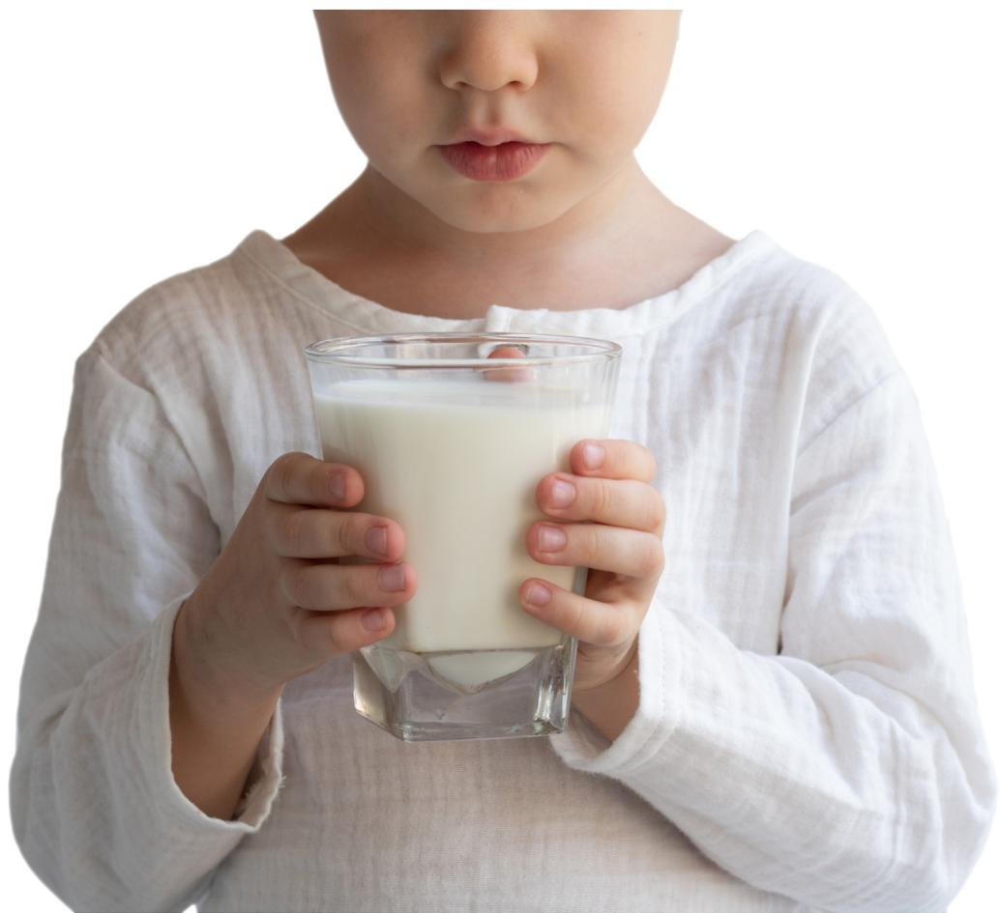
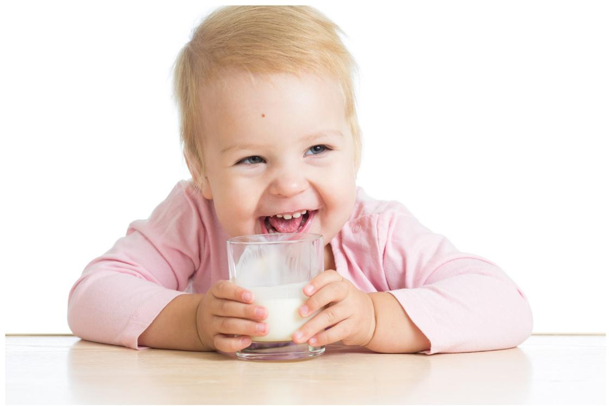

Open Access

# World Allergy Organization (WAO) Diagnosis and Rationale for Action against Cow’s Milk Allergy (DRACMA) Guidelines update – I – Plan and definitions

Alessandro Fiocchi, MDa\*, Antonio Bognanni, MDb, Jan Brozek, MD, PhD\_ c, Motohiro Ebisawa, MD, PhDd and Holger Schünemann, MDb,e, On behalf of the WAO DRACMA guideline group†

\*Corresponding author. Translational Research in Pediatric Specialities Area, Division of Allergy, Bambino Gesù Children’s Hospital, IRCCS, Piazza Sant’Onofrio, 4, Rome 00165, Italy E-mail: alessandro.fiocchi@allegriallergia. net

† Members of the WAO DRACMA guideline group: Ignacio J. Ansotegui, MD, PhD (Department of Allergy & Immunology, Hospital Quironsalud Bizkaia, Erandio, Bilbao, Spain); Stefania Arasi, MD, PhD (Translational Research in Pediatric Specialities Area, Division of Allergy, Bambino Gesù Children’s Hospital, IRCCS, Rome, Italy); Amal H. Assa’ad, MD (Division of Allergy and Immunology, Cincinnati Children’s Hospital Medical Center, Cincinnati, OH, USA); Sami L. Bahna, MD, DrPH (Allergy/Immunology Section, Louisiana State University Health Sciences Center, Shreveport, LA, USA); Roberto Berni Canani, MD, PhD (Department of Translational Medical Science, University of Naples Federico II, Naples, Italy); Antonio Bognanni, MD (Department of Health Research Methods, Evidence and Impact - HEI, McMaster University, Hamilton, ON, Canada); Martin Bozzola, MD (Department of Pediatrics, Pediatric Allergy/Immunology Section, British Hospital, Buenos Aires, Argentina); Jan Brozek, MD, PhD (Department of\_ Medicine, Division of Clinical Immunology and Allergy, Department of Clinical Epidemiology & Biostatistics, McMaster University Health Sciences Centre, Hamilton, ON, Canada); Derek K. Chu, MD, PhD (Department of Medicine, Division of Clinical Immunology and Allergy; Department of Clinical Epidemiology & Biostatistics, McMaster University Health Sciences Centre, Hamilton, ON, Canada); Lamia Dahdah, MD (Translational Research in Pediatric Specialities Area, Division of Allergy, Bambino Gesù Children’s Hospital, IRCCS, Rome, Italy); Christophe Dupont, MD, PhD (Paris Descartes University, Pediatric Gastroenterology, Necker Hospital, Paris, Clinique Marcel Sembat, Boulogne-Billancourt, France); Motohiro Ebisawa, MD, PhD (Clinical Research Center for Allergy and Rheumatology, National Hospital Organization Sagamihara National Hospital, Kanagawa, Japan); Alessandro Fiocchi, MD (Translational Research in Pediatric Specialities Area, Division of Allergy, Bambino Gesù Children’s Hospital, IRCCS, Rome, Italy); Ramon Targino Firmino MD (Faculty of Medical Sciences of Campina Grande, UNIFACISA University Centre, Campina Grande, Paraiba, Brazil); Elena Galli, MD, PhD (Pediatric Allergy Unit, Research Center, San Pietro-Fatebenefratelli Hospital, Rome, Italy); Rose Kamenwa, MD (Department of Pediatrics and Child Health, Aga Khan University Hospital, Nairobi, Kenya);

Gideon Lack, MBBCh (Department of Women and Children’s Health/Peter Gorer Department of Immunobiology, School of Life Course Sciences, Faculty of Life Sciences & Medicine, King’s College London, UK; Evelina London Children’s Hospital, Guy’s and St Thomas’ Hospital NHS Foundation Trust, London, UK), Haiqi Li, MD (Pediatric Division Department of Primary Child Care, Children’s Hospital, Chongqing Medical University, Chongqing, China); Alberto Martelli, MD (Italian Society of Pediatric Allergy and Immunology, Milano, Italy); Anna H. Nowak-Wegrzyn, MD, PhD (Department of Pediatrics, New York University Langone Health, New York, NY, USA; Department of Pediatrics, Gastroenterology and Nutrition, Collegium Medicum, University of Warmia and Mazury, Olsztyn, Poland); Nikolaos G. Papadopoulos, MD, PhD (Allergy Unit, 2nd Pediatric Clinic, University of Athens, Athens, Greece; Division of Infection, Immunity & Respiratory Medicine, University of Manchester, UK); Ruby Pawankar, MD, PhD (Department of Pediatrics, Nippon Medical School, Bunkyo-Ku, Tokyo, Japan); Maria Said, RN (Allergy & Anaphylaxis Australia (A&AA), Castle Hills, New South Wales, Australia); Mario Sánchez-Borges MD (Department of Allergy and Clinical Immunology, Centro Médico-Docente La Trinidad Caracas, Venezuela); Holger J. Schünemann, MD, MSc, PhD (Department of Health Research Methods, Evidence and Impact (HEI), McMaster University, Hamilton, ON, Canada, and Cochrane Canada and McMaster GRADE Centre, Hamilton, ON, Canada); Raanan Shamir, MD, PhD (Institute of Gastroenterology, Nutrition and Liver Disease, Schneider Children’s Medical Center, Petach-Tikva, Israel; Sackler Faculty of Medicine, Tel-Aviv University, Tel-Aviv, Israel); Jonathan M. Spergel, MD, PhD (Division of Allergy and Immunology, Department of Pediatrics, The Children’s Hospital of Philadelphia, Perelman School of Medicine at University of Pennsylvania, Philadelphia, PA, USA), Hania Szajewska, MD (The Medical University of Warsaw - Department of Paediatrics, Warsaw, Poland); Luigi Terracciano, MD (Italian NHS and Italian Society of Social and Preventive Pediatrics, Milano, Italy); Yvan Vandenplas, MD, PhD (Department of Pediatrics, UZ Brussel, Vrije Universiteit Brussel, Brussels, Belgium); Carina Venter, PhD, RD (Section of Allergy & Immunology, University of Colorado Denver School of Medicine, Children’s Hospital Colorado, Aurora, CO, USA); Amena Warner, RN, SN (PG Dip) (Allergy UK, Planwell House, Sidcup, Kent, UK); Susan Waserman, MD, MSc (Division of Clinical Immunology and Allergy, Department of Medicine, McMaster University, Hamilton, ON, Canada); Gary W. K. Wong, MD (Department of Paediatrics, Faculty of Medicine, The Chinese University of Hong Kong, Hong Kong, China)

http://doi.org/10.1016/j.waojou.2021.100609   
Received 7 July 2021; Received in revised from 8 October 2021; Accepted 4 November 2021   
Online publication date xxx   
1939-4551/© 2021 The Author(s). Published by Elsevier Inc. on behalf of World Allergy Organization. This is an open access article under the CC BY license (http://creativecommons.org/licenses/by/4.0/).

Fiocchi et al. World Allergy Organization Journal (2022) 15:100609   
http://doi.org/10.1016/j.waojou.2021.100609

## ABSTRACT

Since the World Allergy Organization (WAO) Diagnosis and Rationale against Cow’s Milk Allergy (DRACMA) Guidelines were published 10 years ago, new evidence has accumulated about the diagnosis, therapy, and specific immunotherapy for cow’s milk allergy (CMA). For this reason, WAO has felt the need to update the guidelines. We introduce here this update. The new DRACMA guidelines aim to comprehensively address the guidance on diagnosis and therapy of both IgE non-IgE-mediated forms of cow’s milk allergy in children and adults. They will be divided into 18 chapters, each of which will be dedicated to an aspect.The focus will be on the meta-analyzes and recommendations that will be expressed for the 3 most relevant clinical aspects: (a) the diagnostic identification of the condition; (b) the choice of the replacement formula in case of CMA in infancy when the mother is not able to breastfeed, and (c) the use of specific immunotherapy for cow’s milk protein allergy.

Keywords: Food allergy, Cow's milk allergy, Oral immunotherapy, GRADE

## INTRODUCTION

IgE-mediated cow’s milk protein allergy (IgE-CMA) has been a primary topic of interest for WAO since 2010, the year in which the first Grading of Recommendations Assessment, Development, and Evaluation (GRADE)-based guidelines on the management of this condition were published.1 Of notice, the World Allergy Organization (WAO) Diagnosis and Rationale against Cow’s Milk Allergy (DRACMA) Guidelines had a noticeable impact on clinical practice regarding IgE-CMA, raising awareness on several aspects.2

First, the DRACMA guidelines presented a more nuanced and comprehensive diagnostic process, which, despite being generally based on oral food challenges (OFCs), could be supplemented, and in some cases replaced by an appropriate use of other tests such as skin prick test (SPT) and specific IgE determination (sIgE). The decision of which approach should be employed required an high-degree of personal contextualization, both depending on the specific circumstances and the values and preferences of the clinicians/patients.

Second, the guidelines pointed out the necessity by infants aged <2 years of a substitutive formula whenever their mother could not breastfeed, with the best choice being frequently cow’s milk extensively Hydrolyzed Formula (eHF). Where available, Hydrolyzed Rice Formula (HRF) was considered equivalent, while Amino Acid Formulae (AAF) was to be reserved for the most severe cases. Soy formulae were generally deemed not to be a first choice, while milk from other mammals (eg, donkey, camel, mare, sheep, and ewe) was not to be used given the mismatch with the infants’ nutritional needs. Also in this case, the choice should rely on the context, and the values and preferences of the clinicians/patients.

Third, Oral Immunotherapy (OIT) with milk was considered as an experimental procedure, not suitable for routine clinical practice.3

Ten years later, despite the DRACMA methods still being valid,4 the scenario has dramatically evolved, prompting an update in guidance. Differently from other food allergies, reported by many as increasingly prevalent, CMA appears to have not undergone this trajectory.5,6 Even so, milk allergy remains a priority concern for allergists and pediatrician worldwide, with dairy anaphylaxis being now more common than peanut anaphylaxis, and the most frequently associated to lethal allergic reactions, as shown in a recent review on school-aged children with CMA.7

We introduce herein the updated DRACMA guidelines. We aim to illustrate the progress in diagnosis, therapy, and immunotherapy of IgE-CMA that could tailor the management of CMA. We will shortly indicate the guidelines published after DRACMA, over the decade 2010/2020.

Finally, we will present the structure of the reviewed guidelines that took place between 2016 and 2021 and whose publication begins with this issue of the World Allergy Organization Journal. The new DRACMA guidelines aim to comprehensively address the guidance on diagnosis and therapy of both IgE non-IgE-mediated forms of CMA.

## 2010–2020: OPEN QUESTIONS IN DIAGNOSIS, THERAPY, AND IMMUNOTHERAPY OF CMA

The diagnosis was preached by the DRACMA guidelines on the use of the OFC as a "gold standard" for IgE-CMA. This somewhat bombastic definition emphasize the need of a scientifically correct diagnosis, in order to prevent CMA overdiagnosis. The OFC certainly retains its validity, but over the years, its limitations have become increasingly evident. For example, OFC results are not predictive of the severity of subsequent reactions.8 Also, there is no direct correlation between the eliciting threshold experienced by children during an OFC and the reaction’s severity upon accidental exposure.9 Tools such as the Basophil Activation Test (BAT) have been developed to minimize the risk of severe reactions to the OFC,10,11 being also proposed as replacement tests of the OFC.12 In addition, serious reactions to the OFC have been described, up to a case of fatal reaction.13 These considerations will affect the direction of recommendations formulated by the guideline panel for the diagnosis of IgE mediated allergy. Other challenges inherent the diagnosis of IgE-CMA are the reassessment of the role of total and specific IgE assay, the interpretation of skin tests, and the possible role of molecular testing in diagnostic evaluation.14,15

Finally, as about 70% of IgE-CMA patients are found to tolerate baked milk, the latter might be considered for a role in the CMA diagnostic pathway, prior to fresh milk testing16

The elimination diet for milk, which prepares the OFC in IgE-mediated food allergy, completely replaces it in most guidelines for the diagnosis of non IgE-mediated CMA (non-IgE-CMA).17 We will see later how this might have profound influence over the epidemiologic estimates of the disease, which will be among the priority topics to be addressed in the new DRACMA guidelines. Specifically, we will try to address in an evidence-based manner the following questions: Should an elimination diet be followed by OFC in the individuals suspected of non-IgEmediated CMA? Is there any use of atopy patch test to milk in these children? Is there any role for endoscopy biopsy in children with suspected milk-induced Eosinophilic Esophagitis (EoE) or non-esophageal Eosinophilic Gastrointestinal Disorders (EGIDs), including eosinophilic gastroenteritis and colitis? Are the diagnostic challenge procedures, recommended by specific guidelines for Food-Protein-Induced Enterocolitis Syndrome (FPIES),18 adequately informed by evidence?

In synthesis, reconciling the diagnostic procedures for the different forms of CMA will be a challenge for the new DRACMA guidelines.19

A peculiar issue to consider, in the treatment of CMA, given the pivotal importance of maternal milk for children up to 24/36 months of age, is to confirm the evidence underlying the suggestion of cow’s milk (CM) elimination diet for mothers breastfeeding allergic infants.20 In the past 10 years, the involvement of formulas in the management of CMA has been profoundly expanded, with extensively hydrolyzed formulas (eHFs),21 rice hydrolyzed formula (HRF),22 amino acid formulae (AAF),23 camel and dromedary milk,24 and donkey milk25 receiving increasing attention from the health community and being implemented in medical practice. To properly represent the change of the topic, we will update the systematic review investigating the effect of formulas in the management of CMA.

Another important aspect to account for is the reported effect of associating probiotics with formulas, either administered separately or mixed in the same formulation, on the duration of IgE-CMA.26,27 Another issue that will be investigated is the employment of new synbiotic-supplemented amino acid-based formulas.28,29

<table><tr><td rowspan=1 colspan=1>Country/region</td><td rowspan=1 colspan=1>Issuing scientificsociety</td><td rowspan=1 colspan=1>Guidelineidentification</td><td rowspan=1 colspan=1>DRACMAbased?</td><td rowspan=1 colspan=1>Main characteristics</td><td rowspan=1 colspan=1>Ref.</td></tr><tr><td rowspan=1 colspan=1>Europe</td><td rowspan=1 colspan=1>ESPGHAN</td><td rowspan=1 colspan=1>ESPGHAN CMPAguidelines</td><td rowspan=1 colspan=1>No</td><td rowspan=1 colspan=1>Focus on non-IgE CMA</td><td rowspan=1 colspan=1>39</td></tr><tr><td rowspan=1 colspan=1>Europe</td><td rowspan=1 colspan=1>European Academy ofAllergy and ClinicalImmunology (EAACI)</td><td rowspan=1 colspan=1>EAAC! food allergyguidelines</td><td rowspan=1 colspan=1>No</td><td rowspan=1 colspan=1>Not limited to CMA</td><td rowspan=1 colspan=1>40</td></tr><tr><td rowspan=1 colspan=1>France</td><td rowspan=1 colspan=1>Société Française dePédiatrie</td><td rowspan=1 colspan=1>Dietetic treatment ofcow&#x27;s milk proteinallergy.</td><td rowspan=1 colspan=1>No</td><td rowspan=1 colspan=1>Limited to treatment</td><td rowspan=1 colspan=1>41</td></tr><tr><td rowspan=1 colspan=1>Italy</td><td rowspan=1 colspan=1>Emilian Working Groupon Pediatric Allergyand Gastroenterology</td><td rowspan=1 colspan=1>A practical guide</td><td rowspan=1 colspan=1>No</td><td rowspan=1 colspan=1>Focus on diagnosis andmanagement inprimary care</td><td rowspan=1 colspan=1>42</td></tr><tr><td rowspan=1 colspan=1>Italy</td><td rowspan=1 colspan=1>Italian Society ofPediatric Allergy</td><td rowspan=1 colspan=1>DRACMA</td><td rowspan=1 colspan=1>Yes</td><td rowspan=1 colspan=1>Italian translation</td><td rowspan=1 colspan=1>43</td></tr><tr><td rowspan=1 colspan=1>UnitedKingdom</td><td rowspan=1 colspan=1>National Institute forHealth and CareExcellence (NICE)</td><td rowspan=1 colspan=1>MAP (Milk Allergy inPrimary Care)</td><td rowspan=1 colspan=1>No</td><td rowspan=1 colspan=1>Focus on non IgE-CMAin primary care</td><td rowspan=1 colspan=1>44</td></tr><tr><td rowspan=1 colspan=1>UnitedKingdom</td><td rowspan=1 colspan=1>NICE-derived</td><td rowspan=1 colspan=1>i-MAP (internationalMAP)</td><td rowspan=1 colspan=1>Partly</td><td rowspan=1 colspan=1>Focus on non IgE CMAin primary care</td><td rowspan=1 colspan=1>45</td></tr><tr><td rowspan=1 colspan=1>UnitedKingdom</td><td rowspan=1 colspan=1>British Society forAllergy and ĆlinicalImmunology (BSACI)</td><td rowspan=1 colspan=1>BSACI cow&#x27;s milkallergy guideline</td><td rowspan=1 colspan=1>No</td><td rowspan=1 colspan=1>Comprehensive</td><td rowspan=1 colspan=1>46</td></tr><tr><td rowspan=1 colspan=1>UnitedKingdom</td><td rowspan=1 colspan=1>NICE-derived</td><td rowspan=1 colspan=1>Updated i-MAP(international MAP)</td><td rowspan=1 colspan=1>Partly</td><td rowspan=1 colspan=1>Focus on CMA inprimary care</td><td rowspan=1 colspan=1>47</td></tr><tr><td rowspan=1 colspan=1>Finland2008</td><td rowspan=1 colspan=1>Finnish AllergyProgramme-2018</td><td rowspan=1 colspan=1>Practicalrecommendations ofthe Finnish AllergyProgramme 2008–2018for prevention,diagnosis, andtreatment</td><td rowspan=1 colspan=1>No</td><td rowspan=1 colspan=1>CMA as part of foodallergy management inchildren</td><td rowspan=1 colspan=1>48</td></tr><tr><td rowspan=1 colspan=1>Spain</td><td rowspan=1 colspan=1>Spanish Society ofPediatric ClinicalImmunology andAllergology (SEICAP)</td><td rowspan=1 colspan=1>Spanish CM guideline</td><td rowspan=1 colspan=1>Partly</td><td rowspan=1 colspan=1>Comprehensive</td><td rowspan=1 colspan=1>49</td></tr><tr><td rowspan=1 colspan=1>Spain</td><td rowspan=1 colspan=1>Spanish Society ofPaediatricGastroenterology,Hepatology, andNutrition (SÉGHNP),Spanish Association ofPaediatric Primary Care(AEPAP), SpanishŠociety of Extra-hospital Paediatricsand Primary HealthCare (SEPEAP), and the</td><td rowspan=1 colspan=1>Spanish CM guidelinefor non IgE-mediatedCMA</td><td rowspan=1 colspan=1>No</td><td rowspan=1 colspan=1>Focus on non IgE CMA</td><td rowspan=1 colspan=1>50</td></tr></table>

(continued)

<table><tr><td rowspan=1 colspan=1>Country/region</td><td rowspan=1 colspan=1>Issuing scientificsociety</td><td rowspan=1 colspan=1>Guidelineidentification</td><td rowspan=1 colspan=1>DRACMAbased?</td><td rowspan=1 colspan=1>Main characteristics</td><td rowspan=1 colspan=1>Ref.</td></tr><tr><td rowspan=1 colspan=1></td><td rowspan=1 colspan=1>Spanish Society ofPaediatric ClinícaLImmunology, Allergy,and Asthma (SEICÃP)</td><td rowspan=1 colspan=1></td><td rowspan=1 colspan=1></td><td rowspan=1 colspan=1></td><td rowspan=1 colspan=1></td></tr><tr><td rowspan=1 colspan=1>Turkey</td><td rowspan=1 colspan=1>Turkish Society ofPediatrics</td><td rowspan=1 colspan=1>Turkish Consensus</td><td rowspan=1 colspan=1>Partly</td><td rowspan=1 colspan=1>Focus on primary care</td><td rowspan=1 colspan=1>51</td></tr><tr><td rowspan=1 colspan=1>MiddleEast</td><td rowspan=1 colspan=1>Independent group</td><td rowspan=1 colspan=1>Middle East consensus</td><td rowspan=1 colspan=1>Yes</td><td rowspan=1 colspan=1>Focus on primary care</td><td rowspan=1 colspan=1>52</td></tr><tr><td rowspan=1 colspan=1>India</td><td rowspan=1 colspan=1>Indian Society ofPediatricGastroenterology,Hepatology andNutrition</td><td rowspan=1 colspan=1>Indian Consensus</td><td rowspan=1 colspan=1>No</td><td rowspan=1 colspan=1>Focus on primary care</td><td rowspan=1 colspan=1>17</td></tr><tr><td rowspan=1 colspan=1>China</td><td rowspan=1 colspan=1>World Allergy,Organization (WAO)</td><td rowspan=1 colspan=1>DRACMA</td><td rowspan=1 colspan=1>Yes</td><td rowspan=1 colspan=1>Mandarin translation</td><td rowspan=1 colspan=1>53</td></tr><tr><td rowspan=1 colspan=1>China</td><td rowspan=1 colspan=1>Independent group</td><td rowspan=1 colspan=1>Intensive DRACMAreading</td><td rowspan=1 colspan=1>Yes</td><td rowspan=1 colspan=1>Implementation inChina</td><td rowspan=1 colspan=1>54</td></tr><tr><td rowspan=1 colspan=1>Japan</td><td rowspan=1 colspan=1>Japanese Society ofPediatric Allergy andClinical Immunology(JSPACI); JapaneseŠociety of Allergology(JSA)</td><td rowspan=1 colspan=1>Japanese guidelines</td><td rowspan=1 colspan=1>Partly</td><td rowspan=1 colspan=1>Not limited to CMA</td><td rowspan=1 colspan=1>55</td></tr><tr><td rowspan=1 colspan=1>Mexico</td><td rowspan=1 colspan=1>Independent group</td><td rowspan=1 colspan=1>GL-APLV</td><td rowspan=1 colspan=1>Partly</td><td rowspan=1 colspan=1>Comprehensive</td><td rowspan=1 colspan=1>56</td></tr><tr><td rowspan=1 colspan=1>SouthAmerica</td><td rowspan=1 colspan=1>World Allergy,Organization (WAO)</td><td rowspan=1 colspan=1>DRACMA</td><td rowspan=1 colspan=1>Yes</td><td rowspan=1 colspan=1>Spanish translation</td><td rowspan=1 colspan=1>57</td></tr></table>

Table 1. Main consensus, position papers, and guidelines produced worldwide between 2010 and 2020

Over the course of the last decade, several advances have been done in developing novel protocols of CM oral immunotherapy, with the most notable examples being the weekly30 or slow updosing regimens,31 the rapid oral desensitization combined with omalizumab,32 different maintenance feeding regimens,33 and baked milk oral immunotherapy34–36

Previous systematic reviews investigating this aspect of IgE-CMA management were published in 2012 and 2017 including, but not limited to, OIT for IgE-CMA.37,38 The systematic review and guideline publication focusing on this topic will be the first among the 2021 DRACMA-related publications.

## CMA GUIDELINES PUBLISHED AFTERDRACMA

Since the first edition of DRACMA, other guidelines, consensuses, and position papers have been issued on CMA at the regional or national level. Some of them were national guidance items, implementing locally the DRACMA guidelines, others were de novo publications, developed using different methodologies. We report in Table 1 a list of the main CMA guidelines published over the course of the past 10 years.

Among the publications above, the one most implemented is the UK NICE – derived guideline, the iMAP guideline. It includes an algorithm for the diagnostic and therapeutic approaches, based on the heterogeneous clinical manifestations of CMA (both non-IgE and IgE).45 Interestingly, the diagnostic process for CMA accounts for a diagnosis not confirmed through OFC, given that a series of conditions are met (improvement on a strict cow’s milk protein-free elimination diet for at least 2 weeks; clinical relapse on subsequent cow’s milk open challenge), possibly leading to an overestimation of non-IgE-CMA. After their implementation in Northern Ireland, the use of hypoallergenic formulas largely increased, exceeding the expected epidemiological figures58,59

<table><tr><td rowspan=1 colspan=1></td><td rowspan=1 colspan=1>Topic</td><td rowspan=1 colspan=1>Method ofpreparation</td></tr><tr><td rowspan=1 colspan=1>General</td><td rowspan=1 colspan=1></td><td rowspan=1 colspan=1></td></tr><tr><td rowspan=1 colspan=1>1.</td><td rowspan=1 colspan=1>Overview and definitions</td><td rowspan=1 colspan=1>This paper</td></tr><tr><td rowspan=1 colspan=1>2.</td><td rowspan=1 colspan=1>CMA epidemiology and natural history</td><td rowspan=1 colspan=1>Narrative review</td></tr><tr><td rowspan=1 colspan=1>3.</td><td rowspan=1 colspan=1>CM allergens and immunologic mechanisms</td><td rowspan=1 colspan=1>Narrative review</td></tr><tr><td rowspan=1 colspan=1>4.</td><td rowspan=1 colspan=1>Clinical presentations: IgE-mediated</td><td rowspan=1 colspan=1>Narrative review</td></tr><tr><td rowspan=1 colspan=1>5.</td><td rowspan=1 colspan=1>Clinical presentations: non IgE-mediated</td><td rowspan=1 colspan=1>Narrative review</td></tr><tr><td rowspan=1 colspan=1>6.</td><td rowspan=1 colspan=1>Comparison among different guidelines</td><td rowspan=1 colspan=1>Systematic review</td></tr><tr><td rowspan=1 colspan=1>7.</td><td rowspan=1 colspan=1>DRACMA methodology</td><td rowspan=1 colspan=1>Synthesis of methods</td></tr><tr><td rowspan=1 colspan=1>CMAdiagnosis</td><td rowspan=1 colspan=1></td><td rowspan=1 colspan=1></td></tr><tr><td rowspan=1 colspan=1>8.</td><td rowspan=1 colspan=1>Diagnosis of CMA</td><td rowspan=1 colspan=1>Systematic review</td></tr><tr><td rowspan=1 colspan=1>9.</td><td rowspan=1 colspan=1>Recommendations on CMA diagnosis</td><td rowspan=1 colspan=1>Guideline</td></tr><tr><td rowspan=1 colspan=1>Treatmentoptions</td><td rowspan=1 colspan=1></td><td rowspan=1 colspan=1></td></tr><tr><td rowspan=1 colspan=1>10.</td><td rowspan=1 colspan=1>Breastfeeding a baby with CMA</td><td rowspan=1 colspan=1>Narrative review</td></tr><tr><td rowspan=1 colspan=1>11.</td><td rowspan=1 colspan=1>Substitutive formulae</td><td rowspan=1 colspan=1>Systematic review</td></tr><tr><td rowspan=1 colspan=1>12.</td><td rowspan=1 colspan=1>Recommendations on substitutive treatment</td><td rowspan=1 colspan=1>Guideline</td></tr><tr><td rowspan=1 colspan=1>13.</td><td rowspan=1 colspan=1>Oral Immunotherapy for CMA</td><td rowspan=1 colspan=1>Systematic review</td></tr><tr><td rowspan=1 colspan=1>14.</td><td rowspan=1 colspan=1>Recommendations on CMA OIT</td><td rowspan=1 colspan=1>Guideline</td></tr><tr><td rowspan=1 colspan=1>15.</td><td rowspan=1 colspan=1>Other milks (goat&#x27;s, ewe&#x27;s, mare&#x27;s, donkey&#x27;s, camel&#x27;s, andsubstitutes from non-animal sources)</td><td rowspan=1 colspan=1>Narrative review</td></tr><tr><td rowspan=1 colspan=1>16.</td><td rowspan=1 colspan=1>Nutritional considerations in CMA infants</td><td rowspan=1 colspan=1>Narrative review</td></tr><tr><td rowspan=1 colspan=1>Conclusions</td><td rowspan=1 colspan=1></td><td rowspan=1 colspan=1></td></tr><tr><td rowspan=1 colspan=1>17.</td><td rowspan=1 colspan=1>Which is the 1st choice formula case by case?</td><td rowspan=1 colspan=1>Synthesis ofrecommendations</td></tr><tr><td rowspan=1 colspan=1>18.</td><td rowspan=1 colspan=1>Unmet needs. Recommendations for research.Recommendation for the implementation of the DRACMAguidelines. Periodical update of DRACMA.</td><td rowspan=1 colspan=1>Synthesis ofrecommendations</td></tr></table>

Table 2. Plan of the DRACMA publications

The quality of guidelines on CMA, published between 2010 and 2015, was assessed through the Appraisal of Guidelines for Research and Evaluation (AGREE II) tool.60 The appraisal highlighted the lack of a defined quality standard, as only 3 presented satisfactory scores across the key domains. In light of this, in the present update of the DRACMA guidelines we strive to adhere to the highest methodological standards in the evaluation of evidence and its translation into recommendations.

## METHODS APPLIED IN THE 2021 DRACMA GUIDELINES

We followed the Grading of Recommendations Assessment, Development, and Evaluation (GRADE) approach {PMID: 21195583} and the European Commission methods for developing practice guidelines.61 WAO established a multidisciplinary guideline panel (DRACMA Scientific Committee) composed of content experts and representatives of key stakeholders, including patient representatives, nutritionists, and general practitioners. All panel members declared their actual, potential, and/or perceived competing interests. Those were reviewed by an anonymous WAO committee that decided which panel members should abstain from voting on selected recommendations related to immunotherapy, formulas, and diagnosis of CMA.

A group of methodology experts from the McMaster GRADE Centre performed systematic reviews of the evidence and led the process of developing recommendations.

The DRACMA guideline panel generated a set of 61 questions and determined their priority to be answered with recommendations (Supplementary material). The methodology group performed necessary systematic reviews and prepared GRADE summary of findings tables. The voting panel members followed the evidence-todecision (EtD) framework to develop recommendations either by in-person or online discussion following the modified Delphi approach. We published all decisions and the rationale for the recommendations as appendices to the guidelines.

## GENERAL STRUCTURE OF THE 2021 DRACMA GUIDELINES

The original guideline comprised 19 chapters merged into a single publication. This time we decided to publish the chapters separately in a dedicated series in the World Allergy Organization Journal to facilitate the dissemination and the implementation of the guideline. For this reason the chapters have been separated, and every topic will be published in a single article.

Table 2 shows the publication plan. Due to peer review process, the articles will not necessarily be published in the order indicated. We will start with the guidelines on OIT, those for which a greater harvest of new data has been produced. The guideline is submitted together with the metanalysis supporting it. Other articles will be published regularly, so that the project will configure a Summa of the relevant information about CMA.

## GLOSSARY OF CMA

In developing the metanalyses and the guidelines, we adhered to the following definitions:

\- Cow’s milk hypersensitivity indicates nonallergic hypersensitivity (traditionally termed “cow’s milk intolerance”) and allergic milk hypersensitivity

\- Cow’s milk allergy (CMA) indicates “a hypersensitivity reaction initiated by specific immunological mechanisms”62

\- IgE-mediated CMA (IgE-CMA) indicates a hypersensitivity reaction to cow’s milk proteins initiated by specific Immunoglobulin E binding to Fcε receptors on effector cells as mast cells and basophils. This causes release of histamine and other preformed mediators, and rapid symptom onset. 63

\- Non IgE-mediated CMA (non-IgE-CMA) indicates a hypersensitivity reaction to cow’s milk proteins initiated by non-IgE mediated (mainly cell-mediated) mechanisms. Non-IgE-mediated milk reactions are typically delayed in onset

\- Anaphylaxis is defined according to the amended WAO criteria for the diagnosis of anaphylaxis.64

Many other definitions of clinical presentations and pathologic mechanisms have been adopted during the development of the guidelines. When necessary, they will be specified in the respective papers.

## WHAT IS NEXT

One of the determinants of the profound heterogeneity in the management of CMA consists in the wide spectrum of professional figures (paediatrician, allergists, gastroenterologists, and so forth) dealing with it. Another is the contradictory guidance provided by a large number of guidelines and position papers. As a consequence, the 2021 updated DRACMA guidelines aim to comprehensively address the diagnostic and therapeutic fields of CMA, harmonizing the collaboration between the various specialist figures.

By their very nature, guidelines make clarity. Clarity is bound to reduce both underdiagnosis and especially overdiagnosis of CMA. We hope we have done the allergy community a good service, and we apologize right now if something went wrong.

## MARIO SÁNCHEZ-BORGES

Before proceeding with the publication of the guidelines, we want to celebrate the remarkable life and academic accomplishments of one of our fellow authors. Mario Sánchez-Borges, MD, was a true leader for the entire international allergy community, without whose guidance and contribution, the realization of these guidelines would not have been possible. As a previous WAO president (2016–2017) and Councilor, Mario has been an impulse and prime mover of DRACMA. He participated in the drafting of all the parts that will report him as author. His kindness and generosity will stay unperished, living through the numerous and joyful memories he left in so many of us.

## Consent to publish

All authors agree to the publication of this manuscript in World Allergy Organization Journal.

## Ethics statement

This manuscript is an editorial. It did not involve human subjects.

## Author contributions

AF initiated the concept and contributed made the first draft. AB, JB, ME, and HS participated in the development of the document. All authors reviewed and approved the final manuscript.

## Funding

This document was supported by the World Allergy Organization.

## Declaration of competing interest

S Arasi, S Bahna, Bognanni, J Brozek, D Chu, L Dahdah, E\_ Galli, R Kamenwa, H Li, A Martelli, R Pawankar, H Schünemann, R Targino, L Terracciano, and A Warner have no conflicts to disclose. Relationships reported related to the submitted work: IJ Anstotegui – Abbott, Amgen, Astra Zeneca, Bayer, Bial, Faes Farma, Hikma, Menarini, Merck, Mundipharma, Roxall, Sanofi, Stallergenes, UCB. A Assa’ad – Aimmune Therapeutics, DBV Technologies, Astella, ABBVIE, Novartis, Sanofi, FARE, NIH and an intellectual property patent licensed to Hoth. R Berni Canani – Ch.Hansen, Danone, DVB, Humana, iHealth, Kraft Heinz, Mead Johnson, Nestlè, Novalac, Nutricia, Sanofi. M Bozzola – Danone C Dupont – Nestle Health Science, Nestle France, Nutricia, Novalac, Sodilac, Abbott, Danone, and stock ownership at DBV Technologies. M Ebisawa – DBV Technologies, Mylan, ARS Pharmaceuticals, Novartis. A Fiocchi – Abbott, Danone. G Lack – FARE, National Peanut Board (NPB), The Davis Foundation, Action Medical Research, UK Food Standards Agency, Medical Research Council, DBV Technologies, Mission Mighty Me, Novartis, Sanofi-Genyzme, Regeneron, ALK-Abello, Lurie Children’s Hospital. A Nowak-Wegrzyn – Nestle, Nutricia, Novartis, Gerber, Aimmune. N Papadopoulos – Novartis, Nutricia, HAL Allergy, Menarini/Faes Farma, Sanofi, Mylan/Meda, Biomay, AstraZeneca, GSK, MSD, ASIT Biotech, Boehringer Ingelheim, Gerolymatos International SA, Capricare. M Said – Nestle, Nutricia, Abbott, Bayer for Anaphylaxis Australia. J Spergel – DBV Technologies, Regeneron, Sanofi, and Aimmune. H Szajewska – Ausnutria, Cargill, Danone, Else Nutrition, Hipp, Nestle, and Nestle Nutrition Institute. Y Vandenplas – Abbott Nutrition, Biogaia, Biocodex, By Heart, CHR Hansen, Danone, ELSE Nutrition, Friesland Campina, Hero, Hypocrata, Nestle Health Science, Nestle Nutrition Institute, Nutricia, Mead Johnson Nutrition, Orafti, Phacobel, Phathom Pharmaceuticals, Sari Husada, United Pharmaceuticals (Novalac), Wyeth, Yakult. C Venter – Reckitt Benckiser, Nestle Nutrition Institute, Danone, Abbott Nutrition, Else Nutrition, and Before Brands, DBV Technologies. S Waserman – Novartis-basic science work on peanut allergy, Aimmune-peanut OIT trial, Medical Advisor to Food Allergy Canada, and Pfizer, Bausch, Kaleoconsultant for epinephrine autoinjectors. GWK Wong – Nestle, Danone.

## Acknowledgement

Mario Sánchez Borges, MD, of Caracas, Venezuela, and a Past President of the World Allergy Organization (2016– 2017), was a major contributor to the development of the guidelines until his death in early 2021. His contributions to the field are immense. He will be greatly missed both professionally and personally.

## Appendix A. Supplementary data

Supplementary data to this article can be found online at https://doi.org/10.1016/j.waojou.2021.100609.

## REFERENCES

1. Fiocchi A, Brozek J, Schünemann H, et al. World Allergy Organization (WAO) Diagnosis and Rationale for Action against Cow’s Milk Allergy (DRACMA) Guidelines. World Allergy Organ J. 2010;3:57–161.

2. Dahdah L, Arasi S, Valluzzi RL, Fierro V, Fiocchi A. How guideline can shape clinical practice globally: the diagnosis and rationale for action against cow’s milk allergy experience. Curr Opin Allergy Clin Immunol. 2019;19:185–191.

3. Brozek JL, Terracciano L, Hsu J, et al. Oral immunotherapy for\_ IgE-mediated cow’s milk allergy: a systematic review and metaanalysis. Clin Exp Allergy. 2012;42:363–374.

4. Ruszczynski M, Horvath A, Dziechciarz P, Szajewska H. Cow- ’s milk allergy guidelines: a quality appraisal with the AGREE II instrument. Clin Exp Allergy. 2016;46:1236–1241.

5. Sicherer SH, Sampson HA. Food allergy: a review and update on epidemiology, pathogenesis, diagnosis, prevention, and management. J Allergy Clin Immunol. 2018;141:41–58.

6. Flom JD, Sicherer SH. Epidemiology of cow’s milk allergy. Nutrients. 2019;11:1051.

7. Baseggio Conrado A, Patel N, Turner PJ. Global patterns in anaphylaxis due to specific foods: a systematic review. J Allergy Clin Immunol. 2021. Epub ahead of print.

8. Pettersson ME. Prediction of the severity of allergic reactions to foods. Allergy. 2018;73:1532–1540.

9. Eigenmann PA, Ebisawa M, Greenhawt M, et al. Addressing risk management difficulties in children with food allergies. Pediatr Allergy Immunol. 2021;32:658–666.

10. Santos AF, Du Toit G, O’Rourke C, et al. Biomarkers of severity and threshold of allergic reactions during oral peanut challenges. J Allergy Clin Immunol. 2020;146:344–355.

11. Kawahara T. Risk prediction of severe reaction to oral challenge test of cow’s milk. Eur J Pediatr. 2019;178:181–188.

12. Santos AF, Brough HA. Making the most of in vitro tests to diagnose food allergy. J Allergy Clin Immunol Pract. 2017;5: 237–248.

13. Statement by the American College of Allergy, Asthma & Immunology, American Academy of Allergy, Asthma & Immunology, and the Canadian Society of Allergy and Clinical Immunology. Allergists respond to death of 3 year-old boy during oral food challenge; 2017. Available from: https://acaai.

org/allergists-respond-death-3-year-old-boy-during-oral-foodchallenge. Accessed October 7, 2021.

14. Fiocchi A, Nowak-Wegrzyn A. The fascinating world of molecular Îdiagnosis in the management offood allergy: nondum matura est. Curr Opin Allergy Clin Immunol. 2011;11:200–203.

15. Foong RX, Dantzer JA, Wood RA, Santos AF. Improving diagnostic accuracy in food allergy. J Allergy Clin Immunol Pract. 2021;9:71–80.

16. Kim JS. Dietary baked milk accelerates the resolution of cow’s milk allergy in children. J Allergy Clin Immunol. 2011;128(1): 125–131.

17. Matthai J, Sathiasekharan M, Poddar U, et al. Indian Society of Pediatric Gastroenterology, Hepatology and Nutrition; Pediatric Gastroenterology Chapter of Indian Academy of Pediatrics. Guidelines on Diagnosis and Management of Cow’s Milk Protein Allergy. Indian Pediatr. 2020;57:723–729.

18. Nowak-Wegrzyn A, Chehade M, Groetch ME, et al. International consensus guidelines for the diagnosis and management of food protein-induced enterocolitis syndrome: executive summary-workgroup report of the adverse reactions to foods committee, American Academy of Allergy, Asthma & Immunology. J Allergy Clin Immunol. 2017;139:1111–1126.

19. Dahdah L, Fierro V, Mennini M, Arasi S, Fiocchi A. What’s next for DRACMA? Expert Rev Clin Immunol. 2018;14:649–651.

20. Munblit D, Perkin MR, Palmer DJ, Allen KJ, Boyle RJ. Assessment of evidence about common infant symptoms and cow’s milk allergy. JAMA Pediatr. 2020 Jun 1;174(6):599– 608.

21. Strózyk A, Horvath A, Meyer R, Szajewska H. Ef\_ ficacy and safety of hydrolyzed formulas for cow’s milk allergy management: a systematic review of randomized controlled trials. Clin Exp Allergy. 2020;50:766–779.

22. Vandenplas Y, De Greef E, Hauser B, Paradice Study Group. Safety and tolerance of a new extensively hydrolyzed rice protein-based formula in the management of infants with cow’s milk protein allergy. Eur J Pediatr. 2014;173:1209–1216.

23. Fierro V, Valluzzi RL, Banzato C, et al. A well-tolerated new amino acid-based formula for cow’s milk allergy. Immun Inflamm Dis. 2020;8:140–149.

24. Maryniak NZ, Hansen EB, Ballegaard AR, Sancho AI, Bøgh KL. Comparison of the Allergenicity and Immunogenicity of Camel and Cow’s Milk-A Study in Brown Norway Rats. Nutrients. 2018;10:1903.

25. Sarti L, Martini M, Brajon G, et al. Donkey’s Milk in the Management of Children with Cow’s Milk protein allergy: nutritional and hygienic aspects. Ital J Pediatr. 2019;45:102.

26. Berni Canani R, Di Costanzo M, Bedogni G, et al. Extensively hydrolyzed casein formula containing Lactobacillus rhamnosus GG reduces the occurrence of other allergic manifestations in children with cow’s milk allergy: 3-year randomized controlled trial. J Allergy Clin Immunol. 2017;139:1906–1913.

27. Scalabrin D, Harris C, Johnston WH, Berseth CL. Long-term safety assessment in children who received hydrolyzed protein formulas with Lactobacillus rhamnosus GG: a 5-year follow-up. Eur J Pediatr. 2017;176:217–224.

28. Candy DCA, Van Ampting MTJ, Oude Nijhuis MM, et al. A synbiotic-containing amino-acid-based formula improves

gut microbiota in non-IgE-mediated allergic infants. Pediatr Res. 2018;83:677–686.

29. Fox AT, Wopereis H, Van Ampting MTJ, et al, ASSIGN study group. A specific synbiotic-containing amino acid-based formula in dietary management of cow’s milk allergy: a randomized controlled trial. Clin Transl Allergy. 2019;9:5.

30. Pajno GB, Caminiti L, Ruggeri P, et al. Oral immunotherapy for cow’s milk allergy with a weekly up-dosing regimen: a randomized single-blind controlled study. Ann Allergy Asthma Immunol. 2010;105:376–381.

31. Kaneko H, Teramoto T, Kondo M, et al. Efficacy of the slow dose-up method for specific oral tolerance induction in children with cow’s milk allergy: comparison with reported protocols. J Investig Allergol Clin Immunol. 2010;20:538–539.

32. Nadeau KC, Schneider LC, Hoyte L, Borras I, Umetsu DT. Rapid oral desensitization in combination with omalizumab therapy in patients with cow’s milk allergy. J Allergy Clin Immunol. 2011;127:1622–1624.

33. Pajno GB, Caminiti L, Salzano G, et al. Comparison between two maintenance feeding regimens after successful cow’s milk oral desensitization. Pediatr Allergy Immunol. 2013;24:376– 381.

34. Goldberg MR, Nachshon L, Appel MY, et al. Efficacy of baked milk oral immunotherapy in baked milk-reactive allergic patients. J Allergy Clin Immunol. 2015;136:1601–1606.

35. Kim JS, Nowak-Wegrzyn A, Sicherer SH, Noone S, Moshier EL, ÎSampson HA. Dietary baked milk accelerates the resolution of cow’s milk allergy in children. J Allergy Clin Immunol. 2011;128:125–131.

36. Dang TD, Peters RL, Allen KJ. Debates in allergy medicine: baked egg and milk do not accelerate tolerance to egg and milk. World Allergy Organ J. 2016;9:2.

37. Yeung JP, Kloda LA, McDevitt J, Ben-Shoshan M, Alizadehfar R. Oral immunotherapy for milk allergy. Cochrane Database Syst Rev. 2012;11:CD009542.

38. Nurmatov U, Dhami S, Arasi S, et al. Allergen immunotherapy for IgE-mediated food allergy: a systematic review and metaanalysis. Allergy. 2017;72:1133–1147.

39. Koletzko S, Niggemann B, Arato A, et al. European Society of Pediatric Gastroenterology, Hepatology, and Nutrition. Diagnostic approach and management of cow’s-milk protein allergy in infants and children: ESPGHAN GI Committee practical guidelines. J Pediatr Gastroenterol Nutr. 2012;55: 221–229.

40. Muraro A, Werfel T, Hoffmann-Sommergruber K, et al. EAACI food allergy and anaphylaxis guidelines: diagnosis and management of food allergy. Allergy. 2014;69:1008–1025.

41. Dupont C, Chouraqui JP, de Boissieu D, et al. Comité de nutrition de la Société française de pédiatrie. Prise en charge diététique de l’allergie aux protéines du lait de vache [Dietetic treatment of cow’s milk protein allergy]. Arch Pediatr. 2011;18: 79–94.

42. Caffarelli C, Baldi F, Bendandi B, Calzone L, Marani M, Pasquinelli P. Emilian Working Group on Pediatric Allergy and Gastroenterology. Cow’s milk protein allergy in children: a practical guide. Ital J Pediatr. 2010;36:5.

43. Fiocchi A, Brozek J, Schunemann HJ, et al. Organizzazione mondiale dell’allergia: le line-guida DRACMA (diagnosi e

terapia della allergia alle proteine del latte vaccino). Rivista di Immunologia ed Allergologia Pediatrica. 2011;26(S1):1–104.

44. Venter C, Brown T, Shah N, Walsh J, Fox AT. Diagnosis and management of non-IgE-mediated cow’s milk allergy in infancy – a UK primary care practical guide. Clin Transl Allergy. 2013;3:23.

45. Venter C, Brown T, Meyer R, et al. Better recognition, diagnosis and management of non-IgE-mediated cow’s milk allergy in infancy: iMAP-an international interpretation of the MAP (Milk Allergy in Primary Care) guideline. Clin Transl Allergy. 2017;7:26.

46. Luyt D, Ball H, Makwana N, et al. British Society for Allergy and Clinical Immunology (BSACI) guideline for the diagnosis and management of cow’s milk allergy. Clin Exp Allergy. 2014;44: 642–672.

47. Fox A, Brown T, Walsh J, et al. An update to the Milk Allergy in Primary Care guideline. Clin Transl Allergy. 2019;9:40.

48. Pelkonen AS, Kuitunen M, Dunder T, Reijonen T, Valovirta E, Mäkelä MJ. Allergy in children: practical recommendations ofthe Finnish Allergy Programme 2008-2018 for prevention, diagnosis, and treatment. Pediatr Allergy Immunol. 2012;23:103–116.

49. Martorell-Aragonés A, Echeverría-Zudaire L, Alonso-Lebrero E, et al. Food allergy committee of SEICAP (Spanish Society of Pediatric Allergy, Asthma and Clinical Immunology). Position document: IgE-mediated cow’s milk allergy. Allergol Immunopathol (Madr). 2015;43:507–526.

50. Espin Jaime B, Diaz Martin JJ, Blesa Baviera LC, et al. Non-IgEmediated cow’s milk allergy: consensus document of the Spanish Society of Paediatric Gastroenterology, Hepatology, and Nutrition (SEGHNP), the Spanish Association of Paediatric Primary Care (AEPAP), the Spanish Society of Extra-hospita Paediatrics and Primary Health Care (SEPEAP), and the Spanish Society of Paediatric ClinicaL Immunology, Allergy, and Asthma (SEICAP). An Pediatr (Barc). 2019;90:1–193.

51. Kansu A, Yüce A, Dalgıç B, S¸ ekerel BE, Çullu-Çokugras ¸ F, Çokugras ¸ H. Consensus statement on diagnosis, treatment and follow-up of cow’s milk protein allergy among infants and children in Turkey. Turk J Pediatr. 2016;58:1–11.

52. Vandenplas Y, Abuabat A, Al-Hammadi S, et al. Middle East consensus statement on the prevention, diagnosis, and management of cow’s milk protein allergy. Pediatr Gastroenterol Hepatol Nutr. 2014;17:61–67.

53. Fiocchi A, Brozek J, Schunemann HJ, et al, World Allergy Organization. The outline of World Allergy Organization (WAO) Diagnosis and Rationale for Action against Cow’s Milk Allergy (DRACMA) guidelines. Zhonghua Er Ke Za Zhi. 2012;50:510–515.

54. Li HQ. Intensive reading of World Allergy Organization (WAO) Diagnosis and Rationale for Action against Cow’s Milk Allergy (DRACMA) guideline. Zhonghua Er Ke Za Zhi. 2012;50:516– 518.

55. Ebisawa M, Ito K, Fujisawa T, Committee for Japanese Pediatric Guideline for Food Allergy, The Japanese Society of Pediatric Allergy and Clinical Immunology; Japanese Society of Allergology. Japanese guidelines for food allergy 2020. Allergol Int. 2020;69:370–386.

56. Montijo-Barrios E, López-Ugalde MV, Ramírez-Mayans J, et al. Guía latinoamericana para el diagnóstico y tratamiento de alergia a las proteínas de la leche de vaca (GL-APLV). Rev Invest Clin. 2014;66(Suppl 2):S9–S72.

57. Fiocchi A, Brozek J, Schunemann HJ, et al. Pautas de la Organización Mundial sobre Alergia para el Diagnóstico y Fundamento de la Acción Contra la Alergia a la Leche de Vaca. http://www.scp.com.co/ArchivosSCP/PDF/DRACMA. pdf, accessed May 5th, 2021.

58. Wauters L, Brown T, Venter C, et al. Cow’s Milk Allergy Prescribing is influenced by Regional and National Guidance. J Pediatr Gastroenterol Nutr. 2016;62: 688–693.

59. Fiocchi A, Fierro V, La Marra F. Interpreting the results of guideline implementation: a long and winding road. J Pediatr Gastroenterol Nutr. 2016;62:665–666.

60. Ruszczynski M, Horvath A, Dziechciarz P, Szajewska H. Cow- ’s milk allergy guidelines: a quality appraisal with the AGREE II instrument. Clin Exp Allergy. 2016;46(9):1236-1241. https:// doi.org/10.1111/cea.12784.

61. Schünemann HJ, Lerda D, Dimitrova N, et al, European Commission Initiative on Breast Cancer Contributor Group. Methods for development of the European Commission initiative on breast Cancer guidelines: recommendations in the era of guideline transparency. Ann Intern Med. 2019;171:273– 280.

62. Johansson SG, Bieber T, Dahl R. Revised nomenclature for allergy for global use: report of the Nomenclature Review Committee of the World Allergy Organization, 2003. J Allergy Clin Immunol. 2004;113:832–836.

63. Anvari S, Miller J, Yeh CY, Davis CM. IgEmediated food allergy. Clin Rev Allergy Immunol. 2019;57: 244–260.

64. Cardona V, Ansotegui IJ, Ebisawa M, et al. World allergy organization anaphylaxis guidance 2020. World Allergy Organ J. 2020;13:100472.