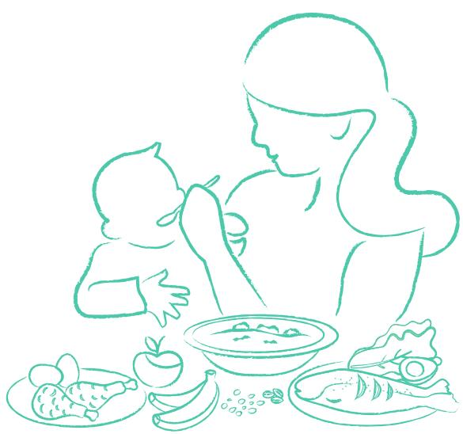

## WHO Guideline for complementary feeding of infants and young children 6–23 months of age

# WHO Guideline for complementary feeding of infants and young children 6–23 months of age

WHO Guideline for complementary feeding of infants and young children 6–23 months of age

ISBN 978-92-4-008186-4 (electronic version) ISBN 978-92-4-008187-1 (print version)

## © World Health Organization 2023

Some rights reserved. This work is available under the Creative Commons Attribution-NonCommercial-ShareAlike 3.0 IGO licence (CC BY-NC-SA 3.0 IGO; https://creativecommons. org/licenses/by-nc-sa/3.0/igo).

Under the terms of this licence, you may copy, redistribute and adapt the work for non-commercial purposes, provided the work is appropriately cited, as indicated below. In any use of this work, there should be no suggestion that WHO endorses any specific organization, products or services. The use of the WHO logo is not permitted. If you adapt the work, then you must license your work under the same or equivalent Creative Commons licence. If you create a translation of this work, you should add the following disclaimer along with the suggested citation: “This translation was not created by the World Health Organization (WHO). WHO is not responsible for the content or accuracy of this translation. The original English edition shall be the binding and authentic edition”.

Any mediation relating to disputes arising under the licence shall be conducted in accordance with the mediation rules of the World Intellectual Property Organization (http://www.wipo.int/ amc/en/mediation/rules/).

Suggested citation. WHO Guideline for complementary feeding of infants and young children 6–23 months of age. Geneva: World Health Organization; 2023. Licence: CC BY-NC-SA 3.0 IGO.

Cataloguing-in-Publication (CIP) data. CIP data are available at https://iris.who.int/.

Sales, rights and licensing. To purchase WHO publications, see https://www.who.int/publications/ book-orders. To submit requests for commercial use and queries on rights and licensing, see https://www.who.int/copyright.

Third-party materials. If you wish to reuse material from this work that is attributed to a third party, such as tables, figures or images, it is your responsibility to determine whether permission is needed for that reuse and to obtain permission from the copyright holder. The risk of claims resulting from infringement of any third-party-owned component in the work rests solely with the user.

General disclaimers. The designations employed and the presentation of the material in this publication do not imply the expression of any opinion whatsoever on the part of WHO concerning the legal status of any country, territory, city or area or of its authorities, or concerning the delimitation of its frontiers or boundaries. Dotted and dashed lines on maps represent approximate border lines for which there may not yet be full agreement.

The mention of specific companies or of certain manufacturers’ products does not imply that they are endorsed or recommended by WHO in preference to others of a similar nature that are not mentioned. Errors and omissions excepted, the names of proprietary products are distinguished by initial capital letters.

All reasonable precautions have been taken by WHO to verify the information contained in this publication. However, the published material is being distributed without warranty of any kind, either expressed or implied. The responsibility for the interpretation and use of the material lies with the reader. In no event shall WHO be liable for damages arising from its use.

Report layout and design: Inís Communication

## Contents

Publication history v   
Acknowledgements vi   
Abbreviations and acronyms vii   
Glossary viii   
Executive summary ix   
1 Introduction and scope 1   
2. Development and methodology 5   
3. Recommendations 11   
Continued breastfeeding 11   
Milks for children fed milks other than breast milk 15   
Age of introduction of complementary foods 20   
Dietary diversity 24   
Unhealthy foods and beverages 32   
Nutrient supplements and fortified food products 36   
Responsive feeding 43   
4. Research gaps 49   
5. Dissemination and plans for future updates 53   
References 54   
Annex 1. WHO guideline development group, steering group, systematic   
review teams, and external resource persons 63   
Annex 2. Management of declarations of interest 67   
Annex 3. Core food groups and subgroups used in modelling study 68   
Annex 4. Summary Judgement Tables 70   
Annex 5. Link to systematic reviews and modelling reports 75   
Web Annex. Evidence Summary Tables   
https://iris.who.int/bitstream/handle/10665/373338/9789240082380-eng.pdf

## Publication history

This guideline, Complementary feeding of infants and young children 6–23 months of age, supersedes the Guiding Principles for Complementary Feeding of the Breastfed Child (1) and Guiding principles for feeding non-breastfed children 6–24 months of age (2). The guideline was developed in accordance with the rigorous procedures described in the WHO handbook for guideline development (3).

# Acknowledgements

The development of this guideline was coordinated by the WHO Department of Nutrition and Food Safety. Dr Laurence Grummer-Strawn and Dr Lisa Rogers oversaw its preparation. Dr Chessa Lutter, RTI International and Dr Grummer-Strawn wrote the guideline. Dr Francesco Branca, Director of the Department, supported its development. Technical guidance was provided by members of the WHO steering committee: Dr Bernadette Daelmans (Department of Maternal, Newborn, Child, and Adolescent Health and Ageing), Dr Marie Noel Brune Drisse (Department of Environment, Climate Change and Health), Dr Jason Montez (Department of Nutrition and Food Safety) and Dr Juana Willumsen (Department of Health Promotion). Ms Sophie Schmitt from the Department of Nutrition and Food Safety provided administrative support. The WHO Guidelines Review Committee reviewed and approved the guideline.

The World Health Organization gratefully acknowledges the members of the WHO Guideline Development Group (GDG): Dr Mona Alsumaie (Ministry of Health, Kuwait), Dr Richmond Aryeetey (University of Ghana, Ghana), Dr Nita Bhandari (Society for Applied Studies, India), Dr Kaleab Baye (Addis Ababa University, Ethiopia), Dr Helen Crawley (First Steps Nutrition, United Kingdom), Dr Kathryn Dewey (University of California Davis, United States of America), Dr Arun Gupta (Breastfeeding Promotion Network of India, India), Dr Lora Iannotti (Washington University, United States of America), Dr Rafael Pérez-Escamilla (Yale University, United States of America), Inês Rugani Ribeiro de Castro (Rio de Janeiro State University, Brazil), Dr Linda Shaker Berbari (Independent Consultant, Lebanon), Dr Frank Wieringa (Institut de Recherche pour le Développement, France) and Dr Zhenyu Yang (Chinese Center for Disease Control and Prevention, China). Dr Kathryn Dewey and Dr Richmond Aryeetey served as co-chairs at the first meeting. All members provided state-of-the art technical knowledge and insights throughout the development process and review of the guideline. WHO also thanks Dr Nandi Siegfried, independent guidelines methodologist, who facilitated decision-making during the meetings.

The World Health Organization thanks the following lead authors for their support in conducting the systematic reviews and presenting the results to the GDG: Dr Reggie Annan, Dr Ildikó Csölle, Dr Jai Das, Dr Natalia Elorriaga, Dr Ana Fernandez-Gaxiola, Dr Tarun Gere, Dr Leila Harrison, Dr Aamer Imdad, Dr Emily Keats, Dr Zohra Lassi, and Dr Emily Rousham, and Ms Mary Arimond for leading the dietary modelling study and presenting the results to the GDG. Ms Hilary Creed de Kanashiro, Dr Rukhsana Haider, Dr Alissa Pries, and Dr Christine Stewart are thanked for providing the peer-review of the guideline.

Lastly, the World Health Organization thanks the external resource persons who participated in the first GDG meeting: Dr Maureen Black, Dr Kaleab Baye and Dr Rosalind Gibson.

## Financial support

The World Health Organization thanks the Bill & Melinda Gates Foundation and the US Agency for International Development for providing financial support. Donors do not fund specific guidelines and do not participate in any decision related to the guideline development process, including the composition of research questions, membership of the guideline groups, conduct and interpretation of systematic reviews, or formulation of recommendations.

## Abbreviations and acronyms

ASF animal-source foods

BMI body mass index

BMIZ body mass index Z score

DECIDE The Developing and Evaluating Communication Strategies to support Informed Decisions and Practice based on Evidence framework

GDG Guideline development group

GRADE Grading of Recommendations, Assessment, Development and Evaluations

HAZ height-for-age Z score

Hgb haemoglobin

IDA iron deficiency anaemia

LMICs low- and middle-income countries

MD mean diference

MDD minimum dietary diversity

MNP multiple micronutrient powders

NCDs noncommunicable diseases

NRV nutrient reference value

PECO population, exposure, comparator and outcome

PR prevalence ratio

RCT randomized controlled trial

RNA ribonucleic acid

RR relative risk

SCP super cereal plus

SDGs Sustainable Development Goals

SMD standard mean diference

SQ-LNS small-quantity lipid based nutrient supplements

SSB sugar-sweetened beverage

UNICEF United Nations Children’s Fund

WAZ weight-for-age Z score

WHO World Health Organization

WHZ weight-for-height Z score

Animal milk Milks from any animal, such as a cow, goat, or camel.

Breast milk Milk from a lactating person; sometimes referred to as human milk.

Complementary The process of providing foods in addition to milk when breast feeding milk or milk formula alone are no longer adequate to meet nutritional requirements.

Cow’s milk Milk from a dairy cow.

low-up formula Defined by the Codex Alimentarius Commission as a food intended for use as a liquid part of the weaning diet for the infant from the 6th month on and for young children. It includes formulas for infants 6–11 months and children 12–35 months.

Infant formula Defined by the Codex Alimentarius Commission as a breastmilk substitute specially manufactured to satisfy, by itself, the nutritional requirements of infants during the first months of life up to the introduction of appropriate complementary feeding. In some countries infant formula is used for the first 12 months whereas in others it is used for the first 6 months.

Low-fat milk Animal milk that has a reduced fat content.

Milk formula Combined term that includes both infant formula and follow-up formula.

Plant-based milk Milk substitute derived from a plant or seed such as soy, almond or coconut.

# Executive summary

This guideline, Complementary feeding of infants and young children 6–23 months of age, supersedes the Guiding Principles for Complementary Feeding of the Breastfed Child (1) and Guiding principles for feeding non-breastfed children 6–24 months of age (2).

## Background

Complementary feeding, defined as the process of providing foods in addition to milk when breast milk or milk formula alone are no longer adequate to meet nutritional requirements, generally starts at age 6 months and continues until 23 months of age, although breastfeeding may continue beyond this period (4). This is a developmental period when it is critical for children to learn to accept healthy foods and beverages and establish long-term dietary patterns (5). It also coincides with the peak period for risk of growth faltering and nutrient deficiencies (6).

The immediate consequences of malnutrition during these formative years – as well as in utero and the first 6 months of life – include impaired growth, significant morbidity and mortality, and delayed motor, cognitive, and socio-emotional development. It can later lead to increased risk of noncommunicable diseases (NCDs). In the long term, undernutrition in early childhood leads to reduced work capacity and earnings and, among girls, reduced reproductive capacity (6). Inappropriate complementary feeding can result in overweight, type 2 diabetes and disability in adulthood (7). The first two years of life are also a critical period for brain development, the acquisition of language and sensory pathways for vision and hearing, and the development of higher cognitive functions (8).

## Purpose of the guideline

This guideline provides evidence-based recommendations on complementary feeding of infants and young children 6–23 months of age living in low, middleand high-income countries. It considers the needs of both breastfed and nonbreastfed children. These are public health recommendations, recognizing that children should be managed individually so that inadequate growth, overweight, or other adverse outcomes are identified, and appropriate action taken. This guideline does not address the needs of pre-term and low-birthweight infants, children with or recovering from acute malnutrition and serious illness, children living in emergencies, or children who are disabled. Except for children with disabilities, the needs of these other groups of children are addressed in other WHO guidelines.

## Guideline development and methodology

The recommendations in this guideline were developed using the procedures outlined in the WHO handbook for Guideline Development (3). The steps included: identification of priority questions and critical outcomes; retrieval of the evidence; assessment and synthesis of the evidence; and formulation of recommendations, including research priorities. The Grading of Recommendations Assessment, Development and Evaluation (GRADE) methodology was followed, to prepare evidence profiles related to preselected topics, based on up-to-date systematic reviews (9).

The available evidence on the benefits and harms of various feeding practices was evaluated using quantitative and qualitative systematic reviews, some that were commissioned by WHO and others that were recently published. In addition, dietary modelling was conducted to analyse how changes in dietary practices as considered in the guidelines would afect nutrient intakes, either creating or alleviating nutrient deficiencies.

The Developing and Evaluating Communication Strategies to Support Informed Decisions and Practice based on Evidence (DECIDE) framework, an evidence-to-decision tool that includes intervention efects, values, resources, equity, acceptability, and feasibility criteria, was used to guide the formulation of the recommendations by the guideline development group (10).

## Recommendations

## Recommendation 1

## Continued breastfeeding

Breastfeeding should continue up to 2 years or beyond (strong, very low certainty evidence).

## Remarks

To carry out this recommendation, all breastfeeding women will require an enabling environment and supportive services (11). For example:

• Women who work outside the home need services such as onsite daycare, workplace breastfeeding rooms, and flexible work schedules.

All women need access to breastfeeding counselling services to address questions and challenges that arise when breastfeeding.

Pregnant women, mothers, families, and health care workers need to be protected from exploitative marketing from manufacturers and distributors of breastmilk substitutes.

• Health care providers must be knowledgeable and skilled in supporting breastfeeding mothers with evidence-based care.

a. Milks 6–11 months: for infants 6–11 months of age who are fed milks other than breast milk, either milk formula or animal milk can be fed (conditional, low certainty evidence).

b. Milks 12–23 months: for young children 12–23 months of age who are fed milks other than breast milk, animal milk should be fed. Follow-up formulas are not recommended (conditional, low certainty evidence) 1.

## Remarks

Dairy products, including liquid animal milks are part of a diverse diet and can contribute to nutritional adequacy (see also Recommendation 4a). They are particularly important for non-breastfed children when other animal source foods (ASFs) are not available.

Types of animal milks that could be used include pasteurized animal milk, reconstituted evaporated (but not condensed) milk, fermented milk, or yogurt.

• Flavoured or sweetened milks should not be used.

• If infants 6–11 months of age are fed animal milks, full fat milk should be used.

• Safe storage and handling practices of animal milks should be followed.

Age of introduction of complementary foods

Infants should be introduced to complementary foods at 6 months (180 days) while continuing to breastfeed (strong, low certainty evidence).

## Remarks

• The recommendation is a public health recommendation and recognizes that some infants may benefit from earlier introduction of complementary foods.

Mothers concerned about the adequacy of breast milk might benefit from lactation support.

Iron in breast milk is highly bioavailable, but some infants may be at risk of iron deficiency (ID), especially if they were preterm or low birthweight. Early introduction of complementary foods, even if iron-fortified, does not adequately prevent iron deficiency anaemia in high-risk populations.

## Dietary diversity

Infants and young children 6–23 months of age should consume a diverse diet.

a. Animal source foods, including meat, fish, or eggs, should be consumed daily (strong, low certainty evidence).

b. Fruits and vegetables should be consumed daily (strong, low certainty evidence).

c. Pulses, nuts and seeds should be consumed frequently, particularly when meat, fish, or eggs and vegetables are limited in the diet (conditional, very low certainty evidence).

## Remarks

Animal-source foods, fruits and vegetables, and nuts, pulses and seeds should be key components of energy intake because of their overall higher nutrient density compared to cereal grains.

Starchy staple foods should be minimized. They commonly comprise a large component of complementary feeding diets, particularly in low resource settings, and do not provide proteins of the same quality as those found in animal source foods and are not good sources of critical nutrients such as iron, zinc and Vitamin B12. Many also include anti-nutrients that reduce nutrient absorption.

When cereal grains are used, whole cereal grains should be prioritized, and refined ones minimized.

Care should be taken to ensure that pulses, nuts and seeds are given in a form that does not pose a risk of choking.

## Unhealthy foods and beverages

a. Foods high in sugar, salt and trans fats should not be consumed (strong, low certainty evidence).

b. Sugar-sweetened beverages should not be consumed (strong, low certainty evidence).

c. Non-sugar sweeteners should not be consumed (strong, very low certainty evidence).

d. Consumption of 100% fruit juice should be limited (conditional, low certainty evidence).

## Remarks

Broad policy actions will be needed to support the implementation of these recommendations, including, but not limited to agricultural policies that take into consideration the nutritional requirements of young children, policies regarding front-of-package labelling and marketing practices, among others.

Counselling caregivers about the short- and long-term harms of foods high in sugar, salt and trans fats, sugar sweetened beverages (SSBs), and non-sugar sweeteners is needed.

## Nutrient supplements and fortified food products

In some contexts where nutrient requirements cannot be met with unfortified foods alone, children 6–23 months of age may benefit from nutrient supplements or fortified food products.

a. Multiple micronutrient powders (MNPs) can provide additional amounts of selected vitamins and minerals without displacing other foods in the diet (context-specific, moderate certainty evidence).

consuming commercial cereal grain-based complementary foods and blended flours, fortification of these cereals can improve micronutrient intake, although consumption should not be encouraged (context-specific, moderate certainty evidence).

c. Small-quantity lipid-based nutrient supplements (SQ-LNS) may be useful in food insecure populations facing significant nutritional deficiencies (context-specific, high- certainty evidence).

## Remarks

WHO guidelines for micronutrient supplementation provide recommendations about the contexts when such supplements are recommended (12).

None of the three products should ever be distributed as standalone interventions, rather they should always be accompanied by messaging and complementary support to reinforce optimal infant and young child feeding practices.

• None of the products are a substitute for a diverse diet consisting of healthy and minimally processed foods.

## Responsive feeding

Children 6–23 months of age should be responsively fed, defined as “feeding practices that encourage the child to eat autonomously and in response to physiological and developmental needs, which may encourage self-regulation in eating and support cognitive, emotional and social development” (13) (strong, low certainty evidence).

## Remarks

Delivering the intervention of responsive feeding will require health care workers and others charged with delivering the intervention to have the capacity to provide the necessary guidance to caregivers and families.

Implementation of the   
recommendation will require   
caregivers to have time to be present while the young child eats or selffeeds and have resources so that   
food loss during self-feeding does not present a problem.

## Research gaps

The GDG highlighted the very limited evidence for many of the recommendations. More studies using similar research protocols (age groups, outcomes, measurement techniques, etc.) across diferent regions, countries, population groups (by income levels, educational levels, cultural and ethnic backgrounds etc.) and contexts are required. Most topics, except for those related to nutrient supplements and fortified food products, lacked robust or sometimes any randomized controlled trials to guide decision making.

# 1 Introduction and scope

## 1.1 Background

Complementary feeding – defined as the process of providing foods when breast milk or milk formula alone are no longer adequate to meet nutritional requirements – generally starts at age 6 months and continues until age 23 months, although breastfeeding may continue beyond this period (4). This is a developmental period when it is critical for children to learn to accept healthy foods and beverages and establish long-term dietary patterns (5). It also coincides with the peak period for risk of growth faltering and nutrient deficiencies.

The immediate consequences of malnutrition during these formative years, as well as in utero and the first 6 months of life, include impaired growth, significant morbidity and mortality, and delayed motor, cognitive, and socioemotional development. It can later lead to increased risk of noncommunicable diseases (NCDs). In the long term, early childhood undernutrition leads to reduced work capacity and earnings and, among girls, reduced reproductive capacity (6). Inappropriate complementary feeding can result in overweight, type 2 diabetes, and disability in adulthood (6). The first 2 years of life are also a critical period for brain development, the acquisition of language and sensory pathways for vision and hearing, and the development of higher cognitive functions (8).

The most recent UNICEF-WHO-World Bank Group Joint Child Malnutrition Estimates indicate that stunting afects 22.3% (148 million), wasting afects 6.8% (45 million), and overweight afects 5.6% (37 million) of children under 5 years of age globally (14). Risk of stunting and wasting is concentrated during the first 5 years of life and children in this age group are also at risk of obesity.

In 2012, the World Health Assembly in its Resolution WHA65.6 endorsed a Comprehensive implementation plan for maternal, infant and young child nutrition, which specified six global nutrition targets for 2025 (15). Appropriate complementary feeding, essential to fostering healthy growth, is directly related to three of these six targets: 1) 40% reduction in the number of under-5s who are stunted; 2) reduce and maintain childhood wasting to less than 5%; and 3) no increase in childhood overweight. Appropriate complementary feeding is also fundamental to achieving several of the targets in the second Sustainable Development Goal (16).

## 1.2 Purpose and target audience

This guideline provides global, normative evidence-based recommendations on complementary feeding of infants and young children 6–23 months of age. The recommendations are intended for a wide audience, including policymakers, and technical and programme staf at government institutions and organizations involved in the design, implementation and scaling of programmes for infant and young child feeding. The guideline may also be used by caregivers, health-care professionals, clinicians, academic and research institutions, and training institutions.

## 1.3 Objective

The objective of this guideline is to help Member States, United Nation’s agencies, nongovernmental organizations and other stakeholders to make informed recommendations about complementary feeding in their eforts to achieve the Global Strategy for Infant and Young Child Feeding (17), the SDGs (16), the

global targets set in the Comprehensive implementation plan on maternal, infant and young child nutrition (15), and the Global Strategy for Women’s, Children’s, and Adolescents’ Health (2016–2030) (18).

## 1.4 Population of interest

The guideline covers infants and young children who were full term at birth and who live in low-income countries, middleincome countries and high-income countries. It considers the needs of both breastfed and non-breastfed children and, unless noted, applies globally to all infants and young children 6–23 months of age. It provides public health recommendations, recognizing that children all infants and young children should be managed individually so that undernutrition, micronutrient deficiencies, overweight or obesity, or other adverse outcomes are identified, and appropriate action taken. This guideline does not address the needs of pre-term and low-birthweight infants, children with or recovering from acute malnutrition and serious illness, children who are disabled, or children living in emergencies. Except for children with disabilities, the needs of these children are addressed in other WHO guidelines.

## 1.5 Scope

The guideline is intended to be food-based. Although it considers nutrient needs of infants and young children, it does not specify levels of nutrients to be consumed or avoided (such as micronutrient levels or energy). It also does not specify quantities of foods to be consumed as these would vary by age, activity level, metabolism and local contexts and so cannot be defined at a global level. However, in making recommendations on what foods need to be consumed, the GDG did consider it important to ensure that nutrient needs can be met. The guideline does not address issues of food safety.

## 1.6 Justification

This guideline updates the Pan American Health Organization/WHO guideline Guiding principles for complementary feeding of the breastfed child (2003) and the WHO guideline Guiding principles for feeding non-breastfed children 6–24 months of age (2005) (1, 2). Both guidelines focused on undernutrition and, therefore, while relevant to low- and middle-income countries (LMICs) they were less relevant to high-income countries. The guidelines were developed prior to the publication of the WHO handbook for guideline development and were therefore not subject to the same rigorous procedures as current guidelines. Additionally, over the past 20 years there have been numerous new publications related to complementary feeding. Overweight and obesity have increased in children globally. Many children are only partially breastfed and thus were not clearly assigned to one or the other document. For these reasons, the WHO Department of Nutrition and Food Safety decided it was timely to update the earlier guidance to address both breastfed and non-breastfed children and those living in low- , middleand high-income countries in a single guideline.

## 1.7 Related WHO Guidelines

The following WHO guidelines are relevant to this guideline:

• Guiding principles for complementary feeding of the breastfed child (1)

• Guiding principles for feeding non-breastfed children 6–24 months of age (2)

• WHO recommendations for postnatal care for the mother and newborn (19)

• Guideline: sugars intake for adults and children (20)

• Guideline: daily iron supplementation in infants and children (21)

Guideline: assessing and managing children at primary health-care facilities to prevent overweight and obesity in the context of the double burden of malnutrition (22)

• Guideline: integrated management of children in all their diversity with obesity (forthcoming) (23)

• Guideline: vitamin A supplementation in infants and children 6–59 months of age (24)

• Improving early childhood development: WHO guideline (25)

• WHO recommendations on antenatal care for a positive pregnancy experience (26)

• Guideline: carbohydrate intake for adults and children (5)

• Guideline: saturated fatty acid and transfatty acid intake for adults and children (27)

• Guideline: total fat intake for the prevention of unhealthy weight gain in adults and children (28)

• Guideline: use of non-sugar sweeteners (29)

Other relevant WHO documents include:

• The optimal duration of exclusive breastfeeding: report of an expert consultation (30)

• Healthy diet fact sheet (31)

• Guideline: sodium intake for adults and children (32) (for persons 2 years of age and older)

• Guideline: potassium intake for adults and children (33) (for persons 2 years of age and older)

• Guidance on ending the inappropriate promotion of foods for infants and young children (34)

• WHO global report on sodium intake reduction (35)

• WHO Manual on sugar-sweetened beverage taxation policies to promote healthy diets (36)

• WHO: five keys to safer food manual (37)

• Nurturing care for early childhood development: a framework for helping children survive and thrive to transform health and human potential (38)

• Guideline: delayed umbilical cord clamping for improved maternal and infant health and nutrition outcomes (39)

• WHO recommendations for care of the preterm or low birth weight infant (40)

• Nutrient and promotion profile model: supporting appropriate promotion of food products for infants and young children 6–36 months in the WHO European Region (41)

# 2. Development and methodology

## 2.1 Guideline Development Group

Potential members of the GDG were identified based on their technical expertise in diferent aspects of complementary feeding and experience in implementing guidelines. Candidates were identified from academic institutions, Ministries of Health, and nongovernmental organizations. Care was taken to ensure diferent WHO regions were represented as well as difering viewpoints on the topics covered. A total of 13 candidates were identified and requested to provide documentation relating to any potential conflict of interest (see 2.1.1 below). A list of GDG members is included in Annex 1.

## 2.1.1 Management of conflict of interest

Potential conflicts of interests were managed by the steering group, in collaboration with the WHO Ofice of Compliance and Risk Management and Ethics. All potential GDG members, first authors of the systematic reviews, and reviewers were asked to complete the standard WHO declaration-of-interests form, sign confidentiality forms and provide their curriculum vitae. Searches were conducted to identify any public statements made or positions held by the potential GDG members with respect to breastfeeding and complementary feeding. All concerns were discussed with the Ofice of Compliance, Risk Management and Ethics and managed on a case-by-case basis. A summary of declarations of interests by members of the GDG, systematic review authors and peer-reviewers, including how any identified conflicts of interest were managed, is presented in Annex 2.

## 2.1.2 Process for developing evidencebased recommendations

To manage the development of the current evidence-based recommendations, WHO followed the procedures outlined in the WHO handbook for guideline development (3). The steps in this process included:

(i) identification of priority questions and critical outcomes using the PECO format (Participant-Exposure-Comparison-Outcome)

(ii) retrieval of the evidence

(iii) assessment and synthesis of the evidence, and

(iv) formulation of recommendations and articulation of research gaps.

Evidence profile tables were prepared for all critical outcomes for each systematic review using the Grading of Recommendations Assessment, Development and Evaluation (GRADE) methodology. The certainty of evidence was rated for each outcome individually and overall across outcomes, based on 1) risk of bias, 2) indirectness, 3) inconsistency, 4) imprecision and 5) publication bias or other considerations. Certainty was graded as high, moderate, low, or very low.

## 2.1.3 Meetings held

An initial meeting was held at WHO in 2019 and six subsequent virtual meetings in 2020–2023 to formulate the PECO questions, review systematic reviews, develop recommendations, identify research gaps, and address questions by the WHO Guideline Review Committee. Decision-making was led by the independent methodologist skilled in the WHO methodology for the development of recommendations.

## 2.2 Evidence gathering reviews and modelling

## 2.2.1 Narrative review

In order to inform the development of this guideline, WHO commissioned a narrative review of literature published since 2003 on complementary feeding, which was presented and discussed at the first meeting of the GDG (4). This paper provided information relevant to deliberations of the GDG and the formulation of the PECO questions for the systematic reviews. The following key questions were formulated:

## 1. Continued breastfeeding

For infants and young children and their mothers, is breastfeeding in the second year of life, compared to no breastfeeding after 12 months, associated with beneficial or adverse health and development outcomes?

## 2. Milks 6–23 months for children who are fed milks other than breast milk

For infants 6–11 months of age, is consumption of animal milk compared to infant formula associated with beneficial or adverse outcomes for health and development?

For young children 12–23 months of age, is full-fat animal milk compared to follow-up formula, lower-fat milk, or plant-based milk associated with beneficial or harmful outcomes?

## 3. Age of introduction of complementary foods

For infants, is the introduction of complementary feeding at 6 months of age compared to earlier or later associated with beneficial or adverse nutrition, health, and development outcomes?

## 4. Dietary diversity

## Animal-source foods (ASFs)

For infants and young children 6–23 months of age, is more frequent consumption or greater amounts of ASFs compared to less frequent consumption or lower amounts of ASFs associated with beneficial dietary and health outcomes?

## Fruits and vegetables

For infants and young children 6–23 months of age, is more frequent consumption of fruits and vegetables compared to less frequent consumption associated with beneficial dietary and health outcomes?

## Nuts, pulses, and seeds

For infants and young children 6–23 months of age, is more frequent consumption or greater amounts of pulses, nuts and seeds compared to less frequent consumption or lower amounts of pulses, nuts and seeds associated with beneficial dietary and health outcomes?

## 5. Unhealthy foods and beverages

What is the impact of high consumption of unhealthy foods and beverages compared to lower consumption on risk of adverse dietary or health outcomes?

## 6. Nutrient supplements and fortification

For infants and young children 6–23 months of age, is consumption of micronutrient powders (MNPs) compared to no consumption associated with beneficial or harmful dietary and health outcomes?

For infants and young children 6–23 months of age, is consumption of fortified complementary food compared to an unfortified version of the same complementary food associated with beneficial or harmful dietary and health outcomes?

For young children 12–23 months of age is consumption of an unfortified versus fortified milk associated with adverse nutritional or health outcomes?

For infants and young children 6–23 months of age, is consumption of small quantity lipid-based nutrient supplements (SQ-LNS) compared to no consumption associated with beneficial or harmful dietary and health outcomes?

## 7. Responsive feeding

For children from introduction of complementary foods to 23 months of age, do interventions that include elements of responsive feeding compared to interventions that do not include those elements of responsive feeding result in beneficial or harmful dietary and health outcomes?

## 2.2.2 Systematic reviews

WHO commissioned 10 systematic reviews, several of which were subsequently published (42–45). The commissioned reviews covered the topics of:

1. continued breastfeeding

2. milks for infants 6–11 months of age

3. milks for children 12–23 months of age

4. age of introduction of complementary foods

5. animal-source foods

6. nuts, pulses, and seeds

7. fruits and vegetables

8. fortified complementary foods

9. unhealthy foods and beverages, and

10. responsive feeding.

For the topic of MNPs, a systematic review published in 2020 was utilized (46) and for the topic of SQ-LNS, four recently published systematic reviews were used (47–50). WHO also commissioned a systematic qualitative review related to preferences, equity and rights, resource implications, acceptability, and feasibility of the topics considered in the systematic reviews. All systematic reviews are available (see Annex 5).

## 2.2.3 Food pattern modelling

WHO commissioned work on dietary and food pattern modelling to analyse how changes in dietary practices, as considered in the guideline, would afect nutrient intakes, either creating or alleviating nutrient inadequacies. The reports from this work are available at (see Annex 5).

Seven questions were formulated:

1. Can target nutrient needs be met using unfortified foods in ‘best-case’ food patterns? If so, what do these food patterns look like?

2. What happens when certain food groups or subgroups are eliminated?

3. What happens when staple foods are monotonous?

4. What happens if we modify the amount of starchy staple foods?

5. What happens if we add unhealthy foods or beverages?

6. What happens if we add fortified foods or products?

7. What are the nutrient gaps when we approximate real-world food patterns, and can the gaps be filled by use of fortified products?

The first six questions were explored through linear goal programming using the WHO Optifood modelling system (51). Optifood is designed to generate food patterns that meet or come as close as possible to meeting target nutrient reference values (NRVs). The last question was addressed through calculations.

The best-case food patterns provided by the Optifood model solutions were considered to be feasible because there was an empirical basis for the maximum quantities and frequencies of consumption of food groups and subgroups allowed. They were considered best-case patterns because the quantities and frequencies, which defined model parameters, reflected global settings where the food subgroups were more frequently consumed and/or were consumed in larger median quantities. They were also considered best-case patterns because they allowed the inclusion of all nutrient-dense food subgroups, which may not reflect the situation in many settings.

For Optifood modelling, food patterns were defined as the weekly quantities and frequencies of consumption of food groups and subgroups for the modelled scenarios. For question seven, food patterns were

defined as the percentage of energy provided by food groups and subgroups, at the population level.

Core food groups and subgroups, specific foods within a core food group, were defined a priori. The six food groups included starchy staple foods (grains plus white roots and tubers, and plantains), fruits, vegetables, dairy, all other protein foods (meat, poultry, fish, eggs, nuts, and seeds, legumes, soy foods), and added fats and oils. The list of food subgroups is provided in Annex 3.

Dietary data were analysed from 16 low-, middle- and high-income countries in Africa, Asia, Europe, Latin America and North America to determine if unfortified foods could meet all target NRVs and bestcase food patterns based on data from countries with high consumption of each food subgroup modelled. These patterns were then modified by i) eliminating food groups, subgroups or sets of subgroups, ii) imposing monotonous staple foods or increasing the quantity of staple foods or iii) including sentinel unhealthy foods or beverages. Nutrient gaps in bestcase and in modified food patterns were characterized and modelling was conducted to explore whether use of MNPs, a fortified cereal grain-based complementary food (Super Cereal Plus), or SQ-LNS could fill some or all the nutrient gaps.

Lastly, scenarios approximating real-world food patterns were developed using data from Bangladesh, Malawi and Mexico. Data sets were selected because they contained information on nutrient consumption needed to conduct modelling and were either publicly available or provided by researchers. Food patterns at the population level were defined by estimating the percentage of energy from food groups and subgroups and calculating the nutrient content of these diets. The nutrient gaps were characterized, and modelling was used to explore whether fortified products could fill the gaps identified.

Modelling was conducted for: i) breastfed infants 6–8.9 months of age ii) breastfed infants 9–11.9 months of age iii) breastfed children 12–23.9 months of age, and iv) nonbreastfed children 12–23.9 months of age.

For breastfed children in each age group, a fixed percentage of energy from breast milk, based on mean values in a recent systematic review, was assumed (52). For each age/feeding group, three energy intake levels were modelled, corresponding to estimated energy requirements for a small, an average, and a large infant or child within the age group. The target nutrients for modelling included fat, vitamin A, thiamine, riboflavin, vitamin B6, folate, choline, vitamin B12, vitamin C, calcium, iron, potassium and zinc. Desired intakes for each target nutrient were defined based on NRVs. Results were also calculated and reported for other selected nutrients that were not built into models as targets, using the model results (that is, grams of each food subgroup in the optimized food pattern).

The modelling was designed to focus on feasible diets to reduce nutrient gaps and did not focus on excess intakes. Fat was included in the models as a target nutrient and fibre was also included. However, the models did not consider intakes of sodium or sugar. Furthermore, the modelling was done for selected “sentinel” unhealthy foods as it was not feasible to model all possible types of unhealthy foods.

## 2.2.4 Systematic review of values and preferences

Additional syntheses of qualitative evidence served to assess the balance of benefits and harms, resource implications, equity implications, and acceptability associated with each of the recommendations. The findings of the WHO-commissioned qualitative review were appraised using the GRADE confidence in the GRADE-CERQual (Confidence in the Evidence from Reviews of Qualitative research) approach (53). Overall confidence in the evidence from reviews of qualitative research was based on four components: methodological limitations of the individual studies; adequacy of the data; coherence of the evidence; and relevance of the individual studies to the review findings.

## 2.3 Decision-making process

During the meetings, an evidence-todecision tool – the Developing and Evaluating Communication Strategies to support Informed Decisions and Practice based on Evidence (DECIDE) framework – was used to promote deliberations and consensus decision-making (10). This tool includes the following considerations: the certainty of the evidence across outcomes critical to decision-making; the balance of benefits and harms; values and preferences related to the recommended intervention in diferent settings and for diferent stakeholders, including the populations at risk; the acceptability of the intervention among key stakeholders; resource implications for programme managers; equity; and the feasibility of implementation of the intervention. The GDG discussed the findings of the systematic reviews and supplemental evidence, such as mathematical modelling. Following this discussion, the GDG reached consensus on the direction, strength, and wording of the recommendation. Where GDG members did not fully concur with the summary judgements for each of these considerations, multiple judgements were recorded. The GDG decided that 70% of members would need to vote for the direction and/or strength of the recommendation to be accepted. All decisions were made by consensus, with the exception for recommendations on nutrient supplements and fortified food products, which were agreed by over 70% of members.

Interventions in these guidelines are listed as recommended, not recommended, or recommended under certain conditions (context-specific). All recommendations are accompanied by a description of the certainty of the body of evidence (very low, low, moderate or high). Strength of the recommendation was classified as “strong” or “conditional”. According to the WHO handbook for guideline development, strong recommendations indicate that the GDG was confident that the desirable efects of adherence to the recommendation outweigh any undesirable consequences. If an intervention is not recommended, the reverse is true.

Conditional recommendations indicate that the GDG was less confident or certain about the balance between benefits and harms of the recommendation. Contextspecific recommendations indicate that the GDG was certain that the desirable efects of the recommendation outweighed any undesirable consequences; however, not all populations needed the intervention. The GDG also provided additional remarks for further understanding of the recommendation. For further information about the basis for each recommendation users of this guideline should refer to these remarks, as well as to the judgement summary tables presented in Annex 4.

Most topics (except for those related to MNPs, fortified cereal-grain complementary foods, fortified milks, and SQ-LNS) lacked robust studies or sometimes even a single randomized controlled trial (RCT) to guide decision making. Except for the recommendations for these supplements or food products, almost all the evidence for the other recommendations was rated as low to very low certainty.

# 3. Recommendations

This chapter presents each of the recommendations alongside the rationale and a summary of the evidence from systematic reviews for each of the practices or interventions. As specified in the WHO handbook for guideline development (3), the GDG also discussed the certainty of the evidence, the balance of benefits and harms, and the values and preferences of caregivers, healthcare providers, programme managers, and policymakers, the resource implications, and the acceptability of the recommendation. These discussions are also summarized alongside each recommendation. Because evidence from the qualitative reviews to assess values and preferences, resource implications, and acceptability associated with the recommendations was lacking, the GDG often relied on its collective experiences and expert opinion. This is noted when applicable.

## Equity

The GDG also discussed equity. However, as there was virtually no evidence to address the issue of equity, separate sections on equity for each recommendation are not included. The view of the GDG was that a good diet increases equity because it supports healthy growth and development. This is especially true for children living in resource-poor settings as they are most likely to sufer the consequences of poor diets. Because access to a diverse diet is limited in some settings – largely because of income constraints though sometimes because of lack of availability – the GDG recognized the need for broader transformations related to economic development and food systems that take into consideration the special nutritional needs of infants and young children, women’s empowerment, and opportunities for remunerative employment. The GDG was also clear that nutrient supplements and fortified food products would not be necessary if infant and young children consumed a nutritious diet.

## 3.1 Continued breastfeeding

## 3.1.1 Recommendation

## Recommendation 1

## Continued breastfeeding

Breastfeeding should continue up to 2 years or beyond (strong, very low certainty evidence).

## Remarks

To carry out this recommendation, all breastfeeding women will require an enabling environment and supportive services (11). For example:

• Women who work outside the home need services such as onsite daycare, workplace breastfeeding rooms, and flexible work schedules.

All women need access to breastfeeding counselling services to address questions and challenges that arise when breastfeeding.

Pregnant women, mothers, families, and health care workers need to be protected from exploitative marketing from manufacturers and distributors of breastmilk substitutes.

• Health care providers must be knowledgeable and skilled in supporting breastfeeding mothers with evidence-based care.

## 3.1.2 Background

Breast milk contributes to macro- and micronutrient needs through the second year of life, particularly with respect to energy, protein and essential fatty acids, as well as vitamin A, calcium, and riboflavin. A recent systematic review reported that, on average, breastfed children 6–8 months,

9–11 months, and 12–23 months of age received 77%, 63%, and 44% of their energy from breast milk, respectively (52). Data from LMICs suggests that between 15 and 18 months of age, breast milk provides approximately 70% of a child’s vitamin A requirements, 40% of their calcium requirements, and 37% of their riboflavin requirements (54). Breast milk is also an important source of choline and omega-3 fatty acids, such as docosahexaenoic acid (DHA) and alpha-linolenic acid, nutrients critical for brain development and function (55, 56). These nutritional qualities of breast milk are particularly important in resourcepoor settings where the predominant complementary foods are starchy staples.

During the second year of life, breast milk continues to provide immune protection to the child through its large array of non-nutritive substances, which include immunoglobulins, hormones, proteins, human milk oligosaccharides, white blood cells, anti-microbial peptides, cytokines, chemokines, micro RNAs and commensal bacteria (57). Such protection is particularly important in settings where environmental hygiene is poor. Several studies have shown that, whereas appetite for other foods decreases during illness, energy intake from breastfeeding is not afected. Hence, breast milk is an important source of nutrition when children are ill (58, 59).

Breastfeeding is also thought to influence short- and long-term maternal health outcomes (60, 61). In the absence of modern contraception, continued breastfeeding contributes to birth spacing in the absence of hormones that are necessary for ovulation. Over a longer period, breastfeeding may contribute to reduced risk of some cancers, type 2 diabetes, and cardiovascular disease (61). There have also been studies on continued breastfeeding and maternal bone mineral density, depression and weight status.

Although the rates of continued breastfeeding vary widely globally, they generally drop precipitously in the second year of life. Based on the Global Breastfeeding Scorecard (62) using data primarily from LMICs, 70% of children 12–15 months old are breastfed, compared to only 45% of children at 20–23 months. In Europe, the percentage of children breastfed at one year of age ranges from 1% in Tajikistan to 78% in Uzbekistan, with a median of 28% (63).

WHO and UNICEF have long recommended continued breastfeeding, along with complementary foods, for 2 years or beyond (17). Most national recommendations in LMICs are aligned with the WHO and UNICEF recommendation. For example, the Ministries of Health of Brazil and Kenya both recommend that children be breastfed for 2 years or more (64, 65). The American Academy of Pediatrics, which previously called for 12 months of breastfeeding, now supports continued breastfeeding “as long as mutually desired” for 2 years or beyond (66).

## 3.1.3 Evidence

The systematic review identified a total of 146 studies, of which 93 provided data on outcomes in infants and young children and 54 provided data on outcomes in breastfeeding mothers. However, for some outcomes only one or two studies were available.

Compared to breastfeeding in the second year versus no breastfeeding during this period, the systematic review found no evidence of any reduced or increased risk of developmental delay (OR = 1.15 [0.54, 2.43]), mean intelligence quotient (IQ) scores (SMD = -0.01 [-0.06, 0.08]), or highest school grade achieved (MD = 0.02 [-0.19, 0.23]). The evidence was graded as very low certainty for all outcomes.

Compared to breastfeeding in the second year versus no breastfeeding during this period, very low certainty evidence found higher cumulative odds of underweight (OR = 1.25 [1.08, 1.46]) and wasting (OR = 2.16 [1.18, 3.98]), although the review noted that this association may be the result of confounding, whereby children’s poor growth leads to longer breastfeeding. Although not statistically significant, continued breastfeeding in the second year compared to no breastfeeding was suggestive of increased odds of stunting (OR = 1.87 [0.95, 3.68]) though not of

overweight and obesity (OR = 0.94 [0.79, 1.12]). However, body mass index (BMI) was slightly lower in children and adolescents who breastfed into the second year of life (MD = -0.10 [-0.17, -0.03]).

Two studies (43 018 children) found no diference in the risk of gastrointestinal infections comparing continued breastfeeding in the second year of life compared to no breastfeeding. However, one study (270 children) found fewer episodes of acute gastroenteritis (MD = -2.23 [-2.55, -1.91]) and respiratory tract infections (MD = -2.43 [-3.99, -0.87]). No efects were found for the other morbidity outcomes. No studies were identified that provided information on child mortality. All evidence was graded as very low certainty.

With respect to maternal health, there was no association of breast cancer in mothers who breastfed their children individually (OR = 0.83 [0.61, 1.14]) or cumulatively (OR = 1.07 [0.95, 1.20]) for >12 months compared to those who breastfed for <12 months. Similarly, there was no evidence of any association of continued breastfeeding with ovarian, uterine, or cervical cancer, type 2 diabetes, or hypertension. Breastfeeding in the second year was not associated with stroke (OR = 1.02 [1.00, 1.05]) or cardiovascular mortality (OR = 0.97 [0.94, 1.00]). Cumulative breastfeeding was not associated with cholesterol (mg/dL) (SMD/ MD = -1.24 [-4.21, 1.74]), low-density lipoprotein (SMD/MD = -1.51, [-4.36, 1.34], or high-density lipoprotein (SMD/MD = 0.66 [-0.68, 2.01,]). Cumulative breastfeeding did, however, increase the risk of osteoporosis (OR = 1.66 [1.21, 2.26]). The certainty for all evidence on maternal outcomes was rated as very low certainty.

Among children 12–23 months of age, dietary modelling found that all 13 target nutrient intakes could be met for both breastfed and non-breastfed children. Although not modelled as a target nutrient, the intake of vitamin D was considerably higher among breastfed children; carbohydrate intake was comparable for both groups. Non-breastfed children, 12–23 months of age, needed to consume a more varied diet – including more types of starchy foods, fruits, dairy, and fats/oils – in order to meet nutrient needs.

## Summary of the evidence

In young children, continued breastfeeding in the second year compared to no breastfeeding during this period was not associated with gastrointestinal infections, although there was some evidence of reduced episodes of acute gastroenteritis and respiratory tract infections. It was associated with increased risk of underweight and wasting, though the authors note that this may be the result of confounding, whereby children’s poor growth leads to longer breastfeeding. There was no association with stunting, overweight, or obesity. However, continued breastfeeding was associated with slightly lower BMI in children and adolescents. The review found no evidence for developmental outcomes or mortality.

With respect to maternal health, there was no association of continued breastfeeding with breast, ovarian, uterine, or cervical cancer, type 2 diabetes, maternal hypertension stroke, cardiovascular mortality, concentrations of cholesterol, low-density lipoprotein, or high-density lipoprotein. Duration of breastfeeding was associated with a lower risk of obesity but not with diabetes or cardiovascular health. It was, however, associated with increased risk of osteoporosis.

Dietary modelling showed that, compared to those not breastfed, children breastfed into the second year of life had higher levels of vitamin D and that non-breastfed children needed to consume a more varied diet to meet nutrient needs.

## Certainty of the evidence

The overall certainty of evidence on the benefits of continued breastfeeding was very low.

## 3.1.4 Balance of benefits and harms

Overall GDG members decided that the balance of benefits and harms probably favours continued breastfeeding, with

several members expressing uncertainty in that the quality of evidence was very low.

## 3.1.5 Values and preferences

The GDG noted that the value women place on continued breastfeeding is highly dependent on context. While some women may prefer to breastfeed for shorter durations, the high prevalence of breastfeeding into the second year in some countries shows that it is valued in many cultural settings and in other settings when programmes and policies support continued breastfeeding. The duration of breastfeeding has been declining in some countries and increasing in others. Maternal employment conditions and an enabling environment for breastfeeding help to shape preferences.

## 3.1.6 Resource implications

While no direct evidence was identified, the GDG considered that the costs of continued breastfeeding were likely lower than the costs of purchasing alternative milks. However, it was also acknowledged that there are opportunity costs incurred by many breastfeeding women in terms of time and ability to engage in remunerative activities where supportive policies and programmes are not in place.

## 3.1.7 Acceptability

In considering whether continued breastfeeding is acceptable to mothers, families and health care workers, the GDG considered that a recommendation for continued breastfeeding would be acceptable or probably acceptable.

## 3.1.8 Rationale

Although evidence from the systematic review was considered to be of very low certainty, in their deliberations the GDG considered the results from the modelling study and their knowledge of research on the nutrient content of breast milk. The GDG noted that breast milk continues to provide a substantial amount of nutrients, including energy, essential fatty acids, vitamins, and minerals, throughout the

second year of life. This is particularly important in contexts where the availability of and economic access to a high quality and a diverse diet, including dairy, is limited, and nutrient gaps are large. They also noted that the immunologic properties of breast milk – including immunoglobulins, hormones, proteins, human milk oligosaccharides, white blood cells, antimicrobial peptides, cytokines, chemokines, micro RNAs, and commensal bacteria continue to be important in the second year of life. Continued breastfeeding also provides critical nutrients when children are ill, as breast milk intake continues even when other foods are rejected. The systematic review found some evidence of reduced episodes of acute gastroenteritis, respiratory tract infections and acute otitis media with continued breastfeeding. It found that breastfeeding in the second year reduced the risk of maternal obesity. Except for an increased risk of osteoporosis, no other associations with adverse outcomes in maternal health were found. When considering the cost savings of continued breastfeeding and high value placed on breastfeeding in many contexts, the GDG decided to make a strong recommendation but noted the need to include remarks on the importance of the enabling policy and legal environment for its facilitation.

## 3.2 Milks for children fed milks other than breast milk

## 3.2.1 Recommendation

Recommendation

a. Milks 6–11 months: for infants 6–11 months of age who are fed milks other than breast milk, either milk formula or animal milk can be fed (conditional, low certainty evidence).

b. Milks 12–23 months: for young children 12–23 months of age who are fed milks other than breast milk, animal milk should be fed. Follow-up formulas are not recommended (conditional, low certainty evidence) 2.

## Remarks

Dairy products, including liquid animal milks are part of a diverse diet and can contribute to nutritional adequacy (see also Recommendation 4a). They are particularly important for non-breastfed children when other animal source foods (ASFs) are not available.

Types of animal milks that could be used include pasteurized animal milk, reconstituted evaporated (but not condensed) milk, fermented milk, or yogurt.

• Flavoured or sweetened milks should not be used.

If infants 6–11 months of age are fed animal milks, full fat milk should be used.

• Safe storage and handling practices of animal milks should be followed.

## 3.2.2 Background

For a variety of reasons, which may include lack of a supportive environment, maternal choice or, more rarely, a medical condition, not all infants and young children are breastfed between 6 and 23 months of age. Some breastfed children also receive other milks. Milk or another source of dairy are necessary for all children 6–23 months of age. For children who are breastfed the milk they receive is breast milk, though other dairy foods could also be part of a diverse diet. For children who are not breastfed, milk or another source of dairy is necessary and even more important if they are not getting other animal-source foods.

According to the 2016 Lancet Breastfeeding series, 37% of children aged 6–23 months in LMICs do not receive breast milk, with variation in rates of 18% in low-income countries, 34% in the LMICs, and 55% in high-income countries (67). Although breast milk is always preferable, in such situations another milk, such as milk formula, animal milk, or another source of dairy is needed to address the unique nutritional needs of this age group.

## Milks for infants 6–11 months of age fed milks other than breast milk

Animal milks are an important source of key nutrients, including protein, calcium, riboflavin, potassium, phosphorus, magnesium, and zinc (68) . Milk protein stimulates insulin-like growth factor-1, important for bone mass acquisition and growth (69). Most milk formulas are derived from cow’s milk, though some are also plant-based. They have been continually altered to be as similar as nutritionally possible to breast milk, though lack its immunological properties and do not include all nutrients present in breast milk. Because milk formulas have been aggressively marketed and are associated with child morbidity and mortality, an International Code of Marketing of Breastmilk Substitutes was nearly unanimously

approved by the World Health Assembly in 1981 (70).

The use of cow’s milk in infancy has been associated with both gastrointestinal blood loss and iron deficiency anaemia (IDA) (43) , although it is not clear how long this association lasts. During this period, it is also associated with increased solute load for kidneys. Despite these outcomes, there continues to be difering opinions on nutrition and health outcomes related to feeding cow’s milk between 6 and 11 months of age (71).

The WHO Guiding Principles for Feeding Nonbreastfed Children 6–24 Months of Age states that feeding animal milk and appropriate complementary foods is a safe choice since the occult blood losses in infants 6–11 months of age are very minor and not likely to afect iron status (2). Furthermore, iron deficiency can be avoided by using iron supplements or complementary foods with adequate bioavailability of iron. The WHO Guideline for HIV and Infant Feeding recommends that for infants older than 6 months, commercial infant formula or animal milk (boiled for infants under 12 months) are acceptable alternatives to breastfeeding (72). However, milk formula is recommended when specific home conditions are met, including safe water and sanitation in the household, suficient infant milk formula is available to support the normal growth and development, and the mother or caregiver can prepare it cleanly and frequently enough so that it carries a low risk of diarrhoea and malnutrition, among other adverse outcomes.

## Milks for young children 12–23 months of age fed milks other than breast milk

Young children who are fed milks other than breast milk are usually given animal milk to support continued growth and development. There have been questions about whether children who consume animal milk should consume milk of lower rather than full fat, thus avoiding the higher levels of saturated fat in full fat milks. Some countries recommend that young children consume whole milk until 24 months of age and low-fat thereafter (66). With

respect to saturated fatty acids, the WHO guidelines on total fat recommend that i) adults and children reduce saturated fatty acid intake to 10% of total energy intake (strong recommendation); ii) further reducing saturated fatty acid intake to less than 10% of total energy intake (conditional recommendation); and iii) replacing saturated fatty acids in the diet with polyunsaturated fatty acids (strong recommendation), monounsaturated fatty acids from plant sources (conditional recommendation), or carbohydrates from foods containing naturally occurring dietary fibre, such as whole grains, vegetables, fruits and pulses (conditional recommendation) (27).

Some milks are fortified with additional nutrients and aggressively marketed as follow-up formulas. They are also widely consumed (73). A recent systematic review by the European Society for Paediatric Gastroenterology, Hepatology and Nutrition Committee on Nutrition found the composition of such formulas varied widely (74). Some products also had inappropriately high protein and carbohydrate concentrations as well as added sugars. The Codex Alimentarius Commission has defined follow-up formula as “a food intended for use as a liquid part of the weaning diet for the infant from the 6th month on and for young children” (75). The WHO and many paediatric societies consider these products as unnecessary and not recommended (76, 77). In 2016, the WHO published guidance to clarify that toddler milk formulas are breast-milk substitutes and should be covered by the Code (76).

Plant-based milks, such as soy milk or almond milk, are also increasingly marketed and there are questions about whether young children should consume them. Compared to plant-based milk, dairy milk has more energy, fat, high-quality protein, and vitamins and minerals (78).

## 3.2.3 Evidence

Milks for infants 6–11 months of age fed milks other than breast milk

The systematic review identified a total of nine studies of which four were RCTs and five were observational cohort studies. All studies, except one, were from high-income countries.

Meta-analyses of the two RCTs and two observational cohort studies found that consumption of cow’s milk compared to infant formula increased the risk of anaemia (RR = 4.03 [1.68, 9.65]) and (RR = 2.26 [1.15, 4.43]), respectively. Evidence from both sets of studies was considered of low certainty.

Three RCTs and two observational studies reported on Hgb concentrations (g/ dL) in infants 6–11 months consuming animal milk compared to infant formula. In a meta-analysis of the RCTs, lower concentrations of Hgb were found among infants consuming animal milk (SMD = -0.32 (-0.59, -0.05]). A meta-analysis of the observational studies found a similar result (SMD = -0.37 [-0.78, 0.05]). Evidence for both sets of comparisons was considered of low certainty. Two cohort studies found that consumption of animal milk compared to formula milk increased the risk of IDA (risk ratio = 2.26 [1.15, 4.43]) (low certainty evidence). One cohort study and three RCTs reported on serum ferritin concentrations (µg/L). The cohort study showed lower concentrations when the animal milk group was compared to the milk formula group (SMD = -0.81 [-1.13, -0.49]). However, a meta-analysis of the three RCTs showed no diference between the two groups (SMD = -0.30 [-0.94, 0.34]).

One RCT and one observational cohort study found no diference in risk of gastrointestinal blood loss when animal milk was compared to infant formula: RR = 1.52 (0.73, 3.16) for the observational cohort study (low certainty evidence) and RR = 3.14 [0.98, 10.04) for the RCT (low certainty evidence).

One observational cohort study found increased risk of diarrhoea with consumption of animal milk compared to infant formula (RR = 1.86 [1.05, 33.10]), though not for constipation (RR = 3.31 [0.89, 12.37]). Evidence for both outcomes was rated as very low certainty.

A meta-analysis of three RCTs found no efect on weight-for-age (WAZ) (SMD = –0.02 [-0.26, 0.21]) and two RCTs found no efect on length-for-age (LAZ) (SMD = 0.07 [-0.15, 0.30]). Evidence for both sets of comparisons was considered of low certainty.

With respect to neurodevelopmental outcomes or psychomotor or mental developmental, data from a single RCT did not show an efect on any outcomes assessed (low certainty evidence).

## Summary of the evidence

The systematic review on milks for infants 6–11 months of age found that cow’s milk compared to milk formula may increase the risk of anaemia and IDA, and result in lower serum ferritin concentrations. The results were mixed for Hgb concentrations. There were no diferences between milks for the anthropometric or developmental outcomes assessed, gastrointestinal blood loss or diarrhoea.

## Certainty of the evidence

The certainty of the evidence for all outcomes was graded as very low or low certainty.

## Milks for young children 12–23 months of age fed milks other than breast milk

The systematic review identified five studies (796 children) that compared animal milk (full-fat or lower-fat) to follow-up formula. Only one study for the comparison of full fat versus lower fat milk and one study on the comparison of animal milk (full or lower fat) to plant milk was found.

## Animal milk compared to follow-up formula

A meta-analysis of three studies found that among children 12–23 months, consumption of animal milk compared to follow-up formula fortified with iron and other nutrients was not associated with weight (kg) (MD = 0.13 [-0.11, 0.36]) or height (cm) (MD = 0.20 [-0.31, 0.72]) (moderate certainty evidence for both outcomes). A single RCT found that animal milk compared to follow-up formula was not associated with an increased WHZ $( \mathsf { M D } = 0 . 3 [ - 0 . 0 1 , 0 . 6 1 ] )$ or percentage body fat (MD = 2.4 [-0.16, 4.96]) (low certainty evidence for both outcomes). Subgroup analysis found no diference in terms of type of funding (e.g., by the dairy or milk formula industry versus a foundation, nongovernmental organization, or government) for any of the comparisons. Two RCTs compared the efect of animal milk versus follow-up formula on head circumference (cm) and found no diference between the groups (MD = 0.05 [-0.36, 0.26)] (moderate certainty evidence).

With respect to vitamin D status (assessed as serum 25-hydroxyvitamin D), two RCTS found children consuming animal milk had lower concentrations of vitamin D (nmol/L) (MD = -16.27 [-21.23, -11.31]) and higher risk of vitamin D deficiency (risk ratio = 2.64 [1.57, 4.45]). The evidence was rated as low certainty for both outcomes.

One RCT reported no efect on mean serum iron concentrations (µmol/L) with consumption of animal milk compared to follow-up formula (MD = -0.70 [-2.63, 1.23]) (low certainty evidence), though two RCTs found an increased risk of iron deficiency (serum iron < 12 µ/L) and IDA among children consuming animal milks: RR = 2.33 [1.40, 3.86] for iron deficiency and risk ratio = 6.16 [1.11, 34.20] for IDA. The evidence was deemed low certainty for the three outcomes. Five RCTs found consumption of animal milk compared to follow-up formula resulted in lower Hgb concentrations (g/dL) (MD = -2.61 [-4.86, -0.37)] (low certainty evidence). No data were reported for anaemia.

One RCT found no diference between the two groups on child development indicators (Bayley mental development index and psychomotor development index). The evidence was rated as moderate for the mental development outcome and low for the psychomotor development index.

For the outcomes of nutrient intakes, feeding practices, long-term food preferences, oral health, morbidity, dietary diversity, allergy, phytoestrogen-related outcomes, no data were reported. With respect to gut health, as measured by stool frequency, no efect was found.

## Full-fat compared to lower-fat animal milk

When consumption of full-fat versus lowerfat animal milk was compared, only one RCT (17 children) was identified. Of all the critical outcomes, data were reported for only cholesterol (mg/dL) and serum lipid profiles (mg/dL). No efects were found for cholesterol (MD = 0.17 [-0.92, 0.58]), low-density lipoproteins, high-density lipoproteins, or the ratio of low-density lipoprotein to high density lipoprotein. No data were found for any of the other critical outcomes, including growth, child development, or long-term food preferences. The evidence for all outcomes was rated as low certainty.

## Animal milk compared to plant-based milk

Only one study, an RCT with 21 children, was found that compared animal milk (fullfat or lower-fat) to plant-based milk. Of the critical outcomes, comparisons were reported only on lipid profile outcomes and no diferences were found. No data were found on any of the important outcomes.

## Summary of the evidence

With respect to milks for children 12–23 months, there was no diference in anthropometric indicators between children who consumed animal milk versus follow-up formula. Children consuming animal milk were more likely to have lower concentrations of vitamin D and have vitamin D deficiency. Indicators of iron status were also generally poorer among children consuming animal milk compared to follow-up formula. There were no diferences on child development indicators.

The only study that was available to study the efect of full fat compared to lower-fat animal milk found no diferences in cholesterol or serum lipid profiles. Lastly, the one study that evaluated the efect of animal milk versus plant-based milk on lipid profiles found no diference between the groups.

## Certainty of the evidence

The evidence was considered low to moderate for anthropometric outcomes. For indicators of vitamin D and iron status, the evidence was rated as low. The evidence related to developmental outcomes was rated as moderate and low.

## 3.2.4 Balance of benefits and harms

The GDG was of the opinion that there was uncertainty in the balance of benefits and harms of animal milk compared to milk formula for infants 6–11 months of age and follow-up formula for young children 12–23 months of age, as it would vary widely by context. However, there was some agreement that there were probably some benefits for infants 6–11 months of age consuming milk formula rather than animal milk.

## 3.2.5 Values and preferences

No studies were identified that describe how caregivers value diferent milks. However, the GDG was of the opinion that values and preferences for animal milk versus milk formula likely difer by context.

## 3.2.6 Resource implications

Based on the high cost of milk formula compared to animal milk, the resource implications for recommending such milks instead of animal milks are significant, especially in low-resource settings. Although there was uncertainty, the GDG was of the opinion that consideration of resource implications would favour consumption of animal milks.

## 3.2.7 Acceptability

No studies were identified that describe the acceptability of animal milk or milk formula. However, the GDG was of the

opinion that the acceptability of animal milk or milk formula likely difer by context and household resources.

## 3.2.8 Rationale

The diferent recommendations for 6–11-month-old infants compared to 12–23-month-old children reflect the diferent nutritional needs of the two groups as well as the quantities of food each group is able to consume. The evidence showed that for infants 6–11 months of age, milk formula has some benefits over animal milk with respect to indicators of iron and vitamin D status. While milk formula provides supplemental sources of iron and other nutrients, there are also other ways to improve iron status, including through ASFs, iron supplementation, MNPs or fortified food products. No diferences in growth were found between animal milk and infant formula or between animal milk and follow-up formula in developmental outcomes. Therefore, the GDG decided to recommend that either animal milk or milk formula could be consumed in later infancy (6–11 months). In contrast, children 12–23 months consume more food and therefore can derive more of their nutrient needs from food, including dairy foods and other ASFs. Animal milk is generally a suitable alternative to follow-up formula for this age group.

## 3.3 Age of introduction of complementary foods

## 3.3.1 Recommendation

Recommendation

Age of introduction of complementary foods

Infants should be introduced to complementary foods at 6 months (180 days) while continuing to breastfeed (strong, low certainty evidence).

## Remarks

• The recommendation is a public health recommendation and recognizes that some infants may benefit from earlier introduction of complementary foods.

Mothers concerned about the adequacy of breast milk might benefit from lactation support.

Iron in breast milk is highly bioavailable, but some infants may be at risk of iron deficiency (ID), especially if they were preterm or low birthweight. Early introduction of complementary foods, even if iron-fortified, does not adequately prevent iron deficiency anaemia in high-risk populations.

## 3.3.2 Background

The age of introduction of complementary feeding, when foods are introduced to complement a milk-based diet, is of critical importance to the nutrition and health of the growing infant. Various reviews have been conducted and most conclude that, while there were harms related to the introduction of complementary foods prior to 4 months, there were generally no harms of introducing complementary foods at around 6 months (79, 80).

Concerns about introduction of complementary foods before 6 months of age have primarily focused on four overall potential risks: increased morbidity because of gastrointestinal diseases (such as diarrhoeal diseases) in settings where food and water hygiene is a concern, inferior nutritional quality of complementary foods compared to breast milk in low-resource settings, inadequate developmental readiness to consume foods, and risk of obesity (4).

Concern about late introduction of complementary foods has primarily focused on the inadequacy in breast milk of key nutrients, particularly iron, needed for continued growth and development and the potential increased risk of some food allergies (4). There are also concerns that delaying the introduction of complementary foods could afect the acceptance of new flavours and textures. In addition, accumulating evidence suggests that delaying the introduction of some nuts, such as peanuts, may promote rather than prevent food allergies (81). This may also be the case for other allergenic foods, such as milk.

Iron is of particular concern for exclusively breastfed infants, especially for those weighing < 3 kg at birth, whose mothers were iron deficient during pregnancy, or who did not receive their full endowment of placental blood because of early umbilical cord clamping (82, 83). Iron deficiency in breastfed infants can be prevented more efectively by targeted iron supplementation than by introducing complementary foods. WHO recommends enteral iron supplementation for human milk-fed preterm or low-birth-weight infants who are not receiving iron from another source (40). Delayed cord clamping for all newborns is also recommended (39). With respect to developmental readiness to begin consuming foods, the ability to sit without support is considered an important factor as it is associated with other aspects of physiological development, including gastrointestinal, renal, and immunological system maturation (84).

Globally, early introduction of complementary foods is common, occurring among 29% of infants < 6 months of age in LMICs (85). The highest percentages were in East Asia and the Pacific and Latin America, where about 47% and 48% of infants < 6 months of age were fed complementary foods, respectively. Percentages were slightly lower in other world regions; about 33% in Eastern and Southern Africa, 34% in West and Central Africa, and 27% in Middle East and North Africa. They were lowest in South Asia at 19% and in the UNICEF region (composed of Central and Eastern Europe and the Commonwealth of Independent States) at about 22%.

In general, national guidelines in most LMICs recommend that complementary feeding begin at 6 months (4, 64, 65). The American Academy of Pediatrics recommends the introduction of complementary foods at approximately 6 months, while the European Society for Paediatric Gastroenterology, Hepatology and Nutrition (ESPGHAN) Committee on Nutrition recommends that complementary foods should not be introduced before age 4 months but not delayed beyond age 6 months (66, 77).

## 3.3.3 Evidence

The systematic review presented data from a total of nine RCTs and 189 observational studies from low-, middle- and highincome countries. The total number of children across all studies summed to 817 490. Data from 78 studies were available for meta-analyses, comprising seven RCTs and 71 observational studies. Of these, 56 studies (seven RCTs and 49 observational studies) focused on early introduction of complementary food, defined as either ≤ 4 months versus at 6 months or <6 months versus ≥ 6 months. Nine observational studies focused on late introduction of complementary foods, defined as introduction at > 6 months versus ≤ 6 months. Thirteen observational studies focused on both early and late introduction.

Early introduction of complementary foods (≤ 4 months of age) compared to at 6 months of age (>180 days)

Four RCTs compared introduction of iron-fortified complementary foods at ≤ 4 months versus at 6 months of age and found no efect on length (cm) (SMD = 0.05 [-0.16, 0.27]) or weight (kg) (SMD = -0.06 [-0.26, 0.13]). Three RCTs evaluated the efect on head circumference (cm) and found no efect (SMD = 0.03 [-0.20, 0.26]). One RCT found no efect on BMI (MD = 0.02 [-0.41, 0.45]), BMI-for-age (MD = -0.15 [-0.48, 0.18]), or overweight (kg) (RR = 3.70 [0.43, 31.61]). All evidence was rated as low certainty evidence. With respect to anaemia, two RCTs found no efect of early introduction of a food fortified with iron compared to later introduction (RR = 3.70 [0.43, 31.61]) and one RCT found no efect in severe anaemia (RR = 0.77 [0.45, 1.33]). One RCT reported no efect on food acceptance score. Evidence for all outcomes was rated as very low certainty.

For maternal outcomes, one RCT found no efect of introducing complementary foods at ≤ 4 months of age versus at 6 months on amenorrhea (RR = 0.84 [0.50, 1.41]) or on the duration of lactational amenorrhea.

## Early introduction of complementary foods (< 6 months of age) compared to ≥ 6 months of age (≥ 180 days)

A total of 40 studies (213 220 children) were identified to examine the association between early introduction of complementary foods, defined as < 6 months of age and later introduction, defined as ≥ 6 months of age. All were observational.

Ten studies examined the association between introduction at < 6 months compared to ≥ 6 months on stunting and found no association (OR = 1.16 [0.77, 1.75]). Six studies studied this comparison for underweight and wasting. An association indicating more underweight among infants with early compared to later introduction was found (OR = 1.29 [1.08, 1.53]), though no association was found with wasting (OR = 1.55 [0.91, 2.62]). Two studies examined HAZ for the

same comparison groups and found no association (MD = 0.03 [-0.13, 0.19]) and one study found no association on WAZ (MD = 0.08 [-0.12, 0.27]). Evidence for all outcomes was rated as very low to low certainty.

Six studies looked at length and weight and found no diference between earlier and later introduction. Three studies looked at the association with BMI and found that earlier introduction was associated with higher BMI compared to later introduction (SMD = 0.13 [0.05, 0.21]). One study looked at BMI Z-score and also found a similar association (SMD = 0.19 [0.09, 0.29]). One study found no association with head circumference. Four studies looked at overweight, obesity, and overweight and obesity combined. No association was found with overweight or obesity; however, for the combined category, early introduction was associated with higher levels of overweight/obesity (OR = 1.34 [1.09, 1.65]). Evidence for all outcomes was rated as low to very low certainty.

With respect to other outcomes, two studies found no association with anaemia (OR = 1.72 [0.90, 3.27]). However, one study found an association with IDA, suggesting that earlier introduction was associated with lower risk (OR = 0.34 [0.18, 0.63]). Two studies found no association with diarrhoea or food allergy and three studies found no association with asthma or lower track respiratory infection. Lastly, one study found no association with wheeze, eczema, respiratory illness or rickets. Evidence for all outcomes was rated as very low certainty.

## Late introduction of complementary foods (> 6 months of age or > 180 days) compared to ≤ 6 months of age

Seventeen observational studies (83 808 children) were identified to evaluate the efect of late introduction of complementary foods, defined as > 6 months of age versus earlier introduction, defined as ≤ 6 months of age.

Seven studies found no association with stunting (OR = 1.19 [0.71, 2.00]), four studies found no association with underweight (OR = 1.35 [0.65, 2.78]),

and three studies found no association with wasting (OR = 0.42 [0.07, 2.56]). Two studies found that late introduction was associated with lower length/height (cm) (SMD = -0.12 [-0.21, -0.04]), but not weight (kg) (MD = -0.11 [-0.69, 0.48]). One study found an association with BMI (MD = -0.14 [-0.23, -0.05]), suggesting that later introduction was associated with lower BMI. Three studies found no association with overweight (OR = 0.94 [0.69, 1.29]). Evidence for all outcomes was considered low to very low certainty.

With respect to other outcomes, two observational studies found no association with anaemia (OR = 2.49 [0.02, 359.68]), atopic dermatitis (OR = 0.98 [0.79, 1.20]), or lower respiratory tract infection (OR = 1.09 [0.86, 1.37]) (very low certainty evidence). One observational study found a positive association with episodes of diarrhoea, suggesting increased risk with late introduction (OR = 1.58 [1.10, 2.28]). However, no associations with asthma, wheeze, or eczema were found. Evidence for all outcomes was considered to be of low or very low certainty.

## Summary of the evidence

Evidence from RCTs suggests that early introduction of complementary foods, defined as ≤ 4 months, compared to at 6 months has no efect on stunting, underweight, wasting, measures of overweight/obesity, anaemia, or severe anaemia.

When early introduction was defined as < 6 months compared to ≥ 6 months, observational studies suggest no association with stunting, underweight, wasting, HAZ, WAZ, length/height, or weight. Early introduction was associated with higher BMI. Results for indicators of iron status were mixed, with two studies showing no association with anaemia and one study showing an association with increased IDA among children who received complementary foods before 6 months compared to at or after 6 months. No associations were found with any of the other outcomes studied.

Observational studies found that late introduction (> 6 months) compared to earlier introduction at ≥ 6 months was not associated with stunting, underweight, wasting, or weight. However, late introduction was associated with lower length/height. Late introduction was associated with lower BMI, though not with overweight or obesity. There was no association between the groups with anaemia, atopic dermatitis, lower respiratory tract infection, asthma, wheeze, or eczema.

## Certainty of the evidence

Evidence from RCTs was graded as low to very low certainty. The same was true for the observational studies. Authors of the systematic review noted that most of the observational studies were not statistically powered to capture the association between the timing of introduction of complementary foods and outcomes reported and not adequately adjusted for confounding variables.

## 3.3.4 Balance of benefits and harms

Based on the evidence, the GDG was of the view that there were small but uncertain evidence of benefits from introducing complementary foods at 6 months compared to earlier and uncertain benefits of introduction later than 6 months. Their view was that harms associated with introduction earlier than 6 months was uncertain and that it varied and that harms associated with introduction later than 6 months were uncertain. The GDG believed that, on balance, the balance of benefits and harms favoured introduction at 6 months rather than earlier or later, but that there was uncertainty. Early introduction, especially in low-resource settings where access to high-quality foods is limited, runs the risk of displacing breast milk that is a superior source of nutrients. Late introduction runs the risk of the infant not receiving enough energy and nutrients to complement breast milk or another milk source.

## 3.3.5 Values and preferences

The GDG noted that values and preferences related to the age of introduction of

complementary foods likely vary depending on culture. Many parents may want to start earlier to show that their baby is precocious and some may be concerned about the adequacy of breast milk to support their infant’s nutritional needs. Although many parents value the introduction at 6 months, for infants who are exclusively breastfed there are often large societal barriers to this practice because supportive policies and programs are not in place. Very few countries mandate maternity leave for 6 months and many ofer as few as 6 weeks. Worksites often lack breastfeeding rooms for the expression and refrigeration of breast milk. Lack of support places an undue burden on mothers who wish to exclusively breastfeed for 6 months. Also, manufacturers and distributors of complementary foods market their products in ways that suggest that complementary foods should be introduced before 6 months.

## 3.3.6 Resource implications

The GDG indicated introduction of complementary foods before 6 months compared to at 6 months would be more costly because of the cost of the quality and variety of foods to optimally feed infants. However, introduction at 6 months could also be costly for women who are exclusively breastfeeding if they lack a supportive environment and must forgo paid work.

## 3.3.7 Acceptability

The GDG noted that some health care providers as well as caregivers may not agree with introduction of complementary foods at 6 months compared to earlier introduction, particularly in high-income countries where paediatric societies often recommend introduction between 4 and 6 months.

## 3.3.8 Rationale

By 6 months, most infants need complementary foods to satisfy their increasing needs for energy, protein, and vitamins and minerals. Iron deficiency is of particular concern for exclusively

breastfed infants, though providing iron supplements to those with ID is likely preferable to early introduction of complementary foods. In many settings in LMICs, the predominant complementary food is based on cereal grains or tubers of lower nutritional quality than breast milk. RCTs showed no benefits in growth or anaemia resulting from early introduction. While evidence shows that introduction of allergenic foods in the first year of life reduced the risk of allergies, there is no evidence of a benefit of introducing before 6 months of age. Despite the low to very low certainty evidence for most of the outcomes evaluated, the GDG decided that the evidence would not warrant changing the current WHO and UNICEF public health recommendation to introduce complementary foods at 6 months.

## 3.4 Dietary diversity

## 3.4.1 Recommendation

## Recommendation

## Dietary diversity

Infants and young children 6–23 months of age should consume a diverse diet.

a. Animal source foods, including meat, fish, or eggs, should be consumed daily (strong, low certainty evidence).

b. Fruits and vegetables should be consumed daily (strong, low certainty evidence), and

c. Pulses, nuts and seeds should be consumed frequently, particularly when meat, fish, or eggs and vegetables are limited in the diet (conditional, very low certainty evidence).

## Remarks

Animal-source foods, fruits and vegetables, and nuts, pulses and seeds should be key components of energy intake because of their overall higher nutrient density compared to cereal grains.

Starchy staple foods should be minimized. They commonly comprise a large component of complementary feeding diets, particularly in low resource settings, and do not provide proteins of the same quality as those found in animal source foods and are not good sources of critical nutrients such as iron, zinc and Vitamin B12. Many also include anti-nutrients that reduce nutrient absorption.

When cereal grains are used, whole cereal grains should be prioritized, and refined ones minimized.

Care should be taken to ensure that pulses, nuts and seeds are given in a form that does not pose a risk of choking.

## 3.4.2 Background

Infants and young children need to consume a variety of foods to ensure their nutritional needs are met and to support healthy growth and development (4). A diet lacking in diversity increases the risk of nutrient deficiencies, many of which cannot be satisfied through nutrient supplements or fortified food products because they contain only a subset of the essential nutrients and bioactive substances found in food. Diferent combinations of foods consumed at the same time also can create synergies that facilitate absorption of important nutrients. For example, vitamin C-rich foods facilitate the absorption of non-heme iron. Consuming a diverse diet is important for reasons beyond meeting nutritional requirements; young children who receive a diverse diet are exposed to diferent food tastes and textures.

WHO and UNICEF have defined eight key food groups for children, which include: 1) breast milk; 2) flesh foods (meat, fish, poultry, and liver/organ meats; 3) dairy (milk, yogurts, cheese); 4) eggs; 5) legumes and nuts; 6) vitamin-A rich fruits and vegetables; 7) other fruits and vegetables; and 8) grains, roots, and tubers (86). They have defined minimum dietary diversity (MDD) as consumption of five out of the eight groups (86)3.

The GDG identified three specific food groups for systematic reviews: ASFs (meat, fish, poultry, eggs, insects, and liver/organ meats), fruits and vegetables, and legumes, nuts, and seeds. Although grains, roots, and tubers are a part of dietary diversity, the GDG opted not to directly examine evidence on this food group through a PECO question. However, they did examine the efects of varying the quantities of such staple foods through dietary modelling.

Depending on the source, ASFs have high bioavailability of many limiting nutrients, especially iron, zinc, vitamin B12, calcium, and preformed vitamin A. Per gram, eggs contain the most choline, a critical nutrient for brain development (87). They also provide a large proportion of requirements of protein, selenium, vitamin B12, potassium, and riboflavin. Fatty fish and other aquatic foods are good sources of n-3 fatty acids important for brain development. Fruits and vegetables are important sources of vitamins A and C, potassium, folate, phytochemicals, and dietary fibre. As with other food groups, legumes, nuts, and seeds are rich in protein, healthy fats, fibre, minerals such as magnesium, potassium, calcium, non-haem iron and zinc, B vitamins such as B1, B2, and B3, and vitamin E.

According to a recent UNICEF report, globally only 28% of children 6–23 months of age met the indicator for MDD (88). It was lowest in South Asia, West and Central Africa, and Eastern and Southern Africa at about 25% whereas it was highest in Latin America and the Caribbean (62%). In East Asia and the Pacific and the Middle East and North Africa, 39% and 36% of children 6–23 months met their MDD, respectively. Infants, age 6–11 months have the lowest diversity compared to children in the older age groups.

Both the Guiding Principles for Complementary Feeding of the Breastfed Child and Guiding Principles for Feeding the Non-Breastfed Child 6–24 Months of Age recommend that infants and young children should be fed a variety of foods to ensure dietary needs are met (1, 2).

## Animal source foods

Animal-source foods, such as eggs, dairy, fish, and meat, are rich in both micro and macro-nutrients and provide highquality proteins to support growth and development (89). They are also high in micronutrients, including vitamins A, B12, and riboflavin and the minerals calcium, zinc, and iron relative to those in plant foods. The bioavailability of many of these nutrients is also higher; for example, the absorption of haem iron in animal products is twice that of nonhaem iron in plants. ASFs are the main source of vitamin B12. A long-chain fatty polyunsaturated acid, DHA, found in many ASFs is the predominant fatty acid in the brain, supporting neurogenesis, neurotransmission, myelination, synaptic plasticity, among other functions. Eggs, in particular, have a high concentration of choline, a critical nutrient for many growth pathways, neurotransmission, memory and learning processes, as well as gene expression (87). Along with human milk, eggs are considered a perfect protein source (87).

While ASFs, particularly red meat, have been identified as problematic aspects of sustainable food systems (90), infants and young children have unique nutritional needs that merit special consideration. Meat is a particularly good source of iron, zinc, and vitamin B12, nutrients that are often deficient in many populations including those in high-income countries. Given their small gastric capacity, infants and young children can consume only small amounts of meat and their consumption would have a small impact on sustainable agriculture. Therefore, how to ensure that infants and young children during the complementary feeding period consume

ASFs, in the context of a family diet, needs special consideration in discussions of sustainable diets.

Because of their cost relative to other types of food (91) consumption of ASFs by young children is low in low resource settings. Between 2014 and 2019, among children 6–23 months of age living in 73 LMICs, 55% did not consume an ASF the previous day (88). The highest percentage of consumers was in Latin America and the Caribbean (71%), followed by East Asia and the Pacific (67%), and the Middle East and North Africa (59%). In Eastern and Southern Africa, West and Central Africa, and South Asia, less than half of children in this age group consumed an ASF the previous day. A recent systematic review of child dietary patterns in Homo sapiens evolution found that animal foods were the most commonly mentioned food group, suggesting that current patterns of ASF consumption diverge sharply from those of the evolutionary past (92).

## Nuts, pulses and seeds

Nuts, pulses, and seeds provide important macronutrients with respect to energy, protein, essential fats, and fibre. They also provide important micronutrients, especially iron, zinc, and thiamine, which are often limited in the diets of young children. They can be a good source of iron, particularly when consumed with other foods rich in vitamin C. Nuts, legumes and other seeds also contain many bioactive phytochemicals and various antioxidants (93).

The consumption of nuts, pulses, and seeds is likely to be particularly relevant in LMICs where they are relatively less costly compared to ASFs. They also have a relatively long shelf life; an attribute important in settings that lack refrigeration. However, aflatoxins in peanuts, peanut products, and some oil seeds such as cotton seed may be a problem in some countries (94).

According to a recent UNICEF report, 78% of children 6–23 months of age did not consume legumes the previous day; 75% in low-income countries, 80% in

middle-income countries and 69% in highincome countries (88).

## Fruits and vegetables

Fruits and vegetables provide nutrients that can fill nutrient gaps common in the complementary feeding diets of infants and young children. In addition to containing nutrients such as potassium, folate, vitamin A, vitamin C, and vitamin K, they are also a good source of fibre and contain many phytochemicals (95). Repeated exposure to fruits and vegetables, especially those with a bitter taste, during infancy has also been associated with better acceptance and improved intake of such foods later in childhood (96). Consumption of fruits and vegetables may also reduce risk of NCDs (97).

Globally, only 59% of children age 6 to 23 months of age consumed a vegetable and/or fruit the previous day (98). In Latin America and the Caribbean and East Asia and the Pacific over 70% of children were in this category. In the Middle East and North Africa, this percentage reached 65%, and in West and Central Asia it reached 44%. In Eastern and South Africa, 38% of children 6–23 months consumed a vegetable and/or fruit the previous day. This percentage was lowest in South Asia where only about one in four children fell in this category.

## Starchy staple foods

Grains, such as wheat, maize, and rice, are the most used starchy food used in infant and young children’s diets. Less used are grains such as barley, oats, millet, sorghum, rye, and quinoa (99). The nutrient content of grains varies widely and depends also on the degree of milling. Grains contain protein, fibre, and a range of micronutrients. However, the quality of the proteins is low compared to ASFs (100). Grains are also high in phytates, which interfere with micronutrient absorption. Roots and tubers are also a starchy staple and potatoes are commonly consumed as a complementary food in Andean countries. Diets heavily reliant on starchy staple foods as the main source of energy are lacking in the level of nutrient density needed to satisfy nutrient requirements in this age group.

Based on nationally representative surveys in numerous LMICs, starchy foods are the most commonly consumed food group. Globally, 79% of children 6-23 months of age consumed a starchy staple the day (93). Ninety percent of young children consuming a starchy staple the previous in East Asia and the Pacific, 83% in the Middle East and North Africa, 74% in South Asia, and 79% is Sub Saharan Africa. Only 47% of young children consumed dairy and vitamin-A rich fruits and vegetables, which were the next most consumed food groups.

## 3.4.3 Evidence

## Animal-source foods (ASFs)

The systematic review presented data from 50 studies from a diverse set of countries of diferent income levels and involving 427 674 children. Of these, 30 were observational, 18 were RCTs, and two were non-randomized experimental studies. Lack of standardization of the interventions (e.g., age of children at baseline, and type and amount of ASF, length of follow-up) and outcome measures limited the ability to meta-analyse the data and was possible for only one food.

## Randomized controlled trials

One RCT of infants 8–10 months of age with follow up at 8 and 10 months after the intervention found no efect on height, weight, triceps skinfold, Hgb concentrations, or serum ferritin concentrations among those consuming 27g/day of meat compared to those consuming 10g/d. All evidence was rated as low to very low certainty. A second RCT, evaluating the efect of providing lyophilized beef compared to a fortified cereal to children 6–18 months of age, did not find an efect on stunting (RR = 1.02 [0.87, 1.21]) or wasting (RR = 0.70 [0.47, 1.04]). It also found no efect on WAZ, HAZ, WHZ, or head circumference Z score. Evidence for these outcomes was graded as low to very low certainty. A third RCT reported on consumption of pork and involved children 6–18 months who were followed for 12 months. It found an efect of consumption of 60 g of pork/ day on WAZ (MD = 0.08 [0.01, 0.15]), HAZ (MD = 0.11 [0.03, 0.19]), change in height (cm) (MD = 0.26 [0.05, 0.47]), and change in head circumference (cm) (MD = 2.98 [2.9, 3.06]) favouring the intervention group. The intervention had no efect on WHZ, head circumference Z-score, or change in weight. The evidence was graded as moderate certainty for all outcomes.

Two RCTs, with a similar design, assessed the efect of providing one egg/day for 6 months on diferent anthropometric outcomes among children 6–9 months of age at baseline. A meta-analysis showed no efect on WAZ (MD = 0.15 [0.00, 0.30]), HAZ (MD = 0.06 [=0.10, 0.22], or WHZ (MD = -0.10 [-0.24, 0.04]) (low to very low certainty evidence). Another RCT evaluated the efect of providing eggs on anaemia and Hgb concentrations among children 6–12 months of age at baseline and followed up at 6, 9, and 12 months. It showed no efect on Hgb concentrations (mg/dL) (SMD = 0.20 [-0.31, 0.71]) or anaemia (RR = 0.78 [0.14, 4.36]) (moderate certainty evidence). Three RCTs evaluated the efect of egg or egg yolk consumption on DHA, two of which evaluated the efect of only egg yolk consumption and one of which compared egg yolk enriched with DHA versus non enriched egg yolk. Both breastfed and non-breastfed children fed enriched egg yolks (four/week) versus non-enriched egg yolks (four/week) had improved DHA concentrations (SMD = 1.72 [1.04, 2.40]) and (SMD = 1.21 [0.55, 1.86]), respectively.

With respect to insects, one study assessed the efect of caterpillar cereal consumption on various outcomes among children 6–18 months of age at baseline and subsequently followed at 9, 12, and 18 months. It found no efect on stunting, wasting, WAZ, HAZ, or WHZ. It did, however, find that children who consumed caterpillar cereal had a reduced risk of anaemia (RR = 0.52 [0.33, 0.81]) and increased Hgb concentration (mg/dL) (SMD = -0.35 [0.02, 0.69]). The evidence for all outcomes was graded as very low certainty.

## Observational studies

One cross-sectional study among children 6–23 months of age compared those who consumed meat at a greater frequency versus at a lesser frequency and found no association with stunting (RR = 1.10 [0.61, 1.96]) or wasting (RR = 1.28 [0.64, 2.56]). Although not statistically significant, frequent versus less frequent consumption of meat was suggestive of a reduced risk of underweight (RR = 1.65 [0.96, 2.83]). A second study with a similar design also found no association with stunting, wasting, or underweight (RR = 1.01 [0.86, 1.20]), (RR = 1.01 [0.63, 1.62]), and (RR = 1.09 [0.86, 1.38]), respectively. One cross-sectional study found that children 6–12 months of age who consumed red meat versus those who did not have a reduced risk of anaemia (RR = 0.74 [0.59, 0.94]). Another cross-sectional study among similarly aged children compared those who consumed liver at a greater frequency to those who consumed at a lesser frequency and found no association with anaemia (RR = 0.94 [0.74, 1.20]). Evidence for all outcomes was graded as very low certainty. Lastly, one cross-sectional study among children 6–23 months of age found no association with stunting among those who consumed more varied sources of compared to those who consumed less varied source of ASFs.

One observational study found that children 6–23 months of age who consumed fish ≥4 times/week versus 1–3 times/week had lower rates of wasting (RR = 0.52 [0.34, 0.80]), but not underweight. The evidence was rated as low to very low certainty.

Lastly, one cross-sectional study in children 6–23 months of age who consumed fish at a greater versus lesser frequency found no association with stunting, wasting, or underweight (very low certainty evidence).

## Dietary modelling

In the dietary modelling study, all best-case diets that minimized nutrient gaps on 13 key nutrients included beef, lamb, game, liver, or small fish. This best-case diet for each age/feeding group was compared to alternative diets in which meat, poultry, fish, and eggs were excluded. When these foods were excluded from the diet in 6–8-montholds, the percentage of the NRV for iron decreased (from 27.8% to 20.9%) and gaps appeared for zinc and vitamin B12. When they were excluded from the diet in 9–11-month-olds, the percentage of the NRV for iron also decreased (from 41.1% to 30.1%). When these foods were excluded from the diet in breastfed 12–23-montholds, gaps in iron and vitamin B12 appeared and when excluded from the diet in nonbreastfed 12–23-month-olds, a gap in vitamin B12 occurred. The vitamin B12 gap does not appear for breastfed 6–8-montholds and breastfed 12–23-months-olds if only meat, poultry and fish are excluded. When only eggs were excluded from the diet, no changes in intakes from these nutrients occurred.

## Summary of the evidence

Evidence suggests that consumption of ASFs improved growth outcomes, reduced the risk of anaemia and increased Hgb concentrations. Children who consumed eggs of chickens fed with DHA-enriched feed also had improved DHA status. The modelling study found that when meat, poultry, fish, and eggs were excluded from the diet for 6–8-month-old children, the diet could not fulfil nutrient needs for iron, zinc, and vitamin B12. For 9–11-monthold children, the gap in meeting iron requirements increased. All best-case diets included beef, lamb, game, liver, or small fish.

## Certainty of the evidence

The authors of the systematic review reported that the certainty of evidence was very mixed and rated the overall certainty as low, largely because for all but one food/outcome pair, only one study was identified making it impossible to conduct meta-analyses.

## Nuts, pulses, and seeds

The systematic review presented evidence from two studies. One cross-sectional study, involving 392 children who were 6–23 months of age at time of enrolment and conducted in Indonesia, examined

the frequency of consumption of legumes. Another cross-sectional study, involving 205 children 6–12 months of age and conducted in Brazil, examined the frequency of consumption of pulses (beans).

With respect to wasting, underweight, and stunting, the study in Indonesia found that frequency of legume consumption, categorized as ≥3 times/week, 1–2 times/ week, and never, was not associated with any of the outcomes; p=0.542 for wasting; p = 0.174 for underweight, and p = 0.618 for stunting. The second study conducted in Brazil, found that daily versus less than daily bean consumption was not associated with anaemia prevalence (OR= 0.8 [0.36– 1.78]). All evidence was considered as very low certainty.

Data from dietary modelling showed that when legumes, nuts, and seeds were excluded from the diet, no changes in nutrient intakes occurred for any age/ feeding group (except for trivial decreases in iron intake in 6–8 and 9–11-month-olds), because when legumes, nuts and seeds were eliminated, foods from other nutrientdense food groups could fill the gaps.

## Summary of the evidence

The systematic review found that the frequency of legume consumption was not associated with anthropometric outcomes, though only one study was identified. Also, consumption of beans (daily versus less than daily) was not associated with anaemia. Dietary modelling showed that when legumes, nuts, and seeds were excluded from the diet other nutrientdense foods could fill any resulting nutrient gaps.

## Certainty of the evidence

All evidence was rated as very low certainty.

## Fruits and vegetables

The systematic review identified six studies (23 346 children) with children 6–23 months of age at time of enrolment. Six of the studies examined the frequency of consumption of vegetables and five of the studies examined the frequency of

consumption of fruit. All study designs were observational; five cross-sectional and the remaining study a longitudinal cohort. They took place in Brazil (205 children), China (13 107 children), Indonesia (392 children), Norway (two studies, one with 9940 children and one with 90 children), and Senegal (543 children).

## Vegetable consumption

In Indonesia, the frequency of eating green leafy and orange vegetables, defined as ≥4 times/week, 1–3 times/week, and never, was not associated with wasting (p = 0.542), underweight (p = 0.969), or stunting (p = 0.491). In Senegal, however HAZ and linear growth were positively associated with fruit and vegetable consumption in children 9–23 months of age. In age adjusted models, those who consumed vegetables/leaves 0–2 days/week versus ≥ 3 times/week had a mean HAZ of -1.01 (p = 0.052) and -0.59 (p < 0.06), respectively. This demonstrates a trend toward lower HAZ with less fruit and vegetable consumption. With respect to linear growth, frequent consumption of vegetables had an inverse relationship to linear growth (means: 8.3 cm and 7.4 cm height increments over the preceding 7 months for rare and frequent consumption, respectively, p = 0.041), indicating slower linear growth among frequent consumers and contradicting the results on HAZ. The authors of this study concluded that the result may be due to confounding in that ill or malnourished children were provided with more breast milk and other nutrientrich foods so that the positive efects on growth were obscured. The evidence was considered very low certainty.

In Norway, vegetable consumption several times/day compared to < once/day was not associated with low iron stores (serum ferritin < 20 μg/L). The evidence was considered very low certainty.

The study in Brazil evaluated the association of vegetables and fruit consumption with anaemia. For vegetables, there was no diference between children who consumed versus did not consume dark green vegetables the previous day

(OR = 1.21 [0.67, 2.21]). All evidence was considered very low certainty.

With respect to change in vegetable consumption, a study in Norway found that for boys and girls, overall vegetable consumption at 18 months was positively associated with overall vegetable consumption at 7 years. The evidence, however, was considered very low certainty.

## Fruit consumption

The study in Indonesia reported that frequency of eating fruits, defined as ≥3 times/week, 1–2 times/ week, or never was not associated with wasting (p=0.356), underweight (p=0.995), or stunting (p=0.623). However, among breastfed children 9–23 months of age in Senegal, fruit consumption was associated positively with both HAZ (p = 0.059) and linear growth (p = 0.027).

The study in Brazil evaluated the association of fruit consumption with anaemia and found no diference in anaemia between children who consumed versus those that did not consume fruit in the previous 24 hours (p = 0.537). However, when looking at daily versus less than daily frequencies, fruit consumption was associated with anaemia. In a model adjusted for per capita family income and consumption of iron supplements, children who consumed fruit less than daily had an increased odds of anaemia (OR = 1.88 [1.03, 3.42]). All evidence was considered very low certainty.

## Diferent varieties of vegetable and fruit consumption

There was no evidence of an association between difering varieties of fruit or vegetable consumption with any of the primary or secondary outcomes.

## Dietary modelling

Results from dietary modelling showed that when vegetables were excluded from the diet in infants 6–8 months of age, the percentage of the NRV for iron that could be met decreased (from 27.8% to 17.4%) and also decreased for calcium, potassium, and zinc. When vegetables were excluded from the diet in infants 9–11 months, the percentage of the NRV for iron that could be met also decreased (from 41.1% to 32.3%). Lastly, when vegetables were excluded from the diet for breastfed children 12–23 months, the percentage of the NRV for iron also decreased. When fruits were excluded from the diet, no changes in nutrient intakes occurred for any age/feeding group, except in infants 9–11 months of age where a trivial decrease in the percentage of the NRV met for iron, because when fruits were eliminated foods from other nutrient-dense food groups could fill the gaps.

## Summary of the evidence

More versus less frequent consumption of fruit and vegetables had mixed results with respect to anthropometric outcomes. The evidence was also mixed for anaemia, though there is some indication that fruit consumption may be related to reduced anaemia. Overall fruit and vegetable consumption at 18 months was positively associated with later consumption of both food groups. Dietary modelling indicated that when fruits were excluded from the diet, no changes in nutrient intake for any age/feeding groups occurred. However, vegetables did help improve intake for some nutrients, especially among 6–8-month-old infants. Vegetables helped improve iron intake in all three age groups.

## Certainty of the evidence

The overall certainty of the evidence from the systematic review was judged to be very low.

## Starchy staple foods

Dietary modelling of varying the frequency of consuming starchy staple foods showed that among infants 6–8 and 9–11 months of age, the best-case diet contained only 53 g/week and 90 g/week, respectively. Increasing these amounts of starchy staple foods would result in infants 6–11 months of age not being able to meet the NRVs for calcium, potassium, zinc, thiamine, riboflavin, choline, and vitamin B6.

## 3.4.4 Balance of benefits and harms

Although the evidence from the systematic reviews on benefits and harms of consuming ASFs, nuts, pulses, and seeds, and fruits and vegetables was of low certainty, dietary modelling showed that ASFs and fruits and vegetables provided important vitamins and minerals and that best case diets included very small amounts of starchy staple foods. Therefore, the GDG was of the opinion that the balance of benefits and harms favours or probably favours the consumption of ASFs and probably favours consumption of nuts, pulses and seeds and fruits and vegetables, though there was uncertainty. All three food groups contribute to dietary diversity and the overall quality of the diet. The GDG noted that aflatoxin contamination in foods such as peanut, peanut products, and some oil seeds such as cotton seed may be a problem in some countries.

## 3.4.5 Values and preferences

No studies were identified that described how caregivers value ASFs, fruits and vegetables, and pulses, nuts, and seeds consumption by young children. There may, however, be concerns about choking on nuts and concerns about allergies despite evidence to the contrary.

## 3.4.6 Resource implications

In the qualitative systematic review, there were some findings related to costs of a diverse diet. In one study, the cost of a diet that included whole grain flour, Irish potatoes, pulses and seeds, ASFs, and vitamin A-rich fruits and vegetables that would meet Recommended Dietary Intakes for 20 selected nutrients varied but overall was expensive for children 6–23 months of age. Further analysis showed that alternative optimal formulations for improving dietary adequacy of limiting nutrients was of relatively higher cost. The study also found a strong association between household income and household dietary diversity. On average, poor households consumed 1.5 fewer food groups compared to non-poor households.

## 3.4.7 Acceptability

Most of the world’s population consumes a broad range of ASFs. However, cultural and religious beliefs in some populations limit the kinds that are acceptable. For example, lacto-vegetarians exclude meat, fish, poultry, and eggs, but allow dairy products, whereas ovo-vegetarians exclude meat, poultry, seafood, and dairy products, but allow eggs. For some populations, it is acceptable to eat beef but not pork for religious reasons. Consequently, there is a wide spectrum of which ASFs are acceptable. Therefore, the recommendation to consume ASFs is likely to be broadly acceptable, except among vegan populations, who exclude all types of ASFs. Fruits and vegetables are likely to be acceptable. Some caregivers may have concerns about feeding pulses, nuts, and seeds because of choking risk.

## 3.4.8 Rationale

Although there was a low certainty of evidence from the systematic reviews, the GDG was of the opinion that strong recommendations are warranted for ASFs and fruits and vegetables. ASFs provide an array of proteins, vitamins and minerals, and essential fatty acids. The modelling study showed that consumption of ASFs was essential to close nutrient gaps, particularly that of iron, a nutrient critical for cognitive development. Fruits and vegetables provide an array of vitamins and minerals and their consumption during the complementary feeding period is also associated with consumption at older ages, which has been shown to benefit health. Results from the systematic review and modelling study are less clear for nuts, pulses, and seeds. However, these foods also provide an array of proteins, vitamins and minerals, and essential fatty acids as well as energy. Therefore, the GDG decided to make a conditional recommendation for consumption of nuts, pulses, and seeds.

## 3.5 Unhealthy foods and beverages

## 3.5.1 Recommendation

## Recommendation 5

## Unhealthy foods and beverages

a. Foods high in sugar, salt and trans fats should not be consumed (strong, low certainty evidence).

b. Sugar-sweetened beverages should not be consumed (strong, low certainty evidence).

c. Non-sugar sweeteners should not be consumed (strong, very low certainty evidence).

d. Consumption of 100% fruit juice should be limited (conditional, low certainty evidence).

## Remarks

Broad policy actions will be needed to support the implementation of these recommendations, including, but not limited to agricultural policies that take into consideration the nutritional requirements of young children, policies regarding front-of-package labelling and marketing practices, among others.

Counselling caregivers about the short- and long-term harms of foods high in sugar, salt and trans fats, sugar sweetened beverages (SSBs), and non-sugar sweeteners is needed.

## 3.5.2 Background

Infants and young children are consuming increasing amounts of unhealthy foods and beverages, often referred to as highly processed or ultra-processed, that contain high amounts of free sugars, salt, and unhealthy fats such as saturated fats and trans fats (101–104). They are also generally high in energy and low in nutrients (57). Their consumption is due to several factors, primarily palatability, convenience, often low cost compared to more nutritious foods, ubiquity, and aggressive promotion (105). While some of these foods and beverages are developed and targeted to young children, the vast majority are developed and marketed to the general population and included in complementary feeding diets.

While fruit juice provides vitamins, there are concerns about its consumption as it is high in free sugars and because consumption could displace other foods needed to meet nutrient requirements. In the context of taxation, WHO includes 100% fruit juice in its definition of an SSB (36).

Accumulating evidence shows that unhealthy snack foods and beverages may have negative efects on young child health, displace healthier foods, and may be associated with undernutrition, overweight, and adverse cardiometabolic outcomes (101, 102). Among young children in Nepal, unhealthy snack foods and beverage consumption contributed 47% of total energy intake among the highest third of consumers compared to only 5% of total energy intake among the lowest third, corresponding to 279 kcal and 33 kcal, respectively (106). Children in the highest third of consumers also had lower intakes of 12 nutrients, a higher risk of nutrient inadequacy for 8 nutrients, and lower LAZ (-0.3 SD).

A cross-sectional survey among caregivers of children 6–23 months of age in urban areas of Senegal, the United Republic of Tanzania, Nepal, and Cambodia revealed the extent of consumption of commercially produced snack foods and sugarsweetened beverages (SSBs) (103). The day prior to the interview, more than half had consumed such a snack food in three of the four countries, reaching 91% in Nepal. The day prior to the interview, more than 20% of young children in Phnom Penh, Dakar, and Dar es Salaam consumed a commercial SSB.

Both the Guiding Principles for Complementary Feeding of the Breastfed Child and Guiding Principles for Complementary

Feeding of Non-Breastfed Children 6 -24 Months of Age recommend avoiding drinks with low nutrient value, such as tea, cofee, and sugary drinks such as soda. They also state that juice consumption should be limited. The WHO Guideline for sugars intake for adults and children recommends a reduced intake of free sugars throughout the life course and reducing the intake of free sugars to less than 10% of total energy intake throughout the life course, and if possible, a further reduction to below 5% of total energy intake (20). The recently published WHO guidance on Use of non-sugar sweeteners suggests that they not be used as a means of achieving weight control or reducing the risk of NCDs (29).

## 3.5.3 Evidence

The systematic review extracted data from a total of 166 articles from 119 studies. Five studies were RCTs and the remainder were observational cohort studies. Nearly 80% of the studies were conducted in high-income countries with the remainder conducted in middle-income countries. Sample sizes ranged from 70 to 32,000. In the systematic review, the authors noted that there was no single classification system or criteria for unhealthy foods that covered all relevant exposures. Therefore, they used four measures to classify foods and beverages as unhealthy. The first was the NOVA classification (107) and the second was the WHO/UNICEF indicator to define unhealthy food consumption (86). The third and fourth categories were based on the nutrient content of foods and beverages and included foods high in free sugars, artificial sweeteners, saturated or trans fats, or salt and ‘fast foods’, ‘convenience foods’, and ‘extra foods’ as defined by the authors. Synthesis of evidence was limited because, across studies, the interventions were very diferent as were the periods of follow-up and comparators.

## Sugar-sweetened beverage consumption

A total of 35 studies reported on SSB consumption and measures of growth and body composition; however, only 10 of these were among children < 2 years of age at exposure and two were not reported on because of critical risk of bias. Of the remaining studies, two reported that the cumulative consumption of SSBs in early life was associated with later obesity (aOR = 2.99 [1.27, 7.00]). Another showed that SSB consumption of > 1/week versus ≤ 1/week in infancy was associated with later overweight/obesity (aOR = 1.6 [1.04, 1.93]). Yet another study showed that any consumption of SSBs in infants 1–12 months of age versus no consumption was associated with obesity at 6 years (aOR = 1.71 [1.09, 2.68]). Three studies reported diferent efects based on either the time-point of assessment, or the assessed outcome and two studies reported no associations. In children 2– < 5 years of age, evidence from 10 studies was evaluated. Of these, four reported that SSB consumption was associated with higher BMI Z-score (BMIZ) or overweight/ obesity whereas five studies reported no association. The remaining study reported no association between SSB consumption and odds of overweight and obesity combined, but greater odds of obesity alone. Thirteen studies on SSBs and BMI or overweight/obesity in children 5– ≤ 10 years of age reported estimates of association. Of these, one was an RCT and the rest observational. Results from the RCT showed SSB intake among children was associated with greater odds of obesity (aOR = 1.22 [1.04, 1.44] but not overweight. Among the observational studies, eight reported no associations with BMI or overweight/ obesity and the remaining four reported positive associations suggesting that SSB consumption was associated with increased risk of high BMI or overweight or obesity. A meta-analysis of three studies that looked at the association of high versus low consumption on percentage body fat found a positive association (β = 1.86 [0.38, 3.34]). Evidence for all outcomes was considered low certainty. Eight studies, all considered at serious risk of bias, examined the association of SSB consumption and dental caries, with five reporting a positive association.

With respect to dietary modelling, SSBs were excluded in the best-case diets. Using these best-case diets and holding energy intake constant, SSBs were added to the

diet at 1, 3 and 7 servings/week. Among infants 6–8 months of age, inclusion of SSBs on a daily basis introduced gaps in the diet for calcium, potassium, zinc, thiamine, and magnesium and the percentage of the NRV for iron decreased from 27.8% to 21.6%. In infants 9–11 months, inclusion of SSBs daily decreased the percentage of NRV of iron from 41.1% to 34.8%.

## Consumption of beverages with nonsugar sweeteners

Five observational studies reported results on non-sugar sweetened beverage consumption and BMI or overweight/ obesity outcomes, though none were among children < 2 years of age. Four studies looked at the association between high versus low non-sugar sweetened beverage consumption and BMI; three showed no association, and one showed an increase in BMI. With respect to percentage body fat, three studies were identified, and none found an association between high versus low consumption. All evidence was graded as low to very low certainty.

## Fruit juice consumption

Ten studies across all ages examined the association between high versus low consumption of 100% fruit juice and BMI or overweight/obesity. Of these, nine found no association and the remaining study found mixed results, depending on the age at which the outcome was assessed. Four studies reported efects of 100% fruit juice on whole body fat and none found an association. A meta-analysis of three studies reporting on the efect of 100% fruit juice consumption of children < 10 years of age on BMIZ produced a result close to 0 (β = 0.01 [0.00, 0.01]). The certainty of evidence for all the outcomes was graded as low to very low.

## Unhealthy food consumption

Twenty-one observational cohort studies examined the association of high versus low consumption of unhealthy foods on BMI, overweight/obesity, and percentage body fat. In children < 2 years of age at baseline, four studies were identified with three reporting no association and one reporting a positive association between sweet foods consumption from 3 and 12 months and WHZ at 3 years of age. No association with other types of snack foods was observed.

In children aged 2– < 5 years of age, seven studies examined the association of high versus low consumption of unhealthy foods with BMI, overweight/obesity, and percentage body fat. Two studies reported that consumption of sugar added to milk and fruit was associated with higher BMI in boys and girls aged 2– < 6 years at baseline but only in boys at 6– < 10 years. Frequency of fast-food intake (high versus low) was associated with higher risk of change in BMI status (normal to overweight or overweight to obese) among children 3–5 years of age followed up 1 year later (RR = 1.38 [1.13, 1.67]). Three studies presented results that difered by quantity consumed, outcome or age of follow-up. In one study, consumption of foods high in fat was associated with higher BMIZ, but not with overweight and obesity. Another study found that the frequency of energy-dense food consumption was not associated with BMIZ; however, the percentage energy intake from ultra-processed foods at 4 years was positively associated with BMI z-score at 7 years. One study reported no efects of added sugars at 2 years of age on change in BMIZ at 5 and 6 years of age and that consumption at 1 year of age was not associated with change in BMIZ at 7 years. However, the change in intake between 1 and 7 years of age was positively associated with change in BMIZ. The remaining studies reported no association between unhealthy food consumption and BMI or overweight and obesity.

Five studies examined the association of unhealthy food consumption in children 5– ≤ 10 years of age with weight-related outcomes. One reported an association of salty, high-fat snack frequency with change in BMI from 8 years to 12 years (β = 0.71 [14, 1.28]. Another found lower odds of overweight/obesity when savoury snacks were consumed several days/week (aOR = 0.48 [0.23, 0.99]) or never (OR = 0.27 [0.10, 0.72]) compared to every day of the week. However, there was no association

between fast food intake and overweight or obesity. Three reported no association between unhealthy food intake and BMI or overweight/obesity.

Across all age groups, four studies examined unhealthy food consumption in relation to body fat, three measured percentage body fat and one assessed fat mass index. The three studies assessing percentage body fat reported no association. The study examining fat mass index reported an association between annual consumption of ultra-processed foods and higher fat mass index in children 6 years of age at baseline and 5 years later (β = 0.05 [0.04, 0.06].

As with SSBs, the dietary modelling study excluded unhealthy foods and beverages from the best-case diets, but sentinel unhealthy items (sweet biscuits/cookies, and fried crisps/chips) were added at 1, 3, and 7 serving per week while holding energy intake constant. Among infants 6–8 months of age, there were minimal impacts of inclusion of a single serving of unhealthy foods once a week. But when either of these food groups were included 7 times a week, the NRVs could no longer be met for calcium, potassium, zinc, and thiamine and the gap in iron intake worsened. There were few impacts of inclusion of unhealthy food items for children 12–23 months up to 7 servings/ week.

## Summary of the evidence

Overall, the review presented mixed evidence with respect to the association of unhealthy foods and beverages on the outcomes studied. Several studies found that consumption of SSBs and unhealthy foods might increase BMI, BMIZ, percentage body fat, dental caries and odds of overweight or obesity. Only one of five studies found that consumption of beverages with non-sugar sweeteners had an adverse outcome (higher BMI). Consumption of sweet foods in infancy may be positively associated with WHZ later in life and there may be adverse anthropometric outcomes among children 2– < 5 years of age and among children 5– ≤ 10 years. Consumption of 100% fruit juice was not associated with any of the outcomes evaluated. Among breastfed infants 6–11 months of age, dietary modelling showed that inclusion of sentinel unhealthy food items increased nutrient gaps for iron and zinc as well as several other nutrients and this was also true for iron among breastfed infants 9–11 months. There were few impacts on nutrient intakes for non-breastfed children 12–23 months of age.

## Certainty of the evidence

All evidence was determined to be of low or very low certainty. Downgrading of evidence from high to low was primarily the result of risk of bias across studies stemming from non-randomization resulting in confounding and selection bias.

## 3.5.4 Balance of benefits and harms

The GDG was of the opinion that the evidence from the systematic reviews showed no benefits and uncertain evidence of harms for the consumption of unhealthy foods as well as beverages with non-sugar sweeteners during the complementary feeding period. With respect to SSBs, it showed no benefits and moderate evidence of harms. There was no evidence of benefits or harms associated with consumption of 100% fruit juice. The modelling study showed that nutrient gaps were introduced among infants and young children with the introduction of unhealthy foods and SSBs. On balance, the GDG deemed the balance of benefits and harms favours or probably favours less consumption of unhealthy foods as well as beverages with non-sugar sweeteners. It favours or probably favours no consumption of SSBs. It favours or probably favours less consumption of 100% fruit juice.

## 3.5.5 Values and preferences

The qualitative review found that among caregivers in the United Republic of Tanzania, Cambodia, Nepal, and Senegal, a sizable proportion fed unhealthy foods to their children because of the high preference of children for these foods. Child preference for unhealthy

foods was also mentioned as a reason why they were provided by caregivers in South Africa. Overall, the studies were rated low confidence for answering preference and values for unhealthy foods recommendations because they were few and did not span diferent global regions.

## 3.5.6 Resource implications

Caregivers mentioned the afordability of unhealthy food products as a reason for feeding them to their children, though this is not the case in all countries. Cost is also dependent on the type of food product.

## 3.5.7 Acceptability

The GDG acknowledged that unhealthy food products and beverages are likely to be acceptable because of their high palatability, convenience, and low-cost relative to healthier foods. In addition, packaging that implies that the food is safe has been shown to increase the acceptability of snack foods in some settings (108). As a result, eforts will need to be made to support caregivers to carry out this recommendation.

## 3.5.8 Rationale

Unhealthy foods, often highly processed, contain high amounts of free sugars, salt, trans fats, and saturated fats. Sugarsweetened beverages contain high concentrations of free sugars in the form of added sugars. They are high in energy, while providing little in the way of nutrients. Both displace healthy foods, making it dificult to meet nutrient needs when they are consumed. Accumulating evidence shows they are associated with both undernutrition and overweight. The consumption of non-sugar sweeteners early in life may create a later preference for foods that are high in sugars. Although 100% fruit juice contains free sugars as the whole fruit has been concentrated, unlike SSBs, they provide some nutrients and do not appear to afect adiposity in children. The recommendation to not consume SSBs and limit consumptions of 100% fruit juice is consistent with the aims expressed in the WHO Guideline on sugars intake for

adults and children (20), the WHO Manual on sugar-sweetened beverage taxation policies to promote healthy diets (36), and the Nutrient and promotion profile model: supporting appropriate promotion of food products for infants and young children 6–36 months in the WHO European Region (41), all of which aim to reduce sugar consumption.

## 3.6 Nutrient supplements and fortified food products

## 3.6.1 Recommendation

Recommendation

Nutrient supplements and fortified food products

In some contexts where nutrient requirements cannot be met with unfortified foods alone, children 6–23 months of age may benefit from nutrient supplements or fortified food products.

a. Multiple micronutrient powders (MNPs) can provide additional amounts of selected vitamins and minerals without displacing other foods in the diet (context-specific, moderate certainty evidence).

b. For populations already consuming commercial cereal grain-based complementary foods and blended flours, fortification of these cereals can improve micronutrient intake, although consumption should not be encouraged (context-specific, moderate certainty evidence).

c. Small-quantity lipid-based nutrient supplements (SQ-LNS) may be useful in food insecure populations facing significant nutritional deficiencies (context-specific, high- certainty evidence).

## Remarks

WHO guidelines for micronutrient supplementation provide recommendations about the contexts when such supplements are recommended (12).

None of the three products should ever be distributed as standalone interventions, rather they should always be accompanied by messaging and complementary support to reinforce optimal infant and young child feeding practices.

None of the products are a substitute for a diverse diet consisting of healthy and minimally processed foods.

• The GDG decided not to make a recommendation on fortified milks.

## 3.6.2 Background

Consumption of a diverse diet of locally available nutrient-rich complementary foods should always be the first priority to satisfy the young child’s needs for growth and development. However, in settings where such foods are not regularly available or afordable, nutrient supplements and fortified food products may help fill nutrient gaps (109). In such settings, micronutrient deficiencies such as iron and zinc are often prevalent because of low stores at birth, inadequate intake from foods, and increased nutrient requirements resulting from malabsorption and infection. Four types of fortified products, designed to fill nutrient gaps during the complementary feeding period, were reviewed as part of this guideline. These include MNPs, fortified cereal grain-based complementary foods, fortified milks, and SQ-LNS. Fortified cereal grain-based complementary foods and fortified milks are commercially available throughout the world, whereas SQ-LNS and MNPs are purchased by third parties as part of nutrition programmes and distributed to recipients without charge, though there have been some attempts to market MNPs. Both SQ-LNS and MNPs are considered home fortificants in that they

are intended to be mixed with a child’s typical complementary food in the home.

A recent systematic review, which used survey data and modelled data for countries without data, estimated the global prevalence of deficiency in at least one of three micronutrients (iron, zinc and vitamin A) to be 56% among children 6–59 months of age (110). However, the authors acknowledge that this estimate is uncertain because of the lack of populationbased data on micronutrient deficiencies.

The Guiding principles for complementary feeding of the breastfed child and Guiding principles for feeding non-breastfed children 6–24 months of age recommend the use of fortified complementary foods or vitaminmineral supplements as needed.

## Multiple micronutrient powders (MNPs)

MNPs are single-dose packets or sachets that contain multiple vitamins and minerals in powdered form. Multiple formulations are available with the number of micronutrients added ranging from three to 22. At a minimum, they contain iron, vitamin A, and zinc. The sachets are designed to be mixed with semi-solid foods for children 6 months of age and older. The WHO guideline on use of multiple micronutrient powders for point-of-use fortification of foods consumed by infants and young children aged 6–23 months and children aged 2–12 years, states that in populations where anaemia is a public health problem4, point-of-use fortification with iron-containing micronutrient powders in infants and young children aged 6–23 months is recommended and should include at least iron, vitamin A and zinc (12). It is a strong recommendation based on moderate certainty evidence.

## Cereal grain-based complementary foods

Fortified cereal grain-based complementary foods have been marketed commercially since 1928 and are widely distributed globally in food aid programmes (4). These cereals are based on wheat, corn or rice and blended with soy and fortified with micronutrients. Over the years, the microand macro-nutrient formulations have changed to improve the bioavailability of diferent mineral compounds and to include milk protein for its nutritional benefit and palatability.

## Fortified milk

A wide variety of fortified milks are commercially available and marketed globally as a way to fill nutrient gaps in the diets of young children (111).

## Small quantity lipid-based nutrient supplements (SQ-LNS)

SQ-LNS are a food-based product designed to prevent malnutrition in vulnerable populations by providing multiple micronutrients, protein, and essential fatty acids. Typical formulations provide about 100 to 120 kcals/per day and include oil (rich in omega-3 fatty acids), legumes (e.g., peanut, chickpea, lentil, or soy), and milk powder. They also include 22 micronutrients, of which 18 provide about 1 NRV for young children. They have been used in food-aid programmes throughout LMICs. Recently, SQ-LNS have been included in recommendations for nutritionspecific interventions to optimize health and growth of children (112).

## 3.6.3 Evidence

## Multiple micronutrient powders (MNPs)

Evidence from a systematic review published in 2020 was used to evaluate the efect of MNPs on the critical outcomes of anaemia, ID, Hgb concentrations, WAZ, and all-cause mortality (46). Secondary outcomes, including adherence, severe anaemia, LAZ, WHZ, all-cause morbidity, side efects, diarrhoea, upper respiratory tract infections, ear infections, iron overload, serum retinol concentrations, retinol binding protein, serum zinc concentrations, mental development and motor skill development were also evaluated.

The intervention group received MNPs with at least three micronutrients (iron, zinc, and vitamin A) and the control group received no intervention, a placebo, or irononly supplements. The search found 29 RCTs, involving 33 141 children < 2 years of age. Of these, seven were individually randomized and 22 were cluster randomized. All were conducted in Africa, Asia, or Latin America and the Caribbean. Trial sample sizes ranged from 45 to 4292 children.

A meta-analysis of 16 RCTs to evaluate the efect of MNPs versus no intervention or placebo on anaemia found moderate certainty evidence that they reduced anaemia by 18% (RR = 0.82 [0.76, 0.90]) (moderate certainty evidence). A metaanalysis of seven RCTs found high-certainty evidence that they reduced iron deficiency by 53% (RR = 0.47 [0.39, 0.56]). A metaanalysis of 21 RCTs also found low certainty evidence that Hgb concentrations (mg/ dL) increased (MD = 2.74 [1.95, 3.53]) with MNPs. A meta-analysis of seven RCTs found moderate certainty evidence that serum ferritin concentrations (µg/L) improved (MD = 12.93 [7.41, 18.45]). No efects were found on zinc status (MD = 1.07 [-3.46, 5.61]), vitamin A status, child growth, diarrhoea (OR = 1.05 [0.82, 1.35]), or upper respiratory infections (OR = 0.89 [0.76, 1.06]). One study (894 children) found an efect on receptive language z-score and expressive language z-score favouring the intervention: 0.17 (0.07, 0.27) and 0.13 (0.04, 0.22), respectively. No studies reported on the outcomes of mortality, adherence, severe anaemia, ear infections or iron overload.

Dietary modelling examined the weekly best-case diet (which excluded fortified products) for each age/feeding group compared to alternative diets in which MNPs were added into the diet. Among 6–8-month-olds, inclusion of MNPs three times per week increased the percentage intake of the NRV of iron from 27.8% to 67.4% and eliminated the iron gap when they were included daily. Among 9–11-month-olds, inclusion of MNPs 3 times per week increased iron intake from 41.1% to 80.1% of the NRV and their inclusion daily fully met the NRV.

Simulated real-world diets from three LMICs were compared to alternative patterns in which MNPs were added to the diet daily. The simulated real-world patterns had deficits for nine to 11 of 13 key nutrients in Bangladesh and Malawi and for three to seven key nutrients in Mexico across the three age groups. In all three countries, inclusion of daily MNPs improved the percentage intake of the NRV for B vitamins and zinc and eliminated or nearly eliminated the gaps in iron. Deficits remained for choline, calcium and potassium in Bangladesh and Malawi and in 6–8 month-olds in Mexico.

## Summary of the evidence

MNPs improved indicators of iron status, but did not afect zinc status, vitamin A status, child growth, diarrhoea, upper respiratory infections, or receptive or expressive language. Dietary modelling showed that the addition of MNPs to simulated real-world diets reduced and/ or eliminated nutrient gaps for several key nutrients, including iron, B vitamins and zinc.

## Certainty of the evidence

The evidence for reductions in iron deficiency was judged to be high certainty. For anaemia, serum ferritin concentrations, or WAZ it was judged to be moderate certainty. For Hgb concentrations, it was judged to be low certainty.

## Fortified cereal grain-based complementary foods

The systematic review identified 16 trials, of which eight were individually randomized RCTs, seven were cluster randomized RCTs, and one was non-randomized and controlled. Of these, all but one were conducted in LMICs; sample sizes ranged from 40 to 1465 children 6–60 months of age. Three studies were short-term (three subsequent feeding sessions to three consecutive days), most were longer-term (ranging from 10 weeks to 18 months) and one had a variable duration. The types of interventions included fortified wheat-based products, fortified maize/ corn-based products, fortified rice or rice

cereal, fortified pearl millet and fortified legume or cereal-legume blend. The number of studies for each fortified food ranged from one to five and the number of fortificants varied widely. For example, in six studies only iron was included as a fortificant whereas three studies included 10 or more micronutrients. Therefore, the meta-analyses included studies using diferent formulations, making it impossible to separate out the efects of diferent micronutrient formulations on the outcomes.

A meta-analysis of six RCTs (1250 children) found that the intervention reduced anaemia by 43% (RR = 0.57 [0.39, 0.82]) and a meta-analysis of 11 trials (2175 children) found that the intervention increased Hgb concentrations (mg/dL) (MD = 3.44 [1.33, 5.55]). Serum ferritin concentrations µg/L) were examined in six RCTs and favoured the intervention (MD = 0.43 µg/L (log) [0.14, 0.72]). For anaemia and Hgb concentrations, the certainty of evidence was moderate, whereas it was low for serum ferritin concentrations. A metaanalysis of three RCTs found moderate certainty evidence that consumption of a fortified cereal compared to a non-fortified cereal reduced iron deficiency (RR = 0.39 [0.21, 0.75]).

Two RCTs found low certainty evidence that there was no efect on serum zinc concentrations (g/dL) (MD = 0.13 [-0.82, 0.56]) and five trials found moderate certainty evidence of no efect on serum retinol (µmol/L) (MD = 0.03 [-0.02, 0.08]), zinc deficiency, vitamin A deficiency or growth outcomes. Two RCTs did, however, find moderate certainty evidence that consumption of a fortified cereal compared to an unfortified cereal resulted in improved mental skill development scores (MD = 0.80 [0.12, 1.48]) and motor skill development scores (MD = 1.13 [0.35, 1.91]). However, no efect was found on fine and gross motor scores. All developmental outcomes were rated as moderate to low certainty. Lastly, one trial (97 children) reported no diference in diarrhoea episodes, fever or acute respiratory infection.

With respect to dietary modelling, daily inclusion of Super Cereal Plus (SCP) to a feasible best-case diet introduced gaps in potassium, zinc, thiamine and choline. For breastfed 6–8-month-olds and 9–11-montholds, it reduced iron intake from 27.8% to 15.8% and from 41.1% to 38.4% of the NRV of iron, respectively. Simulated real-world diets from three LMICs were compared to alternative patterns in which SCP was added to the diet daily. The simulated realworld patterns across three age groups had deficits for nine to 11 of 13 key nutrients in Bangladesh and Malawi and between three to seven key nutrients in Mexico. For Bangladesh and Malawi, where diets were dominated by staple foods, inclusion of daily SCP increased the percentage of children meeting the NRV of B vitamins and minerals, except for potassium. However, deficits remained for five to seven key nutrients, including large deficits for iron. In Mexico, where simulated diets were more diverse, inclusion of SCP increased intakes of iron and zinc, but decreased intakes of several nutrients, particularly potassium, because of displacement. Deficits in intakes remained for two to five key nutrients, including large deficits in iron.

## Summary of the evidence

Consumption of a fortified cereal grainbased complementary food to children aged 6–23 months compared to no consumption improved indicators of iron status, though not zinc, vitamin A or growth outcomes. Children consuming a fortified cereal-based complementary food had better mental skill development scores and motor development scores, but not fine and gross motor scores when assessed separately. Dietary modelling found that when SCP was added to the diet daily, intakes of some nutrients were improved, though deficits remained, especially in iron.

## Certainty of the evidence

The overall certainty of the evidence depended on the outcome studied. Evidence for all the outcomes was judged to be of low certainty, except for anaemia that was deemed of moderate certainty.

## Unfortified versus fortified milk

The systematic review on unfortified versus fortified milks for children 12–23 months of age identified eight studies that included 2905 children. All were RCTs except for one, which was included for qualitative assessment.

One RCT found no diference between unfortified versus fortified milk on weight (kg) (MD = 0.04 [-0.83, 0.91]). A second RCT found no diference between the two milks on stunting (RR = 0.98 (0.74, 1.28]) or wasting (RR = 1.06 [0.78, 1.44]). All evidence was deemed to be low certainty. However, the same RCT, reported a diference in WHZ (MD = -0.12 [-0.23, -0.01]), WAZ (MD = -0.20 [-0.29, -0.22]), height velocity (MD = -0.50 [-0.74, -0.26]) and weight velocity (MD = -0.21 [-0.31, -0.11]) favouring consumers of fortified milk.

With respect to indicators of iron status, a meta-analysis of three RCTs showed that children consuming unfortified milk were more likely to be anaemic (RR = 2.29 [1.12, 4.69]). One study showed they were more likely to have IDA (RR = 4.15 [2.93, 5.87]) and low Hgb concentrations (mg/dL) (MD = 5.91 [9.84, 1.99]) but not iron deficiency (serum ferritin concentrations < 12 µg). All evidence was rated as low certainty, except that for Hgb concentrations that was rated as moderate certainty.

One trial was identified that examined the efect of unfortified milk versus milk fortified with lactobacillus and fluoride on oral health. Unfortified milk was associated with an increased number of decayed, missing, or filled teeth (MD = 1.30 [0.37, 2.23]). One RCT found no diference in respiratory infections (episodes/year) (MD = 0.03 [-0.14, 0.20]. Two studies examined the efect on episodes of diarrhoea and found that children receiving fortified milk had fewer episodes (MD = 0.80 [0.27, 1.33]). Evidence for both outcomes was rated as low certainty. No evidence was found for long-term food preferences or NCDs.

## Summary of the evidence

Children consuming unfortified milk compared to fortified milk were more likely to be anaemic and have IDA, but not ID. There was no diference between the two milks on weight, stunting or wasting. However, children consuming unfortified milk compared to fortified milk had lower WAZ, WHZ, height velocity, and weight velocity. There was no efect of fortified milk compared to unfortified milk on oral health or respiratory infections. Children consuming fortified milk had fewer episodes of diarrhoea.

## Certainty of the evidence

The overall certainty of the evidence depended on the outcome studied. Evidence for all of the outcomes was judged to be of low certainty, except for anaemia that was deemed of moderate certainty.

## Small quantity lipid-based nutrient supplements (SQ-LNS)

The published systematic reviews sought to address the efects of SQ-LNS provided to children 6–23 months of age in LMICs on mortality, growth, development, and anaemia and micronutrient status (47–50, 113). Inclusion criteria for the reviews included prospective RCTs conducted in LMICs. Enrolled children were 6–24 months of age and received at least 3 months of supplementation.

A meta-analysis of 18 trials in 11 countries (41 280 children) found mortality was reduced by 27% among children receiving SQ-LNS compared to children not receiving the intervention (RR = 0.73 [0.59, 0.89]). Six trials reported no efect on diarrhoeal or malarial morbidity and two trials in Bangladesh reported efects on diarrhoeal prevalence and duration of pneumonia, diarrhoea, and dysentery favouring the intervention.

For growth outcomes, meta-analyses found that children who received the intervention compared to children not receiving the intervention were less likely to be stunted (PR = 0.88 [0.85, 0.91]), wasted (PR = 0.86 [0.80, 0.93]), underweight (PR = 0.87 [0.83, 0.91]), or have a small head size (PR = 0.91 [0.86, 0.95]). Supplemented children also had a greater LAZ, WAZ, WAZ, headcircumference-for-age Z-score and less

severe stunting, severe wasting, and severe acute malnutrition. They also had higher language Z-score (MD = 0.07 [0.04, 0.10]), social-emotional Z-score (MD = 0.08 [0.05, 0.11]), motor Z-score (MD = 0.06 [0.03, 0.09]), gross motor Z-score (MD = 0.06 [0.03, 0.09]), and fine motor Z-score (MD = 0.09 [0.04, 0.13]). There was no diference between the two groups in executive function.

With respect to micronutrient status, children who received the intervention compared to children not receiving the intervention were less likely to be anaemic (PR = 0.84 [0.81, 0.87]), iron deficient (PR = 0.44 [0.39, 0.50]), or to have IDA (PR = 0.36 [0.30, 0.44]). They were also less likely to have low serum vitamin A retinol binding protein concentrations (PR = 0.44 [0.27, 0.70).

No short- or long-term efects of SQ-LNS on child overweight or high BMI were observed. In follow-up studies in Ghana and Bangladesh, no greater preference for, or consumption of, sweet foods and beverages, or high-fat foods was observed in the intervention group.

In dietary modelling, the weekly bestcase diet for each age/feeding group was compared to alternative diets in which SQ-LNS was added, holding energy constant. For 6–8-month-olds, inclusion of SQ-LNS (containing 6 mg of iron) three times per week increased iron intake from 27.8% to 46.8% of the NRV. Including SQ-LNS in the diet daily further increased intake to 58.5% of the NRV. However, it introduced gaps in potassium and choline due to the displacement of other foods. For 9–11-month-olds, inclusion of SQ-LNS three times per week increased iron intake from 41.1% to 61.6 % of the NRV and daily inclusion further increased it to 85.0% of the NRV.

Simulated real-world diets from three LMICs were compared to alternative patterns in which SQ-LNS was added to the diet daily. The simulated real-world patterns across the three age groups had deficits for between nine and 11 of the 13 key nutrients in Bangladesh and Malawi and for three to seven key nutrients in Mexico. In all three countries, inclusion of daily SQ-LNS eliminated gaps in B vitamins (except in 1-year-olds in Bangladesh) and zinc and reduced or eliminated calcium gaps. Potassium gaps were reduced for most groups. Iron gaps were reduced in infancy and eliminated or nearly eliminated for 1-year-olds. Gaps remained in iron in infancy and in choline and potassium in most age groups. There were additional gaps in key nutrients for 1-year-olds in Bangladesh, while all gaps were eliminated for 1-year-olds in Mexico.

## Summary of the evidence

Evidence from RCTs shows that compared to controls, children consuming SQ-LNS have reduced mortality, are less likely to be stunted, wasted, underweight, have small head size, or severe undernutrition. Supplemented children had higher developmental scores. SQ-LNS also reduced anaemia, ID and IDA. Indicators of vitamin A status were also higher among children supplemented with SQ-LNS compared to controls. There was no diference in diarrhoeal or malarial morbidity. There were also no long-term preferences for unhealthy foods or beverages.

Dietary modelling found that daily supplementation of SQ-LNS reduced, but did not eliminate, the iron gap for infants 6–8 months of age. However, it also introduced gaps in potassium and choline. For 9–11-month-olds, daily supplementation of SQ-LNS reduced the iron gap. In simulated real-world patterns in Bangladesh, Malawi and Mexico, daily supplementation of 6–23-month-olds with SQ-LNS eliminated gaps for the B vitamins, except for 1-year-olds in Bangladesh and reduced or eliminated calcium gaps. Potassium gaps were reduced for most groups.

## Certainty of the evidence

The evidence was considered of high certainty because of the large number of RCTs, standardized outcomes across studies allowing for meta-analysis, and the fact that they were conducted in a variety of LMICs throughout Africa, Asia, and Latin America and the Caribbean.

## 3.6.4 Balance of benefits and harms

The GDG believed the balance of benefits and harms of MNPs, fortified cereal grainbased complementary foods, fortified milks and SQ-LNS probably favoured their consumption, although there was uncertainty for MNPs and fortified milks. The benefits for all products were deemed to be moderate although there was variability or uncertainty depending on the product. The harms were judged to be none or uncertain.

## 3.6.5 Values and preferences

Four studies reported on the value and preferences of fortified products by caregivers and their children. Overall, caregivers reported that children preferred the taste of the fortified products while, for the caregivers, the preference for fortified products depended on the taste, aroma, colour, content of fortified products and ease of preparation. Any changes in taste, colour, or smell resulted in dislike of the fortified products and discontinuation of its use. The findings imply that caregivers have preferences for products and if the characteristics of these products are not present in the fortified version, they are likely not to give it to their children. The certainty of evidence for values and preferences was deemed by the GDG to be low to very low. It concluded that there is considerable variability in whether caregivers would want to use fortified products.

## 3.6.6 Resource implications

Three studies reported on resource implications and revealed that resources influenced the utilization of nutrient supplements and fortified food products. The promotion of fortified products by health workers or in the community, capacity-building in social and behaviour change communication, and cash transfer to caregivers contributed to their utilization. MNPs and SQ-LNS are currently provided to young children without cost in almost all cases. Fortified cereals are also provided free of charge through many social programmes; however, they are also available commercially for purchase. Therefore, the

resource implications for these products are relevant to budgets of international organizations and national governments. Their distribution is dependent on supply chains, local or international, and the logistics of ensuring distribution to lowresource settings. Therefore, the cost involved is not only the cost of production and packaging, but also the costs relating to transport and distribution. There are also opportunity costs of implementing this intervention rather than focusing budgets and activities on other interventions. The GDG was of the opinion that the resource implications for MNPs, fortified cereal grainbased complementary foods, fortified milks, and SQ-LNS were moderate and varied by context.

## 3.6.7 Acceptability

With respect to MNPs, the overall findings of numerous publications on acceptability showed they were acceptable to children aged 6–23 months. Numerous trials have demonstrated a high level of acceptability of SQ-LNS among children and their caregivers. When delivery issues were not a problem, compliance was generally good. Research also noted that provision of SQ-LNS might increase attendance at health clinics or community social behavioural change communication sessions. The GDG believed that the acceptability of nutrient supplements and fortified complementary food products was both uncertain and variable, and likely depended on the specific product in question. It considered the certainty of evidence on acceptability as low.

## 3.6.8 Rationale

Young children have large nutrient needs that must be met with a relatively small amount of food. Therefore, children, especially those living in low-resource settings where staple foods provide the large part of energy needs, are at risk of nutrient deficiencies. Nutrient supplements and fortified food products can fill some nutrient gaps during the complementary feeding period. The robust evidence of efectiveness from the large number of RCTs for many of the supplements and food products also contributed to the decision-making.

## 3.7 Responsive feeding

## 3.7.1 Recommendation

## Recommendation 7

## Responsive feeding

Children 6–23 months of age should be responsively fed, defined as “feeding practices that encourage the child to eat autonomously and in response to physiological and developmental needs, which may encourage self-regulation in eating and support cognitive, emotional and social development” (114) (strong, low certainty evidence).

## Remarks

Delivering the intervention of responsive feeding will require health care workers and others charged with delivering the intervention to have the capacity to provide the necessary guidance to caregivers and families.

Implementation of the   
recommendation will require   
caregivers to have time to be present while the young child eats or selffeeds and have resources so that   
food loss during self-feeding does not present a problem.

## 3.7.2 Background

It is increasingly recognized that, in addition to what a child eats, how a child is fed is an important component of infant and young child feeding. Responsive feeding involves reciprocity between the child and caregiver during the feeding process. Responsive feeding is grounded on the following three steps: the child signals hunger and satiety through motor actions, facial expressions, or vocalizations; the caregiver recognizes the cues and responds promptly in a manner that is emotionally supportive, contingent on the signal, and

developmentally appropriate; and, the child experiences a predictable response to signals (115). Responsive feeding has been shown to promote healthy growth and development and to encourage children’s self-regulation, which is important to prevent both under- and overfeeding (116). It is considered as a core element of nurturing care (38, 117).

Data on responsive feeding are unavailable because an easy-to-use indicator and measurement tool to assess this important aspect of infant feeding is lacking (118). Although measures have been developed in Cambodia and Sri Lanka, most measures for children < 2 years of age have been developed in high-income countries. Few have been validated against observations, which is the gold standard for assessment.

Both the Guiding principles for complementary feeding of the breastfed child and Guiding principles for feeding the non-breastfed child 6–24 Months of age recommend responsive feeding. It is also recommended in the WHO Guideline on improving early childhood development (25).

## 3.7.3 Evidence

The systematic review identified diverse components of responsive feeding across 26 RCTs involving 10 009 children. Six RCTS (five cluster and one individual) were from LMICs and 20 (five cluster and 15 individual) were from high-income countries. The component “recognition of hunger and satiety” was identified in all the trials except one. Most of the trials also included the components “not pressuring child to eat; praising; encourage self-feeding” and “pleasant and stimulating family eating environment”.

Trials were classified according to type of interventions into three groups. The first focused on one component of responsive feeding: advice on step-by step repeated exposure to vegetables during introduction of complementary foods or advice and counselling for promoting the introduction of textured foods (three trials; two conducted in high-income countries and one in a middle-income country). The second focused on the prevention

of undernutrition and included seven or more components of responsive feeding: responsive feeding and development stimulation programmes (five trials conducted in LMICs). The interventions consisted of group sessions and home visits delivered by trained village women or family welfare assistants. The comparators were regular programmes that included general advice on complementary feeding but without a focus on responsive feeding. The third group focused on preventing obesity and included five to eight components of responsive feeding. The latter group of interventions were delivered through e-health interventions, Facebook peer groups or health professionals. All 18 studies in the third group were conducted in high-income countries.

## Interventions focused on one component of responsive feeding

One RCT in which the intervention was delivered by health professionals found that the number of vegetables consumed after 24–35 days of repeated exposure increased the amount consumed in a meal by 37.6 g (14.0 g, 61.2 g) among children 6–7 months of age in the intervention group and two RCTs found that the number of novel vegetables consumed after one month of repeated exposure also increased by 15.6 g (7.2 g, 23.9 g). The evidence was considered low certainty for the first outcome and moderate certainty for the second outcome. One RCT found that novel fruit consumption was not associated with the intervention (MD = 0.05 g [-34.2, 35.2]) (very low certainty evidence). Another RCT found that advice and regular counselling delivered to the caregiver by a research dietitian had no efect on the consumption of textured foods among infants 8–15 months (MD = 0.30 g [-0.80 g, 1.40 g]) (very low certainty evidence).

Interventions to prevent undernutrition, delivered by women/mothers in the village or family assistants, and including seven or more components of responsive care and developmental stimulation

To prevent undernutrition, three RCTs found no efect of the intervention for number of mouthfuls eaten among children 20–23 months of age (MD = 1.98 [-0.84, 4.8]). Among children in the same age range the intervention had a positive efect on self-fed mouthfuls (MD = 14.42 [6.45, 22.39]). Children in the intervention group also had fewer episodes of food refusals (MD = -0.69 [-1.28, -0.09]). Three RCTs found that dietary diversity score was improved in children 17–21 months in the intervention group (MD = 0.25 [0.04, 0.45]) (moderate certainty evidence). One RCT found that vegetable intake was also improved at 9 months and 15 months (RR = 2.85 [1.23, 6.58]) and (RR = 1.73 [1.21, 2.46]), respectively (moderate certainty evidence). However, two RCTs found no efect on vegetable intake among children 20–23 months of age. One RCT found a positive efect on fruit intake at 9 months and at 15 months of age (RR = 1.53, 1.18, 1.99]) and (RR = 1.27 [1.07, 1.50]), respectively. Two RCTS also showed improved fruit intake among children 20–23 months of age. Evidence for all outcomes was rated as moderate certainty.

For energy and nutrient intakes, one RCT found the intervention resulted in higher intakes of energy, protein, iron, zinc and calcium for children 9–15 months of age (low to moderate certainty evidence). The intervention was not associated with the consumption of unhealthy foods: two RCTs showed no efect on the consumption of sweet snacks and sugar-dense foods for children 20–23 months (MD = 0.11 [-0.50, 0.28]) (very low certainty evidence).

## Interventions to prevent obesity, delivered through e-health, and including five components of responsive feeding

With respect to prevention of obesity, one trial where the intervention was delivered when children were 6–12 months of age found no efect on the enjoyment of food scale when measured at 12 months and 24 months (MD = 0.10 [-0.01, 0.21]) and (MD = -0.04 [-0.21, 0.13]), respectively. There was also no efect on the food fussiness scale at 12 and 24 months. One trial showed that fruit and vegetable consumption (times per day) was increased at 12 months (MD = 0.51 [0.07, 0.95]), but not at 24 months. All evidence was rated as moderate certainty.

## Interventions to prevent obesity, delivered by health professionals, and including between five and eight components of responsive feeding

One trial found that at 12 months, children in the intervention group had higher enjoyment of food (MD = 0.22 [0.04, 0.40]) (moderate certainty evidence). Three trials showed that the enjoyment food scale was greater among children 24–30 months of age in the intervention group (MD = 0.11 [0.02, 0.20]) (low certainty evidence). Children in the intervention group at 12 months and 24–30 months also scored lower on the food fussiness scale (MD = -0.31 [-0.50, -0.12]) and (MD = -0.16 [-0.26, -0.07]), respectively. The evidence was rated as high for the 12-month-old children but low for the 24–30-month-old children. The evidence for both age groups was rated as low certainty.

Two trials found no efect of the intervention on food preferences at 12 months, measured as perception of vegetables liked, (SMD = 0.15 [-0.01, 0.03]) (moderate certainty evidence) and one trial found no efect at 3½ years or at 5 years (low certainty evidence). One trial found that at 24 months there was no efect of the intervention on measures of perception of fruits liked. However, at 3½ years and 5 years, the measure was higher in the intervention group (MD = 7.0 [3.4, 10.6]) and (MD = 5.2 [1.6, 8.8], respectively (moderate certainty evidence). In 24-monthold children, the intervention had no efect on measures of perception of meat and fish liked (moderate certainty evidence) or energy-dense sweet and savoury foods at 24 months, 3½ years, and 5 years of age (low certainty evidence).

Three trials found no efect of the intervention on vegetable intake among 9–12-month-olds or 20–24-montholds and two trials found no efect on vegetable intake at 3½ years or 5 years (low certainty evidence). Three trials found no efect of the intervention on fruit intake at 9–12 months and 20–24 months (SMD = -0.15 [-0.06, 0.35]) and (SMD = 0.09 [-0.03, 0.22]), respectively. The evidence for both outcomes was deemed low certainty. Two trials also found no efect on fruit intake for children 3½ and 5 years of age.

Two trials found no efect of the intervention on meat, poultry, and fish intake. Three trials found no efect on water intake at 9–12 months or at 20–24 months (moderate certainty evidence). However, an efect was found favouring the intervention group at 3½ years (MD = 24.2 [26.4, 74.8]), but not at 5 years (moderate certainty evidence).

With respect to unhealthy food consumption, the trials showed mixed results. Two trials found no efect of the intervention on SSB intake at 9 months, 12–24 months, 3 ½ years, and 5 years of age. Two trials found no efect on the consumption of sweet snacks/sugar-dense food in children 9–16 months and 3 ½ years of age. However, one trial showed an efect of the intervention at 20 months and between 5 and 8 years with children in the intervention group consuming lower amounts of sweet snacks/sugar-dense foods (SMD = -0.25 [-0.48, -0.01]) and (SMD = -0.22 [-0.40, -0.04], respectively).

## Summary of the evidence

Summarizing the results of the systematic review is challenging in that the components of the interventions difered, as did the method of delivery across the studies. The few trials that examined the efect of an intervention that focused on only one component of responsive feeding found that repeated exposure to vegetables increased their consumption, though had no efect on fruit consumption.

Interventions aimed at preventing undernutrition that included seven or more components of responsive feeding and developmental stimulation likely increased self-feeding and reduced child food refusals, and increased dietary diversity, frequency of consumption of some healthy foods, energy, and nutrient intakes. However, there were no efects on the consumption of sweet snacks and sugardense foods.

With one exception, e-health interventions aimed at preventing obesity had no efect on the outcomes evaluated. The efects of interventions delivered by health professionals and that included multiple components of responsive feeding difered by both the outcome and age at which the outcome was evaluated.

## Certainty of evidence

Depending on the outcome, the evidence was judged to be of moderate to low certainty. The overall certainty of the evidence was judged to be moderate by the GDG.

## 3.7.4 Balance of benefits and harms

The benefits of responsive feeding were judged to be moderate whereas the harms were judged to be trivial, none or uncertain. Overall, the balance of benefits and harms was judged to be favourable to responsive feeding. The GDG noted, however, that there were no studies from Africa.

## 3.7.5 Values and preferences

The GDG decided that from the caregiver’s perspective, the values and preferences for responsive feeding were possibly important but probably not important and likely to be variable, depending on context.

## 3.7.6 Resource implications

None of the studies examined the cost to the caregiver for implementing responsive feeding. The GDG considered that the resource requirements for recommending responsive feeding were likely to be moderate, but that there was variability. The resource implications would largely be related to food loss because as young children get more autonomy over their eating, not all the food they are served reaches their mouth.

In resource-constrained households, this could be costly. It may also take more time for caregivers to practice responsive feeding and health workers to convey the concept of responsive feeding as it is not likely to be familiar in many contexts.

## 3.7.7 Acceptability

Among parents from Spain who were asked if the child should eat all their food, some neither agreed nor disagreed, while those who accepted the responsive feeding recommendations of psychosocial care said they must apply pressure or else their children would not eat enough. The latter view was also reported among South African caregivers, who also mentioned the need for pressure or else children would not eat well. These caregivers believe that what babies eat is important for their health and that an unwillingness to eat is a sign of ill health. Hence, they will forcefeed their babies if they refuse to eat. The GDG believed the acceptability of the intervention would likely vary.

## 3.7.8 Rationale

Although the results of the systematic review were mixed, the GDG considered responsive feeding to be an important component of complementary feeding. Practiced appropriately, it may prevent undernutrition, by ensuring the child consumes enough food, as well as overweight and obesity, by ensuring that a child does not eat too much food. It encourages child self-regulation of energy intake and promotes child development.

## 4. Research gaps

During the guideline development process, the GDG was asked to identify important research gaps. These gaps may be particularly important where the certainty of available evidence was rated as “low” or “very low”. The GDG considered whether further research should be prioritized, based on whether such research would a) contribute to improvements in complementary feeding and the health and development of children, b) be likely to promote equity and c) be feasible to implement.

In its discussions over the course of six meetings, the GDG noted the limited evidence available for most topics (except for those related to MNPs, fortified cereal grain-based complementary foods, fortified milks and SQ-LNS) and consequent lack of information to guide decision making. For some topics, the evidence was more than 20 years old.

The GDG called generally for studies that used similar protocols (age groups, outcomes, measurement techniques, etc.) across diferent regions, countries, population groups (by income levels, educational levels, cultural and ethnic backgrounds etc) and contexts.

The GDG called specifically for research on the following questions, distinguishing between questions pertaining to biological outcomes of the intervention and questions relating to operational issues connected with implementation of the interventions.

## Continued breastfeeding

## Biological

• What are the efects of continued breastfeeding (beyond 12 months) on long-term child health and development outcomes (such as cognitive, metabolic, behavioural, immunity) and total

dietary intakes (such as recommended nutrient intakes)?

• What are the efects of continued breastfeeding (beyond 12 months) on maternal health (such as cancer, diabetes)?

## Operational

• What are the gaps in policies for supporting continued breastfeeding (beyond 12 months)?

• How can policies be optimized to ensure support for continued breastfeeding?

• What supportive policies are most efective to achieve continued breastfeeding (beyond 12 months)?

• What are the barriers to continued breastfeeding in diferent contexts (beyond 12 months) and how should they be addressed?

## Milks for infants and young children 6–23 months of age

## Biological

• For infants 6–11 months of age who consume non-fortified animal milk, what other foods need to be added to the diet to avoid iron deficiency?

• What are the efects of diferent types of milk (for example, full-fat vs lowfat animal milks, plant-based vs animal milks) in young children 12–23 months of age on health and nutrition outcomes?

• What is the optimal/maximum quantity of milk that children 6–23 months of age should/can consume (that is, should maximum limits be set to avoid displacement of other foods)?

## Age of introduction of complementary foods

## Biological

• What are the risks of late introduction (>6 months) of complementary foods on nutrition and health outcomes (such as iron deficiency)?

• What are the efects of earlier introduction of complementary foods (before 6 months vs at 6 months) on specific health outcomes (for example, celiac disease, food allergies)?

## Dietary diversity

## Biological

• What are the efects of varying levels of consumption of vegetables, fruits, nuts, pulses, and seeds during 6–23 months of age on dietary patterns and taste preferences later in childhood?

• What are the efects of consuming fruits and vegetables and nuts, pulses, and seeds during the complementary feeding period (6–23 months of age) on specific health outcomes (for example microbiome)?

• What is the eficacy and acceptability of providing less commonly consumed ASFs (such as fish, seafood, insects) during the complementary feeding period (6–23 months of age) on nutrition, developmental and health outcomes (e.g., child growth)?

• What are the efects of consuming diferent types, quantities, and forms of ASFs, fruits and vegetables, and nuts, pulses, and seeds in the complementary feeding period (6–23 months of age) on nutrition, developmental and health outcomes?

• What are the efects of diferent types and degrees of complementary food processing on nutrition, developmental and health outcomes?

## Operational

• What is the feasibility and afordability of consuming ASFs, fruits and vegetables, and nuts, pulses, and seeds as complementary foods in settings where the availability of such foods is poor?

• How can afordability, availability and access to a healthy and diverse diet be improved?

## Unhealthy foods and beverages

## Biological

• What are the short-, medium- and long-term efects of unhealthy dietary patterns (high in sugars, salt, or transfat) on nutritional, developmental and health outcomes?

• What are the efects of consuming unhealthy foods and beverages during the complementary feeding period (6–23 months of age) on dietary patterns and taste preferences for unhealthy foods (such as sweet foods) in later life?

• What are the efects of consuming foods and beverages sweetened with non-sugar substances during the complementary feeding period (6–23 months of age) on health outcomes and taste preferences?

## Operational

• How efective are regulatory measures (such as marketing restrictions, taxation) in reducing the consumption of unhealthy foods and beverages among young children?

## Nutrient supplements and fortified food products

## Operational

• What are the costs and cost-efectiveness of providing nutrient supplements and fortified food products compared to

other approaches for improving diets of children 6–23 months of age?

• What are the implications of providing nutrient supplements and fortified food products (MNPs, SQ-LNS, and fortified cereal-grain based complementary foods) through the public sector with respect to programme sustainability?

## Responsive feeding

## Biological

• What are the core components of responsive feeding that are most critical for nutrition and development in all children? What additional components are needed in specific settings?

## Operational

• What are the implications of practicing responsive feeding with respect to caregivers’ time (for example, time for attentive feeding) and resources (such as food waste)?

• Are standardized protocols needed/ useful for describing the recommended components of responsive feeding, duration, and intensity of interventions?

• What is the feasibility of, and costs associated with integrating responsive feeding interventions into healthcare and other settings?

## 5. Dissemination and plans for future updates

## 5.1 Dissemination

The current guideline will be made available on the WHO website, including the WHO Nutrition website and the WHO e-Library of Evidence for Nutrition Actions (eLENA). In addition, it will be disseminated through a broad network of international partners, including WHO country and regional ofices, ministries of health, WHO collaborating centres, universities, other United Nations agencies and nongovernmental organizations.

## 5.2 Plans for future updates to the guideline

The WHO steering committee will continue to follow research developments in complementary feeding, particularly for questions in which the certainty of evidence was found to be low or very low. If the guideline merits an update, or if there are concerns about the validity of the guideline, the Department of Nutrition and Food Safety will, in collaboration with other WHO departments or programmes, coordinate the guideline update, following the formal procedures of the WHO handbook for guideline development (3). As the guideline nears the 10-year review period, the Department of Nutrition and Food Safety will be responsible for conducting a search for appropriate new evidence.

## References

1. Guiding Principles for Complementary Feeding of the Breastfed Child. Washington DC: Pan American Health Organization/World Health Organization; 2003 (https:// iris.paho.org/handle/10665.2/752?locale-attribute=en, accessed 17 July 2023).

2. Guiding Principles for Feeding Non-breastfed Children 6–24 Months of Age. Geneva: World Health Organization; 2005 (https://www.who.int/publications/i/item/9241593431, accessed 17 July 2023 ).

3. WHO Handbook for Guideline Development, 2nd Edition. Geneva: World Health Organization; 2014 (https://apps.who.int/iris/handle/10665/145714, accessed 17 July 2023).

4. Lutter CK, Grummer-Strawn L, Rogers L. Complementary feeding of infants and young children 6 to 23 months of age. Nutr Rev. 2021; 79(8):825–846. doi: 10.1093/nutrit/nuaa143.

5. Birch LL, Doub AE. Learning to eat: birth to age 2 years. Am J Clin Nutr. 2014;99:723S-7285. doi: 10.3945/ajcn.113.069047.

6. Black RE, Victora CG, Walker SP, Bhutta ZA, Christian P, de Onis M et al. Maternal and child undernutrition and overweight in low-income and middle-income countries. The Lancet. 2013 Jun. doi: 10.1016/S01140–6736(13)60937-X.

7. Report of the Commission on Ending Childhood Obesity. Geneva, Switzerland: World Health Organization; 2016 (https://www.who.int/publications/i/item/9789241510066, accessed 17 July 2023).

8. Black MM, Walker SP, Fernald LC, Andersen CT, DiGirolamo AM, Lu C et al. Early childhood development coming of age: science through the life course. Lancet 2017;389:77–90. doi: 10.1016/S0140–6736(16)31389–7.

9. Guyatt G, Oxman AD, Akl EA, Kunz R, Vist G, J. B et al. GRADE guidelines: 1. Introduction-GRADE evidence profiles and summary of findings tables. J Clin Epidemiol. 2011;64:383–94. doi: 10.1016/j.jclinepi.2010.04.026.

10. Alonso-Coello P, Schünemann HJ, Moberg J, Brignardello-Petersen R, Akl EA, Davoli M et al. GRADE Evidence to Decision (EtD) frameworks: a systematic and transparent approach to making well informed healthcare choices. 1: Introduction. BMJ. 2016;353. doi: 10.1136/bmj. i2016.

11. Global Breastfeeding Collective. A global breastfeeding call to action.: Global Breastfeeding Collective.; no date (https://www.globalbreastfeedingcollective.org/global-breastfeeding-callaction, accessed 12 July 2023).

12. WHO guideline: Use of multiple micronutrient powders for point-of-use fortification of foods consumed by infants and young children aged 6–23 months and children aged 2–12 years. Geneva: World Health Organization; 2016. (https://apps.who.int/iris/bitstream/ handle/10665/252540/9789241549943-eng.pdf?ua=1, accessed 17 July 2023).

13. Pérez-Escamilla R, Jimenez EY, Dewey KG. Responsive Feeding Recommendations: Harmonizing Integration into Dietary Guidelines for Infants and Young Children. Curr Dev Nutr. 2021 Apr;30:1–5. doi: 10.1093/cdn/nzab076.

14. United Nations Children’s Fund, World Health Organization, International Bank for Reconstruction and Development/The World Bank. Levels and trends in child malnutrition: UNICEF/WHO/World Bank Group Joint Child Malnutrition Estimates: Key findings of the 2023 edition New York: UNICEF and WHO; 2023 (https://data.unicef.org/resources/jmereport-2023/, accessed 17 July 2023).

15. Comprehensive implementation plan on maternal, infant and young child nutrition. Geneva: World Health Organization; 2014 (https://www.who.int/publications/i/item/WHO-NMH-NHD-14.1, accessed 17 July 2023).

16. Sustainable Development Goals. New York: United Nations; 2016 (https://www.un.org/ en/academic-impact/page/sustainable-development-goals, accessed 17 July 2023).

17. Global Strategy for Infant and Young Child Feeding. Geneva: World Health Organization; 2003 (https://www.who.int/nutrition/publications/infantfeeding/9241562218/en/, accessed 17 July 2023).

18. Global Strategy for Women’s, Children’s and Adolescents’ Health (2016–2030) Report by the Director-General, A72/30. Geneva: WHO; 2019 Apr (https://apps.who.int/gb/ebwha/pdf\_files/ WHA72/A72\_30-en.pdf, accessed 17 July 2023).

19. WHO recommendations on postnatal care of the mother and newborn. Geneva: World Health Organization; 2014 (https://apps.who.int/iris/handle/10665/97603, accessed 17 July 2023).

20. Guideline: Sugars intake for adults and children. Geneva: World Health Geneva: World Health Organization; 2015 (https://www.who.int/publications/i/item/9789241549028, accessed 17 July 2023).

21. Guideline: Daily iron supplementation in infants and children. Geneva: World Health Organization 2016 (https://www.who.int/publications/i/item/9789241549523, accessed 17 July 2023).

22. Guideline: Assessing and managing children at primary health-care facilities to prevent overweight and obesity in the context of the double burden of malnutrition. Geneva: World Health Organization; 2019. (https://www.who.int/publications/i/item/9789241550123, accessed 17 July 2023).

23. Guideline: Integrated management of children in all their diversity with obesity (forthcoming).

24. Guideline: Vitamin A supplementation in infants and children 6–56 months of age. Geneva: World Health Organization: 2011.

25. Improving early childhood development: WHO guideline. Geneva World Health Organization; 2020 (https://www.who.int/publications/i/item/97892400020986, accessed 17 July 2023).

26. WHO recommendations on antenatal care for a positive pregnancy experience. Geneva: World Health Organization; 2016. (https://www.who.int/publications/i/item/9789241549912, accessed 17 July 2023).

27. Guideline: Saturated fatty acid and trans-fatty acid intake for adults and children. Geneva: World Health Organization; 2023. (https://www.who.int/publications/i/item/9789240073630, accessed 17 July 2023).

28. Guideline: Total fat intake for the prevention of unhealthy weight gain in adults and children Geneva: World Health Organization 2023. (https://www.who.int/publications/i/item/ 9789240073654, accessed 17 July 2023).

29. WHO guideline: use of non-sugar sweeteners Geneva: World Health Organization; 2023 (https://www.who.int/publications/i/item/9789240073616, accessed 17 July 2023).

30. The optimal duration of exclusive breastfeeding: a systematic review. Geneva: World Health Organization; 2002 (http://apps.who.int/iris/bitstream/10665/67219/1/WHO\_NHD\_01.09.pdf, accessed 17 July 2023).

31. Healthy Diet In: Fact sheets. World Health Organization; 29 April 2020 (https://www.who.int/ news-room/fact-sheets/detail/healthy-diet, accessed 12 July 2023).

32. Guideline: sodium intake for adults and children. Geneva: World Health Organization; 2012 (https://www.who.int/publications/i/item/9789241504836, accessed 17 July 2023).

33. Guideline: potassium intake for adults and children. Geneva: World Health Organization; 2012 (https://www.who.int/publications/i/item/9789241504829, accessed 17 July 2023).

34. Guidance on ending the inappropriate promotion of foods for infants and young children. Geneva: World Health Organization; 2017 (https://www.who.int/publications/i/ item/9789241513470, accessed 17 July 2023).

35. WHO global report on sodium intake reduction. Geneva: World Health Organization; 2023 (https://www.who.int/publications/i/item/9789240069985, accessed 17 July 2023).

36. WHO Manual on sugar-sweetened beverage taxation policies to promote health diets. Geneva: World Health Organization 2022 (https://www.who.int/publications/i/ item/9789240056299, accessed 17 July 2023).

37. Five keys to safer food manual. Geneva: World Health Organization; 2006 (https://www.who. int/publications/i/item/9789241594639, accessed 17 July 2023).

38. World Health Organization, United Nations Children’s Fund, World Bank Group. Nurturing care for early childhood development: a framework for helping children survive and thrive to transform health and human potential Geneva: World Health Organization; 2018 (https:// apps.who.int/iris/handle/10665/272603, accessed 17 July 2023).

39. Guideline: delayed umbilical cord clamping for improved maternal and infant health and nutrition outcomes. Geneva: World Health Organization; 2014 (https://iris.who.int/bitstream/ handle/10665/148793/9789241508209\_eng.pdf, accessed 20 September 2023).

40. WHO recommendations for care of the preterm or low birth weight infant. Geneva: World Health Organization; 2022 (https://www.who.int/publications/i/item/9789240058262, accessed 20 September 2023).

41. Nutrient and promotion profile model: supporting appropriate promotion of food products for infants and young children 6–36 months in the WHO European Region. Copenhagen: WHO Regional Ofice for Europe; 2022 (https://www.who.int/europe/publications/i/item/ WHO-EURO-2022-6681-46447-67287, accessed 20 September 2023).

42. Rousham EK, Goudet S, Grifiths P, Boxer B, Carroll C, Petherick ES et al. Unhealthy Foods and Beverage Consumption in Children and Risk of Overweight and Obesity: A Systematic Review and Meta-Analysis. Adv Nutr. 2022;13:1669–96. doi: 10.1093/advances/nmac032.

43. Ehrlich JM, Catania J, Zaman M, Smith ET, Smith A, Tsistinas O et al. The Efect of Consumption of Animal Milk Compared to Infant Formula for Non-Breastfed/Mixed-Fed Infants 6–11 Months of Age: A Systematic Review and Meta-Analysis. Nutrients. 2022 Jan;14:488. doi: 10.3390/nu14030488.

44. Markey O, Pradeilles R, Goudet S, Grifiths PL, Boxer B, Carroll C et al. Unhealthy Food and Beverage Consumption during Childhood and Risk of Cardiometabolic Disease: A systematic Review of Prospective Cohort Studies. J Nutr. 2022. doi: 10.1016/j.tjnut.2022.11.013.

45. Padhani ZA, Das JK, Siddiqui FA, Salam RA, Lassi ZS, Khan DSA et al. Optimal timing of introduction of complementary feeding: a systematic review and meta-analysis. Nutr Rev. 2023 Apr;Epub ahead of print. doi: 10.1093/nutrit/nuad019.

46. Suchdev PS, Jefords MED, Ota E, da Silva Lopez K, De-Regil LM. Home fortification of foods with multiple micronutrient powders for health and nutrition in children under two years of age (Review). Cochrane Database of Systematic Reviews. 2020;Issue 2. doi: 10.1002/14651858.CD008959.pub3.

47. Dewey KG, Stewart CP, Wessells KR, Prado EL, Arnold CD. Small-quantity lipid-based nutrient supplements for the prevention of child malnutrition and promotion of healthy development: overview of individual participant data meta-analysis and programmatic implications. Am J Clin Nutr. 2021 Nov;114. doi: 10.1093/ajcn/nqab279.

48. Stewart CP, Wessells KR, Arnold CD, Huybregts L, Ashorn P, Becquey E et al. Lipid-based nutrient supplements and all-cause mortality in children 6–24 months of age: a metaanalysis of randomized controlled trials. Am J Clin Nutr. 2020 Jan;111:207–18. doi: 10.1093/ ajcn/nqz262.

49. Wessells KR, Arnold CD, Stewart CP, Prado EL, Abbeddou S, Adu-Afarwuah S et al. Characteristics that modify the efect of small-quantity lipid-based nutrient supplementation on child anemia and micronutrient status: an individual participant data meta-analysis of randomized controlled trials. Am J Clin Nutr. 2021;114:68S-94S. doi: 10.1093/ajcn/nqab276.

50. Prado EL, Arnold CD, Wessells KR, Stewart CP, Abbeddou S, Adu-Afarwuah S, ... et al. Smallquantity lipid-based nutrient supplements for children age 6–24 months: a systematic review and individual participant data meta-analysis of efects on developmental outcomes and efect modifiers. Am J Clin Nutr. 2021 Nov;114 (Suppl 1):43S-67S. doi: 10.1093/ajcn/nqab277.

51. Daelmans B, Ferguson E, Lutter CK, Singh N, Pachón H, Creed-Kanashiro H et al. Designing appropriate complementary feeding recommendations: tools for programmatic action. Mater Child Nutr. 2013;9:116–30. doi: doi/10.1111/mcn.12083.

52. Rios-Leyvraz M, Yao Q. The Volume of Breast Milk Intake in Infants and Young Children: A Systematic Review and Meta-Analysis Breastfeeding Med. 2023 Feb;18:188–97. doi: 10.1089/ bfm.2022.0281.

53. Lewin S, Glenton C, Munthe-Kaas H, B. C, Colvin CJ, Gülmezoglu M et al. Using qualitative evidence in decision making for health and social interventions: an approach to assess confidence in findings from qualitative evidence syntheses (GRADE-CERQual). PLOS Medicine. 2015;12:e1001895. doi: 10.1371/journal.pmed.1001895.

54. Complementary feeding of young children in developing countries: A review of current scientific knowledge. Geneva: World Health Organization; 1998 (WHO/NUT/98.1; https:// apps.who.int/iris/handle/10665/65932, accessed 17 July 2023).

55. Chen MY, Northington R, Yan J. Choline Composition in Breast Milk–A Systematic Review and Meta-Analysis. FASEB J. 2018 Oct;31:lb392-lb. doi: 10.1096/fasebj.31.1\_supplement.lb392.

56. Weiser MJ, Butt CM, Mohajeri MH. Docosahexaenoic Acid and Cognition throughout the Lifespan Nutrients 2016;8. doi: 10.3390/nu8020099.

57. Christian P, Smith ER, Lee SE, Vargas AJ, Bremer AA, Raiten DJ. The need to study human milk as a biological system. Am J Clin Nutr. 2021 May;8;113:1063–72. doi: 10.1093/ajcn/nqab075.

58. Brown KH, Black RE, Lopez de Romaña G, Creed de Kanashiro H. Infant-feeding practices and their relationship with diarrheal and other diseases in Huascar (Lima), Peru. Pediatrics, 1989. 83(1):31–40.

59. Paintal K, Aguayo VM. Review Article Feeding practices for infants and young children during and after common illness: Evidence from South Asia. Matern & Child Nutr. 2016. 1239–71. doi:10.1111/mcn.12222.

60. Horta BL, Victora CG. Long-term efects of breastfeeding: A systematic review. Geneva: World Health Organization; 2013 (https://apps.who.int/iris/handle/10665/79198, accessed 17 July 2023).

61. Chowdhury R, Sinha B, Sankar JJ, Taneja S, Bhandari N, Rollins N et al. Breastfeeding and maternal health outcomes: a systematic review and meta-analysis. Acta Paediatrica. 2016;104. doi: 10.1111/apa.13102.

62. Global breastfeeding scorecard. [online database]. Global Breastfeeding Collective; no date (https://www.globalbreastfeedingcollective.org/global-breastfeeding-scorecard, accessed 12 July 2023).

63. Bosi ATB, Eriksen KG, Sobko T, Wijnhoven TMA, Breda J. Breastfeeding practices and policies in WHO European Region Member States Public Health Nutr 2015;19 753–64. doi: 10.1017/ S1368980015001767.

64. Ministry of Health of Brazil. Dietary guidelines for Brazilian children under 2 years of age. Brasilia, Brazil: Ministry of Health of Brazil; 2021 (https://bvsms.saude.gov.br/bvs/ publicacoes/dietary\_guidelines\_brazilian\_chhildren\_under.pdf, accessed 17 July 2023).

65. Ministry of Health of Kenya. National Maternal, Infant, and Young Child Nutrition Policy Guidelines. Nairobi, Kenya Ministry of Health, Kenya; 2013 (http://www.nutritionhealth.or.ke/ wp-content/uploads/Downloads/MIYCN%20Policy%20Summary%20Statement%20-%20 March%202019.pdf, accessed 17 July 2023).

66. Kleinman R.E., Greer FR. Pediatric Nutrition Handbook. Itasca, IL: American Society of Pediatrics; 2020.

67. Victora CG, Bahl R, Barros AJD, Franca GVA, Horton S, Krasevec J et al. Breastfeeding in the 21st century: epidemiology, mechanisms, and lifelong efect. The Lancet. 29 January 2016;387:1–16. doi: 10.1016/S0140–6736(15)01024–7.

68. Iannotti L, Lesorogol C. Animal milk sustains micronutrient nutrition and child anthropometry among pastoralists in Samburu, Kenya. Amer J Physical Anthropology. 2014 Jun;155:66–76. doi: 10.1002/ajpa.22547.

69. Grenov B, Michaelsen KF. Growth Components of Cow’s Milk: Emphasis on Efects in Undernourished Children. Food Nutr Bull. 2018;39:S45-S53. doi: 10.1177/0379572118772766.

70. The International Code of Marketing of Breast-milk Substitutes. Geneva: World Health Organization; 1981 (https://www.who.int/publications/i/item/9241541601, accessed 17 July 2023).

71. Dewey KG, Cohen RJ, Rollins NC. Feeding of non-breastfed children 6–24 months of age in developing countries. Food Nutr Bull. 2004;25:377–402. doi: 10.1177/156482650402500407.

72. World Health Organization, United Nations Children’s Fund (UNICEF). Guideline: updates on HIV and infant feeding: the duration of breastfeeding, and support from health services to improve feeding practices among mothers living with HIV. Geneva World Health Organization; 2016 (https://www.who.int/publications/i/item/9789241549707, accessed 17 July 2023).

73. Baker P, Smith J, Salmon L, Friel S, Kent G, Iellamo A, Dadhich JP, Renfrew MJ. Global trends and patterns of commercial milk-based formula sales: is an unprecedented infant and young child feeding transition underway? Public Health Nutr. 2016;19(14):2540–2550. DOI: https:// doi.org/10.1017/S1368980016001117.

74. Hojsak I, Bronsky J, Campoy C, Domellöf M, Embleton N, Mis NF et al. Young Child Formula: A Position Paper by the ESPGHAN Committee on Nutrition. J Pediatr Gastroenterol Nutr. 2018 Jan;66:177–85. doi: 10.1097/MPG.0000000000001821.

75. CODEX Standard for follow-up formula CODEX Alimentarius; 1987 (https://www.isdi.org/ wp-content/uploads/2020/04/CXS-156-1987.pdf, accessed 17 July 2023).

76. Information note. Clarification on the classification of follow-up formulas for children 6–36 months as breastmilk substitutes. Geneva: World Health Organization; 2018 (https://apps. who.int/iris/handle/10665/275875, accessed 17 July 2023).

77. Fewtrell M, Bronsky J, Campoy C, Domellof M, Embleton N, Mis NF et al. Complementary Feeding: A Position Paper by the European Society for Paediatric Gastroenterology, Hepatology, and Nutrition (ESPGHAN) Committee on Nutrition. J Pediatric Gastroenterology and Nutrition 2017;64:119–32. doi: 10.1097/MPG.0000000000001454.

78. Walther B, Guggisberg D, Badertscher R, Egger L, Portmann R, Dubois S et al. Comparison of nutritional composition between plant-based drinks and cow’s milk. Front Nutr Sec Food Chemistry. October 2022;9. doi: 10.3389/fnut.2022.988707.

79. Pérez-Escamilla R, Buccini GS, Segura-Pérez S, Piwoz E. Perspective: Should Exclusive Breastfeeding Still Be Recommended for 6 Months? Adv Nutr. 2019;00:1–13. doi: 10.1093/ advances/nmz039.

80. Kramer MS, Kakuma R. Optimal duration of exclusive breastfeeding (Review). Cochrane Library 2012;8. doi: 10.1002/14651858.CD003517.pub2.

81. Greer. F.R., Sicherer SH, Burks AW, Committee on Nutrition. Section on Allergy and Immunology. The Efects of Early Nutritional Interventions on the Development of Atopic Disease in Infants and Children: The Role of Maternal Dietary Restriction, Breastfeeding, Hydrolyzed Formulas, and Timing of Introduction of Allergenic Complementary Food. Pediatrics 2019 Apr;143:e20190281. doi: 10.1542/peds/2019–0281.

82. Chaparro CM, Neufeld LM, Alavez GT, Eguia-Líz Cedillo R, Dewey KG. Efect of timing of umbilical cord clamping on iron status in Mexican infants: a randomised controlled trial. Lancet. 2006 Jun;17:1997–2004. doi: 10.1016/S0140–6736(06)68889–2.

83. Meinzen-Derr JK, Guerrero ML, Altaye M, Ortega-Gallegos H, Ruiz-Palacios GM, Morrow AL. Risk of infant anemia is associated with exclusive breast-feeding and maternal anemia in a Mexican cohort. Journal of Nutrition. 2006;136:452–8. doi: 10.1093/jn/136.2.452.

84. American Academy of Pediatrics, Committee on Nutrition., Complementary feeding. Pediatric nutrition. 7th ed Kleinman RE, Greer F, eds. , editors. Elk Grove Village, IL: American Academy of Pediatrics; 2013.

85. United Nations Children’s Fund. From the First Hour of Life: Making the case for improved infant and young child feeding everywhere 2016. New York, NY: United Nations Children’s Fund (UNICEF); 2016 (https://data.unicef.org/resources/first-hour-life-new-reportbreastfeeding-practices/, accessed 17 July 2023).

86. World Health Organization., United Nations Children’s Fund (UNICEF). Indicators for assessing infant and young child feeding practices. Definitions and measurement methods. Geneva: World Health Organization; 2021. (https://www.who.int/publications/i/ item/9789240018389, accessed 17 July 2023).

87. Iannotti LL, Lutter CK, Bunn DA, Stewart CP. Eggs: the uncracked potential for improving maternal and young child nutrition among the world’s poor. Nutr Rev. 2014;72:355–68. doi: 10.1111/nure.12107.

88. Nutrition Strategy 2020–2030. New York: UNICEF; 2020 (https://www.unicef.org/media/ 92031/file/UNICEF%20Nutrition%20Strategy%202020-2030.pdf, accessed 17 July 2023).

89. Iannotti LL. The benefits of animal products for child nutrition in developing countries Rev Sci Tech. 2018;37:37–46. doi: 10.20506/rst.37.1.2738.

90. Willett W, Rockstrom J, Loken B, Springmann M, Lang T, Vermeulen S. et al. Food in the Anthropocene: the EAT–Lancet Commission on healthy diets from sustainable food systems. The Lancet 2019 Feb;393:447–92. doi: 10.1016/S0140–6736(18)31788–4.

91. Headey D, Alderman H. The Relative Caloric Prices of Healthy and Unhealthy Foods Difer Systematically across Income Levels and Continents. J Nutr. 2019;149:2020–3. doi: 10.1093/ jn/nxz158.

92. Iannotti LL, Gyimah EA, Reid M, Chapnick M, Cartmill MK, Lutter CK et al. Child dietary patterns in Homo sapiens evolution: A systematic review Evolution, Medicine, and Public Health. 2021;10:371–90. doi: 10.1093/emph/eoac027.

93. Salas-Salvadó J, Bulló M, Pérez-Heras A, Ros E. Dietary fibre, nuts and cardiovascular diseases. Br J Nutr. 2006 Nov;96:S46-S51. doi: 10.1017/bjn20061863.

94. Pickova D, Ostry V, Toman J, Malir F. Aflatoxins: History, Significant Milestones, Recent Data on Their Toxicity and Ways to Mitigation. Toxins (Basel). 2021 Jun;13:399. doi: 10.3390/ toxins13060399.

95. Slavin JL, Lloyd B. Health Benefits of Fruits and Vegetables. Adv Nutr. 2012;3:506–16. doi: 10.3945/an.112.002154.

96. Mennella JA, Reiter AR, Daniels LM. Vegetable and fruit acceptance during infancy: Impact of ontogeny, genetics, and early experiences. Adv Nutr Health 2016;7:211S-9S. doi: 10.3945/ an.115.008649.

97. GBD 2017 Diet Collaborators. Health efects of dietary risks in 195 countries, 1990–2017: a systematic analysis for the Global Burden of Disease Study 2017. The Lancet. 2019 May;393:1958–72. doi: 10.1016/s0140–6736(19)30041–8.

98. Fed to Fail: The Crisis of Children’s Diets in Early Life. New York United Nations Children’s Fund; 2021 (https://data.unicef.org/resources/fed-to-fail-2021-child-nutrition-report/, accessed 17 July 2023).

99. McKevith B. Briefing paper: Nutritional aspects of cereals. Br Nutr Foundation Nutr Bull. 2004;29:111–42. doi: 10.1111/j.1467–3010.2004.00418.x.

100. Dietary protein quality evaluation in human nutrition. Report of an FAO Expert Consultation. Rome: Food and Agricultural Organization; 2013 (https://www.fao.org/ag/ humannutrition/35978-02317b979a686a57aa4593304ffc17f06.pdf, accessed 17 July 2023).

101. Emmett PM, Jones LR. Diet, growth, and obesity development throughout childhood in the Avon Longitudinal Study of Parents and Children. Nutrition Reviews. 2015;73:175–206. doi: 10.1093/nutrit/nuv054.

102. Fauber F, Campagnolo PDB, Hofman DJ, Vitolo MR. Consumption of ultra-processed food products and its efects on children’s lipid profiles: A longitudinal study. Nutrition, Metabolism and Cardiovascular Diseases. 2015 Jan;25:P116–22. doi: 10.1016/j. numecd.2014.08.001.

103. Pries AM, Hufman SL, Champeny M, Adhikary I, Benjamin M, Coly AN et al. Consumption of commercially produced snack foods and sugar sweetened beverages during the complementary feeding period in four African and Asian urban contexts. Mater Child Nutr 2017 13:e12412. doi: 10.1111/mcn.12412.

104. Santos Costa C, Del-Ponte B, Assuncao MCF, Santos IS. Consumption of ultra-processed foods and body fat during childhood and adolescence: a systematic review. Public Health Nutr. 2017 Jul;21:148–59. doi: 10.1017/S1368980017001331.

105. Monteiro CA, Cannon G, Lawrence M, Louzada MLC, Machado PP. Ultra-processed foods, diet quality, and health using the NOVA classification system. Rome: Food and Agriculture Organization 2019 (https://www.fao.org/3/ca5644en/ca5644en.pdf, accessed 17 July 2023).

106. Pries A, et al. Promotion and prelacteal feeding of breastmilk substitutes among mothers in Kathmandu Valley, Nepal Maternal & Child Nutrition. 2016;12:8–21. doi: 10.1111/mcn.12205.

107. Monteiro CA, Cannon G, Levy RB, Moubarac J, Louzada ML, Rauber F et al. Ultra-processed foods: what they are and how to identify them. Public Health Nutr. 2019 Apr;22:936–41. doi: 10.1017/S1368980018003762.

108. Isaacs A, Neve K, Hawkes C. Why do parents use packaged infant foods when starting complementary feeding? Findings from phase one of a longitudinal qualitative study. BMC Public Health. 2022 Dec;22:2328:1–11. doi: 10.1186/s12889–022–14637–0.

109. Arimond M, Abbeddou S, Kumwenda C, Okronipa H, Hemsworth J, Jimenez EY et al. Impact of small quantity lipid-based nutrient supplements on infant and young child feeding practices at 18 months of age: results from four randomized controlled trials in Africa. Matern Child Nutr. 2017 Jul;13. doi: 10.1111/mcn.12377.

110. Stevens GA, Beal T, Mbuya MMN, Luo H, Neufeld LM, Global Micronutrient Deficiencies Research Group. Micronutrient deficiencies among preschool-aged children and women of reproductive age worldwide: a pooled analysis of individual-level data from populationrepresentative surveys. Lancet Glob Health. 2022 Nov;10:1590-e9. doi: 10.1016/ S2214–109X(22)00367–9.

111. Brooker PG, Rebuli MA, Williams G, Muhlhausler BS. Efect of Fortified Formula on Growth and Nutritional Status in Young Children: A Systematic Review and Meta-Analysis. Nutrients. 2022;14:5060. doi: 10.3390/nu14235060.

112. Keats EC, Das JK, Salam RA, Lassi ZS, Imdad A, Black RE et al. Efective interventions to address maternal and child malnutrition: an update of the evidence. The Lancet. 2021 May;5:367–84. doi: org/10.1016.

113. Dewey KG, Arnold CD, Wessells KR, Prado PL, Abbeddou S, Stewart CP. Preventive smallquantity lipid-based nutrient supplements reduce severe wasting and severe stunting among young children: an individual participant data meta-analysis of randomized controlled trials. Am J Clin Nutr. 2022 Aug 31. doi: 10.1093/ajcn/nqac232.

114. The Role of Responsive Feeding in Nurturing Care. Geneva: World Health Organization and United Nations Children’s Fund; 2023 (https:// www.advancingnutrition.org/resources/nurturing-young-children-through-responsivefeeding, accessed 17 July 2023).

115. Perez-Escamilla R, Segura-Pérez S, Lott FP, Months. Feeding Guidelines for Infants and Young Toddlers: A Responsive Parenting Approach Durham, NC: Healthy Eating Research 2017 (https://healthyeatingresearch.org/research/feeding-guidelines-for-infants-and-youngtoddlers-a-responsive-parenting-approach/, accessed 17 July 2023).

116. DiSantis KI, Hodges EA, Johnson SL, Fisher JO. The role of responsive feeding in overweight during infancy and toddlerhood: a systematic review. Int J Obes (Lond). 2011;35:480–92. doi: 10.1038/ijo.2011.3.

117. Nurturing young children through responsive feeding. United Nations Children’s Fund (UNICEF) and World Health Organization; 2023 (https://nurturingcare.org/wp-content/uploads/2023/05/NRF.pdf, accessed 17 July 2023).

118. Black MM, Tofail F, Hodges EA, Bann CM, Hamadani JD, Aktar S et al. Rethinking Responsive Feeding: Insights from Bangladesh. Nutrients. 2022;14 3156 doi: 10.3390/nu14153156.

# Annex 1. WHO guideline development group, steering group, systematic review teams, and external resource persons

GUIDELINE DEVELOPMENTGROUP

Dr Mona Alsumaie (2019–2023)   
Community Nutrition Promotion   
Department   
Ministry of Health   
Kuwait   
Dr Richmond Aryeetey (2019–2023)   
University of Ghana   
Ghana   
Dr Kaleab Baye (2022–2023)5   
College of Natural and Computational   
Sciences   
Addis Ababa University   
Ethiopia   
Dr Linda Shaker Berbari (2022)6   
Independent Consultant   
Public Health and Nutrition Policy – Infant   
and Young Child Feeding   
Lebanon

Dr Nita Bhandari (2022–2023) Society for Applied Studies India

Dr Helen Crawley (2019–2022)   
First Steps Nutrition   
United Kingdom of Great Britain and   
Northern Ireland

Dr Kathryn Dewey (2019–2023) Department of Nutrition University of California, Davis United States of America

Dr Arun Gupta (2019–2023)   
Breastfeeding Promotion Network of India   
(BPNI)   
India   
Dr Lora Iannotti (2019–2023)   
Brown School, Institute for Public Health   
Washington University   
United States of America

Dr Rafael Pérez-Escamilla (2019–2023) Ofice of Public Health Practice Global Health Concentration Yale School of Public Health United States of America

Dr Inês Rugani Ribeiro de Castro   
(2019–2023)   
Department of Nutrition and Public Health   
Institute of Nutrition   
Rio de Janeiro State University   
Brazil   
Dr Frank Wieringa (2019–2023)   
Joint Research Unit (UMR 267) QualiSud   
Institut de Recherche pour le   
Développement (IRD)   
France   
Dr Zhenyu Yang (2019–2023)   
National Institute for Nutrition and Health   
Chinese Center for Disease Control and   
Prevention   
China

## EXTERNAL RESOURCE PERSONS

Dr Kaleab Baye (2019)   
College of Natural and Computational   
Sciences   
Addis Ababa University   
Ethiopia

Dr Maureen Black (2019) Fellow Emeritus, RTI International Professor of Pediatrics, University of Maryland School of Medicine United States

Dr Rosalind Gibson (2019)   
Department of Human Nutrition   
University of Otago   
New Zealand

## OBSERVERS

Dr France Begin (2019–2023) Nutrition Programme United Nations Children’s Fund United States of America

Dr Linda Shaker Berbari (2019–2023) Nutrition Programme United Nations Children’s Fund United States of America

Ms Aashima Garg (2019–2023) Nutrition Programme United Nations Children’s Fund United States of America

Ms Lauren Landis (2019–2023)   
Nutrition Division   
World Food Programme   
Italy   
Ms Grainne Mairead Moloney (2019–2023)   
Nutrition Programme   
United Nations Children’s Fund   
United States of America   
Ms Deborah Wilson (2019–2023)   
Nutrition Division   
World Food Programme   
Italy

Ms Maria Xipsiti (2019–2023) Food and Agricultural Organization Italy

## WHO SECRETARIAT

Department of Nutrition and Food Safety   
Dr Francesco Branca   
Director

Dr Laurence Grummer-Strawn Unit Head

Mr Jorgen Johnson Consultant

Dr Chessa Lutter   
Consultant (through RTI international   
September–December 2019; direct contract   
January 2020–August 2023)

Dr Jason Montez Technical Oficer

Dr Lisa Rogers Technical Oficer

Dr Nandi Siegfried Consultant

Ms Christine Jolly Secretary

Ms Sophie Schmitt Secretary

Department of Maternal, Newborn, Child and   
Adolescent Health   
Dr Bernadette Daelmans   
Unit Head

## MODELLING STUDY

Ms Mary Arimond, Independent Consultant, United States of America

Dr Eileen Ferguson, London School of Tropical Medicine and Hygiene, United Kingdom

Dr Doris Wiesmann, Independent Consultant, Germany.

## REVIEWERS

Ms Hilary Creed de Kanashiro, Instituto de Investigación en Nutrición, Peru

Dr Rukhsana Haider, Training & Assistance for Health & Nutrition Foundation, Bangladesh

Dr Alissa Pries, Helen Keller Foundation, United Kingdom

Dr Christine Stewart, University of California at Davis, United States of America.

## SYSTEMATIC REVIEW TEAMS

1. Qualitative systematic reviews of complementary feeding recommendations’ impact on preferences, equity and rights, resources implication, acceptability, and feasibility.

Reginald Adjetey Annan1, Nana Ama Frimpomaa Agyapong1, Linda Nana Esi Aduku1, Odeafo Asamoah Boakye1 and Michael Wiafte Akenteng1.

1Kwame Nkrumah University of Science and Technology (KNUST), Kumasi, Ghana.

2. Continued breastfeeding in the second year of life versus no breastfeeding after 12 months for child development, growth, morbidity and mortality, and maternal health.

Tarun Gera1, Dheerraj Shah2, Rajesh K Meena2, Harshpal S Sachdev3

1 Pediatrics, New Delhi, India

2 University College of Medical Sciences, New Delhi, India

3 Sita Ram Bharti Institute of Health Sciences & Research, New Delhi, India.

3. The efect of consumption of animal milk compared to infant formula for nonbreastfed/mixed-fed infants 6–11 months of age. A systematic review and meta-analysis.

Amer Imad1, Julie Melissa Ehrlich1, Joseph Catania1, Muizz Zaman1, Emily Tanner-Smith2, Abigail Smith1, Olivia Tsistinas1, Zulfiqar Ahmed Bhutta3.

1 SUNY Upstate Medical University, New York, United States of America

2 University of Oregon, Oregon, United States of America

3 Institute for Global Health & Development, The Aga Khan University, Islamabad, Pakistan.

4. Animal milks compared to follow-on formula, low-fat milk, plant-based milk or fortified milk and its associated outcomes in children 12–23 months of age.

Ana C Fernández-Gaxiola,1 Luz María De-Regil,2 Sandra Gallegos-Lecona1.

1 National Institute of Public Health,   
Mexico City, Mexico   
2 LMD Inc, Toronto, Canada (currently with WHO Department of Nutrition and Food Safety).

5. Optimal Timing of Introduction of Complementary Feeding: A Systematic Review and Meta-Analysis.

Jai K. Das1, Zahra A. Padhani2, Faareha A. Siddiqui1, Rehana A. Salam3, Zohra S. Lassi4, Durray Shahwar A. Khan1, Ammaar M.A. Abbasi1, Emily C. Keats4, Sajid Soofi1, Robert E Black6, Zulfiqar A Bhutta.2, 5

1 Division of Women and Child Health, Aga Khan University, Karachi, Pakistan 2 Institute of Global Health and Development, Aga Khan University, Karachi, Pakistan

3 Melanoma Institute Australia, University of Sydney, Sydney, Australia

4 Robinson Research Institute, University of Adelaide, Adelaide, Australia

5 Centre for Global Child Health, The Hospital for Sick Children, Toronto, Canada

6 Johns Hopkins Bloomberg School of Public Health, Johns Hopkins University, United States of America.

6. WHO systematic review for complementary feeding of animal-source foods.

Zohra S Lassi1, Komal Abdul Rahim2, Christina Oh3, Kimberly Charbonneau3, Aatekah Owais3, Emily Keats3, Zulfiqar A Bhutta3

1 Robinson Research Institute, the University of Adelaide, Adelaide, Australia 2 Department of GI & Surgery, Aga Khan University, Karachi, Pakistan 3 Centre for Global Child Health, The Hospital for Sick Children, Toronto, Canada.

## 7. The consumption of varying frequencies, varieties, and quantities of fruits & vegetables and pulses, nuts & seeds among children 6–23 months of age and their association with dietary and health outcomes: a systematic review and meta-analysis\*.

Leila Harrison1, Christina Oh1, Kimberly D. Charbonneau1, Aatekah Owais1, Emily C. Keats1 and Zulfiqar A. Bhutta1

1 Centre for Global Child Health, The Hospital for Sick Children, Toronto, Canada   
\* Paper combined two   
systematic reviews.

## 8. The impact of greater consumption of unhealthy foods and beverages in children under 10 years on risk of malnutrition and diet-related non-communicable diseases: a systematic review and meta-analysis.

Emily K Rousham1, Sophie Goudet1, Oonagh Markey1, Ben Boxer1, Paula Grifiths1, Emily Petherick1, Rebecca Pradeilles1. Contributors: Christopher Carroll2, Megan Stanley1, Kathrin Burdenski1, Natalie Pearson1, Kaleab Baye.3

1 Centre for Global Health and Human Development, Loughborough University, Loughborough, United Kingdom 2 School of Health and Related Research, The University of Shefield, Shefield, United Kingdom 3 Center for Food Science and Nutrition, Addis Ababa University, Ethiopia.

## 9. Systematic review on the health outcomes associated to fortified complementary foods.

Ildikó Csölle1,2, Regina Felső1, Éva Szabó3, Maria-Inti Metzendorf4, Lukas Schwingshackl5, Tamás Ferenci6,7, and Szimonetta Lohner8,9

1 Department of Paediatrics, University of   
Pécs, Pécs, Hungary   
2 Szentágothai Research Centre,   
University of Pécs, Pécs, Hungary   
3 Department of Biochemistry and   
Medical Chemistry, University of Pécs,   
Pécs, Hungary 4 Cochrane Metabolic and Endocrine   
Disorders Group, Medical Faculty of the Heinrich-Heine- University Düsseldorf, Düsseldorf, Germany   
5 Institute for Evidence in Medicine,   
University of Freiburg, Freiburg, Germany 6 Physiological Controls Research Center, Obuda University, Budapest, Hungary 7 Department of Statistics, Corvinus   
University of Budapest, Budapest,   
Hungary   
8 Cochrane Hungary, University of Pécs, Pécs, Hungary   
9 Department of Public Health Medicine, University of Pécs, Pécs, Hungary.

## 10. Safety and efectiveness of responsive feeding for infants and young children: Systematic review and meta-analysis.

Natalia Elorriaga1,2, Ariel Bardach1,2, María Victoria Lopez1, Milagros García Diaz1, Federico Rodríguez Cairoli1, Marión Figarella de Aguirre1, Gabriela Olivera y Luna1, Daniel Comandé1, Vilma Irazola1,2, Agustín Ciapponi1,2

1 Institute for Clinical Efectiveness and Health Policy (IECS), Buenos Aires, Argentina 2 Center for Research in Epidemiology and Public Health (CIESP), National Scientific and Technical Research Council (CONICET), Buenos Aires, Argentina.

## 11. Qualitative systematic reviews of complementary feeding recommendations’ impact on preferences, equity and rights, resource implications, acceptability, and feasibility

Reginald Adjetey Annan1, Nana Ama Frimpomaa Agyapong1, Linda Nana Esi Aduku1, Odeafo Asamoah Boakye1, Michael Wiafe Akenteng1

1 College of Science, Kwame Nkrumah University of Science and Technology (KNUST), Kumasi, Ghana.

# Annex 2. Management of declarations of interest

Interests of the GDG for the Guideline on Complementary Feeding Infants and Young Children 6–23 Months of Age declared or otherwise identified independently during the development of this guideline are summarized below.

<table><tr><td>Member</td><td>Interests declared/identified</td><td>Action taken</td></tr><tr><td>Dr Kaleab Baye</td><td>• Received funding from the Nestle Foundation that ended in 2016. Therefore, he did not join as a GDG member until 2022, when the four-year lookback period required by WHO rules ended.</td><td>Joined GDG six years after receipt of funding.</td></tr><tr><td>Dr Kathryn Dewey</td><td>• Author of numerous publications on SQ-LNS, including several systematic reviews that were used as evidence for the guideline • Recipient of grants for research on SQ-LNS.</td><td>The sources of research funds were not considered to represent a conflict of interest for this guideline. However, because of her extensive publications on the topic and authorship of systematic reviews used as evidence, she did not participate in the discussion and decision-making on the SQ-LNS recommendation.</td></tr></table>

No other members of the GDG declared any interests, nor were any interests independently identified.

## Members of the external peer review group

No members of the external peer review group declared any interests, nor were any interests independently identified.

## Members of the systematic review teams

No members of the systematic review teams declared any interests, nor were any interests independently identified.

## Annex 3. Core food groups and subgroups used in modelling study

<table><tr><td colspan="1" rowspan="1">Starchy staple foods</td></tr><tr><td colspan="1" rowspan="1">Whole grains, including flours, pasta, rice, and other grains</td></tr><tr><td colspan="1" rowspan="1">Refined grains, including flours, pasta, rice, and other grains</td></tr><tr><td colspan="1" rowspan="1">Whole grain dry breakfast cereals, including oats</td></tr><tr><td colspan="1" rowspan="1">Refined grain dry breakfast cereals</td></tr><tr><td colspan="1" rowspan="1">Whole-grain savoury bakery products (breads and similar)</td></tr><tr><td colspan="1" rowspan="1">Refined-grain savoury bakery products (breads and similar)</td></tr><tr><td colspan="1" rowspan="1">White-coloured starchy roots, tubers, and plantains</td></tr><tr><td colspan="1" rowspan="1">Fruits</td></tr><tr><td colspan="1" rowspan="1">Vitamin A-rich fruits (e.g., apricot, cantaloupe, mango, papaya, passion fruit)</td></tr><tr><td colspan="1" rowspan="1">Berries</td></tr><tr><td colspan="1" rowspan="1">Citrus</td></tr><tr><td colspan="1" rowspan="1">Other vitamin C-rich fruits (e.g., guava, kiwi, longan, litchi)</td></tr><tr><td colspan="1" rowspan="1">Bananas</td></tr><tr><td colspan="1" rowspan="1">Avocado and coconut (flesh) and any other high-fat fruits</td></tr><tr><td colspan="1" rowspan="1">Other fruit (e.g., apples, peaches, pears, pineapple, others)</td></tr><tr><td colspan="1" rowspan="1">Vegetables</td></tr><tr><td colspan="1" rowspan="1">Medium to dark green leafy vegetables</td></tr><tr><td colspan="1" rowspan="1">Other Brassicas (e.g., broccoli, cauliflower, cabbage, brussels sprouts, kohlrabi, but not roots/tubers)</td></tr><tr><td colspan="1" rowspan="1">Vitamin A-rich orange vegetables (e.g., carrots, squash, pumpkin, and orange-fleshed sweetpotato)</td></tr><tr><td colspan="1" rowspan="1">Peppers and tomatoes</td></tr><tr><td colspan="1" rowspan="1">Immature peas and beans (seeds and pods)</td></tr><tr><td colspan="1" rowspan="1">Other vegetables (e.g., cucumbers, onions, corn, mushrooms, turnip, iceberg lettuce, other)</td></tr><tr><td colspan="1" rowspan="1">Dairy products</td></tr><tr><td colspan="1" rowspan="1">MilkYogurt (also including other fermented dairy such as kefir or buttermilk)</td></tr><tr><td colspan="1" rowspan="1">Cheese</td></tr><tr><td colspan="1" rowspan="1">Protein foods</td></tr><tr><td colspan="1" rowspan="1">Eggs</td></tr><tr><td colspan="1" rowspan="1">Legumes/pulses, and flours made from these</td></tr><tr><td colspan="1" rowspan="1">Soy foods</td></tr><tr><td colspan="1" rowspan="1">Peanuts/groundnuts, tree nuts, and seeds, and pastes made from these</td></tr><tr><td colspan="1" rowspan="1">Beef, lamb, mutton, goat, and large and small game meatPork</td></tr><tr><td colspan="1" rowspan="1">Poultry and wild birds</td></tr><tr><td colspan="1" rowspan="1">Liver</td></tr><tr><td colspan="1" rowspan="1">Fish, small, eaten with bones</td></tr><tr><td colspan="1" rowspan="1">Fish, larger, not eaten with bones</td></tr><tr><td colspan="1" rowspan="1">Added fats and oils</td></tr><tr><td colspan="1" rowspan="1">Solid fats and highly saturated oils</td></tr><tr><td colspan="1" rowspan="1">Most vegetable oils (unhydrogenated)</td></tr></table>

# Annex 4. Summary Judgement Tables

A summary of the judgements made for each of the seven domains is presented in Tables A4.1 to A4.7 below.

Table A4.1 Continued breastfeeding: summary judgement
<table><tr><td>Domain</td><td>Continued breastfeed in the 2nd year of life compared to no breastfeeding after 12 months of age</td></tr><tr><td>Benefits</td><td>Uncertain</td></tr><tr><td>Harms</td><td>Small, uncertain</td></tr><tr><td>Certainty</td><td>Very low</td></tr><tr><td>Balance</td><td>Probably favours continued breastfeeding, uncertain</td></tr><tr><td>Values &amp; preferences</td><td>Possibly important uncertainty or variability</td></tr><tr><td>Resources</td><td>Moderate savings, varies</td></tr><tr><td>Cost-effectiveness</td><td>Probably favours continued breastfeeding, varies</td></tr><tr><td>Acceptability</td><td>Yes, probably yes</td></tr><tr><td>Feasibility</td><td>Yes, varies</td></tr></table>

Table A4.2 Milks for children fed milks other than breast milk: summary judgement
<table><tr><td>Domain</td><td>At 6-11 months, consumption of At 12-23 months, consumption animal milk compared to milk formula</td><td>of animal milk compared to follow-up formula</td></tr><tr><td>Benefits</td><td>Uncertain</td><td>Trivial, uncertain</td></tr><tr><td>Harms</td><td>Uncertain</td><td>Moderate, small</td></tr><tr><td>Certainty</td><td>Low</td><td>Low</td></tr><tr><td>Balance</td><td>Probably favours milk formula, uncertain</td><td>Uncertain</td></tr><tr><td>Values &amp; preferences</td><td>Possibly important uncertainty or</td><td>Important uncertainty or variability</td></tr><tr><td>Resources</td><td>variability Large savings, varies</td><td>Large savings, varies</td></tr><tr><td>Cost-</td><td>Uncertain</td><td>Favours consumption of animal milk,</td></tr><tr><td>effectiveness Acceptability</td><td>Probably yes, varies</td><td>varies Yes, probably yes</td></tr><tr><td>Feasibility</td><td>Yes</td><td>Yes</td></tr></table>

Table A4.3 Age of introduction of complementary foods: summary judgement
<table><tr><td>Domain</td><td>Introduction of complementary feeding at 6 months of age compared to earlier introduction</td><td>Introduction of complementary feeding at 6 months of age compared to later introduction</td></tr><tr><td>Benefits</td><td>Small, uncertain</td><td>Uncertain</td></tr><tr><td>Harms</td><td>Uncertain, varies</td><td>Uncertain</td></tr><tr><td>Certainty</td><td>Low</td><td>Very low</td></tr><tr><td>Balance</td><td>Favours introduction at 6 months, uncertain</td><td>Probably favours introduction at 6 months, uncertain</td></tr><tr><td>Values &amp; preferences</td><td>Possibly important uncertainty or variability</td><td>Possibly important uncertainty or variability</td></tr><tr><td>Resources</td><td>Varies</td><td>Varies</td></tr><tr><td>Cost- effectiveness</td><td>Probably favours introduction at 6 months, uncertain</td><td>Uncertain</td></tr><tr><td>Acceptability</td><td>Probably yes, varies</td><td>Probably yes, varies</td></tr><tr><td>Feasibility</td><td>Yes</td><td>Yes</td></tr></table>

## Table A4.4 Dietary diversity: summary judgement

<table><tr><td rowspan="2">Greater</td><td colspan="3">Greater consumption Greater consumption</td></tr><tr><td>consumption of animal-source foods compared to</td><td>of fruits and</td><td>of nuts, pulses, and</td></tr><tr><td>Domain</td><td>less consumption</td><td>vegetables compared to less consumption</td><td>seeds compared to less consumption</td></tr><tr><td>Benefits</td><td>Moderate, uncertain</td><td>Moderate, uncertain</td><td>Uncertain</td></tr><tr><td>Harms</td><td>Trivial</td><td>Trivial, uncertain</td><td>Uncertain</td></tr><tr><td>Certainty</td><td>Low</td><td>Very low</td><td>Very low</td></tr><tr><td>Balance</td><td>Favours/Probably favours animal-source food consumption</td><td>Probably favours fruit &amp; vegetable consumption, uncertain</td><td>Probably favours consumption of nuts, pulses, and seeds,</td></tr><tr><td>Values &amp; preferences</td><td>Important/Possibly important uncertainty or variability</td><td>Important/Possibly important uncertainty or variability</td><td>uncertain Important no important uncertainty or variability</td></tr><tr><td>Resources</td><td>Large/moderate costs, varies</td><td>Varies, Uncertain</td><td>Moderate costs, varies</td></tr><tr><td>Cost- effectiveness</td><td>Favours/Probably favours consumption of animal source</td><td>Favours/Probably favours consumption of fruits and vegetables,</td><td>Probably favours consumption of nuts,</td></tr><tr><td>Equity</td><td>foods Increased/Probably</td><td>uncertain Probably increased</td><td>pulses and seeds, uncertain Probably increased</td></tr><tr><td>Acceptability</td><td>increased</td><td></td><td></td></tr><tr><td>Feasibility</td><td>Yes Yes/Probably yes</td><td>Yes/Probably yes Yes</td><td>Yes Yes</td></tr></table>

Table A4.5 Unhealthy foods and beverages: summary judgement
<table><tr><td></td><td>Greater consumption of foods high in sugar, salt, and unhealthy fats compared to less</td><td>Greater consumption of sugar- sweetened beverages compared to less</td><td>Greater consumption sweetened with non-sugar sweeteners compared to less</td><td>Greater consumption of 100% fruit juice compared to less</td></tr><tr><td>Domain Benefits</td><td>consumption None</td><td>consumption None</td><td>consumption None</td><td>consumption None</td></tr><tr><td>Harms</td><td>Uncertain</td><td>Moderate/ Uncertain</td><td>Uncertain</td><td>Uncertain</td></tr><tr><td>Certainty</td><td>Low Favours/Probably</td><td>Low Favours no SSB</td><td>Low Does not favour</td><td>Low Favours/</td></tr><tr><td>Balance</td><td>favours less unhealthy foods consumption</td><td>consumption</td><td>consumption of beverages sweetened with non-sugar sweeteners, uncertain</td><td>Probably favours less 100% fruit juice consumption</td></tr><tr><td>Values &amp; preferences</td><td>Possibly important uncertainty or</td><td>Possibly important uncertainty or</td><td>Possibly important uncertainty or</td><td>Possibly important uncertainty or</td></tr><tr><td>Resources</td><td>variability Varies</td><td>variability Varies</td><td>variability Varies</td><td>variability Varies</td></tr><tr><td>Cost- effectiveness</td><td>Favours/Probably favours no consumption</td><td>Favours/Probably favours no consumption</td><td>Favours/Probably favours no consumption</td><td>Favours/ Probably favours no consumption</td></tr><tr><td>Equity</td><td>Probably reduced, varies, uncertain</td><td>Probably reduced, varies, uncertain</td><td>Probably reduced, varies, uncertain</td><td>Probably reduced, varies, uncertain</td></tr><tr><td>Acceptability Feasibility</td><td>Varies Yes</td><td>Varies Yes</td><td>Varies Yes</td><td>Varies Yes</td></tr></table>

Table A4.6 Nutrient supplements and fortified food products: summary judgement
<table><tr><td>Domain</td><td>Consumption of micronutrient powders compared to no consumption</td><td>Consumption of fortified complementary foods compared to consumption of unfortified version of that food</td><td>Consumption of fortified animal milk compared to consumption of unfortified milk (age 12-23 months</td><td>Consumption of small- quantity lipid-based nutrient supplements compared to no</td></tr><tr><td>Benefits</td><td>Moderate</td><td>Moderate, varies</td><td>only) Moderate, uncertain</td><td>consumption Moderate, varies</td></tr><tr><td>Harms</td><td>Uncertain</td><td>None, uncertain</td><td>None, uncertain</td><td>None, uncertain</td></tr><tr><td>Certainty</td><td>Moderate</td><td>Moderate Probably</td><td>Low Probably favours</td><td>High Probably</td></tr><tr><td>Balance</td><td>Probably favours micronutrient powders, uncertain</td><td>favours fortified complementary foods</td><td>fortified milks, uncertain</td><td>favours small- quantity lipid-based nutrient supplements</td></tr><tr><td>Values &amp; preferences</td><td>Possibly important uncertainty or variability</td><td>Possibly important uncertainty or variability</td><td>Possibly important uncertainty or variability</td><td>Possibly important uncertainty or variability</td></tr><tr><td>Resources</td><td>Moderate costs, varies by context</td><td>Moderate costs, varies by context</td><td>Moderate costs, varies by context</td><td>Moderate costs, varies by context</td></tr><tr><td>Cost- effectiveness</td><td>Varies, uncertain</td><td>Varies, uncertain</td><td>Varies, uncertain</td><td>Varies, uncertain</td></tr><tr><td>Acceptability</td><td>Varies, uncertain</td><td>Varies, uncertain</td><td>Varies, uncertain</td><td>Varies, uncertain</td></tr><tr><td>Feasibility</td><td>Probably yes, varies</td><td>Probably yes, varies</td><td>Probably yes, varies</td><td>Probably yes, varies</td></tr></table>

Table A4.7 Responsive feeding: summary judgement
<table><tr><td>Domain</td><td>Interventions that include elements of responsive feeding compared to interventions that do not include those elements</td></tr><tr><td>Benefits</td><td>Moderate</td></tr><tr><td>Harms</td><td>Trivial, uncertain</td></tr><tr><td>Certainty</td><td>Moderate</td></tr><tr><td>Balance</td><td>Favours responsive feeding</td></tr><tr><td>Values &amp; preferences</td><td>Possibly important/Probably no important uncertainty or variability</td></tr><tr><td>Resources</td><td>Moderate costs, varies</td></tr><tr><td>Cost-effectiveness</td><td>Probably favours responsive feeding</td></tr><tr><td>Acceptability</td><td>Varies, uncertain</td></tr><tr><td>Feasibility</td><td>Probably yes, varies</td></tr></table>

# Annex 5. Link to systematic reviews and modelling reports

Systematic review – Continued breastfeeding

https://cdn.who.int/media/docs/default-source/nutrition-and-food-safety/complementaryfeeding/cf-guidelines/systematic-review-continued-breastfeeding.pdf

Systematic-review – Milks-6-11-months

https://cdn.who.int/media/docs/default-source/nutrition-and-food-safety/complementaryfeeding/cf-guidelines/systematic-review-milks-6-11-months.pdf

Systematic-review – Milks-12-23-months

https://cdn.who.int/media/docs/default-source/nutrition-and-food-safety/complementaryfeeding/cf-guidelines/systematic-review-milks-12-23-months.pdf

Systematic-review – Age of introduction of complementary foods

https://cdn.who.int/media/docs/default-source/nutrition-and-food-safety/complementaryfeeding/cf-guidelines/systematic-review-age-of-introduction-of-complementary-foods.pdf

Systematic-review – Animal-Source-Foods

https://cdn.who.int/media/docs/default-source/nutrition-and-food-safety/complementaryfeeding/cf-guidelines/systematic-review-animal-source-foods.pdf

Systematic-review – Fruits-and-Vegetables-and-Nuts-Pulses-and-Seeds

https://cdn.who.int/media/docs/default-source/nutrition-and-food-safety/complementaryfeeding/cf-guidelines/systematic-review-fruits-and-vegetables-and-nuts-pulses-and-seeds.pdf

Systematic review – Unhealthy foods and beverages

https://cdn.who.int/media/docs/default-source/nutrition-and-food-safety/complementaryfeeding/cf-guidelines/systematic-review-unhealthy-foods-and-beverages.pdf

Systematic-review – Fortified-Complementary-Foods

https://cdn.who.int/media/docs/default-source/nutrition-and-food-safety/complementaryfeeding/cf-guidelines/systematic-review-fortified-complementary-foods.pdf

Systematic review – Responsive feeding

https://cdn.who.int/media/docs/default-source/nutrition-and-food-safety/complementaryfeeding/cf-guidelines/systematic-review-responsive-feeding.pdf

Qualitative-review – Preferences-equity-resources-acceptability-and-feasibility

https://cdn.who.int/media/docs/default-source/nutrition-and-food-safety/ complementary-feeding/cf-guidelines/qualitative-review-preferences-equity-resourcesacceptability-and-feasibility.pdf

## Dietary modelling – Full report

https://cdn.who.int/media/docs/default-source/nutrition-and-food-safety/complementaryfeeding/cf-guidelines/dietary-modelling.pdf

## Dietary modelling – Annex 9

https://cdn.who.int/media/docs/default-source/nutrition-and-food-safety/complementaryfeeding/cf-guidelines/dietary-modelling-annex9.xlsx

## Dietary modelling – Annex 10

https://cdn.who.int/media/docs/default-source/nutrition-and-food-safety/complementaryfeeding/cf-guidelines/dietary-modelling-annex10.xlsx

## Dietary modelling – Annex 11

https://cdn.who.int/media/docs/default-source/nutrition-and-food-safety/complementaryfeeding/cf-guidelines/dietary-modelling-annex11.xlsx

