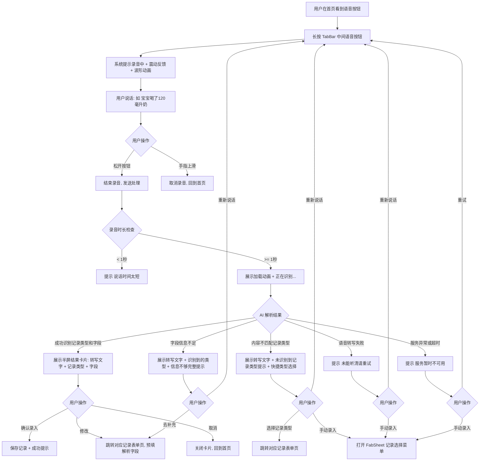
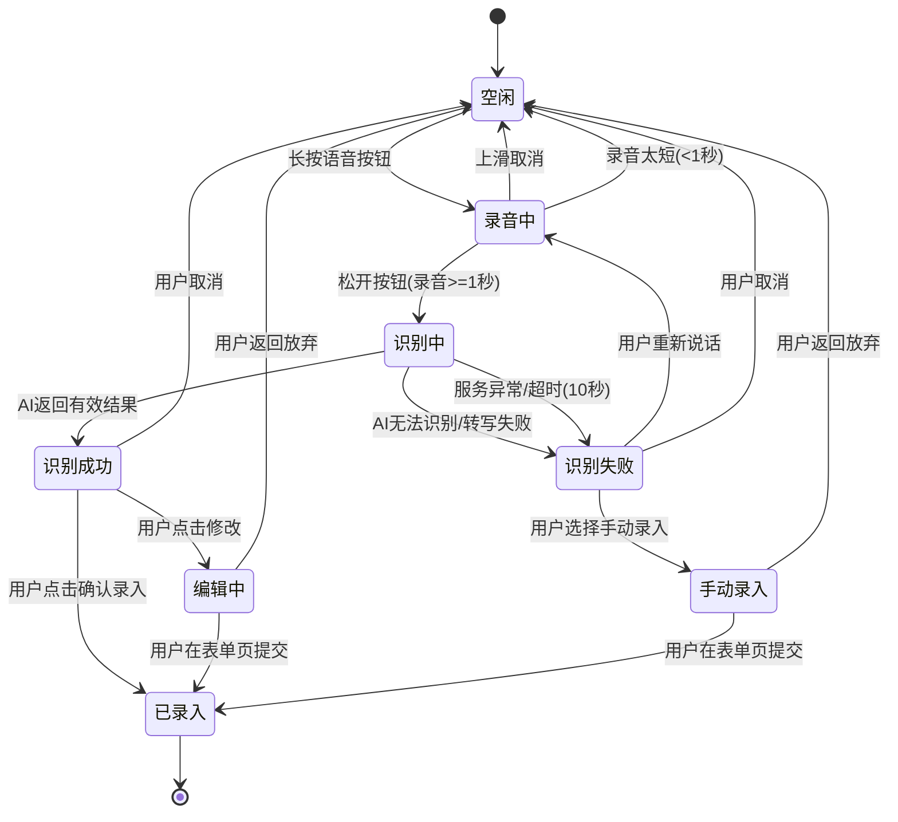
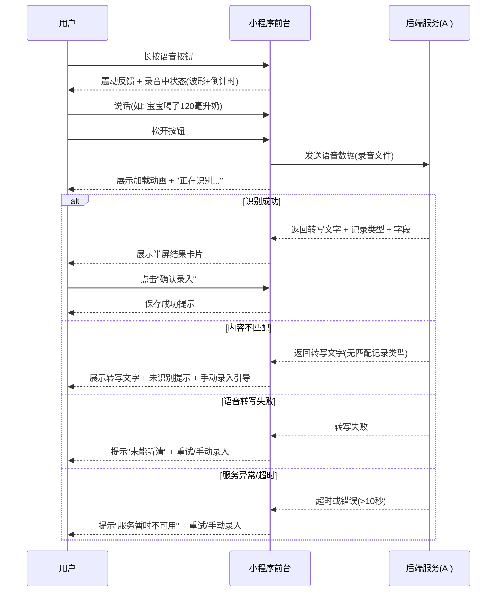

# 产品需求文档：语音录入功能 - V1.0

## 1. 综述 (Overview)

### 1.1 项目背景与核心问题

minicare MVP 版本已上线，当前用户反馈最大的痛点是**录入成本高**。现有记录创建流程需要用户：点击记录类型 → 跳转表单页 → 逐项填写字段 → 提交。对于一天需要多次记录的宝妈/宝爸来说，尤其是单手抱娃场景下，手动操作成本极高。

本需求旨在通过**语音录入**能力，让用户"说一句话即可完成记录"，大幅降低录入门槛，验证语音交互在育儿记录场景的可行性。

### 1.2 核心业务流程 / 用户旅程地图

1. **阶段一：语音采集** — 用户长按语音按钮，说出宝宝记录内容
2. **阶段二：识别与解析** — 系统将语音转文字，AI 识别记录类型和关键字段
3. **阶段三：结果确认** — 展示解析结果，用户确认或修改后完成录入

### 1.3 Mermaid 图（流程/状态/时序）

#### 1.3.1 用户操作流（必填）



#### 1.3.2 语音录入记录状态机



#### 1.3.3 关键场景时序（语音采集与识别）



## 2. 用户故事详述 (User Stories)

### 阶段一：语音采集

---

#### **US-01: 作为宝妈/宝爸，我希望长按首页语音按钮即可进行语音输入，以便于用说话代替手动填表来记录宝宝信息**

* **价值陈述 (Value Statement)**:
  * **作为**宝妈/宝爸
  * **我希望**长按首页语音按钮即可进行语音输入
  * **以便于**在单手抱娃等不便操作场景下，用说话代替手动填表来快速记录宝宝信息

* **业务规则与逻辑 (Business Logic)**:
  1. **前置条件**: 用户已登录；已授权麦克风权限。
  2. **操作流程 (Happy Path)**:
     1. 用户在首页 TabBar 看到中间的语音按钮（原 FAB "+" 位置）。
     2. 用户长按语音按钮，系统给出震动反馈，进入录音状态。
     3. 录音界面展示：音量波形动画 + 剩余时长倒计时（最长 30 秒）。
     4. 用户说话，如"宝宝喝了120毫升奶"。
     5. 用户松开按钮，录音结束，语音数据发送至后端进行识别处理。
  3. **异常处理 (Error Handling)**:
     * **录音时间过短**：录音时长 < 1 秒时松开，提示"说话时间太短"，不发送处理。
     * **上滑取消**：录音过程中手指上滑，显示"松开手指取消录音"提示，松开后取消录音，回到首页。
     * **录音时长达到上限**：录音达到 30 秒自动结束并发送处理，提示"已达最长录音时间"。
     * **麦克风权限未授权**：首次长按时请求麦克风权限；若用户拒绝，提示"需要麦克风权限才能使用语音录入"并提供"前往设置"按钮。
     * **短按行为**：短按（非长按）语音按钮时，打开 FabSheet 记录选择菜单（保留原有 FAB 功能）。

* **验收标准 (Acceptance Criteria)**:
  * **场景1: 成功录音**
    * **GIVEN** 用户已登录且已授权麦克风权限
    * **WHEN** 用户长按 TabBar 中间语音按钮并说话后松开
    * **THEN** 系统展示"正在识别..."加载状态，语音数据发送至后端
  * **场景2: 录音时间过短**
    * **GIVEN** 用户已登录且已授权麦克风权限
    * **WHEN** 用户长按语音按钮后在 1 秒内松开
    * **THEN** 提示"说话时间太短"，不发送语音数据
  * **场景3: 上滑取消录音**
    * **GIVEN** 用户正在录音中
    * **WHEN** 用户手指上滑并松开
    * **THEN** 录音取消，回到首页，不发送语音数据
  * **场景4: 麦克风权限被拒绝**
    * **GIVEN** 用户未授权麦克风权限
    * **WHEN** 用户长按语音按钮
    * **THEN** 提示"需要麦克风权限才能使用语音录入"并提供"前往设置"按钮
  * **场景5: 短按打开菜单**
    * **GIVEN** 用户在首页
    * **WHEN** 用户短按（非长按）TabBar 中间语音按钮
    * **THEN** 打开 FabSheet 记录选择菜单，与原有 FAB "+" 行为一致

---

* **页面布局线框图 (ASCII Wireframe)**:

  **录音中状态**：
  ```text
  +-------------------------------------------------------------+
  |                                                             |
  |                    首页内容区域                               |
  |                    (正常展示，底部被遮挡)                      |
  |                                                             |
  +-------------------------------------------------------------+
  |                                                             |
  |              ~~~ 正在录音 ~~~                                |
  |                                                             |
  |           [  音量波形动画  ]                                  |
  |                                                             |
  |            23s  ← 剩余时长倒计时                              |
  |                                                             |
  |         ↑ 上滑可取消                                         |
  |                                                             |
  +-------------------------------------------------------------+
  |  首页  |  记录  |  (🎤)  |  分析  |  我的  |  ← TabBar     |
  |              按住说话                                        |
  +-------------------------------------------------------------+
  ```

  **上滑取消状态**：
  ```text
  +-------------------------------------------------------------+
  |                                                             |
  |                    首页内容区域                               |
  |                                                             |
  +-------------------------------------------------------------+
  |                                                             |
  |              ✕ 松开手指                                      |
  |                取消录音                                      |
  |                                                             |
  +-------------------------------------------------------------+
  |  首页  |  记录  |  (🎤)  |  分析  |  我的  |               |
  +-------------------------------------------------------------+
  ```

---

### 阶段二：识别与解析

---

#### **US-02: 作为宝妈/宝爸，我希望系统将我的语音内容自动识别为对应的记录类型和关键字段，以便于无需手动选择类型和填写表单**

* **价值陈述 (Value Statement)**:
  * **作为**宝妈/宝爸
  * **我希望**系统自动将语音内容识别为对应的记录类型和关键字段
  * **以便于**无需手动选择记录类型和逐项填写表单，一句话即可完成记录

* **业务规则与逻辑 (Business Logic)**:
  1. **前置条件**: 用户已完成语音录制（录音时长 >= 1 秒），语音数据已发送至后端。
  2. **操作流程 (Happy Path)**:
     1. 录音结束后，首页展示加载动画 + "正在识别..."文案。
     2. 后端完成语音转文字 + AI 语义解析，返回结果。
     3. 若成功识别，进入 US-03 结果确认流程。
  3. **AI 解析范围**:
     * MVP 仅支持 7 种高频记录类型及其基本字段：

     | 记录类型 | 语音示例 | 识别的基本字段 |
     |---------|---------|--------------|
     | 配方奶 | "宝宝喝了120毫升奶" | 奶量(ml) |
     | 母乳 | "左边喂了15分钟" | 哺乳侧、时长 |
     | 辅食 | "吃了半个苹果泥" | 食物名称 |
     | 尿布 | "换了个大便尿布" | 大便/小便、便便性状 |
     | 睡眠 | "宝宝睡了两个小时" | 时长、睡眠时段 |
     | 体温 | "体温38度5" | 体温值 |
     | 表现 | "宝宝今天很开心" | 精神状态、心情 |

     * 未提及的字段使用默认值，记录时间默认为当前时间。
     * 语音内容不属于这 7 种类型时，按"无法识别记录类型"处理。
  4. **异常处理 (Error Handling)**:
     * **内容不匹配记录类型**：语音内容与 7 种记录类型无关（如"今天天气真好"），进入 US-04 失败处理流程。
     * **字段信息不足**：识别到记录类型但关键字段缺失（如"宝宝吃了点东西"），进入 US-04 失败处理流程。
     * **语音转写失败**：环境嘈杂或说话不清导致无法转写，进入 US-04 失败处理流程。
     * **服务异常**：后端服务不可用或网络错误，进入 US-04 失败处理流程。
     * **处理超时**：超过 10 秒未返回结果，提示"识别超时，请重试"，提供重试和手动录入入口。
  5. **约束**: 一次语音只生成一条记录，不支持一句话包含多条记录的场景。

* **验收标准 (Acceptance Criteria)**:
  * **场景1: 成功识别配方奶记录**
    * **GIVEN** 用户说了"宝宝喝了120毫升奶"
    * **WHEN** 系统完成语音识别和语义解析
    * **THEN** 识别结果为：记录类型=配方奶，奶量=120ml，时间=当前时间
  * **场景2: 成功识别体温记录**
    * **GIVEN** 用户说了"宝宝体温38度5"
    * **WHEN** 系统完成语音识别和语义解析
    * **THEN** 识别结果为：记录类型=体温，体温值=38.5°C，时间=当前时间
  * **场景3: 识别超时**
    * **GIVEN** 用户完成语音录制，语音数据已发送
    * **WHEN** 后端 10 秒内未返回结果
    * **THEN** 提示"识别超时，请重试"，提供重新说话和手动录入两个入口
  * **场景4: 内容不属于支持范围**
    * **GIVEN** 用户说了"今天天气真好"
    * **WHEN** 系统完成语音识别和语义解析
    * **THEN** 进入失败处理流程，展示转写文字 + 未识别到记录类型提示

---

### 阶段三：结果确认

---

#### **US-03: 作为宝妈/宝爸，我希望查看 AI 解析的结果并快速确认录入，以便于确保记录准确且操作高效**

* **价值陈述 (Value Statement)**:
  * **作为**宝妈/宝爸
  * **我希望**查看 AI 解析的结果并快速确认录入
  * **以便于**确保记录内容准确，同时保持操作高效

* **业务规则与逻辑 (Business Logic)**:
  1. **前置条件**: AI 成功识别出记录类型和基本字段。
  2. **操作流程 (Happy Path)**:
     1. 识别成功后，在首页弹出半屏弹窗卡片。
     2. 卡片内容从上到下：
        - 原始语音转写文字（如"宝宝喝了120毫升奶"）
        - 记录类型标签（如"配方奶"，带对应颜色和图标）
        - 解析出的基本字段（如"奶量 120ml"）
        - 记录时间（默认当前时间）
     3. 用户点击"确认录入"，系统保存记录，展示成功提示（Toast），卡片关闭。
     4. 首页记录列表自动刷新，展示新录入的记录。
  3. **异常处理 (Error Handling)**:
     * **用户点击"修改"**：跳转到对应记录的表单页，预填 AI 解析出的字段，用户可编辑后提交。
     * **用户点击"取消"**：关闭卡片，回到首页，不保存任何数据。
     * **用户下拉卡片**：关闭卡片，回到首页，不保存任何数据。
     * **保存失败**：提示"保存失败，请重试"，卡片保持打开状态，用户可再次点击确认或选择其他操作。

* **验收标准 (Acceptance Criteria)**:
  * **场景1: 确认录入成功**
    * **GIVEN** AI 成功识别出"配方奶，奶量 120ml"
    * **WHEN** 用户在结果卡片点击"确认录入"
    * **THEN** 记录保存成功，展示成功提示，卡片关闭，首页记录列表刷新
  * **场景2: 修改后录入**
    * **GIVEN** AI 成功识别出"配方奶，奶量 120ml"
    * **WHEN** 用户点击"修改"
    * **THEN** 跳转到配方奶记录表单页，奶量字段预填为 120ml，用户可编辑后提交
  * **场景3: 取消录入**
    * **GIVEN** 结果卡片已展示
    * **WHEN** 用户点击"取消"或下拉卡片
    * **THEN** 卡片关闭，回到首页，不保存任何数据

---

* **页面布局线框图 (ASCII Wireframe)**:

  ```text
  +-------------------------------------------------------------+
  |                                                             |
  |  首页内容区域（半透明遮罩）                                    |
  |                                                             |
  +=============================================================+
  |  ↕ 可下拉关闭                                                |
  +-------------------------------------------------------------+
  |                                                             |
  |  "宝宝喝了120毫升奶"                    ← 语音转写文字        |
  |                                                             |
  +-------------------------------------------------------------+
  |                                                             |
  |  ┌─────────┐                                                |
  |  │ 配方奶   │  ← 记录类型标签                                 |
  |  └─────────┘                                                |
  |                                                             |
  |  奶量        120 ml                                         |
  |  时间        14:30（刚刚）                    ← 默认当前时间   |
  |                                                             |
  +-------------------------------------------------------------+
  |                                                             |
  |  [ 取消 ]     [ 修改 ]     [ 确认录入 ]                      |
  |                                                             |
  +=============================================================+
  ```

---

#### **US-04: 作为宝妈/宝爸，当 AI 无法识别我的语音内容时，我希望看到转写文字并引导手动录入，以便于不会白说一遍**

* **价值陈述 (Value Statement)**:
  * **作为**宝妈/宝爸
  * **我希望**当 AI 无法识别我的语音内容时，看到转写文字并引导手动录入
  * **以便于**不会白说一遍，仍能通过手动方式完成记录

* **业务规则与逻辑 (Business Logic)**:
  1. **前置条件**: AI 解析失败（内容不匹配 / 字段不足 / 转写失败 / 服务异常）。
  2. **操作流程 — 按失败类型分述**:
     * **内容不匹配记录类型**：
       1. 在首页弹出半屏弹窗卡片。
       2. 卡片展示：转写文字 + "未识别到记录类型"提示 + 7 种记录类型快捷选择按钮。
       3. 用户选择记录类型后，跳转对应表单页。
       4. 用户也可点击"重新说话"重试，或点击"手动录入"打开 FabSheet 菜单。
     * **字段信息不足**：
       1. 在首页弹出半屏弹窗卡片。
       2. 卡片展示：转写文字 + 识别到的记录类型标签 + "信息不够完整"提示。
       3. 用户点击"去补充"跳转对应表单页（预填已识别字段），或"重新说话"重试。
     * **语音转写失败**：
       1. 在首页弹出半屏弹窗卡片。
       2. 卡片展示："未能听清，请重试"提示（无转写文字）。
       3. 用户可点击"重新说话"重试，或"手动录入"打开 FabSheet 菜单。
     * **服务异常 / 超时**：
       1. 在首页弹出半屏弹窗卡片。
       2. 卡片展示："服务暂时不可用，请稍后重试"提示。
       3. 用户可点击"重试"重新录音，或"手动录入"打开 FabSheet 菜单。
  3. **异常处理 (Error Handling)**:
     * **用户取消**：点击遮罩或下拉卡片关闭，回到首页。
     * **连续失败**：不限制重试次数，但每次均需重新长按录音。

* **验收标准 (Acceptance Criteria)**:
  * **场景1: 内容不匹配 — 选择手动类型**
    * **GIVEN** 用户说了"今天天气真好"，AI 无法匹配记录类型
    * **WHEN** 系统展示转写文字 + 7 种记录类型快捷按钮
    * **THEN** 用户点击任一类型按钮，跳转对应记录表单页
  * **场景2: 字段不足 — 去补充**
    * **GIVEN** 用户说了"宝宝吃了点东西"，AI 识别为辅食但缺少食物名称
    * **WHEN** 系统展示转写文字 + 辅食类型标签 + "信息不够完整"提示
    * **THEN** 用户点击"去补充"，跳转辅食表单页
  * **场景3: 转写失败 — 重新说话**
    * **GIVEN** 语音转写失败
    * **WHEN** 系统提示"未能听清，请重试"
    * **THEN** 用户点击"重新说话"，重新进入长按录音流程
  * **场景4: 服务异常 — 手动录入**
    * **GIVEN** 后端服务不可用
    * **WHEN** 系统提示"服务暂时不可用"
    * **THEN** 用户点击"手动录入"，打开 FabSheet 记录选择菜单

---

* **页面布局线框图 (ASCII Wireframe)**:

  **场景：内容不匹配记录类型**
  ```text
  +-------------------------------------------------------------+
  |                                                             |
  |  首页内容区域（半透明遮罩）                                    |
  |                                                             |
  +=============================================================+
  |  ↕ 可下拉关闭                                                |
  +-------------------------------------------------------------+
  |                                                             |
  |  "今天天气真好"                         ← 语音转写文字        |
  |                                                             |
  +-------------------------------------------------------------+
  |                                                             |
  |  ⚠ 未识别到记录类型                                          |
  |  请选择要记录的类型，或重新说话                                |
  |                                                             |
  |  ┌──────┐ ┌──────┐ ┌──────┐ ┌──────┐                       |
  |  │配方奶│ │ 母乳 │ │ 辅食 │ │ 尿布 │  ← 快捷类型选择        |
  |  └──────┘ └──────┘ └──────┘ └──────┘                       |
  |  ┌──────┐ ┌──────┐ ┌──────┐                                |
  |  │ 睡眠 │ │ 体温 │ │ 表现 │                                 |
  |  └──────┘ └──────┘ └──────┘                                |
  |                                                             |
  +-------------------------------------------------------------+
  |                                                             |
  |  [ 重新说话 ]              [ 手动录入 › ]                     |
  |                                                             |
  +=============================================================+
  ```

  **场景：字段信息不足**
  ```text
  +-------------------------------------------------------------+
  |                                                             |
  |  首页内容区域（半透明遮罩）                                    |
  |                                                             |
  +=============================================================+
  |  ↕ 可下拉关闭                                                |
  +-------------------------------------------------------------+
  |                                                             |
  |  "宝宝吃了点东西"                       ← 语音转写文字        |
  |                                                             |
  +-------------------------------------------------------------+
  |                                                             |
  |  ┌──────┐                                                   |
  |  │ 辅食 │  ← 识别到的记录类型                                 |
  |  └──────┘                                                   |
  |                                                             |
  |  ⚠ 信息不够完整                                              |
  |  请补充详细内容后提交                                         |
  |                                                             |
  +-------------------------------------------------------------+
  |                                                             |
  |  [ 重新说话 ]        [ 去补充 › ]                             |
  |                                                             |
  +=============================================================+
  ```

  **场景：语音转写失败 / 服务异常**
  ```text
  +-------------------------------------------------------------+
  |                                                             |
  |  首页内容区域（半透明遮罩）                                    |
  |                                                             |
  +=============================================================+
  |  ↕ 可下拉关闭                                                |
  +-------------------------------------------------------------+
  |                                                             |
  |  ⚠ 未能听清，请重试                                          |
  |    （或：服务暂时不可用，请稍后重试）                           |
  |                                                             |
  +-------------------------------------------------------------+
  |                                                             |
  |  [ 重新说话 ]              [ 手动录入 › ]                     |
  |                                                             |
  +=============================================================+
  ```

---

## 3. 非目标 (Non-Goals)

以下内容明确**不在**本次 MVP 范围内：

1. **多记录识别**：一次语音生成多条记录（如"喝了奶又换了尿布"），MVP 不支持
2. **低频记录类型**：健康、生长、医疗、营养素、活动等 5 种低频类型，MVP 不支持语音录入
3. **语音历史回放**：不保存原始语音文件，不支持回放
4. **离线语音识别**：必须联网使用
5. **自定义语音指令**：不支持用户自定义语音快捷指令
6. **多语言支持**：MVP 仅支持中文普通话
7. **语音唤醒**：不支持免按键语音唤醒

## 4. 开放问题与风险

| 编号 | 问题/风险 | 影响 | 建议 |
|------|----------|------|------|
| R-01 | 方言/口音可能导致识别率低 | 用户体验差，失败率高 | MVP 先验证普通话场景，后续迭代考虑方言适配 |
| R-02 | 嘈杂环境下语音转写准确率下降 | 识别失败率升高 | 提供清晰的失败引导和手动录入兜底 |
| R-03 | AI 语义解析的字段准确率未验证 | 用户需频繁修改，反而增加操作成本 | 上线前需进行充分的语料测试，确保核心场景准确率达标 |
| R-04 | 语音处理延迟可能影响体验 | 等待时间过长导致用户流失 | 10 秒超时限制 + 清晰的加载状态反馈 |
| R-05 | 原有 FAB "+" 按钮功能变更 | 习惯短按添加记录的用户可能困惑 | 短按仍保留 FabSheet 菜单功能，长按才是语音，需引导用户发现 |
