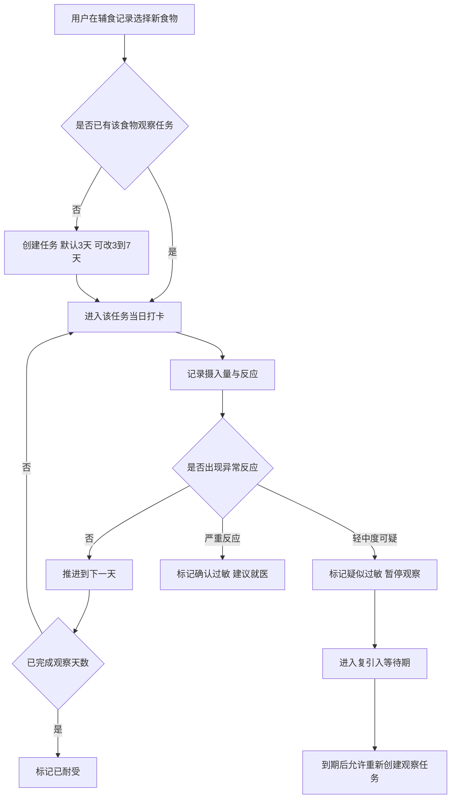
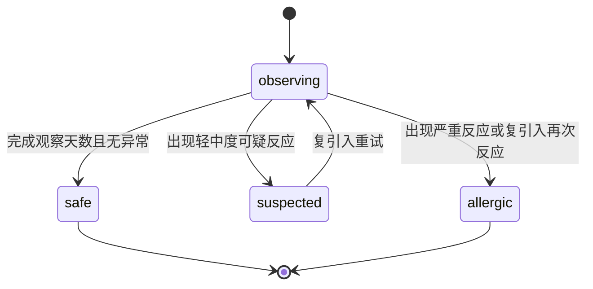
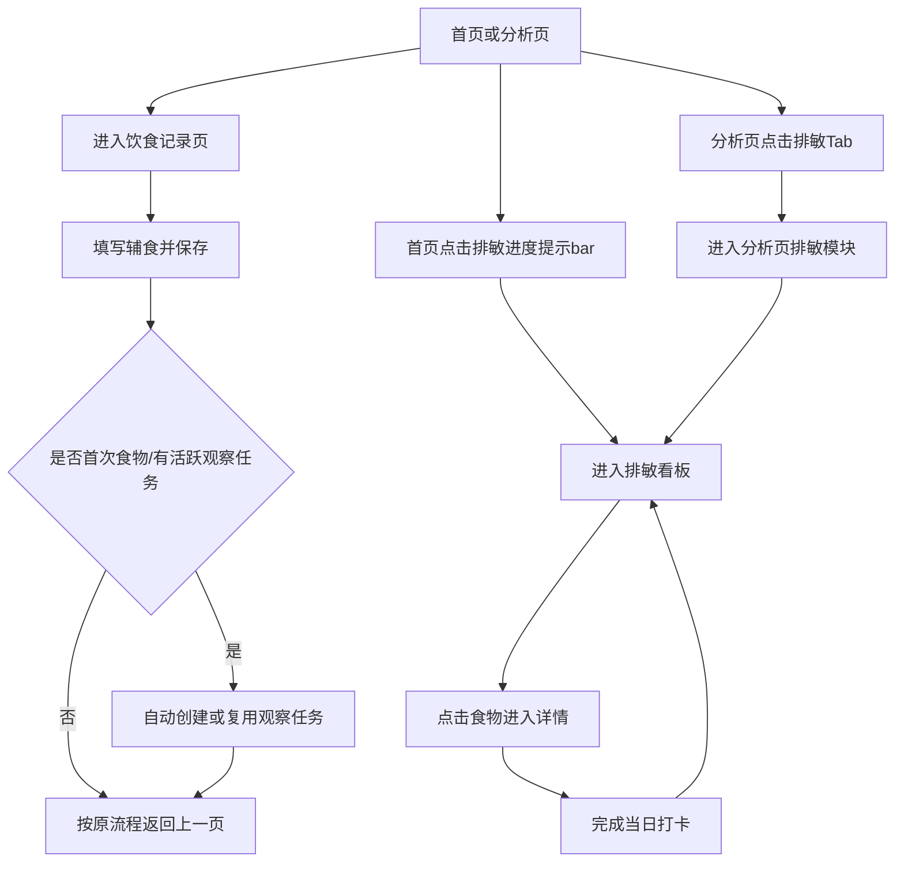
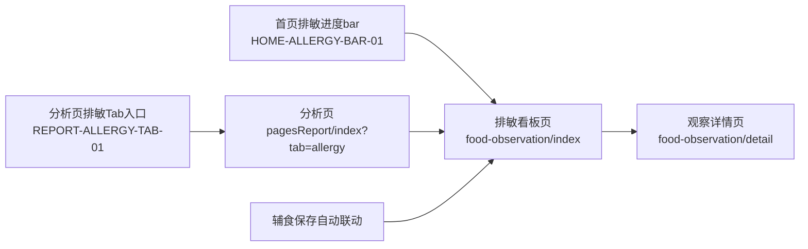

# 产品需求文档：辅食记录与排敏管理 - V0.9

## 1. 综述 (Overview)

### 1.1 项目背景与核心问题

小程序当前的辅食记录能力以“单次记录”为主，能够记录吃了什么，但无法形成“连续观察、状态判断、就医复盘”的排敏闭环。  
在真实喂养场景中，家长通常遵循“每次新增一种食物、连续观察 2-3 天（或 3-5 天）”的方法来识别潜在过敏原。当前产品缺少“观察任务”与“进度可视化”，导致：

1. 家长容易忘记某个食物进行到第几天；
2. 同日新增多种食物后难以定位异常来源；
3. 出现皮疹、腹泻等反应后，缺少可回溯证据链；
4. 家庭协作喂养时信息不同步。

本需求目标是在现有辅食记录基础上，新增“排敏任务化管理”，让用户直观看到每个食物的排敏进展与风险状态，并支持异常处理与复引入管理。

### 1.2 核心业务流程 / 用户旅程地图

1. **阶段一：创建观察任务** - 首次引入新食物时创建观察任务（默认 3 天，可配置 3-7 天）。
2. **阶段二：每日进度推进** - 记录每日摄入与反应，更新 Day1/Day2/Day3 进度。
3. **阶段三：异常判定处理** - 出现反应时标记疑似或确认过敏，给出暂停与就医建议。
4. **阶段四：复盘与复引入** - 查看历史记录，并在满足条件时发起复引入观察。

### 1.3 Mermaid 图（流程/状态/时序）

#### 1.3.1 用户操作流（必填）



#### 1.3.2 状态机（当存在明确状态流转对象时必填）



## 2. 用户故事详述 (User Stories)

### 阶段一：创建观察任务

---

#### **US-01: 作为主要照护者，我希望首次引入新食物时自动创建观察任务，以便我能清楚知道排敏进行到第几天。**

*   **价值陈述 (Value Statement)**:
    *   **作为** 主要照护者
    *   **我希望** 首次新增食物时自动进入观察任务
    *   **以便于** 不依赖手工记忆即可跟踪排敏进展
*   **业务规则与逻辑 (Business Logic)**:
    1.  **前置条件**: 宝宝档案已存在，用户有记录权限。
    2.  **操作流程 (Happy Path)**:
        1. 用户在辅食 Tab 录入新食物名称并保存。
        2. 系统判定该食物是否已有任务；若无则创建观察任务（默认 3 天）。
        3. 任务状态初始化为 `observing`，进度初始化为 `Day1`。
    3.  **异常处理 (Error Handling)**:
        * 若同一时间存在多个活跃新食物任务，系统提示“建议一次仅新增一种食物”，但不强制阻断。
        * 若食物名称重复但状态为 `safe`，允许继续记录，不重复创建任务。
*   **验收标准 (Acceptance Criteria)**:
    *   **场景1: 首次新增食物创建成功**
        *   **GIVEN** 宝宝不存在“南瓜泥”观察任务
        *   **WHEN** 用户新增“南瓜泥”并保存
        *   **THEN** 系统创建任务并展示“观察中 Day1/3”。
    *   **场景2: 已有任务不重复创建**
        *   **GIVEN** 宝宝已有“南瓜泥”观察任务且状态为 observing
        *   **WHEN** 用户再次新增“南瓜泥”
        *   **THEN** 系统不新建任务，进入原任务当天进度更新。
---
*   **页面布局线框图 (ASCII Wireframe)**:
    ```text
    +------------------------------------------------------+
    | 辅食记录                                              |
    +------------------------------------------------------+
    | 食物名称 [ 南瓜泥                    ]               |
    | [保存并开始观察]                                      |
    +------------------------------------------------------+
    | 提示：建议一次仅新增一种新食物，便于排查              |
    +------------------------------------------------------+
    ```
---

### 阶段二：进度可视化与每日打卡

---

#### **US-02: 作为家长，我希望在看板中一眼看到每个食物进行到第几天，以便快速判断今天该跟进什么。**

*   **价值陈述 (Value Statement)**:
    *   **作为** 家长
    *   **我希望** 看板按食物展示观察进度和状态
    *   **以便于** 直观掌握排敏全局进展
*   **业务规则与逻辑 (Business Logic)**:
    1.  **前置条件**: 至少存在一个 food observation 任务。
    2.  **操作流程 (Happy Path)**:
        1. 用户进入“排敏进度看板”。
        2. 系统按食物展示 Day 进度格（如 Day1/Day2/Day3）与当前状态。
        3. 用户点击行进入详情页完成当日打卡（摄入量/是否有反应）。
    3.  **异常处理 (Error Handling)**:
        * 当日未打卡时，状态显示“待记录”。
        * 跨天未记录时，提示“昨日未完成观察记录”并可补录。
*   **验收标准 (Acceptance Criteria)**:
    *   **场景1: 进度可见**
        *   **GIVEN** 存在南瓜泥 Day2、鸡蛋黄 Day1 任务
        *   **WHEN** 打开看板
        *   **THEN** 可同时看到“南瓜泥 Day2/3”“鸡蛋黄 Day1/3”。
    *   **场景2: 当日打卡更新进度**
        *   **GIVEN** 南瓜泥为 Day2 待打卡
        *   **WHEN** 用户完成“无反应”打卡
        *   **THEN** 进度推进至 Day3。
---
*   **页面布局线框图 (ASCII Wireframe)**:
    ```text
    +------------------------------------------------------+
    | 排敏进度看板                                          |
    | [全部] [观察中] [疑似] [已耐受] [确认过敏]            |
    +------------------------------------------------------+
    | 食物       进度(日)                    状态            |
    | 南瓜泥     [D1][D2][  ]                观察中 Day2/3  |
    | 鸡蛋黄     [D1][  ][  ]                观察中 Day1/3  |
    | 鳕鱼       [D1][D2][D3]                已耐受         |
    +------------------------------------------------------+
    | 点击任一行进入详情：                                  |
    | 今日摄入量 / 是否有反应 / 备注                        |
    +------------------------------------------------------+
    ```
---

### 阶段三：异常判定与处理

---

#### **US-03: 作为家长，我希望在出现可疑反应时能快速标记状态并暂停该食物，以便减少重复风险暴露。**

*   **价值陈述 (Value Statement)**:
    *   **作为** 家长
    *   **我希望** 把异常反应直接绑定到食物任务
    *   **以便于** 快速执行暂停或就医决策
*   **业务规则与逻辑 (Business Logic)**:
    1.  **前置条件**: 任务状态为 `observing`。
    2.  **操作流程 (Happy Path)**:
        1. 用户在任务详情勾选反应类型（如皮疹、呕吐、腹泻）。
        2. 系统提示选择“疑似过敏（暂停观察）”或“确认过敏（建议就医）”。
        3. 用户确认后，任务状态更新并记录 reaction note。
    3.  **异常处理 (Error Handling)**:
        * 若用户选择严重反应，弹窗提示“建议立即就医”。
        * 已标记 `allergic` 的任务禁止继续推进 Day 进度。
*   **验收标准 (Acceptance Criteria)**:
    *   **场景1: 标记疑似过敏**
        *   **GIVEN** 鸡蛋黄任务为 observing Day2
        *   **WHEN** 用户记录皮疹并选择“疑似过敏”
        *   **THEN** 状态更新为 suspected，进度暂停。
    *   **场景2: 标记确认过敏**
        *   **GIVEN** 任务存在明显严重反应
        *   **WHEN** 用户选择“确认过敏”
        *   **THEN** 状态更新为 allergic，并展示就医提示。
---
*   **页面布局线框图 (ASCII Wireframe)**:
    ```text
    +------------------------------------------------------+
    | 食物观察详情 - 鸡蛋黄                                 |
    +------------------------------------------------------+
    | 当前进度：Day2/3  状态：观察中                        |
    | 今日摄入量 [      ] g                                 |
    | 反应： [ ]皮疹 [ ]呕吐 [ ]腹泻 [ ]血便                |
    | 备注： [                                ]             |
    +------------------------------------------------------+
    | [标记无反应并继续] [标记疑似过敏] [标记确认过敏]      |
    +------------------------------------------------------+
    ```
---

## 3. 小程序现状与问题梳理

### 3.1 现状

1. 辅食记录已支持多食物录入和列表展示；
2. 后端已存在 `food_observation` 表结构（状态、观察天数、引入次数等字段）；
3. 当前前端未提供排敏任务入口和进度看板；
4. 当前后端未形成排敏任务完整业务 API 闭环。

### 3.2 主要问题

1. 无“观察任务”对象，缺少状态机与生命周期；
2. 无 Day 进度看板，无法直观看到第几天；
3. 无异常到食物任务的结构化关联；
4. 家庭协作时信息不一致，影响执行质量。

## 4. 竞品与设计启发

### 4.1 行业通用模式

1. 食物库 + 状态标记（未测/通过/过敏）；
2. 日历或看板式进度追踪；
3. 反应日志与复盘导出。

### 4.2 本方案差异点（结合草图）

1. 采用“行=食物、列=天数”的矩阵看板，强化“第几天”可见性；
2. 将观察状态与异常处理绑定，减少跨页面跳转；
3. 支持 3-7 天可配置观察期，兼容不同家庭策略。

## 5. 范围与优先级

### 5.1 P0（本期）

1. 排敏任务创建与状态机（observing/safe/suspected/allergic）；
2. 排敏进度看板（按食物展示 Day 进度）；
3. 任务详情每日打卡；
4. 疑似与确认过敏标记。

### 5.2 P1（后续）

1. 复引入日提醒；
2. 与健康记录自动关联建议；
3. 医生沟通版导出视图增强。

## 6. 约束与风险

1. 所有风险提示为健康管理建议，不替代医疗诊断；
2. 多新食物并行观察会降低排查准确性，需持续提示；
3. 食物命名规范化（同义词）影响统计准确度，需后续治理。

## 7. 参考资料

1. 国家卫健委《婴幼儿营养喂养评估服务指南（试行）》  
   https://www.nhc.gov.cn/fys/c100078/202502/19903ff647694f3a85ed6fe332380b34.shtml
2. 中国营养学会《7-24月龄婴幼儿喂养指南》  
   http://dg.cnsoc.org/article/04/8a2389fd5520b4f30155a5d4d78621c4.html
3. NHS Baby food allergies  
   https://www.nhs.uk/best-start-in-life/baby/weaning/safe-weaning/food-allergies/

## 8. 数据模型（Data Model）

### 8.1 设计原则

1. 复用现有 `food_observation` 作为“食物观察任务主表”；
2. 新增“每日观察日志表”，承载 Day1/Day2/Day3 的逐日记录；
3. 所有枚举字段使用字符串（VARCHAR），与当前项目迁移方向一致；
4. 仅做健康管理记录，不做医疗诊断结论。
5. 复用已有“过敏症状记录能力”（`health_record`），与排敏任务做双向关联，不做表合并。

### 8.2 主表：`food_observation`（已有，补充约束）

> 当前库已存在（见 migration 008），本期以“补字段/补索引/补约束”为主，不建议重建。

| 字段 | 类型 | 说明 | 示例 |
|---|---|---|---|
| `id` | CHAR(36) | 任务 ID | uuid |
| `baby_id` | CHAR(36) | 宝宝 ID | uuid |
| `food_name` | VARCHAR(100) | 食物名（标准化前） | 鸡蛋黄 |
| `first_intro_at` | DATE | 首次引入日期 | 2026-05-26 |
| `last_intro_at` | DATE | 最近一次引入日期 | 2026-05-27 |
| `intro_count` | SMALLINT UNSIGNED | 累计引入次数 | 2 |
| `observation_days` | TINYINT UNSIGNED | 观察期天数（3-7） | 3 |
| `status` | VARCHAR(20) | `observing/safe/suspected/allergic` | observing |
| `reaction_note` | TEXT | 异常说明 | 出现面颊皮疹 |
| `created_at` | DATETIME | 创建时间 | - |
| `updated_at` | DATETIME | 更新时间 | - |

#### 建议补充字段（本期推荐）

| 字段 | 类型 | 说明 |
|---|---|---|
| `current_day` | TINYINT UNSIGNED | 当前进行到第几天（1..observation_days） |
| `last_status_changed_at` | DATETIME | 最近状态变更时间 |
| `retry_after_date` | DATE NULL | 可复引入日期（疑似过敏后） |
| `severity` | VARCHAR(20) NULL | `mild/moderate/severe`（记录任务级严重程度） |

#### 建议索引

1. `idx_food_obs_baby_status_updated` (`baby_id`, `status`, `updated_at` DESC)
2. `idx_food_obs_baby_day` (`baby_id`, `current_day`)
3. 保留唯一键 `uk_food_obs_baby_food` (`baby_id`, `food_name`)

### 8.3 子表：`food_observation_log`（本期新增）

> 一条任务对应多条逐日记录，用于看板 Day 格子渲染与审计回溯。

| 字段 | 类型 | 说明 | 示例 |
|---|---|---|---|
| `id` | CHAR(36) | 日志 ID | uuid |
| `observation_id` | CHAR(36) | 关联任务 ID | uuid |
| `baby_id` | CHAR(36) | 冗余字段，便于查询 | uuid |
| `day_index` | TINYINT UNSIGNED | 第几天（1..7） | 2 |
| `record_date` | DATE | 当天日期 | 2026-05-27 |
| `intake_amount_g` | DECIMAL(6,1) NULL | 当日摄入克数 | 18.5 |
| `reaction_flags` | JSON NULL | 反应标签数组 | ["rash","diarrhea"] |
| `reaction_level` | VARCHAR(20) NULL | `none/mild/moderate/severe` | mild |
| `note` | TEXT NULL | 备注 | 晚上出现轻微红点 |
| `action` | VARCHAR(20) | `continue/pause/mark_suspected/mark_allergic` | continue |
| `health_record_id` | CHAR(36) NULL | 关联健康记录 ID（过敏症状事实） | uuid |
| `recorded_by` | CHAR(36) | 记录人 | uuid |
| `created_at` | DATETIME | 创建时间 | - |
| `updated_at` | DATETIME | 更新时间 | - |

#### 约束建议

1. 唯一约束：`uk_obs_day` (`observation_id`, `day_index`)
2. 检查约束：`day_index BETWEEN 1 AND 7`
3. 外键：`observation_id` -> `food_observation.id`（ON DELETE CASCADE）
4. 可选外键：`health_record_id` -> `health_record.id`（SET NULL）

### 8.4 反应枚举建议（前后端统一）

| 枚举值 | 中文 |
|---|---|
| `rash` | 皮疹 |
| `vomit` | 呕吐 |
| `diarrhea` | 腹泻 |
| `blood_stool` | 血便 |
| `wheeze` | 喘息 |
| `face_swelling` | 面部/口唇肿胀 |
| `other` | 其他 |

### 8.5 复用与关联策略（过敏记录表）

#### 8.5.1 结论

1. **不合并表**：`food_observation` 负责排敏流程状态；`health_record` 负责症状事实记录。
2. **做双向关联**：形成“食物进度 -> 症状事实 -> 处理结果”的可追溯链路。

#### 8.5.2 字段建议

**A. `health_record`（已有表）建议新增可选字段**

| 字段 | 类型 | 说明 |
|---|---|---|
| `observation_id` | CHAR(36) NULL | 关联排敏任务 ID |
| `food_name_snapshot` | VARCHAR(100) NULL | 触发时食物快照（避免后续改名影响回溯） |
| `reaction_source` | VARCHAR(20) NULL | `observation/manual`，区分来源 |

**B. `food_observation_log`（新增表）增加反向引用**

| 字段 | 类型 | 说明 |
|---|---|---|
| `health_record_id` | CHAR(36) NULL | 指向症状记录主键，便于报告 JOIN |

#### 8.5.3 联动规则

1. 在排敏详情标记“疑似/确认过敏”时，若用户勾选症状：
   - 可直接创建一条 `health_record`；
   - 回填 `food_observation_log.health_record_id`。
2. 在健康页新增过敏症状时，若用户选择“关联排敏任务”：
   - 回填 `health_record.observation_id`；
   - 同步更新对应 `food_observation` 状态（按用户确认，不自动强制）。
3. 任一侧删除记录时：
   - 仅断开关联，不级联硬删另一侧业务记录。

---

## 9. API 设计清单（Backend API）

### 9.1 约定

1. 路由风格：`/api/family/:familyId/...`
2. 鉴权：`JwtGuard + FamilyMemberGuard + RoleGuard`
3. 响应：保持项目现状“裸数据返回”（无全局 `data` 包装）
4. 错误：沿用 Nest 默认错误结构

### 9.2 观察任务 API

#### 1) 创建/复用任务

- `POST /api/family/:familyId/records/food-observations`
- 用途：首次引入或复引入时创建任务；若活跃任务已存在则返回该任务

请求体：

```json
{
  "baby_id": "uuid",
  "food_name": "鸡蛋黄",
  "observation_days": 3,
  "first_intro_at": "2026-05-26"
}
```

响应：

```json
{
  "id": "uuid",
  "status": "observing",
  "current_day": 1,
  "observation_days": 3,
  "reused": false
}
```

#### 2) 看板列表

- `GET /api/family/:familyId/records/food-observations?baby_id=xxx&status=observing`
- 用途：排敏看板主数据

响应：

```json
[
  {
    "id": "uuid",
    "food_name": "南瓜泥",
    "status": "observing",
    "current_day": 2,
    "observation_days": 3,
    "first_intro_at": "2026-05-26",
    "last_intro_at": "2026-05-27",
    "reaction_note": null
  }
]
```

#### 3) 单任务详情（含 Day 日志）

- `GET /api/family/:familyId/records/food-observations/:id`

响应：

```json
{
  "id": "uuid",
  "baby_id": "uuid",
  "food_name": "南瓜泥",
  "status": "observing",
  "current_day": 2,
  "observation_days": 3,
  "logs": [
    { "day_index": 1, "record_date": "2026-05-26", "reaction_level": "none" },
    { "day_index": 2, "record_date": "2026-05-27", "reaction_level": "none" }
  ]
}
```

#### 4) 更新任务状态

- `PATCH /api/family/:familyId/records/food-observations/:id/status`

请求体：

```json
{
  "status": "suspected",
  "reaction_note": "进食后2小时面颊出现红疹",
  "severity": "mild",
  "retry_after_date": "2026-06-24"
}
```

响应：

```json
{
  "id": "uuid",
  "status": "suspected"
}
```

### 9.3 每日打卡 API

#### 5) 写入/更新某天日志

- `PUT /api/family/:familyId/records/food-observations/:id/logs/:dayIndex`
- 用途：看板点击进入后当天打卡

请求体：

```json
{
  "record_date": "2026-05-27",
  "intake_amount_g": 20,
  "reaction_flags": [],
  "reaction_level": "none",
  "note": "",
  "action": "continue"
}
```

响应：

```json
{
  "observation_id": "uuid",
  "day_index": 2,
  "next_day": 3,
  "status": "observing"
}
```

#### 6) 快速完成当日“无反应”

- `POST /api/family/:familyId/records/food-observations/:id/continue`
- 用途：减少一次表单填写，提升连续打卡率

### 9.4 与辅食记录联动 API（P0 必做）

#### 7) 保存辅食时自动创建/复用观察任务（无手动二次确认）

- `POST /api/family/:familyId/records/feeding`（现有接口增强）
- 规则：
  1. 当 `feed_type=complementary` 且食物为首次出现时，自动创建观察任务；
  2. 当食物已处于 `observing` 状态时，自动复用任务并返回当前进度；
  3. 整个过程不弹“创建观察任务”手动确认卡。

响应补充字段示例：

```json
{
  "id": "feeding_record_uuid",
  "observation_linkage": [
    {
      "food_name": "鸡蛋黄",
      "action": "auto_created",
      "observation_id": "uuid",
      "status": "observing",
      "current_day": 1,
      "observation_days": 3
    },
    {
      "food_name": "南瓜泥",
      "action": "reused_active",
      "observation_id": "uuid",
      "status": "observing",
      "current_day": 2,
      "observation_days": 3
    }
  ]
}
```

### 9.5 与过敏记录联动 API（复用 + 关联）

#### 8) 排敏打卡时创建并关联健康记录（推荐）

- `POST /api/family/:familyId/records/food-observations/:id/reactions`
- 用途：在“标记疑似/确认过敏”同一步骤写入 `health_record` 并建立关联

请求体：

```json
{
  "day_index": 2,
  "record_time": "2026-05-27T19:20:00",
  "allergy_symptoms": ["rash", "diarrhea"],
  "allergy_severity": "mild",
  "note": "进食后约2小时出现面颊皮疹",
  "target_status": "suspected"
}
```

响应：

```json
{
  "observation_id": "uuid",
  "health_record_id": "uuid",
  "status": "suspected"
}
```

#### 9) 健康记录手动关联排敏任务（反向关联）

- `PATCH /api/family/:familyId/records/health/:healthId/link-observation`

请求体：

```json
{
  "observation_id": "uuid",
  "food_name_snapshot": "鸡蛋黄",
  "sync_status": false
}
```

说明：
1. `sync_status=false`：仅建立关联，不改排敏状态；
2. `sync_status=true`：按用户确认将排敏状态更新为 `suspected` 或 `allergic`。

#### 10) 查询某任务关联的过敏记录

- `GET /api/family/:familyId/records/food-observations/:id/health-records`
- 用途：排敏详情页展示“已关联症状记录”列表与跳转入口

---

## 10. 页面清单（MP 页面与组件）

### 10.1 新增页面

1. `minicare-mp/src/pages/records/food-observation/index.tsx`
   - 排敏进度看板页（列表 + 状态筛选）
2. `minicare-mp/src/pages/records/food-observation/detail.tsx`
   - 单食物观察详情与当日打卡页

### 10.2 现有页面改造

1. `minicare-mp/src/pages/records/feeding/index.tsx`
   - 辅食保存后自动联动排敏任务（新食物自动创建；观察中食物回显当前进度）
2. `minicare-mp/src/pages/dashboard/FeedingColumn.tsx`
   - 保持喂养列表展示，不承载排敏状态矩阵
3. `minicare-mp/src/pages/home/index.tsx`
   - 新增排敏进度提醒 bar（与睡眠/喂奶提醒同层）
4. `minicare-mp/src/pagesReport/index.tsx`
   - 新增“排敏”Tab（在分析页内承载排敏看板）

### 10.3 组件清单

1. `FoodObservationBoard`：看板容器（状态筛选、列表、空态）
2. `FoodProgressMatrix`：进度矩阵（Day 格渲染）
3. `FoodObservationStatusTag`：状态标签（观察中/已耐受/疑似/确认）
4. `FoodObservationLogForm`：每日打卡表单
5. `FoodReactionPicker`：反应多选组件
6. `HomeAllergyProgressBar`：首页排敏进度提醒条
7. `ReportAllergyTabPanel`：分析页“排敏”Tab 面板

### 10.4 导航入口建议

> 本节从“建议”调整为“P0 必做导航要求”，确保排敏看板可被直接访问。

1. **首页直达入口（P0 必做）**：首页提醒区展示“排敏进度提示 bar”。
   - ~~固定展示：无活跃任务时显示“暂无排敏任务，去添加”，有任务时显示食物进度摘要。~~
   - **2026-10-11 修订**：**仅当宝宝已有排敏任务（含历史）时渲染整条 Bar**——从未有过任何排敏任务（新用户 / 小月龄尚未添加辅食的宝宝）整条不渲染（连“暂无排敏任务”空态也不出现）。有观察中任务显示食物进度摘要，仅有历史任务显示“暂无排敏任务，去添加”。
2. **分析页固定入口（P0 必做）**：`pagesReport` 新增“排敏”Tab，作为排敏看板主入口。
3. **辅食保存自动联动（P0 必做）**：保存辅食后自动创建/复用观察任务并回显进度（无手动确认卡）。
4. **兜底入口（P1 可选）**：TabBar 中央 FAB 的“记录什么”弹层中增加“排敏看板”快捷项。

#### 10.4.1 入口优先级与可见性规则（P0，2026-10-11 修订）

1. ~~首页入口与分析页“排敏”Tab 均为**常驻可见入口**，不以“是否有活跃任务”为显示条件。~~
   **首页入口改为条件可见（2026-10-11）**：仅当宝宝已有排敏任务（含历史）时渲染排敏进度 Bar；从未有过任何排敏任务（新用户 / 小月龄尚未添加辅食的宝宝）整条不渲染——连“暂无排敏任务”空态也不出现，避免新用户进首页即见无用信息。首个任务由「辅食保存自动联动」创建（或在看板手动添加）后，Bar 自动出现。
2. ~~活跃任务仅影响入口文案（如“观察中 2 项”），不影响入口是否出现。~~
   **活跃任务只影响展示形态**：有观察中任务 → 食物进度摘要（前 2 项 + “另有 N 项”）；仅有历史任务（全部已耐受/过敏/停用）→ “暂无排敏任务，去添加”。
3. 分析页“排敏”Tab 保持**常驻可见**，作为排敏看板兜底入口（延续 §10.6.4：任何降级不允许没有任何常驻入口）。
4. ~~当接口异常时，入口仍可点击进入看板页，并展示空态/错误态，不可隐藏入口。~~
   首页 Bar 依赖排敏数据加载结果：接口异常时按“无数据”处理（不渲染），不做错误态渲染；分析页 Tab 不受影响、始终可进。
5. 游客态不展示写操作，但可展示看板说明空态（按产品权限策略决定是否可见历史）。

### 10.5 新增交互与当前小程序交互流程关系

#### 10.5.1 当前流程基线（不改部分）

当前小程序核心链路保持不变：

1. 首页/记录页 -> 进入饮食记录页（`/pages/records/feeding/index`）
2. 饮食记录页填写并保存 -> 返回上一页（首页或记录列表）
3. 用户在记录列表查看历史记录（`/pages/records/list/index`）

本需求不改变上述主链路的“可达性”和“返回行为”，新增能力以“旁路增强”方式接入。

#### 10.5.2 关系映射（旧交互 -> 新交互）

| 当前节点 | 当前行为 | 新增交互 | 关系类型 | 兼容策略 |
|---|---|---|---|---|
| 饮食记录页保存辅食 | 仅保存记录并返回 | 保存即自动联动排敏：新食物自动建任务；观察中食物回显进度 | 规则增强 | 联动失败不影响辅食记录主保存流程 |
| 分析页 Tab 区 | 展示报告/分析内容 | 新增“排敏”Tab 承载排敏看板 | 信息架构调整 | 统一进入分析域查看排敏进展 |
| 首页提醒区 | 展示睡眠提醒和喂奶提醒 | 新增“排敏进度提示 bar”，展示当前排敏食物进度 | 新增提醒 | ~~无活跃任务显示“暂无排敏任务，去添加”~~；**2026-10-11 修订**：无任何排敏任务（含历史）时整条不渲染；有历史无活跃 → “暂无排敏任务，去添加” |
| 饮食记录重复录入新食物 | 继续写入辅食记录 | 命中同食物活跃任务时进入“当日打卡/复用任务” | 规则增强 | 失败回退到仅保存辅食记录 |
| 健康记录页面 | 记录过敏症状 | （P1）提供“关联到某食物观察任务”建议 | 弱耦合联动 | 关联失败不影响健康记录保存 |

#### 10.5.3 关键跳转关系（路由级）

1. `home/index` 点击“排敏看板”  
   -> `food-observation/index`
2. `home/index` 点击“排敏进度提示 bar”  
   -> `food-observation/index`
3. `pagesReport/index` 点击“排敏”Tab  
   -> `pagesReport/index?tab=allergy`
4. `feeding/index` 保存成功  
   -> 自动创建/复用 observation 并返回 progress 信息（无提示卡）
5. `food-observation/index` 点击食物行  
   -> `food-observation/detail?id=xxx`
6. `food-observation/detail` 完成打卡  
   -> 返回 `food-observation/index`（默认）  
   -> 若来源为辅食页快捷进入，则支持返回来源页（可通过 `from` 参数）

#### 10.5.4 端内交互时序（融合后）



#### 10.5.5 交互优先级与冲突处理

1. **优先保障原主流程**：任何排敏接口异常时，不阻断辅食记录保存成功提示与返回。
2. **新增入口均可降级隐藏**：通过配置开关控制“首页排敏进度 bar/分析页排敏Tab”。
3. **避免强打断**：除严重反应确认场景外，不新增强制弹窗；以卡片、标签、次级 CTA 为主。
4. **跨页状态一致**：看板与饮食记录页共用同一任务状态源，避免“保存后看板未更新”的感知错位。

### 10.6 信息架构图（IA）与 UI 位点定义

本节基于当前小程序已实现结构先做现状分析，再定义新增位点，避免脱离现有组件层级设计。

#### 10.6.0 当前实现分析（基于现有代码）

1. **首页（`pages/home/index.tsx`）**
   - 提醒类内容通过 `HeroSection` 的 `banners` 插槽渲染；
   - `banners` 中已有 `SleepBanner`（睡眠中）、
     `FeedingBanner`（**一张卡片两行**：距上次喂奶 formula/breast + 距上次辅食 complementary 非营养素，2026-10-08 合并）、
     `NextFollowUpBanner`、`AllergyProgressBar`；
   - 因此排敏进度 bar 的最小改造位点是：在同一 `home-banners` 容器中追加一个 Banner 组件。
2. **记录列表（`pages/records/list/index.tsx`）**
   - 当前结构为：标题行 + 日期筛选 + 类型筛选 chips + 排序切换 + 列表；
   - 页面语义是“记录流浏览”，无分析容器和模块锚点机制；
   - 本次不在该页新增排敏入口，保持记录页纯记录流定位。
3. **分析页（`pagesReport/index.tsx`）**
   - 已有 `TAB_CONFIG` + `TabKey` 控制 Tab 切换；
   - 当前 tab 包含 feeding/diaper/growth/sleep/health；
   - 新增排敏能力应复用同一 Tab 机制：扩展 `TabKey`、`TAB_CONFIG`、数据加载分支和面板渲染分支。

#### 10.6.1 首页入口位点（`home/index`）

**所属模块**：首页提醒区（睡眠提醒/喂奶提醒同层）  
**位点编号**：`HOME-ALLERGY-BAR-01`

```text
+------------------------------------------------------------------+
| 首页                                                              |
+------------------------------------------------------------------+
| 今日概览 ...                                                      |
|                                                                  |
| [睡眠提醒 bar]                                                    |
| [喂奶时间提醒 bar]                                                |
| [排敏进度提醒 bar]  鸡蛋黄 Day2/3，南瓜泥 Day1/3   >             |
|   (位点 HOME-ALLERGY-BAR-01)                                     |
|                                                                  |
| [喂养模块 Header]                                  [ +记录 ]      |
|  喂养                                                ↑ 保持原位点  |
|                                                                  |
| 08:00  配方奶 120ml                                                |
| 12:10  辅食 南瓜泥                                                 |
+------------------------------------------------------------------+
| TabBar                                                           |
+------------------------------------------------------------------+
```

**放置规则（首页）**

1. 放在首页提醒区，位置与睡眠提醒、喂奶提醒保持同层级视觉样式（bar 形态一致）。
2. 点击整行热区进入 `food-observation/index`，右侧箭头仅作视觉提示，不作为独立按钮。
3. 文案规则：
   - 有活跃任务：展示食物进度摘要，如 `鸡蛋黄 Day2/3，南瓜泥 Day1/3`
   - ~~无活跃任务：`暂无排敏任务，去添加`~~
   - **2026-10-11 修订**：整条 Bar 仅在宝宝已有排敏任务（含历史）时渲染；无任何排敏任务（含历史）→ 整条不渲染。无活跃但有历史 → `暂无排敏任务，去添加`
4. 默认展示前 2 个活跃任务，超出时显示 `+N`（如 `另有 3 项`）。
5. 当提醒区折叠策略生效时，排敏 bar 优先级低于严重风险提醒，高于普通喂养建议。

#### 10.6.2 分析页 Tab 入口位点（`pagesReport/index`）

**所属模块**：分析页 Tab 导航区  
**位点编号**：`REPORT-ALLERGY-TAB-01`

```text
+------------------------------------------------------------------+
| 分析页                                                            |
+------------------------------------------------------------------+
| [喂养] [尿布] [生长] [睡眠] [健康] [排敏]                         |
|                                    ↑ 位点 REPORT-ALLERGY-TAB-01  |
|                                                                  |
| [排敏 Tab 面板]                                                   |
| - 活跃观察任务                                                    |
| - 今日待打卡                                                      |
| - 状态分布（observing/safe/suspected/allergic）                  |
+------------------------------------------------------------------+
```

**放置规则（分析页 Tab）**

1. “排敏”作为分析页业务维度 Tab，与“喂养/尿布/生长/睡眠/健康”同级。
2. 默认保留上次访问 Tab；首次进入可按产品策略默认落在“生长”（当前默认）或“排敏”。
3. Tab 切换仅切面板，不触发全页重建（优化性能与体验一致性）。
4. 若排敏数据为空，展示空态引导“去添加辅食记录”。
5. 实现上应同步修改：
   - `pagesReport/types.ts`：扩展 `TabKey` 与 `TAB_CONFIG`
   - `pagesReport/index.tsx`：扩展 `loadTabData` 与渲染分支
   - `pagesReport/tabs/`：新增 `AllergyTab`（或 `FoodObservationTab`）组件

#### 10.6.3 IA 总览（入口到页面）



#### 10.6.4 交互一致性约束

1. 首页入口目标页为 `food-observation/index`；分析页入口统一为 `pagesReport/index?tab=allergy`。
2. 同一时期入口名称统一使用“排敏看板”，避免出现“排敏进度/食物观察”等混用。
3. 若入口临时降级，不允许同时下线首页排敏 bar 与分析页排敏 Tab（至少保留一个常驻入口）。

---

## 11. 验收测试用例（UAT）

### 11.1 功能验收矩阵

| 用例ID | 场景 | 前置条件 | 操作步骤 | 预期结果 |
|---|---|---|---|---|
| FO-001 | 首次食物创建任务 | 宝宝无该食物任务 | 在辅食页录入“南瓜泥”并保存 | 自动创建任务，状态 `observing`，`current_day=1` |
| FO-002 | 重复录入复用任务 | 宝宝已有南瓜泥 observing | 再次录入南瓜泥 | 不新建任务，返回原任务并更新 `last_intro_at` |
| FO-003 | 看板进度展示 | 至少2个任务 | 进入看板 | 每个食物显示 Day 进度与状态 |
| FO-004 | 当日无反应推进 | 任务 Day2 | 点击“无反应继续” | 写入 Day2 日志，推进到 Day3 |
| FO-005 | 完成观察转耐受 | 任务 Day3 最后一天 | 提交无反应 | 状态转 `safe` |
| FO-006 | 标记疑似过敏 | 任务 observing | 勾选皮疹并标记疑似 | 状态转 `suspected`，进度暂停 |
| FO-007 | 标记确认过敏 | 任务 observing | 标记确认过敏 | 状态转 `allergic`，展示就医提示 |
| FO-008 | 疑似任务复引入 | 状态 suspected 且到可重试日期 | 点击“重新尝试” | 新一轮任务创建或原任务重开（按产品规则） |
| FO-009 | 多食物并行提示 | 当天已有活跃新食物任务 | 再新增另一新食物 | 提示“建议一次只新增一种”，但允许继续 |
| FO-010 | 家庭协作一致性 | A/B 两账号同家庭 | A 提交 Day2，B 刷新看板 | B 看到最新 Day2 状态 |
| FO-011 | 首页排敏进度 bar 直达看板 | 用户已登录且存在活跃任务 | 在首页点击排敏进度 bar | 进入 `food-observation/index`，展示对应任务进度 |
| FO-012 | 分析页排敏 Tab 入口 | 用户已登录 | 在分析页切换到“排敏”Tab | 显示排敏看板模块数据 |
| FO-013 | 首页排敏进度 bar 内容展示 | 用户有2个以上活跃任务 | 打开首页 | bar 展示前2个食物进度 + `+N` 汇总（如另有 3 项） |
| FO-014 | 无排敏任务时不渲染首页 Bar | 新用户 / 宝宝从未有过任何排敏任务（小月龄未添加辅食） | 打开首页 | 首页不出现“排敏进度”Bar，也不出现“暂无排敏任务”空态；保存辅食自动创建首个任务后 Bar 自动出现 |

### 11.2 异常与边界用例

| 用例ID | 场景 | 预期 |
|---|---|---|
| FO-E01 | `observation_days` <3 或 >7 | 接口 400，提示合法区间 |
| FO-E02 | `day_index` 越界 | 接口 400，拒绝写入 |
| FO-E03 | 已 `allergic` 仍提交 continue | 接口拒绝，返回业务错误 |
| FO-E04 | 同任务同 day 重复提交 | 幂等更新，不新增重复日志 |
| FO-E05 | 食物名称大小写/空格差异 | 标准化后匹配同一任务（按规范化规则） |

### 11.3 回归范围

1. 现有饮食记录创建/编辑/删除流程不回退；
2. 记录列表筛选与时间轴展示不受影响；
3. 报告模块读取 `food_observation` 统计逻辑保持可用；
4. 未登录访客路径不暴露写接口入口。
