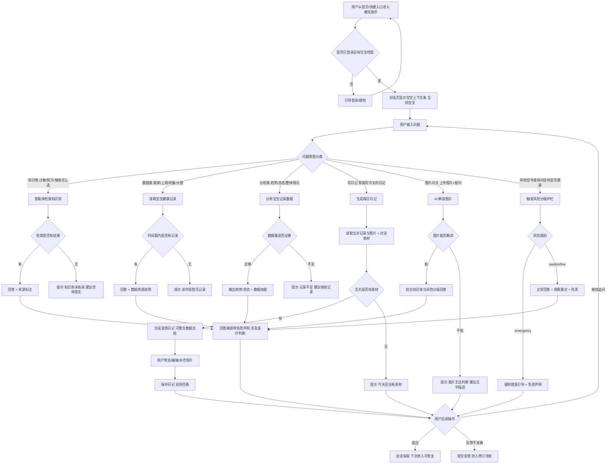
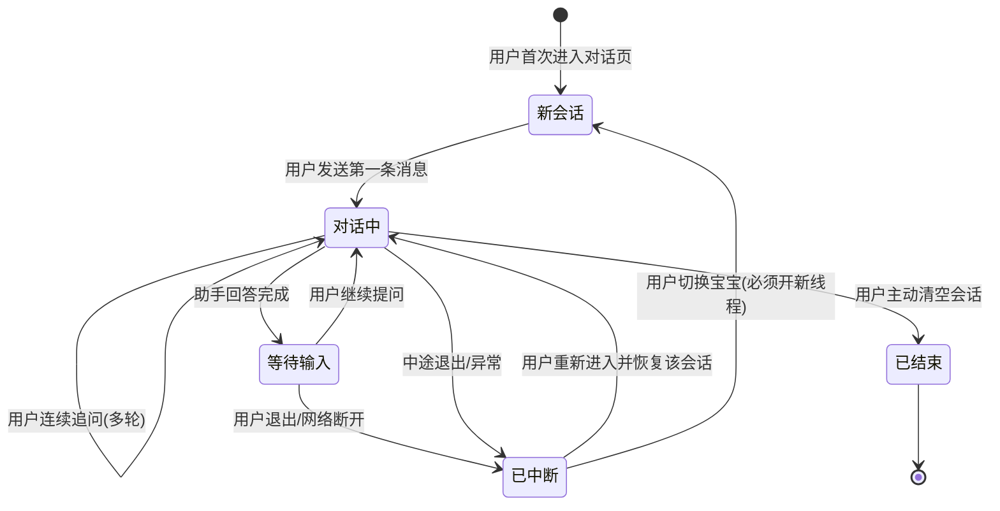
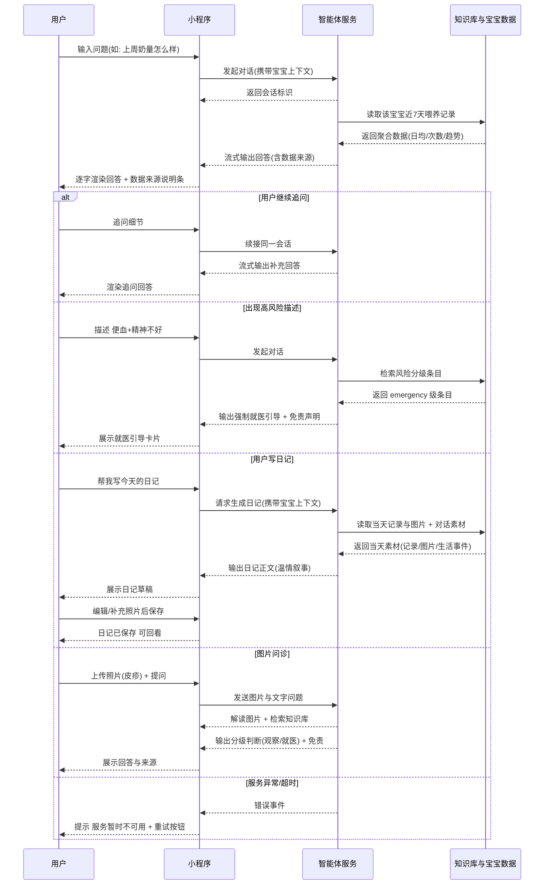

# 产品需求文档：养娃智能体「敏宝助手」- V1.0

## 1. 综述 (Overview)

### 1.1 项目背景与核心问题

minicare 已上线宝宝健康记录能力（喂养/睡眠/生长/症状/尿布等 11 类记录、家庭多成员协作），公众号 CMPA（牛奶蛋白过敏）科普系列持续产出 8 篇文章。**2026-08-20 已完成 agent-poc 核心链路验证**（OAK 框架 + DeepSeek 模型 + 知识库工具 + 多用户会话隔离，CloudBase 环境跑通），技术路径已确认可行，进入正式产品建设阶段。

当前敏宝家长（尤其 CMPA 家庭）面临 4 个核心问题：

1. **知识获取割裂**：科普文章是单向输出，家长遇到具体问题（"我家宝宝这种情况该喝什么配方"）无法获得即时、有针对性的解答；
2. **数据价值沉睡**：健康记录越积越多，家长难以自行解读趋势与规律（"这周奶量正常吗""睡眠规律吗"），数据沉淀没有转化为可用结论；
3. **症状判断焦虑**：出现便血、皮疹等症状时，家长无法快速区分"继续观察"还是"需要就医"，容易延误或过度焦虑；
4. **家庭信息不同步**：多成员（爸妈/奶奶）对宝宝情况掌握不一致，需要一个统一、可解释、带数据依据的问答入口。

本需求通过构建 AI 智能体「敏宝助手」，把**权威知识库 + 自家宝宝数据**结合，为家庭提供**检索增强、带来源引用、带风险分级**的问答与总结分析能力。

### 1.2 核心业务流程 / 用户旅程地图

1. **阶段一：进入对话** — 用户从首页/快捷入口进入「敏宝助手」，确认当前宝宝上下文，发起对话（支持文字/语音输入）。
2. **阶段二：知识问答与图片问诊** — 用户询问 CMPA 相关护理知识，或上传宝宝照片（皮疹/大便等）进行图片问诊，获得基于知识库的检索增强回答（含来源标注）与分级判断。
3. **阶段三：健康数据查询** — 用户用自然语言询问自家宝宝的健康记录，获得基于真实数据的实时聚合回答，回答说明数据来源。
4. **阶段四：记录总结分析与每日日记** — 用户请求对宝宝记录做趋势解读或跨维度综合总结（可单独回答）；或主动触发"帮我写今天的日记"，基于当天记录（含图片）、对话内容与捕捉的生活事件生成温情日记，支持编辑、配图与回看。
5. **阶段五：多轮会话与安全护栏** — 用户连续追问、中断后恢复会话；系统对症状/风险信号分级判断（观察或就医）并强制就医引导；所有医疗类回答附免责声明。

### 1.3 Mermaid 图（流程/状态/时序）

#### 1.3.1 用户操作流（必填）



#### 1.3.2 会话状态机（当存在明确状态流转对象时必填）



#### 1.3.3 关键场景时序（流式对话与数据读取）



## 2. 用户故事详述 (User Stories)

### 阶段一：进入对话

---

#### **US-01: 作为家庭成员，我希望从首页快速进入「敏宝助手」并确认当前宝宝上下文，以便于我放心提问（回答针对我家宝宝）。**

- **价值陈述 (Value Statement)**:
  - **作为** 家庭成员（宝爸/宝妈/奶奶等，有宝宝档案访问权）
  - **我希望** 从现有入口一键进入对话页，页面明确显示"在回答哪个宝宝的问题"
  - **以便于** 避免问错对象/多宝宝家庭混淆，降低提问心理门槛
- **业务规则与逻辑 (Business Logic)**:
  1. **前置条件**: 用户已登录（JWT 有效），家庭下至少存在一个宝宝档案。
  2. **操作流程 (Happy Path)**:
     1. 用户点击入口（TabBar 中央 FAB 弹出菜单中的「问敏宝助手」，或首页快捷操作）。
     2. 进入对话页，顶部宝宝上下文条默认显示当前宝宝（姓名 + 出生日期 + 过敏情况摘要）。
     3. 多宝宝家庭：上下文条可切换宝宝，**切换即开启新会话**（不同宝宝的记录/画像差异大，混合同一线程会污染上下文）。
     4. 输入框支持两种输入方式：① 文字输入（键盘输入后发送）；② 语音输入（长按麦克风说话 → 实时转写为文字 → 可修改后发送，转写复用现有语音录入链路）。
  3. **异常处理 (Error Handling)**:
     - 未登录/会话过期 → 提示登录，登录后回到对话页；
     - 家庭下无宝宝档案 → 引导创建宝宝档案，不进入对话；
     - 游客模式浏览 → 点击入口时提示登录，不提供任何对话能力；
     - 服务未就绪（配置缺失/后端不可用）→ 展示"服务升级中"占位页，不崩溃；
     - 语音转写失败（嘈杂环境/口音/未授权麦克风）→ 提示重试或转手动输入。
- **验收标准 (Acceptance Criteria)**:
  - **场景1: 正常进入**
    - **GIVEN** 已登录且家庭有宝宝档案
    - **WHEN** 用户点击「问敏宝助手」入口
    - **THEN** 进入对话页，顶部显示当前宝宝上下文（姓名/出生日期），输入框可用
  - **场景2: 未登录拦截**
    - **GIVEN** 未登录（游客态）
    - **WHEN** 用户点击对话入口
    - **THEN** 不进入对话页，弹出登录引导
  - **场景3: 切换宝宝**
    - **GIVEN** 家庭下有 2 个宝宝，用户正在与宝宝 A 对话
    - **WHEN** 用户在上下文条切换到宝宝 B
    - **THEN** 对话清空为全新会话，上下文条显示宝宝 B，后续回答只引用宝宝 B 的数据
  - **场景4: 语音输入**
    - **GIVEN** 对话页输入区提供麦克风按钮且已授权麦克风权限
    - **WHEN** 用户长按说话"今天旺仔大便有血丝怎么办"，松开后转写文字出现在输入框并发送
    - **THEN** 对话正常继续，转写文字在发送前可修改
- **页面布局线框图 (ASCII Wireframe)**:
  ```text
  ┌──────────────────────────────────────────────┐
  │  ‹ 返回      敏宝助手              ··· 更多    │  ← 导航栏
  ├──────────────────────────────────────────────┤
  │  [ 旺仔 · 出生 2025-12-28 · 轻度CMPA ]   ▾    │  ← 宝宝上下文条(可切换=新会话)
  ├──────────────────────────────────────────────┤
  │                                              │
  │  ┌────────────────────────────────┐          │
  │  │ 用户: 深度水解和氨基酸配方      │          │
  │  │ 有什么区别？                    │          │
  │  └────────────────────────────────┘          │
  │                                              │
  │  ┌────────────────────────────────────────┐  │
  │  │ 敏宝助手: 两款配方定位不同...          │  │
  │  │ [来源] 公众号文章《深度水解怎么选》     │  │  ← 知识来源卡片
  │  │ [数据] 数据来源: 6/1-6/7 喂养记录       │  │  ← 数据来源条
  │  │                                        │  │
  │  │ 本回答仅供参考，不能替代专业医疗建议    │  │  ← 免责声明
  │  └────────────────────────────────────────┘  │
  │                                              │
  │  [ 正在查询宝宝数据... ]                      │  ← 工具调用加载态
  │                                              │
  ├──────────────────────────────────────────────┤
  │  [图片] [ 输入消息... ] [语音]    [发送]    │  ← 输入区(图片/语音/文字)
  ├──────────────────────────────────────────────┤
  │  AI 回答仅供参考，不能替代专业医疗建议         │  ← 固定页脚
  └──────────────────────────────────────────────┘
  ```

---

### 阶段二：知识问答

#### **US-02: 作为 CMPA 宝宝家长，我希望询问过敏护理知识（如"深度水解和氨基酸怎么选"），以便于获得有依据、可信任的解答。**

- **价值陈述 (Value Statement)**:
  - **作为** CMPA 宝宝家长（公众号读者 / minicare 注册用户）
  - **我希望** 用自然语言提问，获得基于知识库的准确回答，且能看到信息来源
  - **以便于** 不依赖逐篇翻文章，快速得到针对具体问题的可靠答案
- **业务规则与逻辑 (Business Logic)**:
  1. **前置条件**: 会话已建立（US-01），知识库已导入内容（P1 范围：公众号 8 篇 + 核心指南 3-4 份）。
  2. **操作流程 (Happy Path)**:
     1. 用户提问（如"深度水解和氨基酸配方怎么选"）。
     2. 智能体**必须先行检索知识库**（检索先行规则），拿到检索结果后直接作答，不得出现"正在检索/请稍候"话术。
     3. 回答内容基于检索结果组织，末尾**标注来源**（公众号文章标题 / 指南名称），来源可点击展开详情。
     4. 涉及医疗判断的回答尾部附免责声明："本回答仅供参考，不能替代专业医疗建议"。
  3. **异常处理 (Error Handling)**:
     - 知识库未检索到相关内容 → 明确回复"知识库未收录，建议咨询医生"，不得编造；
     - 检索超时/服务异常 → 提示"服务暂时不可用，请稍后重试"，不返回半截回答；
     - 用户问题涉及用药剂量/急救操作 → 拒绝给出具体操作，引导就医；
     - 用户问题超出育儿护理范围（如医疗法律/理财）→ 礼貌说明能力边界。
- **验收标准 (Acceptance Criteria)**:
  - **场景1: 知识库命中**
    - **GIVEN** 知识库已收录"深度水解/氨基酸配方"条目
    - **WHEN** 用户问"深度水解和氨基酸怎么选"
    - **THEN** 回答给出两者定位区别（eHF 适用轻中度、AAF 用于重度/不耐受）并标注来源（文章标题/指南名）
  - **场景2: 知识库未收录**
    - **GIVEN** 知识库无该主题条目
    - **WHEN** 用户提问该主题
    - **THEN** 回答明确"知识库未收录，建议咨询医生"，不编造内容
  - **场景3: 检索先行约束**
    - **GIVEN** 正常服务状态
    - **WHEN** 用户提出知识类问题
    - **THEN** 回答中不出现"正在检索/请稍候"等延迟话术，直接给出完整答案
- **页面布局线框图（来源卡片局部）**:
  ```text
  ┌──────────────────────────────────────────────┐
  │  [来源] 本回答参考了以下内容             ▾    │
  │  ┌────────────────────────────────────────┐  │
  │  │ ① 公众号《深度水解配方怎么选》(科普)   │  │
  │  │    敏宝科普系列 · 2026-05 · 展开       │  │
  │  │ ② 《婴幼儿牛奶蛋白过敏诊治建议》      │  │
  │  │    证据级别: guideline · 国内 · 展开   │  │
  │  └────────────────────────────────────────┘  │
  │  点击卡片可查看原文摘要与完整出处             │
  └──────────────────────────────────────────────┘
  ```

---

#### **US-03: 作为家长，我希望上传宝宝的照片（皮疹/大便/伤口等）并提问，以便于获得基于图片内容的分级判断。**

- **价值陈述 (Value Statement)**:
  - **作为** 宝宝家长
  - **我希望** 拍下宝宝的异常表现（如"大腿上的红疹"）发给助手，让它结合图片内容给判断
  - **以便于** 比纯文字描述更直观，判断"观察还是就医"更有依据
- **业务规则与逻辑 (Business Logic)**:
  1. **前置条件**: 会话已建立（US-01）；图片为 jpg/png（拍照或相册），经压缩后上传（≤10MB/张、每轮 ≤3 张）。
  2. **操作流程 (Happy Path)**:
     1. 用户在输入区点击图片按钮，拍照或从相册选择图片，可附文字问题一起发送。
     2. 图片压缩后上传（复用现有 COS 直传链路），随文字作为本轮输入发送给智能体。
     3. AI 解读图片内容（视觉模型：deepseek-v4-flash-vision-exp），结合知识库与风险分级（US-11）给出判断：正常 / 观察要点 / 就医引导。
     4. 回答遵守风险护栏与免责规则；对话中上传的图片自动成为当天日记素材（见 US-08）。
  3. **异常处理 (Error Handling)**:
     - 图片上传失败（网络/COS 异常）→ 提示重试，文字部分仍可正常发送；
     - 图片无法解读（模糊/不相关部位/光线差）→ 明确说明"图片无法判断"，引导补充文字描述（部位/时长/大小），不强行解读；
     - 视觉模型不可用（降级）→ 降级为纯文字回答，并提示"图片暂无法识别，请用文字描述症状"；
     - 图片数量或大小超限 → 拒绝并提示（≤3 张、≤10MB/张）。
- **验收标准 (Acceptance Criteria)**:
  - **场景1: 图片问诊**
    - **GIVEN** 用户上传一张皮疹照片并提问"这是过敏吗"
    - **WHEN** 用户发送
    - **THEN** AI 结合图片内容与知识库给出分级判断（观察要点或就医引导），附免责声明
  - **场景2: 图片无法解读**
    - **GIVEN** 用户上传一张模糊照片
    - **WHEN** 用户提问
    - **THEN** 明确告知"图片无法判断"，引导补充文字描述，不编造解读
  - **场景3: 上传失败降级**
    - **GIVEN** 图片上传失败或视觉模型不可用
    - **WHEN** 用户发送图片+文字
    - **THEN** 文字部分正常对话，提示图片处理失败可重试
- **页面布局线框图（图片气泡局部）**:

  ```text
  ┌──────────────────────────────────────────────┐
  │  ┌─────────────────────────────┐             │
  │  │ 用户: [图片缩略图] 这是过敏吗 │             │  ← 图片+文字气泡
  │  └─────────────────────────────┘             │
  │                                              │
  │  ┌────────────────────────────────────────┐  │
  │  │ 敏宝助手: 从照片看红疹范围不大、         │  │
  │  │ 无明显水疱。结合"精神好、奶量正常"，    │  │
  │  │ 可先观察 1-2 天……出现以下情况请就医：   │  │
  │  │ [来源] 过敏皮疹相关条目                  │  │
  │  │ 本回答仅供参考，不能替代专业医疗建议     │  │
  │  └────────────────────────────────────────┘  │
  ├──────────────────────────────────────────────┤
  │  [图片] [ 输入消息... ] [语音]    [发送]    │  ← 输入区(图片/语音/文字)
  └──────────────────────────────────────────────┘
  ```

---

### 阶段三：健康数据查询

#### **US-04: 作为家长，我希望用自然语言查询宝宝近期的健康记录（如"上周平均每天喝多少奶"），以便于快速掌握喂养、睡眠等实际情况。**

- **价值陈述 (Value Statement)**:
  - **作为** 宝宝家长
  - **我希望** 用日常语言问"上周奶量/睡眠"等，直接得到基于真实记录的数字回答
  - **以便于** 不用自己翻记录算数，数据可信且能说明出处
- **业务规则与逻辑 (Business Logic)**:
  1. **前置条件**: 会话上下文已绑定 babyId（US-01），该宝宝存在对应类型的记录数据。
  2. **操作流程 (Happy Path)**:
     1. 用户提问（如"旺仔上周平均每天喝多少奶"、"最近一周睡得好吗"）。
     2. 智能体识别为数据类问题 → 按自然语言解析时间窗（"上周"=近 7 天，"最近一周"=近 7 天，支持 1-90 天）与指标类型（喂养/睡眠/尿布/生长/健康/症状/活动）。
     3. 读取该宝宝时间窗内的真实记录，聚合计算（总量/日均/次数/趋势）。
     4. 回答给出数值结论，并附**数据来源说明**（如"数据来自 6/1-6/7 的 42 条喂养记录"）。
  3. **异常处理 (Error Handling)**:
     - 时间窗内无记录 → 回复"该时段暂无 xx 记录，建议先记录几天再来看"；
     - 时间窗超范围（>90 天）→ 按 90 天上限处理并说明；小于 1 天 → 按当天处理；
     - 指标类型无法识别 → 引导用户明确类型（"您想查喂养、睡眠还是大便情况？"）；
     - 查询只读保障：只能读，**任何情况下不能写入/修改记录**（本期无写能力）。
- **验收标准 (Acceptance Criteria)**:
  - **场景1: 喂养聚合查询**
    - **GIVEN** 宝宝近 7 天有 42 条喂养记录（合计 5460ml）
    - **WHEN** 用户问"上周平均每天喝多少奶"
    - **THEN** 回答"平均约 780ml/天"，并说明数据来源与统计口径
  - **场景2: 空数据**
    - **GIVEN** 宝宝时间窗内无睡眠记录
    - **WHEN** 用户问"最近一周睡得好吗"
    - **THEN** 回答"该时段暂无睡眠记录"，引导继续记录，不编造数字
  - **场景3: 数据隔离**
    - **GIVEN** 会话绑定宝宝 A（babyId=A）
    - **WHEN** 用户询问任何健康数据
    - **THEN** 回答只引用宝宝 A 的记录，不出现其他宝宝数据
- **页面布局线框图（数据来源说明条局部）**:
  ```text
  ┌──────────────────────────────────────────────┐
  │  [数据] 统计口径: 6/1-6/7 (7天)              │
  │        喂养记录 42 条 · 日均 780ml           │
  │        数据来自宝宝的喂养记录，仅统计该时段   │
  └──────────────────────────────────────────────┘
  ```

---

#### **US-05: 作为家庭成员（奶奶/妈妈），我希望全家都能问同一个宝宝的情况，以便于家庭信息同步、照护口径一致。**

- **价值陈述 (Value Statement)**:
  - **作为** 家庭内任意成员（爸爸/妈妈/奶奶/爷爷，同一家庭组）
  - **我希望** 用自己的账号也能询问宝宝的健康数据
  - **以便于** 全家对宝宝状态掌握一致，减少"你问了吗""我不知道"的沟通损耗
- **业务规则与逻辑 (Business Logic)**:
  1. **前置条件**: 提问成员已加入宝宝所在家庭组（家庭关系校验通过），宝宝档案对该成员可见。
  2. **操作流程 (Happy Path)**:
     1. 家庭成员登录自己的账号，进入对话页选择该宝宝。
     2. 提问（如"宝宝这两天睡得好吗"）。
     3. 系统校验成员与宝宝的归属关系后正常回答，数据口径与主账号一致。
  3. **异常处理 (Error Handling)**:
     - 成员不属于该家庭 / 宝宝不归属该成员可见范围 → 拒绝回答并提示无访问权限（不泄露数据存在性细节）；
     - 成员属于家庭但宝宝档案已停用 → 提示档案不可用；
     - 越权构造请求（伪造 babyId/家庭信息）→ 服务端校验拒绝，记录审计日志。
- **验收标准 (Acceptance Criteria)**:
  - **场景1: 同家庭多成员**
    - **GIVEN** 奶奶是家庭成员且宝宝对全家可见
    - **WHEN** 奶奶登录后问"宝宝这两天睡得好吗"
    - **THEN** 正常返回宝宝睡眠记录聚合结果 + 数据来源
  - **场景2: 跨家庭越权**
    - **GIVEN** 用户 A 与宝宝 X 不在同一家庭
    - **WHEN** 用户 A 尝试查询宝宝 X 的数据
    - **THEN** 请求被拒绝，返回无权限提示，不返回任何数据

---

### 阶段四：记录总结分析与每日日记

#### **US-06: 作为家长，我希望获得宝宝某类记录的趋势解读（如"最近两周奶量趋势"），以便于发现喂养/睡眠的变化规律。**

- **价值陈述 (Value Statement)**:
  - **作为** 宝宝家长
  - **我希望** 不只看到数字，还能听到"趋势怎么看"（上升/下降/稳定/波动）
  - **以便于** 及早发现喂养量下滑、睡眠倒退等苗头
- **业务规则与逻辑 (Business Logic)**:
  1. **前置条件**: 会话上下文已绑定 babyId，时间窗内有足够的该类记录（建议 ≥5 天有效记录）。
  2. **操作流程 (Happy Path)**:
     1. 用户请求分析（如"最近两周奶量趋势怎么样""这周睡眠规律吗"）。
     2. 智能体读取该指标时间窗内数据，按天聚合生成序列，识别趋势（上升/下降/稳定/波动）与异常点。
     3. 回答输出：趋势结论 + 关键数字 + 异常点提示（如"6/15 奶量突然下降到 400ml"）+ 数据依据。
     4. 必要时结合知识库给护理建议（如奶量下滑可能与厌奶期/辅食量相关，供参考）。
  3. **异常处理 (Error Handling)**:
     - 数据不足（<5 天有效记录）→ 提示"记录还不足以分析趋势，建议再记录几天"；
     - 数据稀疏（中间缺天）→ 按实际记录天数说明统计口径，不强行补全；
     - 单日数据异常大/小（疑似误录）→ 在结论中标注"某日数值与前后差异较大，请确认是否误录"。
- **验收标准 (Acceptance Criteria)**:
  - **场景1: 趋势分析**
    - **GIVEN** 宝宝近 14 天喂养记录完整
    - **WHEN** 用户问"最近两周奶量趋势怎么样"
    - **THEN** 回答给出趋势结论（如"整体平稳，日均 750-800ml，6/15 有一次明显回落"）并附数据依据
  - **场景2: 数据不足**
    - **GIVEN** 宝宝近 7 天仅有 2 条睡眠记录
    - **WHEN** 用户问"这周睡眠规律吗"
    - **THEN** 回答提示记录不足，说明当前仅有 2 条记录，建议连续记录后再分析

---

#### **US-07: 作为家长，我希望获得跨维度的综合总结（如"这个月旺仔整体情况如何"），以便于阶段性掌握宝宝状态、及时发现需要关注的点。**

- **价值陈述 (Value Statement)**:
  - **作为** 宝宝家长
  - **我希望** 一句话问出"整体情况"，得到喂养/睡眠/生长/症状各维度的结构化总结
  - **以便于** 定期复盘（如月度体检前、复诊前）时快速掌握全貌，不遗漏关注点
- **业务规则与逻辑 (Business Logic)**:
  1. **前置条件**: 会话上下文已绑定 babyId，时间窗内至少 2 个维度有记录。
  2. **操作流程 (Happy Path)**:
     1. 用户请求总结（如"这个月旺仔整体情况如何""帮我总结下最近两周"），或点击对话页「一键周报/月报」快捷按钮（按 7/30 天窗口触发，降低输入成本）。
     2. 智能体跨维度读取记录（喂养/睡眠/生长/症状/尿布/活动），逐维度生成小结。
     3. 输出**结构化总结卡片**：各维度小结（含关键数字）+ 规律/变化 + 异常关注点（如"6/15 血丝便 1 次未复发"）+ 数据依据。
     4. 关注点结合知识库给出建议（如建议复诊时向医生反馈某现象）。
     5. 生长维度包含**生长曲线解读**（体重/身高 P50/P75 等百分位对照，内置中国 2023 儿科生长参考数据）。
  3. **异常处理 (Error Handling)**:
     - 时间窗内数据极少（<2 维度有记录）→ 提示记录不足，展示已有维度的数据即可；
     - 某维度无记录 → 该维度标注"暂无记录"，不编造；
     - 总结中包含异常 → 按 US-11 风险分级规则处理（emergency 直接就医引导）。
- **验收标准 (Acceptance Criteria)**:
  - **场景1: 跨维度总结**
    - **GIVEN** 宝宝 7 月有喂养/睡眠/生长/尿布记录，含 1 次血丝便（已恢复）
    - **WHEN** 用户问"7 月旺仔整体情况如何"
    - **THEN** 输出结构化总结：各维度小结+关键数字，标注"6/15 血丝便 1 次未复发"为关注点，附数据来源（如 7 月共 168 条记录）
  - **场景2: 维度缺数据**
    - **GIVEN** 宝宝时间窗内只有喂养记录
    - **WHEN** 用户请求综合总结
    - **THEN** 总结中喂养维度正常输出，其余维度标注"暂无记录"，不编造数据
- **页面布局线框图（总结卡片局部）**:
  ```text
  ┌──────────────────────────────────────────────┐
  │  [总结] 旺仔 7 月整体情况 (7/1-7/31)         │
  │  ┌────────────────────────────────────────┐  │
  │  │ 喂养   日均 780ml · 夜奶 2 次/晚        │  │
  │  │ 睡眠   平均 13.5h/天 · 规律良好         │  │
  │  │ 生长   体重 +620g · 曲线 P50-P75       │  │
  │  │ 症状   无新发症状                       │  │
  │  │ 尿布   大便 1-2 次/天 · 6/15 血丝 1 次  │  │
  │  └────────────────────────────────────────┘  │
  │  [关注] 6/15 血丝便后未复发，可继续观察；    │
  │         若再次出现请记录并咨询医生            │
  │  [数据] 数据来自 7 月各类记录共 168 条        │
  └──────────────────────────────────────────────┘
  ```

---

#### **US-08: 作为家长，我希望说一句"帮我写今天的日记"，就得到一篇记录宝宝今天表现与特别瞬间的温情日记，以便于留下珍贵的成长记忆。**

- **价值陈述 (Value Statement)**:
  - **作为** 宝宝家长（爸爸/妈妈）
  - **我希望** 随时触发生成当天日记，AI 把健康记录、图片和对话里提到的事写成一篇像人写的日记
  - **以便于** 不用自己动笔也能留下有温度的成长记录，日后再看都是回忆
- **业务规则与逻辑 (Business Logic)**:
  1. **前置条件**: 已登录且绑定宝宝；当天存在至少一种素材（健康记录 / 对话内容 / 图片，任一即可）。
  2. **操作流程 (Happy Path)**:
     1. 用户在对话页输入"帮我写今天的日记"（或从日记入口触发）。
     2. 智能体收集当天素材：① 当天健康记录（喂养/睡眠/尿布/症状/活动等，含数据聚合概览）；② 当天记录与对话中上传的图片；③ 当天对话中捕捉的生活事件（如"今天带旺仔去露营了""游了泳"）。
     3. 生成**日记文体**（温情叙事，如"今天旺仔胃口不错，喝了约 780ml 奶，下午我们去公园露营，他看见草地特别兴奋……"），可整合当天/近期的总结分析结论（如"本周奶量趋势平稳"）。
     4. 展示日记草稿，用户预览后可保存。
     5. 保存后持久化存储，按日期组织，每天一篇，支持回看（日记列表/详情）；日记**永久保留**（随家庭账号，删除宝宝档案时一并清理）。
     6. 同一天重复触发"写日记" → 重新生成并覆盖当天草稿/已保存日记，**覆盖前需用户确认**。
  3. **异常处理 (Error Handling)**:
     - 当天无任何素材 → 提示"今天还没有素材，可以先去记录或和我聊聊宝宝"，仍允许用户补充生活事件后生成；
     - 有生活事件但无图片 → 生成时提示"要不要上传一张照片，日记更有纪念意义"（见 US-09）；
     - 当天无健康记录但对话中有生活事件 → 正常生成生活日记，不编造健康数据；
     - 生成失败/超时 → 提示重试，不产生半截日记。
- **验收标准 (Acceptance Criteria)**:
  - **场景1: 基于数据的日记**
    - **GIVEN** 当天有喂养/睡眠记录（如 780ml、午睡 2h）且对话中提到"下午带旺仔去露营"
    - **WHEN** 用户说"帮我写今天的日记"
    - **THEN** 输出日记包含当天行为表现（数据概括）、露营事件、温情叙事口吻，数据与记录一致不编造
  - **场景2: 持久化与回看**
    - **GIVEN** 用户已保存一篇日记
    - **WHEN** 用户稍后从日记入口查看
    - **THEN** 日记按日期展示，内容与保存时一致
  - **场景3: 无素材**
    - **GIVEN** 当天无记录、无对话
    - **WHEN** 用户触发写日记
    - **THEN** 提示"今天还没有素材"，引导先记录或聊聊天
- **页面布局线框图（日记详情）**:

  ```text
  ┌──────────────────────────────────────────────┐
  │  ‹ 返回      旺仔的日记 · 8月22日      ···    │
  ├──────────────────────────────────────────────┤
  │  8月22日 星期六                                │
  │  今天旺仔胃口不错，喝了约 780ml 奶，           │
  │  午睡 2 小时，精神很好。下午我们带他去         │
  │  露营，他看见草地特别兴奋，还和邻居家         │
  │  小哥哥玩了很久……                             │
  │                                              │
  │  [照片1]  [照片2]  [照片3]                    │  ← 记录图片/补充照片
  │                                              │
  │  [数据摘要] 喂养 780ml · 睡眠 13.5h ·          │
  │  大便 1 次 · 无新发症状                        │  ← 当天数据概览
  │                                              │
  │  [编辑日记]  [再次生成]                        │
  └──────────────────────────────────────────────┘
  ```

- **页面布局线框图（日记列表·回看入口）**:

  ```text
  ┌──────────────────────────────────────────────┐
  │  ‹ 返回      旺仔的日记              [+ 写]   │
  ├──────────────────────────────────────────────┤
  │  ┌────────────────────────────────────────┐  │
  │  │ 8月22日 · 露营日                         │  │
  │  │ 今天旺仔胃口不错，喝了约 780ml…         │  │
  │  └────────────────────────────────────────┘  │
  │  ┌────────────────────────────────────────┐  │
  │  │ 8月21日 · 日常                          │  │
  │  │ 今天比较平静，奶量正常，晚上睡得早…    │  │
  │  └────────────────────────────────────────┘  │
  │                                              │
  │  （按日期倒序，每天一篇）                      │
  └──────────────────────────────────────────────┘
  ```

---

#### **US-09: 作为家长，我希望修改/补充生成的日记（文字、生活事件、照片），以便于日记符合我的记忆和感受。**

- **价值陈述 (Value Statement)**:
  - **作为** 宝宝家长
  - **我希望** 在 AI 草稿基础上补充真实细节（比如"其实他今天摔了一跤"）、加上照片
  - **以便于** 日记是"我的日记"而不是"AI 的报告"
- **业务规则与逻辑 (Business Logic)**:
  1. **前置条件**: 已生成日记草稿或已有已保存日记。
  2. **操作流程 (Happy Path)**:
     1. 用户在日记详情点击"编辑日记"。
     2. 可修改正文文字、补充生活事件描述；可新增照片（相册选图，复用现有图片上传链路存储）。
     3. 编辑后保存，覆盖原内容并记录更新时间。
     4. 日记生成时若捕捉到生活事件但无照片 → 明确提醒"可上传照片补充"。
  3. **异常处理 (Error Handling)**:
     - 照片上传失败 → 保留日记正文，提示重试上传，不丢已编辑内容；
     - 编辑中退出 → 提示"有未保存的修改"，可选择保存/放弃；
     - 图片删除后从日记引用中清理，不残留失效图片。
- **验收标准 (Acceptance Criteria)**:
  - **场景1: 编辑保存**
    - **GIVEN** 已生成一篇日记草稿
    - **WHEN** 用户修改文字、补充生活事件并保存
    - **THEN** 日记展示更新后的内容，回看时一致
  - **场景2: 补充照片**
    - **GIVEN** 日记中提到露营但无照片
    - **WHEN** 用户从相册选择照片上传
    - **THEN** 照片展示在日记中，且不丢失原有文字内容
  - **场景3: 照片提醒**
    - **GIVEN** 对话捕捉到生活事件（露营/游泳）但当天无照片
    - **WHEN** 日记生成完成
    - **THEN** 界面提示"可上传照片让日记更有纪念意义"

---

### 阶段五：多轮会话与安全护栏

#### **US-10: 作为家长，我希望在对话中连续追问，且中途退出后能恢复会话，以便于完整获取信息、不重复提问。**

- **价值陈述 (Value Statement)**:
  - **作为** 宝宝家长
  - **我希望** 围绕一个问题连续追问，且离开后回来还能接着聊
  - **以便于** 对话有连续性，碎片时间也能完成咨询
- **业务规则与逻辑 (Business Logic)**:
  1. **前置条件**: 会话已建立并持久化（服务端保存会话历史）。
  2. **操作流程 (Happy Path)**:
     1. 用户回答后继续追问（如"那氨基酸配方呢？"），智能体结合上文上下文作答。
     2. 用户中途退出/网络断开 → 会话保存在服务端。
     3. 用户再次进入对话页 → 恢复最近一次会话，展示历史消息，可继续提问。
  3. **异常处理 (Error Handling)**:
     - 会话上下文过长（超过模型上下文限制）→ 提示"对话内容较长，建议开启新会话"，自动截断保留最近内容；
     - 会话恢复失败（服务重启/数据丢失）→ 提示"无法恢复上次会话"，可开启新会话，不阻塞使用；
     - 用户主动清空会话 → 服务端删除该会话历史，重新开始；
     - 历史会话永久保留，但会话列表/恢复仅取最近 20 条，更早的会话不可恢复（提示开启新会话）；
     - **切换宝宝 = 必须开新线程**，禁止跨宝宝混用上下文（见 US-01）。
- **验收标准 (Acceptance Criteria)**:
  - **场景1: 连续追问**
    - **GIVEN** 用户已询问"深度水解配方"并获得回答
    - **WHEN** 用户追问"那氨基酸配方呢"
    - **THEN** 回答结合上文语境，直接对比两类配方，不重复基础介绍
  - **场景2: 中断恢复**
    - **GIVEN** 用户与助手对话 5 轮后退出小程序
    - **WHEN** 用户当天再次进入对话页
    - **THEN** 展示历史消息并可继续提问，上下文完整
  - **场景3: 上下文超限**
    - **GIVEN** 会话已进行很长（接近上下文上限）
    - **WHEN** 用户继续提问
    - **THEN** 系统提示开启新会话或自动截断，回答不中断

---

#### **US-11: 作为家长，当我描述症状或高风险信号时，我希望获得分级判断（观察还是就医），以便于不延误处理也不过度焦虑。**

- **价值陈述 (Value Statement)**:
  - **作为** 宝宝家长
  - **我希望** 描述症状（无论是否已记录）时，得到"继续观察还是尽快就医"的明确分级判断
  - **以便于** 关键时刻不因"AI 说没事"而延误就医，也不因过度恐慌盲目跑医院
- **业务规则与逻辑 (Business Logic)**:
  1. **前置条件**: 无（风险护栏是全局横切能力，所有对话都生效）。
  2. **操作流程 (Happy Path)**:
     1. **触发路径一（被动拦截）**：用户描述命中高危信号（如"大量鲜血便""精神萎靡""持续高热""呼吸急促""抽搐"等，或知识库命中 emergency 级条目）→ 智能体立即输出**就医引导卡片**：明确"需要尽快就医"，停止常规安抚性回答。
     2. **触发路径二（主动咨询）**：用户描述自己观察到/已记录的症状并询问严重程度（如"宝宝今天大便有血丝，要不要去医院"）→ 智能体结合记录事实与知识库风险条目分级判断：caution 级 → 观察要点 + 就医指征清单；emergency 级 → 就医引导卡片。
     3. 就医引导内容含：建议尽快就诊、就诊时携带近期记录便于医生判断；不给出诊断或治疗方案。
     4. 回答尾部附免责声明。
  3. **异常处理 (Error Handling)**:
     - 信号模棱两可（用户描述含高危词但语气不确定）→ 按高危处理（宁可引导就医，不冒险安抚）；
     - 症状较轻但家长反复追问是否就医 → 给出观察清单与明确就医指征，不代替医生下结论；
     - 用户追问"你觉得严不严重/要不要去医院"→ 不代替医生做判断，重复就医引导或观察清单。
- **验收标准 (Acceptance Criteria)**:
  - **场景1: emergency 强制就医**
    - **GIVEN** 用户描述"宝宝便血很多，而且没精神"
    - **WHEN** 用户提问
    - **THEN** 回答以就医引导为主：明确建议尽快就医、附携带记录建议、附免责声明；**不**出现"先观察几天"等安抚内容
  - **场景2: caution 观察清单**
    - **GIVEN** 用户描述"大便有一点血丝，但宝宝精神好、吃奶正常"
    - **WHEN** 用户提问
    - **THEN** 回答列出观察要点与"出现以下情况需立即就医"的清单，附免责声明
  - **场景3: 主动咨询分级**
    - **GIVEN** 用户描述"今天大便有一点血丝，宝宝精神挺好"并询问"要不要去医院"
    - **WHEN** 用户提问
    - **THEN** 按 caution 处理：列出观察要点（精神/奶量/颜色）与就医指征清单，附免责声明，不强行要求就医
  - **场景4: 高护栏覆盖**
    - **GIVEN** 任意会话中
    - **WHEN** 用户描述命中高危词
    - **THEN** 无论上下文如何，都触发就医引导，不输出安慰性结论
- **页面布局线框图（就医引导卡片局部）**:
  ```text
  ┌──────────────────────────────────────────────┐
  │  [!] 您描述的「便血+精神不好」需要尽快就医    │
  │                                              │
  │  · 请停止线上咨询，尽快带宝宝前往医院          │
  │  · 就诊时携带近期健康记录，便于医生判断        │
  │  · 就医途中注意观察宝宝状态                   │
  │                                              │
  │  本回答仅供参考，不能替代专业医疗建议         │
  └──────────────────────────────────────────────┘
  ```

---

#### **US-12: 作为家长，我希望对回答进行反馈（有帮助/不准确/不相关），以便于内容持续改进。**

- **价值陈述 (Value Statement)**:
  - **作为** 宝宝家长
  - **我希望** 一键反馈"这个回答不对/没用"
  - **以便于** 帮助产品改进知识库与回答质量，让后续回答更准
- **业务规则与逻辑 (Business Logic)**:
  1. **前置条件**: 存在至少一条助手回答。
  2. **操作流程 (Happy Path)**:
     1. 每条助手回答尾部提供反馈入口（有帮助 / 不准确 / 不相关）。
     2. 用户点"不准确" → 弹出确认（可留一句话说明），提交后给出"感谢反馈"提示。
     3. 反馈进入后台统计，按周汇总（P4 起），标记为"不准确"的回答回流知识库修订流程。
  3. **异常处理 (Error Handling)**:
     - 反馈提交失败（网络）→ 静默失败或轻提示，不打断对话；
     - 反馈内容涉个人隐私 → 仅保存反馈标签与可选文本，不保存对话外的个人信息。
- **验收标准 (Acceptance Criteria)**:
  - **场景1: 提交反馈**
    - **GIVEN** 一条助手回答已展示
    - **WHEN** 用户点击"不准确"并确认
    - **THEN** 显示"感谢反馈"，该条回答标记为待修订
  - **场景2: 反馈回流（P4）**
    - **GIVEN** 同一问题被 ≥N 名用户标记"不准确"
    - **WHEN** 周度复盘触发
    - **THEN** 该问题进入知识库修订清单，修订后重新入库

---

## 3. 非目标 (Non-Goals)

本期 MVP **明确不做**：

1. **AI 写入健康记录**（write 类工具，如"帮我记一下刚才喂了 120ml"）→ 二期（复用现有记录 DTO 校验回写）；**日记生成/编辑是日记模块自身能力，不受此限**（见 US-08/09）；
2. **诊断/用药/急救方案输出** → 只做"建议就医"分级引导，不做任何诊断性断言；
3. **语音回复（TTS）** → 本期语音仅输入（转文字后以文本发送），AI 回复为文字；语音朗读回复二期评估；
4. **附件类型限制** → 对话附件仅支持图片（拍照/相册），不支持文档/视频/音频等文件类型；图片压缩后上传（≤10MB/张、每轮 ≤3 张）；
5. **长期个性化记忆**（跨会话记住"我家旺仔习惯 x"）→ 宝宝画像通过会话上下文注入，不做 userMemory；
6. **会话列表/历史管理页** → 接口预留，UI 二期；
7. **定时生成与主动推送** → 总结分析与每日日记均仅用户手动触发，定时自动生成（如每晚自动写日记）与主动推送二期评估；
8. **多语言/多地区** → 本期仅简体中文、中国地区内容。

## 4. 范围与优先级（阶段映射）

| 优先级       | 内容                                 | 对应阶段/故事                  | 预估     | 出口标准                                    |
| --------- | ---------------------------------- | ------------------------ | ------ | --------------------------------------- |
| P0 基础服务 | 独立智能体服务 + 安全接入层 + 会话持久化 + 风险护栏基础 + 图片问诊视觉能力（含降级） | 阶段一/二/五（US-01/03/10/11 服务端部分） | 4-5 人日 | 鉴权/SSE/会话全通；非法访问 403；无 token 直连 401；图片问诊降级可用 |
| P1 知识库    | 知识条目库 + 混合检索工具 + 检索先行规则            | 阶段二（US-02）               | 5-6 人日 | 50 题召回测试集 Recall@10 ≥ 90%；回答带来源；空库降级正确  |
| P2 健康数据与日记生成 | 只读数据连接 + 数据查询/总结工具 + 每日日记生成（素材整合 + 持久化） | 阶段三/四（US-04/05/06/07/08） | 5-7 人日 | 数据查询准确；趋势/总结带数据依据；日记生成不编造数据；越权被拒 |
| P3 对话页与日记页 | 对话页分包 + 流式渲染 + 语音输入 + 图片问诊交互 + 周报/月报快捷入口 + 来源卡片/数据条/护栏卡片 + 日记列表/详情/编辑（含配图上传） | 阶段一/二/四（US-01/03/07 UI 部分，US-08/09） | 5-6 人日 | 真机端到端对话（文字/语音/图片）与日记闭环；流式渲染流畅；模拟器降级可用 |
| P4 打磨上线   | 全量内容入库 + 医学评审 + 召回评测 + 反馈闭环 + 监控运维 | US-11 + 全量内容             | 3-4 人日 | 评测达标（关键信息完整率 100%、幻觉率 0、高危护栏 100%）；监控可看 |

**合计：22-28 人日**（含总结分析增量 2-3 人日 + 每日日记增量 2-3 人日 + 图片问诊/语音输入增量 2-3 人日；P0-P4 并行路径见 TECH-006 3.2）。

**与 TECH-006 的关系**：本文档的 P0-P4 与《TECH-006-minicare-agent-plan.md》执行计划对齐；**总结分析能力（阶段四）为本文档新增范围**，技术方案需在 TECH-006 基础上扩展：`query_baby_data` 增强趋势对比/跨维度查询能力（或新增分析工具），复杂总结可路由 pro 模型（P4 验证）。**每日日记（US-07/08）为本 PRD 新增范围**：需新增日记持久化存储（建议 CynosDB 新增 `baby_diary` 表：id/baby_id/family_id/diary_date/author_id/content/photo_ids/status/时间戳，按 (baby_id, diary_date) 唯一、每天一篇）与日记配图上传（复用现有 COS 直传链路）；日记素材读取复用 P2 数据工具。建议 TECH-006 同步更新。

## 5. 约束与风险

| #  | 风险      | 说明与对策                                                                 |
| -- | ------- | --------------------------------------------------------------------- |
| 1  | 医疗合规风险  | emergency 风险条目强制就医引导（US-11 高护栏覆盖）；输出侧固定免责声明；知识条目医学评审入库（P4）；不做诊断性断言    |
| 2  | 幻觉/知识错误 | 检索先行硬约束 + 未收录明示 + 来源标注可追溯；召回评测门槛（Recall@10 ≥ 90%）作为上线闸门               |
| 3  | 数据隔离被突破 | 三层隔离（userId/familyId/babyId）+ 服务端归属校验 + babyId 不暴露给模型（服务端注入）；越权请求审计日志 |
| 4  | 隐私合规    | 会话默认不存业务字段（知识问答不落库健康数据）；健康数据按《个保法》最小化留存；密钥全部环境变量注入不落代码                |
| 5  | 总结分析准确性 | 数据不足时明确提示（US-06 场景2）；疑似误录数据标注；跨维度总结逐项带数据依据，杜绝编造维度                     |
| 6  | 模型服务异常  | DeepSeek 429/配额 → 指数退避重试 + 前端降级提示；首字延迟目标 <3s                          |
| 7  | 并发受限    | MVP 进程级单例串行（OAK 稳定子集）；CloudRun 1-2 实例防超卖；高峰排队提示                       |
| 8  | 断流/超时   | 代理层超时 + 断连 abort；SSE 首帧即时；`done`/`error` 事件透传（见 TECH-006 2.6 #16）     |
| 9  | 成本失控    | 默认 flash 模型 + 工具先于大模型输出（知识检索先行可降 token）；pro 仅复杂总结路由；token 用量日志对账      |
| 10 | 内容时效    | 知识库需随公众号更新同步（sync 脚本）；指南类内容标注发布年份，过期条目归档                              |
| 11 | 日记内容真实性 | 数据部分严格来自当天记录（不编造数字）；生活事件仅来自对话捕捉或用户编辑补充；生成规则硬约束 |
| 12 | 日记隐私与图片 | 日记（含照片）仅本家庭成员可见；照片复用 COS 私有存储；删除宝宝档案时日记一并清理 |
| 13 | 视觉模型能力 | 已选型 deepseek-v4-flash-vision-exp；Anthropic 兼容端点的图片输入（image block）支持与 Claude CLI 白名单模型名映射需 P0 实测；不支持时降级：换混元 vision 或图片暂不解读 + 引导文字描述（US-03 场景2/3 已定义降级行为） |
| 14 | 语音转写准确率 | 医疗术语/方言/环境噪声影响转写质量；转写结果发送前可编辑确认；复用现有语音录入链路（TECH-001） |

## 6. 决策确认与待确认项

**已确认决策（2026-08-22）**：

1. **总结分析触发方式**：对话内显式请求 + 对话页「一键生成周报/月报」快捷按钮（7/30 天窗口），本期实现（见 US-07）。
2. **会话保留策略**：历史会话理论上永久保留，但会话列表/恢复仅取最近 20 条，更早会话不可恢复（见 US-10）。
3. **总结分析边界**：包含生长曲线解读（P50/P75 百分位对照，内置中国 2023 儿科生长参考数据，见 US-07）。
4. **日记生成策略**：每天一篇；重复触发重新生成并覆盖当天日记，覆盖前需用户确认（见 US-08）。
5. **日记保留时长**：永久保留（随家庭账号，删除宝宝档案时清理，见 US-08）。
6. **视觉模型选型**：deepseek-v4-flash-vision-exp（Anthropic 兼容端点图片输入支持需 P0 实测，见 US-03 / 风险 13）。
7. **语音输入链路**：复用现有语音录入转写能力（TECH-001，见 US-01）。

**待确认项**：

1. **反馈阈值**：US-12 的"N 名用户标记不准确"阈值建议值（如 3 次/周），上线后按量定。
2. **pro 模型路由**：复杂总结/长上下文场景路由 pro 的判定规则，P4 验证后定。
3. **只读账号与权限**：CynosDB 只读账号创建为上线前置（用户侧待办，见 TECH-006 3.3）。

## 7. 参考资料

- `docs/tech/TECH-006-minicare-agent-plan.md` — 养娃智能体服务设计方案（技术底座，本文档 P0-P4 与其对齐）
- `docs/tech/TECH-005-oak-source-analysis.md` — OAK 源码分析
- `agent-poc/README.md` — POC 验证结论与踩坑记录（2026-08-20）
- `agent-poc/src/server.js` — POC HTTP 服务化原型（SSE 事件协议）
- `docs/prd/PRD-001.md` / `docs/prd/PRD-002.md` — 既有 PRD 格式范例
- `docs/敏宝知识库/` — 知识库源材料与知识清单（P1/P4 导入来源）
- `docs/wechat-articles/` — 公众号 CMPA 科普系列（知识条目来源）
