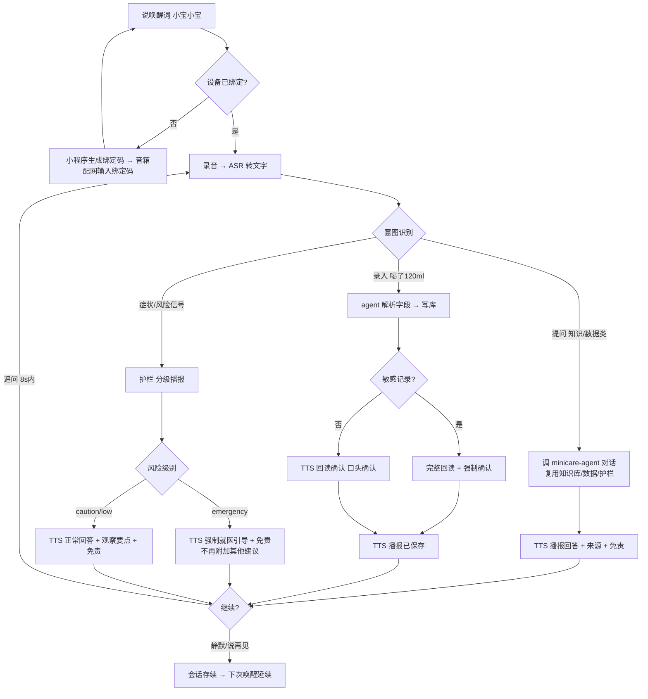
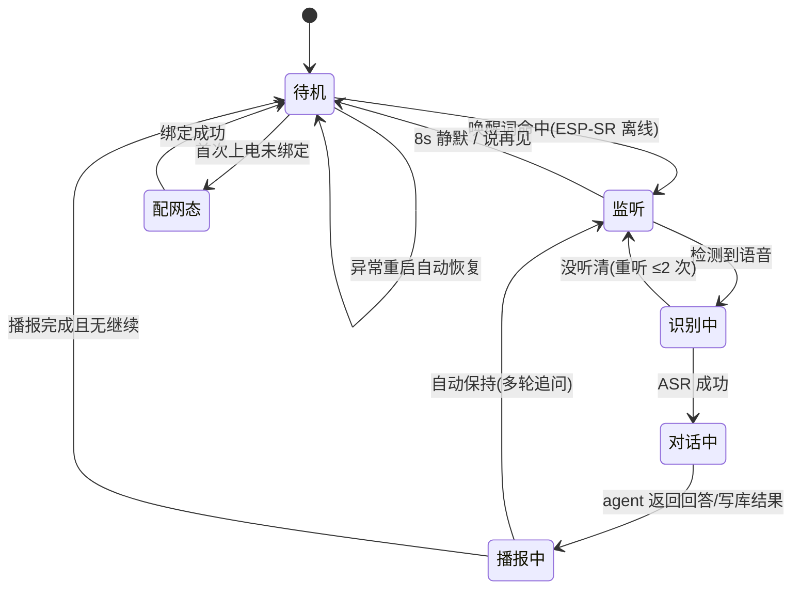
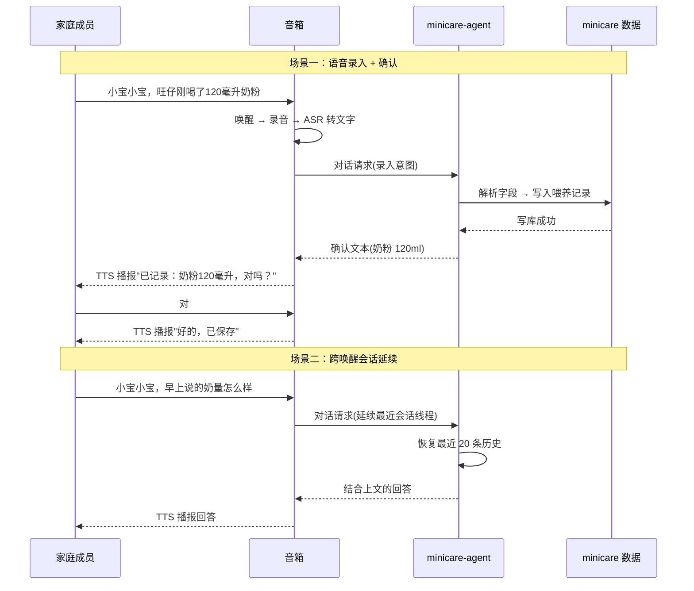

# 产品需求文档：音箱对话渠道「小宝小宝」- V1.0

> 版本：V1.0 ｜ 日期：2026-08-23 ｜ 上级文档：[PRD-003](./PRD-003.md)（敏宝助手）｜ 技术参考：[xiaozhi-esp32 复用分析](../xiaozhi-esp32-reuse-analysis.md)、[音箱语音录入方案调研](../speaker-voice-input-research.md)

## 1. 综述 (Overview)

### 1.1 项目背景与核心问题

minicare 已有手机端「敏宝助手」（PRD-003）提供知识问答、健康数据查询、图片问诊、每日日记等 AI 能力（minicare-agent 全链路验证通过，DeepSeek + 敏宝知识库 + 数据工具 + 护栏）。但手机端存在两个场景痛点：

1. **手忙脚乱时无法记录**：喂奶、哄睡、换尿布时家长往往单手抱娃或手脏，掏手机打开表单录入成本高，容易漏记；
2. **想随口问问题时不便**：哄娃间隙想查"今天奶量正常吗"，掏出手机解锁打开小程序太重，多数时候就放弃了。

本需求引入**家庭音箱**作为敏宝助手的**语音硬件渠道**：家长对音箱说一句话即可完成记录或提问，实现"免掏手机、张口即用"。音箱只承担**语音桥**（唤醒/录音/ASR/TTS/配网/OTA），**全部业务智能由 minicare-agent 承担**（复用其知识库、数据读取、风险护栏、会话记忆），不自建第二套 AI 链路。

**核心原则**：
- **能力复用**：对话/记录/护栏全部复用 minicare-agent，不重复建设；
- **数据边界**：音箱侧不存业务数据，业务数据仍在 minicare 体系内；
- **安全底线**：医疗类回答保留护栏与免责；敏感记录强制语音确认；
- **硬件约束**：基于 ESP32-S3（立创·实战派二次开发版，xiaozhi 固件），本地模拟先行（py-xiaozhi），硬件到货即替换。

### 1.2 核心业务流程 / 用户旅程地图

1. **阶段一：设备接入与绑定** — 家庭管理员在小程序生成永久有效绑定码，音箱配网并输入绑定码完成家庭绑定，获得长期设备凭证。
2. **阶段二：语音对话** — 说唤醒词"小宝小宝"提问（知识/数据类），minicare-agent 回答经 TTS 播报（含来源/免责），同一唤醒会话内可多轮追问。
3. **阶段三：语音录入** — 直接说"旺仔刚喝了 120 毫升奶粉"，agent 工具解析并写库，TTS 回读确认；敏感记录强制确认。
4. **阶段四：会话延续与安全护栏** — 跨唤醒延续最近对话；症状类问题分级播报（emergency 强制就医引导）；异常情况降级提示不崩溃。

### 1.3 Mermaid 图（流程/状态/时序）

#### 1.3.1 用户操作流（必填）



#### 1.3.2 音箱会话状态机（必填）



#### 1.3.3 关键场景时序（录入确认与跨唤醒延续）



## 2. 用户故事详述 (User Stories)

### 阶段一：设备接入与绑定

---

#### **US-01: 家庭管理员生成设备绑定码**

*   **价值陈述 (Value Statement)**:
    *   **作为** 家庭管理员
    *   **我希望** 在 minicare 小程序里生成一个"设备绑定码"
    *   **以便于** 把新买的 ESP32 音箱安全地绑定到本家庭，家庭所有成员即可通过音箱使用语音对话
*   **业务规则与逻辑 (Business Logic)**:
    1.  **前置条件**: 已登录且为家庭管理员（owner/admin 角色）；家庭至少有一个宝宝档案（音箱对话必须绑定到具体宝宝）。
    2.  **操作流程 (Happy Path)**:
        - 进入「我的 → 家庭管理 → 智能设备」页；
        - 点击「添加音箱设备」→ 生成 **6 位数字绑定码**（如 483920）；
        - 绑定码**永久有效**（直到绑定成功或管理员撤销），**一次性使用**；
        - 页面展示绑定码 + "绑定成功后自动失效"提示 + 一键复制。
    3.  **异常处理 (Error Handling)**:
        - 非管理员进入设备管理页 → 隐藏"添加设备"入口，仅可查看已绑设备；
        - 绑定码已被使用 → 自动失效，页面提示"已绑定"；
        - 管理员手动撤销 → 绑定码作废；
        - 重复点击生成 → 旧码作废、生成新码（**同一时刻仅 1 个有效待绑定码**）。
*   **验收标准 (Acceptance Criteria)**:
    *   **场景1: 正常生成**
        *   **GIVEN** 管理员已登录且家庭有宝宝档案
        *   **WHEN** 点击「添加音箱设备」
        *   **THEN** 展示 6 位绑定码 + "永久有效"标识 + 可复制
    *   **场景2: 角色拦截**
        *   **GIVEN** 普通家庭成员登录
        *   **WHEN** 进入智能设备页
        *   **THEN** 看不到"添加"入口，仅能查看已绑设备
    *   **场景3: 绑定后失效**
        *   **GIVEN** 绑定码已被音箱使用
        *   **WHEN** 管理员再次查看
        *   **THEN** 绑定码失效，页面显示"已绑定"
    *   **场景4: 重复生成**
        *   **GIVEN** 已有一个有效待绑定码
        *   **WHEN** 再次点击添加
        *   **THEN** 旧码作废、生成新码，始终只有 1 个有效码
    *   **场景5: 管理员撤销**
        *   **GIVEN** 管理员撤销绑定码
        *   **WHEN** 音箱尝试使用该码绑定
        *   **THEN** 绑定被拒绝，码作废
---
*   **页面布局线框图 (ASCII Wireframe)**:
    ```text
    ┌──────────────────────────────────┐
    │ ‹ 返回   智能设备        ··· 更多 │  ← 导航栏
    ├──────────────────────────────────┤
    │  已绑定设备 (1)                   │
    │  ┌────────────────────────────┐  │
    │  │ 🔊 客厅音箱  ESP32-S3      │  │
    │  │    绑定于 08-23 · 旺仔家庭  │  │
    │  └────────────────────────────┘  │
    │                                  │
    │  [ + 添加音箱设备 ]               │  ← 仅管理员可见
    │                                  │
    │  （点击后弹出绑定码卡片）          │
    │  ┌────────────────────────────┐  │
    │  │ 请输入音箱配网时显示的绑定码 │  │
    │  │       4 8 3 9 2 0          │  │  ← 6位大字 + 一键复制
    │  │  永久有效 · 绑定后失效       │  │
    │  │  [ 重新生成 ]               │  │
    │  └────────────────────────────┘  │
    └──────────────────────────────────┘
    ```
---

#### **US-02: 音箱配网 + 绑定家庭，获得长期设备凭证**

*   **价值陈述 (Value Statement)**:
    *   **作为** 家庭管理员（或协助的家人）
    *   **我希望** 给新买的 ESP32 音箱配网并输入绑定码
    *   **以便于** 音箱完成家庭绑定、获得长期设备凭证，从此家庭成员即可直接语音对话
*   **业务规则与逻辑 (Business Logic)**:
    1.  **前置条件**: 音箱已上电；家庭管理员已生成有效绑定码（US-01）；家庭 WiFi 可用。
    2.  **操作流程 (Happy Path)**（利用触摸屏优势，音箱端直接操作）:
        - 音箱首次上电 → 屏幕进入配网引导（选择 WiFi → 输入 WiFi 密码，支持热点/BluFi 配网）；
        - WiFi 连接成功 → 屏幕进入"输入绑定码"页（触摸屏数字键盘）；
        - 输入 6 位绑定码 → 提交；
        - 服务器校验绑定码 → 绑定 `(device_id, familyId)` → 签发**长期设备凭证**（device token）；
        - 音箱播报 + 屏幕显示"绑定成功，欢迎使用" → 进入待机（可语音唤醒）；
        - 后续每次语音会话握手自动携带凭证，无需再次输入。
    3.  **异常处理 (Error Handling)**:
        - WiFi 密码错误 → 提示重新输入（可重试）；
        - 绑定码错误/已失效 → 提示"绑定码不正确或已失效，请重新获取"；
        - 绑定码属于其他家庭 → 拒绝绑定并提示；
        - 设备已绑定过其他家庭 → 需先解绑（US-03）才能重新绑定；
        - 网络请求失败 → 重试按钮 + 错误提示；
        - 绑定成功但凭证下发失败 → 提示稍后重试，不进入半绑定状态。
*   **验收标准 (Acceptance Criteria)**:
    *   **场景1: 正常绑定**
        *   **GIVEN** 音箱已连 WiFi 且有有效绑定码
        *   **WHEN** 输入正确 6 位码提交
        *   **THEN** 绑定成功、获得长期凭证、播报欢迎语，后续会话免输入
    *   **场景2: 绑定码错误**
        *   **GIVEN** 输入错误绑定码
        *   **WHEN** 提交
        *   **THEN** 提示"绑定码不正确或已失效"，可重新输入
    *   **场景3: 跨家庭码**
        *   **GIVEN** 输入他家庭的有效绑定码
        *   **WHEN** 提交
        *   **THEN** 拒绝绑定并提示
    *   **场景4: 重复绑定**
        *   **GIVEN** 设备已绑定 A 家庭
        *   **WHEN** 尝试绑定 B 家庭
        *   **THEN** 提示先解绑
    *   **场景5: WiFi 失败**
        *   **GIVEN** WiFi 密码错误
        *   **WHEN** 连接
        *   **THEN** 提示重试，不进入绑定步骤
---
*   **页面布局线框图 (ASCII Wireframe)**:
    ```text
    ┌──────────────────────────┐
    │  步骤 2/2 · 绑定家庭       │
    │                          │
    │   请输入 6 位绑定码        │
    │   ┌────────────────┐     │
    │   │  4 8 3 9 2 0   │     │
    │   └────────────────┘     │
    │                          │
    │    [ 1 ][ 2 ][ 3 ]       │
    │    [ 4 ][ 5 ][ 6 ]       │
    │    [ 7 ][ 8 ][ 9 ]       │
    │    [清除][ 0 ][ 确定 ]    │
    │                          │
    │   （绑定成功后）           │
    │   ┌────────────────┐     │
    │   │ ✅ 绑定成功！        │
    │   │ 欢迎使用敏宝助手     │
    │   └────────────────┘     │
    └──────────────────────────┘
    ```
---

#### **US-03: 设备解绑/撤销管理**（P2 · 后置）

*   **价值陈述 (Value Statement)**:
    *   **作为** 家庭管理员
    *   **我希望** 查看已绑定设备并解绑
    *   **以便于** 音箱丢失/换新时撤销其访问权限
*   **业务规则与逻辑 (Business Logic)**:
    1.  **操作流程**: 智能设备页展示已绑设备列表（名称/绑定时间）；管理员可解绑 → 该设备 token 立即失效；解绑后设备可重新走绑定流程。
    2.  **异常处理**: 解绑后音箱再次请求会话 → 拒绝访问并播报"设备已解绑，请联系管理员"。
*   **验收标准 (Acceptance Criteria)**:
    *   **场景1**: GIVEN 管理员解绑设备 WHEN 音箱再次请求会话 THEN 拒绝访问并提示
    *   **场景2**: GIVEN 解绑后重新绑定 WHEN 输入新绑定码 THEN 绑定成功

### 阶段二：语音对话

---

#### **US-04: 唤醒提问，minicare-agent 回答经 TTS 播报**（P0 · 核心）

*   **价值陈述 (Value Statement)**:
    *   **作为** 家庭成员
    *   **我希望** 唤醒音箱后直接说出问题（如"旺仔今天奶量怎么样？""深度水解和氨基酸配方有什么区别？"）
    *   **以便于** 不用掏手机就能获得基于知识库和自家宝宝数据的专业回答
*   **业务规则与逻辑 (Business Logic)**:
    1.  **前置条件**: 音箱已绑定本家庭（US-02）；家庭有宝宝档案；minicare-agent 服务可用。
    2.  **操作流程 (Happy Path)**:
        - 用户说唤醒词「**小宝小宝**」→ 音箱离线唤醒（ESP-SR，断网也能唤醒）→ 进入监听；
        - 用户说出问题 → 录音（Opus 流）→ 服务器 ASR 转文字；
        - 服务器判断为"提问"意图 → 调 **minicare-agent 对话**（复用知识库/数据查询/护栏全部能力）；
        - minicare-agent 返回回答文本 → **TTS 播报**（含必要的数据来源/免责声明）；
        - 播报结束回到待机。
    3.  **异常处理 (Error Handling)**:
        - 唤醒词未触发 → 保持待机（不误答）；
        - ASR 识别为空/失败 → 播报"没听清，请再说一次"（最多重试 2 次）；
        - **非 minicare 范围问题**（闲聊/天气等）→ **关闭闲聊，只走 agent**：播报"这个问题我暂时帮不上，可以问宝宝的喂养、睡眠、症状等问题"；
        - minicare-agent 无响应/超时 → 播报"服务暂时不可用，请稍后再试"；
        - 家庭无宝宝档案 → 绑定阶段已拦截（US-02 前置），此处兜底提示。
*   **验收标准 (Acceptance Criteria)**:
    *   **场景1: 数据问答**
        *   **GIVEN** 音箱已绑定
        *   **WHEN** 唤醒后问"旺仔今天奶量怎么样"
        *   **THEN** 播报基于实时数据的回答（含数据来源）
    *   **场景2: 知识问答**
        *   **GIVEN** 问"深度水解和氨基酸区别"
        *   **WHEN** 提交
        *   **THEN** 播报知识库检索增强回答（含来源/免责）
    *   **场景3: 听不清**
        *   **GIVEN** 语音过短/嘈杂
        *   **WHEN** 识别为空
        *   **THEN** 播报"没听清"并重听，2 次后自动退出
    *   **场景4: 非业务闲聊**
        *   **GIVEN** 问"今天天气"
        *   **WHEN** 提交
        *   **THEN** 播报引导语（聚焦 minicare 能力范围）
    *   **场景5: 服务不可用**
        *   **GIVEN** minicare-agent 超时
        *   **WHEN** 请求
        *   **THEN** 播报"稍后再试"，不崩溃
---
*   **页面布局线框图 (ASCII Wireframe)**:
    ```text
    ┌──────────────────────────┐      ┌──────────────────────────┐
    │   待机（屏幕常亮/微亮）      │      │   对话中                  │
    │                          │      │                          │
    │    🔊 敏宝助手 待命中      │      │   你：旺仔今天奶量怎么样？  │
    │                          │      │                          │
    │    "小宝小宝"（说唤醒词）   │ ──▶ │   助手：根据记录，旺仔今天  │
    │                          │      │   到目前喝了 420 毫升奶粉， │
    │                          │      │   比昨天同期少 60 毫升。    │
    │                          │      │                          │
    │                          │      │   （语音播报 + 屏幕显示）    │
    └──────────────────────────┘      └──────────────────────────┘
    ```
---

#### **US-05: 同一唤醒会话内多轮追问**（P0）

*   **价值陈述 (Value Statement)**:
    *   **作为** 家庭成员
    *   **我希望** 在同一轮唤醒内连续追问（如"那氨基酸配方呢？""跟昨天比呢？"）
    *   **以便于** 像聊天一样深挖问题，不用每次重新唤醒重复上下文
*   **业务规则与逻辑 (Business Logic)**:
    1.  **前置条件**: 音箱已绑定；当前处于同一唤醒会话内（US-04 之后未退出）；minicare-agent 会话可用。
    2.  **操作流程 (Happy Path)**:
        - 用户唤醒 → 问第一个问题 → 播报回答；
        - 播报结束后**自动保持监听**（不回到待机）→ 用户直接追问；
        - 追问转发 minicare-agent **同一会话线程**（复用上文，如"那氨基酸配方呢"会结合上一问对比回答）；
        - 无新指令（**8 秒静默**）→ 自动退出回待机。
    3.  **异常处理 (Error Handling)**:
        - 连续 5 轮后 → 主动提示"还有其他问题吗？"；
        - 追问与上文无关/话题切换 → minicare-agent 正常处理（其知识库/护栏覆盖）；
        - 中途说"退出/再见" → 结束会话回待机；
        - 8 秒静默第一次 → 播报"还有其他问题吗"→ 再次静默退出。
*   **验收标准 (Acceptance Criteria)**:
    *   **场景1: 连续追问**
        *   **GIVEN** 第一问已播报
        *   **WHEN** 用户直接追问
        *   **THEN** 回答结合上文，不重复基础介绍
    *   **场景2: 自动监听**
        *   **GIVEN** 回答结束
        *   **WHEN** 8 秒内无新指令
        *   **THEN** 退出回待机
    *   **场景3: 主动退出**
        *   **GIVEN** 对话中
        *   **WHEN** 用户说"再见/退出"
        *   **THEN** 结束会话回待机
    *   **场景4: 话题切换**
        *   **GIVEN** 上一问是喂养
        *   **WHEN** 追问症状问题
        *   **THEN** 正常切换回答（护栏仍生效）

### 阶段三：语音录入

---

#### **US-07: 语音录入 + 播报确认**（P0 · 核心）

*   **价值陈述 (Value Statement)**:
    *   **作为** 家庭成员（手上有宝宝或正忙）
    *   **我希望** 直接对音箱说"旺仔刚喝了 120 毫升奶粉""刚拉了一次臭臭"
    *   **以便于** 不用掏手机打开表单，一句话完成记录，并得到语音确认
*   **业务规则与逻辑 (Business Logic)**:
    1.  **前置条件**: 音箱已绑定；处于唤醒会话中；家庭有宝宝档案。
    2.  **操作流程 (Happy Path)**:
        - 唤醒后说录入语句（如"小宝小宝，旺仔刚喝了 120 毫升奶粉"）；
        - ASR 转文字 → 意图识别为"记录" → **复用 minicare-agent 的记录能力**（LLM 解析结构化字段 → 调 minicare 写记录 API，不走旧 voice/parse）；
        - 写库成功 → **TTS 播报确认**："已记录：奶粉 120 毫升，对吗？"；
        - 用户回复"对" → 播报"好的，已保存" → 会话结束回待机。
    3.  **异常处理 (Error Handling)**:
        - **字段不全/不确定**（如只说"喝了奶"没说量）→ 播报追问"喝了多少毫升？"（多轮追问补齐，最多 2 次，仍缺则放弃并提示）；
        - **记录类型无法识别** → 播报"没听懂要记什么，可以说'喝了多少奶''睡了多久'等"；
        - **写库失败** → 播报"保存失败，请稍后再试"（不误导用户以为已记录）；
        - **敏感记录二次确认**：涉及症状/用药等敏感记录 → 播报完整回读 + 要求确认后再写库；
        - 非家庭成员（未绑定）→ 绑定前置已拦截（MVP 不区分人）。
*   **验收标准 (Acceptance Criteria)**:
    *   **场景1: 完整录入**
        *   **GIVEN** 说"喝了120毫升奶粉"
        *   **WHEN** 提交
        *   **THEN** 写库成功并播报回读确认，确认后保存
    *   **场景2: 缺字段追问**
        *   **GIVEN** 只说"喝了奶"
        *   **WHEN** 提交
        *   **THEN** 追问"多少毫升"，补齐后写库；2 次追问仍缺 → 放弃并提示
    *   **场景3: 无法识别**
        *   **GIVEN** 说"今天天气不错"
        *   **WHEN** 提交
        *   **THEN** 按闲聊兜底引导回记录能力
    *   **场景4: 写库失败**
        *   **GIVEN** 写库异常
        *   **WHEN** 提交
        *   **THEN** 播报"保存失败，请稍后再试"，不谎报成功
    *   **场景5: 敏感记录确认**
        *   **GIVEN** 说"宝宝有点发烧，38度5"
        *   **WHEN** 提交
        *   **THEN** 完整回读 + 确认后写库
---
*   **页面布局线框图 (ASCII Wireframe)**:
    ```text
    ┌──────────────────────────┐
    │   你：旺仔刚喝了120毫升奶粉 │
    │                          │
    │   助手：已记录：奶粉 120   │
    │   毫升，对吗？            │
    │                          │
    │   你：对                  │
    │                          │
    │   助手：好的，已保存 ✅    │
    └──────────────────────────┘
    ```
---

### 阶段四：会话延续与安全护栏

---

#### **US-09: 跨唤醒会话延续**（P0）

*   **价值陈述 (Value Statement)**:
    *   **作为** 家庭成员
    *   **我希望** 早上问过的问题，晚上再唤醒音箱还能接着聊（"早上说的那个，后来怎么样了"）
    *   **以便于** 对话不因唤醒中断而丢失，像微信聊天一样有连续性
*   **业务规则与逻辑 (Business Logic)**:
    1.  **前置条件**: 音箱已绑定；minicare-agent 会话恢复能力可用（复用 TECH-006 会话保留机制）。
    2.  **操作流程 (Happy Path)**:
        - 第一次唤醒 → 建立**家庭级会话线程**（设备 → 家庭 → 默认会话归属家庭）；
        - 结束唤醒（静默退出/说再见）→ 会话保存在 minicare-agent（历史永久，可恢复最近 20 条）；
        - 下次唤醒 → **自动延续最近一次会话**，用户直接追问（"我们继续上次的话题"为可选播报，默认不播）。
    3.  **异常处理 (Error Handling)**:
        - 无历史会话（首次使用）→ 正常开始新会话；
        - 会话恢复失败（服务重启/数据丢失）→ 播报"无法恢复上次对话，我们重新开始"，不阻塞使用；
        - 上下文过长 → 自动截断为最近 20 条（minicare-agent 已有策略）；
        - 换宝宝场景（二期，声纹区分后）→ 必须开新线程（MVP 单宝宝默认）。
*   **验收标准 (Acceptance Criteria)**:
    *   **场景1: 跨唤醒延续**
        *   **GIVEN** 上午问过"奶量怎么样"
        *   **WHEN** 晚上唤醒直接问"那现在呢"
        *   **THEN** 回答结合上午上下文
    *   **场景2: 首次使用**
        *   **GIVEN** 无历史会话
        *   **WHEN** 首次唤醒
        *   **THEN** 正常开始新会话
    *   **场景3: 恢复失败**
        *   **GIVEN** 会话数据不可用
        *   **WHEN** 唤醒
        *   **THEN** 提示重新开始，不崩溃
    *   **场景4: 上下文截断**
        *   **GIVEN** 历史超 20 条
        *   **WHEN** 恢复
        *   **THEN** 仅最近 20 条生效

---

#### **US-10: 风险信号护栏**（P0 · 安全底线）

*   **价值陈述 (Value Statement)**:
    *   **作为** 家庭成员
    *   **我希望** 音箱在遇到症状/风险类问题时给出分级判断，而不是模糊回答
    *   **以便于** 需要就医时不被耽误，可观察时不被吓到
*   **业务规则与逻辑 (Business Logic)**:
    1.  **前置条件**: 音箱已绑定；minicare-agent 护栏能力（复用 PRD-003 US-11 风险分级）可用。
    2.  **操作流程 (Happy Path)**:
        - 用户描述症状（如"宝宝便血了""发烧 39 度""吐奶带血丝"）；
        - minicare-agent 识别风险信号 → 分级：
          - **emergency（强制就医）**: 播报"这情况需要尽快就医，请立即带宝宝去医院，不要拖延" + 免责声明；
          - **caution/low（观察）**: 正常回答 + 观察要点 + "如症状加重请及时就医" + 免责声明；
        - 播报完成 → 回到待机。
    3.  **异常处理 (Error Handling)**:
        - 无法判断风险级别 → 保守按 caution 处理 + 建议咨询医生；
        - 用户追问"真的不用去医院吗" → 保持原级别判断，不因追问改变（防误导）；
        - 敏感记录（症状录入）→ 与 US-07 一致，完整回读 + 确认后写库；
        - **护栏边界**: 音箱仅播报，不替代医生；不诊断、不开处方；emergency 场景播报后**不再提供其他建议**（避免稀释就医引导）。
*   **验收标准 (Acceptance Criteria)**:
    *   **场景1: emergency**
        *   **GIVEN** 说"宝宝便血了"
        *   **WHEN** 提交
        *   **THEN** 播报强制就医引导 + 免责，且不再附加其他建议
    *   **场景2: 观察级**
        *   **GIVEN** 说"有点红疹"
        *   **WHEN** 提交
        *   **THEN** 正常回答 + 观察要点 + 加重就医提示
    *   **场景3: 无法判断**
        *   **GIVEN** 信息不足无法定级
        *   **WHEN** 提交
        *   **THEN** 保守 caution + 建议咨询医生
    *   **场景4: 追问不变级**
        *   **GIVEN** 已判 emergency
        *   **WHEN** 用户追问是否可观察
        *   **THEN** 保持就医引导，不松口
    *   **场景5: 免责固定**
        *   **GIVEN** 任何医疗类回答
        *   **WHEN** 播报
        *   **THEN** 末尾附免责声明（固定文案）

---

#### **US-11: 异常处理与降级**（P1）

*   **价值陈述 (Value Statement)**:
    *   **作为** 家庭成员
    *   **我希望** 音箱在异常情况（网络/服务/语音）下给出友好提示而不是沉默或崩溃
    *   **以便于** 无论何时都知道"发生了什么、该怎么办"
*   **业务规则与逻辑 (Business Logic)**:
    1.  **异常清单与降级策略**:

        | 异常 | 用户感知 | 系统行为 |
        |---|---|---|
        | 断网/弱网 | 唤醒无响应或提示 | 播报"网络连接不稳定，请检查 WiFi"；唤醒词本地可用（ESP-SR 离线）但 ASR/agent 需网络 |
        | minicare-agent 不可用 | 回答超时 | 播报"服务暂时不可用，请稍后再试"（≤2 次重试） |
        | ASR 识别失败 | 听不清 | 播报"没听清，请再说一次"（≤2 次后退出） |
        | TTS 播报失败 | 无声音 | 屏幕显示回答文字（有屏优势） |
        | 音箱未绑定 | 无法对话 | 屏幕引导"请在小程序绑定设备"（配网态） |
        | 设备被解绑 | 会话被拒 | 播报"设备已解绑，请联系管理员" |
        | 电源/异常重启 | 自动恢复 | 重启后回到待机，会话保留（可延续） |

    2.  **降级总原则**: **优先保语音反馈**（能播报就不沉默）→ **其次屏幕显示** → 最后才静默。
*   **验收标准 (Acceptance Criteria)**:
    *   **场景1: 断网**
        *   **GIVEN** 无网络
        *   **WHEN** 唤醒说话
        *   **THEN** 播报网络提示，不崩溃
    *   **场景2: 服务不可用**
        *   **GIVEN** minicare-agent 超时
        *   **WHEN** 提问
        *   **THEN** 播报稍后再试，重试 ≤2 次
    *   **场景3: 听不清**
        *   **GIVEN** 语音过短
        *   **WHEN** 识别
        *   **THEN** 播报"没听清"，2 次后退出
    *   **场景4: 被解绑**
        *   **GIVEN** 设备已解绑
        *   **WHEN** 请求会话
        *   **THEN** 拒绝并播报提示
    *   **场景5: 异常重启**
        *   **GIVEN** 断电重启
        *   **WHEN** 恢复
        *   **THEN** 回待机且会话可延续

### 二期候选（移出 MVP）

| 故事 | 内容 | 说明 |
|---|---|---|
| US-06（二期） | 声纹识别区分家庭成员 | 基于 3D-Speaker 声纹注册，识别"爸爸说的/妈妈说的"，记录/会话归属到具体成员；MVP 默认家庭级不区分人 |
| US-08（二期） | 主动补录提醒 | 唤醒时注入今日状态，agent 主动提醒漏记项（如"今天还没有大便记录，要记一下吗"）；MVP 不做，避免打扰 |

---

## 3. 非功能需求

| 维度 | 要求 |
|---|---|
| 安全-设备鉴权 | 音箱握手携带长期 device token（Authorization: Bearer）；解绑即失效；绑定码永久有效但一次性、可撤销 |
| 安全-数据边界 | 音箱侧不落业务数据；ASR/TTS 音频仅在语音链路传输；业务数据读写全部经 minicare-agent 复用现有 minicare 权限体系 |
| 安全-密钥 | DEEPSEEK_API_KEY / TCB 凭证 / AGENT_INTERNAL_TOKEN 等走 CloudRun env，不落代码/镜像；音箱固件不含业务密钥 |
| 合规-医疗 | 医疗类回答固定免责声明；不诊断、不开处方；emergency 强制就医引导；敏感记录语音确认 |
| 性能 | 唤醒 <500ms（ESP-SR 本地）；SSE 首字 <3s；端到端"说话→播报"目标 <5s（P1 优化项） |
| 可用性 | 断网可唤醒（离线）；服务降级有语音反馈；异常重启自恢复 |
| 隐私 | 音箱端不采集/上传无关音频；音频不留存或留存策略与现有语音链路一致 |
| 部署 | xiaozhi-server 不直接暴露公网（官方警告未过等保），走内网/反向代理；Docker 部署 |

## 4. 里程碑与验收（建议）

| 阶段 | 内容 | 验收标志 |
|---|---|---|
| M1（本地模拟） | 部署 xiaozhi-esp32-server（腾讯云 ASR/TTS + DeepSeek）+ py-xiaozhi Mac 模拟设备 | 模拟设备完成唤醒→提问→播报全链路 |
| M2（后端接入） | minicare 设备鉴权（device token）+ agent 工具封装（记录/查询） | 模拟设备可完成"问奶量"和"录奶量" |
| M3（硬件联调） | 立创实战派 S3 烧录固件 + 绑定 + 真机全流程 | 真机完成绑定/对话/录入/护栏全流程 |
| M4（打磨） | 异常降级、话术打磨、性能优化 | 验收标准全绿 |

## 5. 依赖与风险

| 依赖 | 说明 |
|---|---|
| minicare-agent（TECH-006） | 对话/记录/护栏能力全部复用，需先可用 |
| xiaozhi-esp32-server | 自建部署，配置腾讯云 ASR/TTS + DeepSeek |
| 硬件 | 立创·实战派 ESP32-S3（未购买，可先 py-xiaozhi 模拟） |
| 设备鉴权（新增） | minicare-server 需新增 device token 签发/校验（长期凭证） |

| 风险 | 对策 |
|---|---|
| 服务器未过等保 | 不暴露公网，内网 + 反向代理 + 设备 token |
| LLM 工具误写记录 | 写库前 TTS 回读确认；敏感记录强制确认 |
| 模拟麦适配（ZTS6216 模拟输出） | xiaozhi 固件适配 ES7210 ADC 通道；如遇阻可换 I2S 数字麦板型 |
| 声纹二期未做 | MVP 家庭级不区分人，记录归属默认家庭 |
| 音频合规 | 与现有手机语音链路一致的留存策略 |
