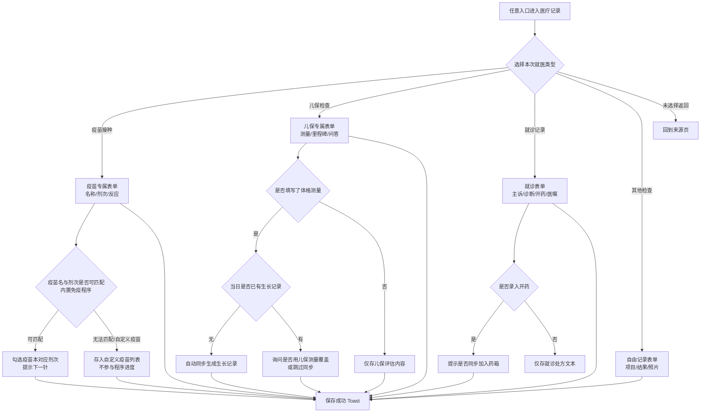
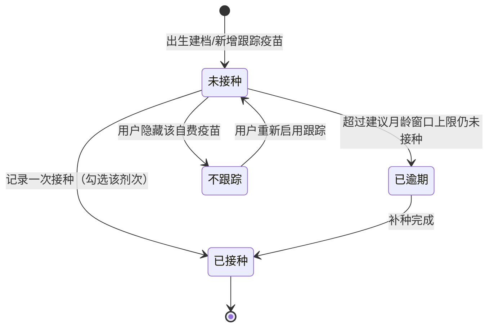
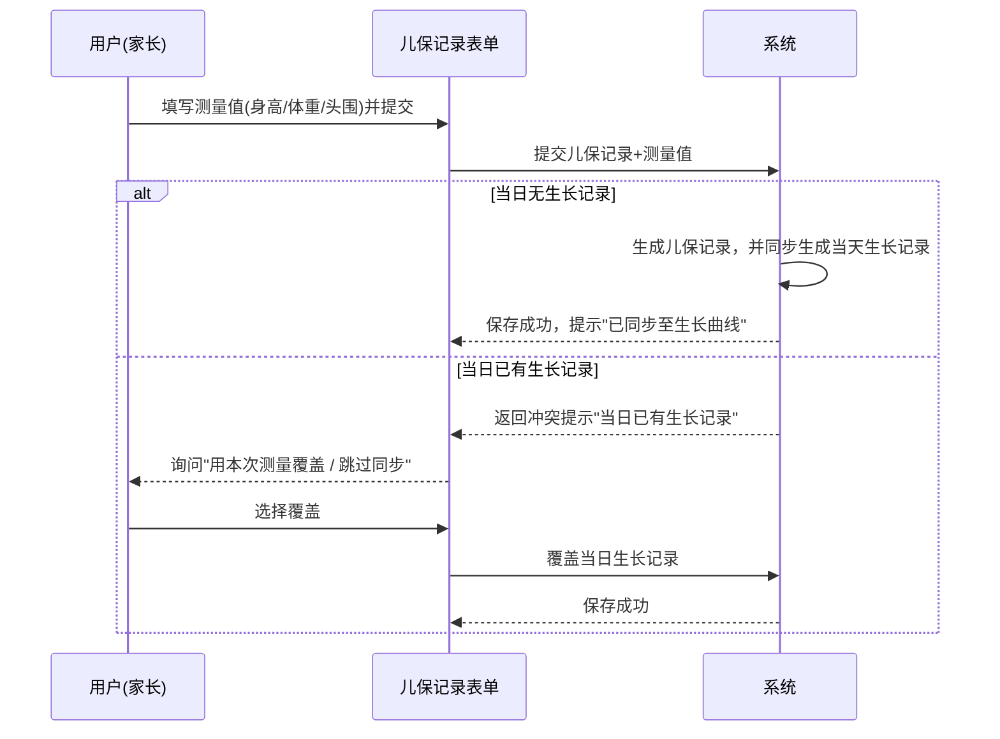

# 产品需求文档：医疗健康档案板块重构（按类型定制记录 + 聚合视图） - V0.1

> 状态：草稿待确认（v0.1）
> 关联 PRD：PRD-001（语音录入）、PRD-002（辅食排敏）、PRD-003（AI 助手，非目标边界参考）
> 涉及平台：minicare-mp（微信小程序，主平台）

## 1. 综述 (Overview)

### 1.1 项目背景与核心问题

**现状**：当前小程序的"医疗记录"是一个"通用就医表单"，通过顶部类型选择（儿保检查 / 就诊记录 / 疫苗接种 / 其他检查）切换标签，但**无论选哪种类型，表单字段完全相同**（时间、机构、医生、诊断、结果摘要、照片、复查提醒）。数据层面 `medical_record` 单表存所有类型，各类型只体现在一个枚举值上。

这带来四个具体问题：

1. **类型不驱动内容**：疫苗场景无法结构化记录"疫苗名称 + 剂次"（只能把"乙肝第 2 针"写进诊断文本）；儿保场景无法记录"医生对生长发育的评估"，也无法记录"家长提问 → 医生答复"（只能挤进一段结果摘要）。
2. **没有聚合视图**：打完疫苗看不到"接种顺序与完成进度"，不知道下一针是什么、什么时候打；做过多次儿保也看不到历次评估的对照与回溯。
3. **入口与表达分散**：用药（药箱+打卡）、过敏、体温分散在"健康"等其它记录类型中，与医疗记录同属"健康档案"但各自为政，无统一归口；就医时开的药（后端曾预留 `medications` 字段）与"用药记录"模块表达重叠，且小程序端从未使用该字段。
4. **历史包袱**：`blood / allergy` 等已废弃类型靠老数据编辑时归一为 `other` 兜底，缺乏干净的迁移与展示策略。

**本 PRD 的目标**：把"医疗健康档案"从"一个通用记录单"重构为"**按就医类型定制的差异化记录模型 + 各类型的聚合档案视图 + 统一归口的健康档案板块**"。核心原则是：**类型驱动字段、类型驱动展示**。

**非目标**（明确不做）：
- 不做疫苗批号追溯、冷链管理、疑似预防接种异常反应（AEFI）上报等政务/疾控能力；
- 不做 AI 医学判断、开处方、替代医生建议；
- 不做儿保报告 PDF 导出；
- 不做体温/过敏/用药**录入表单本身的再造**（这三个子域录入已是专用表单，本 PRD 只做"归口、视图与联动"）；
- 不做疫苗与自费联合疫苗的"自动替代换算"（如五联替代单苗，见 US-02 业务规则降级说明）。

### 1.2 核心业务流程 / 用户旅程地图

1. **阶段一：就医类型路由与差异化记录** — 用户进入"医疗记录"后先选就医类型，系统用该类型专属表单承载差异化字段，解决"一个表单装所有类型"。
2. **阶段二：疫苗接种闭环** — 记录接种（疫苗名+剂次+反应）→ 疫苗本按免疫程序展示已完成/待接种 → 掌握"下一针打什么、什么时候"。
3. **阶段三：儿保检查闭环** — 记录体格测量+发育评估+家长问答 → 儿保档案回溯历次评估；测量数据同步进生长曲线。
4. **阶段四：就诊与其它检查** — 就诊记录结构化（主诉→诊断→开药→医嘱→复查），开药可一键加入药箱；其它检查保留自由形态兜底。
5. **阶段五：医疗健康档案统一归口** — 聚合入口把医疗/疫苗本/儿保/用药/过敏/体温收拢为"医疗档案"板块，二期提供过敏档案视图。

### 1.3 Mermaid 图

#### 1.3.1 用户操作流（必填）



#### 1.3.2 状态机：疫苗剂次跟踪状态（存在状态流转对象，必填）



#### 1.3.3 关键场景时序（选填）

> 儿保测量"同步生长记录"涉及当日已有生长记录的冲突判定（数据表存在"同宝宝同日一条生长记录"的唯一约束），写时序以避免实现歧义。



## 2. 用户故事详述 (User Stories)

> 角色说明：本板块核心用户为「家长」（家庭创建者/成员，角色见 MVP-PRD），以下统一以"家长"为主语。
> 优先级口径：**P0 = 本期必须**（疫苗+儿保类型化 + 老数据兼容）；**P1 = 本期尽量 / 紧接下一期**（就诊增强、归口入口、用药联动）；**P2 = 二期**（过敏档案、发育回顾、自定义提醒推送）。

---

### 阶段一：就医类型路由与差异化记录

---

#### **US-01: 作为家长，我希望在记录医疗事件时先选择就医类型，以便于系统按类型给我展示对应需要填写的字段**
*   **价值陈述 (Value Statement)**:
    *   **作为** 家长
    *   **我希望** 从任意入口（首页快捷、记录列表、语音录入）进入医疗记录时，先明确"这次记录的是哪种就医类型"
    *   **以便于** 只填写该类型真正需要的字段，不被无关字段干扰（例如打疫苗不用填"发育评估"，做儿保不用纠结"剂次"）
*   **业务规则与逻辑 (Business Logic)**:
    1.  **前置条件**: 已进入宝宝档案且有记录权限；医疗记录子域支持 4 种类型：疫苗接种 / 儿保检查 / 就诊记录 / 其他检查。
    2.  **操作流程 (Happy Path)**:
        1.  家长从首页快捷入口或 FAB 选择"医疗记录"。
        2.  系统展示类型选择页（4 种类型，图标+说明，说明示例："疫苗：记录剂次与接种反应" / "儿保：测量与发育评估问答"）。
        3.  家长点选某一类型，进入**该类型专属表单**（见 US-02/04/06/07）。
        4.  保存后按类型归属展示在时间线与对应档案中。
    3.  **异常处理 (Error Handling)**:
        *   家长中途返回：丢弃未提交内容，回到来源页（符合现有一致交互）。
        *   家长从"编辑已有记录"进入：**跳过类型选择**，直接进入该记录所属类型的表单（依 visit_type 分流），避免类型被意外改写。
        *   语音录入（PRD-001）进入：语音识别结果已含类型置信度时直接带入选型；识别不出时落到类型选择页等待家长手选，并提示"请选择这次记录的类型"。
        *   老记录 visit_type 为已废弃值（blood/allergy 等）或缺失：编辑时进入"其他检查"兜底表单，展示时挂"已归档"弱标签，不打断编辑（见 US-10）。
*   **验收标准 (Acceptance Criteria)**:
    *   **场景1: 新建时按类型路由**
        *   **GIVEN** 家长已进入宝宝档案且点击"记录 → 医疗"
        *   **WHEN** 家长选择"疫苗接种"
        *   **THEN** 进入疫苗专属表单，页面不再出现"发育里程碑""体格测量"等儿保字段
    *   **场景2: 编辑时不改类型**
        *   **GIVEN** 时间线上有一条 visit_type=checkup 的儿保记录，家长点编辑
        *   **WHEN** 表单打开
        *   **THEN** 直接进入儿保专属表单且类型锁定不可切换，保存后类型不变
    *   **场景3: 返回不产生脏数据**
        *   **GIVEN** 家长进入类型选择页
        *   **WHEN** 家长未选择直接返回
        *   **THEN** 不产生任何记录草稿，回到来源页
*   **页面布局线框图 (ASCII Wireframe)**:

    ```text
    +--------------------------------------------------------------+
    | < 记录类型                               医疗档案        [×]  |
    +--------------------------------------------------------------+
    |  这次要记录什么？                                             |
    |                                                              |
    |  +----------------------------------------------------------+|
    |  |  [icon] 疫苗接种          →  记录剂次与接种反应          ||
    |  |          接种本进度同步                                    ||
    |  +----------------------------------------------------------+|
    |  |  [icon] 儿保检查          →  体格测量·发育评估·问答      ||
    |  +----------------------------------------------------------+|
    |  |  [icon] 就诊记录          →  主诉·诊断·开药·医嘱         ||
    |  +----------------------------------------------------------+|
    |  |  [icon] 其他检查          →  检查项目·结果·报告照片       ||
    |  +----------------------------------------------------------+|
    +--------------------------------------------------------------+
    ```

---

### 阶段二：疫苗接种闭环

---

#### **US-02: 作为家长，我希望按疫苗与剂次记录每次接种，以便于疫苗本准确反映接种进度**
*   **价值陈述 (Value Statement)**:
    *   **作为** 家长
    *   **我希望** 接种记录里明确"疫苗名称、第几剂、接种反应"，并能从内置参考程序中检索疫苗
    *   **以便于** 每次打完针都能沉淀成结构化数据，供疫苗本算进度、提醒下一针
*   **业务规则与逻辑 (Business Logic)**:
    1.  **前置条件**: 类型选择为"疫苗接种"；疫苗名称支持从**内置参考程序库**检索（覆盖国家免疫规划一类疫苗 + 常见二类疫苗，见文末附录 A），也支持自定义录入。
    2.  **操作流程 (Happy Path)**:
        1.  家长选择疫苗名称（检索式选择：输入关键词联想疫苗名）。
        2.  系统自动带出"本次应接种的剂次"（按该疫苗已记录的最大剂次 +1；如乙肝已记 2 针则带出"第 3 剂"），家长可修改为补种历史剂次（用于回填早期未记录的针）。
        3.  填写：接种日期/时间（默认今天）、接种机构/医生（通用记忆，见 US-07 通用能力）、接种部位（可选：左臂/右臂/大腿/口服等）、疫苗批号（可选）。
        4.  接种后反应（可选，多选+备注）：无异常 / 发热 / 局部红肿硬结 / 皮疹 / 嗜睡烦躁 / 其它，可留文字说明。
        5.  保存 → 疫苗本勾选对应剂次；若为自费且该疫苗无程序跟踪，则提示已存入"自定义疫苗"区。
    3.  **异常处理 (Error Handling)**:
        *   检索不到的自费/非常规疫苗：允许"自定义添加疫苗名"，不入程序进度，仅作为历史记录；后续家长可在疫苗本手动启用跟踪或忽略。
        *   剂次与参考程序不符（如记录"第 4 剂乙肝"，程序仅 3 剂）：提示"该疫苗参考程序为 3 剂，确认记录为第 4 剂？"，确认后按自定义剂次保存并标记"超出程序"，不阻断。
        *   重复接种校验：同疫苗同剂次已存在记录时，提示"第 N 剂乙肝已于 YYYY-MM-DD 记录，是否确认重复/补录？"，二次确认后允许（应对线下补打与同日多联苗场景需家长自行判断）。
        *   自费联合疫苗（如五联）替代单苗：**不做自动换算**。规则：五联中的脊灰/百白破/ Hib 相关单苗剂次**不作为已接种自动勾选**；家长可自行在疫苗本把被替代的单苗剂次标记"已用五联替代完成"（手动），或忽略单苗跟踪（页面给出引导文案，不自动推断）。
        *   接种反应含"发热≥38.5 或疑似严重反应"文案勾选时：仅给出就医引导提示（"如有高热不退/呼吸异常请及时就医"），不做医学判定，不阻断保存。
    4.  **验收标准 (Acceptance Criteria)**:
        *   **场景1: 常规流程记录**
            *   **GIVEN** 家长已为旺仔记录过乙肝第 1、2 剂，现打完第 3 剂
            *   **WHEN** 家长选"乙肝疫苗"并确认自动带出的"第 3 剂"，填好日期保存
            *   **THEN** 疫苗本乙肝条目下第 3 剂变为"已接种(日期)"，页面提示"乙肝疫苗接种完成"
        *   **场景2: 回填历史针次**
            *   **GIVEN** 家长第一次使用，宝宝 5 月龄已打过卡介苗但未记录
            *   **WHEN** 家长选择"卡介苗"并把剂次改为"第 1 剂"、日期填出生日期
            *   **THEN** 正常保存，疫苗本显示卡介苗 1 剂已完成
        *   **场景3: 自定义疫苗**
            *   **GIVEN** 家长打了参考程序外的自费疫苗（如流感疫苗，若实现期参考库未含）
            *   **WHEN** 家长自定义疫苗名保存
            *   **THEN** 记录成功保存，且不参与"待接种"进度提醒
        *   **场景4: 疑似严重反应**
            *   **GIVEN** 家长勾选反应"发热"并补充文字
            *   **WHEN** 保存
            *   **THEN** 正常保存，并出现"如有高热不退/呼吸异常请及时就医"的提示，提示不阻断保存
*   **页面布局线框图 (ASCII Wireframe)**:

    ```text
    +--------------------------------------------------------------+
    | < 疫苗记录                         疫苗接种              [×]  |
    +--------------------------------------------------------------+
    | 疫苗名称 *                                                  |
    | +----------------------------------------------------------+ |
    | | [🔍 搜索: 乙肝]  乙肝疫苗(免费) [第1剂✓ 第2剂✓ 待第3剂] | |
    | +----------------------------------------------------------+ |
    | 剂次 *      ( 第 3 剂 )   [+ 回填历史针次]                   |
    | 接种日期    [ 2026-09-07 ]  时间(可选) [ 09:00 ]             |
    | 接种机构    [ 社区卫生服务中心 ]   医生(可选)[  ]             |
    | 接种部位    ( 左臂 ) ( 右臂 ) ( 大腿 ) ( 口服 ) ( 未记录 )    |
    | 疫苗批号    (可选) [______________]                          |
    | 接种后反应  (多选) [ ]无 [ ]发热 [ ]红肿硬结 [ ]皮疹 ...      |
    |            备注 [____________________________]               |
    | 照片/接种本 (可选) [ + 上传 ]                                 |
    +--------------------------------------------------------------+
    |   [ 保存并同步疫苗本 ]                                        |
    +--------------------------------------------------------------+
    ```

---

#### **US-03: 作为家长，我希望有一个"疫苗本"视图展示免疫程序进度，以便于一眼看清已打、该打、下一针**
*   **价值陈述 (Value Statement)**:
    *   **作为** 家长
    *   **我希望** 按月龄看到内置免疫程序里每支疫苗每个剂次的状态（已完成/待接种/逾期）
    *   **以便于** 掌握"宝宝该打哪些、下一针何时打"，并直达补录/记录
*   **业务规则与逻辑 (Business Logic)**:
    1.  **前置条件**: 已建档（宝宝有出生日期）；疫苗本默认纳入"内置参考程序"可跟踪疫苗，自定义疫苗默认不跟踪（家长可手动切换跟踪开关）。
    2.  **操作流程 (Happy Path)**:
        1.  家长从医疗档案/时间线入口打开"疫苗本"。
        2.  页面顶部为**下一针提醒卡**：系统按宝宝当前月龄 + 已有接种记录，算出「当前已到期未打 / 即将到期（近 1 个月）」的第一优先级剂次，文案示例："乙肝第 3 剂已到 6 月龄窗口，该补打了"；点击直达该疫苗的接种记录页（预选疫苗名与剂次）。
        3.  中部按"建议月龄"或"疫苗类别"分组展示疫苗卡：每支疫苗显示剂次点（1/2/3…），已接种的标日期，逾期未种的高亮"补种"提示，未到龄的置灰显示"X月龄后可接种"。
        4.  顶部显示完成概览："已完成 N 剂 / 待接种 M 剂（其中 X 剂已逾期）"。
        5.  点击任意疫苗卡 → 展开该疫苗的剂次明细 + 历次接种记录列表。
    3.  **异常处理 (Error Handling)**:
        *   宝宝接种明显晚于参考窗口（如 1 岁才补乙肝第 1 剂）：不判定为"逾期错误"，文案用中性词"已超过建议窗口，请按医生/接种门诊安排补种"，避免制造焦虑。
        *   联合疫苗替代（五联等）：被替代单苗由家长手动标记，疫苗本在对应单苗上显示"已由五联替代(手动标记)"徽标，不算逾期。
        *   自费疫苗默认跟踪但家长不关心：提供"隐藏/不跟踪"开关，隐藏后不计入待接种与提醒。
        *   无任何记录的新生儿：疫苗本正常展示程序，下一针提醒卡提示"按免疫程序，出生时建议接种乙肝第 1 剂与卡介苗"。
    4.  **验收标准 (Acceptance Criteria)**:
        *   **场景1: 进度展示**
            *   **GIVEN** 旺仔 6 月龄，已记录乙肝 1/2 剂、卡介苗 1 剂、脊灰 2 剂
            *   **WHEN** 家长打开疫苗本
            *   **THEN** 顶部提醒卡显示待接种首选项（乙肝第 3 剂或脊灰第 3 剂之一，按逾期/近窗口优先级），概览统计正确，乙肝第 3 剂、脊灰第 3 剂等为"待接种"态
        *   **场景2: 逾期高亮**
            *   **GIVEN** 旺仔已满 8 月龄，麻腮风第 1 剂（建议 8 月龄起）未记录
            *   **WHEN** 打开疫苗本
            *   **THEN** 麻腮风第 1 剂显示"已到建议月龄，待接种"提醒且排入下一针提醒卡
        *   **场景3: 隐藏自费**
            *   **GIVEN** 家长在疫苗本把"轮状病毒疫苗"设为不跟踪
            *   **WHEN** 家长打开疫苗本
            *   **THEN** 轮状病毒疫苗不再计入待接种概览与提醒卡
        *   **场景4: 直达记录**
            *   **GIVEN** 下一针提醒卡显示乙肝第 3 剂
            *   **WHEN** 家长点击该卡
            *   **THEN** 进入疫苗记录表单且已预选"乙肝疫苗/第 3 剂"
*   **页面布局线框图 (ASCII Wireframe)**:

    ```text
    +--------------------------------------------------------------+
    | < 疫苗本                   医疗档案 >          [+ 记录接种]  |
    +--------------------------------------------------------------+
    |  [进度环 67%] 已完成 8 剂 · 待接种 4 剂(逾期 1 剂)            |
    | +----------------------------------------------------------+ |
    | | ⚠ 下一针提醒                                              | |
    | |   麻腮风 第1剂 · 已满8月龄该接种了                          | |
    | |   [ 去记录 → ]                                             | |
    | +----------------------------------------------------------+ |
    | 按年龄: ( 全部 | 出生~6月 | 6~12月 | 1~6岁 )  类别:(全部|免费|自费)|
    |                                                              |
    |  乙肝疫苗（免费）                      3/3 剂 ✅完成           |
    |   [●第1剂 出生时 6/1] [●第2剂 1月 7/1] [●第3剂 6月 今天]     |
    |  脊灰疫苗（免费）                      2/4 剂                 |
    |   [●第1剂 2月 8/1] [●第2剂 3月 9/2] [○第3剂 4月] [○第4剂 4岁]|
    |  麻腮风疫苗（免费）                    0/2 剂                 |
    |   [○第1剂 8月 已到期!] [○第2剂 18月 未到龄]                  |
    |  轮状病毒疫苗（自费）  [隐藏不跟踪]     1/3 剂                |
    |   [●第1剂 6周 7/20] [○第2剂 10周] [○第3剂 14周]              |
    +--------------------------------------------------------------+
    ```

---

### 阶段三：儿保检查闭环

---

#### **US-04: 作为家长，我希望儿保记录包含体格测量、发育评估与"我问医生答"，以便于完整留存每一次儿保**
*   **价值陈述 (Value Statement)**:
    *   **作为** 家长
    *   **我希望** 在儿保记录里分层记录：体格测量（身高/体重/头围）、发育里程碑评估、医生综合评估与建议、以及我问的问题和医生的答复
    *   **以便于** 把儿保手册内容电子化，发育担忧（如"太胖了体重怎么控制"）有据可查、可回溯
*   **业务规则与逻辑 (Business Logic)**:
    1.  **前置条件**: 类型选择为"儿保检查"；可带出宝宝当前月龄（自动=按出生日期算），测量区展示月龄标注。
    2.  **操作流程 (Happy Path)**:
        1.  通用信息：儿保日期/时间、机构（社区/医院）、儿保医生（记忆化，见通用能力）。
        2.  **体格测量区**（可空，填了才同步）：身高 cm、体重 kg、头围 cm（三选一填写即可，不必全填）。
            - 同步规则：测量值自动同步为一条当天生长记录（进生长曲线）；若当天已有生长记录则弹冲突确认（覆盖/跳过，见 1.3.3）。
            - 展示规则：若系统有同月龄参考（P3-P97），测量卡片旁展示百分位参考提示（复用现有生长标准，只提示、不下结论）。
        3.  **发育里程碑区**：按月龄给出**常见达标项参考**（如 6 月龄提示：翻身/抓握/发音等，参照数据见附录 B，仅作勾选引导，非诊断依据）。家长按维度逐项标注：`大运动 / 精细动作 / 语言 / 认知 / 社会适应`，每维评估为：正常 / 待观察 / 未评估，可附备注（例：大运动-待观察-"还不会独立坐稳"）。
        4.  **医生综合评估与建议**（文本，可选）：复制/手写医生的总结性话语（"生长发育良好/偏胖"等）与建议（喂养/运动/睡眠建议）。
        5.  **家长提问与医生答复（QA）**：动态增删多条，每条含"我的问题"（示例占位："宝宝体重偏高，如何控制？"）与"医生答复"（示例占位："减少夜间奶量，多趴多动…"）。支持从旧问题模板快速复用（记忆最近 3 次同宝宝提问）。
        6.  **可选**：上传儿保手册/报告照片；下次复查提醒（日期+时间）。
        7.  保存 → 归档为一条儿保记录，同步生长记录（若填了测量）。
    3.  **异常处理 (Error Handling)**:
        *   测量值格式/范围非法（身高超 150cm 等明显笔误）：表单级校验拦截并提示检查，不阻断其它字段。
        *   与当天已有生长记录冲突：见 1.3.3 时序，家长选"跳过同步"时仅存儿保测量值、不写生长记录；选"覆盖"则覆盖当日生长值。
        *   里程碑参考表缺当前月龄档（如早产儿校正月龄复杂）：家长可手工选择校正月龄或跳过参考提示，直接自评，不强制。
        *   QA 只填了问题没答复：允许保存，档案中以"待补答复"弱标记，家长可稍后编辑补全。
        *   医生评估建议较长：无字数强限制（文本），保存后详情页支持滚动查看。
    4.  **验收标准 (Acceptance Criteria)**:
        *   **场景1: 完整儿保记录**
            *   **GIVEN** 旺仔 6 月龄去做儿保，医生量身高 68cm、体重 9kg（偏胖），家长问了体重控制
            *   **WHEN** 家长填写测量+发育评估+医生建议+一条 QA 并保存
            *   **THEN** 生成一条儿保记录；当天自动生成一条生长记录（身高 68/体重 9）；QA"体重控制"完整可查；儿保档案出现本次记录
        *   **场景2: 同日已有生长记录冲突**
            *   **GIVEN** 家长当天上午已单独记录过生长（身高 67）
            *   **WHEN** 儿保表单填身高 68 保存
            *   **THEN** 弹窗询问"当日已有生长记录，覆盖为 68 / 跳过同步"，选择后按结果处理且儿保记录本身正常保存
        *   **场景3: 只填问题未答**
            *   **GIVEN** 家长在 QA 只填问题（忘了问医生或医生还没答）
            *   **WHEN** 保存
            *   **THEN** 儿保记录正常保存，QA 该条带"待补答复"标记
*   **页面布局线框图 (ASCII Wireframe)**:

    ```text
    +--------------------------------------------------------------+
    | < 儿保记录                         儿保检查              [×]  |
    +--------------------------------------------------------------+
    | 儿保日期 [ 2026-09-07 ]  月龄 8月5天  机构[ 社区医院 ]         |
    | 儿保医生 [ 王医生 ]                                           |
    | ── 体格测量（填了会同步到生长曲线）                          |
    |   身高(cm)[ 70.0 ] 体重(kg)[ 9.2 ] 头围(cm)[ 44.5 ]           |
    |   ↳ 参考: 体重 P85-P97 偏上 · 请以医生建议为准                 |
    | ── 发育评估（按月龄参考勾选）  [6月龄参考: 翻身/坐/抓握]      |
    |   大运动     ( 正常 ) ( 待观察 ) ( 未评估 ) 备注[            ] |
    |   精细动作   ( 正常 ) ( 待观察 ) ( 未评估 ) 备注[            ] |
    |   语言       ( 正常 ) ( 待观察 ) ( 未评估 ) 备注[            ] |
    |   认知       ( 正常 ) ( 待观察 ) ( 未评估 ) 备注[            ] |
    |   社会适应   ( 正常 ) ( 待观察 ) ( 未评估 ) 备注[            ] |
    | ── 医生综合评估与建议（可选）                                 |
    | [ 生长发育良好，体重偏上。建议控制夜间奶量、多趴多动。      ] |
    | ── 我的问题与医生答复                                        |
    |  问[ 宝宝偏胖,体重怎么控制? ]                                 |
    |  答[ 减少夜奶,白天增加运动量,下月复测。 ]  [删]               |
    |  [+ 再加一条问题]                                             |
    | 照片(可选)[ + ]   下次复查 [ 2026-10-07 ]                     |
    +--------------------------------------------------------------+
    |   [ 保存 ]                                                     |
    +--------------------------------------------------------------+
    ```

---

#### **US-05: 作为家长，我希望有"儿保档案"按时间回溯历次儿保，以便于对照看生长发育与医生建议的延续性**
*   **价值陈述 (Value Statement)**:
    *   **作为** 家长
    *   **我希望** 通过"儿保档案"看到历次儿保的时间线摘要（月龄/测量/评估要点/问答数）并可进入详情
    *   **以便于** 回顾"上次医生怎么说、这次又怎么说"，追溯发育担忧是否改善
*   **业务规则与逻辑 (Business Logic)**:
    1.  **前置条件**: 至少有 1 条儿保记录。
    2.  **操作流程 (Happy Path)**:
        1.  家长从医疗档案打开"儿保档案"。
        2.  按日期倒序展示历次儿保摘要卡：月龄、日期、机构/医生、体格测量三值、评估快照（各维度正常/待观察颜色点，如有待观察高亮）、QA 条数、照片缩略。
        3.  点击卡片进入该次儿保**只读详情**（可编辑、可删除）；档案页右上提供"+ 补录历史儿保"入口（进入 US-04 表单）。
    3.  **异常处理 (Error Handling)**:
        *   早期无结构化数据的儿保老记录：摘要卡只显示能展示的字段（日期/机构/摘要文本），并提供"补全评估"按钮引导编辑，不强拦。
        *   删除：二次确认（符合全局删除弹窗规范）；删除儿保记录**不级联删除**已同步的生长记录（生长记录独立存在），提示"已同步的生长记录将保留"。
    4.  **验收标准 (Acceptance Criteria)**:
        *   **场景1: 历次回溯**
            *   **GIVEN** 旺仔有 3 月龄、6 月龄两次儿保记录，6 月龄有"体重偏高"QA 与"待观察-大运动"标记
            *   **WHEN** 家长打开儿保档案
            *   **THEN** 两次记录按时间倒序展示，6 月龄卡片突出显示"待观察：大运动"与 QA 摘要，可进入详情查看完整问答
        *   **场景2: 补录历史**
            *   **GIVEN** 家长想补录出生后第一次儿保
            *   **WHEN** 点击"+ 补录历史儿保"并填写日期/测量保存
            *   **THEN** 记录按日期归入正确时间位置，若补录日期当天无生长记录则同步生成生长记录
*   **页面布局线框图 (ASCII Wireframe)**:

    ```text
    +--------------------------------------------------------------+
    | < 儿保档案                       医疗档案 >       [+ 补录]  |
    +--------------------------------------------------------------+
    | 共 3 次儿保 · 最近 2026-09-07(8月5天)                          |
    | +----------------------------------------------------------+ |
    | | 2026-09-07  8月5天  社区医院 王医生          [编辑][×]     | |
    | | 身高 70.0 · 体重 9.2 · 头围 44.5                            | |
    | | 发育: ●正常大运动 ●正常精细 ○待观察语言                  | |
    | | 问答 2条: "体重偏高怎么控制?" +1                             | |
    | | [缩略图]                                                    | |
    | +----------------------------------------------------------+ |
    | | 2026-06-01  6月2天  社区医院 王医生          [编辑][×]     | |
    | | 身高 66.5 · 体重 8.0 · 头围 43.0                            | |
    | | 发育: 全部●正常  问答 1条                                   | |
    | +----------------------------------------------------------+ |
    +--------------------------------------------------------------+
    ```

---

### 阶段四：就诊与其它检查

---

#### **US-06: 作为家长，我希望就诊记录能结构化记录主诉、诊断、开药与医嘱，以便于还原一次就诊全貌**
*   **价值陈述 (Value Statement)**:
    *   **作为** 家长
    *   **我希望** 就诊记录包含：主诉/症状、初步诊断、检查结果摘要、**本次开的药**、医嘱与下次复查
    *   **以便于** 看病历/复诊时有完整上下文，且"开的药"能顺手进药箱
*   **业务规则与逻辑 (Business Logic)**:
    1.  **前置条件**: 类型选择为"就诊记录"。
    2.  **操作流程 (Happy Path)**:
        1.  通用：就诊日期/时间、医院、医生。
        2.  **主诉/症状**（文本为主，可选从"常见症状标签"点选辅助，如发热/咳嗽/腹泻/皮疹/便血等）。
        3.  **初步诊断**（文本，可引用医生原话）；**检查/检验结果摘要**（文本+报告照片，复用现有结果摘要与图片上传）。
        4.  **本次开药**（结构化列表，可增删多条）：每条 = 药品名（优先从药箱/常用药库选择）+ 用量说明（如 2.5ml/次 一天两次）+ 天数（可选）。
           - 保存时弹确认"是否将本次新药同步加入药箱？"（药箱 = 现有"用药记录-常用药清单"），家长可选：全部加入 / 不加入。
           - **不做**自动生成服药打卡（打卡仍由家长在需要时操作，见非目标与边界说明）。
        5.  医嘱/下次复查（可选）：医嘱文本 + 复查日期时间提醒。
        6.  保存 → 时间线展示就诊卡（含开药摘要、复查提醒）。
    3.  **异常处理 (Error Handling)**:
        *   开药列表与药箱同名药品：同步时按"同宝宝同名去重"合并，不产生重复药箱项，仅在原药箱项上提示"已在药箱"。
        *   自定义药名（药箱无、库无）：允许直接录入文本并加入药箱；家长也可选择不入药箱仅留就诊记录。
        *   复查提醒过期后未处理：时间线保留弱标记"复查已过期"，可一键重新安排；不做强推送（P2 候选）。
    4.  **验收标准 (Acceptance Criteria)**:
        *   **场景1: 完整就诊闭环**
            *   **GIVEN** 旺仔因腹泻就诊，医生开"蒙脱石散"并嘱咐补液
            *   **WHEN** 家长填主诉"腹泻"+诊断+开药蒙脱石散 3g/次 一天三次+医嘱，保存并选择"同步加入药箱"
            *   **THEN** 就诊记录含全部字段；药箱出现"蒙脱石散"且不重复
        *   **场景2: 药箱重复合并**
            *   **GIVEN** 药箱已有布洛芬
            *   **WHEN** 本次就诊开药又选布洛芬并同步
            *   **THEN** 药箱不新增重复项，就诊记录开药列表正常保存
*   **页面布局线框图 (ASCII Wireframe)**:

    ```text
    +--------------------------------------------------------------+
    | < 就诊记录                         就诊记录              [×]  |
    +--------------------------------------------------------------+
    | 就诊日期 [2026-09-07] 时间[14:30] 医院[ 市妇幼 ] 医生[ ]     |
    | ── 主诉/症状                                                 |
    | 标签(可选): [发热][咳嗽][腹泻][皮疹][便血][呕吐]...            |
    | 描述 [ 腹泻3天,水样便,一天5-6次 ]                              |
    | ── 初步诊断                                                   |
    | [ 急性肠胃炎(医生诊断) ]                                      |
    | ── 检查结果摘要   照片[+上传报告]                             |
    | [ 便常规: 未见红白细胞 ]                                      |
    | ── 本次开药                                                    |
    | 药[蒙脱石散] 用量[3g/次,一天3次] 天[3]  [删]                  |
    | [+ 加一种药]  ☑保存后同步加入药箱(可勾选)                     |
    | ── 医嘱 / 复查                                                 |
    | 医嘱[ 注意补液,观察精神状态 ]                                  |
    | 复查 [ 2026-09-10 ]                                           |
    +--------------------------------------------------------------+
    |   [ 保存 ]                                                     |
    +--------------------------------------------------------------+
    ```

---

#### **US-07: 作为家长，我希望有"其他检查"自由记录，以便于各类零散检查也能归档**
*   **价值陈述 (Value Statement)**:
    *   **作为** 家长
    *   **我希望** 用尽量少的必填项记录非以上三类以外的检查/化验
    *   **以便于** 血常规、B 超、听力筛查等都能留档并出现在时间线，不被遗漏
*   **业务规则与逻辑 (Business Logic)**:
    1.  **前置条件**: 类型选择为"其他检查"。
    2.  **操作流程 (Happy Path)**:
        1.  必填：检查日期；选填：检查项目/类型、机构、医生、结果摘要、报告照片、备注。
        2.  保存 → 时间线归档为"其他检查"条目（复用现有 other 表单能力，结构调整到类型化路由之下）。
    3.  **异常处理 (Error Handling)**:
        *   老数据归一：编辑历史 blood/allergy 等废弃类型记录时落到本表单（类型锁定为"其他检查"，见 US-01/US-10）。
    4.  **验收标准 (Acceptance Criteria)**:
        *   **场景1: 零散检查归档**
            *   **GIVEN** 旺仔做了血常规
            *   **WHEN** 家长选"其他检查"，填项目"血常规"+上传报告+摘要保存
            *   **THEN** 生成一条其他检查记录，时间线可查、可编辑删除
*   **页面布局线框图 (ASCII Wireframe)**:

    ```text
    +--------------------------------------------------------------+
    | < 其他检查                         其他检查              [×]  |
    +--------------------------------------------------------------+
    | 检查日期 [2026-09-07]  时间(可选)[    ]                       |
    | 检查项目 [ 血常规 ]  机构(可选)[  ] 医生(可选)[  ]           |
    | 结果摘要 [ 血红蛋白 115, 未见异常 ]                           |
    | 报告照片 [ + 上传 ]  (可多张)                                  |
    | 备注(可选)[                                     ]             |
    +--------------------------------------------------------------+
    |   [ 保存 ]                                                     |
    +--------------------------------------------------------------+
    ```

---

### 阶段五：医疗健康档案统一归口

---

#### **US-08: 作为家长，我希望有统一的"医疗档案"入口收拢各类健康记录，以便于在一个地方管理就医与健康档案**
*   **价值陈述 (Value Statement)**:
    *   **作为** 家长
    *   **我希望** 首页/记录列表里进入"医疗档案"后，能看到 疫苗本、儿保档案、就诊、用药、过敏、体温 的分区概览与最近记录
    *   **以便于** 需要时不用想"这个算医疗还是健康"，一个入口全找到
*   **业务规则与逻辑 (Business Logic)**:
    1.  **前置条件**: 已有任意类型健康记录或档案可展示。
    2.  **操作流程 (Happy Path)**:
        1.  家长从首页 FAB"健康档案"分组或记录列表筛选进入"医疗档案"。
        2.  聚合页分区：**需关注提醒条**（疫苗待接种/复查过期/发热中 等聚合提示，最多 3 条）→ 档案快捷区（疫苗本、儿保档案卡片，显示进度摘要：如"8/12 剂""最近 8月5天"）→ 记录流（最近医疗相关记录：医疗/用药/过敏/体温，按时间倒序，沿用类型徽标）。
        3.  各区可跳转到对应子域/明细。
    3.  **异常处理 (Error Handling)**:
        *   无任何记录的新宝宝：聚合页展示引导文案与各类型"记录一次"空态入口。
        *   原入口兼容：既有的"医疗记录"快捷入口行为升级为"类型选择页(US-01)"或直接进入聚合页（二选一，见待确认假设 A7）——两种情形下原直达路径(如列表页既有跳转)不得 404。
    4.  **验收标准 (Acceptance Criteria)**:
        *   **场景1: 聚合展示**
            *   **GIVEN** 旺仔有 1 剂疫苗待补、上次儿保在 8 月、无进行中发热
            *   **WHEN** 家长打开医疗档案聚合页
            *   **THEN** 提醒条提示疫苗补种，疫苗本卡片显示待接种摘要，儿保卡片显示最近一次日期，下方记录流含医疗/用药/过敏等最近条目
        *   **场景2: 空态引导**
            *   **GIVEN** 新建档宝宝无任何健康记录
            *   **WHEN** 家长打开医疗档案
            *   **THEN** 展示空态与"记录第一次疫苗/儿保"引导入口
*   **页面布局线框图 (ASCII Wireframe)**:

    ```text
    +--------------------------------------------------------------+
    | < 医疗档案                                 [＋ 新记录]      |
    +--------------------------------------------------------------+
    |  ⚠ 提醒                                                        |
    |   · 麻腮风 第1剂 该补打了(满8月龄)      [去记录]              |
    |   · 上次儿保建议 10-07 复查             [安排]                |
    | +----------------------+ +---------------------------------+  |
    | | 🛡 疫苗本             | | 👶 儿保档案                      |  |
    | | 已完成 8/12 剂        | | 共3次 · 最近 8月5天             |  |
    | | 1 剂逾期待补          | | 最近: 体重 P85 偏上 · 2条问答   |  |
    | | [打开 →]              | | [打开 →]                        |  |
    | +----------------------+ +---------------------------------+  |
    | 最近医疗记录                                  (按类型筛选 ▼)  |
    |  [疫苗] 09-07 乙肝第3剂 社区医院                                |
    |  [儿保] 09-07 儿保 身高70 体重9.2                              |
    |  [用药] 09-06 蒙脱石散 2.5ml                                   |
    |  [体温] 09-05 37.8℃  [过敏] 09-04 皮疹-轻度                   |
    +--------------------------------------------------------------+
    ```

---

#### **US-09: （二期）作为家长，我希望有"过敏档案"汇总所有过敏反应与来源，以便于看清敏宝的过敏全貌**
*   **价值陈述 (Value Statement)**:
    *   **作为** 家长
    *   **我希望** 把"手动记录的过敏表现"与"辅食排敏观察产生的反应"汇总按过敏原/食物分组展示
    *   **以便于** 一屏看懂哪些食物有过反应、程度如何、是否已确认过敏
*   **业务规则与逻辑 (Business Logic)**:
    1.  **前置条件**: 有任意过敏记录（含排敏观察产物）。
    2.  **操作流程 (Happy Path)**:
        1.  从医疗档案"过敏档案"进入。
        2.  按过敏原/食物分组：每组显示反应次数、最重程度、最近一次时间、来源（手动/排敏观察，来源去重合并展示）、关联排敏任务状态（观察中/停用/疑似/确认）。
        3.  展开组 → 反应时间线（时间、症状、程度、当时的备注）。
    3.  **异常处理 (Error Handling)**:
        *   同一反应同时来自手动记录与排敏观察：按来源字段去重，避免同一事件出现两次（依赖现有 reaction_source 语义归并）。
    4.  **验收标准 (Acceptance Criteria)**:
        *   **场景1: 按过敏原聚合**
            *   **GIVEN** 旺仔对牛奶(手动+排敏)与鸡蛋(排敏)均有反应记录
            *   **WHEN** 家长打开过敏档案
            *   **THEN** 按"牛奶""鸡蛋"分组展示，牛奶组聚合两条来源且不重复计数，展示最重程度与当前排敏状态
*   **页面布局线框图 (ASCII Wireframe)**:

    ```text
    +--------------------------------------------------------------+
    | < 过敏档案                      医疗档案 >        [+ 记录]  |
    +--------------------------------------------------------------+
    |  牛奶 🥛          反应4次 · 最重:中度 · 最近09-01             |
    |   状态: 排敏观察中[严重时就医]  来源: 排敏2 · 手动2            |
    |   [展开历史 ↓]                                                 |
    |  鸡蛋 🥚          反应2次 · 最重:轻度 · 最近08-20              |
    |   状态: 已确认过敏(医生)                                       |
    |  尘螨(疑似)        反应1次 · 待确认                             |
    +--------------------------------------------------------------+
    ```

---

### 阶段六：兼容与联动（横切）

---

#### **US-10: 作为家长，我希望历史医疗记录在新结构下仍可正常查看与编辑，且语音等其它录入渠道不因分型而退化**
*   **价值陈述 (Value Statement)**:
    *   **作为** 家长
    *   **我希望** 重构上线后，以前记的疫苗/儿保/就诊记录都能看到、能编辑，不会丢失或变成"打不开的旧数据"
    *   **以便于** 平滑升级，历史数据继续可用
*   **业务规则与逻辑 (Business Logic)**:
    1.  **前置条件**: 存在分型前的历史 medical_record。
    2.  **数据与展示映射**：
        - 时间线/列表中医疗条目展示**类型徽标**（疫苗/儿保/就诊/其他），点击进入对应类型详情。
        - visit_type=checkup/sick/vaccine/other 的老记录：**无需迁移**即可按类型展示（复用现有字段：诊断/结果摘要归入对应区块）；缺失类型字段按"其他"展示。
        - 已废弃类型（blood/allergy）老数据：仍以"其他检查"形态可查可编辑（保持现有归一逻辑，编辑时类型锁定为其他）。
        - 疫苗老记录无"疫苗名/剂次"结构化：详情页显示原文本内容，并提供"补全为疫苗记录"引导（进入 US-02 表单，预填日期与机构，家长补疫苗名）。
    3.  **其它渠道适配**：
        - 语音录入（PRD-001）：识别意图扩展支持新类型字段的预填（疫苗名、测量三值、QA 首问），识别不全时字段可手动补（退化路径=纯手动表单，功能不缺失）。
        - 记录列表按类型筛选：筛选键补齐"医疗/用药/过敏/体温"细分（沿用现有筛选器扩展），保证聚合页与列表一致。
    4.  **验收标准 (Acceptance Criteria)**:
        *   **场景1: 老疫苗记录可编辑不丢**
            *   **GIVEN** 分型前有一条 vaccine 老记录（文本含"乙肝第二针"）
            *   **WHEN** 家长在时间线点编辑
            *   **THEN** 可正常打开与保存（走通用疫苗编辑兜底或补全引导），内容不丢失
        *   **场景2: 语音记录新类型疫苗**
            *   **GIVEN** 家长用语音说"记一下乙肝第二针，今天打的"
            *   **WHEN** 系统识别类型为疫苗接种
            *   **THEN** 进入疫苗记录表单并预填疫苗名/剂次/日期，缺失字段可手动补齐后保存
*   **页面布局线框图 (ASCII Wireframe)**:

    ```text
    语音录入结果卡片（示意）
    +--------------------------------------------------------------+
    | 识别到: 疫苗接种                                              |
    |   疫苗  乙肝疫苗(第2剂)     [✓可改]                           |
    |   日期  今天 2026-09-07                                       |
    |   机构  [待补充]   反应 [无]                                  |
    | [ 保存 ]  [ 手动修改完整再保存 ]                               |
    +--------------------------------------------------------------+
    ```

---

## 3. 通用能力与规则（跨故事约束）

> 以下为医疗大类各类型记录共享的行为约束，供实现与验收复用。

1. **通用字段记忆**：机构/医院、医生姓名按宝宝维度记忆（最近 3 次供快速点选），药品名复用药箱与常用药库。
2. **复查/随访提醒**：各类型均可带"下次复查"（日期+时间）；到期后在时间线与医疗档案提醒条弱提示（不做推送，P2 候选）。
3. **照片**：统一支持上传报告/病历/接种本照片，多张；复用现有图片上传链路。
4. **删除与编辑**：软删除+二次确认（沿用全局规范）；删除儿保/就诊**不级联**删除已同步的生长记录、药箱项。
5. **免责文案**：内置参考程序、发育里程碑参考、生长百分位提示均标注"参考数据，请以接种本/儿保医生建议为准"，不做任何诊断性断言。
6. **类型徽标规范**：时间线/列表/档案内医疗大类统一使用类型徽标配色：疫苗-绿、儿保-粉、就诊-紫、其他-灰（沿用现有 4 色体系），用药/过敏/体温沿用既有配色。
7. **语音/多入口一致性**：手动、语音、补录（历史回填）三类入口最终落同一套类型化数据结构。

## 4. 数据与字段需求（业务视角摘要）

> 本节从业务数据项角度描述"每种类型要存什么"，供数据建模评审参考，不限定具体落库形态（扩展表 / JSON 列 / 子表由技术方案评审决定，建议保持与现有单表+扩展列风格一致并加子表承载 QA/里程碑）。

- **疫苗记录（由 medical 类型化派生）**：疫苗名、是否内置程序、剂次序号、接种日期时间、机构、医生、部位、批号、反应（多选+备注）、照片、随访；关联"是否勾选疫苗本某剂次"。
- **疫苗本（派生视图+少量用户偏好）**：跟踪开关（默认跟踪一类、自选二类）、手动的"由联合疫苗替代"标记、自定义疫苗列表。
- **儿保记录**：通用字段 + 体格测量（身高/体重/头围，均可选）+ 同步生长冲突结果 + 发育评估（5 维度×状态×备注）+ 医生综合评估与建议 + QA 列表（问题/答复/待补状态）+ 照片。
- **就诊记录**：通用字段 + 主诉标签+描述 + 诊断 + 结果摘要 + 开药列表（药名/用量/天数）+ 是否同步药箱 + 医嘱 + 复查。
- **其他检查**：项目名 + 结果摘要 + 照片（近似现状）。
- **通用**：机构/医生/日期时间/照片/复查提醒。

## 5. 里程碑建议与优先级

| 优先级 | 范围 | 用户故事 | 说明 |
|---|---|---|---|
| P0（本期必做） | 类型化基础 + 疫苗 + 儿保 | US-01、US-02、US-03、US-04、US-05、US-10 | 价值最高：疫苗进度与儿保评估问答 |
| P1（本期尽量/紧接） | 就诊增强 + 归口 + 用药联动 | US-06、US-07、US-08 | 就诊开药进药箱、医疗档案聚合入口 |
| P2（二期候选） | 过敏档案、发育回顾、推送 | US-09 及候选能力 | 过敏聚合视图、按月龄×维度的发育回顾表、复查/接种到期推送 |

> 排序理由：疫苗与儿保是用户明确痛点（记录内容差异大且缺失结构），P0 先解决"类型驱动字段与视图"；就诊/归口解决板块完整度；过敏档案依赖排敏数据沉淀，P2 合适。

## 6. 依赖与影响

- **PRD-001 语音录入**：类型化后语音意图识别需扩展映射（见 US-10）。
- **PRD-002 辅食排敏**：过敏档案（US-09）数据源之一，本期无冲突（仅依赖 reaction_source 语义）。
- **生长记录 growth**：儿保测量同步（US-04）触发写入/冲突判定，涉及"同宝宝同日一条生长记录"约束。
- **用药记录 medication（药箱）**：US-06 开药同步药箱（去重合并）；明确"就诊开药 ≠ 自动服药打卡"边界。
- **现有时间线/记录列表**：需支持类型徽标、按 visit_type 的编辑分流与细分筛选（US-10）。

## 7. 开放问题与待确认假设

> v0.1 需要你逐项确认（答完定稿 v1.0）：

- A1. **入口形态**：US-01 是独立"类型选择页"，还是直接改造为 US-08"医疗档案聚合页 + 顶部快速记类型"？（影响导航层级）
- A2. **内置参考程序范围**：附录 A 以"国家免疫规划 + 常见二类"为参考库，是否认可？更新机制（跟随国家调整的手动维护 vs 其它）本期按手动维护处理是否可行？
- A3. **儿保里程碑维度**：5 维度（大运动/精细动作/语言/认知/社会适应）与三态（正常/待观察/未评估）是否符合你的预期？
- A4. **就诊开药联动**：确认"开药可同步进药箱、但不自动生成服药打卡"的边界。
- A5. **儿保测量冲突默认行为**：当日已有生长记录时默认推荐"覆盖"还是"跳过"？
- A6. **疫苗本分组维度**：按"建议月龄"分组 vs "疫苗类别(免费/自费)"，默认哪个？
- A7. **既有"医疗记录"入口**：升级后旧快捷入口是指向"类型选择页(US-01)"还是"聚合页(US-08)"？（与 A1 联动）
- A8. **免疫程序覆盖年龄**：疫苗本进度跟踪到几岁（如默认 6 岁全覆盖 vs 1.5 岁前重点）？

## 附录 A：内置疫苗参考程序（样例数据，实现时需按最新免疫程序核对）

> 说明：本表为**产品内参考库的样例行**，实现时必须以《国家免疫规划疫苗儿童免疫程序及说明》最新版本为准逐条核对与维护，并对用户呈现"参考数据，以接种本与医生建议为准"。疫苗名/剂次/建议月龄窗口为示意（非权威依据），下方窗口格式为 [最早~建议]。

| 类别 | 疫苗 | 剂次 | 建议月龄 | 备注 |
|---|---|---|---|---|
| 一类(免费) | 乙肝疫苗 | 第1~3剂 | 出生时 / 1月龄 / 6月龄 | 出生医院首针 |
| 一类(免费) | 卡介苗 | 第1剂 | 出生时 | 左臂皮内 |
| 一类(免费) | 脊灰疫苗 | 第1~4剂 | 2/3/4月龄、4岁 | IPV/bOPV 组合以门诊为准 |
| 一类(免费) | 百白破 | 第1~4剂 | 3/4/5月龄、18月龄 | 与白破 6 岁衔接 |
| 一类(免费) | 麻腮风 | 第1~2剂 | 8月龄、18月龄 | |
| 一类(免费) | 乙脑减毒 | 第1~2剂 | 8月龄、2岁 | |
| 一类(免费) | A群流脑 | 第1~2剂 | 6/9月龄 | 与 AC 流脑衔接 |
| 一类(免费) | 甲肝减毒 | 第1剂 | 18月龄 | |
| 二类(自费参考) | 五联疫苗 | 第1~4剂 | 2/3/4/18月龄 | 替代单苗（不自动换算） |
| 二类(自费参考) | 13价肺炎 | 第1~4剂 | 1.5/2.5/3.5月龄、12-15月龄 | |
| 二类(自费参考) | 轮状病毒 | 第1~3剂 | 6/10/14周龄 | 有最早年龄上限 |
| 二类(自费参考) | EV71手足口 | 第1~2剂 | 6月龄起 | |
| 二类(自费参考) | 流感疫苗 | 每年1剂 | 6月龄起（首年 2 剂） | 季节性 |

## 附录 B：发育里程碑参考（样例数据，按月龄分段，仅作勾选引导提示）

> 参考数据仅供家长对照勾选，不做诊断依据；实现时按权威儿童发育里程碑核对精简呈现，避免过载。每段取 3~5 个代表性条目即可。

| 月龄档 | 大运动 | 精细动作 | 语言 | 认知/社会 |
|---|---|---|---|---|
| 0~3月 | 俯卧抬头 | 抓握反射/握拳 | 哭声/喉音 | 追视人脸 |
| 4~6月 | 翻身、扶坐 | 伸手抓物 | 咿呀发音 | 认生/笑出声 |
| 7~9月 | 独坐、爬行 | 拇指食指对捏 | 发 ba/ma 音 | 玩躲猫猫 |
| 10~12月 | 扶站、独站片刻 | 捏小物 | 有意识叫爸妈 | 模仿拍手 |
| 13~18月 | 独走稳 | 翻书页 | 说 3~10 词 | 指物表达需求 |
| 19~24月 | 跑、踢球 | 叠 4+ 积木 | 两词短句 | 平行游戏 |
| 25~36月 | 双脚跳、单脚站 | 画直线/圆 | 简单问答 | 参与集体游戏 |
