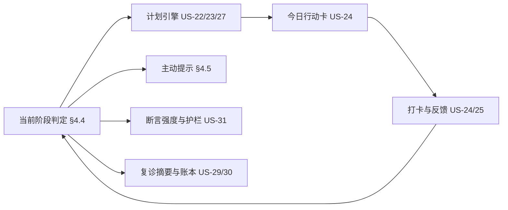
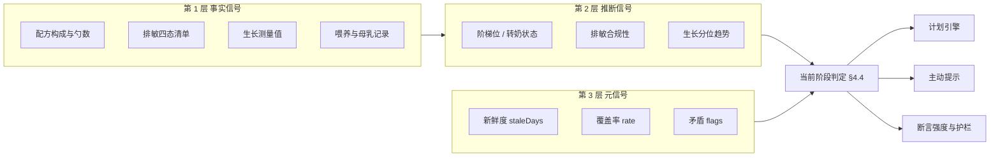
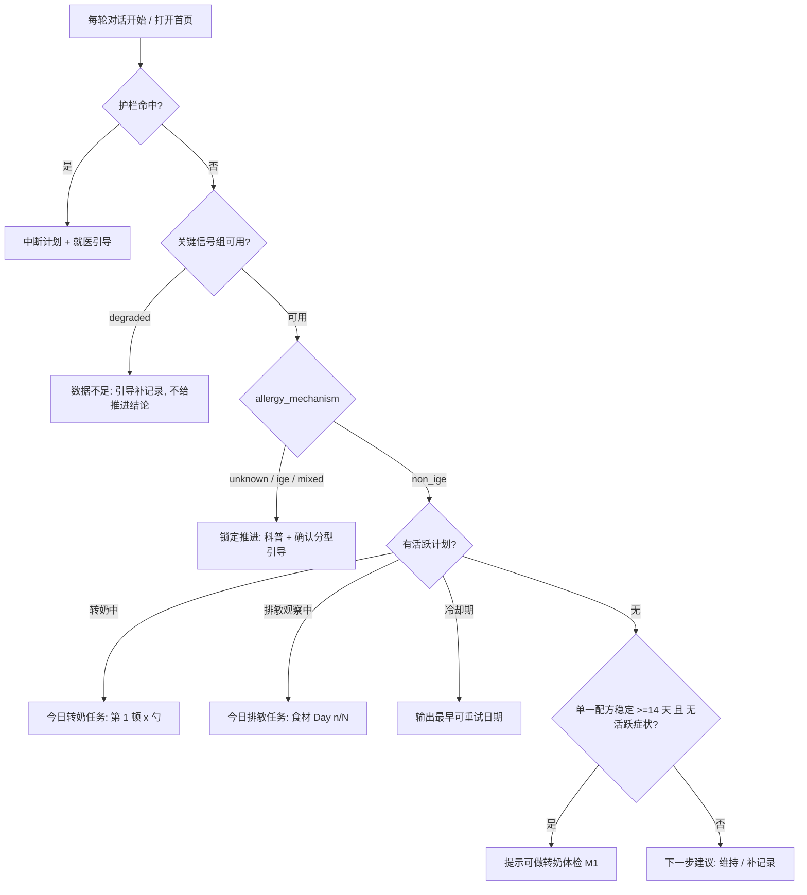
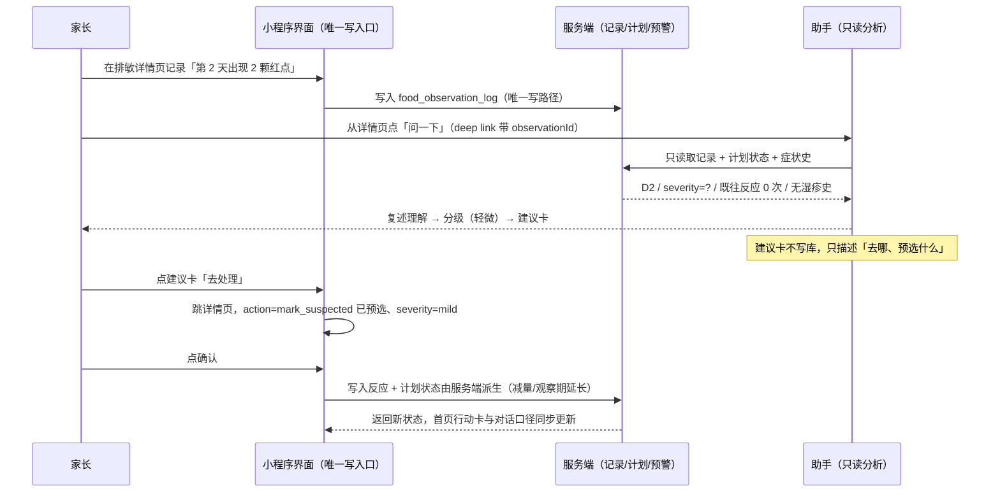

# 02 能力设计 — PRD-006 V3.0

> 本文件是 **PRD-006 V3.0《养娃智能体「敏宝助手」》** 的第 §3 · §4 · §5 · §7 部分，承载 **§3 · §4 · §5 · §7**。
> 主文档：[README.md](README.md) ｜ 同级文档：[01 现状与差距](01-现状与差距.md) ｜ [03 用户故事](03-用户故事.md) ｜ [04 实施派工](04-实施派工.md) ｜ [05 风险与决策](05-风险与决策.md)

---

## 3. 产品形态：一个录入面，一个分析面

**结论先行**：不要把 agent 当作"另一个 App"，也不要把对话当作"另一个填表入口"。
**小程序负责记录，助手负责分析**——这是一条**不对称**的分工，写只有一条路，读可以有很多入口。

```
        ┌──────────── 录入面（小程序，唯一写入口） ────────────┐
        │  表单 · 打卡 · 语音录入 · 生长测量 · 档案编辑          │
        └────────────────────────┬────────────────────────────┘
                                 │ 写（全产品唯一写路径）
                    ┌────────────▼─────────────┐
                    │ 服务端：记录 + 派生        │  ← 唯一真相源
                    │ 状态判定 / 计划 / 进度     │
                    └──┬────────────────────┬──┘
            只读取数（分析）│                    │ 渲染（展示）
        ┌──────────────▼────┐        ┌──────▼──────────────────────┐
        │ 分析面：对话        │        │ 展示面：首页/报告/曲线/详情  │
        │ 判断 · 解释 · 归因  │        └─────────────────────────────┘
        │ 例外处置 · 建议生成 │
        └────────┬──────────┘
                 │ 建议卡（不写库，只给出口）
        ┌────────▼──────────────────────────────────────────┐
        │ 回到录入面执行：deep link + 预填 → 用户点确认保存    │
        └───────────────────────────────────────────────────┘
```

### 3.1 职责矩阵

| 维度 | 谁负责 | 说明 |
|---|---|---|
| **结构化记录的写入** | **小程序界面（含语音）** | 唯一写路径。agent **零写入** |
| **结构化记录的解读** | **助手（对话）** | 趋势、归因、分级、例外、为什么 |
| **跨月记忆与连续推进** | **服务端** | 阶段判定、计划、进度、里程碑（不由前端派生、不由模型推断） |
| **未打开小程序时的提醒** | **服务端 + 订阅消息** | 复引入到期、任务停滞、喂奶间隔 |
| **提醒的落地动作** | **小程序界面** | 提醒只带"跳转 + 预填"，绝不带"直接写" |

### 3.2 四条硬原则

1. **单一真相源**。状态、计划、进度只在服务端产生；小程序与对话都只做渲染与表达。**禁止**前端派生与 agent 推断各算一套（现存 3 处违反见 [§2.3](01-现状与差距.md)-③，必须收回）。
2. **录入只在界面**。所有结构化记录的写入来自小程序界面——表单、打卡、**语音录入**。**agent 不承担任何记录写入**，不保留任何"对话写库"工具。
3. **分析只在对话，且必须可落地**。agent 的价值是判断与解释；它的产出要么是对话文本，要么是**建议卡**，最终由用户在界面上执行。**分析结论如果不能一键回到界面执行，等于没说**。
4. **执行留在界面，判断留在对话**。重复、精确、可批量的动作（打卡、填表、看曲线）留在小程序；一次性、模糊、需要解释的动作（分级、归因、例外）交给对话。

### 3.3 三类产出的区别（决定它们各自的落库路径）

| 类别 | 典型内容 | 谁产生 | 落库路径 |
|---|---|---|---|
| **数据类（Data）** | 喂养 / 睡眠 / 大便 / 生长 / 体温 / 排敏打卡 / 反应等级 / 营养素 | **界面**（表单、打卡、语音） | 既有记录 API（`POST/PUT`）。**agent 只读** |
| **内容类（Content）** | 日记、复诊摘要、医生沟通话术 | **agent 生成草稿** | 界面确认后保存（内容是判断的载体，不是原始数据）。沿用"生成 → 确认 → 保存" |
| **建议类（Advice）** | 反应分级、计划草案、档案候选值、矛盾提示、今日行动 | **agent 生成** | **不落库**。落成"建议卡" → 界面采纳时由**界面**执行既有动作（§7.3） |

> 这个三分法是本 PRD 的核心简化：**只有"数据类"必须界面录入**；"内容类"允许 agent 生成但必须界面确认；"建议类"agent 可以自由产出，但**永远不能自己落库**。

### 3.4 不予采用的设计方案

| 方案 | 结论 | 原因 |
|---|---|---|
| **对话直接写库**（`log_food_observation` / `mark_reaction` / `log_feeding` / `update_transition_plan` / `set_baby_allergy_profile`） | **不予采用** | 对话录入**效率低、准确率低**；同一份数据两条入口必然分裂；录入的正确优化方向是**语音**（§7.6），不是对话 |
| 语音直接写库（跳过表单确认） | 否决 | 抽取必然有错；跳过确认等于把 ASR 的错写成数据的错 |
| agent 复刻分位 / 进度 / 阶段判定 | 否决 | 单一真相源（[§10](01-现状与差距.md)-①/②） |
| 新建 `food_intro_plan` 平行表 | 否决 | 与已有的 `food_observation` 重叠（[§10](01-现状与差距.md)-③） |
| 把"问助手"提升为 TabBar 一级入口 | 待定 | 见 [§14.2](05-风险与决策.md) 第 9 项：会改变首页信息密度与导航结构，且与 [§14.2](05-风险与决策.md)-7 耦合 |

---

---

## 4. 状态感知能力（State Awareness）

> **本章是地基能力。** 没有感知层，后面的"计划推进"只能靠模型猜。
> 信号清单、实测数据与成本测算见 [`PROFILE-20260919-敏宝画像信号清单与设计.md`](../../agent/tech/PROFILE-20260919-敏宝画像信号清单与设计.md)（10 组 46 个信号 + 8 个矛盾 flag）；本章把该信号体系**收敛为 PRD 契约**——感知什么、怎么判定、怎么注入、怎么验收。
> 本能力横切全部六个阶段，故单独成章，置于用户故事之前作为设计前提。

### 4.1 定位：先会"看"，才有资格"教"

V1.0 的感知是**空的**：`buildSystemPrompt(ctx, history)` 注入的上下文只有 `familyId` / `babyId`，不含任何画像字段（见 OPT 问题 2 根因链）。后果不是"答错"，而是**答得没有前提**——模型不知道宝宝当前的喂养模式，只能从"当天 0 条母乳记录"里什么都不说；一旦家长自己提一句母乳，模型就顺着展开。同理，"能不能转奶"这种问题，模型手里只有一堆原始明细，只能给泛泛的"要循序渐进"。

**这不是回答质量问题，是感知问题。** 教练能力的完整链路是闭环的：



感知层要回答的三个问题——它们都**查不出来、必须跨表推断**，这正是"画像不是数据汇总"的原因：

| 问题 | 为什么单靠工具查不到 | 消费方 |
|---|---|---|
| 宝宝现在处于 CMPA 管理的哪一步？ | 需要把「配方阶梯 + 排敏状态 + 症状活跃度 + 生长趋势」四个信号合起来判断 | 里程碑（US-20）、计划引擎（US-22/23/27） |
| 有什么**矛盾或风险**正在发生？ | 需要跨表对照（如"已标记疑似过敏的食材还在吃"） | 主动提示（US-34）、护栏（US-31） |
| 当前哪些结论**不可信**？ | 需要知道数据新鲜度与覆盖率 | 断言强度、数据护栏（US-31 护栏 5） |

### 4.2 三层信号体系

| 层 | 定义 | 典型信号 | 谁消费 |
|---|---|---|---|
| **第 1 层 事实信号** | 可靠可算的客观值 | 配方构成与勺数、生长测量值、已耐受食材清单、母乳记录数 | 注入块的事实陈述部分 |
| **第 2 层 推断信号** | 由事实派生的状态判断 | 阶梯位、转奶状态（stable/transitioning/stalled）、排敏合规性、生长分位趋势 | 阶段判定（§4.4）、计划生成 |
| **第 3 层 元信号** | 对信号本身的可信度标注 | `freshness.staleDays`、`coverage.rate`、矛盾 `flags[]` | 断言强度、主动提示、降级策略 |



> 第 3 层是此前方案完全缺失的部分，也是最能提升助手"活人感"的地方——它让助手知道**什么时候该说、什么时候该问、什么时候不该下结论**。
> 缺少元信号时的两类典型误判：把"母乳 0 条"（有效结论）与"症状 31 天无记录"（信息缺失）当成同一件事；把"大便性状没填"当成"没有便血"。

### 4.3 信号清单（10 组 / 46 个信号，另 J 组 8 个矛盾 flag，合计 54）

> **口径修订（2026-09-22）**：原标题写「10 组 / 41 个信号」，与本节 §4.3.1 分组总览表**自身加总不符** ——
> A5 + B7 + C5 + D8 + E7 + F5 + G4 + H2 + I3 = **46**，加上 J 组的 8 个矛盾 flag 共 **54**。
> 原「41」既非组数加总也无对应枚举，属笔误；现按实际条目修订为 **46 / 54**。
> 逐条实施进度对账见 [GAP-20260922 状态感知层信号缺口清单](../../agent/tech/GAP-20260922-状态感知层信号缺口清单与补齐方案.md)。

#### 4.3.1 分组总览

| 组 | 信号数 | 关键信号 | 数据源 | 优先级 | 本期范围 |
|---|---|---|---|---|---|
| A 过敏基本情况 | 5 | 过敏类型/程度、**诊断确定性**、**家族过敏史** | `baby_profile` | P0 | 部分（新字段依赖 migration 022） |
| B **配方与转奶进度** | 7 | 阶梯位、转奶状态、停滞天数、乳糖型 | `feeding_formula_mix` | **P0** | 全部 |
| C 喂养方式 | 5 | 喂养模式、停母乳判定、日均奶量 | 4 张 feeding 表 | P0 | 全部 |
| D **辅食与排敏进度** | 8 | 四态清单、**排敏合规性**、**名称归一化** | `food_observation` + `feeding_food_item` | **P0** | 全部 |
| E **生长与营养** | 7 | **分位数**、**分位趋势**、生长速度、补充依从性 | `growth_record` + `growth.js` | **P0** | 全部 |
| F 症状与反应 | 5 | 症状谱、大便性状、活跃度 | `symptom_record`/`health_record`/`diaper_record` | P1 | 计数 + 覆盖率标注 |
| G 医疗与随访 | 4 | 分型统计、复查计划、疫苗进度 | `medical_record` | P1 | 降级（见 §4.6.3） |
| H 日记与家长侧 | 2 | 日记新鲜度、近期关注点 | `baby_diary` | P2 | 仅新鲜度 |
| I **数据新鲜度** | 3 | 各源 staleDays、覆盖率 | 各表 `MAX(时间)` | **P0** | 全部 |
| J **矛盾与风险检测** | 8 | 过敏食材仍在吃、排敏任务停滞、转奶停滞期出现皮疹 | 跨表推断 | **P0** | 全部（见 §4.5） |

#### 4.3.2 组 B：配方与转奶进度（本期最高价值）

`feeding_formula_mix` 记录了**每一顿奶的奶粉类型 + 勺数**，本身就支持混合配比，因此转奶进度是**可算的、而且库里一直有数据**：

```
milk_type：aa=氨基酸 | eh_no_lactose=深度水解无乳糖 | eh_lactose=深度水解含乳糖 | ph=适度水解 | std=普通
scoops：   DECIMAL(4,2)，支持 0.25 / 0.33 等分数勺
CMPA 阶梯（高→低）：aa > eh_no_lactose ≈ eh_lactose > ph > std
```

| 信号 | 算法 | 实测（生产旺仔） |
|---|---|---|
| `formula.current` | 近 7 天各 `milk_type` 的勺数占比 | 纯 `eh_lactose`，28 勺/天 |
| `formula.ladder` | 主导类型对应阶梯位 | `extensively_hydrolyzed` |
| `formula.status` | `stable`（单一且 14 天未变）/ `transitioning`（混合且在变）/ `stalled`（构成 ≥14 天完全不变）/ `switched` | `stable` |
| `formula.direction` | `escalated` / `deescalated` / `same` | `deescalated` |
| **`formula.stalledDays`** | 当前构成保持不变的天数 | 34 |
| `formula.lactose` | 含乳糖 / 无乳糖（乳糖耐受信号） | 含乳糖 |
| `formula.lastChangedAt` | 最近一次类型构成变化日 | 2026-08-16 |

**实测轨迹**：`06-04 启用氨基酸 → 08-16 完全停用 → 转为纯深度水解（含乳糖）稳定至今`
**画像输出**：「已停用氨基酸 34 天，当前为纯深度水解（含乳糖）配方，处于稳定期。」

#### 4.3.3 组 D：辅食与排敏进度

**必须双源合并**——实测发现两个源的数据分布在不同时期，缺一不可：

| 源 | 用途 | 实测（生产旺仔） |
|---|---|---|
| `food_observation` | 状态机：四态 + `severity` + `observation_days` + `retry_after_date` | 18 条，最新 09-18（活跃） |
| `food_observation_log` | 逐日打卡 | 42 条，最新 09-05 |
| `feeding_food_item` | 实际吃了什么（不依赖家长建档） | 138 条，最新 09-18 |

| 信号 | 说明 | 实测 |
|---|---|---|
| `food.safeList[]` | 已耐受（含首次引入日、累计引入次数） | 12 条（归一化前） |
| `food.suspectedList[]` | 疑似（含 severity） | 2 条：芹菜、生菜，均 mild |
| `food.allergicList[]` | 确认过敏（含 severity、复引入日期） | 0 条 |
| **`food.observingTask`** | 当前观察任务：食材 + `day n/N` + 停滞天数 | 小米粉 day 1/3（09-18 起） |
| **`food.conflictFlags[]`** | 排敏合规性问题（下表） | 见下 |
| `food.highRiskIntroduced` | 高致敏食物（蛋/小麦/大豆/花生/鱼虾/坚果）引入状态 | 待算 |

**排敏合规性检查（敏宝安全底线，引敏宝必查）**：

| 检查项 | 规则 | 实测结果 |
|---|---|---|
| `multiObserving` | 两个 `observing` 任务的观察窗口是否重叠 | 牛肉(09-14~09-17) → 小米粉(09-18~) **合规串行** ✓ |
| **`staleObserving`** | `observing` 超期未结（`updated_at` 距今 > `observation_days`） | 火龙果 day 2/3 停在 09-05，**停滞 14 天** ⚠ |
| **`eatingMarked`** | 已标记 `suspected`/`allergic` 的食材是否仍在食用 | 生产芹菜待核 ⚠ |
| **`nameDuplication`** | 同一食材因命名不一致重复建档 | **4 组**：西兰花/西兰花泥、鸡肉/鸡肉泥、纯米粉/小米粉、米粉+南瓜泥 ⚠ |

> `nameDuplication` 直接决定"已耐受食材数"的准确性（12 种可能只对应 9 种真实食材），也让 `food_observation.food_name` ↔ `feeding_food_item.food_name` 的软关联断裂。归一化在画像层完成（去"泥/粉/粥/水"等形态后缀 + 白名单），**低置信度条目请家长确认，不自动合并**（见 R11）。

#### 4.3.4 组 E：生长与营养

**关键：分位数能力已经有了**——`minicare-agent/src/lib/growth.js::percentileOf(ageMonths, sex, type, value)` 已实现 P3/P15/P50/P85/P97 五段（0-36 月，与小程序的 `growth-standards.ts` 同源），目前只在 `analyze_baby_data(growth)` 里用，**没有进画像**。本期零新增依赖、零 SQL 成本地复用。

| 信号 | 算法 | 说明 |
|---|---|---|
| **`growth.weightP` / `heightP` / `headP`** | 最新测量值的分位段 | 与 `analyze_baby_data` 必须同源同结论（不得两套） |
| **`growth.trend`** | 最近 2 次分位对比 → `rising`/`stable`/`falling` | **比单点更有临床意义** |
| `growth.velocity` | g/天、cm/月（对月龄参考值） | 用于"长得好不好"的定性 |
| `growth.wfh` | 体重-身长比（消瘦/超重） | 可选 |
| **`growth.stagnationFlag`** | 分位连续 2 次下降 ≥1 档 → 预警 | 联动 flag #7 |
| `nutrition.supplementAdherence` | 近 30 天维生素 D 覆盖率（解析 `supplement_items` JSON） | 实测 211 条，最新 09-18（活跃） |
| `growth.measureFreshness` | 距上次测量天数 | 实测 13 天 |

**实测（生产旺仔）**：`growth_record` 12 条（体重 11 / 身长 11 / **头围仅 8**，最新 09-06）→ 头围覆盖率 67%，属"信息缺失"而非"没长头围"。

#### 4.3.5 组 I：数据新鲜度（元信号）

每个信号组附带 `freshness: { lastDataAt, staleDays }` 与 `coverage: { filled, total, rate }`。实测：

| 信号组 | 最新数据 | staleDays | 感知层判断 |
|---|---|---|---|
| 配方/转奶 | 09-19（当天） | 0 | 可信 |
| 排敏 | 09-18 | 1 | 可信 |
| 营养补充 | 09-18 | 1 | 可信 |
| 生长 | 09-06 | 13 | 可用（月龄尺度正常） |
| 医疗 | 09-06 | 13 | 可用 |
| 症状 | 08-19 | **31** | ⚠ 陈旧，不可作阴性结论 |
| 母乳 | 无记录 | — | **确定已停（有效结论，非缺失）** |

#### 4.3.6 组 A / C / F / G / H（摘要）

| 组 | 信号 | 实测关键点 |
|---|---|---|
| A | `allergy.types` / `level` / **`diagnosed`** / `natal.birthWeightG` / **`family.atopyHistory`** | 生产 `["milk"]` + `mild`；`birth_weight_g` 线上全 null；`allergy_level` 在 dev 大量为 `unknown`（填写引导不足） |
| C | `feeding.mode` / `lastBreastAt` / `dailyMilkMl` / `solidKinds` / `mealRhythm` | 母乳 0 条 → `formula_only`（确定）；**判定规则禁止在两者都为 0 时给结论** |
| F | `symptom.recent[]` / `allergyEvents[]` / **`stoolFlag`** / `activeDays` / `foodLink` | 便血 0 条（阴性）；`poop_type` dev 填写率仅 **22%** → 阴性必须带覆盖率；`food_name_snapshot` 全 null，暂不可用 |
| G | `medical.byType` / `lastCheckup` / `followUp` / `vaccineProgress` | 生产 `vaccine 4 / checkup 1 / sick 1`；但 **020 未上生产** → `vaccine_*`/`checkup_*` 无字段可读，只能给计数 |
| H | `diary.lastAt` / `themes[]` | 主题抽取（LLM）本版暂缓 |

### 4.4 状态判定：从信号到"当前阶段"

**判定的顺序即优先级**——顺序错了会把不该推进的宝宝推进去（例如"分型未知但家长自己开了个计划"）：



对应的判定输出表（供计划引擎与首屏共用）：

| 判定输出 | 条件（信号组合） | 里程碑 | 首屏给家长的一句话 |
|---|---|---|---|
| `guard_hit` | 任一护栏命中 | — | 需立即就医的引导 |
| `data_insufficient` | 关键组 `degraded` 或 staleDays 超阈 | — | 先补一条记录，我才判断得准 |
| `locked_mechanism` | `allergy_mechanism ∈ (unknown, ige, mixed)` | M2+ 锁定 | 需要先确认过敏类型 |
| `transitioning` | 存在活跃 `milk_transition_plan` | M2-M4 | 今日：第 1 顿放 x 勺新配方 |
| `observing` | `food.observingTask` 活跃 | — | 今日：某食材观察 Day n |
| `cooldown` | `plan.status = cooldown` | — | 最早可重试日期 |
| `stable_avoidance` | `formula.status = stable` 且 `symptom.activeDays > 14` 且无强 flag | M0 已达成 | 稳定中，可以准备体检了 |
| `both_idle` | 无活跃计划且无 observing | — | 推荐下一步：转奶 或 引入新食物 |

> **判定必须由服务端做。** 让模型自己拼 SQL 推断，既费 token 又不一致（这与"排敏进度从模型数 205 条明细改为服务端聚合"是同一个思路）。本章不定义实现，实现契约见 §4.8。

### 4.5 矛盾与风险检测（8 个 flag）

这是感知层"最有价值的一层"——**单看配方是"稳定"，单看症状是"偶发皮疹"，只有合起来才发现关联**（dev 旺仔实测：25% 适度水解构成停滞 18 天，期间出现 2 次轻微皮疹）。

| # | flag | 触发条件 | 提示口径（示例） | 强度 |
|---|---|---|---|---|
| 1 | **过敏食材仍在食用** | `status ∈ (suspected, allergic)` 的食材出现在近 14 天 `feeding_food_item` | "记录里芹菜还在吃，但 8 月已标记疑似，要不要先停一下？" | **强** |
| 2 | **排敏任务停滞** | `observing` 且 `updated_at` 距今 > `observation_days` | "火龙果的观察停在 9 月 5 日，还差 1 天，今天补上吗？" | 中 |
| 3 | 多个排敏窗口重叠 | 两个 `observing` 的观察期有交集 | 不主动说；仅在家长要加新食物时阻断（护栏 4） | 拦截型 |
| 4 | 转奶停滞 | `formula.status = stalled`（混合构成 ≥14 天不变） | "25% 适度水解的比例 18 天没动过，是想稳住还是在等时机？" | 中 |
| 5 | **转奶停滞期出现过敏反应** | #4 + 同期有过敏事件 | "停滞可能与这 2 次轻微皮疹有关，建议和医生确认后再继续" | **强** |
| 6 | 配方阶梯上移 | 近 30 天 `direction = escalated` | 仅写入画像，不主动提醒（可能是医生决策） | 弱 |
| 7 | 生长分位下降 | `trend = falling` 或连续 2 次降档 | "体重分位从 P50-P85 落到 P15-P50，下次儿保时提一下" | 中 |
| 8 | 关键数据陈旧 | 症状 / 生长 staleDays 超阈 | "症状记录已 31 天没更新，我判断不了最近的情况" | 中 |

**频控规则（防止把助手变成报告机）**：

1. **服务端算好直接给模型**，模型不自算 flag；
2. **单轮最多提示 1 条**——8 个 flag 全倒出来会破坏对话感；
3. 同一 flag **7 天内不重复**提及；
4. 强度为「强」的项（#1 / #5，以及护栏命中的高危）**不受第 2、3 条限制**，可直接打断当前话题。

### 4.6 元信号：可信度、覆盖率与降级

#### 4.6.1 三种"没有数据"必须区分

| 状态 | 判定 | 输出要求 | 实测样例 |
|---|---|---|---|
| **有效结论** | 该维度确实为 0 且有历史 | 可以下确定结论 | 母乳 0 条 → "已完全停止母乳" |
| **信息缺失** | 无记录但无法排除 | **不下结论**，提示可补记录 | 症状 31 天无记录 → "我判断不了最近的情况"，而非"无症状" |
| **数据陈旧** | 有记录但超阈 | 下结论必须带时效限定 | 生长 13 天前 → "按最近一次测量" |

#### 4.6.2 覆盖率限定

任何**阴性结论**（"没有便血""没出现过敏"）必须附带覆盖率，覆盖率过低时降级为提问：

- 判定规则：`coverage.rate < 50%` → 不做阴性结论，改为"这段时间的记录比较少（填了 x/y 天），要不要说说最近的情况？"
- 实测锚点：`diaper_record.poop_type` 在 dev 填写率仅 22%（56/72 为 null）→ 便血 0 条**不能**当作"无便血"。

#### 4.6.3 能力降级（字段不可用必须能识别）

| 场景 | 感知层行为 |
|---|---|
| 生产库未应用 migration 020 | 组 G 的 `vaccine_*` / `checkup_*` 不可读 → **只给计数**（"已接种 4 针"），并标记该组 `degraded_partial`；US-22 体检第 6 项标记"待确认"，不阻塞其余项（与 R5 一致） |
| 运行时字段探测 | 模块加载时查一次 `information_schema` 缓存能力标记（如 `hasTypedMedical`），未就绪时走旧列 |
| 单组查询失败 | 该组置空并标 `degraded`，**其余组照常注入**；画像缺失不影响对话 |
| 全量失败 | 注入块降级为保守默认：不默认母乳、不带任何进度断言、不输出里程碑进度 |

### 4.7 注入契约

在 systemPrompt 的 `ctxBlock` 之后追加两段（示意，以生产旺仔为例，约 300 字 / 400 token）：

```text
【宝宝画像】旺仔，8 个月 22 天，男，轻度牛奶蛋白过敏（过敏原：牛奶）。
配方：已停用氨基酸 34 天，当前为纯深度水解（含乳糖）配方，稳定期。
喂养：已完全停止母乳，纯配方奶 + 辅食，已尝试食材 12 种。
排敏：已耐受 12 种；疑似 2 种（芹菜/生菜，均轻度）；观察中 小米粉（第 1/3 天）。
生长：体重 8.45kg（P50-P85）、身长 70.5cm（P50-P85）、头围 44.5cm（P50-P85），趋势平稳。
医疗：已接种 4 针，儿保 1 次，就诊 1 次；最近记录 9 月 6 日。
【需要注意】排敏任务「火龙果」已停滞 14 天未结；症状记录已 31 天未更新。

要求：
- 涉及喂养建议时不要默认"母乳/混合喂养"；
- 所有辅食建议默认带牛奶蛋白过敏前提，并先确认是否在排敏观察期内；
- 不要向家长复述"你的记录显示…"这类统计口径话术；
- 上述【需要注意】项可在合适时机主动提醒，但一次对话最多提 1 条。
```

**行为约束（硬性）**：

| # | 约束 | 原因 |
|---|---|---|
| 1 | 涉及喂养建议不默认母乳/混合喂养 | 感知层已给出真实喂养模式 |
| 2 | 辅食建议默认带 CMPA 前提，且先确认是否在排敏观察期 | 排敏期间的归因前提 |
| 3 | 不复述"你的记录显示…" | 家长要的是判断，不是数据回读 |
| 4 | 【需要注意】单轮最多 1 条 | 防报告式输出 |
| 5 | 未确诊断言强度降级（"如怀疑"口径） | `allergy_diagnosed = self_reported` 时不得下"过敏"结论 |

### 4.8 聚合实现与成本约束（供 TECH）

| 项 | 约束 |
|---|---|
| 聚合入口 | 单文件聚合（如 `minicare-agent/src/lib/profile.js`），**不允许模型侧拼装**；第 1 期落 agent 进程内、第 2 期随第二个消费方（首页）出现再下沉服务端，见 [TECH-013](../../tech/TECH-013-state-awareness-implementation.md) §4.1 |
| SQL 预算 | 聚合约 **7 条**（A/B/C/I 共 3 条、D 双源 2 条、E 1 条、F/G 1 条）+ **控制面 2 条**（数据版本戳比对、flag 频控去重）；单宝宝数据量下每条 <50ms |
| 计算复用 | 生长分位数直接调 `lib/growth.js`，零 SQL；flag 计算是依赖聚合结果的**纯内存最后一步** |
| 缓存 | 进程内 Map + **5 分钟 TTL**；同一会话连续对话只查一次 |
| 时延预算 | 对现有 4.3-6.8s 时延影响可忽略；**单轮工具调用上限不变**（见 R6） |
| 缓存失效 | 写记录（喂养/排敏/生长）后**主动失效**，避免"刚记完助手还按旧画像说话"。实现走 `baby_profile.data_version` **版本戳比对**（写入自增 + 每轮比对），**不用跨进程 push**——CloudRun 会缩容到 0，push 会触发 agent 冷启动；见 [TECH-013](../../tech/TECH-013-state-awareness-implementation.md) §4.2 |
| 多宝宝隔离 | 以 `babyId` 为缓存键；家庭内切换宝宝即切换画像，**严禁跨宝宝复用** |
| 降级 | 见 §4.6.3，任一组失败不阻塞对话 |

### 4.9 状态感知验收标准

**事实层**
- [ ] 生产旺仔画像输出"纯深度水解（含乳糖）、已停氨基酸 34 天"，与库中 `milk_type` 构成一致
- [ ] 生长分位数与 `analyze_baby_data(growth)` 结果一致（同源函数，**不得出现两套结论**）
- [ ] 已耐受食材数在名称归一化后与人工核对一致（消除"西兰花 / 西兰花泥"类重复，12 → 9 类真实食材）

**推断层**
- [ ] dev 旺仔 `formula.status` 判定为 `stalled` 且 `stalledDays ≥ 18`
- [ ] 生产火龙果被标记为 `staleObserving`
- [ ] 排敏合规性不误报——生产"牛肉 → 小米粉"串行排敏判定为**合规**
- [ ] §4.4 判定表的 8 条输出路径，每条至少有 1 个用例覆盖，且优先级顺序正确（护栏 > 数据不足 > 分型 > 活跃计划 > 空档）

**元信号层**
- [ ] 母乳 0 条 → 输出"已停母乳"（确定结论），而非"数据缺失"
- [ ] 症状 31 天无记录 → 输出"症状数据陈旧"，而非"无症状"
- [ ] 大便性状填写率 22% → 阴性结论必须带覆盖率限定，或降级为提问
- [ ] 生产 020 未应用时，医疗组降级为计数且不报错、不影响其余组

**行为层**
- [ ] 问"宝宝辅食能加什么"时，回答先确认是否在排敏观察期，且默认带牛奶蛋白过敏前提
- [ ] 已停母乳 34 天的宝宝，回答与日记中**不出现"母乳喂养"表述**
- [ ] 8 个 flag 不一次性倾倒，单轮最多提示 1 条；强提示除外

> 行为层用例建议落在 `evals/`（deepeval 离线层，见 `minicare-agent-eval` 技能）；信号计算正确性用例落在 `minicare-agent/scripts/eval/`（在线 harness）。

---

---

## 5. 八个接缝：具体怎么合

> 每个接缝固定四段：**小程序侧 / agent 侧 / 数据流向 / 要做什么**。接缝 = 用户旅程上"两种形态必然相遇"的位置。
> 全文数据流向遵循同一形状：**界面写 → 服务端算 → 对话读并给建议 → 建议卡跳回界面执行**。

### 5.A 今日行动：同一张卡，两个表面

- **小程序侧**：首页 Hero 下方一张行动卡（1 件事 + 1 个主按钮 + "为什么"一句话）；`dashboard/RemindersColumn.tsx` 改为渲染同一数据源。
- **agent 侧**：对话里需要时用同一 tool 输出同一张卡（不是复述成文字）。
- **数据流向**：服务端 `get_today_actions` → 两端渲染；**点击后落回对应记录页（预填），由界面完成动作**。
- **要做什么**：新服务端聚合接口；删除 RemindersColumn 的派生分支（保留其喂奶间隔预测作为"子项"）。
- **现状**：`RemindersColumn` 已有完整 UI 骨架，缺服务端数据源。

### 5.B 排敏打卡：执行面不动，判断面接上

- **小程序侧**：`food-observation/detail.tsx` 保持为**唯一执行面**（D1-D7、反应等级、四动作）。新增两条轻量录入通道：详情页内**语音打卡**（§7.6-②）与首页行动卡直达。
- **agent 侧**：接住"拿不准"的三类问题——① 这点反应算不算；② 今天没吃上要不要顺延；③ 观察期能不能缩短。**只给分级与建议，不代家长做动作**。
- **数据流向**：对话给判断 → 生成**建议卡**（"建议：标记为轻微反应 + 降量，观察期视情况顺延 1 天"）→ 点击跳到详情页，动作按钮**预选** → 用户点确认，由界面调既有 `upsertLog` / `createReaction`；`pause` 态与 `retry_after_date` 复用现有字段。
- **要做什么**：建议卡的生成与跳转参数（§7.3 / §7.5）；把 `paused` 状态补进口径（[§10](01-现状与差距.md)-②）。**不再需要 agent 写工具**。

### 5.C 转奶执行：让"记录"本身完成"打卡"

这是两形态结合**最典型的场景**：现在家长要知道"今天第 1 顿放 3 勺"，只能靠记忆或聊天记录。

- **小程序侧**：喂养表单在转奶期**被计划预填**——进入表单即看到"第 1 顿：新配方 3 勺 / 原配方 2 勺"，**一键确认即完成记录**；当日打卡由**服务端从记录派生**，不新增第二个"打卡"动作（§3.2-2 的自然结果）。
- **agent 侧**：解释为什么是 3 勺、昨天为什么减量、什么情况该退回；异常时给分级处置。
- **数据流向**：`milk_transition_day`（服务端）→ 预填参数 → 界面写入 `feeding_formula_record` + `feeding_formula_mix` → **服务端监听记录、回写任务状态**。
- **要做什么**：计划实体（migration 023）；表单预填通道；**服务端"记录 → 计划状态"派生逻辑**（这是"不重复打卡"的实现前提）。
- **现状**：`FormulaSection.tsx` 已有配比录入与"转奶期混用"提示，**缺计划**。

### 5.D 反应分级：把医学判断从家长手里收回来

- **现状问题**：`detail.tsx` 让家长在四个动作里自选（含"确认过敏"）——**这等于把分型判断推给了家长**。
- **小程序侧**：保留按钮，但在家长犹豫时提供"问一下"入口（deep link 带 `observationId`）。**界面仍是唯一执行处**。
- **agent 侧**：描述症状（文字或语音，§7.6-④）→ 分级（高危 / 中重度 / 轻微 / 与本次无关）→ 给动作建议 → **建议卡跳回详情页**，动作预选、计划状态变更（减量/回退）在服务端生效。
- **数据流向**：对话 → 建议卡 → 详情页预选 → 用户确认 → 界面 `createReaction`（已有）→ 服务端改计划状态。
- **要做什么**：分级矩阵（US-25）**在服务端实现**（模型只表述裁定结果，避免两端不一致）；建议卡到详情页的参数协议。

### 5.E 生长曲线：图表给事实，对话给因果

- **小程序侧**：曲线照旧（中国 2023 标准），**新增事件标记**（转奶节点、皮疹事件、阶梯变更）叠在时间轴上。
- **agent 侧**：讲趋势与关联——"体重分位从 P50-P85 落到 P15-P50，同期转奶停滞 18 天并出现 2 次皮疹"。
- **数据流向**：分位计算**收敛到服务端一份**，两端都取同源结果。
- **要做什么**：分位计算下沉服务端（[§10](01-现状与差距.md)-①）；曲线事件标记层。

### 5.F 复诊闭环：把线下医生接回线上

- **小程序侧**：`NextFollowUpBanner` → 一页纸（复用 `saveReport`）→ 可分享/打印（现在只有 toast"开发中"）；**医生结论的回填走档案表单**（§5.H），不走对话写库。
- **agent 侧**：生成摘要（**内容类产出**）；复诊后**提炼**医生结论为"候选字段值"→ 建议卡 → 档案页待确认。
- **数据流向**：`build_doctor_summary` → 报告页；结论回填 → 档案页确认 → `baby_profile.allergy_mechanism` + 计划重校验。
- **要做什么**：落库 `allergy_mechanism`/`allergy_diagnosed`（migration 022）；一页纸导出落地；档案页"待确认字段"呈现。
- **价值**：这是"线上记录 → 线下判断 → 回到线上执行"的唯一闭环口，缺了它，机制分型永远填不上。

### 5.G 提醒：三条通道，按"需不需要判断"分流

| 通道 | 适用 | 现状 |
|---|---|---|
| 小程序内（首页卡 / ReminderOverlay） | 确定性提醒：喂奶间隔、今日任务、复引入到期 | 已有渲染能力 |
| 对话内（感知层 flag，单轮最多 1 条） | 需要判断的提醒：排敏停滞、转奶停滞、矛盾检测 | 无（随 §4.5 落地） |
| 订阅消息 | 未打开小程序时也需生效：任务逾期、复引入到期 | **完全没有**，需授权与模板 |

> 三条通道的共同约束：**提醒只带"跳转 + 预填"，不带"直接写"**（§3.1）。

### 5.H 档案采集：对话负责"语义"，表单负责"精确值"

- **反直觉但重要**：机制分型（IgE / 非 IgE）家长说不清，但能说"医生说是迟发型、做了回避激发"——**这类信息只能靠对话采集**，然后落到 `baby_profile`。
- **小程序侧**：`EditBabyModal` 是**唯一落库入口**；当对话采集到候选值时，档案页出现"**待确认**"提示（字段预填但需家长点保存）。
- **agent 侧**：在合适时机（首次想推进转奶时）逐项确认，每轮最多 2 项，支持"我不确定 → 怎么查"；产出为**建议类候选值**，不落库。
- **要做什么**：migration 022；候选值的传递与档案页"待确认"态；分型变更时**服务端**自动暂停计划（US-21 场景 3）。

---

---

## 7. 集成机制

> 这一节是本文档最"必须做"的部分。没有它，两个形态就只是"同 App 里的两个功能"。
> 注意方向的**不对称**：**录入是单向的（界面 → 服务端）**，桥的作用是让**分析结果能回到界面**。

### 7.1 主干：界面是唯一录入通道

| 通道 | 形态 | 适用 | 现状 |
|---|---|---|---|
| 表单 | 8 个记录子包页 | 精确值、多字段、需要校验 | **已有** |
| 打卡 | 排敏详情页四动作 / 行动卡一键 | 计划型记录、高频轻量 | **已有** |
| **语音** | 长按 FAB / 记录页内嵌麦克风 | 口语化、单手、带娃中 | **已有链路，需延伸**（§7.6） |
| 档案编辑 | `EditBabyModal` | 低频、需要看说明 | **已有** |

**约束**：以上四条之外的任何写入路径都必须被否决（包含对话、订阅消息、外部链接）。

### 7.2 agent 侧：只读分析

- 现状：`minicare-agent/src/lib/tools/index.js` 四个工具全只读。
- **本 PRD 不新增任何写工具**。agent 的能力增长方向是**分析深度**，不是**写入权限**：
  - 接 §4 状态感知聚合（阶段判定 + flags）
  - 分级矩阵、趋势归因、计划草案
  - 全部以"结论 + 建议卡"形式输出

> 关于"agent 能不能改计划状态"：**不能**。agent 只能产出"计划草案"或"调整建议"，落库由服务端在用户采纳后执行。

### 7.3 回程：建议落卡（Advice-to-Card）——本 PRD 的核心机制

**问题**：agent 的判断再准，如果只停留在对话文字里，家长还得自己回小程序找入口、重新理解一遍、再手动操作。这是"结合"最容易断的地方。

**机制**：agent 的**建议类产出**统一落成一张**建议卡**，包含：

| 字段 | 含义 | 示例 |
|---|---|---|
| `adviceId` | 建议唯一 id（用于去重与采纳追踪） | `adv_7f3a` |
| `kind` | 建议类型 | `reaction_grade` / `delay_task` / `plan_draft` / `profile_field` / `today_action` |
| `summary` | 一句话结论（家长看这句就够了） | "轻微反应，建议继续观察但把新配方减到 2 勺" |
| `target` | 目标页面 + 预选参数 | `food_observation:a1b2?action=mark_suspected&severity=mild` |
| `confidence` | 结论可信度（低置信时禁止一键采纳） | `high` / `low` |
| `expiresAt` | 建议有效期（过期不再展示，避免陈旧建议误导） | 当日 23:59 |

**规则**：
1. **建议卡不写库**。它只描述"界面该跳去哪、该预选什么"。
2. **采纳 = 在界面上执行既有动作**。点"去处理" → 跳目标页 → 参数已预选 → 用户点保存（**这一步才是唯一的写**）。
3. **低置信禁止一键采纳**：`confidence=low` 时必须进表单核对（复用语音的 `insufficient` 思路）。
4. **可追溯**：采纳后，界面上对应的记录带"来源：助手建议"标记；未采纳的建议在有效期后自动消失，不产生脏数据。
5. **不替代确认**：建议卡**不能**做成"点一下就写好了"的按钮——那等于变相让对话写库。

**完整回路**（注意：全程只有一个写点，且写点在小程序界面）：



### 7.4 小程序 → 对话：带上下文的 deep link

现状：`chat` 不在 TabBar，入口在记录 FAB 菜单（`components/TabBar/FabSheet.tsx`）；进对话后**没有任何上下文**，家长要从零复述。

协议（建议）：

| 参数 | 含义 | 示例 |
|---|---|---|
| `intent` | 意图枚举 | `reaction_check` / `today_action` / `plan_explain` / `diary` / `ask` |
| `anchor` | 锚点对象（页面 + id） | `food_observation:a1b2` |
| `state` | 当前状态快照（只读，供 agent 起手） | `status=observing&day=2` |
| `preset` | 已有参数（沿用日记） | `diary&date=2026-09-18` |

要求：agent 起手**先复述它理解的这件事**（"你是想问：小米粉第 2 天出现的这点红点算不算反应？"），确认后再回答；问错就重问，不要让家长重述。

### 7.5 对话内结构化块

现状：`pages/chat/index.tsx` **纯文本渲染**，`api/agent.ts:26` 有 `tool_call` 事件但只用于状态提示。这是"结合"最硬的工程缺口。

建议三种块（沿用现有 SSE 通道，新增 `event: block`）：

| 块 | 用途 | 点击行为 |
|---|---|---|
| **行动卡** | 今天这一件事 + 主按钮 | 跳对应记录页并预填 |
| **建议卡** | 分析结论 + "去处理"（§7.3） | 跳目标页，参数预选；**不直接写库** |
| **数据卡** | 分位 / 趋势 / 可吃清单 / 计划进度 | 跳详情页（图比文字准） |

> **不存在"回执卡"机制**：任何"对话确认 → 调 API 写库"的路径都不予采用（与 §3.2-2 冲突）。写入一律由界面承担。

### 7.6 语音录入：延伸既有链路，而不是新建

#### 7.6.1 现状（`TECH-001` 已完成的部分）

| 环节 | 现状 | 文件 |
|---|---|---|
| 入口 | TabBar 中间 FAB **长按**录音（短按开 FabSheet） | `components/TabBar/TabBar.tsx:135` |
| 录音与权限 | `useVoiceInput(familyId)`，含模拟器降级、权限引导、上滑取消 | `lib/useVoiceInput.ts`（270 行） |
| 后端抽取 | `POST /api/family/:familyId/voice/parse`（`uploadFile`），CloudBase AI + NLU 提示词（触发词 + 同义词映射 + 字段校验器） | `minicare-server/src/voice/voice.service.ts`（390 行） |
| 返回结构 | `{recordType, fields, confidence: 'high'\|'low', transcript, missingFields}` | `api/voice.ts` |
| 结果确认 | `VoiceResultSheet` 五态（`success` / `no_match` / `insufficient` / `stt_failed` / `service_error`）+ 确认/编辑/重试/手动输入/换类型 | `components/VoiceResultSheet/index.tsx`（236 行） |
| 落地方式 | **确认后不直接写库，而是 `navigateToRecord(route + query)` 跳对应记录页并预填** | `TabBar.tsx:304` |
| 支持类型 | 10 类：`formula` / `breast` / `food` / `diaper` / `sleep` / `sleep_start` / `sleep_end` / `temperature` / `symptom` / `supplement` | `app-config.data.ts`（`VOICE_NLU_CONFIG`） |
| 回归集 | 23 条 `testCases` | 同上 |

> **一个关键既有事实**：语音录入**从来没有绕过界面写库**——它是"语音 → 结构化草稿 → 跳记录页预填 → 用户在表单里保存"。这与 §3.2-2 天然一致。所以本节要做的不是重新设计，而是**把覆盖面、入口与准确率补全**。

#### 7.6.2 要补的四件事

| # | 缺口 | 说明 | 优先级 |
|---|---|---|---|
| ① **入口下沉** | 现在只有 FAB 长按一个入口，且与"开菜单"手势耦合，**发现性差**；**记录页内部没有麦克风**——在喂养页想语音补一句，得退出页面去长按 FAB | 每个记录表单页加麦克风，**进入即带 `recordType` 上下文**（在喂养页说话默认按配方奶解析，不必再选类型） | P1 |
| ② **类型补齐** | 缺 `food_observation`（排敏打卡/反应）、`growth`、`medical`。注意前端 `VOICE_QUICK_TYPES` 里有 `allergy`，但**后端 `recordTypes` 无对应类型**（只是手动选类型的兜底） | 优先补排敏——它是最需要长期坚持、最容易因繁琐而中断的动作 | P1 |
| ③ **逐字段置信度** | 现在是整体 `high/low` + `missingFields` 粗粒度 | 改为**逐字段** `confidence`，低置信字段**留空 + 高亮**，把"不猜"落到字段级 | P1 |
| ④ **一句多条** | 现在只解析**单条**记录（L2 一句话成单已具备） | L3：`"7点150奶，9点黄色糊状大便"` → 拆成**多张草稿**逐条确认 | P2 |

#### 7.6.3 四条硬约束（把既有做法固化为规则）

1. **抽取只产出草稿，永不直接写库**——写仍走既有 `POST/PUT`（现状已如此，写进规则防止回退）。
2. **低置信不猜**：字段置信度低时留空并高亮；未识别片段进"未匹配"清单交用户归位；`confidence=low` 或 `insufficient` 时**禁止"一键确认"**，必须进表单看一眼。
3. **不进对话会话**：语音抽取不产生 chat 历史、不关联 `sessionId`、不进 transcript 链路（现有实现已是独立 HTTP 接口，需保持）；仅保留匿名抽取日志用于准确率评估。
4. **与计划联动靠服务端派生**：转奶期"说一句完成打卡" = 语音 → 表单 → 保存喂养记录 → **服务端从记录派生打卡状态**（不新增打卡动作，不由语音直接改计划）。

#### 7.6.4 指标与验收

**指标**：按字段抽取准确率 / 需人工纠正率 / 单条记录平均耗时（对照纯表单）/ `no_match` 与 `stt_failed` 占比。

- [ ] 23 条既有 `testCases` 全绿（回归基线，不得回退）
- [ ] **记录页内麦克风**：在喂养页说话只产出 `formula` 草稿，不需要再选类型
- [ ] **低置信不落库**：故意含糊（"喝了一点"）→ 奶量字段留空高亮，不产生错误记录
- [ ] **不进会话**：语音路径不产生对话历史（无 `sessionId` 关联）
- [ ] **排敏可语音**：语音"今天吃了小米粉没有反应" → 落到排敏详情页草稿 → 确认后计划由**服务端派生**推进

---


### 7.7 页面级改动清单（`minicare-mp/`）

| 页面 / 组件 | 现状 | 改动 | 优先级 |
|---|---|---|---|
| `pages/home/index.tsx` | Hero + 排敏进度 + 复查 banner + 日记卡 | 新增"今日行动卡"；`AllergyProgressBar` 改由服务端状态驱动（含停滞提示） | P0 |
| `pages/dashboard/RemindersColumn.tsx` | 前端派生提醒 | 改为渲染服务端行动数据；保留喂奶间隔预测为子项 | P0 |
| `pages/chat/index.tsx` | 纯文本 + 图片 + 语音 | 支持三种结构化块（行动卡/建议卡/数据卡）；支持 deep link 上下文起手；**明确不承担记录录入** | P0 |
| `pages/records/food-observation/detail.tsx` | 四动作打卡 | 增加"问一下"入口（带 `observationId`）；接收建议卡参数（动作预选）；`paused` 态与复引入到期展示；加语音打卡入口 | P1 |
| `pages/records/feeding/FormulaSection.tsx` | 手填配比 | 转奶期接收预填参数；**记录保存后由服务端派生当日打卡** | P1 |
| `pages/records/*/index.tsx`（各记录表单） | 纯手填 | **内嵌麦克风**（带 `recordType` 上下文，§7.6-①） | P1 |
| `components/VoiceResultSheet/index.tsx` | 五态结果面板 | 增加**逐字段置信度高亮**；预留多草稿分条（§7.6-③④） | P1 |
| `pagesReport/tabs/GrowthTab.tsx` | 曲线 + 分位文案 | 叠加事件标记；分位取服务端结果 | P1 |
| `pagesReport/index.tsx` | 6 Tab + 保存 | 一页纸导出落地（替换 toast） | P2 |
| `pages/profile/EditBabyModal.tsx` | 过敏类型/程度 | 增加机制分型/确诊情况**展示与"待确认"态**（语义采集走对话，落库仍在此页） | P1 |
| `components/TabBar/FabSheet.tsx` | 问助手 / 宝宝日记 | 按 `intent` 分发（不同入口带不同上下文） | P1 |

---

---

> 返回 [PRD-006 主文档](README.md) ｜ 章节索引见其「怎么读这份文档」
