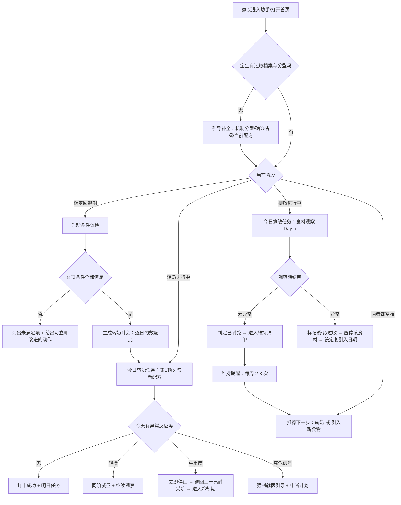
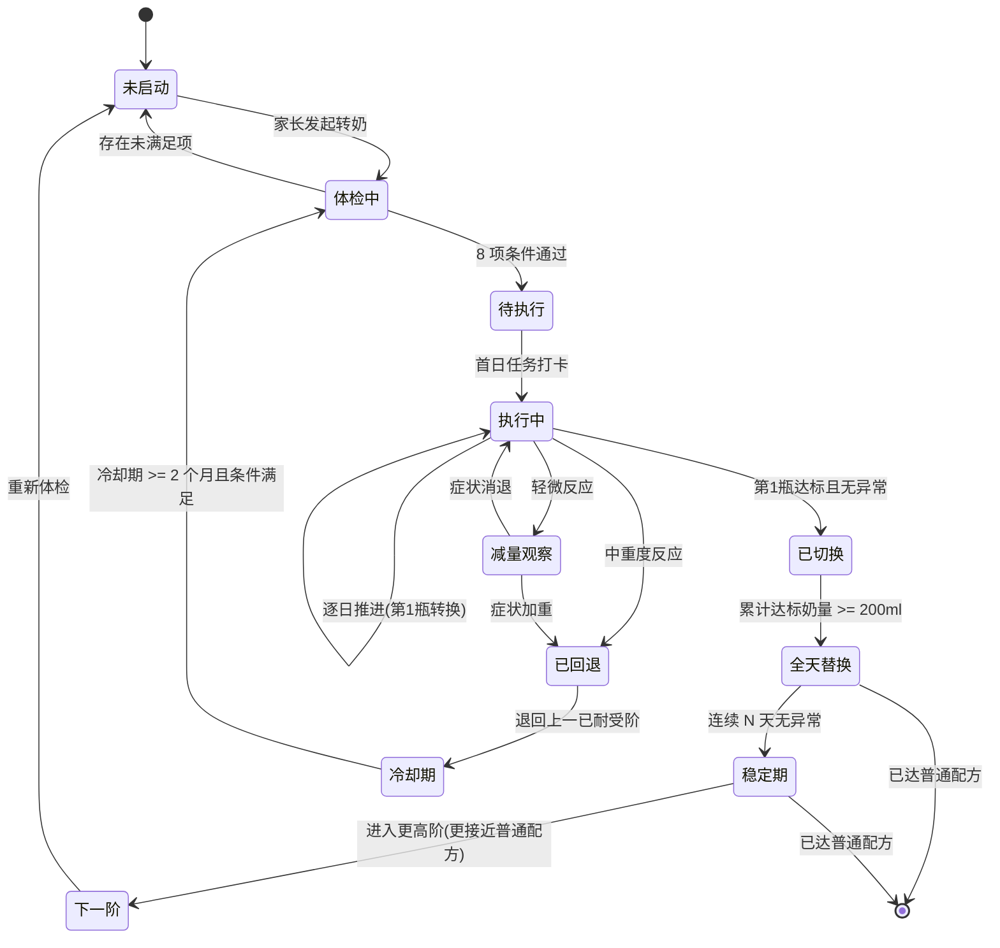
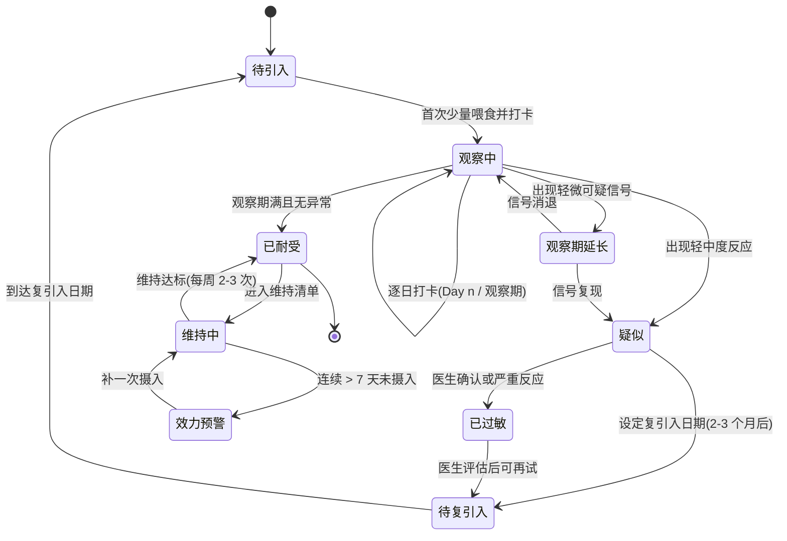
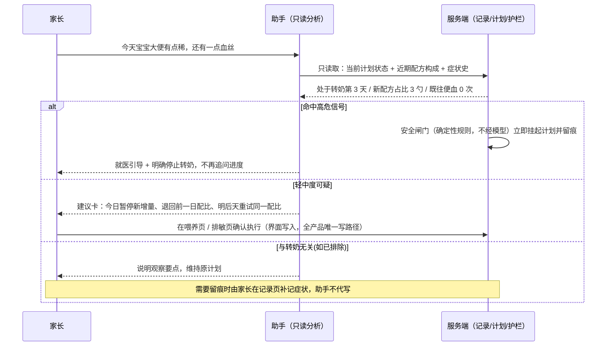

# 养娃智能体「敏宝助手」V3.0 — 转奶与排敏教练（记录面 × 分析面）

> 版本：v3.0 ｜ 日期：2026-09-19 ｜ 状态：规划中
> **定位**：本 PRD 是 **PRD-003《养娃智能体「敏宝助手」V1.0》的战略升级版**，不推翻其能力，而是给整个 agent 补上一个**长期目标**与配套的推进能力，并明确这些能力在**小程序记录面**与**对话分析面**上分别如何落地。
> **主线**：**小程序负责记录，助手负责分析**——结构化记录只从界面进（表单 / 打卡 / 语音），助手只读数据、只产出判断与建议，**写入路径全产品唯一**（§1.3 硬原则 2）。
> **前置调研**：[`RESEARCH-20260919-转奶与排敏教练-先进性调研.md`](../../agent/tech/RESEARCH-20260919-转奶与排敏教练-先进性调研.md)
> **现状与缺陷依据**：[`OPT-20260919-线上助手问题分析与优化方案.md`](../../agent/tech/OPT-20260919-线上助手问题分析与优化方案.md)、[`PROFILE-20260919-敏宝画像信号清单与设计.md`](../../agent/tech/PROFILE-20260919-敏宝画像信号清单与设计.md)

---

## 怎么读这份文档

本 PRD 按「变更频率 × 读者」拆成 6 个文件，**章节编号保持全局唯一**（例如 §4 永远指状态感知能力，不论它在哪个文件）。跨文件的引用已做成可点击链接。

| 文件 | 承载章节 | 什么时候读 |
|---|---|---|
| **README.md**（本文） | §1 综述 · 术语 · §15 参考 | 第一次读、要确认边界时 |
| [01-现状与差距.md](01-现状与差距.md) | §2 现状盘点 · §10 技术债 | 想知道"已经有啥、还欠啥" |
| [02-能力设计.md](02-能力设计.md) | §3 产品形态 · §4 状态感知 · §5 八个接缝 · §7 集成机制 | 要设计或评审某项能力 |
| [03-用户故事.md](03-用户故事.md) | §6 用户故事（US-20 ~ US-34） | 要理解需求细节与验收 |
| [04-实施派工.md](04-实施派工.md) | §8 三层功能改动 · §9 支撑性需求 · §12 优先级与分期 | **要开工、要派活** |
| [05-风险与决策.md](05-风险与决策.md) | §11 非目标 · §13 风险 · §14 假设与待确认 | 要评估风险、拍决策 |

| 想了解 | 去哪 |
|---|---|
| 我们要解决什么问题、边界在哪 | [§1 综述](#1-综述-overview) |
| 小程序现在已有什么（避免重造） | [§2 现状盘点](01-现状与差距.md) |
| 记录面和分析面怎么分工 | [§3 产品形态](02-能力设计.md) |
| 助手凭什么能做判断 | [§4 状态感知能力](02-能力设计.md)（地基） |
| 记录与分析在哪些位置相遇 | [§5 八个接缝](02-能力设计.md) |
| 具体要做什么功能 | [§6 用户故事](03-用户故事.md) |
| 两端怎么接起来 | [§7 集成机制](02-能力设计.md) |
| **谁要改什么代码** | [§8 三层功能改动清单](04-实施派工.md) |
| 需要什么数据与接口 | [§9 支撑性需求](04-实施派工.md) |
| 还欠哪些技术债 | [§10 技术债](01-现状与差距.md) |
| 明确不做什么 | [§11 非目标](05-风险与决策.md) |
| **先做什么、每期多大** | [§12 优先级评估与分期](04-实施派工.md) |
| 有哪些风险 | [§13 约束与风险](05-风险与决策.md) |
| 还有什么没定 | [§14 决策确认与待确认项](05-风险与决策.md) |

---

## 三层改动视角（贯穿本 PRD 的主线）

---

本文件对**每一项能力**都同时给出四个层面的改动。之所以是四层而不是三层：需求上说的"agent 层"在实现上会落到两块独立的代码上（AI 运行时 与 确定性服务端逻辑），**混在一起会导致派工错位**。

| 层 | 载体 | 负责什么 | 典型改动 |
|---|---|---|---|
| **助手层** | 对话产品面 | 说什么、怎么判断、怎么表述 | 话术、断言强度、建议卡产出、护栏口径 |
| **小程序层** | `minicare-mp/` | 录入、展示、执行 | 页面、表单预填、打卡、语音入口、结构化卡片 |
| **agent 层** | `minicare-agent/` | AI 运行时 | systemPrompt 注入契约、只读工具、SSE 事件、KB、评估 |
| **服务端层** | `minicare-server/` | 确定性逻辑与真相源 | 聚合 SQL、计划引擎、状态派生、migration、出口校验 |

> **映射关系**：需求口径的"助手 / 小程序 / agent"三层 = [§8](04-实施派工.md) 的**助手层 / 小程序层 / agent 层**；其中"agent 层"的落地必然同时涉及 **`minicare-agent`（AI）与 `minicare-server`（数据与算法）**，故单列服务端层。

---

## 1. 综述 (Overview)

### 1.1 项目背景与核心问题

**V1.0 的能力已全部围绕"回答"构建**：知识问答、数据查询、总结分析、每日日记、图片问诊。上线后暴露出的真实问题不是"答得不对"，而是 **"答完就结束了"**：家长问完"能不能转奶"，得到一段正确但无后续的话；一周后再问同样的问题，助手不记得上次聊到哪、也不记得宝宝已经稳定 34 天。记录越积越多，宝宝却始终停在同一个配方上。

**而敏宝家庭的真实痛点是长期性的，且有一个明确的终点**：

| 痛点 | 现状 | 代价 |
|---|---|---|
| 不知道"现在能不能转奶" | 靠零散信息与医生门诊间隙判断 | 过早转 → 症状复发；过晚转 → 白花钱、白受限 |
| 不知道"转奶每天到底怎么喂" | 知道要"循序渐进"，但不知道今天第 1 顿放几勺 | 操作随意 → 出现反应无法归因 |
| 不知道"辅食还该加什么" | 已耐受 12 种食材后停滞，家长怕出事不敢加 | 饮食谱长期狭窄 → 铁/钙/维 D 摄入风险 |
| 不知道"已经耐受的还算不算数" | 没有维持概念，某样食物几个月没吃 | 耐受可能丢失，前面白排 |
| 看不到坚持的回报 | 奶粉钱每月多花几千，宝宝却没变好 | 依从性衰减、家庭矛盾 |

**这个终点是可定义、可量化、有循证支持的**：约 55% 的 CMPA 宝宝 1 岁内、超过 75% 在 3 岁内、超过 90% 在 6 岁内可耐受牛奶；FPIAP（便血型）约 70% 在 1 岁内、90% 在第 2 年耐受。

因此本版本把 agent 从"问答助手"升级为 **"转奶与排敏教练"**：用一个跨月甚至跨年的目标把零散对话、记录与提醒串起来，让家长每天知道"今天该做什么"，并看得见进度。

### 1.2 北极星与三个次级目标

**北极星（终极目标）**：让敏宝在安全前提下，**尽快从特殊医学配方回到普通配方，并把可摄入的食物种类扩展到接近同龄健康宝宝的水平**。

拆成三个可度量的次级目标：

| # | 目标 | 度量 |
|---|---|---|
| G1 | 配方降阶 | 阶次推进（AAF→eHF→pHF→std 单向推进）、首次成功降阶所需天数、稳定维持天数 |
| G2 | 食物谱扩展 | 归一化后的"已耐受食材数"月净增；已耐受食物的维持暴露达标率 |
| G3 | 收益可见 | 月度奶粉支出下降金额；生长分位数趋势不下滑；家长焦虑自评改善 |

> **必须校准的一句表述**：特殊医学配方本身是**营养完整**的（GB 25596 / Codex），收益不是"医学奶粉营养不够"，而是**乳糖回归（促进钙吸收 + 益生元效应）、蛋白质来源自然化、食谱大幅变宽、社交与心理减负，以及 40%-60% 的奶粉支出下降**。产品文案与话术统一按此口径，避免被专业家长质疑。

### 1.3 能力边界：四条红线与四条硬原则

**四条红线（安全层，约束"能说什么"）**

1. **分型决定路径**：非 IgE 介导可在家庭按阶梯推进（仍建议医护指导）；**IgE 介导或混合型、机制未知，一律不得输出家庭阶梯推进方案**，只能科普 + 引导至专科。
2. **不诊断、不给药、不做最终裁定**：不输出药物剂量、不建议 OIT / 生物制剂、不裁定"这个能不能吃"；所有推进建议附"以医生评估为准"。
3. **安全优先于进度**：任何高危信号出现，立即中断当前计划并转向就医引导，**进度可以重来，安全不能**。
4. **感知决定断言强度**：未确诊（家长自述）或机制分型未知时，一律使用「如怀疑」口径，不得下「过敏」定论；数据缺失或陈旧时**不得给出阴性结论**（如「没有便血」「没出现反应」）；「无记录」与「数据陈旧」必须区别对待（详见 [§4.6](02-能力设计.md)）。

**四条硬原则（架构层，约束"由谁做、数据怎么流"）**

1. **单一真相源**。状态、计划、进度只在服务端产生；小程序与对话都只做渲染与表达。**禁止**前端派生与 agent 推断各算一套（现存 3 处违反见 [§3.3](02-能力设计.md)-③，必须收回）。
2. **录入只在界面**。所有结构化记录的写入只来自小程序界面——表单、打卡、**语音录入**。**agent 不承担任何记录写入**，不保留任何"对话写库"工具（被否决的方案见 [§3.4](02-能力设计.md)）。
3. **分析只在对话，且必须可落地**。agent 的价值是判断与解释；它的产出要么是对话文本，要么是**建议卡**，最终由用户在界面上执行。**分析结论如果不能一键回到界面执行，等于没说**。
4. **执行留在界面，判断留在对话**。重复、精确、可批量的动作（打卡、填表、看曲线）留在小程序；一次性、模糊、需要解释的动作（分级、归因、例外）交给对话。

> 红线管"能说什么"，硬原则管"由谁做、数据怎么流"。两者的共同落点是 [§8](04-实施派工.md)「三层功能改动清单」——**每一条改动都必须能回答它守住了哪条红线或哪条原则**。

### 1.4 核心业务流程 / 用户旅程地图

| 阶段 | 名称 | 用户目标 |
|---|---|---|
| 阶段一 | **目标确权** | 明确"我们最终要走到哪"，看到一张自己的里程碑地图 |
| 阶段二 | **起点体检** | 补齐机制分型与过敏档案；确认此刻是否具备转奶条件 |
| 阶段三 | **转奶推进** | 按逐日计划执行配方降阶，出现异常能正确处置、能安全重来 |
| 阶段四 | **排敏推进** | 有序引入新食物、保住已耐受的食物、知道下一步加什么 |
| 阶段五 | **收益与协同** | 看见省下的钱与长出的食物谱；生成给医生看的一页纸 |
| 阶段六 | **护栏与校正** | 边界内行事；家长可反馈并让计划跟着现实调整 |

> 阶段之间怎么切换**不需要家长自己声明**——由 [§4.4](02-能力设计.md) 的状态判定表依据信号自动判定，且全产品（对话 / 首页 / 里程碑页）只允许存在**一套**阶段结论。

### 1.5 Mermaid 图

#### 1.5.1 核心用户操作流（必填）

> 上图中的 `D{当前阶段}` 判定输入与规则见 [§4.4](02-能力设计.md)；**判定顺序即优先级**（护栏 > 数据不足 > 分型 > 活跃计划 > 空档）。

#### 1.5.2 状态机一：转奶计划（必填）

#### 1.5.3 状态机二：排敏任务（必填）

#### 1.5.4 关键场景时序：转奶期间出现症状（可选，但影响用户可见结果）

> **边界说明**：上图中助手与系统之间只有**只读**箭头。计划状态的变更来自两条路——① 服务端安全闸门（确定性规则，高危场景自动执行）；② 家长在界面采纳建议后由界面提交。**助手不写记录、不写计划**。详见 [§3.2](02-能力设计.md) / [§7.3](02-能力设计.md)。

---

---

## 术语

| 术语 | 含义 |
|---|---|
| **录入面 / 记录面** | 小程序界面。结构化数据的**唯一写路径**（表单 / 打卡 / 语音） |
| **分析面** | 对话界面。只读数据、产出判断与建议 |
| **真相源** | 服务端。状态、计划、进度的唯一产生地 |
| **数据类产出** | 喂养/睡眠/大便/生长/体温/打卡/反应等原始记录。界面产生，agent 只读 |
| **内容类产出** | 日记、复诊摘要等判断的载体。agent 生成草稿，界面确认保存 |
| **建议类产出** | 分级判断、计划草案、档案候选值。agent 生成，**不落库**，落成建议卡 |
| **建议落卡（Advice-to-Card）** | 把"分析结论"变成"可执行的界面动作"的机制，见 [§7.3](02-能力设计.md) |
| **元信号** | 关于数据本身的信号：有效结论 / 信息缺失 / 数据陈旧，见 [§4.6](02-能力设计.md) |

---

## 15. 参考资料

**本项目内**
1. `docs/agent/tech/RESEARCH-20260919-转奶与排敏教练-先进性调研.md`（循证与对标依据）
2. `docs/agent/tech/PROFILE-20260919-敏宝画像信号清单与设计.md`（10 组 46 个信号 + 8 个 flag 与实测锚点，[§4](02-能力设计.md) 的来源）
3. `docs/agent/tech/OPT-20260919-线上助手问题分析与优化方案.md`（线上缺陷与优化项）
4. `docs/prd/PRD-003.md`《养娃智能体「敏宝助手」V1.0》
5. `docs/prd/PRD-002.md`《辅食记录与排敏管理》（现有四态/五态模型与观察期设计的来源）
6. `docs/prd/PRD-005.md`《医疗健康档案板块重构》（疫苗/儿保数据来源）
7. `docs/agent/README.md`（M1-M8 模块展开索引）

**外部（医学依据，详见调研文档 [§8](04-实施派工.md)）**
8. 中国婴儿轻中度非 IgE 介导的牛奶蛋白过敏诊断和营养干预指南（2022）
9. 新生儿牛奶蛋白过敏诊断与管理专家共识（2023）
10. iMAP 牛奶阶梯 / NHS milk ladder 系列材料
11. LEAP 试验（NEJM 2015）、NIAID Addendum（2017）、Pediatrics 2025 真实世界早期引入数据
12. EAACI 2025 IgE 介导食物过敏管理指南；OUtMATCH 3 期 / FDA 对 omalizumab 的批准
13. 数字健康与 agent 架构：JITAI/RL 实测项目、慢性病 AI 自我管理综述、agent 记忆综述（2025）

**实现依据（盘点锚点）**
14. `minicare-mp/src/app.config.ts`（页面与分包清单）
15. `minicare-mp/src/pages/records/food-observation/detail.tsx`、`minicare-server/src/records/food-observation/*`
16. `minicare-mp/src/pages/dashboard/RemindersColumn.tsx`
17. `minicare-mp/src/lib/growth-standards.ts`、`pagesReport/tabs/GrowthTab.tsx`
18. `minicare-mp/src/pages/chat/index.tsx`、`src/api/agent.ts`
19. `minicare-agent/src/lib/tools/index.js`（当前四个只读工具，本版**不新增**写工具）
20. `minicare-server/migrations/011_food_observation_workflow.sql`

**语音链路（TECH-001）**
21. `minicare-mp/src/api/voice.ts`（`VoiceParseResult` 契约）
22. `minicare-mp/src/lib/useVoiceInput.ts`（录音/权限/降级）
23. `minicare-mp/src/components/VoiceResultSheet/index.tsx`（五态结果面板）
24. `minicare-mp/src/components/TabBar/TabBar.tsx`（长按入口、`navigateToRecord` 预填落地）
25. `minicare-server/src/voice/voice.service.ts`、`dto/voice.dto.ts`（NLU 抽取）
26. `minicare-server/src/app-config/app-config.data.ts`（`VOICE_NLU_CONFIG`：10 类记录 + 23 条 testCases）
