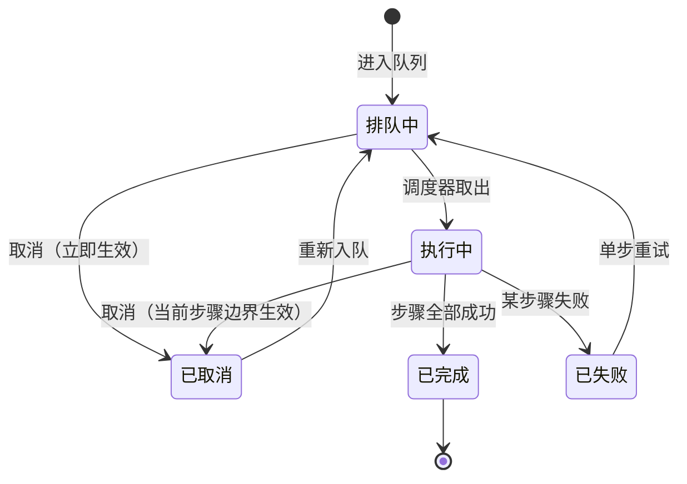
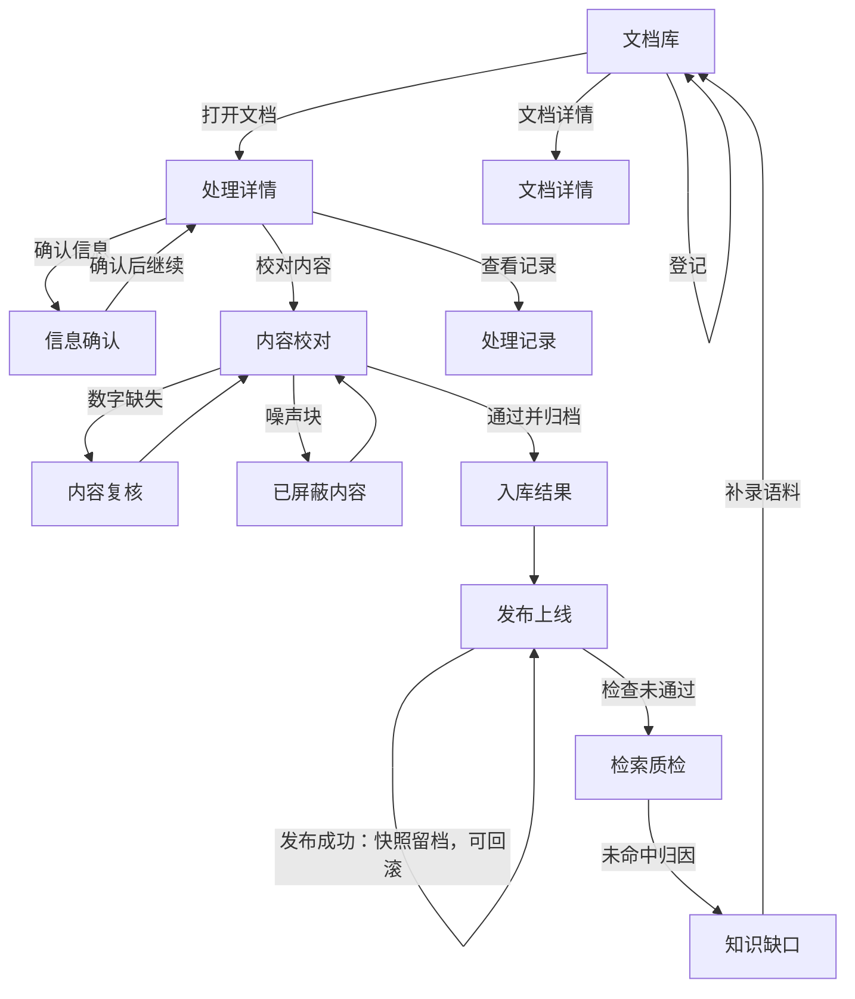

# 02 能力设计 — PRD-008

> 上游：[`01-现状与差距.md`](01-现状与差距.md) §2 现状盘点 ｜ 下游：[`03-用户故事.md`](03-用户故事.md) §10

---

## 5. 平台形态与技术边界

### 5.1 平台定位

**独立本地管理端**：一个跑在本机（或家庭服务器）的 Web 服务，**直接复用现有 `minicare-platform/api` 的 Python 管线代码**，与小程序、`agent-poc`、`minicare-server` 解耦。

| 维度 | 结论 |
|---|---|
| 使用者 | **仅维护者一人**（单用户本机），不做账号、不做权限、不做多租户 |
| 与 `minicare-server` 的关系 | **无依赖**。`minicare-server` 至今没有任何知识库模块（§2.3），本期也不新增 —— 平台自己提供界面与后端 |
| 与 `agent-poc` 的关系 | **单向依赖**：平台产出数据 → `agent-poc` 消费。两者通过 `knowledge_base` 表 + **检索契约（§9）** 耦合，不通过代码耦合 |
| 与小程序/`minicare-web` 的关系 | 无。本期不把知识库管理能力暴露给家长端 |
| 部署形态 | 本机起服务，浏览器访问。**不对外提供服务**（此约束与 MinerU 许可证附加条款相关，见 §18 R-07） |

**为什么不内嵌 `minicare-web` 后台**：管线是 Python，前端是 React + Vite，跨语言调用会引入一层无谓的适配；且知识库维护是低频重操作，与家长端产品节奏完全不同。

**为什么不引入 RAGFlow 等现成平台**：调研确认其 1.0 已用 Go 重写，依赖 MySQL + Elasticsearch/Infinity + Redis/NATS + Kvrocks + MinIO 一整套基建。而 `docs/agent/tech/M02-knowledge.md` §8.2 早已评估并拒绝过（"运维重、对逐条医疗元数据 + 风险分级支持弱"）——本文同意该判断，**只抄产品形态，不引基建**。

### 5.2 技术边界：复用 / 新增 / 明确不引入

| 类别 | 内容 |
|---|---|
| **复用（不重写）** | `mineru/`（云端 API 客户端与结果整理）、`preprocess/`（清洗与标题修复）、`chunking/pipeline.py`（自研切块）、`anchors/`（页码锚定）、`validate/`（数字校验 + pypdf 交叉校验）、`embed/`（TokenHub 客户端）、`store/knowledge_base.py` 的 upsert 语义、31 个 pytest |
| **新增** | 任务队列与步骤编排、产物存储（`ArtifactStore` + manifest）、文档档案与来源映射表（落 DB）、处理与校对的 Web 界面、发布与快照、检索质检与知识缺口、检索日志回流、契约校验 |
| **改造** | `cli.py`（4 步命令 → 6 步注册表，**CLI 保留可用**，作为平台的底层执行器与排障入口）、`config.py`（硬编码映射表迁出、阈值集中为单一配置）、`store/knowledge_base.py`（去掉 `[待复核]` 前缀 hack，改字段表达）、`metadata/annotate.py`（关键词抽取升级） |
| **明确不引入** | FastAPI 之外的重型 Web 框架、llama-index 运行时依赖、Chroma 或其他向量库、PostgreSQL、Elasticsearch、Redis、对象存储、Docker 编排 |

**关于 llama-index 的取舍**：调研确认它是 MIT、核心包轻量，但**本 PRD 仍不引入为运行时依赖**。理由有二：① 切块引擎已实测自研更优（Recall 64.4% vs 31.1%）；② 唯一有价值的是 `IngestionPipeline.docstore_strategy` 的三种去重语义（实际取值为 `upserts` / `duplicates_only` / `upserts_and_delete`，注意旧文档写的 `update` 是错的）—— 这套语义本文**照思路自实现**，不引入依赖。

### 5.3 目录与存储布局

> ⚠️ **实现调整（2026-10-09 重核）**：下面是**规划布局**；实际落地有三处不同 ——
> ① 没有 `file/`（源文件在 `docs/knowledge/source/raw/{国内,国际}/`，**`doc_id` = 源文件名 stem**）与 `export/`；
> ② 产物目录是 `pipeline/{step}/{cache_key[:16]}/`，**不带头部序号**（`01_`~`06_`）；
> ③ 平台顶层代码不在 `minicare-platform/app/`（实际后端在 `minicare-platform/api/src/kb_pipeline/web/`，前端在 `minicare-platform/web/`）。
> 权威布局见 [`06-开发进展与交接.md`](06-开发进展与交接.md) §2.1。

```
<平台数据根>/                      # 平台自管，不进 git
  corpus/
    {doc_id}/
      file/                        # 原始上传文件（FileObject）        ← 规划
      raw/                         # 解析原始产物，原样保留，永不清理
      01_preflight/run__*/         # 预检报告                          ← 规划（实际无序号前缀）
      02_parse/run__*/             # 解析产物（md + content_list.json + images/）
      03_normalize/run__*/         # 归一化结构（章节树 + 块列表，含页码）
      04_segment/run__*/           # 切片产物
      05_validate/run__*/          # 校验与复核清单
      06_index/run__*/             # 索引产物（关键词、向量版本、目标库记录）
      edits/                       # 人工产物，跨 run 存续
        chunks.edited.json         # 切片编辑（diff + base_hash）
        excludes.json              # 噪声块排除与恢复的人工决定
        review_resolutions.json    # 数字校验复核结论
      export/                      # Markdown 导出（doc.md + assets/） ← 规划（未实现）
      manifest.json                # 执行事实唯一来源
  snapshots/
    snapshot__{时间戳}/            # 发布快照
  logs/                            # 结构化日志（JSON Lines，按天滚动）
```

**进 git 的部分**：本文档、平台代码、阈值配置、检索契约文档、manifest 的**结构定义**。**不进 git**：源文件、产物、快照、日志、台账数据（台账落 DB，见 §19 D-04 与 §18 R-01）。

### 5.4 并发与任务模型

| 项 | 结论 | 理由 |
|---|---|---|
| 任务队列 | 自研（DB 表 + 单调度循环），**不引入 Celery/RQ** | 单用户单机，引入外部依赖不划算 |
| 并发 | **解析步骤可并发**（云端 API，IO 密集）；**本地步骤（清洗/切块/校验/索引）串行**（CPU 密集，抢资源会互相拖慢） | 本机 CPU 有限，且已确认 MinerU 云端是主要耗时项（实测单篇约 1–2 分钟，本地切块仅 2–3 秒） |
| 进度 | **阶段级 + 已耗时**，不做百分比估算 | 云端只能轮询到任务状态（8s 间隔），拿不到页级进度。**"卡在 90% 的假进度条"比"没有进度条"更糟** |
| 取消 | 排队中可立即取消；执行中在**步骤边界**安全中止，已完成步骤产物保留 | 避免半成品产物被下游引用 |
| 断点恢复 | 进程重启后，已完成步骤产物不丢失，从当前步骤继续 | 产物与 manifest 落盘是正确性基础 |
| 失败策略 | **单份失败不中断整批**；失败项可单步重试；成功项不重跑 | 批量导入时最怕"一份坏文件卡死整批" |

---

## 6. 处理步骤与状态模型

### 6.1 六步定义

> 替代现有 4 步（parse / chunk / import / embed）。**关键变化是把「内容复核」从 chunk 里拆出来独立成步** —— 这是 US-06「发现一条数字缺失 → 改规则 → 只重跑校验」能够成立的前提；沿用 4 步则每次都要重切。

| # | 步骤 | 输入 | 输出产物 | 引擎 | LLM |
|---|---|---|---|---|---|
| 1 | `preflight` **预检** | 源文件 | 预检报告（页数、扫描页清单、推荐档位） | pypdf 抽样 + 逐页判定 | — |
| 2 | `parse` **解析** | 源文件 + 预检报告 | 解析产物 + `raw/` | **MinerU 云端**（PDF 走 `pipeline`、HTML 走 `MinerU-HTML`） | — |
| 3 | `normalize` **正文清洗** | 解析产物 | 归一化结构（章节树 + 块列表，含页码） | 规则（`preprocess/`） | — |
| 4 | `segment` **切块** | 归一化结构 + 台账元数据 | 切片集合 + 噪声块标记 | 规则（自研切块） | — |
| 5 | `validate` **内容复核** | 切片集合 | 复核清单 + 风险分级 + 关键词（**LLM 触点**） | 规则 + `pypdf` 交叉校验 + LLM | ✅ 关键词生成 |
| 6 | `index` **索引** | 切片集合 + 人工编辑 + 排除决定 | 向量 + 全文索引 + 目标库写入记录 | TokenHub embedding | — |

**预检步骤的三项职责**（这是它值得独立成步的理由，直接替代 `config.py:27` 的手工 `ocr_files` 清单）：
1. **逐页判定扫描页**：文字层字符数 / 页面积比低于阈值判为扫描页 → 锁定解析档位必须含 OCR
2. **推荐解析档位**：按扫描页占比与文档结构给建议（默认 `standard`）
3. **估算耗时**：给出预计耗时，让维护者对大文档有心理预期

### 6.2 步骤依赖拓扑


> 说明：`validate` 需要 `segment` 的产物（要按块校验），而 `segment` 需要台账元数据（要冗余进切片）。
> ~~所以**暂停点 1 卡在 `normalize` 完成与 `segment` 开始之间**。~~
> ⚠️ **2026-10-09 变更**：人工暂停点机制已整体移除，六步之间**没有任何人工关卡**（见 §6.5）。

### 6.3 缓存与失效传播

**缓存判据**（全部参与 key 计算）：

```
cache_key = sha256(
  步骤 ID,
  上游产物内容 hash,
  步骤参数 hash,
  引擎版本,            # 如 MinerU 4.0.10 / MinerU-HTML
  平台代码版本          # 见 §19 D-11
)
```

> **为什么要含平台代码版本**：否则"代码改了行为变了、缓存却仍命中"会产生最难排查的一类不一致。代价是任何代码改动都会让全部缓存失效 —— 对单用户本机场景，这个代价可以接受（切块单篇仅 2–3 秒）。

**失效传播**（重跑某步 → 下游标 `stale`，**产物文件不删**）：

```
invalidate(预检)   → 解析, 正文清洗, 切块, 内容复核, 索引 全部 stale
invalidate(解析)   → 正文清洗, 切块, 内容复核, 索引 全部 stale
invalidate(正文清洗) → 切块, 内容复核, 索引 stale
invalidate(切块)   → 内容复核, 索引 stale
invalidate(内容复核) → 索引 stale
invalidate(索引)   → （无下游）
```

**参数级失效**（上游没变、但自己或环境变了，也要显式标 `stale` 而不是静默 miss）：
- **更换向量模型** → **全部文档**的索引步骤标 `stale`（新旧向量不可混用）
- **更换关键词 prompt 版本** → 全部文档的内容复核 + 索引标 `stale`
- **修改切块阈值**（如 `max_section_chars`）→ 该文档的切块及下游标 `stale`
- **修改排除规则** → 该文档的切块及下游标 `stale`（排除决定在切块步产出）

### 6.4 文档状态派生规则

> ⚠️ **2026-10-09 变更**：下表中「待确认元数据 / 待校对切片」两档**已随人工暂停点一并移除**。
> 现行为 **失败 > 待更新 > 已就绪 > 处理中 > 待处理** 五档（实现见 `orchestrator.derive_status`）。

**文档状态不手工维护，由步骤状态派生**（按优先级从上往下匹配）：

| 条件 | 文档状态 | 界面提示 |
|---|---|---|
| 任一步骤 `failed` | **失败** | 标出失败步骤，可直接重试该步 |
| ~~正文清洗步骤完成 ∧ 元数据未确认~~ | ~~**待确认元数据**~~ | ~~暂停点 1，给出确认入口~~ |
| ~~切块与校验完成 ∧ 切片未通过~~ | ~~**待校对切片**~~ | ~~暂停点 2，显示异常块数~~ |
| 索引完成 ∧ 未发布 | **已就绪待发布** | 给出发布入口 |
| 已发布 ∧ 存在 `stale` | **待更新** | 提示哪些步骤需重跑 |
| 全部步骤 `succeeded` 且无 `stale` | **已发布** | 可被 Agent 检索 |
| 被新版取代 | **已归档** | 产物保留可查，不可发布 |

### 6.5 ~~两个人工暂停点与闸门~~（2026-10-09 已移除）

> 🚫 **本节设计已整体废弃，实现与界面均已删除。** 理由：用户实测反馈"这个功能很难理解" ——
> 单用户本机维护工具里，一个人工关卡要求用户先理解"暂停点/放行/闸门"三个概念才能推进流程，
> 理解成本远大于它挡住的错误。
> **替代设计**：「信息确认」与「切片校对」两个页面**保留**，但降级为**可选操作** ——
> 随时可改台账元数据、随时可改切片，**做不做都不影响流程能否继续**。
> 需要"复核"就做成可选操作，不要做成拦流程的关卡。
>
> 以下为原设计（留档，便于理解历史讨论与老截图）：

| 暂停点 | 位置 | 为什么在这个位置 | 闸门语义 |
|---|---|---|---|
| **暂停点 1 · 元数据确认** | `正文清洗` 完成之后、`切块` 开始之前 | 元数据要**冗余进每一个切片**做检索过滤，切片出来之后再改就得全量重建 | 闸门不开则 `切块` 不启动；**退回重新解析时保留已填字段** |
| **暂停点 2 · 切片校对** | `内容复核` 完成之后、`索引` 开始之前 | 只有切片出来才能判断"切得对不对"；且此前的错误已在下游放大到可见 | 有**红色标记**未处理时「一键全部通过」不可用；通过后自动跑索引 |

~~**两个暂停点都可被配置关闭**（`require_meta_review` / `require_chunk_review`），关闭时自动放行并**留痕**（记录"经配置自动放行"）。批量导入低重要性语料时可临时关闭。~~

### 6.6 队列与取消



- 队列位置与预估等待**可见**（批量导入 10 份时可预期）
- 「执行中取消」在**步骤边界**生效，已完成步骤产物保留
- **不产生半成品可供下游引用**（取消的 run 目录不写进 manifest 的 `current_run`）

---

## 7. 数据契约

### 7.1 文档档案（台账字段）

> 界面上的「文档库」页展示的就是本表；技术语境下仍称"语料台账"，表名为 `kb_corpus`。

**落 DB 表**（不进 git，见 §19 D-04）：

| 字段 | 说明 | 来源 |
|---|---|---|
| ~~`doc_id`（稳定 ID）~~ **内容 sha256** | ⚠️ **实现调整（2026-10-09）**：主键 `doc_id` 实际 = **源文件名 stem**（`_safe_doc_id(filename)`）。原因：预检/解析要按 `{source_dir}/{国内\|国际}/{doc_id}{后缀}` **定位源文件**，用哈希做目录名就对不上了。内容 sha256 **退化为临时判重值**（`same_content` 判据，改名重发也能命中），**不入主键、不入表**（`kb_corpus` 无 `sha256` 列） | 文件名 → 登记时规范化 |
| `filename` / ~~`sha256`~~ / `size_bytes` | 文件基础信息 | 登记时计算（`sha256` 仅用于判重，不落列） |
| `note` | **实现新增**：人工备注（PRD v1.0 未列） | 人工（可空） |
| `source_name` **必填** | 来源名称，如"严重过敏反应诊断和临床管理专家共识(2025)" | 文件名规则 → 正文抽取 → 人工 |
| `publisher` | 发布机构 | 正文抽取 → 人工 |
| `year` **必填** | 年份 | 正文抽取 → 人工 |
| `region` **必填** | `cn` / `intl` | 目录推断 → 人工 |
| `evidence_level` **必填** | `guideline` / `consensus` / `RCT` / `policy` / `edu` | 文件名规则 → 人工 |
| `applicable_age` | 适用年龄，如 `0-3 岁` | 人工（可空） |
| `license` | 许可证 / 使用范围 | 人工（可空，缺失标 ⚠） |
| `source_url` | 来源链接 | 人工（可空） |
| `obtained_at` | 获取日期 | 登记时自动 |
| `version` | 版本号（`v1` / `v2`…） | 覆盖或并存时递增 |
| `superseded_by` / `supersedes` | 取代关系 | 疑似同源时人工确认 |
| `kb_domain` | 库域（本期恒 `default`） | **预留字段**，见 §19 D-03 |

> **必填三项（年份 / 地区 / 证据级别）**的理由：这三个字段直接决定检索过滤与"国内共识 vs 国际指南"的冲突判定（决策 §19 D-08）。

### 7.2 产物与 manifest

`manifest.json` 是**执行事实的唯一来源**，DB 只做加速索引（不一致时以 manifest 为准重建）。

```jsonc
{
  "doc_id": "...",
  "steps": {
    "segment": {
      "current_run": "run__self@v1__d7b0a9c2",
      "status": "succeeded",
      "runs": [
        {
          "run_id": "run__self@v1__d7b0a9c2",
          "params": { "max_section_chars": 900 },
          "params_hash": "d7b0a9c2",
          "engine": "self",
          "engine_version": "v1",
          "platform_version": "0.2.0",
          "upstream_hashes": { "normalize": "sha256:1f2e..." },
          "duration_ms": 2410,
          "stats": { "chunks": 52, "sections": 50, "tables": 2, "excluded": 3 },
          "started_at": "...", "finished_at": "..."
        }
      ]
    }
  }
}
```

### 7.3 `run_id` 与产物目录

```
run_id   = run__{engine}@{engine_version}__{params_hash 前 8 位}
目录名    = cache_key 前 16 位            # 保证"同参数重跑直接命中目录"
```

历史 run 保留且可对比；可将任一历史 run「设为当前」。

### 7.4 `knowledge_base` 字段扩展（迁移 021）★

> **这是本 PRD 唯一一处会动生产库结构、且需要回填存量数据的改动。** 影响面见 §13。

新增两个字段，替代现有的 `content` 前缀 `[待复核]` + `risk_level=caution` 的 hack：

| 字段 | 取值 | 语义 |
|---|---|---|
| `retrieval_status` | `enabled` / `excluded` / `review` | 是否参与检索。`excluded` = 噪声块（US-07）；`review` = 数字校验未过（US-06） |
| `review_state` | `pending` / `accepted` / `rejected` / `edited` / `NULL` | 复核结论。仅 `retrieval_status=review` 时有值 |

**语义约束**：
- `retrieval_status IN ('excluded','review')` 的条目 **既无向量也不参与全文索引**，但仍然被全文索引表过滤（保留数据，只是不检索）
- 检索端过滤从 `content NOT REGEXP '^\\[待复核\\]'` 变为 `retrieval_status = 'enabled'` —— **这是 agent-poc 必须同步的改动**
- 存量回填：1586 条中，那 2 条 `[待复核]` 前缀的置为 `review/pending` 并**去掉前缀**；其余置 `enabled`

### 7.5 噪声块判定规则

| 规则 | 判定条件 | 默认动作 |
|---|---|---|
| **参考文献 / 引用列表** | 块标题**整行匹配** `参考文献` / `引用文献` / `References?` / `Bibliography` **且** 块位置在**文档后 30%** | 默认屏蔽 |
| **空表** | `chunk_type=table` 且**数据行 ≤ 1**（只有表头或完全无行）；去标签后 < 8 字作为兜底（防 HTML 残渣） | 默认屏蔽 |
| **页眉页脚残留** | 块文本短（< 40 字）**且** 形如页码 **且** 在 `content_list` 中跨页重复出现 | 默认屏蔽 |
| **纯图无题注** | `chunk_type=image` 且无配对题注且无描述文本 | 默认屏蔽 |

> **两条阈值经实测修正（2026-10-03，均为实现后真实数据发现）**：
>
> 1. **参考文献位置阈值 20% → 30%**。位置用**块起始页**推导，对"横跨多页的大块"会系统性低估：
>    实测 `NIAID_2010_食物过敏指南` 的 References 块起始于 **104/133 页（占比 0.782）**，
>    却一直延续到文末。原 20% 阈值（需 ≥0.8）**刚好判不到它** —— 而它正是
>    `KB-MAPPING.md:12` 里被错当成 KB-A3 gold 标准答案的那一块。放宽到 30% 后正确命中。
>    另：位置**必须用页码**推导，不能用块列表序号（切块结果按 `header_path` 排序，
>    「参考文献」的汉字编码小于「第N节」，会排到列表最前面 → 用序号判断永远失效）。
> 2. **空表主判据从"字符数 < 20"改为"数据行 ≤ 1"**。字符数阈值会误杀短而有效的表格：
>    实测一张 2×2 剂量表（`起病时间/2~72h`、`持续时间/数小时至数天`）去标签后仅 **19 字**，
>    低于原阈值即被误判为空表。字符数降为辅助（< 8 字，只兜 HTML 残渣）。

**两条硬约束**：
1. **默认排除 = 不参与向量化与全文索引**，但**保留在列表中可见**、可逐块「恢复检索」
2. **人工决定优先于规则** —— 我恢复过的块，在后续重切时不会被规则再次排除

### 7.6 发布快照

| 项 | 内容 |
|---|---|
| 快照内容 | 发布前目标库的切片集（含 `kb_id` / `content` / 元数据字段 / 向量）与切片总数 |
| 快照粒度 | 每次发布自动生成一个，命名 `snapshot__{时间戳}` |
| 回滚语义 | 从快照恢复目标库 → 切片与向量回到发布前状态，**不重跑任何解析** |
| 回滚可验证 | 回滚后库内切片数须等于快照记录值，且抽样检索能命中上一版内容 |
| 写入原子性 | 增量写入走事务；中途失败则全部回退，**不允许出现"一半新一半旧"** |

---

## 8. 页面清单

### 8.1 页面清单

> **命名约定**：下表「页面」列是**产品化的界面名称**（界面上显示、日常沟通使用）；「对应机制」列保留工程术语，供技术章节与代码对照。两者是同一件事的两种说法 —— 例如打开「检索质检」页，跑的就是"召回回归"。

| 页面 | 职责 | 对应机制（工程术语） | 关联故事 | 优先级 |
|---|---|---|---|---|
| **文档库** | 列表 + 完整度摘要 + 缺项筛选 + 导出 | 语料台账 / `kb_corpus` | US-01、US-02 | P0 |
| **文档详情** | 档案字段 + 版本历史 + 引用关系 + 合规信息 | 台账字段与取代关系 | US-02 | P1 |
| **处理进度** | 批量任务列表 + 进度 + 取消 + 单步重试 | 任务队列 | US-03 | P0 |
| **处理详情** | 单文档 6 步状态 + 产物 + 耗时 + 重跑 | 6 步编排与产物寻址 | US-03 | P0 |
| **信息确认** | 表单 + 字段来源标注 + 置信度 | **可选**：核对台账元数据（原「暂停点 1」，已不拦流程） | US-04 | P0 |
| **切片校对** | 左原文 / 右切片双栏 + 编辑操作集 | **可选**：校对切片（原「暂停点 2」，已不拦流程） | US-05 | P0 |
| **内容复核** | 缺失项 + 原文上下文 + 自动候选值 + 四种处置 | 数字校验复核闭环 | US-06 | P0 |
| **已屏蔽内容** | 四类规则命中 + 逐块恢复 | 噪声块排除 | US-07 | P0 |
| **处理记录** | 6 步产物 + 参数指纹 + 失效标记 + 历史对比 | 产物版本与选择性重跑 | US-08 | P0 |
| **入库结果** | 索引进度 + 向量/全文字段 + 模型版本 + 关键词抽样 | 索引构建 | US-09 | P1 |
| **发布上线** | 发布前检查 + 发布内容摘要 + 快照 | 发布前检查与快照 | US-10 | P0 |
| **发布记录** | 历史发布 + 发布后验证 + 回滚入口 | 发布历史与回滚 | US-10 | P0 |
| **检索质检** | 指标 + 未命中题 + 与基线对比 + 建议动作 | 召回回归 | US-11 | P0 |
| **知识缺口** | 主题聚合 + 出现次数 + 建议语料 + 关闭留痕 | 覆盖缺口台账 | US-12 | P1 |
| **智能体对接** | 契约字段 + 变更记录 + 线上检索观察 + 校验状态 | 检索契约 | US-13 | P1 |

### 8.1b 实际落点对照（2026-10-09 重核 · 含导航收敛）

> 上表 15 个「页面」是**产品概念**；实现在界面上被重新编排过（2026-10-09 收敛；同日晚四处微调：发布记录并入发布上线、智能体对接与处理进度下线、生效阈值更名「全局配置」）：
> · **侧栏 = 两级菜单，无分组标题**：一级 4 个功能入口（文档管理 / 发布上线 / 检索质检 / **全局配置**），
>   二级 5 个（文档管理 → **文档工作台**；检索质检 → 用例集、执行记录、检索测试、知识缺口）；
>   原「发布上线 → 发布记录」二级项与「智能体对接」「处理进度」页面均已移除（见下行对照）；
> · **文档工作台**（`?page=source`）承载单份文档的 9 个页签（七步产物），无「当前文档」时落引导态；
> · 两个低频页合并成**弹框**。对照如下：

| PRD 页面 | 实际落点 | 状态 |
|---|---|---|
| 文档库 | 侧栏「**文档管理**」（`corpus`）—— 卡片矩阵（PDF 缩略图 + 原文摘要 + 六步管线） | ✅ |
| **文档详情** | ⚠️ **无独立页面**：卡片只展示标题/元信息/摘要/管线；**版本历史、引用关系、合规信息没有界面**（`supersede` 只有 API，前端无人消费） | 🟡 待补 |
| 处理进度 | **已下线**（2026-10-09 晚）：文档按篇处理、无队列场景；端点 `/api/queue*` 同删 | ➖ 已下线 |
| 处理详情 | **弹框·纯查看**（`?modal=processing`，挂在文档管理上）：七步状态 + 各步产物 + **警告/错误**；**无操作项**（重跑 / 作废走 CLI）；别名 `?page=detail` 自动翻译 | ✅ |
| 处理记录 | **工作台页签「处理记录」**（`?page=source&tab=runlog`）：完整执行历史（警告/错误 / 参数 / 引擎 / 耗时）；2026-10-09 从处理弹框拆出（弹框只留摘要） | ✅ |
| 信息确认 | 工作台页签「信息确认」（`?page=source&tab=meta`） | ✅（**可选操作，不拦流程**） |
| 切片校对 | **并入**工作台页签「切片对照」（`tab=chunks`）；别名 `tab=review` 仍可路由 | ✅ |
| 内容复核 | 工作台页签「内容复核」（`tab=numbers`） | ✅ |
| 已屏蔽内容 | 工作台页签「已屏蔽内容」（`tab=excluded`） | ✅ |
| 入库结果 | **并入**工作台页签「入库结果」（`?page=source&tab=indexresult`，第 ⑦ 步「索引」产物）；旧深链接 `?page=indexresult` 自动翻译 | ✅ |
| 发布上线 | 侧栏「发布上线」（`publish`） | ✅ |
| 发布记录 | **并入**侧栏「发布上线」（`publish`）：发布历史由「快照」卡片承接（快照编号 / 创建时间 / 切片数 / 回滚入口）；变更留档仍在 `kb_publish`（CLI `publish records` 可查）；原独立页已移除，旧深链接 `?page=publishlog` 自动翻译 | ✅ |
| 检索质检 | 侧栏「检索质检」（`quality`） | ✅ |
| 知识缺口 | 侧栏「知识缺口」（`gaps`） | ✅ |
| 智能体对接 | **已下线**（2026-10-09 晚）：KB 侧不再单设页面；后端 `/api/contract` 与回退页同删，契约校验保留为 CLI（`kb-pipeline contract show/validate/observe`）；旧深链接 `?page=contract` 不再翻译 | ➖ 已下线 |
| — | **PRD 未列、实现新增**：工作台页签「解析结果对照」`compare`、「预检」`preflight`、「解析高危敏感信息复核」`numbers`、「元信息解析与确认」`meta`（合并原「信息确认」+「元信息解析」，文档级子页面）；侧栏「全局配置」`config` | ✅ |
| — | **PRD 未列**：上传弹框（`?modal=upload`，US-01 的 dry→登记两步流） | ✅ |

### 8.2 页面跳转关系



### 8.3 线框图索引

每条 UI 故事的 ASCII 线框图放在 **§10 用户故事详述**对应故事内（`页面布局线框图` 字段），共 12 张：

| 故事 | 线框图内容 |
|---|---|
| US-01 | 文档库（主界面）· 判重冲突弹窗 · 登记预填表单 |
| US-02 | 文档库（含合规列）· 文档详情（版本历史 + 引用关系） |
| US-03 | 处理详情 · 处理进度 |
| US-04 | 信息确认（含来源标注与置信度） |
| US-05 | 内容校对双栏（含已屏蔽内容可见） |
| US-06 | 内容复核（含自动候选值与四种处置） |
| US-07 | 已屏蔽内容（四类规则 + 逐块恢复） |
| US-08 | 处理记录（步骤产物 + 参数指纹 + 历史记录） |
| US-09 | 入库结果（模型版本 + 关键词抽样） |
| US-10 | 发布上线（发布前检查）· 发布完成与验证 |
| US-11 | 检索质检（指标 + 未命中题 + 建议动作） |
| US-12 | 知识缺口 |
| US-13 | 智能体对接（契约字段 + 变更记录 + 线上观察） |

---

## 9. 检索契约与 Agent 消费

### 9.1 契约 v1（冻结于 2026-10-02，对齐 `search-knowledge.js` 现存实现）

| 类别 | 内容 |
|---|---|
| **响应结构** | `found: boolean` · `items: Item[]` · `topK: number` |
| **条目字段** | `id` · `kb_id` · `title` · `content` · `content_truncated` · `source` · `risk_level` |
| **过滤参数** | `query`（必填）· `riskLevel`（`low`/`caution`/`emergency`）· `category` |
| **语义约束** | ① `retrieval_status != 'enabled'` 的条目**永不出现** ② `content` 超 800 字截断并置 `content_truncated=true` ③ 未命中返回 `{ found: false, message: '知识库未找到相关内容' }` |
| **检索方式** | FULLTEXT ngram（`title`+`content`+`keywords`）取 top20 + 向量余弦取 top20 → RRF 融合（k=60）→ top5 |
| **向量一致性** | 查询与入库**必须同模型同维度**（当前 `kinfra-text-embedding-0.6b` / 1024） |

### 9.2 契约载体与校验

- **载体**：Markdown 契约文档（本节 + 独立文件），人可读、可 review
- **校验时机**：**发布前自动执行**（US-13 场景 7）
- **校验内容**：① 语义约束①在实现中确实生效（被排除/待复核条目不会返回）② 响应结构与字段集未被删减 ③ 向量维度与库内已有向量一致
- **校验失败**：阻断发布，指出缺了哪个字段或哪条约束失效

### 9.3 变更流程

```
改字段/改语义 → 更新契约文档（记变更记录 + 递增版本）→ 改实现 → 发布时自动校验通过 → 才允许发布
```

> **为什么要自动校验而不只是写文档**：`agent-poc` 与平台是两个独立演进的项目，靠"记得同步"一定会漏。契约校验是这条链路上唯一的自动化保险。

### 9.4 检索日志回流

| 项 | 结论 |
|---|---|
| 记录内容 | 检索时间、查询文本、命中数、top1 相似度、是否未命中、是否低分（< 0.5） |
| 写入方式 | **旁路**：日志写入失败**不影响**用户问答（US-13 场景 8） |
| 用途 | ① 聚合出未命中 TOP（US-13 检索观察）② 一键记入知识缺口（US-12），打通"线上问题 → 语料补充" |
| 隐私边界 | 只记录查询文本与命中统计，**不记录**用户身份、家庭数据、会话内容 |
