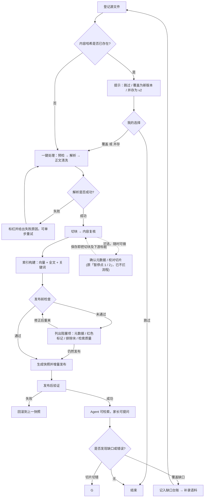
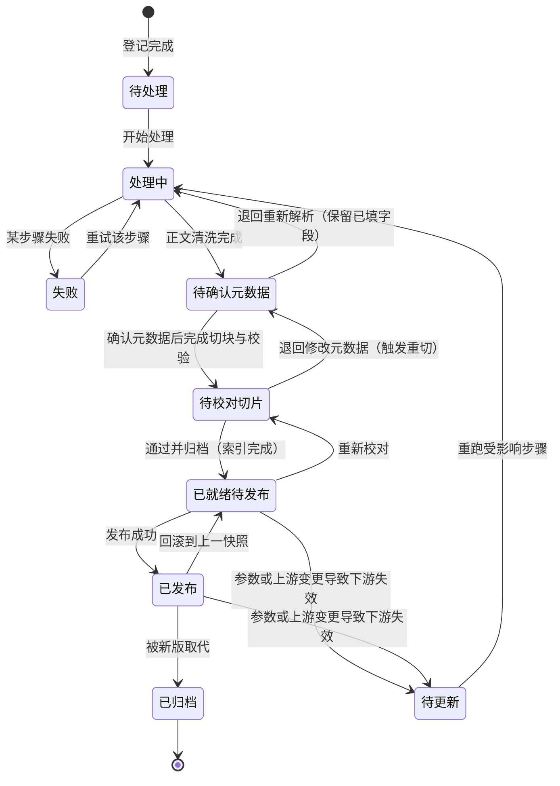
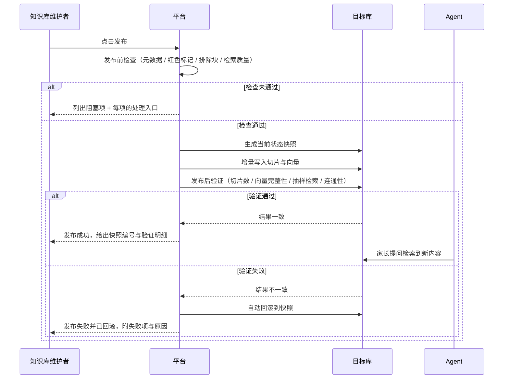

# 知识库平台化 — PRD-008

> 版本：v1.0 ｜ 日期：2026-10-02 ｜ 状态：**需求已冻结，进入实现与验收阶段**
> **实施进展以 [`06-开发进展与交接.md`](06-开发进展与交接.md) 为准**（2026-10-09 13:40 按代码与 dev 库重核）。
> 一句话：五期功能代码已全部落地、界面全量实现；**但真实路径（入库/发布/质检/关键词 A/B）尚未验收**，
> 迁移 021 只在 dev 加了列、**回填未执行**。接手前先读 06 的 §0.0。
> 替代范围：`archive/PRD-知识库解析入库流水线-v3.md`（PRD-KB-003 v3.2）与其配套技术方案 `archive/技术方案-知识库解析入库流水线-v1.md`（DES-KB-004）
> **配套技术方案**：[`docs/tech/TECH-015-kb-platform.md`](../../tech/TECH-015-kb-platform.md)（v1.1，2026-10-09）—— 实现级设计、十个选型点的评估与反面论证、迁移 021 的五阶段执行序、§18 落地实况与偏差
> **运维速查**：[`docs/tech/TECH-015-kb-platform-gotchas.md`](../../tech/TECH-015-kb-platform-gotchas.md)（11 节，含「原文↔解析」源码调研在 `TECH-015-kb-source-research.md`）
> 上游依据：`.agents/skills/prd-doc-writer`（三步确认法，2026-10-02 全部阶段与故事已单点确认）
> 适用范围：`minicare-platform/api/` 知识库构建全链路 —— 从语料登记到 Agent 消费与线上验证
> 代码基线：`minicare-platform/api/`（Python 包 `kb_pipeline`，含 `web/` 后端）、`minicare-platform/web/`（React 前端）、`agent-poc/src/lib/tools/search-knowledge.js`、`minicare-server/migrations/017_knowledge_base.sql` + `021_knowledge_retrieval_status.sql`

---

## 怎么读这份文档

本文按「**变更频率 × 读者**」拆分，章节编号（§1–§20）**全局唯一**，跨文件引用已链接化。

| 文件 | 章节 | 什么时候读 |
|---|---|---|
| **`README.md`（本文件）** | §1 综述 · 术语 · §16 参考 | **第一次读，先读这里**。掌握主线与旅程地图 |
| [`01-现状与差距.md`](01-现状与差距.md) | §2 现状盘点 · §3 与旧 v3 设计的差异 · §4 技术债 | 想知道"现在到底是什么样"、以及"为什么旧 PRD 不能用" |
| [`02-能力设计.md`](02-能力设计.md) | §5 平台形态 · §6 步骤与状态模型 · §7 数据契约 · §8 页面清单 · §9 检索契约 | 要设计接口、表结构、页面时 |
| [`03-用户故事.md`](03-用户故事.md) | §10 用户故事详述（US-01 ~ US-14） | 要派工、写验收用例时 |
| [`04-实施派工.md`](04-实施派工.md) | §11 改动清单 · §12 支撑性需求 · §13 影响面 · §14 优先级与分期 · §15 验收 | 要开工时 |
| [`05-风险与决策.md`](05-风险与决策.md) | §17 非目标 · §18 约束与风险 · §19 决策记录 · §20 假设与待确认 | 要判断"这条能不能改"、或想知道为什么这么定 |
| [`06-开发进展与交接.md`](06-开发进展与交接.md) | 当前进度 · 代码地图 · 已验证/未验证 · 已知缺陷 · 环境坑 · 下一步 | **中途接手或上下文压缩后，从这里继续** |
| [`archive/`](archive/README.md) | — | 想知道被推翻的 v3 假设是什么 |

**三条读法提示**

1. **§2 现状盘点全部带代码路径与行号**，不是转述文档。旧 v3 文档的核心问题就是"假设了一个不存在的平台"，所以本文所有现状描述都以代码为准。
2. **§19 决策记录**是本文的"合宪审查依据"——21 条决策（D-01 ~ D-21）全部来自 2026-10-02 的逐条确认，改动任何一条都需先改这里。
3. **§13 影响面清单**是开工前必查项：本次有**唯一一处会动生产库结构 + 需回填存量数据 + 需同步改 agent-poc** 的改动（迁移 021），它在 §13 里被单独标红。

---

## 1. 综述 (Overview)

### 1.1 项目背景与核心问题

**背景**：minicare 的知识库已经**可用且质量达标**——20 份语料（16 PDF + 4 HTML）经 MinerU 解析、自研切块、数字校验后入 `knowledge_base` 共 1586 条，TokenHub 生成 1024 维向量，`agent-poc` 通过 `search_knowledge` 工具做 FULLTEXT + 向量 RRF 混合检索，**精确 Recall@10 = 97.8%（44/45），已过上线闸门**。

**问题不在效果，在"这套东西无法被人维护"**。当前形态是一个 Python CLI（`kb-pipeline parse / chunk / import / embed`），全部靠手工敲命令 + 手工分步 + 手工判断该重跑哪一步。核实出的六个具体缺陷：

| # | 问题 | 证据 |
|---|---|---|
| P1 | **不可分步、不可判断影响面**：改了切块参数之后，无法知道哪些产物过期了，只能整体重跑 | `cli.py:142-145` 的 `pipeline` 只串 parse→chunk，无依赖图、无失效传播 |
| P2 | **产物无版本**：没有 `run_id`、没有 manifest、没有参数指纹，两次切块结果物理上无法对比 | 全仓库无 manifest 相关实现 |
| P3 | **`chunks.jsonl` 会累积**：追加写入，重复跑会持续膨胀，靠入库 upsert 兜住 | `store/knowledge_base.py:22` 用 `open(path, "a")` |
| P4 | **质量环节是断的**：数字缺失只加 `[待复核]` 前缀 + 写本地 `var/review.md`，**无界面、无回填路径**，那 2 条 review 条目实质是永久死数据 | `store/knowledge_base.py:16`、`validate/pdf_layer.py` |
| P5 | **噪声块进了检索**：参考文献块与空表未被排除，`KB-MAPPING.md` 把它们映射成了 gold 标准答案 | `KB-MAPPING.md:12`（References 块）、`:25/:26/:43/:49`（空表） |
| P6 | **发布与回归游离在流程外**：`sync-kb-to-prod.py` 硬编码库名、无快照、无回滚、无发布后验证；召回评测脚本不属于任何流程节点 | `scripts/sync-kb-to-prod.py:24-26` |

**核心问题一句话**：把这条已经跑通、效果达标的链路，从「一次性脚本」升级为「可反复维护的平台」——**每一步可单独重跑、每个产物可追溯、每批发布可验证可回滚、每次质量变化可被拦住**。

**为什么现在做**：① 语料会持续新增（指南更新、新共识），每次都要改 `config.py` 里手写的 20 条映射表；② Agent 侧已在消费这张表，字段语义变更需要契约约束；③ 单用户本机场景，平台形态可以做到最简（无账号、无多租户）。

### 1.2 核心业务流程 / 用户旅程地图

本平台是**单用户本机维护端**，用户角色只有一个：**知识库维护者**（即你自己，非数据工程师）。四个阶段 + 一条贯穿线：

1. **阶段一：语料入库** — 把源文件可靠地收进来：登记、按内容判重、建立来源台账
2. **阶段二：解析与切片** — 把文件变成可信的知识块：6 步处理一路跑完（~~两个人工暂停点把关质量~~ 暂停点已移除，元数据核对与切片校对降级为可选操作）
3. **阶段三：索引与发布** — 把知识块变成可检索且可退的线上数据：产物版本、向量与全文索引、快照发布与回滚
4. **阶段四：消费与验证** — 让改动可被验证、让缺口可被发现：检索质检闸门、知识缺口、Agent 消费契约

**贯穿线（不属于任何单一阶段，横切全程）**：
- **来源台账**：每份语料可溯源到机构/年份/证据级别/许可证
- **质量门禁**：噪声块排除、数字校验、红色标记，未过门禁不得发布
- **产物版本与回滚**：`run_id` + 失效传播 + 发布快照
- **检索质检**：每次发布前验证检索质量没有退化

**本期的成功标志**：**新增一份指南到它可被家长检索到，全程只通过界面完成，不需要打开代码编辑器、不需要敲命令、改错了一步能只重跑那一步、发错了能一键退回去。**

> 📌 **截至 2026-10-09 的达成度**：界面这一侧**已经全量做出来**（侧栏两级菜单全部可用、上传/六步/校对/发布/质检/
> 缺口/契约页面都在），"不需要敲命令"这条形式上成立；但**"发错了能一键退回去"尚未验收**——发布与回滚
> 从未对真实库跑过。所以本期**尚未收口**，剩下的全是"真实路径验收"而不是"写功能"。

### 1.3 Mermaid 图（流程/状态/时序）

> 说明：本节三张图用于**需求对齐**，刻意不写 API 路径、字段名、HTTP 状态码与框架细节。

#### 1.3.1 用户操作流（必填）

#### 1.3.2 状态机（文档生命周期）

> 状态由步骤状态**派生**，不手工维护（详见 §6.4）。

#### 1.3.3 关键场景时序（发布与回滚）

> 选此场景的理由：它是唯一一处「中途失败/重试/回滚会直接改变用户可见结果」的流程——发布失败若处理不当，家长会看到一半新一半旧的知识库。

---

## 术语

| 术语 | 说明 |
|---|---|
| **切片 / Chunk** | 知识库的最小检索单元，对应 `knowledge_base` 表一行 |
| **产物 / Artifact** | 某一步骤的输出文件，可寻址、可版本化、可被下游引用 |
| **`run_id`** | 一次步骤执行的标识，含引擎版本与参数 hash |
| **`current_run`** | 某步骤当前被下游默认引用的那次执行 |
| **`stale` / 待更新** | 上游已变更、建议重跑的下游状态（产物仍保留） |
| ~~**暂停点 1**~~ | ~~元数据确认（页面「信息确认」），位于正文清洗之后、切块之前~~ —— **已移除（2026-10-09）**，「信息确认」页面保留为**可选操作** |
| ~~**暂停点 2**~~ | ~~切片校对（页面「内容校对」），位于内容复核之后、索引之前~~ —— **已移除（2026-10-09）**，「切片校对」页面保留为**可选操作** |
| **页面名 vs 机制名** | 界面用产品化页面名（如「检索质检」「已屏蔽内容」），技术章节保留工程术语（如"召回回归""噪声块排除"）。两者是同一件事的两种说法，完整对照表见 §8.1 |
| **噪声块** | 参考文献块、空表、页眉页脚残留、纯图无题注 —— 默认排除检索 |
| **发布快照** | 发布前对目标库现状的记录，用于回滚 |
| **覆盖缺口** | 因语料缺失导致的检索未命中主题，汇总进缺口台账 |
| **检索契约** | 平台对 Agent 暴露的检索响应结构与语义约束，冻结后可校验 |

---

## 16. 参考资料

**项目内（代码与文档，本文现状盘点的依据）**

| 资料 | 用途 |
|---|---|
| `minicare-platform/api/src/kb_pipeline/cli.py` | 现有 CLI 四步命令 |
| `minicare-platform/api/src/kb_pipeline/config.py` | 现有配置与手写 20 条来源映射表（`:65-89`） |
| `minicare-platform/api/src/kb_pipeline/chunking/pipeline.py` | 自研切块实现（表格独立成块） |
| `minicare-platform/api/src/kb_pipeline/store/knowledge_base.py` | 入库语义与 `[待复核]` 前缀 hack（`:16`、`:22`） |
| `minicare-platform/api/src/kb_pipeline/metadata/annotate.py` | 关键词仅从标题抽取（`:14`） |
| `minicare-platform/api/docs/ARCHITECTURE.md` | 现有管线技术架构（2026-08-22） |
| `minicare-platform/api/docs/RECALL-REPORT.md` | 召回基线 97.8%，伪有害召回口径分析 |
| `minicare-platform/api/docs/CHUNKING-COMPARE-REPORT.md` | 自研切块 vs LlamaIndex、0.6b vs 4b 的 2×2 对比 |
| `minicare-platform/api/docs/KB-MAPPING.md` | gold 映射表（噪声块污染的现场证据） |
| `minicare-platform/api/scripts/sync-kb-to-prod.py` | 现有发布脚本（硬编码库名） |
| `docs/agent/tech/M02-knowledge.md` | 知识问答模块技术方案（消费侧） |
| `agent-poc/src/lib/tools/search-knowledge.js` | 混合检索实现，US-13 契约的现状基线 |
| `agent-poc/src/lib/embeddings.js` | 查询向量化（与离线同模型同维度） |
| `minicare-server/migrations/017_knowledge_base.sql` | `knowledge_base` 表结构 |
| `docs/prd/PRD-008/archive/` | 被推翻的 v3 设计（骨架沿用、假设作废） |

**开源项目（2026-10-02 调研，快照版本）**

| 项目 | 版本 | 许可证 | 本 PRD 的取用方式 |
|---|---|---|---|
| MinerU | 4.0.10 | Apache-2.0 **+ 附加条款** | 继续作为解析引擎（云端 API）；**档位制**替代旧后端名；许可证附加条款见 §18 R-07 |
| llama_index | 0.14.25 | MIT | **只借思路不引依赖**：`IngestionPipeline` 的去重策略枚举、`MetadataExtractor` 系列 |
| RAGFlow | 1.0.0-rc1 | Apache-2.0 | **只抄产品形不引基建**：三层资源模型、任务状态机、进度单调回写、分块可视化编辑、摄入日志 |
