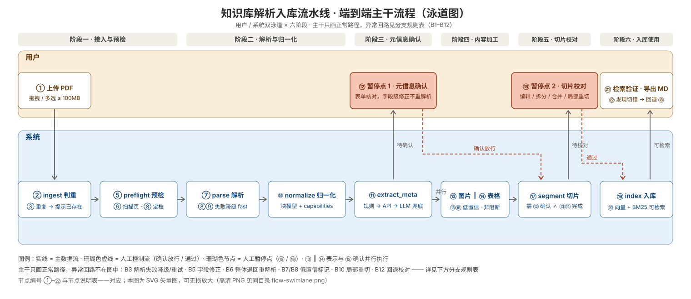

# PRD：知识库解析入库流水线 v3

| 项    | 内容                             |
| ---- | ------------------------------ |
| 文档编号 | PRD-KB-003                     |
| 版本   | v3.2                           |
| 状态   | 评审修订稿（外部审查 5 项 P0 / 8 项 P1 问题已全部关闭） |
| 创建日期 | 2026-09-30                     |
| 替代版本 | PRD-KB-002 v2.0                |
| 配套设计 | DES-KB-003《文档处理流水线 Step 化改造方案》 |
| 适用范围 | 知识库服务的「文档解析入库」全流程，从上传到入库索引     |
| 不在范围 | 检索调优、问答生成、知识库 CRUD、多用户与权限      |

### 变更记录

| 版本       | 日期         | 变更摘要                                                                                                                                             |
| -------- | ---------- | ------------------------------------------------------------------------------------------------------------------------------------------------ |
| v1.0     | 2026-09-29 | 首版。pypdf 按页抽文本 → 直接切片 → 直接入 Chroma。三段直通，无校验。                                                                                                     |
| v2.0     | 2026-09-30 | 人工校对从「解析后」后移到「切片后」；解析产物改为带页码/坐标的结构化对象；切片改为按章节 + 父子块；新增元信息确认与质量标记。                                                                                |
| **v3.0** | 2026-09-30 | **流水线 Step 化**：单文档处理拆成 9 个可独立执行、产物可寻址可复用的步骤；**引入 MinerU** 作为主解析引擎并设计环境隔离与档位降级；**明确 LLM 四个触点的调用时机与作用范围**；**新增图片与表格的专门处理机制**；文档状态由步骤状态派生，不再手工维护两套。 |
| **v3.1** | 2026-09-30 | 关闭全部未决问题（见 §13.2）。**关键变更**：① 新增**专用 OCR** 需求（语料含扫描件），FR-2.9/2.13/2.14/2.15；② 移除 PMC/JATS XML 路径，全部文献按 PDF 走 MinerU；③ 明确 **MinerU 跑在本机 CPU**，据此重定 NFR-1 性能指标；④ 新增**中文期刊支持**要求；⑤ **Markdown 导出**由 P1 提为 P0；⑥ 图片描述语言定为**中文但保留英文术语**；⑦ Python 环境策略改为**统一版本**；⑧ 确认 v1/v2 数据**不保留**，无需迁移；⑨ **补充端到端业务流程图（§6.5）**，按 **6 阶段 22 节点**展开，含 2 个人工暂停点、12 条分支规则、4 点分支设计意图。 |
| **v3.2** | 2026-09-30 | **按外部审查报告修订**（P0×5 / P1×8 / P2×14）：① G8/D5 调用次数制 → **预算制**（FR-10.5 提级 P0，§5.10 新增成本模型）；② 新增 **DEC-10**（VLM 走云 API、仅上传图表裁切图），NFR-10 分口径改写；③ §6.1/§6.5 统一为**并行方案**（5/6/7 与暂停点 1 并行、17 汇合），§6.2 派生规则修正；④ `ParseArtifact` 新增 **capabilities 掩码** + FR-4.9/FR-5.11 降级短路 + 验收豁免；⑤ NFR-1 改**基准后承诺**，P2 增设**选型闸门**与性能基准任务；⑥ 新增 FR-1.13 编辑存续语义、FR-1.14/1.15 队列与取消、FR-10.10 L4 开关条件、FR-9.6 embedding 中文与版本化、场景 5 批量快速通道、D14 中文检索；⑦ FR-7.14 导出重建机制、FR-2.14 混合语言、FR-4.1 配对优先级、FR-9.2 分词、FR-6.2 中英分档；⑧ FR-3.6/3.7 提级 P0；⑨ 清理 JATS/high 残留（§6.1/§7.1/§7.2）；⑩ §9 补 7 个接口；⑪ 新增 §14.4 阈值集中配置表（NFR-13）；⑫ B4 分级、B5 分层、D10 样本量 20→10、里程碑验收口径声明；⑬ §6.5 流程图**重制为泳道式主干图**（`assets/flow-swimlane.svg` 矢量 + 2× PNG，只画正常路径），异常回路改由分支规则表承载。 |

---

## 1. 背景与问题

### 1.1 v2 之后的现状

v2 定义了正确的流程骨架（两个人工暂停点、结构化产物、章节切分），但落地形态仍是**单一函数顺序执行**：

```python
def process_document(doc_id):
    parse() → split() → embed()   # 一个函数，中间结果只在内存
```

### 1.2 v2 未解决的五类问题

| #  | 问题          | 具体表现                      | v3 对应需求        |
| -- | ----------- | ------------------------- | -------------- |
| P1 | **不可分步执行**  | 只改了切片参数，也必须从解析重跑          | FR-1.1~1.3     |
| P2 | **中间结果被丢弃** | 解析产物随函数结束消失，无法复用、对比、排查    | FR-1.2、FR-1.6  |
| P3 | **无产物版本**   | 换引擎后旧结果无法保留做对比；出问题无法复现    | FR-1.7、FR-1.10 |
| P4 | **解析质量触顶**  | pypdf 只能抽文字层，双栏论文/表格/公式全丢 | FR-2.1~2.6     |
| P5 | **无多模态处理**  | 图片完全无机制；表格被拍平成文本行         | FR-4.x、FR-5.x  |

### 1.3 为什么要做 Step 化

参照对象是 LlamaCloud / LlamaParse。从官方文档可确认其设计本质：

> "One API key, one SDK, and six composable products: Parse, Extract, Classify, Split, Sheets, and Index."

> "Chain them (Split, then Extract) or use one on its own."

**它的价值不在 OCR 模型，而在"以产物为中心的步骤编排"**。每个步骤产出可寻址、可复用、带版本信息的产物，下游直接引用；文件本身（`file_id`）与处理任务分离。

这套骨架能一次性解决 P1/P2/P3，也是引入 MinerU 与 LLM 增强的前提——因为换引擎、加 LLM 触点都会让"单函数"变得更不可维护。

---

## 2. 目标与非目标

### 2.1 产品目标

| #      | 目标                       | 衡量方式                          |
| ------ | ------------------------ | ----------------------------- |
| G1     | 解析质量可被人工核验，错误不再静默入库      | 每篇文档入库前必经元信息确认 + 切片校对         |
| G2     | 每个切片可 100% 溯源到原文页码       | 随机抽 50 个切片，页码准确率 100%         |
| G3     | 切片结构对齐论文语义结构             | 章节路径元数据齐全率 ≥ 95%              |
| G4     | 论文级元信息可用于检索过滤            | 关键字段（标题/年份/DOI/期刊/研究类型）**抽取完整率** ≥ 90%（完整 = 字段有值；抽对与否由 B3 考核） |
| G5     | 人工校对成本可控                 | 单篇 20 页论文校准时耗：图表 ≤ 2 个 ≤ 3 分钟；图表 > 5 个 ≤ 5 分钟（分级口径，防图表丰富的论文不可达） |
| **G6** | **任一步骤可单独重跑，改切片参数不必重解析** | 日志可见上游步骤被跳过                   |
| **G7** | **图片与表格内容可被检索**          | 针对图表内容提问 top-5 命中 ≥ 70%       |
| **G8** | **LLM 调用成本可控且可追溯**       | **预算制**：单篇调用预算上限可配（FR-10.5），超限按 L4→L3→L2 顺序跳过非必需触点并告警；预算内每次调用可查、100% 可追溯（D5/D6） |

### 2.2 成功指标

一句话：**导入一篇医学论文，机器处理质量可被人在 3 分钟内核验完毕；其中任何一步出错，可以只重跑那一步而不影响其他。**

### 2.3 非目标（本期明确不做）

- ❌ 多用户、权限、租户隔离
- ❌ 多模态 embedding（CLIP / ColPali 类图像向量检索）—— 但图片文件与描述必须保留，为将来留口
- ❌ RAPTOR 层级摘要索引
- ❌ Late Chunking（有学术争议，列 v4 实验项）
- ❌ 检索结果重排序（rerank）—— 属于检索层
- ❌ **PMC / JATS XML 优先路径** —— 已决策：全部文献按 PDF 走 MinerU，不做 XML 优先。因此**不需要** PMC 查询、ID Converter、JATS 解析等一整套逻辑（见 §13.2 DEC-2）
- ❌ **`high` 档（MinerU vlm-engine）** —— 需 8GB+ 显存，本机 CPU 环境不可用，本期不实现（见 §13.2 DEC-3）

> 注：v3.0 曾把「扫描件专用 OCR」列为非目标。v3.1 已确认语料含扫描件，**该能力已移入范围**，见 FR-2.9 / FR-2.13 / FR-2.14 / FR-2.15。

---

## 3. 用户与场景

**用户**：单一人（奶爸），非专业数据工程师。医学文献来自 PubMed/PMC，单篇 10–40 页，中英混合。

### 场景 1：导入一篇新论文

> 拖进知识库 → 看到步骤条逐步变绿 → 核对标题/年份/期刊 → 确认 → 切片完成，扫一眼红色和蓝色的标记 → 改掉两处切错的 → 通过并入库 → 去检索测试确认能命中。

### 场景 2：怀疑某篇论文检索不到

> 问「水解配方的转奶周期」，答案里没有那篇明明讲过的论文 → 打开切片页 → 发现相关段落被切进"参考文献"块 → 手动调整 → **只重跑 segment + index**（日志显示 parse 被跳过）→ 重新检索命中。

**这条场景是 v3 相对 v2 的新增价值**：v2 要整体重跑。

### 场景 3：想换解析引擎看效果

> 听说 MinerU 对双栏论文更好 → 对同一篇文档跑一次 MinerU 解析 → 在同一页并排对比 pypdf 与 MinerU 的产物（块数、表格、图片）→ 满意后把 MinerU 结果设为 current → **只跑下游步骤**。

### 场景 4：图表里的数字检索不到

> 问「三种配方在第 12 周的耐受率」，答案只有正文里的部分 → 打开图片列表，发现图 3 的描述是"柱状图显示了三种配方的对比"（太泛）→ 手动改写描述，补上具体数值 → 重跑 index → 再问命中。

### 场景 5：批量导入一批低重要性文献（v3.2 新增）

> 一次拖入 10 篇背景阅读材料 → 不想点 20 次确认 → 对该批次开启**快速模式**（批次级临时关闭两个人工暂停点，自动通过并留痕，FR-3.5/FR-7.11）→ 处理完成后在"待抽查"清单集中浏览质量摘要 → 只对 2 篇有红色标记的做完整校对。

---

## 4. 核心设计决策

### D1 人工校对环节放在切片之后（沿用 v2）

`解析 → 元信息确认 → 切片 → **切片校对** → 入库`

**理由**：Markdown/纯文本是有损表示，表格结构、公式、双栏阅读顺序在校验所依赖的坐标丢失后无法再验证。业界成熟做法是在切片结果上校对并支持回跳原文。

### D2 解析产物的 canonical 形态是带坐标的结构化对象（沿用 v2）

主存储为 `NormalizedDoc`（章节树 + 块列表，每块带 `page`、`bbox`、`type`）；Markdown 由它派生，仅供人工快速通读。

### D3 一级切分按章节，页码降级为元数据（沿用 v2）

### D4 元信息在切片前确认（沿用 v2）

元信息要冗余进每一个切片用于过滤，必须在切片前定稿。

### D5 用质量标记替代逐块人工检查（沿用 v2）

系统计算质量特征并打标，界面默认只高亮异常项。

### D6 ~~有 PMC 标识的文献优先走 JATS XML~~（v3.1 已废弃）

**v3.1 决策：不做。** 全部文献按 PDF 走 MinerU，不引入 PMC 查询、ID Converter 与 JATS 解析（见 §13.2 DEC-2）。

理由：语料以 PDF 形式获取，引入第二条解析路径会显著增加实现与维护成本；且 MinerU 已能覆盖章节、表格、公式、图片等结构化需求。若将来发现某批文献有高比例 PMCID，再作为独立需求评估。

> 这条从"沿用 v2 的捷径"变成了"明确不做"，是 v3.1 相对 v3.0 的范围缩减项。

### D7【新】以步骤为中心：每步独立可跑，产物可寻址、可复用、可对比

**决策**：把单文档处理拆成 9 个步骤，每步是 `输入产物 → 输出产物` 的独立单元。产物落盘为带 `run_id` 的目录，`run_id` 包含引擎版本与参数 hash。

**理由**：

- 让"改切片参数不必重解析"成为可能（G6）
- 让"同一文档并存多套解析结果做对比"成为可能（场景 3）
- 让"出问题能定位到具体哪一步"成为可能（可排查性）
- 是引入 MinerU 和 LLM 触点后的**唯一可维护形态**——否则单函数会膨胀到无法调试

**取舍**：复杂度上升（状态组合变多），用 D10 的状态派生规则来收敛。

### D8【新】LLM 是兜底与增强，不是主路径

**决策**：主路径靠专用模型（MinerU 的版面/OCR/表格/公式模型）+ 确定性规则。LLM 只在三类情况介入：① 规则抽不出 ② 需要语义判断 ③ 需要跨模态理解。

**每个 LLM 触点必须定义"不调用的条件"**，且必须存在确定性替代路径时优先走确定性路径。

**理由**：成本可控、结果可解释、失败可降级。反例是把 LLM 放在主路径上——成本不可预测，且出错时无法判断是模型问题还是数据问题。

### D9【新】多媒体内容"检索文本"与"存储结构"分离

**决策**：表格同时保存**文本化版本**（用于 embedding / BM25）与 **HTML 结构**（用于存储与展示）；图片保存**题注 + VLM 描述 + 关键数据**作为检索文本，图像文件另行保留。

**理由**：纯 HTML 进 embedding，模型看到一堆标签，检索效果差；纯文本化又丢失合并单元格与多级表头。两者都要，各司其职。

### D10【新】文档状态由步骤状态派生，不手工维护

**决策**：不再单独维护一套文档状态机。文档状态是 9 个步骤状态的函数（见 §6.2）。

**理由**：v2 的状态机与步骤存在映射关系，两套并行会导致不一致（比如文档显示"处理中"但所有步骤都已完成）。派生规则让状态天然一致。

---

## 5. 功能需求

优先级：**P0 = 本期必须**，**P1 = 本期应做**，**P2 = 可延后**。

### 5.1 步骤执行模型（v3 新增，核心）

| ID      | 需求                                            | 优先级 | 验收标准                                             |
| ------- | --------------------------------------------- | --- | ------------------------------------------------ |
| FR-1.1  | 单文档处理拆为 9 个步骤，每步可**单独执行**                     | P0  | 可指定只跑某一步并成功产出                                    |
| FR-1.2  | 每步产出**可寻址的产物**，路径含 `run_id`                   | P0  | 产物路径含引擎版本与参数 hash                                |
| FR-1.3  | 产物可被下游步骤**直接引用**，不需重新计算                       | P0  | 下游读取产物文件而非重新执行上游                                 |
| FR-1.4  | 同参数**重复执行命中缓存**                               | P0  | 缓存命中耗时 < 1 秒（读文件 + hash 校验，不按百分比计）                                  |
| FR-1.5  | 提供 `force` 参数绕过缓存强制重跑                         | P0  | 对应 LlamaCloud 的 disableCache                     |
| FR-1.6  | **原始产物（`raw/`）原样保留，不加工不删除**                   | P0  | 删除归一化产物后可仅凭 `raw/` 重生成                           |
| FR-1.7  | manifest 记录执行事实：引擎版本、**各子模型版本**、参数 hash、耗时、统计 | P0  | 三者齐全，"可复现"成立                                     |
| FR-1.8  | 某步重跑时，**下游标记为 stale**，产物文件不自动删除               | P0  | 标记正确，产物仍在                                        |
| FR-1.9  | 支持**从任意步骤续跑**到指定终点                            | P0  | 可指定 `until` 参数                                   |
| FR-1.10 | 每步的**历史执行记录可查可比对**                            | P1  | 可查看同一文档同一步的多次 run                                |
| FR-1.11 | 机器产物与**人工编辑产物并存不覆盖**                          | P0  | `chunks.json` 与 `chunks.edited.json` 同时存在且可 diff |
| FR-1.12 | 提供"作废某步及下游"的操作入口                              | P1  | 作废后可重新执行                                         |
| FR-1.13 | **人工编辑存续语义（v3.2）**：切片/图片/表格的人工编辑以"基于机器产物的 diff"落库，记录所基于机器产物的内容 hash；重切产生新 ChunkSet 后旧编辑默认失效，界面按内容相似度列出**可找回的旧编辑**供一键迁移；index 优先读编辑版产物 | P0  | 重切后旧编辑不静默丢失，可找回并迁移                  |
| FR-1.14 | **后台任务队列（v3.2）**：解析与加工全部走后台任务，单 worker 串行执行（CPU 密集不并行），界面显示队列位置与预估等待 | P0  | 批量上传 10 篇时排队顺序可见、可预期                    |
| FR-1.15 | **任务可取消（v3.2）**：排队中与执行中的任务均可取消；执行中的在当前步骤边界安全中止，已完成步骤产物保留 | P1  | 取消后无半成品产物被下游引用                            |

### 5.2 上传与解析

| ID      | 需求                                                                                          | 优先级 | 验收标准                                  |
| ------- | ------------------------------------------------------------------------------------------- | --- | ------------------------------------- |
| FR-2.1  | 支持拖拽/多选上传 PDF，单文件 ≤ 100MB                                                                   | P0  | 已有实现，保持                               |
| FR-2.2  | 上传时按内容哈希判重，重复文件不重复入库                                                                        | P1  | 二次上传提示"已存在"，可选择覆盖                     |
| FR-2.3  | **接入 MinerU 作为主解析引擎**                                                                       | P0  | 解析产物含章节、表格 HTML、图片裁切、公式 LaTeX、页码、bbox |
| FR-2.4  | 解析引擎抽象为 `ParseEngine` 接口，可替换                                                                | P0  | 至少实现 MinerU 与 pypdf 两个引擎              |
| FR-2.5  | ~~识别到 DOI/PMID 且 PMC 有全文时优先取 JATS XML~~ **本期不做**（已决策：全部文献按 PDF 走 MinerU）                     | —   | 移出范围，见 §13.2 DEC-2。相应地**不需要** PMC 查询与 ID Converter |
| FR-2.6  | 支持**解析档位**：`fast`(pypdf) / `standard`(MinerU pipeline，含 OCR) / `high`(MinerU vlm-engine，需 GPU) / `auto` | P0  | 可从界面选择；`auto` 依据预检结果决定。**本机 CPU 环境下 `high` 不可用，`auto` 只在 fast / standard 间选择** |
| FR-2.7  | MinerU 不可用时**自动降级**到 fast，并打标 `degraded=true`                                               | P0  | 文档列表显示实际档位，**并提示"降级文档的图片/表格机制不可用"**；验收豁免见 §11.1 附注                     |
| FR-2.8  | 自动剔除页眉/页脚/水印/孤立页码                                                                           | P0  | 抽 20 篇验证，残留率 < 5%                     |
| FR-2.9  | **扫描页判定与路由**：预检阶段逐页判定是否为扫描页（无文字层或文字层质量低于阈值），路由到含 OCR 的解析档位                                       | P0  | 抽 20 篇含扫描件的文献，扫描页被正确识别并走 OCR            |
| FR-2.10 | 解析失败保留明确的失败原因与失败页，可单独重试                                                                     | P0  | 失败态可重跑 `parse`                        |
| FR-2.11 | **统一本地 Python 环境**：MinerU 与 kb 后端使用同一 Python 版本（3.12），消除版本不匹配                                   | P0  | 见 §13.1 R1 的取舍与退路说明                    |
| FR-2.12 | 解析产出的图片裁切、表格裁切截图保留                                                                          | P0  | 供图片机制与表格校对使用                          |
| FR-2.13 | **专用 OCR 能力**：对扫描页执行 OCR，产出带页码与位置的文本层，并回流到 `NormalizedDoc` 参与后续切片                                | P0  | 扫描页 OCR 后正文漏字率 ≤ 3%                  |
| FR-2.14 | **中文期刊支持**：OCR 使用中文模型；解析参数中文优先；切片与检索适配中文。**混合语言策略（v3.2）**：preflight 做逐页语言检测（`page_langs`），按页选择 OCR 模型（英文正文 + 中文摘要等混合文档不整篇套用中文模型）；无法可靠判定时接受降质并在产物 `warnings` 中标记                                                 | P0  | 中文期刊抽样，正文漏字率 ≤ 3%；章节识别准确率 ≥ 90%；中英混合样本（英文正文+中文摘要）双语页漏字率均 ≤ 3%|
| FR-2.15 | **OCR 引擎可替换**：抽象 `OcrEngine` 接口。MinerU 内置 OCR（PP-OCRv5）为默认实现，可替换为独立 OCR（如国内云 OCR）                | P1  | 更换引擎只改配置，不改业务代码                       |
| FR-2.16 | OCR 结果标注来源（`mineru_builtin` / `external`），便于排查与对比                                              | P1  | 产物中可见来源字段                            |


### 5.3 元信息确认

| ID     | 需求                                                           | 优先级 | 验收标准                  |
| ------ | ------------------------------------------------------------ | --- | --------------------- |
| FR-3.1 | 自动抽取并预填：标题、作者、年份、期刊、DOI、研究类型、摘要                              | P0  | 20 篇样本，标题与年份准确率 ≥ 80% |
| FR-3.2 | 表单呈现，人工只需核对与修正                                               | P0  | 单篇 ≤ 15 秒             |
| FR-3.3 | 必填字段：标题、年份。缺失不允许进入下一步                                        | P0  | 校验生效并有明确提示            |
| FR-3.4 | 支持多篇批量确认                                                     | P1  | 用于低风险文档               |
| FR-3.5 | 配置项 `require_meta_review`（默认 true）；**批次级临时覆盖（v3.2）**：批量导入可对一批文档临时关闭，自动通过并留痕，事后经"待抽查"清单回看（见场景 5）                           | P1  | 关闭时自动流转，元信息仍抽取落库      |
| FR-3.6 | 有 DOI 时调 Crossref/OpenAlex 补全规范化元信息（**不消耗 LLM**；**v3.2 提级 P0**——D8 要求 L1 兜底前确定性路径必须可用，否则 FR-3.8 高频触发冲击 G8 预算）             | P0  | 补全失败不影响主流程            |
| FR-3.7 | 有 PMID 时调 PubMed E-utilities 补全 MeSH、结构化摘要、研究类型（**不消耗 LLM**；提级理由同 FR-3.6） | P0  | 结果落库并可用于过滤            |
| FR-3.8 | 前序全部失败且缺必填字段时，**才调用 LLM 兜底**                                 | P0  | 见 FR-8.7              |
| FR-3.9 | 元信息抽取结果必须带 `confidence` 与 `evidence`（原文片段）                   | P0  | 置信度 < 0.6 时界面标黄       |

### 5.4 图片处理（v3 新增）

| ID     | 需求                                                                                                    | 优先级 | 验收标准                    |
| ------ | ----------------------------------------------------------------------------------------------------- | --- | ----------------------- |
| FR-4.1 | **图与题注配对（v3.2 调整优先级）**：① 优先用 MinerU 细分类别（`ImageBody`/`ImageCaption`）+ 阅读顺序邻接；② bbox 几何规则兜底（同页垂直距离 < 8% 页高且水平重叠 > 50% / 题注在上方则反向 / 跨页连续）；③ 配不上标 `caption_missing` 仍保留 | P0  | 抽 30 张图，配对准确率 ≥ 90%     |
| FR-4.2 | **过滤无信息量图**：面积 < 3% 页、宽高比 > 8 或 < 1/8、与文字区重叠 > 60%、图像方差过低、公式截图误判                                      | P0  | 过滤原因记录，界面可查看被过滤项        |
| FR-4.3 | **图类型分类**：数据图表 / 流程图 / 示意图 / 显微图 / 照片 / 表格式图 / 其他                                                     | P1  | 分类结果可人工纠正               |
| FR-4.4 | **按图类型生成可检索描述**（VLM）。数据图表须列出数据点与趋势；流程图须列出节点与流向；显微图须描述标注与倍数。**描述语言为中文，但关键术语保留英文原词**（如 `exclusive enteral nutrition (EEN)`、`CMPA`），确保中文提问与英文术语查询都能命中 | P0  | 图表内容提问 top-5 命中 ≥ 70%（中文查询 5 个 + 英文术语查询 5 个各测） |
| FR-4.5 | 落库为独立切片：`content_type=figure`，`text = 题注 + 描述 + 关键数据`                                                 | P0  | 针对图表内容提问 top-5 命中 ≥ 70% |
| FR-4.6 | 图片文件与裁切图保留，为多模态 embedding 留口                                                                          | P1  | 文件存在且可访问                |
| FR-4.7 | 图片描述可人工**采纳 / 驳回 / 改写**，状态落库                                                                          | P0  | 驳回后重跑不再生成同一条            |
| FR-4.8 | 描述与题注**分字段存储**（避免 VLM 幻觉污染原文）                                                                         | P0  | 数据模型中字段分离               |
| FR-4.9 | **能力降级短路（v3.2）**：`ParseArtifact.capabilities.figure=false`（如 fast 档产物）时，`annotate_figures` 直接产出空集并标记 `skipped_no_capability`，不报错不空转 | P0  | 降级文档全流程走通；图片清单页显示"解析档位不支持" |

### 5.5 表格处理（v3 新增）

| ID      | 需求                                                        | 优先级 | 验收标准                 |
| ------- | --------------------------------------------------------- | --- | -------------------- |
| FR-5.1  | **三级级联**：优先解析 MinerU 的 HTML → 结构校验 → 才调 VLM 修复            | P0  | HTML 直接可用率 ≥ 80%     |
| FR-5.2  | 结构校验项：列数一致性 / 表头是否识别 / 单元格数是否匹配 / 是否有超长异常单元格              | P0  | 校验不通过才进第三级           |
| FR-5.3  | 表格结构保留**合并单元格与多级表头**（HTML 存储）                             | P0  | 抽 20 张表，结构完整 ≥ 18 张  |
| FR-5.4  | **检索文本与存储结构分离**：embedding 用文本化版本（题注 + 表头 + 行列配对），存储用 HTML | P0  | 两者同时存在且都可访问          |
| FR-5.5  | **表格整块保留**，不参与普通切分                                        | P0  | `content_type=table` |
| FR-5.6  | 超长表（> 60 行或 > 3000 字）**垂直切分，每片重复表头**                      | P1  | 切分后每片可独立理解           |
| FR-5.7  | VLM 修复结果带 `confidence`，< 0.7 时界面标红要求人工确认                  | P0  | 标红可见                 |
| FR-5.8  | 表格清单页可**对照原表裁切截图**校核                                      | P1  | 双栏对照可见               |
| FR-5.9  | 表注（TableFootnote）与题注（TableCaption）单独提取并保留                 | P1  | 字段分离                 |
| FR-5.10 | 表格结构化结果可人工修正，状态落库                                         | P0  | 修正后重跑不被覆盖            |
| FR-5.11 | **能力降级短路（v3.2）**：`capabilities.table=false` 时，`repair_tables` 直接产出空集并标记 `skipped_no_capability` | P0  | 同 FR-4.9，表格清单页显示"解析档位不支持" |

### 5.6 切片生成

| ID     | 需求                                    | 优先级 | 验收标准                              |
| ------ | ------------------------------------- | --- | --------------------------------- |
| FR-6.1 | 一级切分按章节标题层级                           | P0  | 每片带 `section_path`                |
| FR-6.2 | 二级切分生成父子块                             | P1  | 子块中文 300–500 字 / 英文 200–350 词；父块中文 1500–2500 字 / 英文 1000–1700 词（中英分档，等价信息量口径）       |
| FR-6.3 | 摘要独立成块，不二次切分                          | P0  | `content_type=abstract`           |
| FR-6.4 | 参考文献独立成段，默认 `excluded_from_retrieval` | P0  | 默认不参与检索，界面可一键打开                   |
| FR-6.5 | 公式与所在段落绑定，保留 LaTeX 原文                 | P1  | 不单独成块导致语义割裂                       |
| FR-6.6 | 页眉页脚残留块自动标记                           | P1  | 见 §8.7                            |
| FR-6.7 | 支持按文档调整切片参数并触发重新切片                    | P0  | **只重跑 segment + index，不重跑 parse** |
| FR-6.8 | 元信息、图片描述、表格结构**写入切片元数据**              | P0  | 切片可携带图表信息用于检索                     |

### 5.7 切片校对（核心）

| ID      | 需求                                  | 优先级 | 验收标准                    |
| ------- | ----------------------------------- | --- | ----------------------- |
| FR-7.1  | 切片列表展示：序号、章节路径、页码、字数、内容类型、质量标记      | P0  | 信息齐全，可排序筛选              |
| FR-7.2  | **点击任一切片，原 PDF 预览跳到对应页并高亮该块区域**     | P0  | 有 bbox 画框；无 bbox 至少跳页定位 |
| FR-7.3  | 切片内容可编辑                             | P0  | 编辑落库，重新入库生效             |
| FR-7.4  | 支持拆分 / 与上下块合并                       | P0  | 操作后章节路径与页码继承正确          |
| FR-7.5  | 支持禁用单个切片（保留但不参与检索）                  | P0  | 禁用态不可召回                 |
| FR-7.6  | 支持删除单个切片                            | P1  | 二次确认                    |
| FR-7.7  | 支持挂关键词 / 关联问题 / 标签                  | P1  | 关键词影响检索权重               |
| FR-7.8  | 支持对单个章节**重新切片**（不影响其他章节）            | P1  | 局部重切不触发全文重建             |
| FR-7.9  | 顶部显示质量摘要：异常 N 块 / 共 M 块             | P0  | 异常为 0 时突出"可直接通过"        |
| FR-7.10 | 提供"一键全部通过"                          | P0  | 有红色标记时需二次确认             |
| FR-7.11 | `require_chunk_review` 配置项（默认 true） | P1  | 关闭时无红色标记则自动通过，且留痕       |
| FR-7.12 | 支持"退回重新解析"                          | P1  | 回到 parse 之前，保留已确认元信息    |
| FR-7.13 | 校对页可查看**图表切片的描述与结构化结果**             | P0  | 见 FR-4.7、FR-5.8         |
| FR-7.14 | **Markdown 导出**：可导出单篇文档的 Markdown（含表格 HTML、公式 LaTeX、图片引用），供外部工具直接消费。**导出的是人工校对后的版本**。**重建机制（v3.2）**：以 `NormalizedDoc` 线性结构为骨架，按序应用三类人工 patch（切片编辑 / 图片描述与过滤 / 表格修正）；被过滤图片不导出；`excluded_from_retrieval` 的参考文献**默认仍导出**（导出是完整文档视角，与检索排除解耦）；图片拷贝至导出目录 `assets/` 并用相对路径引用 | P0  | 导出为 `doc.md + assets/` 目录结构，外部 Markdown 工具可离线渲染，表格与公式结构不丢（D13） |
| FR-7.15 | 支持按章节范围导出（整篇 / 选定章节） | P1  | 可选章节导出 |

### 5.8 检索验证

| ID     | 需求                    | 优先级 | 验收标准       |
| ------ | --------------------- | --- | ---------- |
| FR-8.1 | 入库前提供检索测试：输入问题看命中哪些切片 | P0  | 已有实现，保持    |
| FR-8.2 | 支持限定"本文档"范围           | P1  | 便于单篇调优     |
| FR-8.3 | 命中结果可直接跳转到切片校对页并定位    | P1  | 发现切错能立刻改   |
| FR-8.4 | 检索测试可切换"是否包含图表切片"     | P1  | 便于验证图表机制效果 |

### 5.9 入库

| ID     | 需求                               | 优先级 | 验收标准          |
| ------ | -------------------------------- | --- | ------------- |
| FR-9.1 | 入库写入向量 + 全文索引 + 切片元数据            | P0  | 三者一致          |
| FR-9.2 | 支持 BM25 混合检索；**中文须先分词**（v3.2：jieba 或等价分词器，词典可追加医学术语）                     | P1  | 缩写与专有名词召回提升；中文短语查询可命中（D14） |
| FR-9.3 | 支持元数据过滤检索（年份、期刊、研究类型）            | P2  | 过滤在检索层执行      |
| FR-9.4 | 入库后支持回到 `reviewing` 重新校对         | P0  | 回退后重新入库向量正确覆盖 |
| FR-9.5 | 删除文档时级联清除向量、切片、全文索引**与该文档的产物目录** | P0  | 无残留           |
| FR-9.6 | **embedding 模型须具备中文能力（v3.2）**（中英混合语料）；模型名与版本纳入 `index` 步骤的 run_id 与 manifest；更换 embedding 模型触发全量重嵌入 | P0  | manifest 中 index 步骤可见 embedding 模型版本；换模型后新旧向量不混用 |

### 5.10 LLM 调用管理（v3 新增）


| ID      | 需求                                                              | 优先级 | 验收标准                |
| ------- | --------------------------------------------------------------- | --- | ------------------- |
| FR-10.1 | **每个 LLM 调用记录** provider、model、prompt_version、调用时间、输入输出 token 数 | P0  | 每次调用可查              |
| FR-10.2 | 所有 LLM 输出必须带 `confidence`（**自报 + 规则校验融合**，v3.2：如图片描述中的数值须与 `key_data` 一致，不一致自动下调并标黄）                                       | P0  | 字段存在且落入产物；融合校验规则可配置 |
| FR-10.3 | 所有 LLM 输出必须带 `review_state`（pending/accepted/rejected/edited）   | P0  | 人工可操作               |
| FR-10.4 | **驳回后重跑不再生成同一条**                                                | P0  | 重跑时跳过已 rejected 的条目 |
| FR-10.5 | 单文档 LLM 调用**预算上限可配**（次数与 token 双口径），超限按 L4→L3→L2 顺序跳过非必需触点（L1 兜底不跳）并告警。**v3.2 提级 P0**：本条是 G8 预算制的执行机制                              | P0  | 超限有明确提示；降级顺序正确 |
| FR-10.6 | 四个 LLM 触点（L1 元信息 / L2 图片 / L3 表格 / L4 上下文前缀）**可独立开关**           | P0  | 配置项可分别控制            |
| FR-10.7 | 存在确定性替代路径时**必须先走确定性路径**                                         | P0  | L1 必须先走规则与外部 API    |
| FR-10.8 | prompt 版本化落盘，可追溯到具体版本                                           | P1  | prompt 文件带版本号       |
| FR-10.9 | 统计并展示每篇文档的 LLM 成本                                               | P2  | 界面可见                |
| FR-10.10 | **L4（Contextual Retrieval）默认关闭（v3.2）**。开启条件：B5 检索验证命中率不达标时的调优手段（属检索调优，非主路径）；开启即改变 `segment` 参数 → `segment` + `index` 自动标 stale（见 §6.3） | P0  | 开关状态在 manifest 可查；开启后 stale 传播正确 |

**LLM 成本模型（v3.2 新增，G8 预算制的依据）**：

| 触点 | 调用次数 | 说明 |
| --- | --- | --- |
| L1 元信息兜底 | ≤ 1 次/篇 | 规则与外部 API 全部失败才触发（FR-3.8） |
| L2 图片描述 | = 图片数 × 1 | 20 页论文典型 4–8 张图 |
| L3 表格修复 | = 校验失败表数 × 1 | HTML 直接可用率 ≥ 80%（FR-5.1），通常 0–2 次 |
| L4 上下文前缀 | = 切片数 × 1 | 默认关闭（FR-10.10）；20 页 ≈ 20–40 次，仅检索调优时按篇开启 |

> 修订原因：v3.1 的"单篇 ≤ 3 次"与上表在数学上不可同时成立（仅图片描述就必然超过 3 次）。改为预算制后，G8 与 FR-4.4（P0）不再互锁。
>
> **VLM 部署位置**：L2/L3 使用**云 VLM API**（DEC-10），只上传图表裁切图，不上传整页或全文。

---

## 6. 流程与状态机

### 6.1 步骤依赖拓扑

```
1 ingest → 2 preflight → 3 parse → 4 normalize ─┬→ 5 extract_meta
                                                ├→ 6 annotate_figures
                                                ├→ 7 repair_tables
                                                └→ 8 segment → 9 index
```

步骤 5 / 6 / 7 互不依赖，**可并行执行**。v3.2 进一步明确：5/6/7 的机器执行与**暂停点 1 的人工元信息确认并行**——人在核对表单时机器在处理图表；`segment`（步骤 8）在"元信息已确认 **且** 5/6/7 全部完成"时才启动（见 §6.5）。

| # | Step               | 输入                               | 输出产物              | 引擎                        | LLM     |
| - | ------------------ | -------------------------------- | ----------------- | ------------------------- | ------- |
| 1 | `ingest`           | 上传文件                             | `FileObject`      | 本地                        | —       |
| 2 | `preflight`        | `FileObject`                     | `PreflightReport` | pypdf 抽样                  | —       |
| 3 | `parse`            | `FileObject` + `PreflightReport` | `ParseArtifact`   | **MinerU** / pypdf | —       |
| 4 | `normalize`        | `ParseArtifact`                  | `NormalizedDoc`   | 规则                        | —       |
| 5 | `extract_meta`     | `NormalizedDoc`                  | `DocumentMeta`    | 规则 + 外部 API               | ✅ L1    |
| 6 | `annotate_figures` | `NormalizedDoc.figures`          | `FigureNotes`     | 规则 + **VLM**              | ✅ L2    |
| 7 | `repair_tables`    | `NormalizedDoc.tables`           | `TableSet`        | 规则 + **VLM**              | ✅ L3    |
| 8 | `segment`          | `NormalizedDoc` + 5/6/7 产物       | `ChunkSet`        | 规则                        | ✅ L4 可选 |
| 9 | `index`            | `ChunkSet`                       | `IndexedDoc`      | 本地（**embedding 模型与版本纳入 run_id**，FR-9.6）                       | —       |

### 6.2 文档状态派生规则（D10）

文档状态**不手工维护**，由步骤状态派生：

| 条件（按优先级从上往下匹配）          | 文档状态       | 界面提示         |
| ----------------------- | ---------- | ------------ |
| 任一步骤 `failed`           | 失败         | 标出失败步骤，可单独重跑 |
| `extract_meta` 完成 ∧ 元信息未确认 ∧ 6/7 无 running | **待确认元信息** | 暂停点 1 |
| `extract_meta` 完成 ∧ 元信息未确认 ∧ 6/7 有 running | 处理中 | 显示图表处理进度，并提示**"元信息可先行确认"** |
| 其余任一步骤 `running`      | 处理中        | 显示当前步骤名与进度   |
| 停在 `segment` 完成         | **待校对切片**  | 暂停点 2        |
| 存在 `stale` 且无 running   | 待更新        | 提示哪些步骤需重跑    |
| 全部 `succeeded` 且无 stale | 已入库        | 可检索          |
| 用户手动置停用                 | 已停用        | —            |

### 6.3 失效传播与缓存

**失效规则**（重跑某步 → 下游标 `stale`，产物文件保留）：

```
invalidate(parse)            → normalize, meta, figures, tables, segment, index 全部 stale
invalidate(annotate_figures) → segment, index stale
invalidate(segment)          → index stale
```

**缓存规则**：执行前计算 key = `(step_id, 输入产物 hash, 参数 hash, 引擎版本)`，命中则复用产物并返回 `skipped_cached`。`force=true` 绕过。

**参数级失效（v3.2 补充）**：除"上游重跑"外，**步骤自身参数或环境变化**同样触发失效——embedding 模型更换 → 全部 `index` 产物标 stale（FR-9.6）；L4 开关切换 → `segment` + `index` 标 stale（FR-10.10）。缓存 key 已含参数 hash，参数变化天然不命中旧缓存；此处要求的是**显式标 stale 并在界面提示**，而非静默 miss。

### 6.4 两个人工暂停点（保留 v2 设计）

**暂停点 1 — 元信息确认**（`extract_meta` 完成后）  
为什么早于切片：元信息要冗余进每个切片用于过滤，切片后再改需全量重建。
**与机器并行（v3.2 明确）**：暂停不等于机器停转——`annotate_figures` / `repair_tables` 在确认期间继续执行，两路在 `segment` 前汇合。

**暂停点 2 — 切片校对**（`segment` 完成后）  
为什么晚于解析：只有切片出来才能判断"切得对不对"，且此前的错误已经在下游被放大到可见。

### 6.5 业务流程图（端到端）

下图是**用户视角**的端到端主干流程，采用**泳道式主干图**（v3.2 起替代原 Mermaid 全节点图）：按"用户 / 系统"双泳道 × 6 个阶段横向展开，**只画正常路径**；两个人工暂停点以珊瑚色突出，并行与人工控制流用虚线表达。异常与回路（B3–B8、B10、B12）**不进图**，统一由下方「节点说明表」与「分支规则表」承载——图表职责分离，避免"22 节点 × 12 分支挤一张图"导致的布局混乱。

- 图源文件：`assets/flow-swimlane.svg`（**SVG 矢量，可无损放大**）；高清位图 `assets/flow-swimlane.png`（2× 渲染，3040px 宽）
- 节点编号 ①–㉒ 与「节点说明表」一一对应
- **⑬ ∥ ⑭ 与暂停点 1 并行执行**；⑰ segment 需要"⑫ 确认 ∧ ⑬⑭ 完成"双前置（与 §6.1 拓扑一致）
- 步骤的内部依赖（9 个 Step 的拓扑）见 §6.1，此处不重复



**节点说明**

| # | 节点 | 角色 | 是否阻塞 | 产出 / 说明 |
| - | --- | --- | --- | --- |
| 1 | 用户上传 PDF 资料 | 用户 | — | `FileObject`；多选 / 拖拽 / 单文件 ≤ 100MB |
| 2 | ingest 登记与判重 | 系统 | — | 计算 `sha256`，作为去重与缓存键 |
| 3 | 是否重复？ | 系统 | — | 是 → 提示已存在（跳过或覆盖）后跳到 6 |
| 4 | preflight 预检 | 系统 | — | `PreflightReport`：页数 · 文字层质量 · 扫描页清单 · 预估耗时 |
| 5 | 是否含扫描页？ | 系统 | — | 是 → 标记 `need_ocr=true`，档位锁定 `standard`（`fast` 不含 OCR） |
| 6 | 确定解析档位 | 系统 | — | `auto` 按预检结果在 `fast` / `standard` 间选；本机无 GPU，`high` 不可用 |
| 7 | parse 解析 | 系统 | — | `ParseArtifact` + `raw/` 原始产物（版面 / OCR / 表格 / 公式 / 阅读顺序） |
| 8 | 解析是否成功？ | 系统 | — | 否 → 转 9 |
| 9 | 是否可降级？ | 系统 | — | 是 → 降 `fast` 并标 `degraded=true`（界面须显示实际档位）；否 → 标记失败，可人工重试或跳过 |
| 10 | normalize 归一化 | 系统 | — | `NormalizedDoc`：章节树 + 块列表（页码 + bbox + 类型） |
| 11 | extract_meta 抽取元信息 | 系统 | — | `DocumentMeta`，含每字段的来源 / 置信度 / 原文证据 |
| 12 | **元信息是否准确？** | **用户** | **是（暂停点 1）** | 准确 → **放行 17**（17 另需 13/14 完成）；个别字段错 → 表单内修正（**不重解析**）；整体不可用 → 退回 7。**13/14 自 11 完成即并行执行，人工确认不必等机器** |
| 13 | annotate_figures 图片理解 | 系统 | — | `FigureNotes`：配对 → 过滤 → 分类 → 中文描述 |
| 14 | repair_tables 表格处理 | 系统 | — | `TableSet`：MinerU HTML → 结构校验 → （不可用时）VLM 修复 |
| 15 | 描述置信度 ≥ 0.6？ | 系统 | — | **非阻断**：低于阈值只标记待核对，不拦截流程 |
| 16 | HTML 是否可用？ | 系统 | — | 否 → VLM 修复并给出置信度（< 0.7 界面标红） |
| 17 | segment 切片 | 系统 | — | `ChunkSet`：章节 + 父子块 + 摘要 / 参考文献 / 表格特殊处理。**前置（v3.2）：元信息已确认 ∧ 13/14 均完成，先到者等待** |
| 18 | **切片是否合格？** | **用户** | **是（暂停点 2）** | 合格 → 转 19；内容有问题 → 编辑 / 拆分 / 合并 / 禁用后回 18；边界切错 → 局部重切后回 17 |
| 19 | index 入库索引 | 系统 | — | 向量 + BM25 全文 + 元数据 |
| 20 | 已入库，可检索 | 系统 | — | 供检索测试、问答与元数据过滤使用 |
| 21 | 导出 Markdown | 用户 | — | 导出**校对后**版本，供外部工具消费 |
| 22 | 检索中发现切错？ | 用户 | — | 是 → 回退到 18 重新校对 |

> 说明：图中未编号的辅助节点（如「提示已存在」「降级为 fast」「标记待人工核对」「VLM 修复」）是某个决策的具体去向，已并入上表对应行的说明列，不单独编号。

**分支规则**

| 分支 | 触发条件（节点） | 去向 | 阻断性 | 说明 |
| --- | --- | --- | --- | --- |
| B1 文件重复 | 3 | 跳过或覆盖 → 6 | 非阻断 | 按 `sha256` 判定；覆盖会作废该文档全部下游产物 |
| B2 含扫描页 | 5 | 标记 `need_ocr` → 6 | 非阻断 | 决定解析档位必须为 `standard`，且直接影响耗时（见 R4） |
| B3 解析失败但可降级 | 8 → 9 | 降 `fast`，标 `degraded` → 10 | 非阻断 | **必须在界面显示实际档位**，否则用户会误以为用的是 MinerU 结果 |
| B4 解析失败且不可降级 | 8 → 9 | 标记失败，人工重试或跳过 | **阻断** | 记录失败页与原因；可只重跑 `parse`，不重跑前置步骤 |
| B5 元信息个别字段错误 | 12 | 表单内逐字段修正 → 12 | 非阻断 | **推荐路径**：不触发任何重算 |
| B6 元信息整体不可用 | 12 | 退回 7 重新解析 | **阻断** | **成本最高的回路**：作废下游全部产物（含并行中的 13/14，需先取消再作废）。改一个年份绝不应该走这条 |
| B7 图片描述置信度低 | 15 | 标记待人工核对 → 17 | 非阻断 | 不拦截流程，统一在暂停点 2 集中处理 |
| B8 表格 HTML 不可用 | 16 | VLM 修复 → 17 | 非阻断 | 置信度 < 0.7 界面标红；修复调用次数受 FR-10.5 预算上限约束 |
| B9 切片内容有问题 | 18 | 编辑 / 拆分 / 合并 / 禁用 → 18 | **阻断** | 不重切，只改内容；人工编辑产物与机器产物并存 |
| B10 切片边界切错 | 18 | 局部重切 → 17 | **阻断** | **只重跑 17 及其下游，不重跑解析**（FR-1.8 / FR-6.7）。这是本期核心价值 |
| B11 切片合格 | 18 | 进入 19 | — | 可开启 `require_chunk_review=false` 时按质量标记自动通过 |
| B12 已入库后需返工 | 22 | 回退到 18 重新校对 | 非阻断 | 重新入库时向量正确覆盖（FR-9.4） |

**分支设计的四点意图**

- **B6 要尽量避免**：它是唯一会作废解析结果的回路。所以把「逐字段修正」（B5）和「整体退回重解析」（B6）做成两个不同粒度的操作——改一个年份不该重跑几分钟的解析。这也是为什么 12 号节点必须区分这两种失败程度。
- **B10 是本期核心价值**：改切片参数只需重跑 `segment` + `index`。这是 G6 目标（"改切片参数不必重解析"）在业务层面的体现，也是 v3 相对 v2 最实质的改进。
- **B7 / B8 刻意做成非阻断**：图片描述置信度低、表格结构可疑，这类问题如果立刻打断流程，用户会被反复打断。设计成"只标记不拦截"，让人在暂停点 2 一次性看到所有可疑项，集中处理。
- **B12 保证可返工**：知识库不是一次性的，检索中发现切错要能立刻改回去，而不是删掉重传。
- **（v3.2）13/14 与暂停点 1 并行**：人工确认元信息的同时机器处理图表，两路在 17 汇合，人工等待时间与机器时间重叠，端到端时延最短；状态派生规则（§6.2）保证并行期间"待确认元信息"仍对用户可见。

---

## 7. 数据契约

### 7.1 `FileObject` / `PreflightReport`

```python
@dataclass
class FileObject:
    doc_id: str
    filename: str
    sha256: str              # 判重依据
    size_bytes: int
    stored_path: str
    mime: str

@dataclass
class PreflightReport:
    page_count: int
    has_text_layer: bool
    text_layer_quality: float   # 0-1，低于阈值判为扫描件
    empty_pages: list[int]
    suspected_scanned: bool
    recommended_tier: str       # fast | standard（high 本期不实现，DEC-3）
    has_doi: bool
    has_pmid: bool
    page_langs: dict[int, str]  # v3.2：逐页语言检测（zh/en/mixed），驱动按页选 OCR 模型（FR-2.14）
```

### 7.2 `ParseArtifact`（引擎统一输出契约）

所有引擎（MinerU / pypdf）都产出这个结构，`normalize` 只认它：

```python
@dataclass
class ParseArtifact:
    blocks: list[RawBlock]        # 阅读顺序，带 page + bbox + type
    markdown: str                 # 渲染视图
    images: list[RawImage]        # 裁切图 + page + bbox + 来源类目（可为空，见 capabilities）
    tables: list[RawTable]        # HTML 或裁切图路径（可为空，见 capabilities）
    capabilities: dict[str, bool] # v3.2：引擎能力掩码 {layout, table, figure, formula, ocr}
                                  # fast(pypdf) 产物仅部分能力可用，bbox/images/tables 允许为空
                                  # 下游按掩码短路（FR-4.9 / FR-5.11），禁止假设字段必填
    engine: str
    engine_version: str           # 实际跑到的版本
    model_versions: dict[str, str]  # 各子模型版本（layout/ocr/table/formula）
    params_hash: str
    raw_dir: Path                 # 原始产物目录，原样保留
    warnings: list[str]
```

`RawImage.category` / `RawTable.category` 保留 MinerU 的细分类别（`ImageBody` / `ImageCaption` / `TableBody` / `TableCaption` / `TableFootnote`），供 §5.4 的配对与 §5.5 的题注提取使用。

### 7.3 `NormalizedDoc` / `Block` / `Section`

沿用 v2.0 定义，`Block` 增加两个字段：

| 字段              | 类型            | 说明                                |
| --------------- | ------------- | --------------------------------- |
| `asset_ref`     | string | null | 指向裁切图或表格的产物内引用                    |
| `origin_engine` | string        | 来源引擎，便于排查"这块是 MinerU 还是 pypdf 给的" |

### 7.4 `DocumentMeta`

沿用 v2.0 定义，增加：

| 字段           | 类型             | 说明                                                  |
| ------------ | -------------- | --------------------------------------------------- |
| `source`     | enum           | `rule` / `crossref` / `pubmed` / `llm` —— 标明每个字段的来源 |
| `confidence` | float          | LLM 抽取时的置信度                                         |
| `evidence`   | dict[str, str] | 字段 → 原文片段，供人工核对                                     |

### 7.5 `FigureNote`（v3 新增）

```python
@dataclass
class FigureNote:
    figure_id: str
    page: int
    bbox: list[float]
    image_path: str
    caption_from_pdf: str | None      # 题注单独存，不与描述混合
    figure_type: str                  # data_chart | flowchart | ...
    description: str                  # VLM 生成的描述
    key_data: list[str]               # 数据图：数据点与趋势
    labels: list[str]                 # 图中标签、图例、坐标轴
    filtered: bool = False
    filtered_reason: str | None = None
    confidence: float = 0.0
    llm: dict | None = None           # 调用元信息
    review_state: str = "pending"     # pending | accepted | rejected | edited
```

### 7.6 `StructuredTable`（v3 新增）

```python
@dataclass
class TableCell:
    text: str
    row: int; col: int
    rowspan: int = 1; colspan: int = 1
    is_header: bool = False

@dataclass
class StructuredTable:
    table_id: str
    page: int
    bbox: list[float]
    caption: str | None            # 来自 TableCaption
    footnotes: list[str]           # 来自 TableFootnote
    header_rows: int
    cells: list[TableCell]
    n_rows: int; n_cols: int
    html: str                      # 存储用
    retrieval_text: str            # 检索用（文本化）
    parse_level: str               # mineru_html | llm_repaired | fallback
    confidence: float
    review_state: str = "pending"
    row_range: tuple[int, int] | None = None   # 超长表切分标记
```

### 7.7 `Chunk`

沿用 v2.0，增加：

| 字段          | 类型            | 说明           |
| ----------- | ------------- | ------------ |
| `figure_id` | string | null | 图表切片指向对应图    |
| `table_id`  | string | null | 表格切片指向对应表    |
| `assets`    | list[str]     | 关联的裁切图/截图表路径 |
| `derived_from` | list[str] \| null | v3.2：拆分/合并产生的派生块指向来源 chunk_id（FR-1.13 编辑迁移的匹配锚点） |

### 7.8 `manifest.json`

```jsonc
{
  "doc_id": "doc_xxx",
  "steps": {
    "parse": {
      "status": "succeeded",
      "current_run": "run__mineru-2.5__pipeline__a3f1",
      "runs": [{
        "run_id": "run__mineru-2.5__pipeline__a3f1",
        "engine": "mineru",
        "engine_version": "2.5.0",
        "backend": "pipeline",
        "model_versions": { "layout": "...", "ocr": "...", "table": "...", "formula": "..." },
        "params_hash": "a3f1",
        "params": { "effort": "medium", "lang": "ch" },
        "started_at": "...", "finished_at": "...",
        "duration_ms": 41230,
        "outputs": { "parsed": "03_parse/run__.../parsed.json" },
        "stats": { "pages": 20, "blocks": 214, "figures": 6, "tables": 4 },
        "cached": false
      }]
    }
  }
}
```

---

## 8. 交互与界面

### 8.1 页面清单

| 页面             | 说明                                | 优先级 |
| -------------- | --------------------------------- | --- |
| 文档列表           | 状态列、待校对筛选、**实际解析档位与 degraded 标记** | P0  |
| **流水线步骤视图**（新） | 9 个步骤横排，各自显示状态；失败可单独重跑            | P0  |
| 元信息确认页         | 表单形式，预填自动抽取结果，带来源与证据              | P0  |
| **图片清单页**（新）   | 图/题注/描述/被过滤项，可采纳驳回改写              | P1  |
| **表格清单页**（新）   | 结构化结果 + 原表截图对照，可修正                | P1  |
| 切片校对页          | 左原文 / 右切片双栏，核心界面                  | P0  |
| Markdown 预览页与导出 | 派生视图供快速通读；**支持导出 Markdown（校对后版本）供外部使用** | P0  |
| 检索测试页          | 已有，增加"限定本文档"与"含图表切片"开关            | P1  |

### 8.2 流水线步骤视图

```
论文标题  ·  档位 standard (MinerU 2.5)  ·  总耗时 68s   [重跑失败步骤]

① ingest ●  ② preflight ●  ③ parse ●  ④ normalize ●
⑤ extract_meta ●  ⑥ annotate_figures ◐ 62%  ⑦ repair_tables ○ 待执行
⑧ segment ○  ⑨ index ○
                                    ● 完成  ◐ 进行中  ○ 待执行  ⚠ 失败  ↻ stale
```

- 每个步骤可点击展开，查看产物（原始 JSON、统计、耗时、引擎版本）
- 失败的步骤标红并显示错误摘要，旁边直接给"重跑此步"
- stale 的步骤显示 ↻，提示"上游已变更，建议重跑"

### 8.3 元信息确认页

必须在表单上体现**字段来源**：`rule` / `crossref` / `pubmed` / `llm`。来自 `llm` 的字段额外显示置信度与证据片段，低于 0.6 标黄。

### 8.4 图片校对（P1）

每张图一行：缩略图 | 页码 | 题注（来自 PDF）| 描述（VLM）| 类型 | 置信度 | 操作（采纳/驳回/改写）。  
被过滤的图折叠在一个"已过滤"区域，附过滤原因，允许"恢复"（避免误杀）。

### 8.5 表格校对（P1）

左：原表裁切截图；右：结构化结果（渲染 HTML）。  
顶部显示 `parse_level`（`mineru_html` 直接可用 / `llm_repaired` 模型修复 / `fallback`）与置信度。  
置信度 < 0.7 或 `parse_level=fallback` 的表格默认展开并要求确认。

### 8.6 切片校对页

沿用 v2.0 的双栏布局（左原 PDF / 右切片列表），增加：

- 图表切片的卡片可展开查看图片描述与表格结构化结果（不必跳到别的页面）
- 支持按 `content_type` 筛选（只看表格 / 只看图片）

### 8.7 质量标记规则

沿用 v2.0 的 7 类标记，新增两类：

| 标记          | 触发条件                                              | 建议动作   |
| ----------- | ------------------------------------------------- | ------ |
| 🟤 图片描述置信度低 | `figure.confidence < 0.6`                         | 人工核对描述 |
| 🟤 表格结构可疑   | `table.confidence < 0.7` 或 `parse_level=fallback` | 对照原表核对 |

---

## 9. 接口

### 9.1 Step 级接口（v3 新增）

| 方法   | 路径                                                      | 用途                            |
| ---- | ------------------------------------------------------- | ----------------------------- |
| GET  | `/api/documents/{doc_id}/manifest`                      | 所有步骤的执行记录、状态、产物路径             |
| POST | `/api/documents/{doc_id}/steps/{step_id}/run`           | 单独跑某一步（可带 `params` / `force`） |
| GET  | `/api/documents/{doc_id}/steps/{step_id}/artifact`      | 取某步产物（可指定 `run_id`）           |
| GET  | `/api/documents/{doc_id}/steps/{step_id}/runs`          | 该步历史执行记录                      |
| POST | `/api/documents/{doc_id}/steps/{step_id}/invalidate`    | 作废该步及下游                       |
| POST | `/api/documents/{doc_id}/pipeline/run`                  | 从当前状态续跑到指定 `until` 步骤         |
| POST | `/api/documents/{doc_id}/pipeline/rerun-from/{step_id}` | 从某步重跑到底                       |
| POST | `/api/documents/{doc_id}/pipeline/cancel`               | v3.2：取消排队/执行中的任务（FR-1.15），在步骤边界安全中止 |

### 9.2 产物级接口

| 方法    | 路径                                              | 用途                                      |
| ----- | ----------------------------------------------- | --------------------------------------- |
| GET   | `/api/documents/{doc_id}/meta`                  | 元信息（含来源、置信度、证据）                         |
| PUT   | `/api/documents/{doc_id}/meta`                  | 提交确认（触发进入切片）                            |
| GET   | `/api/documents/{doc_id}/figures`               | 图片列表                                    |
| PATCH | `/api/figures/{figure_id}`                      | 采纳 / 驳回 / 改写描述                          |
| GET   | `/api/documents/{doc_id}/tables`                | 表格列表                                    |
| PATCH | `/api/tables/{table_id}`                        | 修正表格结构化结果                               |
| GET   | `/api/documents/{doc_id}/chunks`                | 切片列表（含质量标记）                             |
| PATCH | `/api/chunks/{chunk_id}`                        | 编辑切片                                    |
| POST  | `/api/chunks/{chunk_id}/split` / `/merge`       | 拆分 / 合并                                 |
| POST  | `/api/documents/{doc_id}/approve`               | 确认通过，进入入库                               |
| POST  | `/api/documents/{doc_id}/reject`                | 退回重新解析                                  |
| GET   | `/api/documents/{doc_id}/pages/{n}.png?dpi=200` | 页面渲染图，用于双栏对照                            |
| POST  | `/api/kbs/{kb_id}/retrieve`                     | 检索测试（增加 `doc_id` / `include_assets` 参数） |
| GET   | `/api/documents/{doc_id}/export/markdown`       | v3.2：导出校对后 Markdown（FR-7.14）；`?sections=` 支持按章节（FR-7.15） |
| DELETE | `/api/documents/{doc_id}`                     | v3.2：删除文档并级联清理（FR-9.5） |
| POST  | `/api/figures/{figure_id}/restore`             | v3.2：恢复被误过滤的图片（§8.4） |
| DELETE | `/api/chunks/{chunk_id}`                      | v3.2：删除切片（FR-7.6，二次确认） |
| POST  | `/api/documents/{doc_id}/steps/segment/run`    | v3.2：带 `section` 参数即章节级重切（FR-7.8） |
| POST  | `/api/documents/upload`                        | 上传（FR-2.1，已有实现沿用，v3.2 补录清单） |

---

## 10. 非功能需求

| ID     | 需求        | 指标                                                        |
| ------ | --------- | --------------------------------------------------------- |
| NFR-1  | 解析性能（本机 CPU） | **基准后承诺（v3.2 修订）**：`standard` 档指标以 P2 第一周 10 篇基准实测的 P50/P90 为准回填——MinerU pipeline 对每页都跑版面 + OCR 模型，"纯文本层"并不能跳过，原"≤ 3 分钟"的假设不成立（见 R4）；`fast` 档 ≤ 5 秒保留。**含扫描页时不做硬性承诺**——CPU 上逐页 OCR 可能单页数十秒，界面必须给出进度与预计剩余时间。基准报告须记录机型（Apple Silicon 具体型号），保证指标可复现。详见 §13.1 R4 |
| NFR-2  | 切片 + 索引性能 | 单篇 ≤ 30 秒                                                 |
| NFR-3  | **步骤级缓存** | 同参数重复执行命中缓存，耗时 < 首次 10%                                   |
| NFR-4  | 断点恢复      | 进程中断重启后已完成的步骤产物不丢失，可从当前步骤继续                               |
| NFR-5  | 幂等        | 同文件按哈希去重；重复入库不产生重复向量                                      |
| NFR-6  | 溯源        | 任意切片能定位到原文页码；有 bbox 时能定位到区域                               |
| NFR-7  | 可移植       | 解析引擎可替换，切换只改配置；产物格式与引擎解耦。v3.2 补充：**embedding 模型同理可替换**，更换即触发全量重嵌入（FR-9.6） |
| NFR-8  | **Python 环境** | 统一到 Python 3.12。优先尝试同一 venv；若与 llama-index 链路冲突，退为两个同为 3.12 的 venv。`MinerUClient` 保持 http / cli / cloud 三种模式可切换，使部署形态不绑死 |
| NFR-9  | 可观测       | 每篇文档记录各步骤耗时、引擎版本、模型版本、LLM 调用次数与成本                         |
| NFR-10 | 数据安全      | **元信息类外部 API**（Crossref/PubMed）只发 DOI/PMID，不上传全文；**VLM 触点**（云 API，DEC-10）允许上传图表**裁切图**（局部内容），不上传整页渲染图或全文 |
| NFR-11 | 许可合规      | MinerU 为 Apache-2.0 + 附加条款；对外提供在线服务须履行署名义务                |
| NFR-12 | 磁盘管理      | 提供产物保留策略：非 current run 超过 N 个后自动清理，`raw/` 除外              |
| NFR-13 | 阈值集中管理   | v3.2：全部阈值与常量（见 §14.4）收敛为单一配置文件，不在代码中散落，调参一处生效 |


## 11. 验收标准

### 11.1 解析质量

| #  | 指标           | 门槛    | 统计方式             |
| -- | ------------ | ----- | ---------------- |
| A1 | 标题层级识别准确率    | ≥ 95% | 20 篇 × 每篇前 10 个标题 |
| A2 | 表格结构还原准确率    | ≥ 90% | 抽 20 张表，结构完整 ≥ 18 张 |
| A3 | 正文漏字率        | ≤ 1%  | 抽 5 篇逐段比对；ground truth 与出版社 HTML 版或人工录入对照（标注工作量约 1 小时/篇） |
| A4 | 公式可编译率       | ≥ 90% | 抽 30 个公式尝试编译     |

> **降级豁免（v3.2）**：`degraded=true`（fast 档降级，FR-2.7）的文档，A1–A4 与 D1–D3 中依赖版面/图表能力的指标**豁免**，仅考核 B 类流水线指标；文档列表须展示降级提示。

### 11.2 流水线基础

| #  | 指标                        | 门槛             |
| -- | ------------------------- | -------------- |
| B1 | 切片页码溯源准确率                 | **100%**（硬门槛）  |
| B2 | 章节路径元数据齐全率                | ≥ 95%          |
| B3 | 元信息自动填充准确率（标题 / 年份）       | ≥ 80%          |
| B4 | 单篇 20 页校准时耗               | 图表 ≤ 2 个：≤ 3 分钟；图表 > 5 个：≤ 5 分钟（与 G5 分级口径一致） |
| B5 | 检索验证：15 个已知答案问题 top-5 命中率 | 整体 ≥ 85% 且分层：正文题（≥ 8 题）≥ 90%、图表题（≥ 4 题）≥ 70%（与 D2 口径衔接，避免图表题被整体均值掩盖）；题量分布：正文/表格/图片 × 中/英 各 ≥ 2 题 |

### 11.3 步骤化能力

| #  | 指标                                     | 门槛                  |
| -- | -------------------------------------- | ------------------- |
| C1 | 改切片参数后只跑 `segment` + `index`，`parse` 不重跑 | 日志可见 parse 被跳过      |
| C2 | 同参数重复执行命中缓存                            | 缓存命中耗时 < 1 秒     |
| C3 | 删除归一化产物后可**仅凭 `raw/` 重生成**             | 无需重新解析              |
| C4 | 重跑 `parse` 后下游全部标 stale，产物文件不丢          | manifest 状态正确       |
| C5 | 全部步骤产物路径含 `run_id`，且 run_id 含引擎版本与参数 hash | 路径可验证               |
| C6 | 可从任意步骤续跑到指定终点                          | `until` 参数生效        |
| C7 | `degraded` 标记正确：MinerU 不可用时自动降 fast 并在界面显示 | 界面可见                |

### 11.4 多媒体、OCR 与 LLM

| #   | 指标                                       | 门槛                          |
| --- | ---------------------------------------- | --------------------------- |
| D1  | 图片配对准确率                                  | ≥ 90%（抽 30 张）               |
| D2  | 图表内容提问 top-5 命中率                         | ≥ 70%（中文查询 5 个 + 英文术语查询 5 个） |
| D3  | 表格 HTML 直接可用率                            | ≥ 80%（抽 20 张）               |
| D4  | 表格 VLM 修复后整体结构完整率                        | ≥ 90%                       |
| D5  | LLM 预算合规（FR-10.5）：不超配置上限，超限降级顺序 L4→L3→L2 正确 | 100% 合规（与 D6 合并观测） |
| D6  | 每次 LLM 调用可查到 provider / model / prompt_version / token 数 | 100% 可查                    |
| D7  | 驳回的 LLM 输出重跑不再生成同一条                      | 验证通过                        |
| D8  | 表格检索文本与 HTML 结构同时存在且都可访问                 | 100%                        |
| D9  | **扫描页 OCR 后正文漏字率**                       | ≤ 3%（抽 10 个扫描页人工比对）         |
| D10 | **扫描页识别与路由准确率**                          | ≥ 90%（抽 10 篇含扫描件文献；v3.2 由 20 篇下调——单人语料可行性）         |
| D11 | **中文期刊正文漏字率**                            | ≤ 3%（抽 5 篇中文期刊）             |
| D12 | **中文期刊章节识别准确率**                          | ≥ 90%（抽 5 篇，比对标题目录）         |
| D13 | **Markdown 导出可用性**                       | 导出文件可被外部 Markdown 工具正常渲染，表格与公式结构不丢 |
| D14 | **中文检索命中率（v3.2 新增）**                 | 中文查询 top-5 命中 ≥ 80%（10 个中文问题，含 3 个图表题；BM25 分词与 embedding 中文能力的联合验收，FR-9.2/9.6） |

### 11.5 功能验收清单

- [ ] 9 个步骤全部可单独执行并产出产物
- [ ] 流水线步骤视图正确显示各步状态、可单独重跑
- [ ] 状态派生规则全部命中，无手工状态与步骤状态不一致的情况
- [ ] 元信息确认页显示字段来源；`llm` 来源字段显示置信度与证据
- [ ] 缺失必填字段时无法进入切片
- [ ] `require_chunk_review` 关闭且无红色标记时自动通过并留痕
- [ ] 点击任一切片能跳到原文对应页（有 bbox 时高亮）
- [ ] 图片可采纳 / 驳回 / 改写；被过滤图片可查看原因并可恢复
- [ ] 表格可对照原表截图校对；置信度低的表格默认展开提示
- [ ] 参考文献默认不参与检索，可一键开启
- [ ] 重新切片不触发重复解析（日志可见）
- [ ] **扫描件的扫描页被正确识别并走 OCR；OCR 结果来源标注可见**
- [ ] **中文期刊 PDF 可正常解析，章节结构完整**
- [ ] **Markdown 导出的是校对后版本，可被外部工具渲染**
- [ ] 删除文档后向量、切片、全文索引、产物目录均无残留
- [ ] 进程重启后未完成文档能从当前步骤继续
- [ ] 重切后旧的人工编辑不静默丢失，可在界面找回并迁移（FR-1.13）
- [ ] 批量上传时队列位置可见；执行中任务可取消且无半成品被下游引用（FR-1.14/1.15）
- [ ] 批次快速模式（场景 5）自动通过并留痕，事后抽查清单可用
- [ ] 降级文档（degraded）全流程走通，图片/表格页显示"解析档位不支持"，指标按豁免条款处理

---

## 12. 里程碑

| 里程碑    | 范围                  | 交付物                                                                             | 前置                            |
| ------ | ------------------- | ------------------------------------------------------------------------------- | ----------------------------- |
| **P1** | **Step 框架**（不换解析引擎） | `ArtifactStore` + `StepRunner` + manifest + Step 级 API + 步骤视图；`parse` 步先包 pypdf | 无，可立即开工                       |
| **P2** | **MinerU 接入 + OCR** | 统一 Python 3.12 环境 + `MinerUClient` + normalize 步骤 + 档位与降级 + **扫描页判定与 OCR** + 中文参数 + `raw/` 保留 + **性能基准报告（NFR-1 回填）** | P1；Python 环境统一完成；**选型闸门（v3.2）**：脏样本三方对比结论支持 MinerU（胜出或差距可接受），否则重议选型 |
| **P3** | **图片机制**            | 配对/过滤/分类/描述全链路 + 图片清单页                                                          | P2（需 MinerU 的裁切图与 caption 分类） |
| **P4** | **表格机制**            | 三级级联 + 结构化对象 + 双表示 + 超长切分 + 表格清单页                                               | P2                            |
| **P5** | **LLM 增强与收口**       | 元信息兜底 L1 + Contextual Retrieval L4 + 成本统计 + 预算上限                                | P1（L1）/ P4（L4）                |

**P1 刻意不依赖 MinerU**：Step 骨架的正确性（缓存、失效传播、产物寻址）与引擎选型是两件独立的事，先用 pypdf 把骨架验证掉，能避免两类问题互相掩盖。

**并行建议**：脏样本集建立（10–20 篇最难文献 × pypdf / MinerU(pipeline) / Docling 三方对比，统计 A1–A4 四项指标）可与 P1 并行推进，其结论直接决定 P2 的引擎参数（是否调整 effort、OCR 模型选型）。**同时应记录含扫描页样本的 CPU 解析耗时**，用于验证 §13.1 R4 的风险量级。

**性能基准（v3.2 新增，与 P1 并行）**：10 篇典型文献 × fast/standard 两档，记录单页与总耗时（P50/P90），产出基准报告回填 NFR-1；报告须记录机型。

**验收口径（v3.2 声明）**：P0 需求验收在 **P4 完成后统一执行**；各里程碑按当期引擎能力子集验收——P1（pypdf）阶段 FR-7.2 的 bbox 高亮、FR-4.x/FR-5.x 图表能力按 capabilities 短路逻辑验收"不报错、正确标记"，实际效果验收推迟至对应里程碑。

---

## 13. 风险与决策记录

### 13.1 风险

| #  | 风险                          | 影响      | 应对                                               |
| -- | --------------------------- | ------- | ------------------------------------------------ |
| R1 | MinerU 与 kb 后端的依赖冲突（Python 版本与库版本） | 无法就地安装或运行时报错 | **已决策统一 Python 版本（3.12）**。仍建议先尝试同 venv 安装；若出现 torch/paddle 与 llama-index 链路在 numpy / protobuf / pydantic 上的版本冲突，退路是拆成**两个同为 3.12 的 venv**（这不违背"统一 Python 环境"）。无论哪种方式，`MinerUClient` 都保持可切换 http / cli（FR-2.4） |
| R2 | 模型下载走 HuggingFace 遇代理失败     | P2 阻塞   | **已决策：用本机 Clash Verge CLI 控制代理后下载**。备选：`MINERU_MODEL_SOURCE=modelscope` 走国内源（不需要动代理）；或预先离线下载模型目录再 `MINERU_MODEL_SOURCE=local` 指向 |
| R3 | MinerU 磁盘占用（pipeline 后端模型 1–3GB；两类后端全装约 20–25GB） | 磁盘膨胀 | 只装 pipeline 后端即满足本期需求；模型目录独立于 venv、多 venv 共享同一模型缓存路径（v3.2 修正措辞：本机部署无镜像）；`MINERU_MODEL_SOURCE=local` 指向独立目录 |
| R4 | **本机 CPU + 扫描件 + OCR 三者叠加的性能风险（本期最高风险）** | 单篇含扫描页的文献解析可能耗时很久（CPU 上逐页 OCR 可能单页数十秒），拖慢入库节奏 | ① `preflight` 先估算并给出**预计耗时**，让用户有心理预期；② 全部走后台任务 + 分页进度上报；③ 支持**按页范围分批处理**，不必等整篇；④ 扫描页占比高的文献可先跳过，优先入库纯文本层文献；⑤ 若实测不可接受，再评估 §4.5 的官方云 API 路线（本机 CPU 上的 `high` 档不可用，因为没有 GPU） |
| R5 | VLM 描述幻觉，把图上没有的数据写进描述       | 检索到错误内容 | 强制 `confidence` + 描述与题注分字段存储 + 界面可驳回（FR-4.7/4.8） |
| R6 | 步骤增多导致"现在卡在哪"难以理解           | 使用体验下降  | 流水线步骤视图 + 状态派生规则（D10）                            |
| R7 | 产物文件膨胀                      | 磁盘占用    | NFR-12 保留策略；`raw/` 除外                            |
| R8 | 表格 VLM 修复调用次数不可控            | 成本超预期   | 严格三级级联；单文档调用上限（FR-10.5）                          |
| R9 | Step 化改造期与现有可用版本并行          | 维护两套逻辑  | P1 直接改造现有 pipeline，不做双跑；保留 smoke test 作为回归       |

### 13.2 已决策事项（原未决问题，2026-09-30 全部关闭）

| #  | 原问题                          | 决策                        | 对文档的影响                                                                                              |
| -- | ---------------------------- | ------------------------- | --------------------------------------------------------------------------------------------------- |
| DEC-1 | 是否需要专用 OCR                    | **需要**（语料含扫描件）            | 移出「非目标」；新增 FR-2.9 扫描页路由、FR-2.13 OCR 能力、FR-2.14 中文支持、FR-2.15 引擎可替换、FR-2.16 来源标注；**R4 升级为本期最高风险** |
| DEC-2 | 是否有 PMCID 的文献占比 / 是否走 JATS 优先 | **不做**，全部文献按 PDF 走 MinerU  | FR-2.5 移出本期范围；**不需要** PMC 查询、ID Converter、JATS 解析；范围反而简化                                          |
| DEC-3 | MinerU 跑在哪                    | **本机 CPU**                | NFR-1 按 CPU 重定；`high` 档（需 8GB+ 显存）本期不实现；`auto` 只在 fast / standard 间选择                                  |
| DEC-4 | 是否需要支持中文期刊 PDF                | **需要**                    | 新增 FR-2.14；OCR 用中文模型；解析参数中文优先；检索需覆盖中文查询                                                             |
| DEC-5 | v1 / v2 已有数据是否保留              | **不保留**                   | 无需迁移逻辑，可直接重建索引；迁移类风险关闭                                                                              |
| DEC-6 | 是否需要 Markdown 导出              | **需要**                    | 新增 FR-7.14（P0）；Markdown 预览页优先级由 P1 提为 P0；导出的是**校对后**版本                                                     |
| DEC-7 | 图片描述的语言                      | **中文**（保留英文术语原词）          | FR-4.4 明确：中文描述 + 关键术语保留英文原词，确保中英文查询都能命中                                                               |
| DEC-8 | Python 环境策略                   | **统一本地 Python 环境**        | FR-2.11 由「独立 venv（3.11）+ HTTP 隔离」改为「统一版本（3.12）」；R1 应对更新，并给出"同版本双 venv"的退路                                     |
| DEC-9 | 模型下载代理                       | **用本机 Clash Verge CLI 控制代理** | R2 应对更新；ModelScope 源降为备选                                                                             |

| DEC-10 | VLM 部署位置（v3.2 新增，来自外部审查 P0-2） | **云 VLM API**（L2 图片描述 / L3 表格修复），仅上传图表裁切图，不上传整页或全文 | NFR-10 分口径改写；本机 CPU 跑 VLM 效果与速度不可行（叠加 DEC-3 无 GPU）；成本受 FR-10.5 预算约束。退路：若合规或成本不可接受，改本地小模型；效果不达标则 L2/L3 降级为"仅题注检索" |

> 影响面小结：本次决策**减了一项**（JATS/PMC 路径整体移除）、**加了一项**（专用 OCR 及其配套 FR-2.13~2.16）、**提级一项**（Markdown 导出）、**调整两项指标**（NFR-1 性能、R4 风险等级）。范围总体是净增的，主要增量在 OCR 与中文支持。


---

## 14. 附录

### 14.1 术语表

| 术语            | 说明                           |
| ------------- | ---------------------------- |
| Step / 步骤     | 流水线中可独立执行的最小单元，`输入产物 → 输出产物` |
| 产物 / Artifact | 步骤的输出文件，可寻址、可版本化、可被下游引用      |
| run_id        | 一次步骤执行的标识，含引擎版本与参数 hash      |
| current_run   | 某步骤当前被下游默认引用的那次执行            |
| stale         | 上游已变更、建议重跑的下游状态（产物仍保留）       |
| degraded      | 解析引擎不可用导致自动降档运行              |
| 档位 / tier     | 解析强度：fast / standard / high  |
| 父子块           | 小子块用于检索，命中后返回父块作为生成上下文       |
| 双表示           | 表格同时保存检索用文本与存储用 HTML         |
| 暂停点           | 需要人工确认才能继续的位置                |
| 脏样本集          | 人工挑出的最难解析文档集合，用于选型与回归        |

### 14.2 行业依据

| 来源                                                            | 用于支撑                        |
| ------------------------------------------------------------- | --------------------------- |
| LlamaCloud / LlamaParse 官方文档与产品界面                             | D7 步骤化、文件与任务分离、版本固定、分档与缓存开关 |
| RAGFlow 文档「Chunk 管理 / 干预文件解析结果」                               | D1 校对后移、回跳原文、块级编辑与禁用        |
| MinerU 官方输出格式文档与源码                                            | FR-2.3、§7.2 的引擎契约、图表细分类别    |
| Anthropic《Contextual Retrieval》                               | L4 触点（检索失败率降低最多 67%）        |
| PyMuPDF《The Benchmark Creator Is Almost Always on the Podium》 | 不以公开排行榜做选型，改用脏样本回归          |
| S2ORC (arXiv 1911.02782)                                      | 元信息抽取与 canonical 选择策略       |
| 多模态 RAG 实践文章                                                  | D9 双表示、图片描述可检索化、VLM 成本量级    |

### 14.3 版本差异速查

| 维度     | v1.0  | v2.0         | **v3.0**                      |
| ------ | ----- | ------------ | ----------------------------- |
| 执行形态   | 单函数顺序 | 单函数顺序        | **9 步骤可独立执行**                 |
| 中间产物   | 不存    | 不存           | **可寻址产物 + manifest**          |
| 产物版本   | 无     | 无            | **run_id 含引擎版本与参数 hash**      |
| 缓存     | 无     | 无            | **有，`force` 可绕过**             |
| 失效传播   | 无     | 无            | **有，下游标 stale**               |
| 解析引擎   | pypdf | pypdf 可替换    | **MinerU 主引擎 + 三档降级 + 环境隔离**  |
| 人工环节   | 无     | 元信息确认 + 切片校对 | 同 v2，新增图片/表格校对清单页             |
| 切分依据   | 页     | 章节 + 父子块     | 同 v2                          |
| 图片     | 无     | 题注绑定         | **配对/过滤/分类/VLM 描述/可检索切片**     |
| 表格     | 拍平文本  | 整块保留 HTML    | **三级级联 + 结构化对象 + 双表示 + 超长切分** |
| LLM 使用 | 无     | 未明确          | **4 个触点，明确时机、作用范围、触发与跳过条件**   |
| 文档状态   | 单一状态机 | 状态机 12 态     | **由步骤状态派生**                   |
| 质检     | 无     | 质量标记 + 脏样本   | 质量标记 + 脏样本 + 步骤级缓存与溯源         |

**v3.2 相对 v3.1 的增量（外部审查驱动的一致性与缺口修复）**

| 类型 | 内容 |
| --- | --- |
| 🔧 修正 | G8/D5 调用次数制 → **预算制**（FR-10.5 提级 P0 + §5.10 成本模型） |
| 🔧 修正 | §6.1/§6.5 执行顺序统一为**并行方案**（5/6/7 与暂停点 1 并行、17 汇合）；§6.2 派生规则同步 |
| 🔧 修正 | NFR-1 改**基准后承诺**；R3 容器化残留措辞修正 |
| ➕ 新增 | DEC-10（VLM 部署位置）；`ParseArtifact.capabilities` 掩码 + FR-4.9/FR-5.11 降级短路 + §11.1 验收豁免 |
| ➕ 新增 | FR-1.13（人工编辑存续语义）/ FR-1.14/1.15（任务队列与取消）/ FR-9.6（embedding 中文能力与版本纳入 run_id）/ FR-10.10（L4 开关条件）/ 场景 5（批量快速通道）/ D14（中文检索命中） |
| 🔧 补充 | FR-7.14 Markdown 导出重建机制；FR-2.14 混合语言策略；FR-4.1 配对优先级（category 优先）；FR-9.2 中文分词；FR-6.2 中英分档阈值 |
| ⬆️ 提级 | FR-3.6/3.7（确定性元信息补全）P1 → P0；FR-10.5 P1 → P0 |
| 🧹 清理 | JATS/high 残留引用（§6.1 引擎列、§7.1 `pmc_available` 与 `recommended_tier` 注释、§7.2 引擎枚举） |
| ➕ 新增 | §9 接口补 7 项；§14.4 阈值集中配置表（NFR-13）；B4 分级 / B5 分层 / D10 样本量 20→10 / 里程碑验收口径与 P2 选型闸门 |
| 🔧 修正 | §6.5 流程图重制为**泳道式主干图**（SVG 矢量 + 2× PNG，只画正常路径，暂停点突出），异常回路交由分支规则表承载 |

**v3.1 相对 v3.0 的增量（不在上表内，单列）**

| 变更 | 内容 |
| --- | --- |
| ➕ 新增 | **专用 OCR 能力**：扫描页判定与路由（FR-2.9）、OCR 执行（FR-2.13）、中文支持（FR-2.14）、引擎可替换（FR-2.15）、来源标注（FR-2.16） |
| ➕ 新增 | **中文期刊支持**：OCR 中文模型、解析参数中文优先（FR-2.14） |
| ➕ 新增 | **Markdown 导出**（FR-7.14，P0）与按章节导出（FR-7.15） |
| ➖ 移除 | **PMC / JATS XML 优先路径**（原 FR-2.5）—— 全部文献按 PDF 走 MinerU |
| ➖ 移除 | **`high` 档（MinerU vlm-engine）** —— 本机无 GPU，本期不实现 |
| ⬆️ 提级 | Markdown 预览页与导出：P1 → **P0** |
| 🔧 调整 | Python 环境策略：独立 venv(3.11) + HTTP 隔离 → **统一 Python 3.12** |
| 🔧 调整 | NFR-1 性能指标：按本机 CPU 重定，含扫描页不作硬性承诺 |
| 🔧 调整 | 图片描述语言：明确**中文 + 保留英文术语原词** |
| 🔧 调整 | R4 风险等级：**提升为本期最高风险**（CPU + 扫描件 + OCR 叠加） |
| ✅ 关闭 | 迁移风险 —— v1/v2 数据不保留，无需迁移逻辑 |

### 14.4 阈值与常量集中配置表（v3.2 新增，NFR-13）

实现时收敛为单一配置文件，调参一处生效；下表是全文阈值的唯一权威索引：

| 阈值 / 常量 | 值 | 出处 | 用途 |
| --- | --- | --- | --- |
| 元信息置信度标黄线 | 0.6 | FR-3.9 / §8.3 | 低于则界面标黄，提示人工核对 |
| 图片描述置信度标黄线 | 0.6 | FR-4.4 / B7 | 低于则标记待核对（非阻断） |
| 表格置信度标红线 | 0.7 | FR-5.7 / §8.5 | 低于则默认展开要求确认 |
| 表格 HTML 直接可用率目标 | ≥ 80% | FR-5.1 / D3 | 三级级联第一级质量目标 |
| 元信息准确率目标（标题/年份） | ≥ 80% | FR-3.1 / B3 | 元信息抽取质量 |
| 章节路径齐全率目标 | ≥ 95% | G3 / B2 | 切片元数据质量 |
| 图表检索命中率目标 | ≥ 70% | G7 / D2 | 图表可检索性 |
| 整体检索命中率目标 | ≥ 85%（分层） | B5 | 检索验证 |
| 中文检索命中率目标 | ≥ 80% | D14 | 中文能力联合验收 |
| 章节标题识别准确率 | ≥ 95% | A1 | 解析质量 |
| 表格结构还原准确率 | ≥ 90% | A2 / D4 | 解析质量 |
| 正文漏字率 | ≤ 1%（文本层）/ ≤ 3%（OCR 页、中文期刊） | A3 / D9 / D11 | 解析质量 |
| 图片配对：垂直距离 | < 8% 页高 | FR-4.1 | bbox 兜底配对 |
| 图片配对：水平重叠 | > 50% | FR-4.1 | bbox 兜底配对 |
| 无信息量图过滤：面积 | < 3% 页 | FR-4.2 | 过滤规则 |
| 无信息量图过滤：宽高比 | > 8 或 < 1/8 | FR-4.2 | 过滤规则 |
| 无信息量图过滤：与文字区重叠 | > 60% | FR-4.2 | 过滤规则 |
| 超长表切分阈值 | > 60 行或 > 3000 字 | FR-5.6 | 垂直切分 |
| 子块大小 | 中文 300–500 字 / 英文 200–350 词 | FR-6.2 | 二级切分 |
| 父块大小 | 中文 1500–2500 字 / 英文 1000–1700 词 | FR-6.2 | 二级切分 |
| 单文件上传上限 | 100MB | FR-2.1 | 上传约束 |
| LLM 预算上限 | 可配（次数 + token 双口径） | FR-10.5 / G8 | 超限降级顺序 L4→L3→L2 |
| 缓存命中耗时 | < 1 秒 | FR-1.4 / C2 | 缓存有效性 |
| 批量快速通道参考批量 | 10 篇/批 | 场景 5 / FR-3.4 | 批次级暂停点覆盖 |
