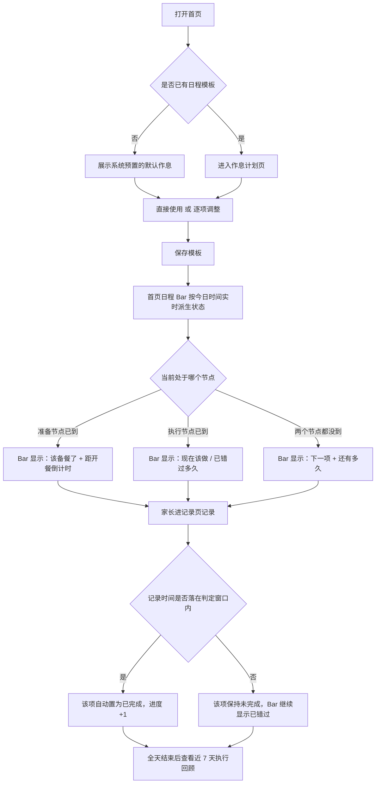
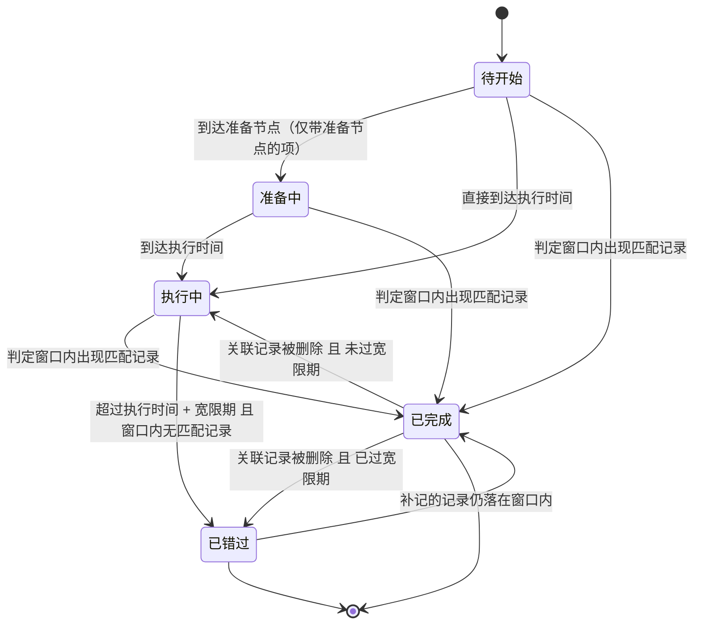
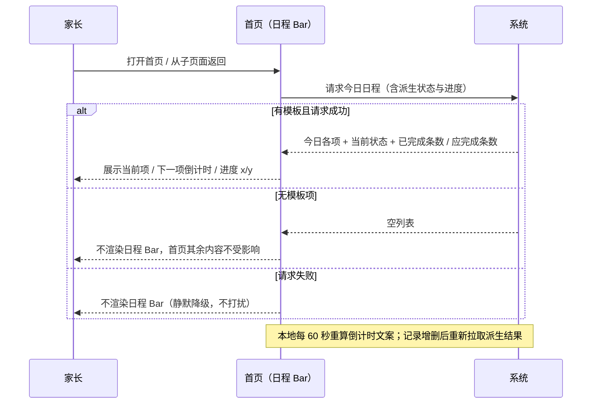

# 产品需求文档：宝宝日程表「今日作息计划 + 首页提醒」- V1.0

| 项      | 内容                                                           |
| ------ | ------------------------------------------------------------ |
| 版本     | PRD-009 / 文档内版本 V1.0                                         |
| 状态     | **第 1 期（P0）已实现，待人工验证**（2026-10-09）。10 条关键决策 + §10 的 #1~#4 已全部确认；#5 / #6 为开发侧口径，不阻塞。§4 API 已按实施口径修正（家庭维度路由 + `isDefault`） |
| 创建日期   | 2026-10-09                                                   |
| 主平台    | 微信小程序 `minicare-mp`（主）+ `minicare-server`（派生与存储）             |
| 关联 PRD | PRD-006 V3.0（§2 现状盘点「完全没有——计划/任务实体」需据本 PRD 更新；§5.G「提醒三通道分流」） |
| 关联技术文档 | `docs/features/F05-activity.md`（活动记录，US-06 需同步）              |

---

## 1. 综述 (Overview)

### 1.1 项目背景与核心问题

旺仔的喂养结构正在发生变化：**辅食从每天 1–2 顿增加到 3 顿，且每顿要提前 2 小时备餐**；再穿插 3–4 顿奶粉；白天还要外出活动 1–2 次；晚上 19:00 洗澡。事项数量与相互约束同时上升，而当前产品**没有任何"计划"能力**——只有"记录"能力。

由此产生三个真实问题：

1. **记不住**：靠脑子记"下一顿该干什么、该提前多久备"，事多必漏。
2. **看不出乱**：作息乱是结果，但家长看不到"乱在哪一项、乱多少"，因为系统里只有"做了什么"，没有"应该做什么"，二者无法对比。
3. **不能沉淀**：即便今天理顺了，这个作息也无法复用，明天仍要重新想。

**核心命题**：在既有的"记录面"之外，补一个极薄&#x7684;**"计划面"**——用户描述"一天应该长什么样"，系统负责在首页告诉他"现在到哪一步了"，并用已有记录自动判定"做到没有"。

> ⚠️ **与 PRD-006 的关系（必须先读）**：PRD-006 §2 现状盘点把"计划 / 任务实体"标为「完全没有」，且其第 2 期规划已包含「今日行动卡双端同源」「首页提醒改服务端」。**本 PRD 即为该空白的第一个实现**，`schedule_template_item`（§3）应被视为 PRD-006 所指"计划/任务实体"的最小落地，不得在 PRD-006 第 2 期重复建设；PRD-006 §2 的现状描述需据本 PRD 回写。

### 1.2 核心业务流程 / 用户旅程地图

1. **阶段一：排班（设一次，用每天）** —— 系统先给一份可用的默认作息，用户按旺仔实际情况调整；改的是"模板"，每天自动套用，不需要每天重排。
2. **阶段二：看得见** —— 首页一条日程提醒 Bar，随时告诉家长"现在该做什么 / 下一项还有多久 / 今天做到几项了"；需要细节时进今日日程详情页看时间轴。
3. **阶段三：对得上** —— 建立"日程项 ↔ 记录类型"的判定口径与六态状态机，让"做没做"不需要人工打卡，由已有记录自动判定；同时把「洗澡」补进活动记录类型，让晚上 19:00 这一项也有记录可判。
4. **阶段四：能复盘（P2）** —— 回看近 7 天的执行偏差，回答"到底哪一项最常被漏掉 / 实际比计划晚了多久"。

### 1.3 Mermaid 图（流程/状态/时序）

#### 1.3.1 用户操作流（必填）



#### 1.3.2 状态机（日程项的生命周期，必填）

> 状态是**实时派生**结果，不落库（见 §1.5 决策 D2）。



六态口径：**待开始 `upcoming` / 准备中 `preparing` / 执行中 `doing` / 已完成 `done` / 已错过 `missed`**，外加 `disabled`（模板项被关闭，不参与任何展示与统计）。

#### 1.3.3 关键场景时序（首页 Bar 的派生与降级）



### 1.4 名词与口径定义（术语表）

| 术语                       | 定义                                                     |
| ------------------------ | ------------------------------------------------------ |
| **日程模板项**（schedule item） | 一条"每天应该在某个时间点做某事"的计划，如"09:00 早餐辅食，07:00 开始备餐"。是唯一的存储实体 |
| **执行节点**（execute_time）   | 该事项计划发生的时间点                                            |
| **准备节点**（prepare_time）   | 需要提前准备的事项的"开始准备"时间点。辅食默认 = 执行时间 − 120 分钟。无准备节点的项此字段为空  |
| **判定窗口**                 | 判定"做到没有"的**时间容差区间**：以**执行时间**为基准向前 60 分钟、向后 90 分钟展开 —— `[执行时间 − 60 分钟, 执行时间 + 90 分钟]`（闭区间，共 150 分钟）。**区间内出现任意一条类型匹配的记录，该项即判为已完成**；区间外一概不算。取 60/90 的理由见 §1.4.1 |
| **匹配记录**                 | 与日程项类型对应、且记录时间落在判定窗口内的记录（映射表见 US-05）                   |
| **顺序兜底**                 | 窗口匹配**一条都没命中**时的补判口径：同类「未配对项」与「未消费记录」各按时间升序**一一顺序配对**（第 1 项 ← 第 1 条记录…），**不设时间偏差上限**。用于"记录时间整体偏早/偏晚"这类窗口覆盖不到、但"第 N 顿确实已经喝了"的情况。详见 §1.4.2 |
| **展示顺序**（`sort_order`）   | 作息计划列表里项的排列顺序，**由用户长按拖拽决定**（0..n-1），与 `execute_time` 无关。提交数组的下标即顺序。详见 US-02 |
| **今日日程**                 | **不是一张表**，而是"日程模板项 × 今日记录"实时派生出的结果集                    |
| **进度分母**                 | 今日启用（`enabled = 1`）且**可判定**（`item_type ≠ other`）的项数    |

### 1.4.1 判定窗口详解（它指什么、60/90 从哪来）

**它解决什么问题**：家长不可能分秒不差地按计划操作。计划 `09:00 早餐辅食`，实际 `08:45` 或 `09:40` 才记录都很正常。如果要求"必须 09:00 整"，几乎每一项都会被判成"已错过"，提醒就失去了意义。判定窗口就是给"准时"划一个**宽容边界**。

**规则**：窗口 = `[执行时间 − 60 分钟, 执行时间 + 90 分钟]`，闭区间。

以 `09:00 早餐辅食` 为例，窗口是 `08:00 → 10:30`：

| 记录时间 | 结果 |
|---|---|
| `07:59` 或更早 | 不算 —— 太早，这条多半属于上一顿 |
| `08:00` | 完成（左边界，含） |
| `09:10` | 完成 |
| `10:30` | 完成（右边界，含） |
| `10:31` 或更晚 | 不算 → 判为「已错过」；但若之后补记的记录仍落在窗口内，可回填为完成 |

**两个参数各自负责什么**：

- **向前 60 分钟（提前量）**：防止"把上一顿的记录误判给这一顿"。例如 `07:00` 那顿奶的记录，不能算给 `09:00` 的辅食。提前量越大，越容易与相邻同类项"抢记录"。
- **向后 90 分钟（宽限期）**：容忍家长晚喂、晚记。超过这个时间仍无记录，就在首页 Bar 与详情页显示「已错过」，提示补记。

**为什么取 60 / 90**：

1. 只有**同类型**的项之间才会争抢记录（匹配要求类型一致，`11:30` 的奶永远不会被算作 `13:30` 的辅食）。
2. 因此只要保证**同类相邻两项的时间差 ≥ 提前量 + 宽限期 = 150 分钟**，窗口就不会重叠、判定就没有歧义 —— 这正是 US-02 那条"同类项至少间隔 150 分钟"校验的来源。
3. 150 分钟对现有作息是安全的：4 顿奶间隔约 4 小时、3 顿辅食间隔约 4 小时，均远大于 150 分钟。

**取舍**：

- 窗口偏窄 → 明明做了却总被标「已错过」，用户会不信任这个提醒。
- 窗口偏宽 → 同类项更易互相抢记录（例如两顿奶只隔 2 小时时），需靠 US-02 的校验兜住。
- ⚠️ 若后续调整这两个参数，**必须同步调整 US-02 的 150 分钟校验**，两者是一个整体。

> ✅ **参数已确认（2026-10-09）**：取 **提前 60 分钟 / 宽限 90 分钟**（窗口共 150 分钟），本版按此实现。

### 1.4.2 顺序兜底详解（窗口之外，怎么还能判"做到了"）

**它解决什么问题**：窗口是绝对时间容差，一天整体偏移（比如当天所有操作都比计划晚 2 小时）时，**每一条记录都落在所有窗口之外**，于是每一项都被判成「已错过」并一直催补记录 —— 但家长其实每一顿都喂了。窗口口径无法表达"第 2 顿已经喝了，只是时间不在计划附近"。

**规则（两遍算法，服务端 `schedule.service.ts::deriveItems`）**：

1. **第一遍 · 窗口匹配（高置信）**：逐项在 `[执行时间 − 60, 执行时间 + 90]` 内找**时间最早**的匹配记录并配对该项，配到的记录标记为"已消费"，一条记录只点亮一项。
2. **第二遍 · 顺序兜底（低置信）**：对**每个类型**，把剩下的「未配对项」和「未消费记录」各自按时间升序排列，然后**一一顺序配对**：

   ```text
   第 1 个未配对项 ← 第 1 条剩余记录
   第 2 个未配对项 ← 第 2 条剩余记录
   …（多出的项保持未配对，多出的记录忽略）
   ```

**两条硬约束（少一条都会误判）**：

- **执行时间还没到的项不参与兜底**。未来的顿次不可能"已经喝了"；若不加这条，一顿计划外的补喂（多余的记录）会把晚上的项提前点亮成已完成。
- **配对基准是执行时间升序，不是展示顺序**。「第 N 顿」是时间概念，用户把列表拖成任意顺序都不影响顿次判定。

**取舍（已与用户确认 2026-10-09）**：

- 用户明确选择**不设时间偏差上限、纯按顺序**。因此同类型"记录条数 ≥ 已到时间的项数"时，这些项会被全部判为完成。
- 已知代价：当天某类型**只有 1 条记录**且时间偏离很大时（例如 3 顿奶只记了 1 顿），按纯顺序口径它归属**第 1 项**，而不是"离它最近的那一项"。这是刻意的简单口径，不是 bug。
- ⚠️ 因此顺序兜底**只在第一遍完全没命中时才生效** —— 有窗口命中时以窗口为准（窗口是更强的证据）。

> 📌 与 US-02 的 150 分钟校验的关系：该校验只约束"同类项窗口不重叠"，顺序兜底**不受其限制**（它本来就工作在窗口之外）。二者不冲突。

### 1.5 关键设计决策（本版拍板记录）

| 编号      | 决策                                                             | 理由 / 影响                                                                                         |
| ------- | -------------------------------------------------------------- | ----------------------------------------------------------------------------------------------- |
| **D1**  | 提醒触达**只做首页 Bar 倒计时**，不做响铃浮层、不做振动、不做微信订阅消息推送                    | 用户明确选择。复用成本最低、无授权摩擦。代价是"小程序没打开就收不到"，已知并接受                                                       |
| **D2**  | 完成判定**只靠记录自动判定**，不设手动打卡 / 跳过                                   | 用户明确选择。避免与"录入只在界面"的写入路径原则冲突，也无需新增写接口                                                            |
| **D3**  | **只存模板，不存"每日日程"**。今日状态全部实时派生                                   | 符合单一真相源。若为每天落一份日程行，会引入"记录已写但日程没打勾"的双写不一致                                                        |
| **D4**  | 日程形态 = **系统预置默认模板 + 用户可调整**；"调整"指改模板本身，**全局生效**，不做"仅今天生效"的临时调整 | 用户明确选择。代价见风险 R3                                                                                 |
| **D5**  | 每个日程项可有**准备节点与执行节点两个时间点**（双节点）                                 | 用户明确要求体现"提前 2 小时备餐"。准备时间默认由"执行时间 − 提前量"推导，允许改为独立值                                               |
| **D6**  | 日程项必须是**结构化类型**（带 `item_type`），不接受自由文本                         | `item_type` 是自动判定的唯一依据（D2 的前提）                                                                  |
| **D7**  | 「外出活动」「洗澡」**归入既有活动记录**，其中 `bath` 为**新增枚举值**                    | 用户明确选择。`outdoor` 后端已存在；`bath` 历史上是 TINYINT `1`，在迁移 006 被并入 `daily_care`，字段已是 VARCHAR，新增枚举无需数据迁移 |
| **D8**  | 首页日程 Bar 与既有「距上次喂奶/辅食」Banner **并存**，不互相取代                      | 用户明确选择。口径分工见 US-03「与既有 Banner 的口径分工」；并存风险见 R1                                                   |
| **D9**  | 奶**也按固定时点排班**（不做滑动预测式排奶）                                       | 用户明确选择。与既有 `feedingSource` 的滑动预测形成两套口径，必须靠文案区分（R1）                                              |
| **D10** | 模板与今日日程均**按 `baby_id` 维度存储与派生**                                | 多孩子家庭下，旺仔的作息不能污染其他孩子的                                                                           |
| **D11** | 作息计划列表的顺序**由用户长按拖拽决定**（落库 `sort_order`），**不再按执行时间自动排序**。提交数组的下标即顺序 | 用户明确要求「拖拽调整排序」。旧实现每次保存都强制按 `execute_time` 排序，用户排好的顺序会被"弹"回去，新增项也永远只能出现在时间位 |
| **D12** | 窗口判定之外追加**顺序兜底**，且**不设时间偏差上限**（纯顺序配对）                          | 用户明确选择。解决"一天整体偏移 → 全部误判已错过"的核心痛点；代价与边界见 §1.4.2 |

---

## 2. 用户故事详述 (User Stories)

### 阶段一：排班（设一次，用每天）

---

#### **US-01: 作为敏宝家长，我希望第一次打开日程功能时就已经有一份可用的作息计划，以便于不用从零配置就能立刻看到"今天几点该做什么"**

- **价值陈述 (Value Statement)**:
  - **作为** 需要给旺仔安排 3 顿辅食 + 3–4 顿奶 + 外出 + 洗澡的家长
  - **我希望** 系统直接给我一份能用的作息，而不是一张空白表单
  - **以便于** 打开即用，把精力花在"改哪一项"而不是"想怎么填"
- **业务规则与逻辑 (Business Logic)**:
  1. **前置条件**：已登录、已加入家庭、已创建宝宝档案（持有 `baby_id`）。未建档用户不展示日程入口。
  2. **操作流程 (Happy Path)**:
     1. 家长从首页日程 Bar 的"设置作息"入口，或首页 QuickActions 进入**作息计划页**。
     2. 系统查询该 `baby_id` 的日程模板项：
        - 已有模板项 → 直接展示（编辑态）；
        - **无任何模板项** → 返回系统默认模板，页面顶部提示：「这是系统为你准备的默认作息，可直接使用，也可以逐项修改」，并在保存前**不写库**（见决策 D3 的落地：默认模板只在前端展示为待确认态）。
     3. 家长点「保存使用」，模板落库；返回首页后日程 Bar 立即按当前时间显示今日状态。
     4. 家长也可先逐项修改（进入 US-02）再保存。
  3. **默认模板内容（初版）**：系统预置一份通用 9–12 月龄作息，共 10 项：
     | 执行时间  | 名称         | `item_type`        | 准备节点             |
     | ----- | ---------- | ------------------ | ---------------- |
     | 07:00 | 第 1 顿奶     | `feeding_formula`  | —                |
     | 09:00 | 早餐辅食       | `feeding_food`     | 07:00（提前 120 分钟） |
     | 10:30 | 户外活动       | `activity_outdoor` | —                |
     | 11:30 | 第 2 顿奶     | `feeding_formula`  | —                |
     | 13:30 | 午餐辅食       | `feeding_food`     | 11:30（提前 120 分钟） |
     | 15:30 | 户外活动       | `activity_outdoor` | —                |
     | 16:30 | 第 3 顿奶     | `feeding_formula`  | —                |
     | 18:00 | 晚餐辅食       | `feeding_food`     | 16:00（提前 120 分钟） |
     | 19:00 | 洗澡         | `activity_bath`    | —                |
     | 20:00 | 第 4 顿奶（睡前） | `feeding_formula`  | —                |
     > ✅ 上表时间点已于 2026-10-09 确认，即为上线默认值（后续可随时在作息计划页调整，见 US-02）。默认模板在服务端以 `getDefaultScheduleTemplate(ageMonths)` 形式存在，按宝宝月龄返回不同默认值（当前仅一套）。
  4. **异常处理 (Error Handling)**:
     - **未建档**：入口隐藏；若通过外部链接直达，提示「请先创建宝宝档案」并给出跳转。
     - **保存失败（网络 / 服务异常）**：Toast 提示「保存失败，请重试」；本次编辑内容**保留在页面内不丢失**（不清空、不返回），支持重试。
     - **默认模板拉取失败**：展示空态 + 「手动添加第一项日程」引导，不阻塞用户。
     - **重复保存（并发）**：以服务端最后写入为准（全量覆盖语义），前端在保存中禁用按钮防连点。
     - **宝宝月龄暂无对应默认模板**：回落到通用默认模板，不报错。
- **验收标准 (Acceptance Criteria)**:
  - **场景1: 首次进入即见默认模板**
    - **GIVEN** 旺仔档案已创建且该 `baby_id` 下无任何日程模板项
    - **WHEN** 家长进入作息计划页
    - **THEN** 页面展示 §2.1 表中的 10 项默认作息，且顶部展示「可直接使用或修改」的说明文案
  - **场景2: 保存后首页立即生效**
    - **GIVEN** 默认模板已展示且未保存
    - **WHEN** 家长点「保存使用」并返回首页
    - **THEN** 日程模板项已落库，首页出现日程提醒 Bar，且 Bar 展示的当前项与当前时间一致
  - **场景3: 保存失败不丢内容**
    - **GIVEN** 家长已修改若干项
    - **WHEN** 保存请求失败
    - **THEN** 页面停留在编辑态、内容不丢失，并提示可重试
  - **场景4: 未建档不展示入口**
    - **GIVEN** 用户已登录但未创建宝宝档案
    - **WHEN** 用户查看首页
    - **THEN** 不展示日程 Bar 与作息入口
- **页面布局线框图 (ASCII Wireframe)**:
  ```text
  ┌────────────────────────────────────────────┐
  │  ←              作息计划            [保存]  │
  ├────────────────────────────────────────────┤
  │  这是系统为你准备的默认作息，可直接使用，     │
  │  也可以逐项修改。改完记得保存。               │
  ├────────────────────────────────────────────┤
  │  共 10 项 · 全部启用                         │
  ├────────────────────────────────────────────┤
  │  ┌──────────────────────────────────────┐  │
  │  │ 07:00  ● 第 1 顿奶        [开关]  ⋮ │  │
  │  │         类型：奶粉                    │  │
  │  ├──────────────────────────────────────┤  │
  │  │ 09:00  ● 早餐辅食         [开关]  ⋮ │  │
  │  │         类型：辅食                    │  │
  │  │         准备 07:00（提前 120 分钟）    │  │
  │  ├──────────────────────────────────────┤  │
  │  │ 10:30  ● 户外活动         [开关]  ⋮ │  │
  │  │         类型：外出活动                │  │
  │  ├──────────────────────────────────────┤  │
  │  │ 19:00  ● 洗澡             [开关]  ⋮ │  │
  │  │         类型：洗澡                    │  │
  │  └──────────────────────────────────────┘  │
  │                                            │
  │           [ ＋ 添加一项日程 ]               │
  └────────────────────────────────────────────┘

  ⋮ 展开后：修改时间 / 修改名称 / 设置准备节点 / 删除
  ```

---

#### **US-02: 作为敏宝家长，我希望在默认作息上增删改具体的日程项，以便于让它贴合旺仔真实的作息节奏**

- **价值陈述 (Value Statement)**:
  - **作为** 要按旺仔实际节奏安排作息的家长
  - **我希望** 能改时间、加一项、停用一项、删掉一项
  - **以便于** 计划与我家实际作息一致，倒计时才有参考价值
- **业务规则与逻辑 (Business Logic)**:
  1. **前置条件**：已进入作息计划页（US-01）。
  2. **操作流程 (Happy Path)**:
     1. **添加一项**：点「＋ 添加一项日程」→ 依次选择**类型**（辅食 / 奶粉 / 外出活动 / 洗澡 / 其他）→ 设置**执行时间** → 若类型为辅食，**准备时间默认自动填为执行时间 − 120 分钟**（可改、可清空、可改为独立值）→ 保存。
     2. **修改一项**：展开该项 → 改时间 / 改名称 / 改准备节点 / 开关启用状态。
     3. **删除一项**：展开该项 → 删除 → 二次确认「删除后该项不再出现在日程中，历史判定也会一起消失，确定删除？」。
     4. **调整顺序（长按拖拽）**：长按任意一项 ~0.35 秒进入拖拽态（轻微振动反馈），手指上下移动即实时重排，松手落定。
        - 拖拽期间**自动收起展开的编辑区**（保证各行等高，落点计算才准），被拖项高亮浮起、其余项淡出。
        - 顺序**不做任何自动排序**：既不按执行时间、也不按类型，完全按用户拖成的顺序。列表右上角提示「长按任意一项可拖动调整顺序」，拖过之后变为「顺序已调整 · 记得保存」。
        - 顺序随「保存」一起落库（`sort_order` = 提交数组下标 0..n-1），**不点保存则不改库**。
     5. 点「保存」→ 全量提交（新增 / 修改 / 删除差集）；成功 Toast「作息计划已保存」。
  3. **校验规则（保存前本地校验 + 服务端兜底）**:
     - **执行时间必填**；准备时间若填写，必须**严格早于执行时间**，否则报错「准备时间需要早于执行时间」。
     - **准备时间与执行时间不得跨零点**（即准备时间必须 ≤ 执行时间，且两者同属当日）→ 越界时报错「暂不支持跨天的事项，请调整时间」。
     - **同类项的判定窗口不得重叠**（判定窗口见 US-05）：若新增/修改后，两个 `item_type` 归属同一判定依据的项，其窗口发生重叠，则报错「这两项时间太接近，同一段时间的记录无法判断属于哪一项，请至少间隔 150 分钟」（150 = 提前 60 + 宽限 90）。
     - **准备节点不得与其它项的执行时间完全重合**（提示级，不阻塞，仅提示「该时段已有其它安排」）。
     - 名称可为空，为空时由 `item_type` 推导默认名（如"辅食"）。
  4. **异常处理 (Error Handling)**:
     - **校验不通过**：定位到出错项并高亮，Toast 说明原因，不提交。
     - **删除最后一项**：允许，删除后模板为空 → 首页日程 Bar 不渲染，作息计划页回到空态引导。
     - **服务端校验与本地不一致**：以服务端为准，返回具体项索引，前端定位高亮。
     - **保存中离开页面**：提示「正在保存，请稍候」。
     - **停用（开关关闭）**：该项不参与首页 Bar、不计入进度分母、也不参与判定；历史记录不受影响。
- **验收标准 (Acceptance Criteria)**:
  - **场景1: 新增辅食项自动带出准备时间**
    - **GIVEN** 家长在作息计划页点「添加一项日程」并选择类型「辅食」
    - **WHEN** 家长把执行时间设为 `13:30`
    - **THEN** 准备时间被自动填为 `11:30`，并展示"提前 120 分钟"的说明
  - **场景2: 准备时间晚于执行时间被拒绝**
    - **GIVEN** 家长正在编辑某一项
    - **WHEN** 将准备时间设为晚于执行时间并点保存
    - **THEN** 提交被拒绝，该项高亮，提示「准备时间需要早于执行时间」
  - **场景3: 同类项时间过近被拒绝**
    - **GIVEN** 已存在 `13:30 午餐辅食`
    - **WHEN** 家长新增 `14:30 加餐辅食` 并保存
    - **THEN** 提交被拒绝，提示两项间隔需至少 150 分钟
  - **场景4: 停用项不参与今日进度**
    - **GIVEN** 家长把 `10:30 户外活动` 关闭
    - **WHEN** 返回首页查看日程 Bar
    - **THEN** 该项不出现在 Bar 与进度分母中，今日日程详情页亦不展示
  - **场景5: 拖拽调整顺序并保存**
    - **GIVEN** 列表为 `07:00 第 1 顿奶 / 09:00 早餐辅食 / 11:30 第 2 顿奶`
    - **WHEN** 家长长按 `11:30 第 2 顿奶` 拖到最前并点保存
    - **THEN** 提交数组顺序为 `第 2 顿奶(11:30) → 第 1 顿奶(07:00) → 早餐辅食(09:00)`；
      服务端按下标写 `sort_order = 0/1/2`；再次进入本页与今日日程页，顺序与拖拽结果一致（**不按时间回弹**）
  - **场景6: 拖拽后不保存则不改库**
    - **GIVEN** 家长拖拽调整了顺序
    - **WHEN** 直接返回（不点保存）
    - **THEN** 库中顺序不变，再次进入本页仍是原顺序；提示文案停留在「顺序已调整 · 记得保存」直至离开
- **页面布局线框图 (ASCII Wireframe)**:
  ```text
  ┌────────────────────────────────────────────┐
  │  ←              作息计划            [保存]  │
  ├────────────────────────────────────────────┤
  │  ┌── 编辑：午餐辅食 ──────────────────┐    │
  │  │ 类型    ◉ 辅食  ○ 奶粉            │    │
  │  │         ○ 外出  ○ 洗澡  ○ 其他    │    │
  ```


````
│  │                                    │    │
│  │ 执行时间            [ 13:30    ]   │    │
│  │                                    │    │
│  │ 提前准备   [ 开 ]  提前 120 分钟   │    │
│  │ 准备时间            [ 11:30    ]   │    │
│  │  ⓘ 准备时间默认由执行时间倒推，     │    │
│  │    也可改成任意更早的时间           │    │
│  │                                    │    │
│  │ 名称（选填）        [ 午餐辅食  ]   │    │
│  │                                    │    │
│  │  [ 取消 ]        [ 删除 ]  [ 确定 ] │    │
│  └────────────────────────────────────┘    │
└────────────────────────────────────────────┘
```
````

---


### 阶段二：看得见

---

#### **US-03: 作为敏宝家长，我希望首页有一条日程提醒，直接告诉我现在该做什么、下一项还有多久、今天完成了几项，以便于不用翻页和动脑就能跟上节奏**

- **价值陈述 (Value Statement)**:
  - **作为** 白天要一边带娃一边按点推进作息的家长
  - **我希望** 打开首页一眼就看到当前节点进度
  - **以便于** 在最容易忘事的时刻（刚哄睡、刚回家）被拉回节奏
- **业务规则与逻辑 (Business Logic)**:
  1. **前置条件**：已建档；该 `baby_id` 存在至少 1 项启用中的日程模板项。不满足则整个 Bar 不渲染（首页其余内容完全不受影响）。
  2. **操作流程 (Happy Path)**:
     1. 首页 Hero 区的 banner 插槽内，在既有 `SleepBanner` / `FeedingBanner` / `NextFollowUpBanner` / `AllergyProgressBar` 之外，**新增一条日程提醒 Bar**（与既有 Banner 并存，见决策 D8）。
     2. Bar 的展示优先级（自上而下，命中即停）：
        1. 存在 `doing`（执行中）项 → 主行「现在该做：{项名}」，副行「计划 {HH:mm} · 已开始 {N} 分钟」；
        2. 存在 `preparing`（准备中）项 → 主行「该备餐了：{项名}」，副行「准备 {HH:mm} · 距开始还有 {N} 小时 {M} 分」；
        3. 存在 `missed`（已错过）项 → 主行「已错过：{项名}（计划 {HH:mm}）」，副行「已错过 {N} 分钟 · 现在补记录」；
        4. 存在 `upcoming`（待开始）项 → 主行「下一项：{项名}」，副行「计划 {HH:mm} · 还有 {N} 小时 {M} 分」；
        5. 今日全部 `done` 且分母 > 0 → 主行「今日日程已全部完成」，副行「作息规律，继续保持」。
     3. Bar 右侧常显**进度**「已完成 / 应完成」，如 `3/10`。
     4. 点击 Bar 任意位置 → 跳转**今日日程详情页**（US-04）。
     5. 倒计时文案**本地每 60 秒**刷新一次，不请求接口；页面 `onShow`、以及记录增删后（复用既有 `home:refresh` 事件）重新拉取派生结果。
  3. **与既有 Banner 的口径分工（重要，防止两个时间口径打架）**:
     - **日程 Bar = 计划视角**：回答"**该几点做**"。所有时间文案统一用「计划 HH:mm」前缀。
     - **既有 FeedingBanner = 事实视角**：回答"**距上次多久**"。保持原有文案（「上次 09:10 · 已过去 3 小时 20 分」），**不做任何联动改动**。
     - 二者同时出现时，不允许出现"预计"与"计划"混用；日程 Bar 不使用"预计"字样。
     - 日程项到点未完成时，**只**由日程 Bar 显示「已错过」，FeedingBanner 不追加任何提示（避免双重提醒逻辑）。
  4. **异常处理 (Error Handling)**:
     - **接口失败 / 超时**：不渲染日程 Bar，静默降级（不弹错误、不影响首页其它内容）。下次 `onShow` 重试。
     - **模板项被全部停用或删除**：Bar 不渲染。
     - **跨零点时刻（00:00 刷新）**：以本地日期切换为准重新拉取；不处理跨零点项（§9 非目标）。
     - **进度分母为 0**（只剩 `other` 类型项）：不显示进度数字。
     - **游客模式 / 未建档**：不渲染。
     - **同一时刻命中多个 `doing`**：取执行时间最早的一项；不并列展示。
- **验收标准 (Acceptance Criteria)**:
  - **场景1: 执行节点到达**
    - **GIVEN** 模板含 `11:00 午餐辅食`，当前时间为 `11:12`，且该时段无匹配记录
    - **WHEN** 家长打开首页
    - **THEN** Bar 主行显示「现在该做：午餐辅食」，副行显示「计划 11:00 · 已开始 12 分钟」
  - **场景2: 准备节点到达**
    - **GIVEN** 模板含 `13:30 午餐辅食`（准备 `11:30`），当前时间为 `11:44`
    - **WHEN** 家长打开首页
    - **THEN** Bar 显示「该备餐了：午餐辅食」及「距开始还有 1 小时 46 分」
  - **场景3: 已有记录则自动跳过该项**
    - **GIVEN** `11:00 午餐辅食` 在 `11:05` 已产生一条辅食记录
    - **WHEN** 家长在 `11:12` 打开首页
    - **THEN** Bar **不**显示「现在该做：午餐辅食」，而是显示下一未完成项
  - **场景4: 错过项优先暴露**
    - **GIVEN** `09:00 早餐辅食` 无任何匹配记录，当前时间为 `10:20`
    - **WHEN** 家长打开首页
    - **THEN** Bar 显示「已错过：早餐辅食（计划 09:00）」及「已错过 1 小时 20 分 · 现在补记录」
  - **场景5: 无模板不渲染**
    - **GIVEN** 该 `baby_id` 无任何启用中的日程项
    - **WHEN** 打开首页
    - **THEN** 不出现日程 Bar，且其它 Banner 与首页内容正常展示
  - **场景6: 接口失败静默降级**
    - **GIVEN** 今日日程接口返回失败
    - **WHEN** 打开首页
    - **THEN** 不出现日程 Bar，且不弹出任何错误提示
- **页面布局线框图 (ASCII Wireframe)**:
  ```text
  ① 执行中（执行节点已到，窗口内无记录）
  ┌──────────────────────────────────────────────┐
  │  首页 Hero（宝宝信息 / 今日统计）              │
  │  ┌──────────────────────────────────────────┐│
  │  │ ● 现在该做：午餐辅食          已完成 3/10 →││
  │  │   计划 11:00 · 已开始 12 分钟             ││
  │  └──────────────────────────────────────────┘│
  │  ┌──────────────────────────────────────────┐│
  │  │ ● 距上次辅食  上次 09:10 · 已过去 3 小时  ││ ← 既有 FeedingBanner
  │  └──────────────────────────────────────────┘│   （并存，口径为"事实"）
  └──────────────────────────────────────────────┘

  ② 准备中（准备节点已到、执行节点未到）
  ┌──────────────────────────────────────────┐
  │ ● 该备餐了：午餐辅食          已完成 3/10 →│
  │   准备 11:30 · 距开始还有 1 小时 46 分     │
  └──────────────────────────────────────────┘

  ③ 已错过
  ┌──────────────────────────────────────────┐
  │ ● 已错过：早餐辅食（计划 09:00） 已完成 3/10 →│
  │   已错过 1 小时 20 分 · 现在补记录         │
  └──────────────────────────────────────────┘

  ④ 待开始（无执行中 / 准备中 / 已错过）
  ┌──────────────────────────────────────────┐
  │ ● 下一项：第 2 顿奶            已完成 3/10 →│
  │   计划 11:30 · 还有 42 分钟                │
  └──────────────────────────────────────────┘

  ⑤ 今日全部完成
  ┌──────────────────────────────────────────┐
  │ ● 今日日程已全部完成          已完成 10/10 →│
  │   作息规律，继续保持                       │
  └──────────────────────────────────────────┘
  ```

---

#### **US-04: 作为敏宝家长，我希望有一个今日日程详情页按时间轴看到全天的计划与完成情况，以便于快速判断哪一项落下了、并直接去补记录**

- **价值陈述 (Value Statement)**:
  - **作为** 想弄清"今天到底乱在哪"的家长
  - **我希望** 看到全天计划与每一项的真实状态
  - **以便于** 知道自己漏了哪一项并能立刻补上
- **业务规则与逻辑 (Business Logic)**:
  1. **前置条件**：从首页日程 Bar 点击进入，或从页面路由直达。
  2. **操作流程 (Happy Path)**:
     1. 页面顶部：返回按钮、标题「今日日程」、右上角「编辑」（跳 US-02 作息计划页）。
     2. 标题下方：日期（如「10 月 9 日 · 周五」）+ **今日进度**「已完成 x / y」+ 进度条。
     3. 主体：**按作息计划的展示顺序（`sort_order`）排列的时间轴**（不是按执行时间重排 —— 顺序由用户在 US-02 拖拽决定），每个节点展示：
        - 左侧：执行时间（`HH:mm`）；若有准备节点，在主时间上方小字显示「备餐 `HH:mm`」。
        - 中间：项名 + 类型标签。
        - 右侧：状态徽标 —— `✓ 已完成` / `▶ 现在该做` / `○ 还有 N 分钟` / `⚠ 已错过 N 分钟`。
        - 已完成项下方追加**关联记录摘要**：「09:10 · 米粉 30g」。
     4. 点击交互：
        - 未完成 / 已错过项 → 跳对应记录表单页，并**预填执行时间为记录时间**；已错过项额外提供「现在补记录」直跳。
        - 已完成项 → 跳该条记录详情（复用首页既有的记录操作能力）。
        - ⚠️ **跳转参数必须经 URL 解码**：`Taro` 的 `useLoad(options)` **不会**解码查询串，而发送端是 `encodeURIComponent` 编码的。
          预填时间统一由 `lib/useRecordInit.ts` 在 `opts` 层做一次 `decodeParams` 后经 `onInitTime` 回调下发
          （`feeding` / `sleep` 两个不用该 Hook 的页面各自显式解码）——
          漏解码会让 `initTime=07%3A00` 原样进表单，`HH:mm` 解析出 `[NaN]` 并渲染成 `NaN:NaN`。
     5. 底部：P2 前不展示；P2 时新增「查看近 7 天回顾」入口（US-07）。
  3. **异常处理 (Error Handling)**:
     - **接口失败**：展示错误态 + 「重试」按钮（与首页 Bar 的静默降级策略不同：本页是用户主动进入，需要明确反馈）。
     - **无模板项**：展示空态 + 「去设置作息计划」按钮。
     - **准备节点早于当前日 00:00**：不展示该准备节点（§9 非目标：不支持跨零点）。
     - **`other` 类型项**：正常展示，但状态只可能出现 `○ 待开始 / ▶ 现在该做 / ⚠ 已错过`，**不会**出现 `✓ 已完成`，且不参与顶部进度分母。
     - **同一天跨天查看（非今日）**：本版**仅支持今日**；传入非今日日期时按今日处理（或提示「仅支持查看今日日程」）。
- **验收标准 (Acceptance Criteria)**:
  - **场景1: 时间轴按作息计划顺序排列且状态正确**
    - **GIVEN** 作息计划为 `07:00 / 09:00 / 11:00 / 19:00` 四项，其中前两项已有匹配记录，当前时间 11:12
    - **WHEN** 家长进入今日日程页
    - **THEN** 四项按**计划的展示顺序**展示（默认模板下即 `07:00 → 09:00 → 11:00 → 19:00`），前两项为「✓ 已完成」并显示关联记录摘要，`11:00` 为「▶ 现在该做」，`19:00` 为「○ 待开始」
    - **AND** 若家长在作息计划页把 `19:00` 拖到最前并保存，本页第一项应变成 `19:00`（**不按时间回弹**）
  - **场景2: 已完成项显示关联记录摘要**
    - **GIVEN** `09:00 早餐辅食` 对应 `09:10` 的一条「米粉 30g」辅食记录
    - **WHEN** 查看该节点
    - **THEN** 该节点下方显示「09:10 · 米粉 30g」
  - **场景3: 已错过项可直接补记录**
    - **GIVEN** `09:00 早餐辅食` 无匹配记录且已超过宽限期
    - **WHEN** 家长点击该项的「现在补记录」
    - **THEN** 跳转到辅食记录表单页，且记录时间预填为 `09:00`
  - **场景4: 空模板引导**
    - **GIVEN** 该 `baby_id` 无任何日程项
    - **WHEN** 家长进入今日日程页
    - **THEN** 展示空态与「去设置作息计划」按钮
- **页面布局线框图 (ASCII Wireframe)**:
  ```text
  ┌──────────────────────────────────────────────┐
  │  ←              今日日程              [编辑]  │
  │              10 月 9 日 · 周五                │
  ├──────────────────────────────────────────────┤
  │  已完成 3 / 10                                │
  │  ████████░░░░░░░░░░░░░░░░░░░░                 │
  ├──────────────────────────────────────────────┤
  │ 07:00 │ 第 1 顿奶              ✓ 已完成       │
  │       │   07:05 · 奶粉 180ml                  │
  ├───────┼──────────────────────────────────────┤
  │ 备餐   │                                      │
  │ 07:00 │ 早餐辅食               ✓ 已完成       │
  │ 09:00 │   09:10 · 米粉 30g                    │
  ├───────┼──────────────────────────────────────┤
  │ 10:30 │ 户外活动               ✓ 已完成       │
  │       │   10:35 · 户外 40 分钟                │
  ├───────┼──────────────────────────────────────┤
  │ 11:30 │ 第 2 顿奶              ⚠ 已错过 25 分  │
  │       │   现在补记录 →                        │
  ├───────┼──────────────────────────────────────┤
  │ 备餐   │                                      │
  │ 11:30 │ 午餐辅食               ▶ 现在该做      │
  │ 13:30 │   备餐已完成 · 去记录 →               │
  ├───────┼──────────────────────────────────────┤
  │ 15:30 │ 户外活动               ○ 还有 2 小时   │
  ├───────┼──────────────────────────────────────┤
  │ 备餐   │                                      │
  │ 16:00 │ 晚餐辅食               ○ 待开始       │
  │ 18:00 │                                      │
  ├───────┼──────────────────────────────────────┤
  │ 19:00 │ 洗澡                   ○ 待开始       │
  ├───────┼──────────────────────────────────────┤
  │ 20:00 │ 第 4 顿奶（睡前）      ○ 待开始       │
  └──────────────────────────────────────────────┘
  ```

---

### 阶段三：对得上

---

#### **US-05: 作为系统，我需要一套明确的"日程项 ↔ 记录"判定口径，以便于不做手动打卡也能准确判断每一项到底做到没有**

- **价值陈述 (Value Statement)**:
  - **作为** 产品的判定逻辑
  - **我希望** 每一项日程的完成与否完全由既有记录推出
  - **以便于** 家长不用重复操作（记录一次即同时完成记录与打卡），也不会出现"记录写了但日程没打勾"的不一致
- **业务规则与逻辑 (Business Logic)**:
  1. **前置条件**：该 `baby_id` 存在启用中的日程模板项；已拉取该宝宝当日的记录（复用 `family.service.getTodayRecords` 口径）。
  2. **判定依据映射表（唯一口径）**:

     > 📌 **权威定义处（2026-10-09 起）**：服务端 `src/schedule/schedule-item-type.meta.ts`（枚举值 / 默认名 / 分组 / 可判定 / 默认提前量）
     > \+ `schedule-item-type.registry.ts`（`match` / `summary` 函数）。下表为**快照**，新增类型一律以代码为准。
     > 小程序不维护第二份清单 —— 类型选项由 `GET /api/config` 的 `scheduleItemTypes` 下发。

     | 日程项类型 `item_type`        | 默认名    | 分组 | 匹配条件                                                            | 可判定       |
     | ------------------------ | ------ | -- | --------------------------------------------------------------- | --------- |
     | `feeding_formula` 奶粉    | 奶粉     | 喂食 | `feeding` + `feed_type = 'formula'`                              | ✅         |
     | `feeding_breast` 母乳     | 母乳     | 喂食 | `feeding` + `feed_type = 'breast'`                               | ✅         |
     | `feeding_food` 辅食       | 辅食     | 喂食 | `feeding` + `feed_type = 'complementary'` **且** `complementary_food ≠ '营养素'` | ✅         |
     | `feeding_supplement` 营养素 | 营养素    | 喂食 | `feeding` + `feed_type = 'supplement'`                           | ✅         |
     | `sleep` 睡觉              | 睡觉     | 作息 | `sleep`（取 `start_time` —— 对应「该睡觉了」）                               | ✅         |
     | `diaper` 换尿布            | 换尿布    | 作息 | `diaper`                                                         | ✅         |
     | `medication` 用药         | 用药     | 作息 | `medication`                                                     | ✅         |
     | `activity_outdoor` 户外活动 | 户外活动   | 活动 | `activity` + `activity_type = 'outdoor'`                          | ✅         |
     | `activity_bath` 洗澡      | 洗澡     | 活动 | `activity` + `activity_type = 'bath'`（US-06 新增枚举）                 | ✅         |
     | `activity_gross_motor` 大运动练习 | 大运动练习 | 活动 | `activity_type = 'gross_motor'`                                   | ✅         |
     | `activity_fine_motor` 精细运动练习 | 精细运动练习 | 活动 | `activity_type = 'fine_motor'`                                    | ✅         |
     | `activity_edu_play` 亲子早教互动 | 亲子早教互动 | 活动 | `activity_type = 'edu_play'`                                      | ✅         |
     | `activity_daily_care` 日常护理 | 日常护理  | 活动 | `activity_type = 'daily_care'`                                    | ✅         |
     | `other` 自定义事项           | 自定义事项  | 其他 | —                                                                | ❌ 不判定、不计入分母 |

     > ⚠️ 辅食的匹配必须沿用首页既有口径排除"营养素"：读取侧把营养素出口为 `feed_type = 'supplement'`，另有历史数据用 `complementary_food = '营养素'` 标记，**两种都要排除**。
     >
     > 🔴 **不做日程项的类型（2026-10-09 定，两条硬约束）**：
     > ① **唯一命中** —— 必须能在 `getTodayRecords()` 出口的 9 种 `type` 里用 `type + detail` 双键唯一定位；
     > ② **记录自带可解析时分** —— `schedule.service.ts::recordHm()` 只认 `[T ]HH:mm`。
     > 故：`growth`（出口 `time` 是纯日期 `record_date`，无时分 → 判定必为 `missed`）、
     > 观察型 `temperature` / `allergy` / `symptom`（属事件记录而非计划事项）、
     > 容器类 `feeding` / `health`（无独立时间语义）**一律不做**。
     > 历史遗留 `activity_type = 'play' / 'tummy_time'` **不认领**（语义无法一对一映射，宁可判不到也不误判）。
  3. **第一遍 · 判定窗口匹配**：`[执行时间 − 60 分钟, 执行时间 + 90 分钟]`（跨零点时按"不支持"处理，见 §9）。
     - 窗口内存在 ≥ 1 条匹配记录 → 命中；关联记录取窗口内**时间最早**的一条。窗口边界为**闭区间**。
     - 命中的记录标记为"已消费"，**一条记录只点亮一项**（同类项窗口理论上不重叠，兜底防历史脏数据）。
  4. **第二遍 · 顺序兜底（PRD-009 追加，口径见 §1.4.2）**：第一遍完全没命中时才生效。
     - 对每个 `item_type`：取「未配对且**执行时间已到**的项」（按执行时间升序）与「未消费的记录」（按记录时间升序），**一一顺序配对**，多出的项/记录不动。
     - **不设时间偏差上限**（用户决策 D12）—— 只要有对应条数的记录，就算全部超出窗口也算完成。
     - 第二遍配到的项，`matchedRecord.recordTime` 是**真实记录时间**（不是计划时间），摘要照常展示，便于家长看出实际偏差多大。
  5. **状态推导顺序（每次请求重新计算，无持久化）**:
     1. 项被停用 → `disabled`（不参与后续）。
     2. 窗口或顺序兜底命中 → `done`。
     3. 否则按当前时间判断：`now < 准备时间`（有准备节点）→ `upcoming`；`准备时间 ≤ now < 执行时间` → `preparing`；`执行时间 ≤ now ≤ 执行时间 + 90 分钟` → `doing`；`now > 执行时间 + 90 分钟` → `missed`。
     4. 无准备节点的项跳过 `preparing`，直接由 `upcoming` 转 `doing`。
  6. **进度口径**：`进度 = 今日 done 的项数 / 今日 enabled 且可判定的项数`。`disabled` 与 `other` 均不计入分母。
  7. **可逆性规则**：`done` 基于记录实时推导，因此——
     - 若关联记录被**删除**，该项立即按当前时间重新判定（可能回到 `doing`，也可能直接变 `missed`）。
     - 若补记的记录仍落在窗口内（或凑够了顺序兜底的条数），`missed` 会立即回到 `done`。
  8. **异常处理 (Error Handling)**:
     - **记录时间字段缺失 / 非法**：该记录不参与匹配，不报错（也不参与顺序兜底的配对池）。
     - **同一窗口内出现多条匹配记录**：取最早一条作为关联记录，其余忽略。
     - **同类项窗口重叠（不应发生）**：若因历史数据（如 US-02 校验上线前的老模板）出现重叠，取执行时间**离记录最近**的项作为归属，另一项保持未完成，并记录一条服务端告警。
     - **宝宝当日无任何记录**：全部项按时间推导为 `upcoming` / `preparing` / `doing` / `missed`，不报错。
     - **时区**：统一按服务端时区（Asia/Shanghai）判断"今日"与时间比较，不使用客户端时区。
- **验收标准 (Acceptance Criteria)**:
  - **场景1: 记录命中 → 已完成**
    - **GIVEN** 日程项为 `09:00 早餐辅食`（窗口 `08:00`–`10:30`）
    - **WHEN** 存在一条 `09:10` 的辅食记录
    - **THEN** 该项状态为 `done`，关联记录为 `09:10` 那条，进度分母 +1 且分子 +1
  - **场景2: 窗口边界内命中**
    - **GIVEN** 窗口为 `08:00`–`10:30`
    - **WHEN** 记录时间为 `08:00` 或 `10:30`
    - **THEN** 该项判定为 `done`（闭区间）
  - **场景3: 窗口外记录不算命中**
    - **GIVEN** 窗口为 `08:00`–`10:30`
    - **WHEN** 仅在 `11:00` 有一条辅食记录
    - **THEN** 该项不判定为 `done`，按当前时间显示 `doing` 或 `missed`
  - **场景4: 超时未记录 → 已错过**
    - **GIVEN** `09:00 早餐辅食` 无匹配记录，当前时间 `10:31`
    - **WHEN** 请求今日日程
    - **THEN** 该项状态为 `missed`
  - **场景5: 补记录可回填**
    - **GIVEN** 该项当前为 `missed`
    - **WHEN** 家长补记一条 `09:20` 的辅食记录
    - **THEN** 该项立即变为 `done`，进度 +1
  - **场景6: 删除记录可回退**
    - **GIVEN** 该项为 `done`，关联记录为 `09:10`
    - **WHEN** 该记录被删除且当前时间为 `11:00`（已过宽限期）
    - **THEN** 该项变为 `missed`，进度 -1
  - **场景7: other 类型不计入进度**
    - **GIVEN** 模板含 1 项 `other` 类型
    - **WHEN** 该项处于任何状态
    - **THEN** 进度分母不包含该项
  - **场景8: 营养素不计为辅食**
    - **GIVEN** `09:00 早餐辅食` 的窗口内只有一条营养素记录
    - **WHEN** 请求今日日程
    - **THEN** 该项**不**判定为 `done`
  - **场景9: 记录整体偏出窗口 → 顺序兜底判定完成（核心痛点）**
    - **GIVEN** 模板为 `06:00 第 1 顿 / 10:00 第 2 顿 / 14:00 第 3 顿`（窗口 `[05:00,07:30]` / `[09:00,11:30]` / `[13:00,15:30]`）
    - **WHEN** 当日只有 3 条奶粉记录：`04:00`、`08:00`、`12:00`（**全部落在各自窗口之外**）
    - **THEN** 三项均判 `done`，关联记录分别为 `04:00` / `08:00` / `12:00`，进度 `3 / 3`
    - **AND** 第 2 顿不再是"一直提醒补记录"
  - **场景10: 顺序兜底不放大 —— 记录少于项时只点亮对应条数**
    - **GIVEN** 同上模板，当日只有 1 条 `08:00` 的奶粉记录（不在任何窗口内）
    - **WHEN** 请求今日日程
    - **THEN** 仅第 1 项判 `done`（纯顺序口径），其余项按时间推导，进度 `1 / 3`
  - **场景11: 未来的项不被顺序兜底点亮**
    - **GIVEN** 当前 `09:00`，模板含 `06:00` 与 `18:00` 两项；当日有 2 条窗口外记录 `04:00`、`06:50`
    - **WHEN** 请求今日日程
    - **THEN** `06:00` 项判 `done`（配 `04:00`）；`18:00` 项**保持 `upcoming`**，不会被 `06:50` 那条提前点亮
  - **场景12: 窗口命中优先于顺序兜底**
    - **GIVEN** 模板为 `06:00 / 10:00 / 14:00` 三顿奶，当日记录为 `06:10`、`09:20`
    - **WHEN** 请求今日日程
    - **THEN** `06:10 → 06:00 项`、`09:20 → 10:00 项`（都在窗口内，第一遍直接命中），`14:00` 项非 `done`
- **页面布局线框图 (ASCII Wireframe)**: 本故事为纯判定规则，无独立页面；其可见结果体现在 US-03 的 Bar 与 US-04 的时间轴。

---

#### **US-06: 作为敏宝家长，我希望晚上 19:00 的洗澡也能被记录并自动判定完成，以便于"洗澡"这一项不至于永远是未完成状态**

- **价值陈述 (Value Statement)**:
  - **作为** 日程里安排了洗澡的家长
  - **我希望** 洗澡有对应的记录类型
  - **以便于** 它能像辅食、奶一样被自动判定完成，也便于日后回看宝宝护理节奏
- **业务规则与逻辑 (Business Logic)**:
  1. **前置条件**：无（纯枚举扩展）。
  2. **操作流程 (Happy Path)**:
     1. 后端 `ActivityType` 枚举**新增** `bath`（值即字符串 `'bath'`，`VARCHAR(20)` 字段，**无需数据迁移**）。
     2. 小程序活动记录表单（`ActivityTypeSection`）新增「洗澡」选项（含图标与配色），网格由 6 项扩为 7 项，布局相应调整。
     3. 各处标签映射补充 `bath: '洗澡'`，使时间线、首页记录摘要、记录列表都能正确显示。
     4. 日程项类型 `activity_bath` 的匹配条件指向 `activity_type = bath`，接入 US-05 判定。
  3. **兼容性（重要）**:
     - 历史数据：`daily_care`（日常护理）语义**保持不变**，**不回填**历史中实为洗澡的记录（§9 非目标）。
     - 「洗澡」在类型列表中与 `daily_care` 并列，文案需区分：`bath` = 洗澡（具体行为）、`daily_care` = 日常护理（洗澡/抚触/护理等泛化），在选项副标题中说明，避免用户困惑。
     - Web 端（`minicare-web`）处于维护模式，本期**不做**同步；若后续恢复迭代需一并补齐。
  4. **异常处理 (Error Handling)**:
     - **老版本小程序读到 `bath` 记录**：标签映射缺失时回落到通用「活动」，不崩溃（前端所有标签读取均已用 `?? '活动'` 兜底）。
     - **后端先上线、前端后上线**：老前端选项里没有「洗澡」，不会产生 `bath` 记录，无兼容问题。
     - **前端先上线、后端后上线**（不应发生）：提交 `bath` 会被 `@IsEnum` 拒绝并返回 400，需按发布顺序（**后端先、前端后**）执行。
- **验收标准 (Acceptance Criteria)**:
  - **场景1: 可选并保存洗澡**
    - **GIVEN** 新版本前后端已发布
    - **WHEN** 家长在活动记录页选择类型「洗澡」并保存
    - **THEN** 记录 `activity_type = 'bath'` 保存成功，Toast「活动记录已保存」
  - **场景2: 标签正确展示**
    - **GIVEN** 存在一条 `activity_type = 'bath'` 的记录
    - **WHEN** 在时间线 / 记录列表 / 首页摘要中查看
    - **THEN** 均显示为「洗澡」
  - **场景3: 老数据语义不变**
    - **GIVEN** 存在 `activity_type = 'daily_care'` 的历史记录
    - **WHEN** 查看该记录
    - **THEN** 仍显示为「日常护理」，未被改判为「洗澡」
  - **场景4: 洗澡日程可判定**
    - **GIVEN** 日程项 `19:00 洗澡`（窗口 `18:00`–`20:30`）
    - **WHEN** 存在一条 `19:05` 的 `bath` 记录
    - **THEN** 该日程项判定为 `done`
- **页面布局线框图 (ASCII Wireframe)**:
  ```text
  活动记录页 — 活动类型（由 6 项扩为 7 项）

  ┌──────────────────────────────────────────┐
  │  活动类型                                  │
  │  ┌──────────┐  ┌──────────┐              │
  │  │ 大运动    │  │ 精细运动  │              │
  │  │ 翻身/爬行 │  │ 抓握/对捏 │              │
  │  └──────────┘  └──────────┘              │
  │  ┌──────────┐  ┌──────────┐              │
  │  │ 亲子早教  │  │ 户外活动  │              │
  │  │ 互动游戏  │  │ 散步/日晒 │              │
  │  └──────────┘  └──────────┘              │
  │  ┌──────────┐  ┌──────────┐              │
  │  │ 日常护理  │  │ 洗澡      │ ← 新增      │
  │  │ 抚触/护理 │  │ 洗澡/清洁 │              │
  │  └──────────┘  └──────────┘              │
  │  ┌──────────┐                            │
  │  │ 其他活动  │                            │
  │  │ 自由记录  │                            │
  │  └──────────┘                            │
  └──────────────────────────────────────────┘
  ```

---

### 阶段四：能复盘（P2，本期不实现，仅锁定范围）

---

#### **US-07: 作为敏宝家长，我希望看到近 7 天作息计划的执行情况，以便于知道到底哪一项最常被漏掉、实际比计划晚了多久**

- **价值陈述 (Value Statement)**:
  - **作为** 想真正把作息调规律的家长
  - **我希望** 看到一周维度的执行结果而不是只有今天
  - **以便于** 针对性调整（哪一项该改时间、哪一项该减掉）
- **业务规则与逻辑 (Business Logic)**（骨架，待 P2 细化）:
  1. 入口：今日日程详情页底部「查看近 7 天回顾」。
  2. 指标：
     - 整体完成率（近 7 天 `done` 数 / 应完成数）；
     - **最常错过的 Top 3 项**（按 `missed` 次数排序）；
     - **平均执行偏差**（实际记录时间 − 执行时间，单位分钟，按项聚合）；
     - 按天完成率折线（7 点）。
  3. 口径约束：仅统计**当前模板仍存在**的项（因 D3 无历史快照，已删除的项无法回溯统计——见 R3）。
  4. **异常处理**：数据不足 3 天时展示「数据还不够，再记几天就能看到规律」，不出图。
- **验收标准 (Acceptance Criteria)**:
  - **场景1: 数据充分**
    - **GIVEN** 近 7 天有 ≥ 3 天存在日程项与记录
    - **WHEN** 进入近 7 天回顾
    - **THEN** 展示完成率、最常错过的 Top 3、各项平均偏差
  - **场景2: 数据不足**
    - **GIVEN** 近 7 天有效天数 < 3
    - **WHEN** 进入近 7 天回顾
    - **THEN** 展示数据不足提示，不出图表
- **页面布局线框图 (ASCII Wireframe)**: P2 细化，本期不绘制。

---

## 3. 数据模型（Data Model）

### 3.1 设计原则

1. **只新增一张表**：`schedule_template_item`。**不建"每日日程表"**（决策 D3）。
2. 今日日程、状态、进度全部**实时派生**，不落库、不缓存（可由前端 60 秒本地重算 + 服务端请求时计算）。
3. 复用既有的 `feeding` / `activity` 记录表作为判定依据，**不新增任何记录表**。
4. 按 `baby_id` 维度隔离，天然支持多孩子家庭。
5. 字段用 `TIME` 存时间点（不存 DATETIME），因为日程是"每天重复的时刻"而不是"某一天的绝对时间"。

### 3.2 主表：`schedule_template_item`（本期新增，migration **022**；`sort_order` 由 **023** 追加）

```sql
CREATE TABLE IF NOT EXISTS `schedule_template_item` (
  `id`                 CHAR(36)     NOT NULL,
  `baby_id`            CHAR(36)     NOT NULL COMMENT '所属宝宝',
  `item_type`          VARCHAR(24)  NOT NULL COMMENT '日程项类型；取值清单见 src/schedule/schedule-item-type.meta.ts',
  `title`              VARCHAR(50)  DEFAULT NULL COMMENT '用户可见名称；空则由 item_type 推导默认名',
  `execute_time`       TIME         NOT NULL COMMENT '计划执行时间（每日重复）',
  `prepare_time`       TIME         DEFAULT NULL COMMENT '准备节点时间；NULL 表示无准备节点',
  `prepare_offset_min` SMALLINT UNSIGNED DEFAULT NULL COMMENT '准备提前量（分钟）；仅用于 UI 联动推导，判定不依赖',
  `enabled`            TINYINT(1)   NOT NULL DEFAULT 1 COMMENT '0=停用，不参与展示与判定',
  `sort_order`         INT          NOT NULL DEFAULT 0 COMMENT '展示顺序（拖拽调整，0..n-1）；同值时回退到 execute_time 升序',
  `note`               VARCHAR(200) DEFAULT NULL,
  `created_at`         DATETIME     NOT NULL DEFAULT CURRENT_TIMESTAMP,
  `updated_at`         DATETIME     NOT NULL DEFAULT CURRENT_TIMESTAMP ON UPDATE CURRENT_TIMESTAMP,
  `deleted_at`         DATETIME     DEFAULT NULL COMMENT '软删除',
  PRIMARY KEY (`id`),
  KEY `idx_sched_baby_time` (`baby_id`, `execute_time`),
  KEY `idx_sched_baby_sort` (`baby_id`, `sort_order`)
) ENGINE=InnoDB DEFAULT CHARSET=utf8mb4 COMMENT='宝宝每日作息计划模板项';
```

**约束与说明**：

- 迁移编号 **022**（020 = 医疗类型化，021 = KB retrieval_status 已占用）；**023 = `sort_order`**（拖拽排序）。
- 采用软删除（`deleted_at`），与迁移 012 的既有约定一致。
- **不建唯一索引**：允许用户建有两条同名项的（如两顿"户外活动"），时间不同即可。
- **`sort_order` 不建唯一索引**：保存时按提交数组下标整体重写（0..n-1），不做增量 diff —— 与 022 的"全量差集提交"语义一致，避免局部重排产生空洞或重复。
- **`sort_order` 默认 0 兼做向后兼容**：023 之前的历史行全为 0，此时 `ORDER BY sort_order, execute_time, created_at` 自动退化为"按时间升序"，与升级前表现一致。
- 判定窗口不重叠的约束在**应用层校验**（SQL 层无法表达"时间窗不重叠"）；顺序兜底不受该约束，见 §1.4.2。

### 3.3 与既有表的关联

| 关联对象              | 关系   | 说明                                      |
| ----------------- | ---- | --------------------------------------- |
| `baby_profile.id` | N:1  | `schedule_template_item.baby_id`        |
| `feeding_*_record`（4 张子表） | 派生读取 | 判定 `feeding_*` 6 个类型（靠 `getTodayRecords` 出口的 `detail.feed_type` 区分） |
| `activity_record` | 派生读取 | 判定 `activity_*` 6 个类型（靠 `detail.activity_type` 区分） |
| `diaper_record` / `sleep_record` / `medication_record` | 派生读取 | 判定同名类型 |
| `record_timeline` | 不涉及  | 日程不是记录，不进时间线                            |

---

## 4. API 设计清单（Backend API）

> 遵循项目约定：全局前缀 `/api`；无全局响应包裹层（前端直读 `res.data`）；JWT Bearer 认证 + `FamilyMemberGuard` + `RoleGuard`。
>
> ⚠️ **实施口径修正（2026-10-09）**：路由最终挂为**家庭维度** `/api/family/:familyId/schedule/*`，
> 与 `records/*` 保持同一鉴权与取数口径（`FamilyMemberGuard` 从 `params.familyId` 取家庭）。
> 原稿的 `/api/schedule/*?babyId=` 形态**未采用**；`baby_id` 改为 query 参数并强制校验归属该家庭。
> 默认模板标记为驼峰 `isDefault`（与同响应内的 `itemType` / `executeTime` 保持一致）。

| # | 方法    | 路径                                                        | 说明                 | 备注                                                                                     |
| - | ----- | --------------------------------------------------------- | ------------------ | -------------------------------------------------------------------------------------- |
| 1 | `GET` | `/api/family/:familyId/schedule/template?baby_id=<id>`     | 获取作息计划模板项列表        | 若库中无项，返回**系统默认模板**并带 `isDefault: true`；`isDefault` 为 true 时前端展示"待确认"文案，**不落库**。返回顺序 = `sort_order` 升序 |
| 2 | `PUT` | `/api/family/:familyId/schedule/template?baby_id=<id>`     | 全量保存模板（新增/修改/删除差集） | 服务端执行 US-02 的全部校验；校验失败返回 400 + 出错项索引。**提交数组下标 = 展示顺序**，服务端整体重写 `sort_order`（客户端不必传该字段） |
| 3 | `GET` | `/api/family/:familyId/schedule/today?baby_id=<id>`        | 获取今日日程（含派生状态）      | 返回项 + `status` + `matchedRecord` 摘要 + `progress: { done, total }`；项顺序同 `sort_order`；`date` 非今日时按今日处理（本期） |
| 4 | `GET` | `/api/family/:familyId/schedule/review?baby_id=<id>&days=7` | 近 7 天执行回顾          | **P2**                                                                                 |

**响应结构（实施口径）**：

```ts
// 模板
{ items: ScheduleItem[], isDefault: boolean }
// 今日
{ items: ScheduleItem[], progress: { done: number; total: number } }

interface ScheduleItem {
  id: string;                 // 默认模板未落库时为空串
  itemType: ScheduleItemType   // 共 14 个取值，见 §US-05 判定依据映射表（权威源在服务端 schedule-item-type.meta.ts）
  title: string
  executeTime: string         // 'HH:mm'
  prepareTime: string | null  // 'HH:mm'
  prepareOffsetMin: number | null
  enabled: boolean
  sortOrder: number           // 展示顺序（0..n-1，拖拽决定）；items 数组本身已按此排序
  note: string | null
  status?: 'upcoming'|'preparing'|'doing'|'done'|'missed'|'disabled'   // 仅 today 返回
  matchedRecord?: { id: string; type: string; recordTime: string; summary: string } | null  // 仅 today 返回；顺序兜底配到的项，recordTime 为真实记录时间
}
```

**服务端需新增的能力**：

- `ScheduleService.getToday(familyId, babyId)`：复用 `FamilyService.getTodayRecords()` 取当日记录 → 按 US-05 口径派生状态（**不另起一套取数口径**）。
- `ScheduleService.deriveItems(rows, records, nowMin)`：**两遍算法**（窗口匹配 → 顺序兜底），口径见 §1.4.2；返回顺序与入参 `rows`（`sort_order`）一致。
- `getDefaultScheduleTemplate(ageMonths)`：默认模板（按 §2 US-01 的表，当前只有一套）。
- `ScheduleService.validateItems(items)`：US-02 的校验规则（准备时间 < 执行时间、不跨零点、同类项窗口不重叠）。
- `assertBabyInFamily(familyId, babyId)`：防跨家庭读写。

**验收脚本**：`minicare-server/scripts/e2e-schedule.mjs`（自造隔离家庭/宝宝，跑完自动清理并打印真实删除行数；覆盖 T1 拖拽排序 / T2 顺序兜底 / T3 不跨类型误配 / T4 窗口优先）。

---

## 5. 页面清单（MP 页面与组件）

### 5.1 新增页面

| 路径                                     | 说明                   | 关联故事          |
| -------------------------------------- | -------------------- | ------------- |
| `minicare-mp/src/pages/schedule/index` | 作息计划（查看 + 编辑 + 增删改项） | US-01 / US-02 |
| `minicare-mp/src/pages/schedule/today` | 今日日程详情（时间轴 + 进度）     | US-04         |

### 5.2 新增组件

| 组件                                              | 说明                           |
| ----------------------------------------------- | ---------------------------- |
| `minicare-mp/src/pages/home/ScheduleBanner.tsx` | 首页日程提醒 Bar（五态展示 + 60 秒本地倒计时） |

### 5.3 现有页面改造

| 文件                                      | 改造点                                                                                              |
| --------------------------------------- | ------------------------------------------------------------------------------------------------ |
| `minicare-mp/src/pages/home/index.tsx`  | 在 `home-banners` 插槽内插入 `<ScheduleBanner />`；新增今日日程数据加载（失败静默）；在 `home:refresh` / `useDidShow` 时刷新 |
| `minicare-mp/src/pages/home/index.scss` | 日程 Bar 样式                                                                                        |
| `minicare-mp/src/app.config.ts`         | 注册 2 个新页面路由（放分包）                                                                                 |
| `minicare-mp/src/lib/useRecordInit.ts`  | **统一 URL 解码 + 日程预填时间下发**：`useLoad` 的 `opts` 走 `decodeParams`，新增 `onInitTime` 回调（非编辑态且带 `initTime` 时触发） |
| `minicare-mp/src/pages/records/diaper/index.tsx` / `medication/index.tsx` | 接 `onInitTime` → `setRecordTime`，补记录时预填计划时间 |
| `minicare-mp/src/pages/records/activity/index.tsx` | 预填时间改由 Hook 的 `onInitTime` 下发（原在 `onExtraOptions` 里自己处理，且未解码） |
| `minicare-mp/src/pages/records/feeding/index.tsx` / `sleep/index.tsx` | 不用 `useRecordInit`，各自显式 `decodeParams`；`sleep` 新增 `initTime` → `start_time` 预填（对应「该睡觉了」） |
| `minicare-mp/src/pages/records/index.tsx` / `records/medical/type-select/index.tsx` | 透传前先解码（原本"不解码→再编码"会二次编码） |

### 5.4 导航入口

- 首页日程 Bar 点击 → `pages/schedule/today`
- 首页 QuickActions / 作息计划入口 → `pages/schedule/index`
- 今日日程页右上「编辑」→ `pages/schedule/index`

---

## 6. 影响面清单

> 按 AGENTS.md 要求，开发前需用 `node .agents/scripts/impact-scan.mjs <关键词>` 复核本清单，开发后回写。以下为已在代码中核实到的消费点。

### 6.1 首页（日程 Bar 插入点）

| 层   | 文件                                                                                                 | 说明                                                          |
| --- | -------------------------------------------------------------------------------------------------- | ----------------------------------------------------------- |
| 入口层 | `minicare-mp/src/pages/home/index.tsx`                                                             | banner 插槽（`home-banners`）、`home:refresh` 事件、`useDidShow` 刷新 |
| 展示层 | `minicare-mp/src/pages/home/FeedingBanner.tsx`                                                     | **并存关系**，口径分工见 US-03；本期不改其逻辑                                |
| 展示层 | `minicare-mp/src/pages/home/SleepBanner.tsx` / `NextFollowUpBanner.tsx` / `AllergyProgressBar.tsx` | 同级 Banner，不冲突                                               |
| 样式  | `minicare-mp/src/pages/home/index.scss`                                                            | 新增 `.home-inline-banner--schedule` 等类                       |

### 6.2 活动记录类型扩展（US-06）

| 层         | 文件                                                                | 改造                                                      |
| --------- | ----------------------------------------------------------------- | ------------------------------------------------------- |
| 后端        | `minicare-server/src/records/activity/dto/create-activity.dto.ts` | `ActivityType` 增 `BATH = 'bath'`；Swagger description 同步 |
| 后端        | `minicare-server/src/app-config/app-config.data.ts`               | `ACTIVITY_TYPE_OPTIONS` 增「洗澡」                           |
| MP API    | `minicare-mp/src/api/activity.ts`                                 | type union 增 `'bath'`                                   |
| MP 常量     | `minicare-mp/src/lib/constants.ts`                                | `ACTIVITY_TYPE_LABELS` 增 `bath: '洗澡'`（第 138 行附近）        |
| MP 组件     | `minicare-mp/src/pages/records/activity/ActivityTypeSection.tsx`  | 新增选项（图标 / 配色 / 副标题），布局 6→7 项                            |
| MP 表单页    | `minicare-mp/src/pages/records/activity/index.tsx`                | type union 同步                                           |
| MP 展示层    | `minicare-mp/src/pages/dashboard/ActivityColumn.tsx`              | 对齐后端枚举                                                  |
| MP 展示层    | `minicare-mp/src/pages/records/list/recordListDisplay.ts`         | 走 `ACTIVITY_TYPE_LABELS`，自动生效                           |
| MP 展示层    | `minicare-mp/src/pages/home/homeRecords.ts`                       | 走 `ACTIVITY_TYPE_LABELS`，自动生效                           |
| Web（维护模式） | `minicare-web/src/pages/records/activity/*`                       | **本期不同步**，记录为技术债                                        |
| 文档        | `docs/features/F05-activity.md`                                   | 补 `bath` 枚举                                             |
| 文档        | `docs/tech/DB-02-schema.md`                                       | 补 `activity_type` 枚举说明                                  |

### 6.3 提醒体系（复用而非重写）

| 对象                                                                  | 关系                                         |
| ------------------------------------------------------------------- | ------------------------------------------ |
| `minicare-mp/src/pages/dashboard/reminder/useReminder.ts`           | **本期不复用**（它是响铃调度，本期不响铃）。日程 Bar 自带 60 秒本地刷新 |
| `minicare-mp/src/pages/dashboard/reminder/sources/feedingSource.ts` | 保留原样（滑动预测），与日程的固定时点排班**并存**（R1）            |
| `minicare-mp/src/pages/dashboard/RemindersColumn.tsx`               | 保留原样（dashboard 派生待办），与日程 Bar 是不同页面、不同入口    |
| `minicare-mp/src/pages/dashboard/ReminderOverlay.tsx`               | 本期不动                                       |

### 6.4 文档与台账

> 🧭 **实施派工（三层改动清单 + 分阶段排期）已单独成文**：[PRD-009-实施派工.md](PRD-009-实施派工.md)。
> 开工请以该文件为准：§1–§3 定"改哪些文件"、§5.2 定"常量单一定义处"、§6 定"分档分期与最小切片"、§6.6 定"实施顺序硬约束"。

| 文件                                | 动作                                         |
| --------------------------------- | ------------------------------------------ |
| `docs/prd/PRD-009.md`             | 本文件                                        |
| `docs/prd/PRD-009-实施派工.md`        | **实施派工**：三层改动矩阵 / 契约变更表 / 支撑性需求 / 分期与 MVS |
| `docs/PRD_REGISTRY.md`            | 新增一行                                       |
| `docs/prd/PRD-006/01-现状与差距.md` §2 | **必须回写**：把"完全没有——计划/任务实体"改为"最小实现见 PRD-009" |
| `docs/features/F05-activity.md`   | 补 `bath`                                   |
| `TODO.md`                         | 新增本 PRD 的实施条目                              |

---

## 7. 范围与优先级

### 7.1 P0（第一期，三层同版，必须一起发）

| 故事    | 内容               | 施工层              |
| ----- | ---------------- | ---------------- |
| US-01 | 预置默认日程模板         | 服务端 + 小程序        |
| US-02 | 调整日程模板           | 服务端 + 小程序        |
| US-03 | 首页日程提醒 Bar       | 小程序              |
| US-04 | 今日日程详情页          | 小程序              |
| US-05 | 完成判定口径与状态机       | 服务端（派生）+ 小程序（消费） |
| US-06 | 活动记录类型扩展（`bath`） | 服务端 + 小程序        |

> **US-03 与 US-05 / US-06 必须同版**：缺 US-05 则 Bar 无所显示状态；缺 US-06 则"洗澡"永远是 `missed`，会让家长对产品产生不信任。

**规模约束自查**：新增小程序页面 2 个（`schedule/index`、`schedule/today`）+ 新增 1 张表（`schedule_template_item`）→ 符合 `TODO.md` 中"单期 ≤3 个页面、≤1 张新表"的约束。

### 7.2 P2（第二期）

| 故事    | 内容        |
| ----- | --------- |
| US-07 | 近 7 天执行回顾 |

---

## 8. 约束与风险

| 编号     | 风险                                                                                                           | 影响      | 应对                                                                                                                               |
| ------ | ------------------------------------------------------------------------------------------------------------ | ------- | -------------------------------------------------------------------------------------------------------------------------------- |
| **R1** | **日程 Bar 与既有 FeedingBanner 并存 → 两个时间口径**：日程说「计划 11:00 该喂奶」，FeedingBanner 说「距上次喂奶 3 小时 · 预计 11:40」，家长会困惑以哪个为准 | 中（体验）   | 严格口径分工：日程 Bar 一律「计划 HH:mm」、FeedingBanner 一律「已过去 / 上次」，日程 Bar **禁用"预计"**&#x5B57;样。两者不互相联动、不互相提示。此风险为用户明确接受的取舍                     |
| **R2** | **与 PRD-006 第 2 期的重复建设**：PRD-006 已规划「今日行动卡双端同源」「首页提醒改服务端」                                                    | 高（架构）   | 本 PRD 的 `schedule_template_item` 定位为 PRD-006 所指"计划/任务实体"的最小实现；开发前**必须**先回写 PRD-006 §2，并在 PRD-006 第 2 期的实施口径中改为"按 PRD-009 扩展"而非新建 |
| **R3** | **无历史快照 → 改模板会改写历史**：因为今日状态实时派生（D3），把 `09:00 早餐辅食` 改成 `10:00` 后，昨天那条 `09:10` 的记录就不再算作"完成"                    | 中（可信度）  | 本期明确接受（写入 §9 非目标）；`updated_at` 保留变更痕迹。若后续需要"历史不可变"，需引入按日快照表或模板版本表，届时单独起 PRD                                                      |
| **R4** | 默认模板时间点与实际不符                                                                                                 | 中（首日体验） | 默认模板时间点已于 2026-10-09 确认（§10-1），风险降级为"用户后续按需自行调整即可"；服务端以 `getDefaultScheduleTemplate(ageMonths)` 实现，方便后续按"断夜奶/减奶增辅食"分阶段给不同默认值                                   |
| **R5** | 判定窗口 60 / 90 分钟是否合适                                                                                          | 中（准确性）  | 参数已于 2026-10-09 确认取 **60 / 90**（§10-2）。实现时须集中定义在一处常量（服务端 + 前端字面量同源或由服务端下发）；⚠️ 与 US-02 的"同类项间隔 ≥150 分钟"校验是**同一个整体**，改一个必须同步改另一个（含义见 §1.4.1）                                                                                    |
| **R6** | `bath` 与 `daily_care` 语义重叠，用户困惑                                                                              | 低（体验）   | 选项副标题明确区分；不回填历史数据；`docs/features/F05-activity.md` 补说明                                                                            |
| **R7** | 微信小程序 `TIME` 类型与前端字符串互转                                                                                      | 低（实现）   | 统一以 `HH:mm` 字符串在 API 层交换，服务端做 `TIME` ↔ 字符串转换；禁止直接用 `new Date()` 拼日期比较，避免时区污染                                                     |
| **R8** | 跨零点项不支持（夜奶）                                                                                                  | 中（覆盖度）  | 写入 §9 非目标。若旺仔仍有夜奶，需在 P2 单独设计跨零点窗口归属（凌晨项归前一天还是当天）                                                                                 |
| **R9** | Web 端不同步 `bath`                                                                                              | 低       | Web 处于维护模式，记录为技术债；一旦恢复迭代需补齐                                                                                                      |
| **R10** | **拖拽排序的落点计算依赖"拖拽期间行高一致"**：槽位几何在长按开始时只量一次并缓存（`measureRowSlots`），若拖拽态样式改了 `padding` / `border` / 字号或行内出现高度不定的内容（如徽标、缩略图），落点会整体错位 | 中（实现）  | 已固化两条约束并写入代码注释与 SCSS 注释：① 拖拽开始时先**收起展开项**再量；② 拖拽态样式**只用 `transform` / `box-shadow` / 颜色**，禁止改动影响布局的属性                          |
| **R11** | **顺序兜底"纯按顺序"可能把记录归错顿次**：当天某类型只记 1 条且时间偏离很大时，它归属**第 1 项**（而非"最近的那一项"），导致"该做的没打勾、早上的打勾了" | 低（可接受） | 用户明确选择（D12）。已加"执行时间未到不参与兜底"的安全闸防最坏情况；顺序兜底只在窗口完全无命中时生效，有窗口命中时窗口优先。若后续要更聪明，需改为**保序最近对齐**（DP），届时单独评估 |

---

## 9. 非目标（本期明确不做）

1. **不做**手动打卡 / 手动标记"跳过"（决策 D2）。
2. **不做**到点响铃、振动、全屏提醒浮层（决策 D1）。
3. **不做**微信订阅消息 / 任何形式的服务端推送（决策 D1）。
4. **不做**"仅今天生效"的临时调整 —— 改模板即全局生效（决策 D4）。
5. **不做**多套模板切换（工作日 / 周末 / 不同月龄阶段模板），本期只有一份模板。
6. **不做**跨零点事项（夜奶不入日程）。
7. **不做**日程历史快照 / 模板版本（R3）。
8. **不做**日程共享 / 家庭成员分工（"今天谁负责洗澡"）。
9. **不做**接 AI 建议（"根据记录建议把辅食提前 30 分钟"），留待与 PRD-006 助手能力联动。
10. **不做**历史 `daily_care` 记录回填为 `bath`。
11. **不做** Web 端（`minicare-web`）同步。
12. **不做**用户自定义日程项类型的颜色 / 图标。
13. **不做**"就近匹配"的智能补偿 —— 顺序兜底**纯按顺序**（决策 D12 / 边界见 §1.4.2、R11）；当天某类型只记 1 条时，不判断它究竟属于哪一顿。
14. **不做**"按状态自动分组 / 排序"（如已完成项沉底）—— 列表顺序**完全**由用户拖拽决定，不做任何自动重排。

---

## 10. 确认记录与待确认事项

> **2026-10-09 确认结果**：#1 默认模板时间点、#2 判定窗口 60/90、#3 辅食统一提前 120 分钟、#4 奶固定 4 顿 —— **全部已确认**（详见 §1.4.1 与下表）。
> **2026-10-09 追加确认**：#7 拖拽排序（且顺序需落库）、#8 顺序兜底不设偏差上限。
> 剩余 #5 / #6 属开发侧口径，不影响开工。

| # | 事项                          | 说明                                                                                   | 责任方     |
| - | --------------------------- | ------------------------------------------------------------------------------------ | ------- |
| 1 | **默认模板的 10 个时间点**           | ✅ **已确认（2026-10-09）**：先按 §2 US-01 表中的节奏使用，后续可再调整；表中 10 个时间点即为上线默认值。 | 用户      |
| 2 | **判定窗口参数**                  | ✅ **已确认（2026-10-09）**：**保持 60 / 90**。含义与取值理由见 **§1.4.1**；与 US-02 的"同类项间隔 ≥150 分钟"校验是**同一整体**，改一个必须同步改另一个。                                              | 用户      |
| 3 | **准备提前量是否统一 120 分钟**        | ✅ **已确认（2026-10-09）**：**是** —— 三顿辅食统一提前 120 分钟；UI 默认按此联动推导，单次仍可改。                                                       | 用户      |
| 4 | **奶的顿数**                    | ✅ **已确认（2026-10-09）**：**固定 4 顿**，默认模板按 4 顿排。                                                     | 用户      |
| 5 | **`other` 类型是否本期就需要**       | 若默认模板不含 `other` 类型项，可先不实现该类型（减少一个枚举分支）                                               | 用户 / 开发 |
| 6 | **首页 Bar 是否受 isNight 逻辑影响** | 既有提醒体系有 `isNight` 概念（夜间不响铃）；日程 Bar 无声音，是否夜间仍展示倒计时（建议：仍展示）                            | 开发      |
| 7 | **作息计划列表能否调整顺序**              | ✅ **已确认（2026-10-09）**：**需要**，形式为**长按拖拽**，且**拖动后要保存该顺序**（落库 `sort_order`）—— 不做"仅本次生效"的临时排序。见决策 D11 / US-02 | 用户      |
| 8 | **顺序兜底是否设时间偏差上限**             | ✅ **已确认（2026-10-09）**：**不设上限，纯按顺序**。含义、安全闸与已知代价见 §1.4.2 / 决策 D12 / R11                                    | 用户      |

---

## 11. 参考资料

- `docs/prd/PRD-006/` —— 敏宝助手 V3.0（单一真相源、录入只在界面、计划/任务实体空缺、提醒三通道分流）
- `docs/prd/PRD-002.md` —— 辅食记录与排敏管理（辅食记录口径、观察任务）
- `docs/features/F05-activity.md` —— 活动记录（`ActivityType` 枚举现状）
- `docs/tech/DB-02-schema.md` —— 建表 DDL（`activity_record`、迁移 006 的枚举变更）
- 代码：`minicare-mp/src/pages/home/FeedingBanner.tsx`（Banner 形态参考）
- 代码：`minicare-mp/src/pages/dashboard/reminder/useReminder.ts`（既有提醒调度框架，本期不复用）
- 契约：`.agents/rules/api-conventions.mdc`、`.agents/rules/frontend-coding.mdc`
