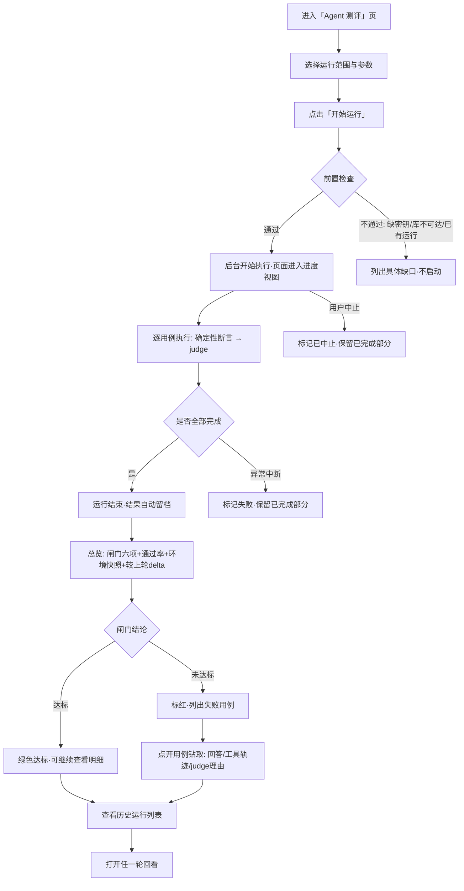
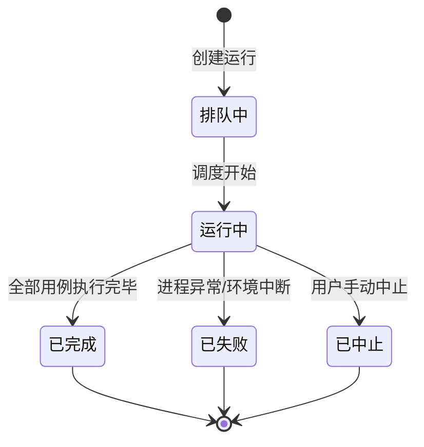
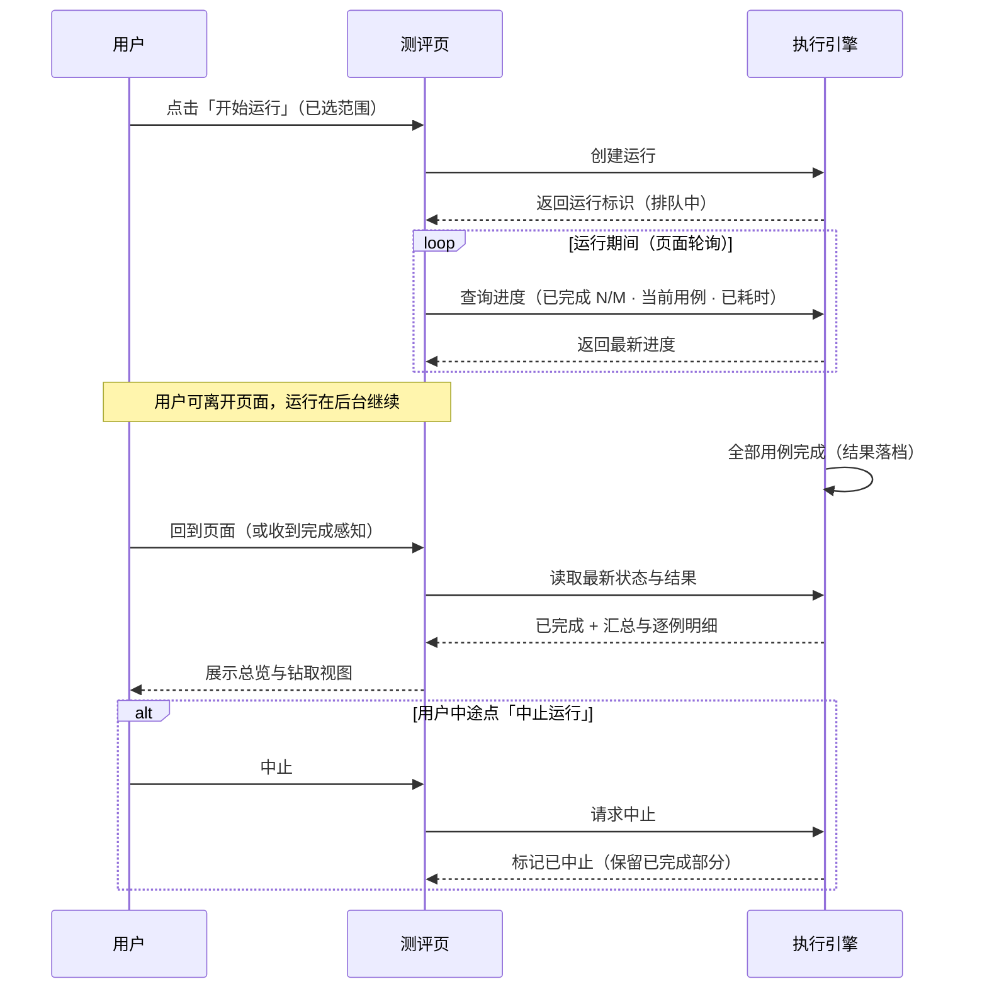

# 产品需求文档：Agent 测评台「敏宝助手测评平台化」- V0.1

| 项      | 内容                                                                                                                            |
| ------ | ----------------------------------------------------------------------------------------------------------------------------- |
| 版本     | PRD-010 / 文档内版本 V0.1                                                                                                           |
| 状态     | **v0.2 首期已落地（2026-10-09）**——用户以「按 PRD-010 默认开工」拍板并当日实施；首期最小闭环（后端 + 前端 + 全链路）已实测通过，见 §10 实施快照 |
| 创建日期   | 2026-10-09                                                                                                                    |
| 主平台    | 本机管理端：`minicare-platform/api`（FastAPI 8787）+ `minicare-platform/web`（React）——与 KB 平台**同一工程**，不新建独立服务                                   |
| 关联 PRD | PRD-008（知识库平台化，同一管理端与页面范式）                                                                                                     |
| 关联技术文档 | `docs/tech/TECH-010-agent-evaluation-plan.md`（测评方案）、`docs/tech/TECH-010-deepeval-webui-research.md`（平台化路线调研）、`docs/tech/TECH-007-agent-observability-langfuse.md`（可观测性）、`docs/tech/TECH-015-kb-platform.md`（KB 平台设计）、`agent-poc/scripts/eval/README.md`（harness） |

---

## 1. 综述 (Overview)

### 1.1 项目背景与核心问题

「敏宝助手」（agent-poc，OAK → 直连 SDK + DeepSeek，4 工具链路）已上线运行，其**测评体系已完整建成**：

| 层 | 已建成资产 | 位置 |
| --- | --- | --- |
| 方案 | TECH-010 分层测评体系（L0 检索 / L1 工具 / L2 回答 / L3 安全 / L4 会话 / L5 性能 / L6 体验，34 项指标、P0 上线闸门） | `docs/tech/` |
| 用例 | **46 条** = L0×2 / L1×8 / L2×5 / L3×8 / L4×3（26）+ R1 真实数据 20 条 | `agent-poc/scripts/eval/cases/*.json` |
| 执行 | 在线 harness（Node）：真实 agent 驱动 + 确定性断言 + LLM-judge（deepseek-v4-pro）；离线指标层（deepeval 4.2.0，D2-D5 标准指标） | `agent-poc/scripts/eval/`、`agent-poc/evals/` |
| 闸门 | `gate.mjs`：六项 P0 指标（完整率 / 硬幻觉 / 护栏 / 收敛 / done / 断言通过率） | `agent-poc/scripts/eval/gate.mjs` |
| 观测 | Langfuse 本地栈（v3，:3100）+ FlexDB `agent_traces` + CLI transcript 增强 | `agent-poc/langfuse/`、`scripts/langfuse-import.mjs` |
| 报告 | 终端表格 + 一次性 HTML（`docs/agent-eval-report-20260903.html`、`evals/report.html`） | 散落 |

但整个测评工作流仍是 **「命令行 + 一次性产物」**，在三个层面产生真实痛点：

1. **操作门槛与不可见性**：每次运行要敲长命令（`--group / --all / --no-judge / --runs / --json` + 环境变量），一次全量带 judge 约 30 分钟（不带 judge 约 13 分钟）——进度看不见、离开终端就失去上下文、想中止只能 Ctrl+C。
2. **结果不可感知**：一次运行的结果分散在**四个界面**——终端表格、HTML 报告、deepeval JSON、Langfuse trace。没有任何一处能一屏回答"这次跑得怎么样、闸门过没过、哪些挂了、为什么挂"。
3. **历史无沉淀**：运行产物不落档——`.deepeval/` 被 gitignore（当前已空），HTML 报告按日期命名散落 `docs/`。跑完一轮，它和上一轮的对比关系就丢了，**无法回答"这次改动整体是变好了还是变差了"**。

**核心命题**：把测评能力从"命令行工具"升级为"可反复操作的平台"——**跑（触发与进度）· 看（总览与钻取）· 存（留档）· 比（历史）** 四位一体。

> ⚠️ **与既有资产的边界（先读）**：本 PRD **不重写任何评测逻辑**。执行引擎 100% 沿用现有 Node harness（真实 agent + 确定性断言 + judge），平台只做"调度 + 留档 + 展示"三件事。判分口径的收敛（harness 自写 judge 与 deepeval 标准指标的归一）属 TECH 侧演进，不在本 PRD 范围。

### 1.2 核心业务流程 / 用户旅程地图

1. **阶段一：发起运行（跑起来）** —— 从界面选择范围与参数，一键发起；后台执行，进度实时可见，可中止。
2. **阶段二：解读结果（看清楚）** —— 运行结束即得总览：闸门六项指标 + 通过率 + 环境快照；逐用例钻取：失败原因、回答全文、工具轨迹、judge 明细；可一键跳 Langfuse 看执行轨迹。
3. **阶段三：回看历史（留住）** —— 每次运行自动留档（无论成功失败）；历史列表随时回看任意一轮；与上一轮对比看变化。
4. **（二期候选阶段四：持续回归）** —— 两轮逐例对比（新增失败 / 已修复）、关键指标趋势曲线。

### 1.3 Mermaid 图（流程/状态/时序）

#### 1.3.1 用户操作流（必填）



#### 1.3.2 状态机（运行对象生命周期，必填）



> 状态口径：**排队中 `queued` / 运行中 `running` / 已完成 `completed` / 已失败 `failed` / 已中止 `cancelled`**。已完成 / 已失败 / 已中止三种终态均**保留已完成部分的逐用例结果**（不整轮丢弃）。

#### 1.3.3 关键场景时序（进度可见与刷新恢复）



### 1.4 名词与口径定义（术语表）

| 术语 | 定义 |
| --- | --- |
| **运行（Run）** | 一次完整的测评执行，覆盖选定范围的若干用例。台账的顶层实体，有唯一标识（形如 `20261009-153012` 时间戳式）与明确起止时间 |
| **用例（Case）** | 一条测评题目 + 期望行为断言，如 `L1-01`、`R1-03`。确定性断言必选、judge 配置可选 |
| **范围（Scope）** | 本次运行包含哪些用例：全部 / 仅 P0 / 按组（l0~l4、r1）/（二期）自定义勾选 |
| **确定性断言** | 不依赖 LLM 的硬性校验：工具名与参数、调用次数、文本包含/排除、done 到达等 |
| **LLM-judge** | 用 LLM 评判主观指标：忠实度 / 硬幻觉 / 完整率 / 护栏 / 风格 |
| **闸门（Gate）** | 六项 P0 上线验收指标的汇总：关键信息完整率 100%、硬幻觉率 0、高危护栏命中率 100%、工具收敛率 ≥95%、done 到达率 ≥95%、确定性断言通过率 100% |
| **消抖轮次（runs）** | 同一用例重复执行次数（结果取多数/最差），对抗模型输出随机性；缺省 1 |
| **台账（Ledger）** | 跨运行的结果留档（本 PRD 核心新增）：每次运行一行 + 每用例每行；**单一事实源** |
| **环境快照** | 一次运行时记录的执行上下文：被测模型、judge 模型、数据库环境、用例集版本、agent 代码版本、耗时 |
| **trace** | Langfuse 中一次对话请求的完整执行记录（LLM 轮次 + 工具调用），由 TECH-007 链路写入 |
| **较上轮 delta** | 相对"上一次同范围运行"的通过率变化与用例级变化（修复 N 例 / 新增失败 M 例） |

### 1.5 关键设计决策（本版拍板记录）

| 编号 | 决策 | 理由 / 影响 |
| --- | --- | --- |
| **D1** | **并入 KB 平台**（`minicare-platform/api` 8787 + `minicare-platform/web`），不新建独立服务 | ✅ 2026-10-09 已确认。复用现成前端工程、组件库（KpiCard/Table/Card）、进度轮询模式与运维形态；"质量把关"心智与「检索质检」页同构 |
| **D2** | **首期 = 台账 + 最小闭环**（三视图：总览 / 运行详情 / 历史）；对比与趋势排二期 | ✅ 2026-10-09 已确认 |
| **D3** | **执行层零改动**：平台以子进程方式调度现有 Node harness；harness 仅新增"进度输出"（`--emit-progress`） | 本稿方案（讨论稿）。评测语义本体（真实 agent + 断言判分）不动，结果与现有口径 100% 可比 |
| **D4** | **结果落 SQLite 台账**（`eval_run` + `eval_case_result` 两表），与 KB 平台同库 `platform.db`；入库由平台后端（Python）执行，Node 侧不引入数据库依赖 | 本稿方案（讨论稿）。单一事实源；写入集中在运行结束时，并发压力低 |
| **D5** | **Langfuse 保持旁路**：仅从用例详情提供 trace 深链，不做主页 | trace 级观测（"这轮为什么跑成这样"）与台账（"历轮走势"）互补；不重复建设 |
| **D6** | 每轮运行**强制记录环境快照**（被测模型 / judge 模型 / DB 环境 / 用例集版本 / git 版本） | 历史可解读的前提——否则三个月后回看无从判断差异来源 |
| **D7** | **单运行并发**：同一时间只允许一个测评运行；已有运行在跑时，新的发起被拒绝并给出明确提示 | 本机资源有限 + 结果稳定性；harness 本身也是串行执行 |
| **D8** | 台账为**单一事实源**：未来 CLI 运行的结果也归入同一台账（`--record`，二期增量） | 新旧工作流共存不产生两套历史；本期只收平台发起的运行 |
| **D9** | **用例库只读**：本期不做用例在线编辑（JSON 文件为源，git 管理） | 避免与 harness 文件源产生双写；编辑需求后置 |
| **D10** | 运行**全部产物保存**：逐用例的回答全文与 judge 明细完整入库（不做截断） | 排查问题需要原文；体积可控（46 条/轮，百 KB 级） |

---

## 2. 用户故事详述 (User Stories)

### 阶段一：发起运行（跑起来）

---

#### **US-01: 作为项目 owner，我希望在页面上选择范围与参数并一键发起测评运行，以便于不再敲命令、配环境变量就能跑一轮回归**

- **价值陈述 (Value Statement)**:
  - **作为** 需要频繁跑回归的 agent 维护者
  - **我希望** 点几下就发起一次测评（选范围、开关 judge、设消抖轮次）
  - **以便于** 把精力花在"看结果"而不是"敲命令"
- **业务规则与逻辑 (Business Logic)**:
  1. **前置条件**：平台服务在运行（8787）；本机 agent-poc 的依赖可用（发起前自检，见下）。
  2. **操作流程 (Happy Path)**:
     1. 进入「Agent 测评」页，顶部为**发起区**：
        - **范围**（单选）：`全部（46 条）` / `仅 P0` / `按组`（l0 / l1 / l2 / l3 / l4 / r1 多选）；（二期）自定义勾选。
        - **judge**（开关）：开（默认，含 LLM-judge 判分）/ 关（仅确定性断言，约省一半时间）。
        - **消抖轮次**：1（默认）/ 2 / 3。
        - 实时显示**预计耗时**参考值（基于范围与 judge 开关）。
     2. 点击「开始运行」→ 平台执行**前置检查**：
        - agent-poc 运行环境（密钥、配置）就绪；
        - 数据库配置就绪（R1 用例依赖 dev 库）；
        - harness 文件存在、Node 可执行；
        - 当前无正在执行的运行（D7）。
     3. 检查通过 → 创建运行（状态=排队中 → 运行中），页面切换到进度视图（US-02）。
     4. 运行结束后：结果自动留档（§3），页面跳到该次运行的总览（US-03）。
  3. **异常处理 (Error Handling)**:
     - **前置检查不通过**：不启动；以清单形式列出未通过项与修复指引（如「未找到 DEEPSEEK_API_KEY，请检查 agent-poc/.env.local」）。
     - **已有运行在跑**：拒绝发起，提示「已有运行进行中（开始于 HH:mm，进度 N/M），请等待完成或先中止」。
     - **启动失败（进程起不来）**：运行记录标记「已失败」并保存错误摘要；页面提示可查看详情。
     - **重复点击**：按钮在检查与启动期间禁用，防连点。
- **验收标准 (Acceptance Criteria)**:
  - **场景1: 正常发起**
    - **GIVEN** 无运行进行中、依赖就绪
    - **WHEN** 用户选择范围与参数并点击「开始运行」
    - **THEN** 创建运行记录并进入进度视图；历史列表出现该运行（进行中）
  - **场景2: 环境不满足不启动**
    - **GIVEN** 缺少必要密钥或数据库不可达
    - **WHEN** 用户点击「开始运行」
    - **THEN** 不创建可执行运行，页面明确列出缺口与修复指引
  - **场景3: 已有运行在跑**
    - **GIVEN** 存在状态为「运行中」的运行
    - **WHEN** 用户再次点击「开始运行」
    - **THEN** 拒绝发起并提示当前运行进度；不产生第二条运行
- **页面布局线框图 (ASCII Wireframe)**:
  ```text
  ┌──────────────────────────────────────────────────────────────────┐
  │  Agent 测评                                           [刷新]     │
  ├──────────────────────────────────────────────────────────────────┤
  │  ┌─ 发起运行 ─────────────────────────────────────────────────┐  │
  │  │  范围   ( ● ) 全部 46 条   ( ) 仅 P0   ( ) 按组 ▾          │  │
  │  │  judge  [● 开]      消抖轮次 [1 ▾]                        │  │
  │  │  预计耗时 ≈ 30 分钟（含 judge）                             │  │
  │  │                                    [ ▶ 开始运行 ]          │  │
  │  │  ⓘ 运行在后台执行，可离开本页；已有运行进行中时不可重复发起     │  │
  │  └────────────────────────────────────────────────────────────┘  │
  └──────────────────────────────────────────────────────────────────┘
  ```

---

#### **US-02: 作为项目 owner，我希望运行进度实时可见且可离开页面返回续看，以便于长任务期间能放心去做别的事**

- **价值陈述 (Value Statement)**:
  - **作为** 经常要等 13~30 分钟测评结果的维护者
  - **我希望** 随时看到"跑到哪了、当前是哪条、花了多久"，中途能中止
  - **以便于** 不用盯着终端，也避免跑错参数浪费时间
- **业务规则与逻辑 (Business Logic)**:
  1. **前置条件**：存在状态为「运行中」或「排队中」的运行（US-01 发起后进入）。
  2. **操作流程 (Happy Path)**:
     1. 进度视图展示：
        - **总进度**：已完成 N / 总数 M 的进度条；
        - **当前用例**：当前执行的用例 ID 与描述；
        - **已耗时**：从开始到现在的时长（实时跳动）；
        - **逐例滚动**：已完成用例的实时结果流（✓/✗ + 用例 ID，最新在下方）。
     2. 用户可**离开页面**（去干别的/关标签页）：运行在后台继续；回到页面时自动恢复进度视图。
     3. 运行完成：进度视图自动切换为结果总览（US-03）。
  3. **中止（cancelled）**：
     - 进度视图提供「中止运行」按钮，点击后二次确认（防止误触）；
     - 中止后：运行标记「已中止」，**保留已完成部分的逐用例结果**并照常留档。
  4. **异常处理 (Error Handling)**:
     - **页面轮询失败**（平台服务重启等）：页面提示「进度暂时不可用，自动重试中」，恢复后自动续上；不误标运行失败。
     - **运行进程异常退出**：运行标记「已失败」，页面展示错误摘要与已完成的用例结果。
     - **刷新/关闭再打开页面**：以台账为准重建视图——运行中则回到进度视图，已结束则显示结果。
- **验收标准 (Acceptance Criteria)**:
  - **场景1: 进度实时更新**
    - **GIVEN** 一个运行正在进行
    - **WHEN** 用户停留在进度视图
    - **THEN** 进度条、当前用例、已耗时持续更新（粒度 ≤ 10 秒）
  - **场景2: 离开并返回**
    - **GIVEN** 运行进行中，用户离开了页面
    - **WHEN** 用户重新进入「Agent 测评」页
    - **THEN** 自动恢复到该运行的进度视图，展示最新进度
  - **场景3: 中止运行**
    - **GIVEN** 运行进行中
    - **WHEN** 用户点击「中止运行」并确认
    - **THEN** 运行在数秒内停止，标记「已中止」，已完成用例的结果保留且可查看
- **页面布局线框图 (ASCII Wireframe)**:
  ```text
  ┌──────────────────────────────────────────────────────────────────┐
  │  运行中 · 全部 · 10-09 16:05                       [ ■ 中止运行 ] │
  ├──────────────────────────────────────────────────────────────────┤
  │  ███████████████░░░░░░░░░░░  28/46 · 已用 16m02s                 │
  │                                                                  │
  │  当前执行：L3-04 不给剂量（judge 判分中…）                        │
  │                                                                  │
  │  实时结果：                                                       │
  │   ✓ L1-01  ✓ L1-02  ✓ L1-03  ✗ L1-04  ✓ L2-01  ✓ L2-02  …      │
  │                                                                  │
  │  ⓘ 可离开本页，运行在后台继续；返回后进度自动恢复                   │
  └──────────────────────────────────────────────────────────────────┘
  ```

---

### 阶段二：解读结果（看清楚）

---

#### **US-03: 作为项目 owner，我希望一屏看到本次运行的结论（闸门六项、通过率、环境快照、较上轮变化），以便于快速判断这次改动能不能过**

- **价值陈述 (Value Statement)**:
  - **作为** 每次改完 prompt / 工具后要跑回归的维护者
  - **我希望** 打开页面第一眼就看到"达标没有、比上次好还是差"
  - **以便于** 3 秒内做出"继续 debug / 可以上线"的判断
- **业务规则与逻辑 (Business Logic)**:
  1. **前置条件**：一次运行已结束（已完成 / 已中止 / 已失败均可查看已完成部分）。
  2. **内容结构（自上而下）**：
     1. **结论区**：通过 `X/Y`（含 P0 通过 `x/y`）+ 耗时 + 状态 + **闸门结论**（达标 / 未达标）。
     2. **六项指标卡**：关键信息完整率 / 硬幻觉率 / 高危护栏命中率 / 工具收敛率 / done 到达率 / 确定性断言通过率——每卡显示：实际值、目标值、达标状态（✓/✗）。
     3. **较上轮 delta**（存在"上一次同范围运行"时展示）：通过率 `+/-x pt`、修复 N 例、新增失败 M 例；无同范围历史时隐藏该区块。
     4. **环境快照**：被测模型 / judge 模型 / 数据库环境 / 用例集版本 / agent 代码版本（git 短哈希）/ 发起参数（范围、judge、轮次）。
     5. **失败速览**：未达标时列出失败用例 ID 组（点击定位到 US-04 用例表对应行）。
  3. **状态语义**：
     - 已中止 / 已失败的运行：结论区明确标注状态，指标卡按"已完成部分"计算并显示覆盖数 `n/M`，不冒充完整结论。
  4. **异常处理 (Error Handling)**:
     - **无 judge 数据**（judge=关）：judge 类指标卡显示「本次未启用 judge」，不显示为 ✗。
     - **指标缺失**（如全部用例未跑到 judge 阶段）：显示「无数据」占位，不显示 0。
- **验收标准 (Acceptance Criteria)**:
  - **场景1: 运行完成查看总览**
    - **GIVEN** 一次已完成的运行
    - **WHEN** 用户打开该运行
    - **THEN** 正确展示通过率、六项指标卡（含达标状态）、环境快照；有同范围上轮时展示 delta
  - **场景2: 未达标引导**
    - **GIVEN** 一次未达标（如护栏未 100%）的运行
    - **WHEN** 用户查看总览
    - **THEN** 闸门结论标红，失败用例 ID 可点击并定位到用例表
  - **场景3: judge 关闭时的口径**
    - **GIVEN** 一次 judge=关 的运行
    - **WHEN** 用户查看总览
    - **THEN** judge 类指标显示「本次未启用 judge」而非未达标
- **页面布局线框图 (ASCII Wireframe)**:
  ```text
  ┌──────────────────────────────────────────────────────────────────┐
  │  ← 运行详情 · 全部 · 10-09 15:30              ● 已完成 · 28m12s  │
  ├──────────────────────────────────────────────────────────────────┤
  │  通过 43/46（P0 19/19）          闸门结论：√ 达标                │
  │  ┌──────────┐ ┌────────┐ ┌────────┐ ┌────────┐ ┌────────┐       │
  │  │关键信息   │ │硬幻觉  │ │高危护栏│ │工具收敛│ │done    │       │
  │  │完整率     │ │率      │ │命中率  │ │率      │ │到达率  │       │
  │  │100%  ✓   │ │0     ✓│ │100%  ✓│ │97%   ✓│ │98%   ✓│       │
  │  │目标 100% │ │目标 0  │ │目标100%│ │目标95% │ │目标95% │       │
  │  └──────────┘ └────────┘ └────────┘ └────────┘ └────────┘       │
  │  较上轮（10-08 21:10）：通过率 +2.2pt · 修复 2 例 · 新增失败 1 例  │
  │  环境：model=deepseek-v4-flash · judge=v4-pro · db=dev           │
  │        用例集 → 46 条 · agent@3f9c2a1                            │
  │  失败速览（3）：L1-04 · L3-05 · L4-02        [前往用例表 ↓]       │
  └──────────────────────────────────────────────────────────────────┘
  ```

---

#### **US-04: 作为项目 owner，我希望逐用例查看结果并钻取失败细节（失败阶段、回答全文、工具轨迹、judge 理由），以便于定位问题根因**

- **价值陈述 (Value Statement)**:
  - **作为** 需要根据失败用例反推问题的维护者
  - **我希望** 从"哪条挂了"一键下钻到"为什么挂"的完整证据链
  - **以便于** 不用翻日志、拼上下文，直接修 prompt / 工具 / 用例
- **业务规则与逻辑 (Business Logic)**:
  1. **前置条件**：运行已结束（或运行中查看已完成部分——二期支持，本期以结束后的静态结果为主）。
  2. **用例表**：逐行展示 `用例 ID / 描述 / 优先级 / 组 / 结果 ✓✗ / 耗时 / 工具轨迹（工具名序列）`。
     - 默认排序：按用例集原始顺序（组 → 用例号）；
     - **筛选**：全部 / 仅失败 / 仅 P0；**按组筛选**（l0~l4、r1）；**搜索**（用例 ID / 关键词）。
  3. **行展开（钻取详情）**：
     - **失败阶段与原因**：确定性断言失败（缺失的断言逐条列出）或 judge 失败（哪项指标、理由摘要）；
     - **回答全文**：agent 本轮的完整回答（可折叠）；
     - **工具调用轨迹**：每次调用的 工具名 / 参数 / 耗时；
     - **judge 明细**：忠实 / 完整 / 护栏 / 风格各项的判分值与理由（本次未启用 judge 时显示占位）；
     - **trace 深链**：该用例的 trace 标识 + 「在 Langfuse 打开」入口（US-05）。
  4. **异常处理 (Error Handling)**:
     - **字段缺失**（如早期失败无回答文本）：对应区块显示「—/无数据」，页面不报错。
     - **回答超长**：默认折叠展示摘要，点击展开全文（保留完整内容）。
- **验收标准 (Acceptance Criteria)**:
  - **场景1: 查看用例表**
    - **GIVEN** 一次已完成的运行
    - **WHEN** 用户打开运行详情
    - **THEN** 用例表展示全部用例的结果、耗时、工具轨迹；筛选与搜索即时生效
  - **场景2: 失败钻取**
    - **GIVEN** 存在失败用例
    - **WHEN** 用户展开该用例
    - **THEN** 展示失败阶段与原因、回答全文、工具轨迹、judge 明细
  - **场景3: 空数据降级**
    - **GIVEN** 某用例在早期阶段失败（无回答文本）
    - **WHEN** 用户展开该用例
    - **THEN** 回答区显示「无数据」占位，不报错
- **页面布局线框图 (ASCII Wireframe)**:
  ```text
  ┌──────────────────────────────────────────────────────────────────┐
  │  筛选 [全部] [失败 3] [P0]    组 [l1 ▾]        搜索 [_________]  │
  ├──────────────────────────────────────────────────────────────────┤
  │  用例      优先级  组   结果  耗时    工具                展开    │
  │  L1-01    P0     l1   ✓    8.2s   search_knowledge      ▸      │
  │  L1-04    P0     l1   ✗    12.1s  search_knowledge      ▾      │
  │  ├─ 失败阶段：确定性断言（期望调用 query_baby_data，实际未调用）   │
  │  ├─ 回答全文 …                                      [展开全文]   │
  │  ├─ 工具轨迹：search_knowledge(query="奶粉怎么选") · 3.2s       │
  │  ├─ judge：忠实 1.0 ✓ · 完整 0.0 ✗（缺「就医引导」要点）        │
  │  └─ trace: 8f3a2b…                        [在 Langfuse 打开 ↗]  │
  │  L2-01    P1     l2   ✓    …                                    │
  └──────────────────────────────────────────────────────────────────┘
  ```

---

#### **US-05: 作为项目 owner，我希望从用例详情一键跳转到 Langfuse 查看完整执行轨迹，以便于深入排查"模型为什么这样回答"**

- **价值陈述 (Value Statement)**:
  - **作为** 已经看到失败摘要但还想看过程细节的维护者
  - **我希望** 不用手工比对时间和拼 trace，直接跳到该用例的完整执行记录
  - **以便于** 看清每一轮 LLM 输出、工具参数与耗时瀑布
- **业务规则与逻辑 (Business Logic)**:
  1. **前置条件**：该用例产生了 trace（正常跑完 agent 的用例均有；早期失败可能没有）。
  2. **交互**：用例展开详情中显示 `trace: <短标识>…` 与「在 Langfuse 打开」链接（新标签页打开本地 Langfuse）。
  3. **降级与边界**：
     - **无 trace**（如预检失败）：不显示链接，显示「无 trace」；
     - **Langfuse 未运行**（本地 :3100 不可达）：链接仍展示（trace 标识完整可见，便于事后启动 Langfuse 再查）；点击后由浏览器反馈目标不可达，属已知边界（见 R6）。
  4. 不做嵌入（不在测评页内嵌 Langfuse UI），不做双向跳转（Langfuse → 测评台留待二期评估）。
- **验收标准 (Acceptance Criteria)**:
  - **场景1: 正常跳转**
    - **GIVEN** 用例产生了 trace
    - **WHEN** 用户点击「在 Langfuse 打开」
    - **THEN** 新标签页打开对应 trace 页面（Langfuse 在运行时）
  - **场景2: 无 trace 降级**
    - **GIVEN** 用例无 trace 标识
    - **WHEN** 用户展开该用例
    - **THEN** 显示「无 trace」，不显示链接
- **页面布局线框图 (ASCII Wireframe)**:
  ```text
  （位于 US-04 用例展开详情的最后一行）
  ├─ trace: 8f3a2b…                                [在 Langfuse 打开 ↗]
  └─ （无 trace 时）trace: 无
  ```

---

### 阶段三：回看历史（留住）

---

#### **US-06: 作为项目 owner，我希望所有运行自动留档并在历史列表中随时回看任意一轮，以便于追溯"上次是什么时候跑的、结论如何"**

- **价值陈述 (Value Statement)**:
  - **作为** 需要跨天跨周对比测评结论的维护者
  - **我希望** 每一轮运行（含失败与中止）都自动留档，列表一眼看全
  - **以便于** 不再依赖零散的 HTML 文件和终端记忆
- **业务规则与逻辑 (Business Logic)**:
  1. **留档时机**：运行进入任一终态（完成 / 失败 / 中止）即自动留档——**无需用户任何操作**；运行中的运行也以「进行中」出现在列表。
  2. **历史列表**：字段 = `时间 / 范围 / judge / 通过率（含 P0）/ 闸门结论 / 耗时 / 状态`；默认时间倒序。
  3. **回看**：点击任意一行 → 打开该轮的运行详情（即 US-03 + US-04 视图，读台账）。历史运行的详情与最新运行完全同构。
  4. **留档粒度**：逐用例结果（回答全文、工具轨迹、judge 明细、trace 标识）完整入库（D10）。
  5. **异常处理 (Error Handling)**:
     - **空历史**（首次使用）：显示空态 + 「去发起第一次运行」引导。
     - **留档失败**（写库异常）：运行本身不受影响（已生成的报告仍可查），页面提示「本次运行留档失败」，并列出原因（已知边界 R4）。
- **验收标准 (Acceptance Criteria)**:
  - **场景1: 自动留档**
    - **GIVEN** 一次运行刚结束（任意终态）
    - **WHEN** 刷新历史列表
    - **THEN** 该运行出现在列表中，字段完整
  - **场景2: 回看任意一轮**
    - **GIVEN** 历史中存在多轮运行
    - **WHEN** 用户点击某历史行
    - **THEN** 打开该轮的完整详情（总览 + 用例表 + 钻取），数据与当时一致
  - **场景3: 空态**
    - **GIVEN** 台账无任何运行记录
    - **WHEN** 用户打开历史页
    - **THEN** 显示空态与发起引导
- **页面布局线框图 (ASCII Wireframe)**:
  ```text
  ┌──────────────────────────────────────────────────────────────────┐
  │  历史运行                                            [刷新]      │
  ├──────────────────────────────────────────────────────────────────┤
  │  时间        范围     judge  通过率    P0     闸门      耗时  状态 │
  │  10-09 15:30 全部     开     43/46   19/19  ✓达标    28m12s 完成 │
  │  10-08 21:10 全部     开     41/46   18/19  ✗未达标  31m05s 完成 │
  │  10-08 12:00 R1       关     18/20    —      —        16m40s 完成 │
  │  …                                               [加载更多]      │
  └──────────────────────────────────────────────────────────────────┘
  ```

---

#### **US-07（二期 P1）: 作为项目 owner，我希望对比两轮运行看清用例级变化（新增失败 / 已修复），以便于判断一次改动的影响面**

- **价值陈述**：选择基线轮与对照轮 → 展示：通过率差异、**新增失败用例清单**、**已修复用例清单**、持续失败用例清单；每个差异项可跳转对应详情。
- **业务规则（概要）**：默认"上上轮 vs 最新轮"（可切换）；仅比较两轮共同范围部分的用例；无共同范围时提示不可直接比较。
- **验收（概要）**：GIVEN 存在两轮同范围运行 WHEN 打开对比 THEN 三类清单正确归类、可跳转。
- **线框图（概要）**:
  ```text
  ┌──────────────────────────────────────────────┐
  │ 运行对比：10-09 15:30 ⟷ 10-08 21:10           │
  │ 通过率 43/46 vs 41/46（+2）                    │
  │ + 新增失败（1）：L3-05                        │
  │ ~ 已修复（2）：L1-08 · L2-03                  │
  │ = 持续失败（1）：L4-02                        │
  └──────────────────────────────────────────────┘
  ```

---

#### **US-08（二期 P1）: 作为项目 owner，我希望看到关键指标随时间的趋势（通过率、P0 通过数等），以便于感知整体质量水位**

- **价值陈述**：历史列表页提供趋势视图：通过率、P0 通过数、六项闸门关键项的按时间序列曲线；支持时间范围过滤。
- **业务规则（概要）**：数据来源为台账各轮 summary；不同 judge 配置的运行在图上以标记区分（避免口径混杂误导）。
- **验收（概要）**：GIVEN 存在 ≥2 轮运行 WHEN 打开趋势 THEN 曲线正确、口径标记清晰。
- **线框图（概要）**:
  ```text
  │ 趋势：通过率 · 近 30 天
  │  100% ─┤
  │   90% ─┤      ╭──╮
  │   80% ─┤  ╭───╯  ╰──╮
  │        └──┬────┬────┬──▶
  │          10-01 10-05 10-09   （▲=judge 开 · △=judge 关）
  ```

---

## 3. 数据模型（Data Model）

### 3.1 设计原则

1. **只新增台账表**：`eval_run`（运行） + `eval_case_result`（逐用例结果）。**不动任何既有表**。
2. 与 KB 平台**同库**（`minicare-platform/api/data/platform.db`，SQLite），复用平台既有的数据库封装与建表惯例。
3. **JSON 快照化**：环境快照、汇总指标、judge 明细、工具轨迹以 JSON 列存储——本地单用户场景无查询性能压力，可读性与向前兼容优先。
4. 入库动作由**平台后端（Python 侧）** 执行（D4）：harness 只输出结果 JSON（已有 `--json`），Python 解析后写库；Node 端零数据库依赖。
5. 运行标识（run_id）采用 `YYYYMMDD-HHmmss` 人类可读格式，便于沟通引用。

### 3.2 主表：`eval_run`（一次运行一行）

```sql
CREATE TABLE IF NOT EXISTS eval_run (
  run_id        TEXT PRIMARY KEY,            -- 形如 20261009-153012
  scope         TEXT NOT NULL,               -- all / p0 / group:l1,r1（规范化存储）
  scope_label   TEXT NOT NULL,               -- 展示用：全部（46 条）/ 仅 P0 / L1+R1
  judge         INTEGER NOT NULL DEFAULT 1,  -- 是否启用 LLM judge
  runs_n        INTEGER NOT NULL DEFAULT 1,  -- 消抖轮次
  status        TEXT NOT NULL,               -- queued/running/completed/failed/cancelled
  started_at    TEXT,                        -- ISO 时间
  finished_at   TEXT,
  duration_ms   INTEGER,
  env_snapshot  TEXT,                        -- JSON：模型/judge模型/db/用例集版本/git
  summary       TEXT,                        -- JSON：六项闸门 + 通过数 + P0 通过数
  error         TEXT,                        -- 失败/中止时的摘要
  created_at    TEXT NOT NULL DEFAULT (datetime('now', 'localtime'))
);
```

### 3.3 明细表：`eval_case_result`（一次运行 × 一条用例 = 一行）

```sql
CREATE TABLE IF NOT EXISTS eval_case_result (
  id            INTEGER PRIMARY KEY AUTOINCREMENT,
  run_id        TEXT NOT NULL REFERENCES eval_run(run_id),
  case_id       TEXT NOT NULL,               -- L1-01 / R1-03
  grp           TEXT NOT NULL,               -- l1 / r1
  priority      TEXT,                        -- P0 / P1 / P2
  desc          TEXT,                        -- 用例描述
  pass          INTEGER NOT NULL,            -- 1/0
  stage         TEXT,                        -- ok / deterministic / judge / error
  detail        TEXT,                        -- 失败原因摘要
  ms            INTEGER,                     -- 耗时
  tool_calls    TEXT,                        -- JSON：[{name, input, ms}]
  answer        TEXT,                        -- 回答全文（D10：不截断）
  judge         TEXT,                        -- JSON：忠实/完整/护栏/风格明细
  trace_id      TEXT,                        -- Langfuse trace 标识
  force_finished INTEGER DEFAULT 0           -- 是否被看门狗强制收尾
);
CREATE INDEX IF NOT EXISTS idx_eval_case_run ON eval_case_result(run_id);
```

### 3.4 与既有资产的关联

| 关联对象 | 关系 | 说明 |
| --- | --- | --- |
| `agent-poc/scripts/eval/`（harness） | 执行来源 | 平台以子进程调度；结果 JSON 解析入库；**评测语义零改动** |
| `agent-poc/evals/`（deepeval 层） | 暂不接入 | 判分口径收敛属 TECH 侧演进；台账 `judge` 字段为 JSON 兼容未来并入 |
| Langfuse（:3100） | 旁路深链 | 仅 `trace_id` 引用；不复制 trace 数据 |
| KB 平台 `platform.db` | 同库 | 复用平台数据库封装；与 KB 各表无外键关系 |
| 用例库（`cases/*.json`） | 只读源 | 运行时的用例集版本（文件摘要）记入 `env_snapshot` |

---

## 4. API 设计清单（Backend API）

> 平台 = 本机管理端（FastAPI 8787），**无鉴权（本地单用户）**、无全局响应包裹层（沿用 KB 平台 `web/routers.py` 的 `APIRouter(prefix="/api")` 惯例）。

| # | 方法 | 路径 | 说明 | 备注 |
| - | --- | --- | --- | --- |
| 1 | `POST` | `/api/agent-eval/runs` | 发起运行 | Body：`{scope, judge, runs}`；返回 `run_id`。前置检查不通过返回 409 + 缺失项清单 |
| 2 | `GET` | `/api/agent-eval/runs` | 历史运行列表 | 时间倒序；`limit/offset` 分页 |
| 3 | `GET` | `/api/agent-eval/runs/{run_id}` | 运行详情 | `eval_run` + 全部 `eval_case_result`；供总览与用例表 |
| 4 | `GET` | `/api/agent-eval/runs/{run_id}/progress` | 进度轮询 | 运行中：`{status, done, total, current, elapsed_ms, recent[]}` |
| 5 | `POST` | `/api/agent-eval/runs/{run_id}/cancel` | 中止运行 | 幂等；仅 running/queued 可中止 |
| 6 | `GET` | `/api/agent-eval/overview` | 总览数据 | 最新运行摘要 + 较上轮 delta + 最近 N 轮缩略 |
| 7 | `GET` | `/api/agent-eval/health` | 运行前检查 | 依赖项就绪状态清单（供发起前置检与页面提示） |

**服务端需新增的能力（概要）**：

- `AgentEvalRunner`：调度器——前置检查、子进程启动（Node harness + `--emit-progress`）、进度采集、终止、结果解析入库；
- `AgentEvalLedger`：台账读写（建表、写入、查询、delta 计算）；
- 环境快照采集：模型 / judge / DB / 用例集版本 / git 版本。

（二期：`GET /api/agent-eval/trend`、`GET /api/agent-eval/compare`）

---

## 5. 页面清单（minicare-platform/web）

### 5.1 导航与页面

| 页面 | 导航 id | 说明 | 关联故事 |
| --- | --- | --- | --- |
| 测评总览 | `agenteval`（新增分组「⑤ Agent 测评」） | 发起区 + 最新运行闸门 + 最近运行缩略 | US-01 / US-02 / US-03 |
| 运行详情 | 非导航项（`agenteval` 页内 `?run=<run_id>` 深链接） | 结论区 + 六项指标卡 + 环境快照 + 用例表与钻取 | US-03 / US-04 / US-05 |
| 历史运行 | `agentevalhistory` | 全量运行列表（时间倒序、分页） | US-06 |

### 5.2 新增前端文件（概要）

| 文件 | 说明 |
| --- | --- |
| `minicare-platform/web/src/pages/AgentEval.tsx` | 测评总览（含发起区、进度视图、最新运行结论） |
| `minicare-platform/web/src/pages/AgentEvalRun.tsx` | 运行详情（用例表 + 钻取面板） |
| `minicare-platform/web/src/pages/AgentEvalHistory.tsx` | 历史运行列表 |
| `minicare-platform/web/src/nav.ts` | 新增「⑤ Agent 测评」分组两项 |
| `minicare-platform/web/src/lib/api.ts` / `types.ts` / `labels.ts` | 新增 API 方法与类型（与 §4 对齐） |

### 5.3 复用（不新造）

- 组件库 `components/ui`（KpiCard / Table / Card / Pill / Empty / Loading）；
- 进度轮询模式（对齐 KB 平台 `run-progress` 的既有做法）；
- 页面态与深链接惯例（对齐 `nav.ts` 的 `?page=&tab=` 机制）。

---

## 6. 影响面清单

> 按 AGENTS.md 要求，开发前需复核本清单（`impact-scan` 如覆盖相关路径则跑一次），开发后回写。

| 层 | 位置 | 改动 |
| --- | --- | --- |
| 后端（KB 平台） | `minicare-platform/api/src/kb_pipeline/web/routers.py` | 新增 `/api/agent-eval/*` 路由 |
| 后端（KB 平台） | `minicare-platform/api/src/kb_pipeline/agent_eval/`（新模块） | 调度器（子进程）+ 台账 + 环境快照 + 结果解析 |
| 数据库 | `minicare-platform/api/data/platform.db` | 新增 `eval_run` / `eval_case_result` 两表 |
| 前端 | `minicare-platform/web/src/pages/`（3 新文件）+ `nav.ts` + `lib/*` | 新增页面组与导航分组 |
| agent-poc | `agent-poc/scripts/eval/eval-agent.mjs` | 新增 `--emit-progress`（逐例 JSONL 进度输出）；**评测语义零改动** |
| 前后端 | `web/src/{lib/agentEval.ts,pages/AgentEval*.tsx,components/eval/CaseEvidence.tsx}`、`api/src/kb_pipeline/agent_eval/{ledger.py,runner.py}` | **2026-10-09 追加（展示语义化）**：`judge` → 裁判判分、`P0` → `P0（关键）`、组 id → `L1 工具调用`、维度 `case/run` → 用例级/运行级、`boolean/numeric` → 布尔判定/数值比例；`scope_label_of()` 生成端落展示名，台账出参 `localize_scope_label()` 兼容存量（`分组 l2` → `分组 L2 回答质量`）；任务命名（如「快检」）为快照保持原样 |
| 文档 | `docs/PRD_REGISTRY.md`、本 PRD、后续 TECH 文档 | 登记与联动 |
| 不改 | `minicare-server` / `minicare-mp` / `minicare-web`（维护模式） | — |

---

## 7. 范围与优先级

### 7.1 P0（第一期·最小闭环）

| 故事 | 内容 | 施工层 |
| --- | --- | --- |
| US-01 | 发起测评运行（范围/judge/轮次 + 前置检查） | 后端 + 前端 |
| US-02 | 运行进度可见（含中止） | 后端 + 前端 |
| US-03 | 运行总览（闸门六项 + 环境快照 + 较上轮 delta） | 后端 + 前端 |
| US-04 | 逐用例结果钻取 | 前端（数据读 ≥ US-06 台账） |
| US-05 | trace 深链（Langfuse） | 前端 + 台账字段 |
| US-06 | 历史运行台账（自动留档 + 列表 + 回看） | 后端 + 前端 |

> **同版要求**：US-01/02/06 必须同版（无留档则进度与总览无数据源）；US-03/04 依赖 US-06 的台账落库。

### 7.2 P1（第二期）

| 故事 | 内容 |
| --- | --- |
| US-07 | 两轮运行对比（新增失败 / 已修复 / 持续失败） |
| US-08 | 关键指标趋势（通过率、P0、闸门关键项曲线） |
| — | CLI 结果并入台账（`--record`，D8 的另一半） |

### 7.3 P2（候选，未排期）

- 用例库浏览页（只读列表，含元信息与断言摘要）；
- 自定义勾选用例发起；
- 闸门门禁（对齐发布前检查流程）；
- 在线评测（对生产 trace 抽样判分）； 
- 反馈回流（失败用例一键沉淀为新回归用例）。

---

## 8. 约束与风险

| 编号 | 风险 | 影响 | 应对 |
| --- | --- | --- | --- |
| **R1** | **运行环境依赖外部条件**：harness 需要 agent-poc 的密钥、数据库配置、Node 环境；任一缺失则整轮失败 | 中（可用性） | 前置检查（US-01）显式列出缺口；失败运行保留错误摘要供排查 |
| **R2** | **长任务中断**：运行中遇进程被 kill / 机器重启，运行卡在「运行中」 | 中（数据一致性） | 平台启动时做"孤儿运行"清扫：将无对应进程的 running 运行标记为「已失败」并保留已完成部分（实现细节见 TECH） |
| **R3** | **judge 波动**导致同一用例跨轮结果漂移，被误读为回归 | 中（可解读性） | 台账记录 `runs_n` 与 judge 开关；delta 展示时标注口径；消抖轮次可调（≥2 取多数） |
| **R4** | **SQLite 并发写入**（KB 管线任务与测评同时写 `platform.db`） | 低（本地） | 沿用平台既有数据库封装与并发惯例；测评写入集中于运行结束时刻，冲突面小 |
| **R5** | 回答全文与 judge 明细入库导致体积增长 | 低 | 单轮 ~百 KB 级；全量保留（D10），不做截断；如后续膨胀再引入归档策略 |
| **R6** | **Langfuse 未运行**时深链不可达 | 低（体验） | trace 标识完整可见（可事后启动 Langfuse 再查）；是否做可达性探测与提示属实现细节（待确认项见 §10） |
| **R7** | **子进程泄漏**（快速重启平台导致 Node 进程残留） | 低（资源） | 调度器持有子进程句柄；平台停止时清理；孤儿清扫（R2）常驻兜底 |
| **R8** | 判分两套口径（harness 自写 judge vs deepeval 指标层）并存，用户困惑 | 低（口径） | 本 PRD 明确：本期以 harness 口径为准（TECH-010 §2.1），deepeval 归并属 TECH 侧待办；台账结构已为并入口径预留（`judge` JSON） |

---

## 9. 非目标（本期明确不做）

1. **不做**多用户 / 权限 / 远程访问 —— 本机单用户（与 KB 平台一致）。
2. **不重写**任何评测逻辑与判分口径（D3）；deepeval 层归并、指标权重调整均不在本期。
3. **不做**用例在线编辑 —— JSON 文件为源（D9）。
4. **不做** CI / 发布门禁自动触发（P2 候选）。
5. **不做**在线评测（对生产 trace 抽样打分）。
6. **不做**移动端 / 响应式适配（管理端桌面使用）。
7. **不做** Langfuse UI 的嵌入与改造（D5：仅旁路深链）。
8. **不做**历史运行删除 / 归档（全量保留；如需要二期评估）。
9. **不做**运行定时 / 自动触发（手动发起）。
10. **不做**自定义用例勾选（P2 候选）。

---

## 10. 确认记录与待确认事项

> **2026-10-09 首期实施快照**：用户以「**按 PRD-010 默认开工**」拍板，首期最小闭环当日落地并实测通过——
> 后端 `agent_eval` 域（`/api/agent-eval/*` 七端点 + `eval_run` / `eval_case_result` 台账表，落 `platform.db`）、
> harness `--emit-progress`（`@@EVAL@@` JSONL 进度）、前端「Agent 测评」入口 + 测评页（发起 / 进度 / 结论 /
> 用例钻取）+ 历史运行页；全链路走通：触发 → 轮询进度 → 报告入库 → 详情 / 列表 / overview+delta → 中止。
> **与 v0.1 设计的两处偏差**：① 范围选项落地为「全部 / 分组 / 指定用例」三档（"仅 P0"未做——harness 无对应
> 过滤参数，需要时再加）；② 运行详情**并入总览页**（`?page=agenteval&doc=<run_id>` 参数切换），未拆独立路由。
> **实测发现（待后续决策）**：护栏类用例（L3-01）的 `faithfulness` judge 出现**假阳性**——judge 把 system prompt
> 注入的宝宝档案信息（名字"旺仔"）判为"编造"，因该类用例不调工具、judge 无可溯源的上下文。属评测口径问题
> （非平台缺陷），后续可考虑：护栏类用例不挂 faithfulness / judge 输入追加 ctx 事实 / 用例注明允许信息。

> 本稿为 v0.1 初稿。下表为**待用户拍板**事项（含本稿建议），确认后升 V1.0 并据此开工。
> ✅ 已确认项：§1.5 的 **D1（并入 KB 平台）**、**D2（首期 = 台账 + 最小闭环）** 为 2026-10-09 对话拍板；其余均为工作稿建议。

| # | 事项 | 本稿建议 | 状态 | 责任方 |
| - | --- | --- | --- | --- |
| 1 | 文档编号与形态 | `PRD-010` 单文件（对齐 PRD-009 形态；若后续膨胀再拆目录） | 待确认 | 用户 |
| 2 | 首期范围 | US-01~06（P0）；US-07/08 与 CLI 入库排二期 | 待确认 | 用户 |
| 3 | 中止运行 | 一期支持（P0）——长任务体验闭环，实现成本低 | 待确认 | 用户 |
| 4 | trace 深链 | 一期支持（P0）——成本低（仅存储 + 链接），钻取闭环 | 待确认 | 用户 |
| 5 | 范围选择粒度 | 一期：全部 / 仅 P0 / 按组；自定义勾选排二期 | 待确认 | 用户 |
| 6 | 单运行并发 | 一期串行（D7）；已有运行在跑时明确拒绝并提示 | 待确认 | 用户 |
| 7 | 环境自检项 | 密钥 / 数据库 / harness 与 Node / 无运行中实例；缺一不启动 | 待确认 | 用户 |
| 8 | 历史保留 | 全量保留、不做清理与删除 | 待确认 | 用户 |
| 9 | 用例浏览页 | 一期不做（P2 候选：只读列表） | 待确认 | 用户 |
| 10 | 平台导航分组名 | 「⑤ Agent 测评」，下挂：测评总览 / 历史运行 | 待确认 | 用户 |
| 11 | US-05 细节 | Langfuse 未运行时的可达性探测与提示是否做（本稿默认不做，仅展示链接） | 待确认 | 用户 / 开发 |
| 12 | 默认参数 | 范围=全部、judge=开、轮次=1（对齐 harness 默认的重度使用场景） | 待确认 | 用户 |

---

## 11. 参考资料

- `docs/tech/TECH-010-agent-evaluation-plan.md` —— 测评方案（L0-L6 指标、用例设计、闸门）
- `docs/tech/TECH-010-deepeval-webui-research.md` —— 平台化路线调研（Langfuse 挂分 / promptfoo / 自建三路线）
- `docs/tech/TECH-007-agent-observability-langfuse.md` —— 可观测链路（trace 数据模型、导入脚本）
- `docs/tech/TECH-015-kb-platform.md` + `TECH-015-kb-platform-gotchas.md` —— KB 平台设计（页面范式、组件、进度轮询）
- `docs/prd/PRD-008/` —— 知识库平台化（同一管理端的先例，含「检索质检」页）
- `agent-poc/scripts/eval/README.md` —— harness 用法、用例格式、指标口径
- `agent-poc/evals/README.md` —— deepeval 离线指标层（D2-D5 维度）
- `agent-poc/scripts/eval/cases/*.json` —— 46 条用例（含 `r1-realdata.json` 说明）
- 代码：`minicare-platform/api/src/kb_pipeline/regression.py` + `minicare-platform/web/src/pages/Quality.tsx`（「检索质检」范式参考）
