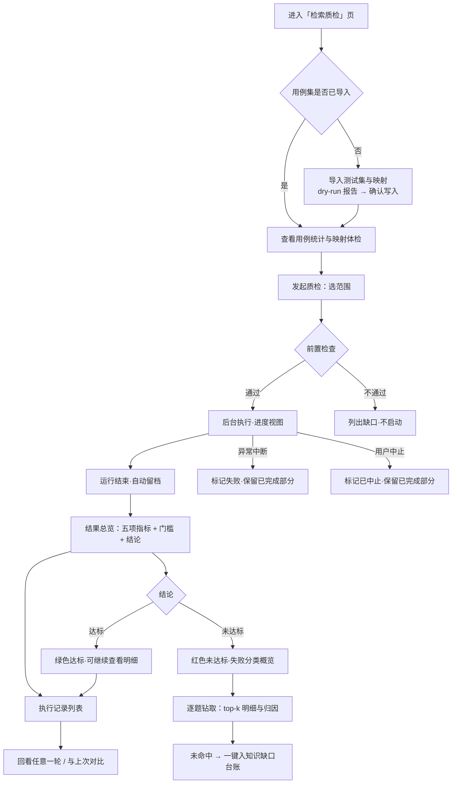
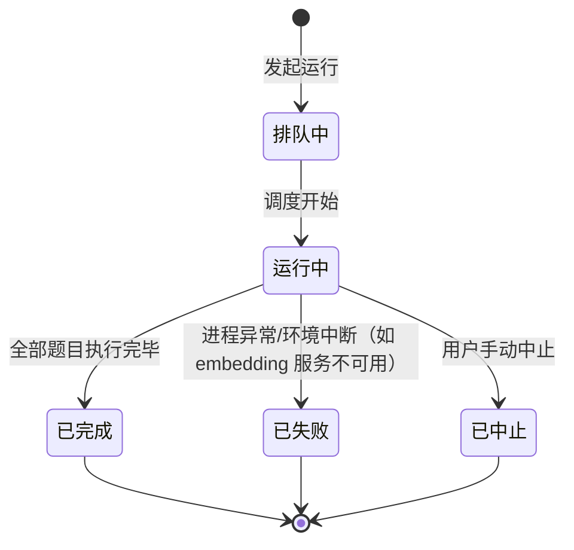
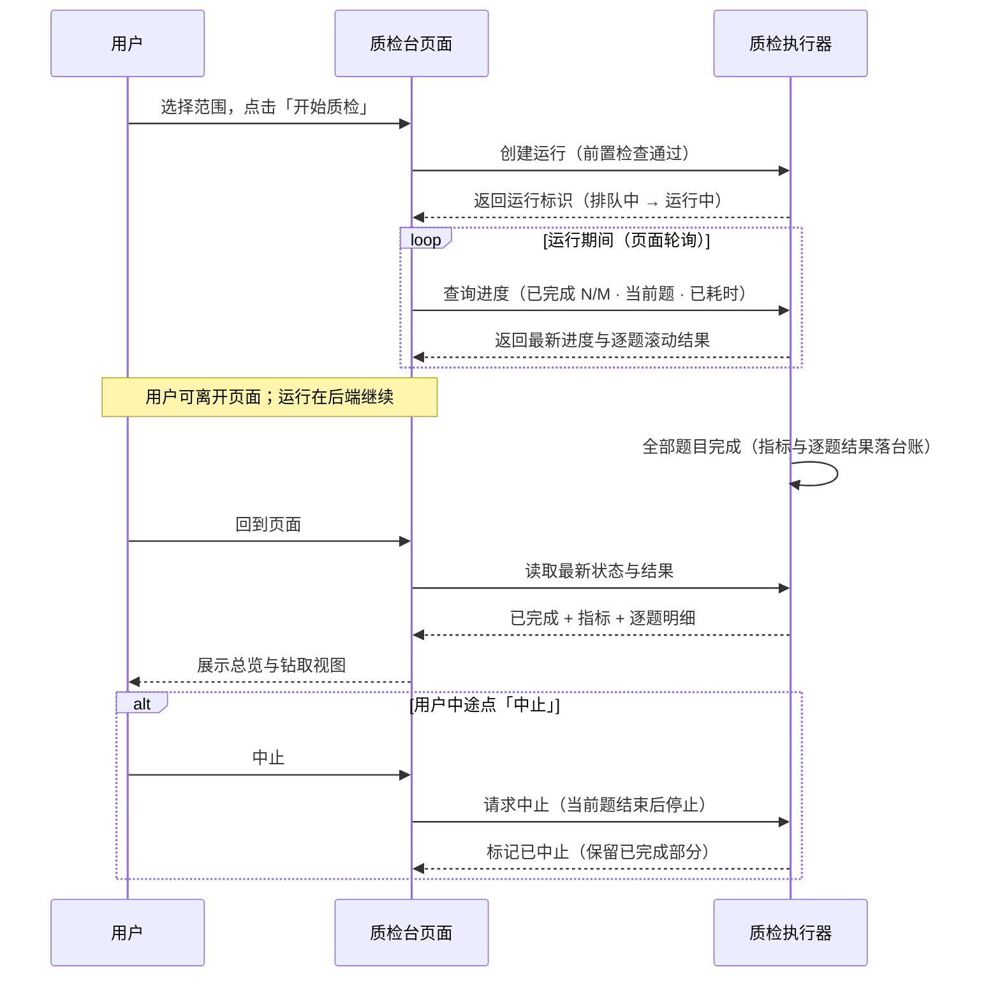

# 产品需求文档：知识库「检索质检台」— 检索评测平台化（用例集 · 执行台账）- V0.1

| 项      | 内容                                                                                                                            |
| ------ | ----------------------------------------------------------------------------------------------------------------------------- |
| 版本     | PRD-011 / 文档内版本 V0.2                                                                                                            |
| 状态     | **v0.2 首期已落地（2026-10-09）**——用户以「按 PRD-011 默认开工」拍板并当日实施；§11 的 13 项待确认按本稿建议全部采纳；实施快照见 §11 开头                                                                    |
| 创建日期   | 2026-10-09                                                                                                                    |
| 主平台    | 本机管理端 `minicare-platform`（api 8787 + web）——知识库域「检索质检」页组扩展，**不新建独立服务**                                                        |
| 关联 PRD | PRD-008（US-11 检索质检闸门 / US-12 知识缺口——本 PRD 在其上补足「用例可见 + 执行留档」，不改变闸门语义）、PRD-010（Agent 测评台——同平台、同台账范式、可对齐的交互先例）                                             |
| 关联文档   | `docs/knowledge/research/召回质量测评方案.md`（指标与测试集方法论）、`docs/knowledge/research/召回测试集-种子50题.md`（真实测试集）、`minicare-platform/api/docs/KB-MAPPING.md`（条目→块映射表）、`minicare-platform/api/docs/RECALL-REPORT.md`（2026-08-23 基线报告）、`docs/tech/TECH-015-kb-platform.md`、`docs/tech/TECH-020-agent-eval-platform-research.md`（同族调研体例） |

---

## 1. 综述 (Overview)

### 1.1 项目背景与核心问题

「检索质检」是知识库平台的**发布闸门**（PRD-008 US-11）：改切片参数、换模型、加语料之后，必须证明检索质量没有退化，坏数据不能流到家长面前。这项能力的**方法论资产早已完备，但全部停留在"脚本 + 报告"形态**，平台页面只是一个壳：

| # | 已建成资产（脚本侧，真实在跑） | 位置 |
| - | --- | --- |
| 1 | **测试集**：种子 50 题（A–H 模块 48 题 + 库外负样本 2 题），表格式 Markdown，含 `gold / acceptable / negative / key_info / risk` 七列标注 | `docs/knowledge/research/召回测试集-种子50题.md` |
| 2 | **映射表**：47 个 KB 条目 → 知识块（top3 自动生成 + 人工修正），Markdown 人读版；其 JSON 中间产物 `var/kb_mapping.json` **已缺失**（构建期产物） | `minicare-platform/api/docs/KB-MAPPING.md` |
| 3 | **评测脚本**：`eval-recall-exact.py`（平台侧）/ `eval-recall-exact.mjs`（agent-poc 侧），正确解析表格格式，混合检索逐题执行 | `minicare-platform/api/scripts/`、`agent-poc/scripts/` |
| 4 | **基线报告**：2026-08-23 实测 Recall@10 = 97.8%（44/45）；暴露 16 条"伪有害"为口径失真（一个块被多条映射即全算有害），待修正 | `minicare-platform/api/docs/RECALL-REPORT.md` |

| # | 平台侧功能（PRD-008 US-11 已建的壳） | 现状 |
| - | --- | --- |
| 1 | 检索质检页（`Quality.tsx`）：计数元信息 + 「跑一次质检」按钮 + 内存中的本次结果 | 页面可用，但**数据从未接入** |
| 2 | `RegressionRunner`：`seed`（行式正则解析）/ `import_gold` / `run`（Recall@10 + 有害=非 gold 进 top5）/ 单一基线文件 | **seed 解析器与真实测试集格式不兼容**（表格行匹配不到，实测返回 0 题） |
| 3 | 台账表 `kb_recall_case` / `kb_recall_gold`（SQLite `platform.db`） | **全 0 行**（从未 seed/导入成功） |
| 4 | 基线文件 `data/quality/recall-baseline.json` | **不存在**（平台侧从未跑过） |
| 5 | 发布闸门（`publish.py`）：读基线文件判定 Recall@10 达标与否 | 逻辑在，但因无基线恒为「未执行」 |

**实测现状（2026-10-09）**：打开检索质检页显示「测试集 0 题 · gold 0 组」；点击「跑一次质检」返回「测试集为空：先 seed 题目」。而真实评测（97.8% 那次）只能在命令行里用脚本复现——且因映射 JSON 缺失，今天连脚本都跑不动。

由此产生三个核心问题（与行业对标后的准确表述）：

1. **测试集不是一等对象**——题面、gold/acceptable/negative 标注、映射关系全部躺在 Markdown 里，页面上看不见、喂不进（导入通道与实际文件格式不兼容）、维护不了（无启停、无体检、无标注全貌）。
2. **运行不落档**——每次运行的结果只在内存与一个基线文件里；没有历史、没有对比、没有环境快照。"这次改动让检索变好了还是变差了"回答不了，只能和三个月前那份报告比印象。
3. **结果不可钻取**——未命中题只以一个列表出现在本次结果里；没有 top-k 明细、没有失败归因、与「知识缺口」台账也没有闭环。

> **核心命题**：把质检从"页面上一个按钮"升级为「**用例集（看得见、管得住）→ 运行（跑得动、留得下）→ 结果（读得懂、钻得深）→ 历史（比得了、可追溯）**」四位一体的**质检台**。
> 与「Agent 测评台」（PRD-010）同平台、同台账范式、同交互惯例——两个域的质检能力对齐为一套心智。

> ⚠️ **与既有资产的边界（先读）**：本 PRD **不改变**发布闸门的阻塞语义（不达标硬阻塞 + 二次确认放行）、不改变检索链路本身（仍走平台侧 `retrieval.py` 的混合检索，与 agent-poc 同口径）、不做生成层/回答层评测（faithfulness 等属 Agent 测评台范畴）。质检台只回答一个问题：**给定这批题，检索层还够不够好？**

### 1.2 核心业务流程 / 用户旅程地图

1. **阶段一：看清测试集** —— 把真实测试集（50 题 + 条目映射）导入平台；浏览题目与三态标注；体检映射存活情况。
2. **阶段二：跑质检** —— 选范围发起运行；后台执行、进度可见、可离开页面。
3. **阶段三：读结果** —— 一屏拿到指标与结论（含较上次变化）；逐题钻取 top-k 明细与失败归因；未命中一键入「知识缺口」台账。
4. **阶段四：回看与对比** —— 每次运行自动留档；执行记录列表随时回看任意一轮；与上次同范围运行对比，看清用例级变化。
5. **（二期候选）阶段五：趋势与回流** —— 指标趋势曲线；线上 bad case 一键沉淀为回归用例。

### 1.3 Mermaid 图（流程/状态/时序）

#### 1.3.1 用户操作流（必填）



#### 1.3.2 状态机（运行对象生命周期，必填）



> 状态口径：**排队中 `queued` / 运行中 `running` / 已完成 `completed` / 已失败 `failed` / 已中止 `cancelled`**。三种终态均**保留已完成部分的逐题结果**（不整轮丢弃）；指标按已完成题计算并标注覆盖数 `n/M`。

#### 1.3.3 关键场景时序（后台执行与离页恢复）



### 1.4 名词与口径定义（术语表）

| 术语 | 定义 |
| --- | --- |
| **用例（Case）** | 一条质检题目 + 三态标注 + 风险级别，如 `A-04`、`F-01`、`N-01`。质检台账的顶层业务对象 |
| **用例集（Case Set）** | 全部用例构成的池子（本版为单一池；范围筛选替代"多个集"——见 D2） |
| **三态标注** | 每题对相关条目的三级判定：**gold**（必含，缺失即答不对）／**acceptable**（支持性，命中不算错）／**negative**（无关，若进 top-5 记一次有害召回）。替代原"二态（gold / 非 gold）"口径 |
| **负样本题** | 库外问题（如"宝宝可以吃燕窝吗"），预期行为是**不强召回**；`case_type = out_of_scope`，不参与召回率分母，单独判定 |
| **条目（Entry）** | 知识清单的原子单元，编码如 `KB-A1`（稳定，不随重切漂移） |
| **知识块（Chunk / `kb_id`）** | `knowledge_base` 表中的检索单元（随解析/重切漂移）。用例标注的是**条目**，运行前经映射解析为**块** |
| **映射（Map）** | 条目 → 知识块的对应关系（`KB-MAPPING.md` 人读版 / JSON 机器版），质检的"翻译层" |
| **映射体检** | 导入或运行前，对照当前知识库检查每个映射块是否仍存在（重切会改 `kb_id`），失效必须显式报告 |
| **运行（Run）** | 一次质检执行：选定范围的若干题目 × 一次检索链路快照。台账顶层实体，标识形如 `20261009-200512` |
| **范围（Scope）** | 本次运行的题目集合：全部 / 按模块（A–H 多选）/ 仅高危（`risk=emergency`）/ 仅负样本 |
| **精确 Recall@k** | gold 层命中率：`命中题目数 / 可评题目数`；同一次运行同时产出 k=5 与 k=10 两档 |
| **MRR** | 平均倒数命中位次：每题第一个 gold 块位次的倒数取均值（衡量"排得前不前"） |
| **有害召回率** | 命中 negative 层的 top-5 条目数 / 可评题 top-5 总槽位数（**口径 v2：只有 negative 记有害**，未标注与 acceptable 都不算——直接修掉 16 条"伪有害"问题） |
| **高危必召回** | `risk=emergency` 题目的 gold 命中率（门槛 100%）——医疗场景一票否决项 |
| **gold 失效** | 某题全部 gold 块已不在知识库（重切/覆盖导致）→ 显式报出，**绝不静默算成未命中** |
| **环境快照** | 一次运行时记录的配置上下文：embedding 模型 / RRF 参数 / 检索深度 / 语料规模 / 用例集版本 / 映射版本 / 口径版本 / git 版本 |
| **口径版本（metric_version）** | 指标定义版本号。v1 = 旧口径（非 gold 即有害）；v2 = 三态口径。**跨口径的数字不可直接对比**，页面须标注 |
| **上次基线** | 合并语义：台账中"上一次同范围运行"（用于 delta 对比）；发布闸门读取"最近一次成功运行"的结论 |

### 1.5 关键设计决策（本版工作稿建议）

> 以下为本稿建议，标 ✅ 的为已明确方向（对齐既有架构的事实约束），其余待用户拍板（汇总见 §11）。

| 编号 | 决策 | 理由 / 影响 |
| --- | --- | --- |
| **D1** | ✅ **不新建服务**：在知识库域「检索质检」页组内扩展，新增两个二级页（用例集 / 执行记录），沿用 `minicare-platform` 前后端与组件库 | 与 PRD-010 同范式；质检的"质量把关"心智与 Agent 测评台并列成体系 |
| **D2** | **单一用例池 + 范围筛选**：本版不做"多个独立用例集"对象；"按模块 / 仅高危 / 仅负样本"以运行范围表达 | 当前只有一套 50 题资产；避免为空想场景建模。多集（如线上回流专集）留二期候选 |
| **D3** | **三态标注口径**：gold 必命中 / acceptable 命中不算错 / negative 进 top5 记有害 / 未标注块**中性**（不计命中也不计有害） | 直接修正 `RECALL-REPORT.md` 承认的"16 条伪有害=口径失真"；对齐行业分级相关度（graded relevance）实践 |
| **D4** | **指标扩展**：同一次运行产出 Recall@5 / Recall@10 / MRR / 有害召回率 / 高危必召回 五项；**达标判定**沿用 Recall@10 + 有害为主门槛，高危必召回作为第三门槛**候选**（默认建议纳入，待确认） | 多档 k 与 MRR 是行业标配且数据零成本；口径升级后旧数字不可直接比——运行记录 `metric_version` |
| **D5** | ✅ **台账落 `platform.db`**：新增 `kb_recall_run` + `kb_recall_case_result` 两表，与 KB 平台、Agent 测评同库；**台账为单一事实源** | 对齐 PRD-010 先例；CLI 与界面发起共用同一台账，不产生两套历史 |
| **D6** | ✅ **后台执行 + 进度轮询 + 可中止**（对齐 Agent 测评台交互）；平台重启时孤儿运行清扫（running → failed，保留已完成部分） | 50 题约 1–3 分钟，页面同步等待体验差且易断 |
| **D7** | **导入通道吃真实文件格式**：解析表格式 Markdown（50 题）+ `KB-MAPPING.md`（或 JSON）；**两步式**（dry-run 报告 → 确认写入）；幂等 + 差异报告 | 现状 seed 解析器与真实文件不兼容、映射 JSON 缺失——不修这两个，"用例可见"无从谈起 |
| **D8** | **发布闸门改读台账**「最近一次成功运行」；`recall-baseline.json` 降级为兼容镜像（去留实现时定） | 台账成为唯一事实源；闸门口径与页面结论永远一致 |
| **D9** | **用例只读 + 启停**：本版不做用例在线编辑；重新导入即刷新（题面/gold 变更留 diff 报告）。重映射辅助（候选块生成）排二期 | 对齐 PRD-010 D9 的克制；编辑需求后置，避免双写来源 |
| **D10** | **保持既有语义**：不达标硬阻塞 + 二次确认放行；gold 失效显式报出（不算未命中）；数据不足显示「未执行」**绝不显示为通过** | PRD-008 US-11 的验收红线，本版只增强不放松 |

---

## 2. 行业最佳实践调研与对标

> 调研目的：回答"一个知识库的检索质检，成熟做法长什么样"，作为本 PRD 的设计依据。调研覆盖 RAG 评测框架（RAGAS 等）、评测平台（LangSmith / Langfuse / Braintrust 系）、测试管理域（TestRail/qTest 系）与医疗 RAG 专项实践四类信源，完整来源见 §12。

### 2.1 行业共识：四个一等对象

无论 RAG 评测平台还是传统测试管理平台，成熟形态都可归纳为同一套对象模型：

| 对象 | 行业承载 | 我们已有什么 | 本 PRD 补什么 |
| --- | --- | --- | --- |
| **用例集（Dataset）** | LangSmith：dataset 自动版本化、可打 tag 里程碑、可切 split；TestRail：层级化用例库 | 50 题 Markdown + 映射 Markdown（页面不可见） | 用例集页：浏览 / 筛选 / 三态标注 / 启停 / 体检 |
| **运行（Experiment / Run）** | LangSmith experiment；Braintrust `data×task×scores` 一次执行；TestRail 测试计划与执行记录 | 脚本一次跑完即走，无留档 | 后台运行 + 进度 + 逐题结果落台账 |
| **指标（Metrics）** | RAGAS / 经典 IR：Recall@k、MRR、NDCG；安全专项（医疗）：must-recall、negative 检出 | Recall@10 + 有害（二态口径） | +Recall@5 / MRR / 高危必召回；有害口径三态化 |
| **台账与对比（History）** | LangSmith：实验并排对比 + baseline 指定 + 统计显著性；TestRail：执行历史链 + 里程碑门禁 | 单一基线 JSON 文件 | 执行记录列表 + 回看 + 与上次同范围 delta + 用例级变化 |

**辅助机制**（行业标配，我们部分已有/部分后置）：
- **失败回流**（trace → dataset flywheel）：线上 bad case 沉淀为新用例——对应我们的「知识缺口 → 补充用例」（二期）；
- **仲裁标注**：双人标注 + κ≥0.8（内部《召回质量测评方案》已列，当前 50 题为单人产出待医学复核）；
- **CI 门禁**：检索代码变更必须过回归（"recall@5 降超 2% 即阻断合并"）——我们的对应物是**发布闸门**，语义一致，本 PRD 不引入 CI。

### 2.2 测试集纪律（行业共识归纳）

| 维度 | 行业建议 | 对 minicare 的落地 |
| --- | --- | --- |
| 来源配比 | 真实用户查询 60% + 专家拟题 25% + 边界/对抗 15%（本仓方案）；医疗场景建议：常见 40% / 边界 20% / 对抗陷阱 15% / 库外 15% / 多步 10%（ClinRAG） | 现有 50 题按 A–H 模块 + 负样本 2 题分层，基本合规；线上未命中问题按月回流（二期） |
| 规模 | 50–200 题起步即可产生信号；宁小且精，勿大而脏；合成题只作脚手架、必须人工确认 | 50 题起步；每次线上事故/未命中沉淀 1 题 |
| 标注 | **分级相关度**（必含 / 支持 / 无关），双人标注 + 仲裁；判定标准写进文档 | 三态标注（gold/acceptable/negative）+ key_info 摘要；仲裁流程后置 |
| 版本化 | 数据集变更即新版本；**实验期间冻结**；运行记录所用版本 | 用例集内容 hash 入运行快照；页面显示"用例集：50 题 · 版本 hash 前 8 位" |
| 维护纪律 | 每轮改动后跑同一套题；未命中题逐条归因并走修复闭环 | 本 PRD 的台账 + 缺口联动 |

### 2.3 指标口径（行业共识归纳）

1. **检索层与生成层分开评**——"recall 上不去，提示词救不回来"；本平台只评检索层（边界清晰，生成层属 Agent 测评台）。
2. **多档 k 同报**（@5 与 @10 语义不同：@5 看"够不够准"，@10 看"够不够全"）；**MRR** 看首位次质量；NDCG 需要更细分级标注，本版后置。
3. **安全指标独立于一票否决**：医疗场景下高危召回必须 100%（must-recall）；negative/库外问题的"不强召回"是单独判据。
4. **失败要分类归因**（error analysis）：行业建议的输出口径——「无相关结果 / 相关但排在 k 外 / 排序被降位 / 映射或数据问题」，对应不同修复动作（补语料 / 调排序 / 重映射 / 补标注）。
5. **口径变更要留痕**：指标定义变化（如本版有害口径 v1→v2）会让新旧数字不可比，必须记录口径版本并显式标注。

### 2.4 运行与对比（行业共识归纳）

- **环境快照是历史可解读的前提**：模型 / 参数 / 语料版本 / 用例集版本 / 代码版本缺一不可，否则三个月后回看无从判断差异来源。
- **对比对象**："上一次同范围运行" + 用例级变化三类清单（新增未命中 / 已修复 / 持续未命中）——比总分变化更能指导行动。
- **参数快照与可复现**：同一次运行应可被原样复跑（本轮不承诺"一键复跑"，但快照字段齐备）。
- **全量留档**：运行中/失败/中止都留档，保留已完成部分——避免"跑了一半白跑"。

### 2.5 对标差距映射（行业实践 → 现状 → 本 PRD 动作）

| 行业实践 | 我们的现状 | 本 PRD 对应 |
| --- | --- | --- |
| 用例集是一等对象、页面可见可管 | 题与标注只在 Markdown；页面只见计数（且为 0） | US-01 / US-02 |
| 导入通道兼容真实数据格式、幂等、dry-run | seed 解析器与表格格式不兼容；映射 JSON 缺失 | US-01 |
| 运行配置快照 + 逐题结果留档 | 无 | US-04 / US-07 + §4 台账 |
| 基线对比 + 用例级变化清单 | 单一基线文件（且为空），只比总分 | US-05 / US-07 |
| 多档指标 + 安全专项指标 | 仅 Recall@10 + 二态有害 | US-05 |
| 失败分类归因、回路到修复动作 | 脚本报告里人工看 | US-06 + 缺口联动 |
| 数据集版本/冻结纪律 | 无 | 运行快照记录 hash；变更走重新导入 diff |

---

## 3. 用户故事详述 (User Stories)

### 阶段一：看清测试集

---

#### **US-01: 作为知识库维护者，我希望把真实测试集与映射表一键导入平台并看到导入报告，以便于质检从"脚本跑报告"变成"页面里有数据"**

- **价值陈述 (Value Statement)**:
  - **作为** 每次动了切片/检索参数都要跑回归的知识库维护者
  - **我希望** 导入时能看到"识别了多少题、多少标注入库、映射能不能对上当前知识库"
  - **以便于** 不再出现"页面显示 0 题"这种无从下手的开局
- **业务规则与逻辑 (Business Logic)**:
  1. **前置条件**：平台服务运行；两个源文件存在（默认路径 `docs/knowledge/research/召回测试集-种子50题.md` 与 `minicare-platform/api/docs/KB-MAPPING.md`，可修改）；数据库可连（映射体检需要对照 `knowledge_base`）。
  2. **操作流程 (Happy Path)**:
     1. 进入「用例集」页，顶部提供「导入 / 更新测试集」按钮；空态时展示引导（含默认路径说明）。
     2. 点击后展开导入区：两个文件路径输入框（预填默认值）+「解析并体检（不写入）」按钮。
     3. 系统执行 **dry-run**：解析测试集（题号 / 问题 / gold / acceptable / negative / key_info / risk / 负样本），解析映射表（条目 → 块），对照当前知识库做**映射体检**；输出报告：
        - 识别题目数（按模块分布）；gold/acceptable/negative 条目数；
        - 映射：解析条目数、解析块数、**存活数 / 失效数**（失效=块不在当前库）；
        - 与现有数据的差异：新增 / 更新 / 未变 / （若有）将失效的旧标注。
     4. 确认无误后点「确认写入」→ 幂等入库（题号为主键 upsert；映射同）；页面刷新用例集统计。
  3. **异常处理 (Error Handling)**:
     - **文件不存在 / 解析不到题目** → 明确报错并指出"文件路径或格式可能已变"，**不写入**。
     - **映射部分失效**（重切后 `kb_id` 漂移）→ **不阻塞导入**，在报告中单列失效清单；用例列表对受影响题目标「映射失效」角标；运行前检查将按范围拦截或提示（US-03）。
     - **重复导入** → 幂等：已存在的题号走更新；报告展示 diff（"更新 3 题"）。
     - **负样本题**（库外，无 gold 条目）→ 以 `case_type = out_of_scope` 入库，**不参与**召回率分母（单独判定，口径见 US-05）。
     - **数据库不可达** → 允许"只解析不体检"？不——**直接失败并提示**（体检是导入的必要组成，宁可不导入）。
- **验收标准 (Acceptance Criteria)**:
  - **场景 1: 正常导入**
    - **GIVEN** 两个源文件在位、数据库可连
    - **WHEN** 我点击「解析并体检」再点「确认写入」
    - **THEN** 报告展示识别题目 ≥45（以真实文件为准）、三态标注齐全；用例集页统计从 0 变为实际数量
  - **场景 2: 幂等与差异**
    - **GIVEN** 已导入过一次
    - **WHEN** 我再次导入同一文件
    - **THEN** 报告显示"新增 0 · 更新 0 · 未变 N"；不产生重复题目
  - **场景 3: 格式不兼容不写入**
    - **GIVEN** 我误填了一个非测试集文件路径
    - **WHEN** 我点击「解析并体检」
    - **THEN** 明确报"未能识别任何题目"，且数据未被修改
- **页面布局线框图 (ASCII Wireframe)**:
  ```text
  ┌──────────────────────────────────────────────────────────────────────┐
  │  用例集 · 导入测试集与映射                                    [ × ]  │
  ├──────────────────────────────────────────────────────────────────────┤
  │  测试集文件   docs/knowledge/research/召回测试集-种子50题.md          │
  │  映射表文件   minicare-platform/api/docs/KB-MAPPING.md               │
  │                                        [ 解析并体检（不写入） ]       │
  │  ── 报告（未写入）───────────────────────────────────────────────    │
  │  题目 50（A~H 48 + 负样本 2） · gold 条目 63 · acceptable 41 · neg 12 │
  │  映射 47 条目 / 138 块 · 存活 132 · 失效 6                            │
  │  失效明细（前 3）：KB-A3 → 2025共识-35（已不存在）…                    │
  │  与现有差异：新增 50 · 更新 0 · 未变 0                                │
  │                                    [ 确认写入 ]     [ 取消 ]          │
  └──────────────────────────────────────────────────────────────────────┘
  ```
  （示例数字仅示意；以实际解析报告为准）

---

#### **US-02: 作为知识库维护者，我希望浏览、筛选和体检整个用例集，以便于随时看清"我们在用哪些题、标得对不对、映射还活着吗"**

- **价值陈述 (Value Statement)**:
  - **作为** 需要定期审视测试集质量的维护者
  - **我希望** 一页看全 50 题的三态标注与映射状态，能按模块/风险/状态筛选
  - **以便于** 知道哪些题在高危区、哪些标注已经失效、哪些题被停用了
- **业务规则与逻辑 (Business Logic)**:
  1. **前置条件**：完成 US-01 导入（或已有历史数据）。
  2. **内容结构（自上而下）**:
     1. **统计条**：总题数 · 可评题数（answerable 且启用 且映射存活）· 负样本数 · 映射失效数 · 模块分布（A–H mini 条）。
     2. **筛选工具条**：模块（多选 A–H / 负样本）· 风险（low / caution / emergency）· 状态（启用 / 停用）· 映射（存活 / 失效）· 搜索（题号 / 问题文本 / 条目码）。
     3. **用例表**：`题号 / 问题 / 模块 / 风险 / 标注概要（g1·a1·n1）/ 映射（✓ 或 ⚠失效 n）/ 启用开关 / 排查（一键跳「检索测试」）`；行可展开。
     4. **行展开（详情）**：三态标注的完整条目清单（含语义名，如 `KB-A3 过敏进程`），每条目下展开映射块（`kb_id + 块标题`）；`key_info` 关键要素；备注。提供「查看该块」入口（跳文档工作台，P1）。
  3. **启停**：开关即生效（`enabled` 翻转），**不删除数据**；停用题不参与运行、不入统计的"可评题数"。
  4. **异常处理 (Error Handling)**:
     - **映射失效题** → 行内 ⚠ 角标 + 提示「重新导入映射或重映射」；展开显示失效条目明细。
     - **数据为空** → 空态引导到 US-01 导入。
     - **条目无映射**（题面声明了条目但映射表里查不到）→ 同样标失效并注明"映射表缺失该条目"。
- **验收标准 (Acceptance Criteria)**:
  - **场景 1: 浏览与筛选**
    - **GIVEN** 用例集已导入
    - **WHEN** 我按"风险=emergency"筛选
    - **THEN** 只显示风险为 emergency 的题目（如 F 模块高危题），统计条不变
  - **场景 2: 展开标注链**
    - **GIVEN** 任意一题
    - **WHEN** 我展开该行
    - **THEN** 看到 gold/acceptable/negative 条目及其映射块（条目 → 块两层可见）
  - **场景 3: 停用即隔离**
    - **GIVEN** 我把某题停用
    - **WHEN** 我发起一次质检
    - **THEN** 该题不参与本次运行，可评题数相应减少
  - **场景 4: 单题排查直达（2026-10-09 增补）**
    - **GIVEN** 用例集里的任意一题（含停用题与库外负样本）
    - **WHEN** 我点该行「排查」列的「检索测试」按钮
    - **THEN** 跳到检索测试页：题面已带入并自动检索一次（参数同质检口径），顶部提示「来自用例集 <题号>」，可调整参数重跑；URL 形如 `?page=retrievaltest&q=<题面>&case=<题号>`（只读深链接，可刷新、可分享）
- **页面布局线框图 (ASCII Wireframe)**:
  ```text
  ┌──────────────────────────────────────────────────────────────────────────┐
  │  用例集      50 题 · 可评 42 · 负样本 2 · 映射失效 6        [ 导入/更新 ] │
  ├──────────────────────────────────────────────────────────────────────────┤
  │  筛选  [模块 ▾ A~H]  [风险 ▾ 全部]  [状态 ▾ 启用]     搜索 [________]    │
  ├──────────────────────────────────────────────────────────────────────────┤
  │  题号   问题                              模块  风险      标注    映射   │
  │  D-03   确诊牛奶过敏，奶粉要换哪种…        D    caution   g1·a1·n1  ✓    │
  │  F-01   吃了花生后嘴唇肿、喘不上气…        F    emergency g2·a1·—   ✓    │
  │  A-04   牛奶过敏会发展成哮喘吗…            A    low       g1·a1·n1  ⚠失效1│
  │  N-01   宝宝可以吃燕窝吗？                负样本 库外      —         —    │
  │  ▾ A-04 展开                                                             │
  │    gold  KB-A3 过敏进程 → 2025共识-35（⚠已失效）                          │
  │    acc   KB-A6 自然病程 → 严重过敏共识-20 · 中国CMPA指南-19               │
  │    neg   KB-G1 免疫治疗 → …                                              │
  │    key_info  过敏进程、早干预意义           [查看块]                      │
  └──────────────────────────────────────────────────────────────────────────┘
  ```

---

### 阶段二：跑质检

---

#### **US-03: 作为知识库维护者，我希望选择范围并一键发起质检运行，以便于针对"全量回归 / 某个模块 / 高危专项"跑不同深度的检查**

- **价值陈述 (Value Statement)**:
  - **作为** 发布前要过闸门、平时要盯重点的维护者
  - **我希望** 不敲命令就能跑一次质检（全部 / 按模块 / 仅高危 / 仅负样本）
  - **以便于** 发布前跑全量、日常先跑高危专项快速确认
- **业务规则与逻辑 (Business Logic)**:
  1. **前置条件**：平台服务在运行（8787）；用例集已导入且本次范围内有 ≥1 道可评题；数据库可连；当前无正在执行的质检运行。
  2. **操作流程 (Happy Path)**:
     1. 「检索质检」首页顶部为**发起区**：
        - **范围**（单选）：`全部（N 题）`（默认）/ `按模块`（A–H 多选）/ `仅高危（emergency）` / `仅负样本`；
        - **检索深度**固定 top_k=10（同时产出 Recall@5/@10 两档，零额外成本，界面不暴露参数）；
        - 实时显示**可评题数**与**预计耗时**参考值（约 N × 1–2 秒）。
     2. 点击「开始质检」→ 前置检查：
        - 数据库可达且过滤条件探测正常；
        - 范围内可评题 ≥1（负样本范围时 ≥1 道负样本题）；
        - 范围内**映射体检**：存在 gold 全失效的题 → **拒绝启动**并列出题目（提示重新导入/重映射）；存在部分失效 → 警告并可继续（失效条目从期望里剔除，报告注明）。
        - 无正在运行的质检（单运行并发）。
     3. 通过 → 创建运行（排队中→运行中），跳到进度视图（US-04）。
  3. **异常处理 (Error Handling)**:
     - **前置检查不通过**：不启动；清单式列出缺口与修复指引（如「2 道题的 gold 全部失效：A-04、E-05 → 请重新导入映射」）。
     - **已有运行在跑**：拒绝发起，提示「已有质检运行中（开始于 HH:mm，进度 N/M），请等待或中止」。
     - **embedding 服务不可用**（向量路降级）：**不静默降级**——运行标记 failed 并给出原因（"嵌入服务不可达，结果将偏向关键词路，已中止"）；可重试。
     - **覆盖缺口导致的个别未命中**（如 A-04）不是异常，是结果；进 US-06 归因。
- **验收标准 (Acceptance Criteria)**:
  - **场景 1: 正常发起**
    - **GIVEN** 无运行进行中、范围内可评题充足、映射健康
    - **WHEN** 我选择「全部」并点击「开始质检」
    - **THEN** 创建运行并进入进度视图；执行记录列表出现该运行（运行中）
  - **场景 2: 映射失效拦截**
    - **GIVEN** 某题 gold 全部失效且在所选范围内
    - **WHEN** 我点击「开始质检」
    - **THEN** 不启动，明确列出失效题目与修复指引
  - **场景 3: 高危专项**
    - **GIVEN** 用例集含 emergency 题
    - **WHEN** 我选择「仅高危」发起
    - **THEN** 本次只跑 emergency 题，总数为该组题数
- **页面布局线框图 (ASCII Wireframe)**:
  ```text
  ┌──────────────────────────────────────────────────────────────────┐
  │  检索质检                                              [刷新]     │
  ├──────────────────────────────────────────────────────────────────┤
  │  ┌─ 发起质检 ───────────────────────────────────────────────┐    │
  │  │  范围  ( ● ) 全部 48 题   ( ) 按模块 ▾   ( ) 仅高危       │    │
  │  │        ( ) 仅负样本（2 题）                               │    │
  │  │  可评 42 题 · 预计耗时 ≈ 1–3 分钟      [ ▶ 开始质检 ]     │    │
  │  │  ⓘ 后台执行，可离开本页；已有运行进行中时不可重复发起       │    │
  │  └──────────────────────────────────────────────────────────┘    │
  └──────────────────────────────────────────────────────────────────┘
  ```

---

#### **US-04: 作为知识库维护者，我希望质检运行进度实时可见且可离开页面返回续看，以便于跑长任务时能去做别的事**

- **价值陈述 (Value Statement)**:
  - **作为** 经常边改参数边跑回归的维护者
  - **我希望** 随时看到"跑到哪题了、已用多久"，中途能中止
  - **以便于** 不等在页面前，也能发现跑错范围时及时止损
- **业务规则与逻辑 (Business Logic)**:
  1. **前置条件**：存在「运行中 / 排队中」的运行。
  2. **操作流程 (Happy Path)**:
     1. 进度视图展示：**总进度**（已完成 N / M 进度条）、**当前题目**（题号 + 问题前 20 字）、**已耗时**（实时跳动）、**逐题滚动结果**（✓/✗ + 题号，最新在下）。
     2. 用户可**离开页面**：运行在后端继续；回到页面自动恢复进度视图（以台账为准重建）。
     3. 完成：自动切换到结果总览（US-05）。
  3. **中止**：
     - 「中止」按钮 + 二次确认；当前题结束后停止；状态「已中止」，**保留已完成部分**并照常留档；指标按已完成题计算并标注覆盖数。
  4. **异常处理 (Error Handling)**:
     - **页面轮询失败**（服务重启等）：提示"进度暂时不可用，自动重试"，恢复后续上；不误标失败。
     - **运行进程异常/平台重启**：孤儿清扫将其标记「已失败」，保留已完成部分与错误摘要。
- **验收标准 (Acceptance Criteria)**:
  - **场景 1: 进度实时更新**
    - **GIVEN** 运行进行中
    - **WHEN** 我停留在进度视图
    - **THEN** 进度条 / 当前题 / 已耗时持续更新（粒度 ≤5 秒）
  - **场景 2: 离开并返回**
    - **GIVEN** 运行进行中我离开了页面
    - **WHEN** 我重新进入「检索质检」
    - **THEN** 自动恢复到该运行的进度视图
  - **场景 3: 中止保留部分**
    - **GIVEN** 运行进行中（已完成 20/48）
    - **WHEN** 我中止并确认
    - **THEN** 运行标记「已中止」；结果区展示已完成 20 题的指标与明细
- **页面布局线框图 (ASCII Wireframe)**:
  ```text
  ┌──────────────────────────────────────────────────────────────────┐
  │  运行中 · 全部 48 题 · 10-09 20:05                [ ■ 中止 ]      │
  ├──────────────────────────────────────────────────────────────────┤
  │  ████████░░░░░░░░░░░░░░  12/48 · 已用 01m10s                     │
  │                                                                  │
  │  当前：C-03 回避-激发试验是什么？家长要怎么配合？                  │
  │                                                                  │
  │  实时结果：                                                       │
  │   ✓ A-01  ✓ A-02  ✗ A-03  ✓ B-01  ✓ B-02  ✗ D-05  …             │
  │                                                                  │
  │  ⓘ 可离开本页，运行在后端继续；返回后进度自动恢复                   │
  └──────────────────────────────────────────────────────────────────┘
  ```

---

### 阶段三：读结果

---

#### **US-05: 作为知识库维护者，我希望一屏看到本次质检的指标、结论与较上次变化，以便于三秒内判断这次改动能不能发布**

- **价值陈述 (Value Statement)**:
  - **作为** 刚改完切片/重跑完索引的维护者
  - **我希望** 打开页面就看到"过没过、比上次好还是差、差在哪类"
  - **以便于** 直接决定"继续 debug / 可以发布"
- **业务规则与逻辑 (Business Logic)**:
  1. **前置条件**：一次运行已结束（完成 / 中止 / 失败均可查看已完成部分）。
  2. **内容结构（自上而下）**:
     1. **结论区**：达标 / 未达标（含未达标项一句话，如「Recall@10 93.8% < 门槛 95%」）+ 覆盖数 `n/M` + 耗时。
     2. **指标卡（五项）**：`Recall@5 / Recall@10 / MRR / 有害召回 / 高危必召回`——每卡显示：本次值、门槛（或「观察值」）、达标状态（✓/✗）。
     3. **较上次**（存在"上一次同范围运行"时）：指标 delta（pt）；用例级变化摘要（新增未命中 N 题 / 已修复 M 题 / 持续 K 题）；**口径不一致时整块标注**「上次为口径 v1，仅部分可比」。
     4. **失败分类概览**：未命中题按归因计数——`覆盖缺口 / 排序问题 / 切片排除 / 映射失效 / 负样本异常`；点击跳 US-06 对应筛选。
     5. **环境快照**：embedding 模型 / 检索深度 / 语料规模（条数）/ 用例集版本 hash / 映射版本 hash / 口径版本 / git 短哈希 / 发起参数。
  3. **状态语义**：
     - 中止/失败的运行：结论区明确状态，指标按已完成部分计算并显示覆盖数 `n/M`，**不冒充完整结论**。
     - `metric_version` 与上次不同：delta 区显示口径提示；高危必召回在无 emergency 题时显示「本次范围无高危题」。
  4. **异常处理 (Error Handling)**:
     - **无上次同范围运行**：隐藏"较上次"区块，显示「首轮运行，暂无对比基线」。
     - **失败分类无法归因**（如诊断数据缺失）：归入「未知」并计数，不硬猜。
- **验收标准 (Acceptance Criteria)**:
  - **场景 1: 达标**
    - **GIVEN** Recall@10 ≥ 门槛、有害 ≤ 门槛、高危必召回 =100%
    - **WHEN** 运行完成
    - **THEN** 结论「✓ 达标」；五项指标卡齐全；发布闸门解锁
  - **场景 2: 未达标与引导**
    - **GIVEN** Recall@10 = 93.8% < 95%
    - **WHEN** 查看总览
    - **THEN** 结论标红并给出失败项一句话；失败分类计数可点击跳钻取
  - **场景 3: 口径变更提示**
    - **GIVEN** 上次运行 metric_version=v1、本次为 v2
    - **WHEN** 查看总览
    - **THEN** delta 区显式标注「口径不一致，仅部分可比」
- **页面布局线框图 (ASCII Wireframe)**:
  ```text
  ┌──────────────────────────────────────────────────────────────────────┐
  │  运行详情 · 全部 48 题 · 10-09 20:05       ● 已完成 · 1m42s          │
  ├──────────────────────────────────────────────────────────────────────┤
  │  结论：✗ 未达标（Recall@10 93.8% < 95%）        覆盖 48/48            │
  │  ┌────────┐ ┌────────┐ ┌────────┐ ┌────────┐ ┌────────┐             │
  │  │Recall@5│ │Recall@10││  MRR   │ │有害召回│ │高危必召回│             │
  │  │ 89.6%  │ │ 93.8%  │ │ 0.91   │ │ 2.1%   │ │ 100%   │             │
  │  │门槛≥90%│ │门槛≥95%│ │ 观察值  │ │门槛≤10%│ │要求100%│             │
  │  └────────┘ └────────┘ └────────┘ └────────┘ └────────┘             │
  │  较上次（10-08 21:10 · 口径 v2）：Recall@10 -2.1pt · MRR +0.02        │
  │         新增未命中 1 · 已修复 0 · 持续 2                              │
  │  失败分类：覆盖缺口 2 · 排序问题 1 · 切片排除 0 · 映射失效 0 · 未知 0  │
  │  环境：embedding=kinfra-text-embedding-0.6b · 深度 10 · 库 1586 条    │
  │        用例集#a1b2c3d4 · 映射#e5f6a7b8 · 口径 v2 · git 3f9c2a1        │
  └──────────────────────────────────────────────────────────────────────┘
  ```

---

#### **US-06: 作为知识库维护者，我希望逐题钻取未命中的完整证据链（期望标注、实得 top-k、归因与建议动作），以便于把"为什么没命中"变成"下一步修什么"**

- **价值陈述 (Value Statement)**:
  - **作为** 拿到未命中清单后要定位根因的维护者
  - **我希望** 一眼看到"期望什么、实际排了什么、差在哪一类"
  - **以便于** 直接分流到正确动作：补语料 / 调排序 / 去校对切片 / 重映射
- **业务规则与逻辑 (Business Logic)**:
  1. **前置条件**：运行已结束（或运行中查看已完成部分——本版以结束后为主）。
  2. **用例结果表**：逐行 `题号 / 问题 / 结果(✓✗⚠) / 首个命中位次 / top1 分 / 耗时`；默认按用例集顺序；筛选：全部 / 仅未命中 / 仅有害 / 按模块 / 按归因；搜索。
  3. **行展开（钻取）**：
     - **期望**：三态标注（gold/acceptable/negative）条目 → 映射块清单（含块标题）；
     - **实得**：top-10 明细（位次 / `kb_id` / 标题 / 融合分 / 该块所属性（gold·acc·neg·未标注））；诊断信息：gold 最佳位次（诊断深度 20 以内，未进显示「未进 20」）；
     - **判定与归因**（自动归类，展示为标签 + 一句话）：
       ① `映射失效`——gold 块不在库（含"全失效"题的单列）；
       ② `切片/排除问题`——gold 块在库但被排除检索（被屏蔽/待复核）；
       ③ `排序问题`——gold 块在库且可检索，最佳位次在 11–20（"差一点"）；
       ④ `覆盖缺口`——gold 块在库但未进诊断深度 20（内容薄弱/表述不匹配）；
       ⑤ `负样本异常`——负样本题 top1 分超阈值（待标定后启用）；
     - **建议动作**：按归因给固定映射——补录语料 / 复核切片（跳文档工作台）/ 重映射（导入更新）/ 入缺口台账；提供「记入知识缺口」一键动作（复用 US-12 台账）。
  4. **异常处理 (Error Handling)**:
     - **字段缺失**（早期失败题无 top-k）→ 区块显示「无数据」，页面不报错；
     - **负样本题**：判定区显示「不强召回」结果（top1 分与阈值），不计入召回率；
     - **中止/失败的运行**：仅展示已完成题的钻取。
- **验收标准 (Acceptance Criteria)**:
  - **场景 1: 查看用例表**
    - **GIVEN** 一次已完成的运行
    - **WHEN** 我打开运行详情
    - **THEN** 用例表列出全部题目的结果、首命中位次与耗时；筛选与搜索即时生效
  - **场景 2: 钻取归因**
    - **GIVEN** A-04 未命中且其 gold 块存在但未进诊断深度
    - **WHEN** 我展开 A-04
    - **THEN** 归因标签「覆盖缺口」，建议动作含"补录过敏进程语料"与「记入知识缺口」按钮
  - **场景 3: 有害明细**
    - **GIVEN** 某题 top-5 里有 negative 层块
    - **WHEN** 我筛选「仅有害」
    - **THEN** 仅显示该类题目，展开可见命中的 negative 块与位次
- **页面布局线框图 (ASCII Wireframe)**:
  ```text
  ┌──────────────────────────────────────────────────────────────────────────┐
  │  筛选 [全部] [未命中 3] [有害 1]  归因 [全部 ▾]     搜索 [_________]      │
  ├──────────────────────────────────────────────────────────────────────────┤
  │  题号   问题                        结果  首命中  top1分  耗时            │
  │  D-03   确诊牛奶过敏，奶粉要换哪种…  ✓     1      0.83   1.2s            │
  │  A-04   牛奶过敏会发展成哮喘吗…      ✗     —      0.61   0.9s    ▾      │
  │  ├─ 期望 gold：KB-A3 过敏进程 → 2025共识-35 / NIAID-115 / 严重过敏共识-15 │
  │  ├─ 归因：覆 盖 缺 口（gold 块在库但未进诊断深度 20）                     │
  │  ├─ top10：① 2025共识-12 (0.72) ② 中国CMPA指南-3 (0.70) ③ …             │
  │  │          标注：② = acceptable ✓                        ⑦ = negative ⚠ │
  │  ├─ 建议：补录"过敏进程"综述语料；或复核 KB-A3 映射                        │
  │  └─ [ 记入知识缺口 ]   [ 去文档工作台复核切片 ]                           │
  └──────────────────────────────────────────────────────────────────────────┘
  ```

---

### 阶段四：回看与对比

---

#### **US-07: 作为知识库维护者，我希望所有质检运行自动留档且可回看、对比任意两轮，以便于追溯"上次什么时候跑的、结论如何、这次变了什么"**

- **价值陈述 (Value Statement)**:
  - **作为** 需要跨天跨周追踪质量水位的维护者
  - **我希望** 每轮运行（含失败与中止）自动留档；与上次同范围运行对比用例级变化
  - **以便于** 不再依赖散落的报告文件与记忆
- **业务规则与逻辑 (Business Logic)**:
  1. **留档时机**：运行进入任一终态（完成/失败/中止）**自动留档**，无需操作；运行中的运行以「进行中」出现在列表。
  2. **执行记录列表**：字段 = `时间 / 范围 / 题数 / Recall@10 / MRR / 有害 / 高危 / 结论 / 耗时 / 状态`；默认时间倒序，分页。
  3. **回看**：点击任意一行 → 打开该轮完整详情（US-05 + US-06 视图，读台账），与最新运行完全同构。
  4. **对比**（本版做"与上一次同范围"；任意两轮选择器排 P1）：指标 delta + 用例级变化三类清单——**新增未命中 / 已修复 / 持续未命中**（每项可点开对应题）。
  5. **留档粒度**：逐题结果（期望、实得 top-10、归因、判定）完整入库（对齐 PRD-010 D10；单轮体积百 KB 级）。
  6. **异常处理 (Error Handling)**:
     - **空历史**：空态 + 「去发起第一次质检」引导；
     - **留档失败**（写库异常）：结果文件不丢（运行响应里仍带完整结果），页面提示「本次留档失败」+ 原因；
     - **口径不一致的两轮对比**：对比区显式标注，只列用例级变化不做分数比较结论。
- **验收标准 (Acceptance Criteria)**:
  - **场景 1: 自动留档**
    - **GIVEN** 一次运行刚结束（任意终态）
    - **WHEN** 我刷新执行记录
    - **THEN** 该运行在列表中且字段完整
  - **场景 2: 回看**
    - **GIVEN** 存在多轮运行
    - **WHEN** 我点开任意历史行
    - **THEN** 打开该轮完整详情（总览 + 逐题钻取），数据与当时一致
  - **场景 3: 对比可信**
    - **GIVEN** 最近两轮同范围运行（口径一致）
    - **WHEN** 我查看对比
    - **THEN** 指标 delta 与三类用例级变化清单正确
- **页面布局线框图 (ASCII Wireframe)**:
  ```text
  ┌──────────────────────────────────────────────────────────────────────────┐
  │  执行记录                                                    [刷新]       │
  ├──────────────────────────────────────────────────────────────────────────┤
  │  时间        范围   题数  Recall@10  MRR   有害  高危   结论     耗时      │
  │  10-09 20:05 全部    48   93.8%     0.91  2.1%  100%  ✗未达标  1m42s     │
  │  10-08 21:10 全部    48   95.9%     0.89  3.8%  100%  ✓达标    1m38s     │
  │  10-08 12:00 高危     3   100%       …     0%    100%  ✓达标    8s        │
  │                                                  [加载更多]               │
  ├──────────────────────────────────────────────────────────────────────────┤
  │  ▸ 对比（10-09 20:05 ⟷ 10-08 21:10 · 口径 v2）                            │
  │    Recall@10 -2.1pt  · MRR +0.02  · 有害 -1.7pt                          │
  │    + 新增未命中（1）：A-04                                                │
  │    ~ 已修复（0）：—                                                        │
  │    = 持续未命中（2）：E-05 · H-01                                          │
  └──────────────────────────────────────────────────────────────────────────┘
  ```

---

#### **US-08（二期 P1）: 作为知识库维护者，我希望看到关键指标随时间的趋势与单题跨轮追踪，以便于感知整体质量水位与"这题到底修没修好"**

- **价值陈述**：执行记录页提供趋势视图：Recall@10 / MRR / 有害召回按时间序列（支持时间范围过滤）；单题视角（如 A-04）展示其在历轮的命中与位次变化。不同口径的运行在图上以标记区分（避免口径混杂误导）。
- **业务规则（概要）**：数据来源为本台账（无第二数据源）；趋势图与对比区同页；不做预警推送。
- **验收（概要）**：GIVEN 存在 ≥2 轮同口径运行 WHEN 打开趋势 THEN 曲线正确、口径标记清晰；GIVEN 指定题号 WHEN 查看跨轮 THEN 位次/命中演变正确。
- **线框图（概要）**:
  ```text
  │ 趋势：Recall@10 · 近 30 天
  │  100% ─┤
  │   95% ─┤      ╭──╮
  │   90% ─┤  ╭───╯  ╰──╮
  │        └──┬────┬────┬──▶
  │         10-01 10-05 10-09   （●=口径 v2 · ○=口径 v1）
  ```

---

#### **US-09（二期 P2 候选）: 作为知识库维护者，我希望把线上未命中问题一键沉淀为质检用例，以便于"线上的坑"变成"回归的题"**

- **价值陈述**：从「知识缺口」（线上聚合的未命中提问）一键"转为用例"（进入用例集、待补标注）；形成行业标准的 bad case 回流闭环。
- **业务规则（概要）**：转入的用例初始状态"待标注"（无 gold）；不可参与运行直到标注齐全；标注能力属 P2 编辑能力的一部分。
- **验收（概要）**：GIVEN 缺口台账中有线上未命中项 WHEN 点击「转为用例」 THEN 用例集出现该题且标注状态为"待标注"。

---

## 4. 数据模型（Data Model）

### 4.1 设计原则

1. **只动质检相关表**：升级 `kb_recall_case` / `kb_recall_gold`（加列），新增 `kb_recall_run` / `kb_recall_case_result`（两表）。**不动其它任何表**。
2. **同库**：SQLite `minicare-platform/api/data/platform.db`，与 KB 平台、Agent 测评台账同库；沿用 `PlatformDB` 封装与建表惯例（`SCHEMA` + `_migrate` 补列）。
3. **JSON 快照化**：三态标注、逐题 top-k、环境快照、指标以 JSON 列存储——本地单用户无查询压力，可读性与向前兼容优先。
4. **台账为单一事实源**：页面、发布闸门、（后续）趋势全部读台账；`recall-baseline.json` 降级为兼容镜像。
5. **稳定层与易变层分离**：用例标注的是**条目**（`KB-A1`，稳定）；条目→块映射随重切漂移——运行前重新解析并在快照中记录映射版本 hash。

### 4.2 升级：`kb_recall_case`（用例）

```sql
-- 新增列（SQLite ALTER TABLE，历史库由 PlatformDB._migrate 补列）
ALTER TABLE kb_recall_case ADD COLUMN risk        TEXT;                    -- low / caution / emergency
ALTER TABLE kb_recall_case ADD COLUMN case_type   TEXT NOT NULL DEFAULT 'answerable';  -- answerable / out_of_scope（负样本）
ALTER TABLE kb_recall_case ADD COLUMN expect_json  TEXT;                   -- {"gold":[{"code":"KB-A3","name":"过敏进程"}...],
                                                                           --  "acceptable":[...],"negative":[...],"key_info":["过敏进程","早干预意义"]}
ALTER TABLE kb_recall_case ADD COLUMN source      TEXT NOT NULL DEFAULT 'seed';  -- seed / online / manual
ALTER TABLE kb_recall_case ADD COLUMN note        TEXT;
-- 既有列沿用：case_id / module / question / theme / enabled
```

### 4.3 升级：`kb_recall_gold`（映射解析结果，运行期真值）

```sql
-- 新增列：三态 + 条目溯源
ALTER TABLE kb_recall_gold ADD COLUMN tier       TEXT NOT NULL DEFAULT 'gold';  -- gold / acceptable / negative
ALTER TABLE kb_recall_gold ADD COLUMN entry_code TEXT;                          -- KB-A3（该块由哪个条目展开而来）
-- 既有限制沿用：(case_id, kb_id) 主键；is_primary / gold_version / mapped_at 保留
-- 语义变化：仅当 tier='gold' 的块参与召回率判定；该表由「导入」重建（upsert）。
```

> 说明：`kb_recall_gold` 是**派生数据**（用例标注 × 条目映射的展开结果），由导入通道重建；它同时承担"运行期查询加速"与"三层链可视化（题 → 条目 → 块）"两个角色。

### 4.4 新增：`kb_recall_run`（一次运行一行）

```sql
CREATE TABLE IF NOT EXISTS kb_recall_run (
  run_id          TEXT PRIMARY KEY,             -- 形如 20261009-200512
  scope           TEXT NOT NULL,                -- all / modules:A,C / emergency / out_of_scope（规范化存储）
  scope_label     TEXT NOT NULL,                -- 展示用：全部（48 题）/ 模块 A·C / 仅高危 / 仅负样本
  top_k           INTEGER NOT NULL DEFAULT 10,  -- 指标截断档（同跑 5/10 两档）
  diag_depth      INTEGER NOT NULL DEFAULT 20,  -- 诊断深度（归因用）
  status          TEXT NOT NULL,                -- queued/running/completed/failed/cancelled
  started_at      TEXT,
  finished_at     TEXT,
  duration_ms     INTEGER,
  env_snapshot    TEXT,                         -- JSON：embedding 模型 / 检索参数 / 语料规模 / 用例集 hash / 映射 hash / 口径版本 / git
  metrics         TEXT,                         -- JSON：{recall5, recall10, mrr, harmful_rate, emergency_recall, n, answerable, out_of_scope, k}
  thresholds      TEXT,                         -- JSON：{recall5_min, recall10_min, harmful_max, emergency_min}
  passed          INTEGER,                      -- 1/0/NULL（未执行）
  baseline_run_id TEXT,                         -- 对比对象（上一次同范围运行）
  delta           TEXT,                         -- JSON：指标 delta + 用例级变化摘要
  error           TEXT,                         -- 失败/中止摘要
  created_at      TEXT NOT NULL
);
CREATE INDEX IF NOT EXISTS idx_recall_run_created ON kb_recall_run(created_at DESC);
```

### 4.5 新增：`kb_recall_case_result`（一次运行 × 一题 = 一行）

```sql
CREATE TABLE IF NOT EXISTS kb_recall_case_result (
  id             INTEGER PRIMARY KEY AUTOINCREMENT,
  run_id         TEXT NOT NULL,                 -- 关联 kb_recall_run.run_id
  case_id        TEXT NOT NULL,                 -- A-04 / F-01 / N-01
  module         TEXT,
  risk           TEXT,
  question       TEXT,
  verdict        TEXT NOT NULL,                 -- hit / miss / broken / out_of_scope_ok / out_of_scope_bad / skipped
  attribution    TEXT,                          -- map_stale / excluded / ranked / coverage / neg_outlier / unknown（miss 时的归因）
  first_hit_rank INTEGER,                       -- 首个 gold 位次（NULL=未命中）
  top1_score     REAL,
  expected       TEXT,                          -- JSON：解析后的 gold/acceptable/negative 块清单（含 entry_code）
  topk           TEXT,                          -- JSON：[{rank, kb_id, title, score, tier}]（top-10）
  best_rank      TEXT,                          -- 诊断信息：gold 最佳位次（≤20 / "gt20"）
  harmful        TEXT,                          -- JSON：top5 中命中 negative 层的块
  ms             INTEGER
);
CREATE INDEX IF NOT EXISTS idx_recall_case_run ON kb_recall_case_result(run_id);
CREATE INDEX IF NOT EXISTS idx_recall_case_case ON kb_recall_case_result(case_id);
```

### 4.6 兼容与降级

| 对象 | 处置 |
| --- | --- |
| `data/quality/recall-baseline.json` | **降级为兼容镜像**：每次成功运行后同步写出（publish 旧读取路径不断）；发布闸门升级为优先读台账 |
| `POST /api/quality/run`（旧同步端点） | 保留至少一个版本周期（CLI/兼容）；页面全部切换到新端点后评估去留 |
| `RegressionRunner.seed_cases_from_markdown`（旧行式解析） | 由导入通道取代；旧函数保留到确认无调用后删除 |

### 4.7 与既有资产的关联

| 关联对象 | 关系 | 说明 |
| --- | --- | --- |
| `retrieval.py`（平台侧混合检索） | 执行引擎 | 运行逐题调用；**不改语义**；诊断深度 20 仅传参 |
| `knowledge_base`（MySQL） | 数据源 | 映射体检（块存活）与检索均直连；运行快照记语料规模 |
| `publish.py` 发布闸门 | 消费方 | 改读台账「最近一次成功运行」结论 |
| `kb_gap` 知识缺口 | 下游 | US-06 一键记入；缺口关闭后下次运行验证 |
| Agent 测评台账（`eval_run` 等） | 同库邻居 | 无外键；交互范式（进度/钻取/历史）对齐 |
| `召回测试集-种子50题.md` / `KB-MAPPING.md` / `var/kb_mapping.json` | 导入源 | Markdown 为主；JSON（若再生成）兼容读取；源文件 hash 入快照 |

---

## 5. API 设计清单（Backend API）

> 平台 = 本机管理端（FastAPI 8787），无鉴权（本地单用户），沿用 `web/routers.py` 的 `APIRouter(prefix="/api")` 惯例。

| # | 方法 | 路径 | 说明 | 备注 |
| - | --- | --- | --- | --- |
| 1 | `GET` | `/api/quality/overview` | 质检台首页数据：用例统计 + 映射体检摘要 + 最近运行摘要 + delta + 阈值 + 依赖自检 | 取代旧 `GET /api/quality`（旧端点保留一个版本周期） |
| 2 | `GET` | `/api/quality/cases` | 用例列表（筛选：module/risk/enabled/mapping/source/q） | 返回 items + stats（含模块分布） |
| 3 | `PATCH` | `/api/quality/cases/{case_id}` | 启停 / 备注 | body：`{enabled?, note?}` |
| 4 | `POST` | `/api/quality/import` | 导入/更新测试集与映射 | body：`{testset_path, mapping_path, dry_run}`；dry_run=true 只返回报告 |
| 5 | `POST` | `/api/quality/runs` | 发起运行 | body：`{scope, top_k?}`；前置检查不通过返回 409 + 缺口清单 |
| 6 | `GET` | `/api/quality/runs` | 执行记录列表 | 时间倒序；`limit/offset`；可按 scope 过滤 |
| 7 | `GET` | `/api/quality/runs/{run_id}` | 运行详情 | 指标 + 全部逐题结果；供总览与钻取 |
| 8 | `GET` | `/api/quality/runs/{run_id}/progress` | 进度轮询 | 运行中：`{status, done, total, current, elapsed_ms, recent[]}` |
| 9 | `POST` | `/api/quality/runs/{run_id}/cancel` | 中止运行 | 幂等；仅 running/queued 可中止 |

**服务端需新增/升级的能力（概要）**：

- `quality/import_runner.py`（新）：表格式测试集解析（50 题七列）+ 映射解析（KB-MAPPING.md / JSON）+ 映射体检 + diff 报告 + 幂等写库；
- `regression.py`（升级）：三态感知（读 `tier`）、五项指标（@5/@10/MRR/有害/高危）、诊断深度 20、范围过滤、逐题结果产出、进度回调、台账写入；
- `quality/ledger.py`（新）：`kb_recall_run` / `kb_recall_case_result` 读写、上次同范围运行查询、delta 与用例级变化计算、孤儿清扫；
- `publish.py`（升级）：闸门改读台账最近一次成功运行（镜像文件兜底）。
- 运行执行形态：**后台线程 + 进度状态**（对齐 Agent 测评台的"后台执行 + 轮询"；区别在于质检为进程内执行，无子进程）。

（二期：`GET /api/quality/runs/compare?a=&b=`（任意两轮对比）、`GET /api/quality/trend`、`POST /api/quality/cases/from-gap`）

---

## 6. 页面清单（minicare-platform/web）

### 6.1 导航与页面

| 页面 | 导航 id | 说明 | 关联故事 |
| --- | --- | --- | --- |
| 检索质检（质检台） | `quality`（现有，改造） | 总览：用例统计 + 发起区 + 最新运行结论 + 失败速览 | US-03 / US-04 / US-05 |
| 用例集 | `qualitycases`（新增二级） | 用例浏览 / 筛选 / 详情 / 启停 / 导入入口 / 单题排查跳转「检索测试」 | US-01 / US-02 |
| 执行记录 | `qualityruns`（新增二级） | 历史列表；运行详情 = `?run=<run_id>` 页内切换（对齐 Agent 测评台） | US-05 / US-06 / US-07 |
| 知识缺口 | `gaps`（现有，保留） | 台账与归因（US-06 的入账出口） | PRD-008 US-12 |

`nav.ts` 变更：`quality` 的 `children` 从 `[gaps]` 扩为 `[qualitycases, qualityruns, gaps]`；`quality.desc` 更新为「质检台：用例集 · 跑质检 · 执行记录；不达标阻塞发布」。

### 6.2 新增/改造前端文件（概要）

| 文件 | 说明 |
| --- | --- |
| `pages/Quality.tsx` | 改造：总览 + 发起区 + 进度视图 + 最新运行结论 |
| `pages/QualityCases.tsx` | 新增：用例集页（含导入区） |
| `pages/QualityRuns.tsx` | 新增：执行记录列表 + 运行详情（`?run=` 切换，含钻取） |
| `nav.ts` | 二级导航扩展与 desc 更新 |
| `lib/api.ts` / `lib/types.ts` | 新增 API 方法与类型（与 §5 对齐） |

### 6.3 复用（不新造）

- 组件库 `components/ui`（Card / KpiCard / Table / Pill / Empty / Loading / ErrorBox）；
- 进度轮询模式（对齐 KB 平台 `run-progress` 与 Agent 测评台做法）；
- 两步式导入惯例（对齐「上传新文档」的 dry → 登记交互）；
- 深链接惯例（`?page=&tab=&run=` 机制）。

---

## 7. 影响面清单

> 按 AGENTS.md 要求：开发前运行 `node .agents/scripts/impact-scan.mjs 检索质检` 复核本清单，开发后回写。

| 层 | 位置 | 改动 |
| --- | --- | --- |
| 后端 | `minicare-platform/api/src/kb_pipeline/platform_db.py` | SCHEMA 新增两表；`_migrate` 补列（case/gold） |
| 后端 | `minicare-platform/api/src/kb_pipeline/quality/import_runner.py`（新） | 导入通道 |
| 后端 | `minicare-platform/api/src/kb_pipeline/regression.py` | 三态 / 五项指标 / 范围 / 进度 / 台账写入 |
| 后端 | `minicare-platform/api/src/kb_pipeline/quality/ledger.py`（新） | 运行台账读写与对比 |
| 后端 | `minicare-platform/api/src/kb_pipeline/web/routers.py` | `/api/quality/*` 路由扩展（§5） |
| 后端 | `minicare-platform/api/src/kb_pipeline/publish.py` | 发布闸门改读台账 |
| 后端 | `minicare-platform/api/src/kb_pipeline/cli_extra.py` | CLI `quality seed/gold` 对齐新表；`quality run` 写台账 |
| 数据库 | `data/platform.db` | 2 新表 + 2 表加列（SQLite 本地，无迁移脚本） |
| 前端 | `web/src/pages/Quality*.tsx`（1 改造 + 2 新增）、`nav.ts`、`lib/*` | 页面组与导航 |
| 文档 | `docs/PRD_REGISTRY.md`、本 PRD、`docs/prd/PRD-008/06-开发进展与交接.md`（记一行指向本 PRD） | 登记与联动 |
| 前后端 | `api/src/kb_pipeline/{quality/import_runner.py,quality/ledger.py,regression.py}`、`web/src/{lib/quality.ts,pages/QualityCases.tsx,pages/Quality.tsx}` | **2026-10-09 追加（模块语义名）**：模块字母不再裸露给用户——`import_runner.MODULE_LABELS` 为单一事实源（对齐《召回质量测评方案》§2.2），`cases/overview` stats 下发 `module_labels`；`scope_label()` 生成端直接落语义名，台账出参 `localize_scope_label()` 兼容存量字母版标签（题号/scope 串/DB `module` 列等稳定标识仍为字母，不动） |
| 前后端 | `web/src/{lib/labels.ts,pages/{QualityCases,QualityRuns,Quality,RetrievalTest,Gaps,Corpus,UploadDocModal,Preflight,Excluded,ChunkCompare,IndexResult,Meta}.tsx}`、`api/src/kb_pipeline/{web/routers.py,web/ui.py,steps/preflight.py}` | **2026-10-09 追加（展示语义化 · 第二批）**：用例「标注」列 `g2·a1·n1` → `必命中2 · 可接受1 · 有害1`（新增 `TIER_LABEL`）；切片类型 `section/table`、入库状态（`mode`/`keyword_source`/`retrieval_status`）、文档派生状态（`DOC_STATUS` 补 `archived`，ui.py 同步）、缺口状态、风险等级、解析档位（`TIER_LABEL` + 后端检查项文案）等全部经映射显示中文；底层代码值仍稳定不变 |
| 前后端 | `web/src/{lib/app-context.tsx,pages/QualityCases.tsx,pages/RetrievalTest.tsx}` | **2026-10-09 追加（单题排查直达）**：`go()` 增加页面私有参数 `query` 透传（显式传入才写入 URL，不传即清；只读消费、不回写，与 `?chunk=` 深链接同惯例）；用例集用例表新增「排查」列 → 一键跳「检索测试」（`?q=<题面>&case=<题号>`：题面预填 + 自动检索一次 + 来源提示） |
| 前后端 | `api/src/kb_pipeline/{quality/excel_io.py(新),quality/import_runner.py,web/router_quality.py,pyproject.toml}`、`web/src/{lib/quality.ts,pages/QualityCases.tsx}` | **2026-10-09 追加（用例集 Excel 通道）**：维护载体收敛为固定格式 .xlsx（「测试集/映射表/说明」三表）——下载模板 / 导出当前用例集 / 上传导入三端点（`/cases/template.xlsx`、`/cases/export.xlsx`、`/import-excel`，raw body + 两步式）；导入内核抽出 `_run_import` 双通道共用，行级错误拒绝写入；md/json 路径通道降为兼容（页面折叠区） |
| 不改 | `agent-poc/*`（其评测脚本独立演进）、`minicare-server` / `minicare-mp` / `minicare-web` | — |

---

## 8. 范围与优先级

### 8.1 P0（第一期 · 最小闭环）

| 故事 | 内容 | 施工层 |
| --- | --- | --- |
| US-01 | 测试集与映射导入（两步式 + 体检 + 幂等） | 后端 + 前端 |
| US-02 | 用例集浏览/筛选/三态详情/启停 | 后端 + 前端 |
| US-03 | 发起运行（范围 + 前置检查） | 后端 + 前端 |
| US-04 | 进度可见（后台执行 + 离页恢复 + 中止） | 后端 + 前端 |
| US-05 | 结果总览（五项指标 + 结论 + delta + 失败分类 + 快照） | 后端 + 前端 |
| US-06 | 逐题钻取（三态对照 + top-k + 归因 + 入缺口） | 后端（数据）+ 前端 |
| US-07 | 执行记录台账（自动留档 + 列表 + 回看 + 对比） | 后端 + 前端 |

> **同版要求**：US-01/02 先行（无数据则全链路空转）；US-05/06/07 与 US-03/04 必须同版（无台账则总览/钻取/历史无数据源）；**发布闸门改读台账（D8）与 US-07 必须同版**，避免口径分裂。
> **最小切片**（不可再拆）：导入 + 运行（全部范围）+ 台账 + 总览/钻取 + 记录列表。

### 8.2 P1（第二期）

| 项 | 内容 |
| --- | --- |
| US-08 | 指标趋势 + 单题跨轮追踪 |
| — | 重映射辅助：对失效条目生成候选块（检索最相似块 + 人工确认） |
| — | 任意两轮对比选择器（当前仅"与上次同范围"） |
| — | 「查看该块」深链到文档工作台（对应块高亮） |

### 8.3 P2（候选，未排期）

- US-09 线上 bad case 一键转为用例（缺口 → 用例）；
- 用例编辑能力（题面/标注在线维护，需定义与导入通道的分工）；
- NDCG / Precision 等指标扩展（依赖更细分级或全量标注）；
- 多用例集（线上集 / 对抗集独立管理）；
- 定时运行与发布前自动运行；CI 化（本机单用户场景低优先）。

---

## 9. 约束与风险

| 编号 | 风险 | 影响 | 应对 |
| --- | --- | --- | --- |
| **R1** | **映射时效性**：2026-08-23 的映射基于当时的解析产物；此后解析/切片升级可能已让部分 `kb_id` 漂移，且 JSON 中间产物缺失 | 高（首次导入即暴露） | 导入通道内置**映射体检**；失效清单显式报告；P1 提供重映射辅助；运行前按范围拦截"全失效题" |
| **R2** | **口径变更的连续性**：有害召回口径 v1→v2 后，与历史数字（16 条伪有害）不可直接对比 | 中（可解读性） | 运行快照记录 `metric_version`；对比区显式标注"口径不一致"；首轮 v2 运行后建立新基线 |
| **R3** | **embedding 服务依赖**（TokenHub）：不可用时向量路降级会改变检索质量 | 中（可用性） | 不静默降级——运行失败并给原因；可重试；失败也留档 |
| **R4** | **SQLite 并发写入**（质检与管线任务/Agent 测评同写 `platform.db`） | 低（本地） | 沿用平台既有封装；质检写入集中于逐题落账与运行结束，冲突面小；逐题结果在结束时批量写 |
| **R5** | **长运行与中断**：运行中平台重启/进程被 kill | 中（数据一致性） | 孤儿清扫（running→failed，保留已完成部分）；进度按台账重建 |
| **R6** | **负样本判定阈值未标定**：top1 分阈值需实测分布后定 | 低（新指标） | 本版只展示分数不判定（`out_of_scope_bad` 判定待阈值标定后启用） |
| **R7** | 逐题 top-k 与快照入库导致体积增长 | 低 | 单轮约百 KB 级；全量保留；如膨胀再评估归档 |
| **R8** | 三态标注为单人产出、未经医学复核（种子文件自身标注"待医学审核员复核"） | 中（评测可信度） | 页面显式标注用例集版本与来源；医学复核与仲裁流程列入后续任务（导入通道已支持修订后重新导入） |

---

## 10. 非目标（本期明确不做）

1. **不做**生成层/回答层评测（faithfulness、答案正确性等归 Agent 测评台）；
2. **不做**在线评测与自动回流（线上未命中聚合已在「知识缺口」；一键转用例排 P2）；
3. **不做**用例在线编辑（D9：只读 + 启停；修订走重新导入）；
4. **不做** CI / 自动定时运行（发布闸门即门禁；定时排 P2）；
5. **不做**多用户 / 权限 / 远程访问——本机单用户（与 KB 平台一致）；
6. **不做**页码溯源准确率（维持 PRD-008 的"独立抽样验收项"定位，不在本版计算）；
7. **不做**NDCG / Precision / 关键信息完整率自动化判定（需更细标注或语义判定，排 P2）；
8. **不做**多用例集对象（D2；以范围筛选替代）；
9. **不做**"一键复跑历史运行"（快照字段齐备，复跑能力后置）；
10. **不做**移动端适配（管理端桌面使用）。

---

## 11. 确认记录与待确认事项

> **2026-10-09 首期实施快照**：用户以「**按 PRD-011 默认开工**」拍板，§11 的 13 项待确认**全部按本稿建议采纳**（三态口径切换、高危必召回纳入判定、Recall@5 门槛 ≥90%、全失效题拦截、发布闸门改读台账、导航三项等），当日实施——
> **后端**：`platform_db`（`kb_recall_case` +5 列 / `kb_recall_gold` +3 列 / 新增 `kb_recall_run` + `kb_recall_case_result`）；
> 导入通道 `quality/import_runner.py`（表格式测试集解析 + KB-MAPPING 解析 + 映射体检 + dry-run/写入 + 跨层重叠按 gold>acceptable>negative 认领）；
> 执行引擎 `regression.py` 升级（三态 + Recall@5/@10 + MRR + 有害 v2 口径 + 高危必召回 + 诊断深度 20 + 进度回调 + 中止）；
> 调度器 `quality/runner.py`（后台线程 + 进度 + 孤儿清扫）；台账 `quality/ledger.py`（delta / 用例级变化 / 全量留档）；
> 新路由 `/api/quality/*` 9 端点 + 逐题入缺口；发布闸门改读台账（基线文件降级为兼容镜像）。
> **前端**：导航「检索质检」下挂 用例集 / 执行记录（+ 保留 检索测试 / 知识缺口）；质检台（发起 + 进度 + 五指标结论）、
> 用例集（三态标注 + 条目→块两层体检 + 两步式导入）、执行记录（列表 + 逐题钻取 + 归因 + 入缺口）。
> **数据接入（真实资产，首次入库）**：种子 50 题（48 可评 + 2 负样本）全量导入；映射 47 条目 → 展开 315 块（gold 145 / acceptable 117 / negative 53），
> 体检 50/50 正常。**过程发现并处置**：① KB-F3（家庭预案）映射缺失 → F-04 会被拦截 → `KB-MAPPING.md` 补两行（预防和管理 / 病程-双相；人工初判待医学复核）；
> ② 52 处块级跨层重叠（同一块被多条目映射——"伪有害"根因的块级表现）→ 按层优先认领，保证不会「既命中又有害」。
> **待办（阻塞真实运行验收）**：本机 `minicare-platform/api/.env` 未配 `TOKENHUB_API_KEY`（.env 里注明属预期缺省）——质检运行被前置检查按设计拦下；
> 补密钥后即可跑首轮真实全量（另：旧口径 97.8% 基线因 v2 口径变更不可直接比，首轮 v2 运行建立新基线）。
> **验证**：导入/体检/用例集/启停在真库实测通过；运行链路（进度/台账/指标/delta/中止/孤儿清扫/缺口联动）以「临时库 + 桩嵌入」全链路自测通过
> （`scripts/smoke-quality-run.py`，不碰真实台账）；前端 tsc + build 通过，三页浏览器探针通过。

> **2026-10-09 增补（单题排查直达，US-02 场景 4）**：用例集用例表新增「排查」列——每题一键跳「检索测试」
> （`?q=<题面>&case=<题号>`：题面预填 + 自动检索一次 + 来源提示；只读深链接，可刷新可分享）。
> 支撑改动：`go()` 增加页面私有参数 `query` 透传（`app-context.tsx`）。自此「看到某题标注可疑 → 看它实际召回什么」
> 从「拷题面 → 手动重搜」变为一次点击。

> **2026-10-09 增补（用例集 Excel 通道，US-01 载体升级）**：两份 Markdown 源（`召回测试集-种子50题.md` +
> `KB-MAPPING.md`）列不固定、两处维护，收敛为**固定格式 .xlsx**（工作表「测试集」+「映射表」+「说明」）。
> 「导入 / 更新测试集」面板升级为：**下载 Excel 模板**（`GET /cases/template.xlsx`，含说明表与下拉约束）、
> **导出当前用例集**（`GET /cases/export.xlsx`，由台账反推、改完可直接再导入）、**上传导入**
> （`POST /import-excel`，raw body + 两步式 dry→write）。读写唯一实现 = `quality/excel_io.py`；导入内核
> `_run_import` 由 md / Excel 两条通道共用。**行级校验错误（题号/必填/条目编码/风险取值）逐行报出且拒绝写入**；
> md/json 路径通道保留为兼容（页面收进「兼容通道」折叠区），两个 md 源文件保留为历史底稿。
> **验证**：md 与等价 Excel 双通道解析逐字段相等（50 题 + 48 条目 / 143 块）；导出→再导入 diff 全 0；
> 行级错误 dry=0 实测不落库；新建三个端点在 8787 实测通过；前端 tsc + build 通过。

> 本稿为 v0.1 初稿。下表为**待用户拍板**事项（含本稿建议），确认后升 V1.0 并据此开工。

| # | 事项 | 本稿建议 | 状态 | 责任方 |
| - | --- | --- | --- | --- |
| 1 | 文档编号与形态 | `PRD-011` 单文件（对齐 PRD-009/010 形态；作为 PRD-008 US-11 的增强篇，不并入其目录） | 待确认 | 用户 |
| 2 | 有害召回口径切换（v1 二态 → v2 三态） | 采纳三态口径（修掉"16 条伪有害"）；首轮 v2 运行建立新基线 | 待确认 | 用户 |
| 3 | 高危必召回是否纳入达标判定 | 纳入（门槛 100%，emergency 题 gold 进 top5；可配置开关，默认开） | 待确认 | 用户 |
| 4 | Recall@5 门槛 | 新增配置项，建议 ≥90%（与 @10 的 ≥95% 并行展示） | 待确认 | 用户 |
| 5 | 负样本题判定 | 本版只展示 top1 分，不判定；阈值实测后启用 | 待确认 | 用户 |
| 6 | 映射失效的拦截力度 | 范围内有"gold 全失效题"→ 拒绝启动；仅部分失效 → 警告继续（失效条目剔除并注明） | 待确认 | 用户 |
| 7 | 运行触发与并发 | 仅手动触发；单运行并发（已有运行在跑时拒绝） | 待确认 | 用户 |
| 8 | 中止/失败的部分结果 | 保留并标注覆盖数；指标按已完成题计算 | 待确认 | 用户 |
| 9 | 台账保留策略 | 全量保留，不做清理与删除 | 待确认 | 用户 |
| 10 | 发布闸门读取源 | 改读台账「最近一次成功运行」；基线文件降级为兼容镜像 | 待确认 | 用户 |
| 11 | 导航呈现 | 「检索质检」下挂：用例集 / 执行记录 / 知识缺口（保留） | 待确认 | 用户 |
| 12 | 多用例集与用例编辑 | 均排二期/后置（D2/D9）；如希望本期即支持"多个独立用例集"，需重新评估范围 | 待确认 | 用户 |
| 13 | 医学复核流程 | 用例标注的双人复核与仲裁（κ≥0.8）作为独立任务跟踪，不阻塞本期开发 | 待确认 | 用户 |

---

## 12. 参考资料

**内部文档**

- `docs/knowledge/research/召回质量测评方案.md` —— 指标分层、测试集构建、消融实验、错误分析（本 PRD §2 的重要底稿）
- `docs/knowledge/research/召回测试集-种子50题.md` —— 真实测试集（三态标注 + key_info + risk）
- `minicare-platform/api/docs/KB-MAPPING.md` —— 条目 → 知识块映射表
- `minicare-platform/api/docs/RECALL-REPORT.md` —— 2026-08-23 基线报告（97.8% / 16 条伪有害口径问题）
- `docs/prd/PRD-008/` —— 知识库平台化 PRD（US-11 质检闸门 / US-12 缺口台账）
- `docs/prd/PRD-010.md` + `docs/tech/TECH-020-agent-eval-platform-research.md` —— Agent 测评台（同平台、同范式的先例与调研体例）
- `docs/tech/TECH-015-kb-platform.md` + `-gotchas.md` —— KB 平台设计与踩坑

**外部调研来源（2026-10-09 检索）**

| # | 来源 | 用于 |
| - | --- | --- |
| 1 | LangSmith 文档（Evaluation concepts / Manage datasets，docs.smith.langchain.com；docs.langchain.com） | 数据集版本化、实验与基线对比、离线/在线评测分层 |
| 2 | RAGAS 资料（八项指标、合成测试集质量警告；tekai.dev / qaskills.sh / qabattle.com） | 检索层 vs 生成层指标分离、测试集设计纪律 |
| 3 | Data AI Hub《Retrieval Evaluation Guide》（dataaihub.co） | 黄金集 50–200 题、评测流水线四组件、CI 阈值阻断（recall@5 降 >2% 阻断部署） |
| 4 | ClinRAG《How to Evaluate Medical RAG Answers》（clinrag.com） | 医疗场景测试集配比、双人标注与 κ、持续监控 |
| 5 | Precision AI Academy《RAG Pipeline Guide 2026》（precisionaiacademy.com） | golden set + recall@k/MRR/NDCG 每次变更必跑、检索与答案指标分离 |
| 6 | aitutorialmaker《Measure and Improve RAG Retrieval Metrics 2026》 | 失败分类学（无结果 / k 外 / 被降位 / 生成失败）、实验期冻结数据集 |
| 7 | MDPI《From Fine-Tuning to Grounding: RAG for Biomedical LLMs》 | 生物医学 RAG 的检索召回检查、来源版本治理、不确定性处理 |
| 8 | 测试管理域资料（TestRail / qTest 能力综述，ones.com.cn 等） | 执行记录与历史链、里程碑门禁的类比 |
