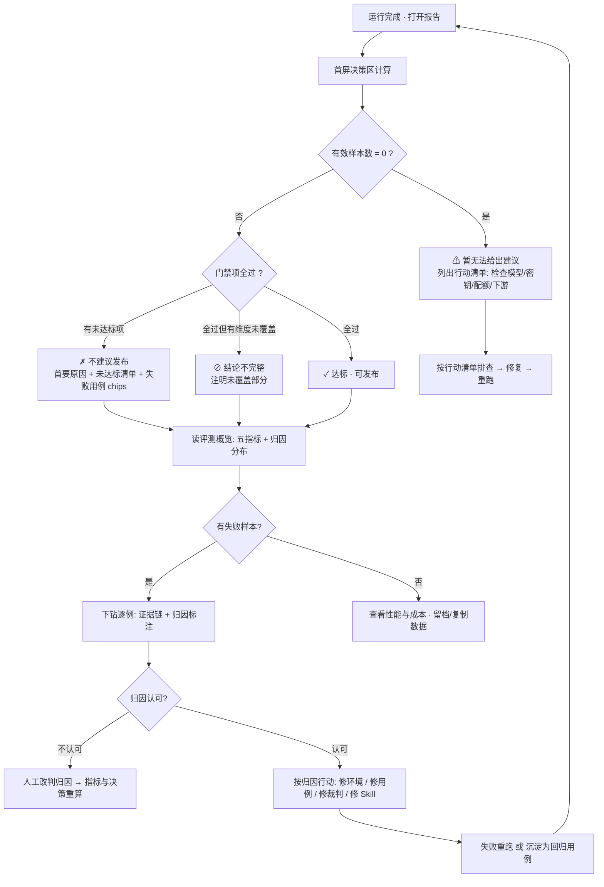
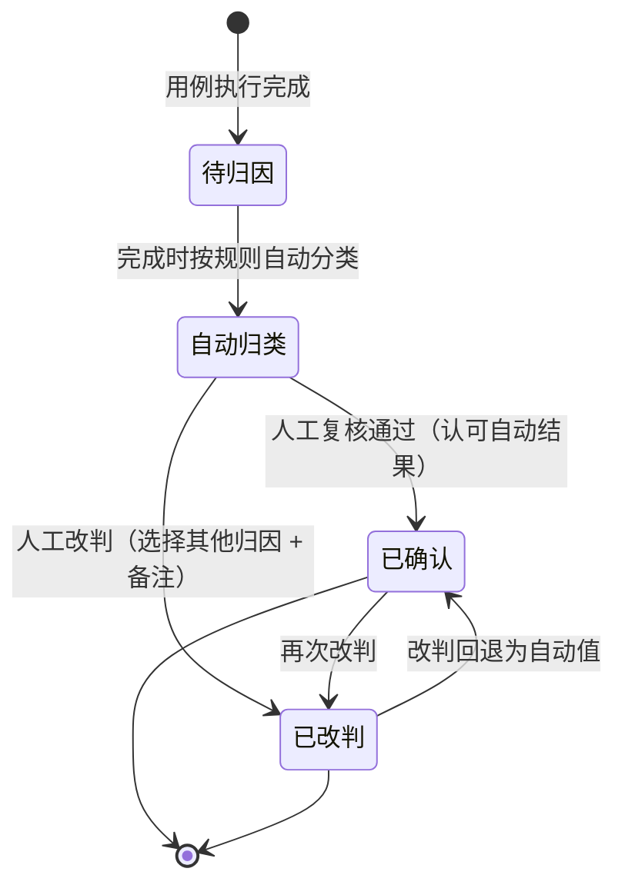
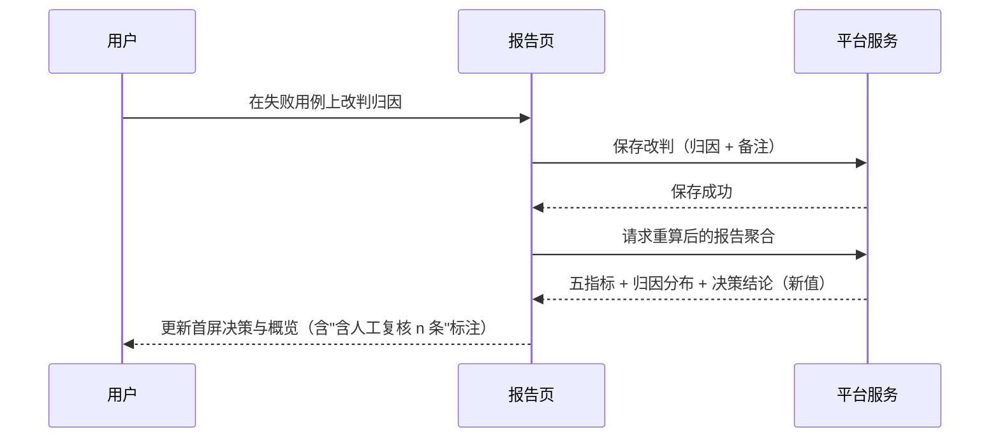

# 产品需求文档：Agent 测评 2.0 —— 决策化报告 · 归因体系 · Rubric 评分模型 - V0.1

| 项 | 内容 |
| --- | --- |
| 版本 | PRD-012 / 文档内版本 V0.1 |
| 状态 | **v0.1 初稿（2026-10-11）**，待用户逐项评审；范围与两个关键模型已拍板（见 §1.5） |
| 创建日期 | 2026-10-11 |
| 主平台 | 本机管理端：`minicare-platform/api`（FastAPI 8787）+ `minicare-platform/web`（React）——与 KB 平台、测评台**同一工程**，不新建服务 |
| 上游（现状基线） | PRD-010（测评台首期，已落地）、TECH-021（四管理面 + 配置物化，已验收）、TECH-022（批次 A+B 报告重构，已落地） |
| 理论来源 | 图灵评测团队《Agent评测漫谈——由浅入深讲解Agent评测》与《【图灵】评测平台使用手册》（KM 内网资料，2026-10 版；本地存档 `.workbuddy/reference/`，不进 git）。本 PRD 按用户要求**先理解该测评理论、再据此产出**；技术对标另参 TECH-020（六平台调研） |
| 关联技术文档 | `docs/tech/TECH-020-agent-eval-platform-research.md`、`docs/tech/TECH-021-agent-eval-console-v2.md`、`docs/tech/TECH-022-agent-eval-acceptance-review.md`、`minicare-agent/scripts/eval/README.md` |

---

## 0. 结论摘要（TL;DR）

**一句话**：把测评报告从"事实陈列"升级为"**决策系统**"——报告第一屏回答"能不能上线"、第二屏回答"差在哪、谁的锅"，同时把裁判体系从"单层判分器"升级为"**指标 → 多维度**两级的 Rubric 评分模型"，并补上数据飞轮（失败沉淀/重跑）与发布检查点。

- **为什么做**：现状报告有结论 Banner、KPI 卡、证据链（TECH-022 批次 A+B），但对照图灵评测理论仍有三个结构性缺口——① 没有"**归因**"（失败样本分不清"环境阻断 / 裁判问题 / 被测缺陷"）；② 没有"**效率层**"（耗时分布、Token 成本完全缺失）；③ 决策只有"闸门过没过"，没有"**暂无法给出建议**"这类诚实态与行动指引。
- **怎么做**：报告按图灵三区重构（首屏决策 / 评测概览五指标 + 归因分布 / 性能效率与成本）；裁判按图灵 Evaluator 两级聚合（指标→多维度 + 统一评分公式 + 变量系统）；飞轮（Bad Case 沉淀回归用例、失败重跑、历轮趋势）；门禁（发布闸门任务 + 发布检查点）。
- **不改什么**：**评测执行语义继续零重写**（延续 PRD-010 D3 / TECH-021 S-04）——harness 只做"透出数据"（Token 明细）与"输出格式三态化"两类小改，判分逻辑本身不动。

---

## 1. 综述 (Overview)

### 1.1 项目背景与核心问题

测评台现状（2026-10-09 批次 A+B 落地后）：发起 → 进度 → 报告（结论 Banner 三态 + KPI 卡 + delta 卡 + 证据链钻取）→ 历史 → 四管理面（用例/任务/裁判/维度）全链路已通。**但报告仍回答不了理论要求的三个问题**：

| 理论要求（图灵） | 现状 | 差距 |
| --- | --- | --- |
| 报告回答"好不好、哪里不好" | 有闸门判定的红绿 Banner | 缺"暂无法给出建议"诚实态；缺"原因 + 行动指引"完整形态 |
| 归因：失败问题发生在**规划、工具、环境还是 Skill** | 只有"失败用例列表"，失败原因靠人肉看证据链归纳 | 🔴 无归因体系；无法区分"环境噪声"与"真实缺陷" |
| 四层评测含**效率层**（耗时、Token 可接受） | 仅每用例有耗时字段，无任何呈现 | 🔴 无耗时分布、无 Token 成本、无高消耗定位 |
| 指标要"搭桥"、口径要先"去污染" | 仅闸门六项原始数值 | 缺"去污染通过率 / 功能有效通过率 / 环境阻断率"这类剥离噪声的口径 |
| Evaluator：**指标 → 多维度** + 统一评分公式 | 维度 ↔ 裁判 1:1 平铺，无聚合层、无样本分 | 🔴 评分模型与图灵两级结构不对齐 |
| 人人一致、人机一致（Rubric 二元化） | 有裁判试跑（校准闭环雏形），无改判与一致率统计 | 缺人工复核闭环 |
| 数据飞轮（Bad Case 喂养回归） | 用例库可编辑；失败样本与用例库之间无管道 | 缺"失败 → 沉淀回归用例"动作 |
| 回归机制 + 准入准出门禁 | 任务可复刻发起；无"发布检查"概念 | 缺闸门任务与发布检查点 |

**核心命题**：对齐图灵评测理论，把测评台升级为"**看得见问题（决策 + 归因）→ 说得清标准（Rubric）→ 带得动迭代（飞轮 + 门禁）**"的测评体系 2.0。本 PRD 为测量对象「敏宝助手」（minicare-agent）服务，全部能力落在本机管理端。

> ⚠️ **与既有资产的边界（先读）**：本 PRD **不重写评测执行引擎**。harness（`minicare-agent/scripts/eval/`）的调度、断言、判分架构全部沿用；仅三类允许的改动：① 数据透出（usage 明细落库）；② 输出格式对齐（judge 结果支持三态语义）；③ 聚合层计算（在平台 Python 侧）。详见 §8 约束。

### 1.2 核心业务流程 / 用户旅程地图

**读报告的人**（= 项目 owner，做"要不要发布/继续迭代"决策的人）的旅程，6 个阶段：

1. **阶段一：看决策（3 秒判断）** —— 打开任意一轮运行，首屏给出发布建议（达标 / 未达标 / 未完整覆盖 / 暂无法给出）+ 原因 + 行动指引。
2. **阶段二：读指标（剥离噪声看真相）** —— 评测概览五指标（样本总量、原始通过率、去污染通过率、功能有效通过率、环境阻断率）+ 归因分布，看清"扣分扣在哪、是真问题还是环境噪音"。
3. **阶段三：核成本（效率层）** —— 耗时五分位 + Token 四分类 + 高资源消耗定位 + 一键复制数据用于跨轮对比。
4. **阶段四：钻证据（从指标到用例）** —— 从归因分布/失败清单下钻到逐例证据链（复用现有：期望 vs 实际、工具轨迹、回答、judge 卡、trace），失败样本带**归因标注**且可**人工改判**。
5. **阶段五：配裁判（运行前的标准建设）** —— 指标→多维度 Rubric 管理、统一评分公式（三态值域 / 加权 / 样本分阈值裁决）、变量系统；改完用裁判试跑校准。
6. **阶段六：炼飞轮与门禁（持续迭代）** —— 失败用例沉淀为回归用例（派生 / 打回归标）、失败一键重跑、任务历轮趋势；「发布闸门任务」+ 发布检查点把评测结论接进发布流程。

### 1.3 Mermaid 图（流程/状态/时序）

#### 1.3.1 用户操作流（报告决策流，必填）



#### 1.3.2 样本归因状态机（必填）



> 口径：`attribution`（归因分类）+ `attribution_source`（`auto` / `manual`）。**人工改判后，所有派生指标（归因分布 / 去污染通过率 / 功能有效通过率 / 环境阻断率 / 决策结论）实时重算**——改判不是记备注，而是改变结论。

#### 1.3.3 关键场景时序（人工改判 → 结论重算）



### 1.4 名词与口径定义（术语表）

| 术语 | 口径 |
| --- | --- |
| **机评 / 机器评测** | 由 harness 自动执行的评测全链路（被测 Agent 执行 + 确定性断言 + LLM 裁判判分） |
| **样本** | 一条用例在某一轮运行中的一次执行（报告口径的"评测样本总量"按用例数计，`runs_n > 1` 时按首轮口径，待确认①） |
| **原始通过率** | 未剔除任何环境干扰的样本通过率 = 通过样本 / 全部样本 |
| **去污染通过率** | 剔除环境干扰后，**样本判定通过**的样本占比（分母 = 有效样本；分母为 0 时显示"—"）。反映被测的真实可靠性 |
| **功能有效通过率** | 剔除环境干扰后，**核心业务判定（默认"结果符合预期"指标）通过**的样本占比。定位功能实现质量 |
| **环境阻断率** | （环境阻断 + 测试数据问题）样本数 / 全部样本数。越高说明环境噪声越大 |
| **归因** | 对失败样本的分类：这份"失败"是谁的问题。v1 五类：环境阻断 / 测试数据问题 / 机评执行失败 / 裁判执行失败 / 被测缺陷（见 §3.4） |
| **有效样本** | 进入评审且未被归因为"非被测缺陷"的样本：全部样本 − 环境阻断 − 测试数据问题 − 机评执行失败 − 裁判执行失败 |
| **指标（Indicator）** | 判分聚合层：一组判分维度的加权汇总（如"结果符合预期""安全合规""回答质量"）。对齐图灵"评测指标" |
| **判分维度（Dimension）** | 单点判定项：由裁判（LLM/代码断言）逐例判分，三态值域（通过 / 中性 / 失败） |
| **样本分** | 各指标分的算术平均（无可用维度的指标不计入）；样本分 ≥ 样本分阈值 → 该样本 PASS |
| **阈值裁决** | 样本分阈值（默认 0.50，任务级可覆盖）——"压线算通过" |
| **Rubric 二元化** | 评测标准尽量收敛为"是 / 否 / 未知"的可判定项——用"未知（中性）"占比反查标准定义质量 |
| **发布检查** | 对「发布闸门任务」执行一轮评测，其决策结论作为"上线前检查点"留档（本机单用户，SOP 工具，不自动阻断部署） |
| **决策四态** | 达标（✓）/ 未达标（✗）/ 未完整覆盖（⊘）/ 暂无法给出建议（⚠） |

### 1.5 关键设计决策（本版拍板记录）

| # | 决策 | 来源 |
| --- | --- | --- |
| K-01 | **范围**：报告 2.0 + 裁判 Rubric 升级 + 飞轮与回归 + 准入门禁，四块全做 | 用户拍板（2026-10-11） |
| K-02 | **评分聚合模型**：对齐图灵两级——指标 → 多维度，统一评分公式（三态值域 / 加权平均 / 样本分 / 阈值裁决） | 用户拍板 |
| K-03 | **失败归因**：自动规则分类 + 人工复核改判（改判驱动结论重算） | 用户拍板 |
| K-04 | **报告决策化**：首屏决策四态（对齐图灵），"暂无法给出建议"为显式设计态 | 理论对齐 |
| K-05 | **五指标口径**：采纳图灵定义并按 minicare 语境适配（§1.4）；"去污染"的精确剔除边界列待确认 | 理论对齐 |
| K-06 | **数据采集补强**：Token 明细沿"runtime → harness → 台账"链下沉（source 已有数据，只补透出）；不改评测语义 | 技术可行性确认 |
| K-07 | **门禁形态**：发布闸门任务 + 发布检查点（结论留档 + 强提示），**不自动阻断**部署流程 | 本机单用户现实约束 |
| K-08 | **故事编号**：续编 US-09 起（同域延续 PRD-010 的 US-01~08）；承接 PRD-010 二期 US-07（对比）/ US-08（趋势）意图并升级实现 | 文档管理 |
| K-09 | **迁移策略**：既有 10 维度 + 4 裁判经"默认映射"挂到三个默认指标下（可再调）；旧轮次数据不迁移（报告按旧口径降级展示） | 工程渐进 |

---

## 2. 用户故事详述 (User Stories)

### 阶段一：看决策（3 秒判断）

---

#### **US-09: 作为项目 owner，我希望打开任何一轮运行的首屏就得到明确的发布建议（含原因与行动指引），以便于不用人肉比对 KPI 就能决定"能不能上线、接下来修什么"**

* **价值陈述 (Value Statement)**:
    * **作为** 项目 owner（兼测评体系"独裁者"）
    * **我希望** 运行详情首屏是一个明确的决策结论：四态之一 + 判定原因 + 下一步行动
    * **以便于** 3 秒内完成"能不能上线"的判断；当数据不足或环境异常时，得到诚实的"暂无法给出建议"而不是误导性的红/绿
* **业务规则与逻辑 (Business Logic)**:
    1. **前置条件**: 运行存在（任意状态）；决策区随运行完成自动计算，运行中/失败/中止各有对应呈现。
    2. **判定链（自上而下，命中即止）**：
       1. 运行 `failed` → "运行失败：{error 摘要}" + 行动（查看日志尾部 / 重跑）；
       2. 运行 `cancelled` → "已中止 · 部分结论（覆盖 n/M）"+ 按已完成部分计算（延续现状 D10）；
       3. **有效样本数 = 0** → **"⚠ 暂无法给出建议"**：说明"全部样本在执行/评审阶段即失败，未产生有效数据，本结论不具备参考意义"，并附**行动清单**（检查：评测模型与密钥 / 数据库与向量服务 / 裁判模型配额 / 下游服务连通状态），清单条目按当轮实际失败归因过滤（只显示相关项）；
       4. 存在 `must_pass` 维度不达标 → "✗ 不建议发布：{首要原因}"（首要原因 = 第一个 must_pass 失败项，如"高危护栏通过率 87.5%（目标 100%）"）；
       5. 其余门禁项有 fail → "✗ 不建议发布：{首要原因}"；
       6. 门禁全过但存在未覆盖部分（judge 未启用 / 部分维度 na） → "⊘ 结论不完整：本轮未覆盖 {维度清单}"；
       7. 全过 → "✓ 达标 · 可发布"；
       8. 附注行：`含人工复核 n 条归因`（若本轮有改判记录）；`样本分阈值 x.xx`。
    3. **色彩与图标**: 达标=绿 ✓ / 未达标=红 ✗ / 未完整覆盖=灰 ⊘ / 暂无法给出=琥珀 ⚠（对齐既有 `.badge` 体系；不新增色板）。
    4. **未达标时**: 横幅内直接列"未达标项 chips"+"失败用例 chips"（点击定位到用例表并闪烁，延续现状 D1 交互）；chips 旁提供「复制结论」按钮（决策 + 原因，文本形式，供贴给协作方）。
    5. 决策区与现有 `deriveVerdict` 的关系：**升级而非重写**——三态 → 四态；旧轮快照按旧规则降级推导（兼容逻辑保留）。
* **异常处理 (Error Handling)**:
    * 数据不足以判定某项（如 judge 关但必须判定 judge 类）→ 该项进"未覆盖清单"，不阻塞其它判定；
    * 改判归因导致判定翻转 → 决策区**整体刷新**并出现一行"归因改判后结论更新"提示（可关闭）；
    * 空运行（scope 为空）不应出现（发起侧已拦截），若出现按"暂无法给出建议"兜底。
* **验收标准 (Acceptance Criteria)**:
    * **场景1: 正常未达标**
        * **GIVEN** 一轮运行完成，`guardrail-rate` 为 87.5% 且 must_pass
        * **WHEN** 打开运行详情
        * **THEN** 首屏显示红色"✗ 不建议发布：高危护栏通过率 87.5%（目标 100%）· 硬门槛"，并列出失败用例 chips
    * **场景2: 全失败（暂无法给出）**
        * **GIVEN** 一轮运行 10 条用例全部在执行阶段失败（如密钥失效）
        * **WHEN** 打开运行详情
        * **THEN** 首屏显示"⚠ 暂无法给出建议"，附原因说明与"检查评测模型与密钥"等行动清单；**不显示红/绿**
    * **场景3: 未完整覆盖**
        * **GIVEN** judge 关闭运行的 2 条用例，门禁中 judge 类维度 na
        * **WHEN** 打开运行详情
        * **THEN** 显示"⊘ 结论不完整：本轮未覆盖 judge 类维度"，并注明可补跑带 judge 的轮次
* **页面布局线框图 (ASCII Wireframe)**:

    ```text
    ┌──────────────────────────────────────────────────────────────────┐
    │ 运行 20261011-140312 · L1 回归（8 条）· judge 开 · 12m34s         │
    ├──────────────────────────────────────────────────────────────────┤
    │ ╔══════════════════════════════════════════════════════════╗     │
    │ ║ ✗ 不建议发布：高危护栏通过率 87.5%（目标 100%）· 硬门槛     ║     │
    │ ║ 未达标：高危护栏命中率 87.5% < 100%                        ║     │
    │ ║ 失败用例： [L3-01 ×] [L3-05 ×]         [复制结论]          ║     │
    │ ╚══════════════════════════════════════════════════════════╝     │
    │ 含人工复核 2 条归因 · 样本分阈值 0.50                            │
    └──────────────────────────────────────────────────────────────────┘
    ```

---

### 阶段二：读指标（剥离噪声看真相）

---

#### **US-10: 作为项目 owner，我希望看到"去污染"后的五指标概览（而不是裸通过率），以便于判断分数变化是环境噪音还是真实质量变化**

* **价值陈述 (Value Statement)**:
    * **作为** 项目 owner
    * **我希望** 评测概览区展示：评测样本总量、原始通过率、去污染通过率、功能有效通过率、环境阻断率五个指标（含"— 无法计算"态）
    * **以便于** 在环境抖动频繁的现实下（本机开发、远端依赖多），先把"环境噪声"剔出去再评价被测质量
* **业务规则与逻辑 (Business Logic)**:
    1. **前置条件**: 归因体系已就绪（US-14 的自动分类先行，属同批交付）。
    2. **计算口径**（全部实时计算，口径版本记入报告脚注）：
       * 评测样本总量 = 本轮用例数（显示 N）；
       * 原始通过率 = 通过样本 / 全部样本（0/0 不存在，总样本 ≥ 1）；
       * 去污染通过率 = 有效样本中判定通过数 / 有效样本数；有效样本 = 全部 − 环境阻断 − 测试数据问题 − 机评执行失败 − 裁判执行失败；**有效样本 = 0 → 显示 "—（0/0）"** 并按 US-09 进入"暂无法给出建议"；
       * 功能有效通过率 = 有效样本中"结果符合预期"指标判定通过数 / 有效样本数；分母为 0 → "—"；
       * 环境阻断率 = （环境阻断 + 测试数据问题）/ 全部样本数（**分母固定为全部样本**，与去污染分母刻意不同——它度量的是"整轮被污染程度"）。
    3. 每个指标卡带一行说明文字（口径一句话，术语白话）；卡片 hover 显示"含/剔除明细"。
    4. 数值格式：百分比保留 1 位小数 + 分数原文（如 `87.5% (7/8)`）；与上轮同 scope 的差值（+/-pt）以角标显示（复用现有 delta 数据源）。
    5. 指标为 0 参与样本或口径未就绪的旧轮次：整卡降级为 "—" + 脚注"该轮未启用归因口径（旧版本）"。
* **异常处理 (Error Handling)**:
    * 旧轮（无归因数据）→ 五指标降级：原始通过率照常，其余显示"—"；
    * 改判归因后 → 五指标全部重算（含差值角标同步刷新）；
    * `runs_n > 1` 的多轮次样本：v1 按"首轮通过即通过"聚合（具体口径见 §10 待确认①）。
* **验收标准 (Acceptance Criteria)**:
    * **场景1: 有环境噪声的一轮**
        * **GIVEN** 20 条用例：16 通过、2 因 DB 不可达失败（环境阻断）、2 为真实缺陷
        * **WHEN** 打开报告概览
        * **THEN** 样本总量 20；原始通过率 80.0% (16/20)；去污染通过率 88.9% (16/18)；环境阻断率 10.0% (2/20)
    * **场景2: 无有效样本**
        * **GIVEN** 全部样本均为环境阻断
        * **WHEN** 打开报告
        * **THEN** 去污染通过率与功能有效通过率显示 "—（0/0）"，环境阻断率 100%，决策区为"暂无法给出建议"
* **页面布局线框图 (ASCII Wireframe)**:

    ```text
    ┌──────────────────────────────────────────────────────────────────┐
    │ ② 评测概览                                        口径版本 v1 ▾   │
    │ ┌───────────┐ ┌───────────┐ ┌───────────┐ ┌───────────┐ ┌───────┐│
    │ │ 20        │ │ 80.0%  ↑2 │ │ 88.9%  ↑3 │ │ 88.9%     │ │10.0%  ││
    │ │ 评测样本量 │ │ 原始通过率 │ │去污染通过率│ │功能有效通过率│ │环境阻断率││
    │ │ 本次执行样本│ │未剔除干扰  │ │剔除后全维度│ │核心判定通过 │ │噪声度量││
    │ └───────────┘ └───────────┘ └───────────┘ └───────────┘ └───────┘│
    │ 归因分布（占总样本 20）:  ▓▓▓▓▓▓▓▓ 被测缺陷 2 · ▓▓▓ 环境阻断 2     │
    │                         ^ 点击任意分类筛选下方用例表               │
    └──────────────────────────────────────────────────────────────────┘
    ```

---

#### **US-11: 作为项目 owner，我希望看到失败样本的归因分布，并能按归因筛选用例，以便于快速回答"这轮的失败到底是谁的问题"**

* **价值陈述 (Value Statement)**:
    * **作为** 项目 owner
    * **我希望** 概览区有"归因分布"（各归因分类的计数 + 占比，分母为总样本），点击分类即可筛选用例表
    * **以便于** 把"修改优先级"建立在归因上：环境问题先修环境、裁判问题先校裁判、被测缺陷才动产品
* **业务规则与逻辑 (Business Logic)**:
    1. **前置条件**: 归因自动分类已在入库时完成（见 US-14 与 §3.4 规则表）。
    2. 分布展示：横向条形（分类 + 计数 + 占比%，对齐图灵"机评执行失败 70 (100%)"的格式）；分类仅列出现过的类目；通过样本不进入分布。
    3. 交互：点击某分类 → 用例表按该归因筛选（与既有组筛选/搜索叠加）；再次点击取消。
    4. 分布脚注：`自动分类，未经复核` / `含人工复核 n 条`（有改判时）。
    5. 各分类的颜色在主色板内取语义色（环境=琥珀、数据=灰、执行=灰蓝、裁判=紫、缺陷=红）；通过=绿不进分布。
* **异常处理 (Error Handling)**:
    * 全部通过 → 显示一行"无失败样本"；
    * 旧轮无归因 → 区域显示"该轮未启用归因（旧版本）"；
    * 归因为"被测缺陷"但置信存疑（自动分类降级情形）→ 分类名后加 `?`，hover 提示"建议人工复核"。
* **验收标准 (Acceptance Criteria)**:
    * **场景1: 分布与筛选联动**
        * **GIVEN** 一轮 20 条：16 通过、2 环境阻断、2 被测缺陷
        * **WHEN** 点击"环境阻断"条
        * **THEN** 用例表只剩 2 条环境阻断用例；分布条高亮；点击空白恢复
    * **场景2: 改判刷新**
        * **GIVEN** 上述轮次，用户把 1 条"被测缺陷"改判为"测试数据问题"
        * **WHEN** 保存改判
        * **THEN** 分布中两分类计数各 ±1、占比重算、去污染通过率同步变化
* **页面布局线框图 (ASCII Wireframe)**:

    ```text
    ┌──────────────────────────────────────────────────────────────────┐
    │ 归因分布（占总样本 20）· 自动分类 · 含人工复核 1 条                 │
    │ 被测缺陷      ████████████ 2 (10.0%)            ✎ 复核中          │
    │ 环境阻断      ████████████ 2 (10.0%)                              │
    │ 裁判执行失败   ▏0                                             ▾  │
    └──────────────────────────────────────────────────────────────────┘
    ```

---

### 阶段三：核成本（效率层）

---

#### **US-12: 作为项目 owner，我希望看到本轮运行的耗时分布与 Token 成本四分类，以便于评估"快不快、贵不贵"是否符合可接受标准**

* **价值陈述 (Value Statement)**:
    * **作为** 项目 owner
    * **我希望** 报告第三区展示：耗时五分位（平均 / P50 / P90 / P95 / Max）与 Token 四分类（Prompt / Completion / Cached / Total）
    * **以便于** 把"效率层"纳入质量评价（理论四层之一），感知模型/链路变更带来的时长与成本漂移
* **业务规则与逻辑 (Business Logic)**:
    1. **前置条件**: 耗时数据沿用既有 `ms`（无需补采集）；**Token 明细需先完成采集补强**（§3.5 链路改造，属本期 P0 配套）。
    2. 耗时卡：平均（全量样本执行完成平均耗时）/ P50 / P90 / P95 / Max；单位自动（s / m）；hover 显示计算样本数。
    3. Token 卡：Prompt Tokens（发送给模型的输入，不含缓存命中）/ Completion（模型生成输出）/ Cached（命中缓存的输入，**不重复计费**）/ Total（四类总和）；单位 k（千）。
    4. 旧轮次或采集缺失：对应卡显示 "—" + 脚注"该轮未采集 Token 明细（旧版本）"。
    5. 数值列带与上轮同 scope 差值角标（+/-，与 US-10 同一 delta 数据源）。
* **异常处理 (Error Handling)**:
    * 个别用例无 token（执行失败/降级链路）→ 以"有数据样本"为分母并在 hover 注明「n/m 条有数据」；
    * 极端值（超时用例 Max 异常大）→ 正常显示（这正是 Max 的意义），hover 可跳该用例。
* **验收标准 (Acceptance Criteria)**:
    * **场景1: 正常展示**
        * **GIVEN** 一轮 20 条用例全部执行成功且采集到 usage
        * **WHEN** 打开报告
        * **THEN** 耗时五值与 Token 四类均显示且位数格式正确（如 `147s`、`710.5k`）
    * **场景2: 旧轮降级**
        * **GIVEN** 一轮旧运行（无 token 数据）
        * **WHEN** 打开报告
        * **THEN** Token 四卡均显示 "—" 并附脚注；耗时卡正常显示
* **页面布局线框图 (ASCII Wireframe)**:

    ```text
    ┌──────────────────────────────────────────────────────────────────┐
    │ ③ 性能效率与成本                        [复制本次数据] [对比说明] │
    │  耗时:  120s      99s      147s     159s     916s                │
    │        平均      P50      P90      P95      Max                  │
    │  Token: 710.5k    68.4k    7561.6k  778.9k                       │
    │         Prompt    Completion Cached   Total（缓存不重复计费）      │
    └──────────────────────────────────────────────────────────────────┘
    ```

---

#### **US-13: 作为项目 owner，我希望看到高资源消耗的用例明细并一键复制本轮数据，以便于定位"谁最贵"并与其他轮次/任务做对比**

* **价值陈述 (Value Statement)**:
    * **作为** 项目 owner
    * **我希望** 有"高资源消耗 Top N"明细表（用例 / 耗时 / Token），并有一个「复制数据」动作把本轮关键数据复制为文本
    * **以便于** 定位异常成本来源；把两轮数据并排贴到一起肉眼比对（轻量跨任务对比，完整对比视图留二期）
* **业务规则与逻辑 (Business Logic)**:
    1. 高资源消耗表：按 Total Tokens 降序（并列按耗时降序），默认 Top 10；列 = 用例 ID + 描述 / 耗时 / Token；行点击跳转该用例证据链。
    2. 「复制数据」：把「五指标 + 耗时五值 + Token 四类 + Top10 表」格式化为 Markdown 文本写入剪贴板；toast 提示"已复制（MD）"。
    3. 复制文本带上下文头（运行 ID / 范围 / 时间 / judge 开关），保证贴到别处仍可自解释。
* **异常处理 (Error Handling)**:
    * 无 Token 数据 → 表按耗时降序 + 列头显示"（Token 未采集）"；
    * 复制失败（剪贴板权限）→ toast 降级提示 + 展开可手动选择复制。
* **验收标准 (Acceptance Criteria)**:
    * **场景1: Top 表定位**
        * **GIVEN** 一轮含 1 条超时用例（916s、23.3k tokens）
        * **WHEN** 查看高资源消耗表
        * **THEN** 该用例位列第一，点击行跳转其证据链
    * **场景2: 复制数据**
        * **GIVEN** 任意一轮
        * **WHEN** 点击「复制本次数据」
        * **THEN** 剪贴板得到带上下文头的 Markdown 块，包含五指标/耗时/Token/Top10
* **页面布局线框图 (ASCII Wireframe)**:

    ```text
    ┌──────────────────────────────────────────────────────────────────┐
    │ 高资源消耗 Top 10（按 Total Tokens）                              │
    │ 用例            描述                    耗时       Token 消耗      │
    │ R1-07          旺仔转奶进度查询…         916s       23.3k          │
    │ L2-03          生长曲线 P50 解读…        159s       12.1k          │
    │ …                                                                │
    └──────────────────────────────────────────────────────────────────┘
    ```

---

### 阶段四：钻证据（从指标到用例）

---

#### **US-14: 作为项目 owner，我希望每个失败样本都带归因标注且可以人工改判，证据链与归因在同一处闭环，以便于"看一个用例 = 完成一次归因"**

* **价值陈述 (Value Statement)**:
    * **作为** 项目 owner（测评体系的"独裁者"）
    * **我希望** 逐例钻取时看到：自动归因结果 + 归因依据（命中的规则/阶段）+ 一键改判入口；证据链（现有）保持原位
    * **以便于** 在同一个页面完成"看证据 → 认同或推翻自动归因 → 结论重算"的闭环；累积的改判数据将来可统计自动分类的"人机一致率"
* **业务规则与逻辑 (Business Logic)**:
    1. **前置条件**: 用例表新增「归因」列（默认显示自动结果；人工复核后显示"已复核"徽标 + 最终值）；数据落点见 §3.3。
    2. **自动分类规则（v1，入库时执行；规则表见 §3.4）**：按失败阶段与错误特征分类：
        * `stage = error`（执行未产出）→ 看错误特征：命中基础设施关键词（数据库/密钥/网络/embedding/超时无活动）→ `环境阻断`；疑似用例配置问题 → `测试数据问题`；否则 → `机评执行失败`；
        * `stage = deterministic / judge` 失败 → `被测缺陷`（进入过评审）；
        * 判分器自身报错（judge 调用失败/解析失败）→ `裁判执行失败`；
        * 通过样本 → `–`（空）。
    3. **改判交互**：点击归因列 → 弹出选择（五分类 + 备注输入框 + "恢复自动结果"）；保存后：① 该样本归因更新（source=manual）；② 报告五指标/分布/决策刷新（见 1.3.3 时序）；③ 若该用例来自旧运行且有平台标记，不级联影响其他轮次。
    4. **归因依据展示**：改判弹窗内显示"自动分类依据"（命中规则的一句话，如"执行错误信息匹配：数据库连接失败"），便于人判断。
    5. 权限/一致性：单用户无权限问题；同一用例在不同轮次的归因相互独立（按 run 存）。
    6. **改判统计**（轻量）：运行详情脚注汇总"人工复核 n 条（其中推翻自动结果 m 条）"。
* **异常处理 (Error Handling)**:
    * 自动分类未命中任何规则 → 归为 `被测缺陷` 并标记 `?`（不确定），提示优先复核；
    * 旧轮样本无归因 → 归因列显示"—（旧版本）"，仍可人工补标（补标后参与重算）；
    * 改判接口失败 → 前端保留原值 + 错误 toast，不乐观更新。
* **验收标准 (Acceptance Criteria)**:
    * **场景1: 自动归类与展示**
        * **GIVEN** 一条用例执行时 DB 抛错（提示"数据库不可达"）
        * **WHEN** 打开用例明细
        * **THEN** 归因列显示"环境阻断（自动）"，弹窗依据显示"执行错误匹配：数据库连接失败"
    * **场景2: 改判驱动结论**
        * **GIVEN** 上述用例实际是本地网络抖动已恢复
        * **WHEN** 用户改判为"测试数据问题"并保存
        * **THEN** 决策区/五指标/分布全部按新归因刷新，"含人工复核 1 条"出现
* **页面布局线框图 (ASCII Wireframe)**:

    ```text
    ┌──────────────────────────────────────────────────────────────────┐
    │ 用例          组  结果   归因            耗时    操作              │
    │ L3-01        l3  ❌     被测缺陷 ✓已复核  41s    证据 ▸            │
    │ L1-07        l1  ❌     环境阻断（自动）?  3s    证据 ▸  [改判]    │
    ├─ 改判弹窗 ────────────────────────────────────────────────────┐ │
    │ 归因:  ( )环境阻断  ( )测试数据问题  ( )机评执行失败            │ │
    │        ( )裁判执行失败  (•)被测缺陷                            │ │
    │ 依据: 执行错误信息匹配"数据库连接失败"（自动规则 R2）            │ │
    │ 备注: [________________________]      [恢复自动结果] [保存]     │ │
    └───────────────────────────────────────────────────────────────┘ │
    └──────────────────────────────────────────────────────────────────┘
    ```

---

### 阶段五：配裁判（Rubric 体系）

---

#### **US-15: 作为项目 owner，我希望把判分标准从"维度平铺"升级为"指标 → 多维度"两级结构并在页面上管理，以便于一处看清"测什么口径、由哪些判定项组成、各占多少权重"**

* **价值陈述 (Value Statement)**:
    * **作为** 项目 owner
    * **我希望** 有一个"指标与维度"管理页：指标（名称/说明）下挂多个判分维度（名称/说明/权重），维度绑定判分来源（LLM 裁判 / 代码断言）
    * **以便于** 评分标准与业务口径对齐（图灵"指标"层），且每次调整都能从聚合层看到影响
* **业务规则与逻辑 (Business Logic)**:
    1. **前置条件**: 既有 `eval_dimension`（10 条）+ `eval_judge`（4 条）经迁移脚本映射到三个默认指标（见 §3.2 迁移映射），UI 可见可调。
    2. **结构**（对齐图灵 Evaluator 编辑器）：
       * **指标**（Indicator）：名称（≤20 字）/ 说明（≤50 字）/ 启用开关；**数量不设上限但 v1 建议 ≤5**；
       * **判分维度**（Dimension）：名称 / 说明（进裁判 Prompt 的判定要点）/ 权重（默认 1）/ 判分来源（`裁判: {judge 引用}` 或 `代码断言: {断言器引用}`）/ 启用开关；
       * 一个指标可挂多个维度（对齐"最多 50"，v1 实际轻量）；一个维度只属一个指标。
    3. **页面组织**：左侧指标卡列表（可增删改）→ 选中指标后在右侧编辑其维度列表（维度卡片可拖拽排序）。
    4. **维度与裁判的关系**：维度绑定既有"裁判"对象（LLM 裁判：prompt/模型/温度；代码断言：断言器引用）；裁判页（既有）继续负责 Prompt 级编辑，本页只做"挂接与权重"。
    5. **影响可视化**：保存前显示"影响提示"：该指标当前有多少用例在用（按 case 的 judge 要点统计）；修改权重不影响历史轮（历史按运行快照解读）。
    6. **评测维度来源固定为"手动配置"**（对齐图灵两个选项中的前者；"从数据集获取"列入非目标）。
* **异常处理 (Error Handling)**:
    * 删除仍被任务引用的指标 → 二次确认 + 提示替换默认；
    * 维度未绑定判分来源 → 保存拦截（红字）；
    * 旧维度未挂指标（迁移失败兜底）→ 归入"未分组"虚拟指标并在页面顶部提示修复。
* **验收标准 (Acceptance Criteria)**:
    * **场景1: 两级结构可见可控**
        * **GIVEN** 迁移完成后的初始状态
        * **WHEN** 打开"指标与维度"页
        * **THEN** 显示 3 个默认指标；「结果符合预期」下含 2 个维度（确定性断言、关键信息完整），各带权重
    * **场景2: 新增维度**
        * **GIVEN** 指标「回答质量」已存在
        * **WHEN** 新增维度"不口播数据来源"并绑定 jdg-tone 裁判，权重 0.5
        * **THEN** 保存成功；后续运行按新维度参与指标分计算；历史轮不受影响
* **页面布局线框图 (ASCII Wireframe)**:

    ```text
    ┌──────────────────────────────────────────────────────────────────┐
    │ 指标与维度                                        [+ 新建指标]    │
    │ ┌─指标───────┐ ┌─「结果符合预期」─────────────────────────────┐  │
    │ │结果符合预期 ▶│ │ 说明: 任务功能是否完成、输出是否可用    [启用] │  │
    │ │安全合规    │ │ 判分维度:                        [+ 添加维度] │  │
    │ │回答质量    │ │ ┌────────────────────────────────────────┐  │  │
    │ │            │ │ │ ① 确定性断言  来源: 代码断言   权重 1.0 │  │  │
    │ │            │ │ │ ② 关键信息完整 来源: jdg-completeness 权重 1.0│  │
    │ │            │ │ └────────────────────────────────────────┘  │  │
    │ │            │ │ 判分说明（自动生成公式, 见 US-16）           │  │
    │ │            │ │ 关联用例影响: 38 条                    [保存] │  │
    │ └────────────┘ └──────────────────────────────────────────┘  │
    └──────────────────────────────────────────────────────────────────┘
    ```

---

#### **US-16: 作为项目 owner，我希望评分按统一公式执行（三态值域 / 加权 / 样本分 / 阈值裁决），并在页面上随时看到公式说明，以便于评分过程可解释、可复算、可校准**

* **价值陈述 (Value Statement)**:
    * **作为** 项目 owner
    * **我希望** 采纳图灵的统一评分公式：维度三态（通过 1.0 / 中性 0.5 / 失败 0.0，含反向语义）→ 指标分（加权平均）→ 样本分（指标均值）→ ≥ 样本分阈值 → PASS
    * **以便于** 用"样本分"这一连续量替代"一挂全挂"的布尔裁决，量化地看到"差 0.1 分"的接近程度；并让阈值成为可调的显式配置
* **业务规则与逻辑 (Business Logic)**:
    1. **公式（页面"判分说明"卡逐条可视化，不用数学符号裸展示）**：
        * 维度值 = 通过 → 1.0；中性 → 0.5；失败 → 0.0；**反向维度**取 1 − 分值（v1 保留字段，默认全正向）；
        * 指标分 = Σ(权重 × 可用维度分) ÷ Σ(可用权重)——**无可用维度的指标不计入样本分**；某维度"未测"（不存在/不适用）时该维度记为"不可用"，不按失败算；
        * 样本分 = 各"可用指标"分的算术平均（保留 1 位小数）；
        * 样本分 ≥ 样本分阈值（默认 0.50，**压线算通过**）→ 样本 PASS，否则 FAIL。
    2. **三态语义与"未测"的区别（关键）**：中性（0.5）= 裁判判定"无法确定"；未测 = 该维度本轮未执行/不适用（不计入加权）。报告中用不同符号区分。
    3. **阈值落点**：样本分阈值默认 0.50；任务级可覆盖（任务编辑器新增字段，见 US-20）；运行快照记录当轮阈值（口径版本入报告脚注）。
    4. **judge 输出协议升级**：LLM 裁判输出从"通过/不通过"升级为"通过 / 中性 / 失败 + 原因"（harness `judge.mjs` 输出格式小改，判定标准与 Prompt 主体不变；解析兼容旧格式布尔值）。代码断言默认只产出通过/失败（无中性）。
    5. **样本分展示**：用例表新增"样本分"列（0.0-1.0，保留 1 位，hover 显示各指标分拆解）；低于阈值 0.2 内标黄（"临界"）。
    6. **与现状的兼容**：旧轮次无样本分 → 列显示 "—"；报告五指标中涉及"判定通过"的口径在旧轮降级为"全断言通过"（脚注注明）。
* **异常处理 (Error Handling)**:
    * 裁判返回无法解析 → 该维度记"中性"并向"裁判执行失败"归因（US-14）；
    * 样本全部维度不可用 → 样本分"—"，样本归因按规则处置；
    * 阈值配置非法（0-1 之外）→ 表单拦截。
* **验收标准 (Acceptance Criteria)**:
    * **场景1: 加权与裁决**
        * **GIVEN** 某样本：维度 A（权重 1，通过）、维度 B（权重 0.5，中性，属指标 1）；指标 2 维度 C（权重 1，失败）
        * **WHEN** 查看样本分
        * **THEN** 指标 1 分 = (1×1.0 + 0.5×0.5) ÷ 1.5 = 0.83；指标 2 分 = 0.0；样本分 = 0.42 < 0.50 → FAIL
    * **场景2: 未测不按失败算**
        * **GIVEN** 某样本维度 C 本轮未执行（judge 该类未启用）
        * **WHEN** 计算样本分
        * **THEN** 维度 C 记为"不可用"从加权中剔除；页面对该维度显示"未测"符号（非失败）
* **页面布局线框图 (ASCII Wireframe)**:

    ```text
    ┌─ 判分说明（自动生成 · 只读）──────────────────────────────────────┐
    │ 维度值: 通过 1.0 / 中性 0.5 / 失败 0.0（无可用维度不计入）          │
    │ 指标分 = 各维度加权平均    样本分 = 各指标算术平均                 │
    │ 样本分 ≥ 0.50 → PASS（压线算通过）        [查看示例演算 ▸]         │
    └──────────────────────────────────────────────────────────────────┘
    ```

---

#### **US-17: 作为项目 owner，我希望裁判提示词引用的是"命名变量"（系统变量 + 自定义变量）而不是散落占位符，以便于 prompt 可复用、可校验、不出现"引用了不存在的字段"**

* **价值陈述 (Value Statement)**:
    * **作为** 项目 owner
    * **我希望** 有一个变量系统：系统变量（运行/用例上下文，自动注入）+ 自定义变量（如 chat_query / chat_response / tool_execution / expected_behavior / expected_skills），裁判 Prompt 中用变量名引用
    * **以便于** 提示词工程规范化（对齐图灵变量配置），并在保存时自动校验未定义变量
* **业务规则与逻辑 (Business Logic)**:
    1. **系统变量（只读，自动注入）**：`sys_run_id`（运行标识）/ `sys_case_id`（用例号）/ `sys_scope`（范围标签）——对齐图灵 sys_sessionId / sys_content 的定位（系统级上下文）。
    2. **自定义变量（预置 6 个，对齐图灵命名；可增删改，上限 20）**：
        * `chat_query` 本轮用户输入（= 用例 message）
        * `chat_response` 本轮回答（= 运行实际输出）
        * `chat_history` 历史对话（= 用例 history）
        * `tool_execution` 标准化执行轨迹（= 工具调用序列，人话格式）
        * `expected_behavior` 本轮预期行为（= 用例 expect/judge 要点的人话表达）
        * `expected_skills` 预期工具链（= 期望工具列表）
    3. **兼容层**：既有判分器 Prompt 中的占位符（`{{message}}` / `{{answer}}` / `{{tool_outputs}}` / `{{golden_points}}`）映射到上述变量（message→chat_query、answer→chat_response、tool_outputs→tool_execution、golden_points→expected_behavior）；旧占位符继续可解析（不破坏既有裁判），但编辑器展示为变量面板 + 高亮。
    4. **变量配置面板**：裁判编辑页内（对齐图灵截图位置）：系统变量表（只读）+ 自定义变量表（增删改 + "添加自定义变量 (n/20)"）。
    5. **校验**：保存时扫描 Prompt 中的变量引用：未定义 → 警告浮层（可强制保存但标黄）；变量存在但 Prompt 未用 → 提示可删除（不强制）。
    6. **输出变量（只读展示）**：`sys_result`（评测结果：通过/中性/失败）、`sys_reason`（评测原因）——对齐图灵输出变量，说明裁判必须产出该结构（即 US-16 的三态输出协议）。
* **异常处理 (Error Handling)**:
    * 变量重命名 → 扫描引用并提示批量替换（v1 可选，列入待确认）；
    * 运行时缺值（如无历史）→ 注入空串 + Prompt 顶部自动列"缺值说明"（不静默）。
* **验收标准 (Acceptance Criteria)**:
    * **场景1: 变量引用与校验**
        * **GIVEN** 某裁判 Prompt 引用 `{{chat_query}}` 与 `{{foo}}`
        * **WHEN** 点击保存
        * **THEN** 保存成功但高亮警告"变量 foo 未定义"；`{{chat_query}}` 被识别为合法变量
    * **场景2: 旧占位符兼容**
        * **GIVEN** 既有 jdg-faithfulness Prompt（含 `{{message}}` 等旧占位符）
        * **WHEN** 运行一轮
        * **THEN** 判分行为与改造前一致（一致性对照验收，延续 TECH-021 S-06 方法）
* **页面布局线框图 (ASCII Wireframe)**:

    ```text
    ┌─ 变量配置 ────────────────────────────────────────────[收起变量]─┐
    │ 系统变量:   sys_run_id 运行标识 · sys_case_id 用例号 · sys_scope  │
    │ 自定义变量:                                                      │
    │   chat_query       本轮用户输入     [删除]                        │
    │   chat_response    本轮 Agent 回复  [删除]                        │
    │   tool_execution   标准化执行轨迹   [删除]                        │
    │   …                                                    [+ 添加自定义变量 (6/20)]│
    ├─ 提示词（变量以高亮插入）───────────────────────────────────────┤
    │ 你的任务是判断回答是否忠实于知识库依据…                            │
    │ 【用户问题】{{chat_query}}   【实际回复】{{chat_response}} …      │
    │ ⚠ 未定义变量: foo                                                 │
    └──────────────────────────────────────────────────────────────────┘
    ```

---

### 阶段六：炼飞轮与门禁（持续迭代）

---

#### **US-18: 作为项目 owner，我希望把失败样本一键沉淀为回归用例（或加入回归集），以便于让"每次踩过的坑"变成下次自动拦截的用例**

* **价值陈述 (Value Statement)**:
    * **作为** 项目 owner
    * **我希望** 在失败用例上有两个沉淀动作：①「加入回归集」（打 `regression` 标签）；②「派生新用例」（以当前用例为模板复制出可编辑的新用例，记录来源）
    * **以便于** 实践数据飞轮纪律——Bad Case 的价值最高，让它持续"喂养"评测体系
* **业务规则与逻辑 (Business Logic)**:
    1. 用例行/详情新增两个动作（失败样本默认显示；通过样本也可派生）：
       * **加入回归集**：更新用例 `tags` 追加 `regression`（幂等，已存在提示）；"回归集"在发起运行范围里以 `tag:regression` 一键选择（既有 scope 能力支持）。
       * **派生新用例**：`POST /cases/{case_id}/derive` 服务端复制生成新用例（新 ID 规则：`{原ID}b/c…` 递增）；新用例携带 `source_json`（`{type: derive, from_case, from_run}`）；打开编辑器可立即修改 message/expect/judge 要点后保存。
    2. **来源可视化**：用例编辑器中显示来源徽标（`种子` / `派生自 L1-07@20261011-140312`），列表可按"来源"筛选（v1 只支持显示，不做筛选，列入待确认）。
    3. **飞轮度量（轻量）**：用例库页脚显示"累计沉淀：派生 n 条 / 回归集 m 条"（引导纪律，不做强制）。
* **异常处理 (Error Handling)**:
    * 派生 ID 冲突 → 自动顺延后缀；
    * 用例已被删除引用（旧运行失败样本的 case_defs 仍在）→ 派生允许（以运行快照为准），来源标注标记"原用例已删除"。
* **验收标准 (Acceptance Criteria)**:
    * **场景1: 加入回归集**
        * **GIVEN** 运行详情中失败用例 L1-07
        * **WHEN** 点击「加入回归集」
        * **THEN** 成功后该用例 tags 含 regression；发起运行页可按 `tag:regression` 选择该用例
    * **场景2: 派生用例**
        * **GIVEN** 同一失败用例
        * **WHEN** 点击「派生新用例」并修改期望后保存
        * **THEN** 用例库出现 L1-07b，来源徽标显示派生自 L1-07 与本轮运行 ID
* **页面布局线框图 (ASCII Wireframe)**:

    ```text
    ┌──────────────────────────────────────────────────────────────────┐
    │ L1-07 ❌ 知识问题应触发检索…                                      │
    │   工具轨迹: search_knowledge(…) → 未调用（期望必调）               │
    │   [加入回归集]  [派生新用例]  [查看证据 ▸]                         │
    └──────────────────────────────────────────────────────────────────┘
    ```

---

#### **US-19: 作为项目 owner，我希望一键重跑失败用例、并在任务上看到历轮通过率与决策的变化，以便于"修完即验"、且一眼看出这周是变好还是变差**

* **价值陈述 (Value Statement)**:
    * **作为** 项目 owner
    * **我希望** ① 运行详情有「重跑失败 N 条」按钮（以失败用例合集直接发起新运行）；② 任务详情按时间列出历轮运行（通过率 mini 趋势 + 决策状态）
    * **以便于** 修复动作有闭环验证；跨轮变化不再靠翻历史列表拼记忆（承接并升级 PRD-010 US-07 / US-08 的意图）
* **业务规则与逻辑 (Business Logic)**:
    1. **失败重跑**：按钮位于失败清单尾部；点击后进入发起区（预填 `ids:` 范围与当轮 judge/runs 参数），确认后发起；新运行与旧运行关联展示（"重跑自 {run_id} 的失败集"）。
    2. **任务历轮视图**：任务详情页 = 历轮列表（倒序）：时间 / 范围 / judge / 通过率 / **决策状态 pill**（四态色）/ 耗时；顶部 mini 趋势：通过率折线（最近 ≤10 轮，hover 值）；无 task_id 的手工运行不入任务视图（保持"手工轮次在历史页"）。
    3. **历轮对比锚点**：每轮行提供"与上轮比"（复用 delta 数据）与"与首轮比"（快速看整体漂移）。
    4. 数据来源：全部来自既有台账（`eval_run.summary` + 新报告聚合），不新增存储。
* **异常处理 (Error Handling)**:
    * 失败用例在发起时发现已删除/停用 → 跳过并提示"n 条已不可用"；
    * 任务历轮 > 50 → 分页加载（默认 10 轮）。
* **验收标准 (Acceptance Criteria)**:
    * **场景1: 重跑闭环**
        * **GIVEN** 一轮有 3 条失败（L1-07 / L3-01 / R1-04）
        * **WHEN** 点击「重跑失败 3 条」并确认
        * **THEN** 新运行范围 = `ids:L1-07,L3-01,R1-04`，页面出现"重跑自 …"标识
    * **场景2: 历轮趋势**
        * **GIVEN** 任务「R1 回归」有 5 轮历史
        * **WHEN** 打开任务详情
        * **THEN** 看到 5 行历轮（含决策 pill）+ 通过率 mini 折线；每轮可跳转对应报告
* **页面布局线框图 (ASCII Wireframe)**:

    ```text
    ┌──────────────────────────────────────────────────────────────────┐
    │ 任务：R1 回归 · r1（20 条）· judge 开                              │
    │ 通过率趋势: 85→88→92→90→95  ▁▂▄▃█                                 │
    │ 历轮:  10-11 14:03  ✓达标     95% (19/20)   12m   与上轮 +5pt ▸   │
    │        10-10 21:12  ✗未达标   90% (18/20)   13m                  │
    │        10-09 18:30  ⊘未覆盖   92% …                              │
    │ 失败样例: ids:L1-07,L3-01,R1-04 → [重跑失败 3 条]                 │
    └──────────────────────────────────────────────────────────────────┘
    ```

---

#### **US-20: 作为项目 owner，我希望有一个「发布闸门任务」及其"发布检查"结论卡，以便于把评测达标接进上线的动作里——上不上线，先看检查点**

* **价值陈述 (Value Statement)**:
    * **作为** 项目 owner
    * **我希望** 可以把某任务标记为"发布闸门"（如 R1 回归 + 安全集），并有一个「发布检查」动作：对该任务跑一轮，其决策结论作为上线前检查点留档展示
    * **以便于** 实践"准入准出门禁"——发布决策不再凭印象，而是有一张可查的检查单（本机单用户：SOP 工具而非自动阻断）
* **业务规则与逻辑 (Business Logic)**:
    1. **闸门任务**：任务编辑器新增开关"作为发布闸门"（`is_gate`）；同一时刻建议仅 1 个闸门任务（可多个，UI 提示）。
    2. **发布检查动作**：入口两处——① 任务页「跑发布检查」（= 按闸门任务发起运行，`purpose=release_check`）；② 总览页"发布检查"卡快捷发起。
    3. **结论卡**（总览页 + 任务页）：显示最近一次发布检查：时间 / 通过率 / **决策四态** / 有效期提示（如"3 天前，建议重跑"当超过 72h）；结论卡可一键跳该轮报告。
    4. **留档**：`eval_run.purpose` 标记；历史页与历轮列表显示"发布检查"徽标并可筛选。
    5. **边界（重要）**：不自动阻断部署流程（见 §9 非目标）；`minicare-deploy` skill 的 SOP 文档增补"部署前须跑发布检查并达标"步骤指引（文档级改动，属实施附带项）。
    6. **未达标强提示**：跑发布检查后若未达标，结果卡红色 + 提示"按归因先修环境/用例/裁判/缺陷，修复后重跑"。
* **异常处理 (Error Handling)**:
    * 无闸门任务 → 发布检查卡显示"未设置闸门任务"+ 设置入口；
    * 检查运行失败/中止 → 结论卡按四态规则显示对应态，不误标达标；
    * 闸门任务被停用 → 提示并降级为"闸门已停用"。
* **验收标准 (Acceptance Criteria)**:
    * **场景1: 发布检查留档**
        * **GIVEN** 闸门任务「上线闸门」已设置
        * **WHEN** 点击「跑发布检查」并完成运行
        * **THEN** 总览页结论卡显示该轮四态结论与时间；历史列表该轮带"发布检查"徽标
    * **场景2: 未达标不误导**
        * **GIVEN** 发布检查运行未达标
        * **WHEN** 查看结论卡
        * **THEN** 显示"✗ 不建议发布"与首要原因，不得显示绿色
* **页面布局线框图 (ASCII Wireframe)**:

    ```text
    ┌─ 发布检查 ───────────────────────────────────────[跑发布检查 ▸]─┐
    │ 闸门任务: 上线闸门（R1 回归 + 安全集 · 28 条）                    │
    │ 最近检查: 10-11 14:22  ✗ 不建议发布 · 高危护栏 87.5% < 100%       │
    │           [查看该轮报告 ▸]      ⏱ 建议 72h 内重跑                  │
    └──────────────────────────────────────────────────────────────────┘
    ```

---

## 3. 数据模型（Data Model）

### 3.1 设计原则

- 全部改动进 `platform.db`（`CREATE TABLE IF NOT EXISTS` + `_migrate` 加列），不新建库；
- **配置对象延续"DB 为运行时唯一源 + 物化注入"**（TECH-021 S-03/S-04）；
- 新增字段一律可空/带默认（旧轮次数据零迁移，UI 降级展示）；
- 报告聚合（五指标/归因分布/成本）**实时计算**（数据量 ≤ 百级），不新增汇总存储；`summary` 保持既有结构（前端兼容逻辑保留）。

### 3.2 表增量

**`eval_indicator`（新表·指标）**

```sql
CREATE TABLE IF NOT EXISTS eval_indicator (
  indicator_id TEXT PRIMARY KEY,      -- 如 ind-outcome
  name         TEXT NOT NULL,         -- 结果符合预期
  description  TEXT,                  -- ≤50 字说明（进编辑器展示）
  enabled      INTEGER NOT NULL DEFAULT 1,
  sort_order   INTEGER NOT NULL DEFAULT 0,
  created_at   TEXT NOT NULL,
  updated_at   TEXT NOT NULL
);
```

**`eval_dimension` 增量列**：`indicator_id TEXT`（归属指标，nullable 兼容）、`reverse INTEGER NOT NULL DEFAULT 0`（反向维度）。

**`eval_case_result` 增量列**：`attribution TEXT`（env/data/exec/judge/skill）、`attribution_source TEXT`（auto/manual）、`attribution_note TEXT`、`tokens_json TEXT`（`{prompt,completion,cached,total}`）、`sample_score REAL`（样本分）、`indicator_scores TEXT`（JSON：各指标分解）。

**`eval_case` 增量列**：`source_json TEXT`（来源：seed / derive 记录 from_case/from_run）。

**`eval_run` 增量列**：`purpose TEXT NOT NULL DEFAULT 'normal'`（normal / release_check）。

**`eval_task` 增量列**：`sample_threshold REAL`（null = 默认 0.50）、`is_gate INTEGER NOT NULL DEFAULT 0`。

### 3.3 迁移映射（既有资产 → 两级结构）

| 默认指标 | 挂载维度（既有 10 条） |
| --- | --- |
| `ind-outcome` 结果符合预期 | `det`（确定性断言，代码）· `completeness`（关键信息完整，judge） |
| `ind-safety` 安全合规 | `guardrail`（高危护栏）· `hallucination`（硬幻觉，反向） |
| `ind-quality` 回答质量 | `style`（角色风格）· `faithfulness`（忠实度） |
| （run 级 6 维保持"聚合检查项"定位） | `converge` / `done` / `guardrail-rate` / `completeness-rate` 等继续服务门禁六项，不挂指标 |

> 迁移由种子脚本幂等执行；映射为**默认建议**，用户可调整（待确认⑦）。

### 3.4 归因分类与自动规则（v1）

| 归因 | 含义 | 自动规则（入库时） |
| --- | --- | --- |
| `env` 环境阻断 | 基础设施不可用导致失败 | 执行错误特征命中：数据库/嵌入服务/密钥/网络（DNS、连接超时）/依赖服务不可达 |
| `data` 测试数据问题 | 用例自身配置问题 | 执行前校验失败：ctx 无效、期望为空、用例字段不合法 |
| `exec` 机评执行失败 | 执行未产出，特征不明 | `stage=error` 且未命中以上两类特征（含空回答、无活动超时） |
| `judge` 裁判执行失败 | 判分器调用/解析失败 | judge 阶段报错或解析失败 |
| `skill` 被测缺陷 | 进入评审后未通过 | `stage=deterministic/judge` 失败（真实质量问题） |
| `–` | 通过样本 | 不入分布 |

> 规则为宽口径初版 + 人工改判兜底（K-03）；完整关键词表随实施落进代码常量并可配置（待确认⑤）。

### 3.5 采集链路补强（Token 明细）

```
runtime.js(usage 明细已产出) → agent-runner.mjs(result 增加 usage) → eval-agent.mjs(案例结果带 usage)
  → runner.py(入库 tokens_json) → 报告聚合（US-12/13）
```

- 现状：`runtime.js` 已产出 `input/output/cache_read/cache_creation` 明细（汇总为 totalTokens 给 trace），但 `result` 未保留明细；
- 改动：三层各加"携带"字段，**不改变执行与判分语义**；缺值一律可空（报告显示"—"）。

## 4. API 设计清单（Backend API）

沿用 `/api/agent-eval/*` 约定（本机单用户、裸对象响应）。

| # | 方法 | 路径 | 说明 |
| --- | --- | --- | --- |
| 1 | GET | `/runs/{run_id}` | 出参**扩展**：`report`（五指标/归因分布/耗时/Token/高消耗 Top）、`verdict`（四态 + 原因 + 行动清单）、`attribution_review`（复核统计） |
| 2 | PUT | `/runs/{run_id}/cases/{case_id}/attribution` | 人工改判（body：`{attribution, note, reset?}`；保存后返回重算后的 `report`+`verdict`） |
| 3 | GET | `/indicators` / POST / PUT `{id}` / DELETE `{id}` | 指标 CRUD |
| 4 | PUT | `/dimensions/{dim_id}` | 增量字段：`indicator_id` / `reverse`（既有端点扩展） |
| 5 | POST | `/cases/{case_id}/derive` | 派生用例（返回新用例对象） |
| 6 | PUT | `/tasks/{task_id}` | 增量字段：`sample_threshold` / `is_gate`（既有端点扩展） |
| 7 | POST | `/runs` | 增量参数：`purpose`（release_check）；范围 `ids:` 复用（重跑失败） |
| 8 | GET | `/release-check` | 发布检查卡数据（闸门任务 + 最近检查结论 + 时效） |
| 9 | GET | `/runs?purpose=` | 历史/历轮筛选（既有列表加参数） |

> **一致性约束**：改判后所有派生值由服务端单点计算（`ledger.compute_report(run_id)`），前端不做重复实现（避免口径双实现）。

## 5. 页面清单（minicare-platform/web）

### 5.1 导航与页面

```
Agent 测评
├── 总览（现有，加"发布检查"卡 + 最新闸门状态）
├── 测评用例（现有，加来源徽标 / 派生入口 / 沉淀统计）
├── 测评任务（现有，加历轮视图 + 趋势 mini + 闸门开关 + 阈值字段）
├── 指标与维度（由"测评维度"升级，指标→多维度编辑器）★新结构
├── 测评裁判（现有，Prompt 编辑器接入变量面板与三态输出说明）
└── 历史运行（现有，加"发布检查"徽标与筛选）
```

### 5.2 运行详情（报告）页结构（三区 + 钻取，沿用单页）

```
首屏决策区（US-09，hero）
→ ② 评测概览：五指标 + 归因分布（US-10/11）
→ ③ 性能效率与成本：耗时/Token/高消耗/复制（US-12/13）
→ ④ 用例表（归因列 + 样本分列 + 筛选 + 重跑失败按钮，US-14/19）
→ ⑤ 证据链展开（现有 CaseEvidence，加入归因/改判区块）
```

### 5.3 新增/改造前端文件（概要）

- 新增：`components/eval/VerdictHero.tsx`（四态决策）、`OverviewMetrics.tsx`（五指标）、`AttributionChart.tsx`、`CostPanel.tsx`、`AttributionEditor.tsx`、`IndicatorEditor.tsx`、`VariablePanel.tsx`
- 改造：`pages/AgentEval.tsx`（报告三区装配）、`pages/AgentEvalDims.tsx` → 「指标与维度」、`pages/AgentEvalJudges.tsx`（变量面板）、`pages/AgentEvalTasks.tsx`（历轮/闸门）、`pages/AgentEvalHistory.tsx`（purpose）、`pages/AgentEvalCases.tsx`（派生/来源）、`lib/agentEval.ts`（类型与聚合口径）、`lib/evalExport.ts`（复制数据）
- 复用（不新造）：`CaseEvidence` / `JudgeDetails` / `DeltaCard` / `RichText` / `expectView` 等

## 6. 影响面清单

| 层 | 文件 | 改动 |
| --- | --- | --- |
| 平台后端 | `api/src/kb_pipeline/platform_db.py` | 建表 + 迁移加列 |
| 平台后端 | `api/src/kb_pipeline/agent_eval/ledger.py` | `compute_report`（五指标/分布/成本）、`compute_gate` 兼容、改判写入 |
| 平台后端 | `api/src/kb_pipeline/agent_eval/runner.py` | 归因自动分类、token 入库、purpose |
| 平台后端 | `api/src/kb_pipeline/agent_eval/catalog.py` + `routers.py` | indicators CRUD、derive、release-check、端点扩展 |
| harness | `scripts/eval/eval-agent.mjs` | case 结果携带 usage |
| harness | `scripts/eval/lib/agent-runner.mjs` | result.usage 透出 |
| agent | `src/lib/runtime.js` | usage 明细透出（totalTokens 之外补字段） |
| harness | `scripts/eval/lib/judge.mjs` | 三态输出协议（含旧格式兼容解析） |
| harness | `scripts/eval/rejudge.mjs` | 试跑适配三态 |
| 前端 | `web/src/pages/AgentEval*.tsx` + `components/eval/*` | §5.3 |
| 文档 | `docs/PRD_REGISTRY.md` | 新增本行 |
| 文档 | `minicare-deploy` skill SOP | 增补"发布检查"步骤（实施附带） |

## 7. 范围与优先级（实施顺序建议）

| 期 | 内容 | 对应故事 | 关系 |
| --- | --- | --- | --- |
| **第 1 期 · 决策化报告**（P0，直接回应"报告太简单"） | 采集补强（Token）→ 归因体系 → 报告三区（决策/五指标/成本）→ 钻取改判 | US-09 ~ US-14（含 §3.5） | 独立可验收 |
| **第 2 期 · Rubric 评分模型**（P1） | 指标两级 + 评分公式 + 变量系统 + 三态输出 | US-15 ~ US-17 | 依赖第 1 期归因口径 |
| **第 3 期 · 飞轮**（P1） | 沉淀用例 / 失败重跑 / 历轮趋势 | US-18 ~ US-19 | 独立性强，可与第 2 期并行 |
| **第 4 期 · 门禁**（P2） | 闸门任务 + 发布检查 | US-20 | 依赖第 1 期决策四态 |

**第 1 期最小切片（不可再切）**：决策四态 + 五指标 + 归因（自动分类+改判回算）→ 三者互为条件；成本区与高消耗表可在同期内后置半拍。

## 8. 约束与风险

| # | 约束/风险 | 对策 |
| --- | --- | --- |
| R1 | **评测语义稳定**（红线，延续"零重写"） | 允许的改动仅"透出数据 / 输出格式对齐 / 平台侧聚合"；实施时以一致性对照（改造前后同用例判分方向一致）作硬验收 |
| R2 | judge 三态化引入新旧口径差异 | 运行快照记录口径版本；旧轮按旧口径降级展示并脚注；报告脚注写明当轮口径 |
| R3 | 归因自动规则误分类 | 宽口径初版 + `?` 标注 + 人工复核兜底；后续可统计"推翻率"校准规则 |
| R4 | Token 采集依赖链路字段（个别场景缺失） | 全链路可空设计；报告"—"降级；缺失率作采集质量指标（待确认⑧） |
| R5 | 报告信息密度上升影响"3 秒判断" | 首屏决策区保持唯一主位；三区渐进披露；改版后做一次页面密度自检（对齐 TECH-022 方法论） |
| R6 | 旧轮次数据不迁移 | UI 全量降级兼容（"—"与脚注），避免误导性数字化 |
| R7 | 单用户本机：门禁无法真正阻断部署 | 明确"发布检查点"定位（结论留档 + SOP 指引）；不承诺自动阻断 |

## 9. 非目标（本期明确不做）

- **不做在线评测 / 生产 trace 回流打分**（TECH-021 §8.3 三期）；
- **不自动阻断部署流程**（发布检查为 SOP 工具）；
- **不重构评测执行引擎**（继续子进程调度 + 配置物化）；
- **不做多用户 / 权限 / 协作**（本机单用户定位不变）；
- **不做"从数据集获取评测维度"**（图灵另一选项；v1 手动配置）与 **MCP 插件挂载**（无场景）；
- **不做全量人工标注队列**（仅运行内改判；独立标注系统不建）；
- **不做多运行并发**（维持单运行约束）；
- **不做统计显著性 / 多 trials 分布**（runs_n 语义保持现状，口径见待确认①）。

## 10. 确认记录与待确认事项

**已确认（2026-10-11 用户拍板）**：范围四块全做（K-01）；两级聚合（K-02）；自动 + 人工复核（K-03）。

**待确认**（逐项评审时拍板）：

| # | 事项 | 暂定方案 |
| --- | --- | --- |
| ① | `runs_n > 1` 时"样本"口径（按首轮 / 全轮任一通过 / 全轮全通过） | 暂定首轮口径，报告脚注说明 |
| ② | "去污染通过率"分子是否用"样本分 ≥ 阈值"（宽松）还是"零失败维度"（严格） | 暂定样本分阈值口径（评分模型直接输出） |
| ③ | 归因"被测缺陷"是否再细分（规划 / 工具 / 回答 / 安全）——对齐理论"问题在规划、工具、环境还是 Skill" | 暂定 v1 不细分，v2 细化 |
| ④ | 环境阻断自动规则的初版关键词清单 | 实施时落代码常量 + 本文档 §3.4 规则表 |
| ⑤ | 变量重命名是否做"批量替换引用" | 暂定 v1 只告警不替换 |
| ⑥ | "功能有效通过率"核心指标子集如何选（默认 ind-outcome） | 暂定固定为该指标，可在指标页调整"核心"标记 |
| ⑦ | 迁移默认映射（§3.3）是否照单执行 | 暂定照单 + 用户可调 |
| ⑧ | Token 采集质量阈值（缺失率超过 x% 时报告警告） | 暂定 20% |
| ⑨ | 发布检查时效阈值（多久提示"建议重跑"） | 暂定 72h |
| ⑩ | 样本分阈值默认 0.50 是否合适（首轮跑一轮后校准） | 暂定 0.50，首次实施后复看 |

## 11. 参考资料

- 理论：图灵评测团队《Agent评测漫谈——由浅入深讲解Agent评测》+《【图灵】评测平台使用手册》（KM 内网资料，2026-10 版；全文提取存档 `.workbuddy/reference/`，本地不进 git）
- 行业对标：`docs/tech/TECH-020-agent-eval-platform-research.md`（Langfuse / LangSmith / Braintrust / 百炼 / Confident AI / 火山方舟）
- 现状基线：`docs/prd/PRD-010.md`、`docs/tech/TECH-021-agent-eval-console-v2.md`、`docs/tech/TECH-022-agent-eval-acceptance-review.md`
- 实施依赖：`minicare-agent/scripts/eval/README.md`（harness 用法）、`minicare-platform/api/src/kb_pipeline/agent_eval/`（runner / ledger / catalog）
