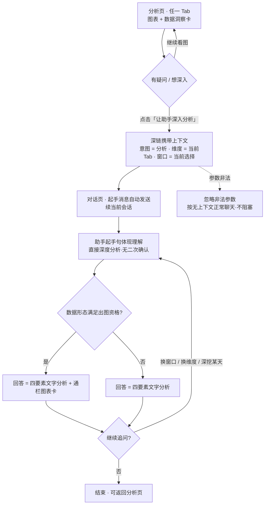
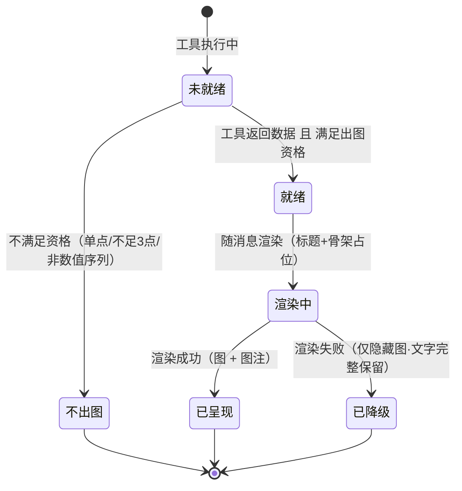
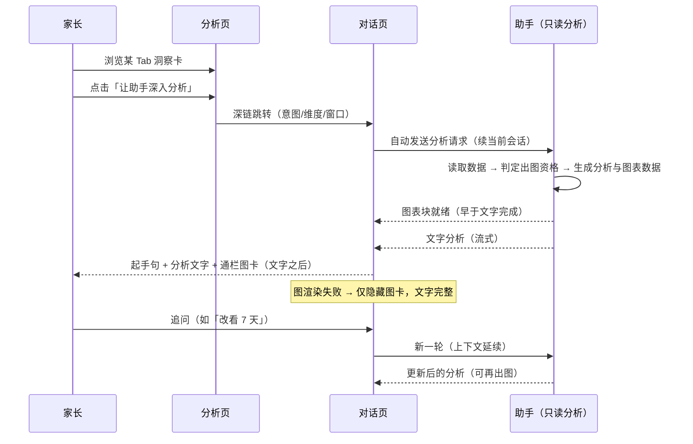

# 产品需求文档：分析页 × 敏宝助手「分析域联动」— 洞察深挖与对话图表 - V0.1

| 项 | 内容 |
| --- | --- |
| 版本 | PRD-013 / 文档内版本 V0.1 |
| 状态 | **v1.0 定稿（2026-10-11）**——全部 7 个用户故事 + 贯穿项经用户逐项确认（含 14 项关键决策）；待实施 |
| 创建日期 | 2026-10-11 |
| 主平台 | 微信小程序 `minicare-mp`（分析页 `pagesReport` + 对话页 `pages/chat` 为主战场）；执行侧 `minicare-agent`（只读分析增强 + SSE 图表块协议）；数据侧 `minicare-server`（复用既有接口，本期近零改动） |
| 关联 PRD | PRD-003（敏宝助手：数据查询/总结分析/护栏）、PRD-006（记录面 × 分析面；**§7.4 deep link 协议与 §7.5 对话内结构化块为本文协议基座**——本文落地其分析域子集，不引入第二套协议）、PRD-002（排敏：allergy 域上下文来源） |
| 关联文档 | **`docs/tech/TECH-028-report-assistant-integration.md`（本 PRD 技术方案 v0.1）**、`docs/tech/TECH-025-mp-chart-rendering-research.md`（小程序图表渲染同层化——图表内嵌对话的可行性依据）、`docs/tech/TECH-006-agent-tech.md`（助手技术方案）、`TODO.md`「第 2 期 打桥」（边界见 §1.4） |

---

## 0. 结论摘要（TL;DR）

**一句话**：把"分析页看图"与"助手对话分析"从两个孤立功能变成一条双向链路——分析页的解读卡一键把用户送进对话做**深度分析**（带维度与时间窗上下文），助手的分析结果把关键数据以**图表**呈现（复用分析页图表体系）。

- **为什么做**：分析页 6 个 Tab 的「数据洞察」是前端硬编码规则文案（静态、封闭、不可追问）；助手的 `analyze_baby_data` 能产出趋势/异常/周期对比的深度解读，但只以纯文本呈现、且入口藏得深。两个"分析面"各自有能力、互为盲区。
- **怎么做**：① 分析页洞察卡加「让助手深入分析 →」入口，深链三参数（`intent=analysis` / `anchor=report:<tab>` / `range=<窗口>`）进对话，助手起手即出该维度深度分析；② SSE 新增 `chart` 结构化块，助手分析/查询中的时间序列数据以**通栏图卡**渲染在文字之后。
- **不做什么**：不新增任何写能力（agent 保持只读）；不把分析页洞察卡改为 AI 生成（规则保留、深度交给对话）；不做助手结论回流分析页（本期范围外）；不做分位计算下沉重构（仅做两端数字一致性核对，见贯穿项）。

---

## 1. 综述 (Overview)

### 1.1 项目背景与核心问题

产品存在两个"分析面"，各自有能力但互为盲区：

| 维度 | 分析页（TabBar「分析」，`pagesReport`） | 助手（`pages/chat` + `minicare-agent`） |
| --- | --- | --- |
| **能力** | 6 Tab（生长/饮食/睡眠/尿布/健康/排敏）+ 时间范围切换（按 Tab 独立记忆） | 对话式：知识问答 + 数据查询 + 分析 + 写日记 |
| **数据解读** | 「数据洞察」卡 = **前端硬编码 if-else 规则文案**（阈值写死：如日均奶量 <500/>1000ml、睡眠 12h/10h、生长 P15/P85），6 个 Tab 各写各的 | `analyze_baby_data` 输出**结构化数据**（趋势判定 + 异常点 + 逐日明细 + 分周聚合 + 百分位）→ LLM 转文字 |
| **呈现** | ECharts 图表已成熟（EcChart 组件，已重构为 canvas 2d 同层渲染直显，见 TECH-025） | **纯文本 Markdown**（标题/列表/表格），无任何图表 |
| **入口** | TabBar 主 Tab（流量大） | FAB 菜单「问助手」/ 首页卡片，藏得较深 |
| **跳转联动** | **零助手入口** | 仅支持 `preset=diary&date=` 一种（日记场景，已跑通） |

由此产生 4 个具体缺口：

1. **洞察静态封闭**——分析页规则文案不可追问、不结合知识库与宝宝状态（如「睡眠偏少」背后是转奶期还是作息问题，规则答不了）；助手的深度分析能力用户在看图时够不着。
2. **助手结论不可视**——用户问「这周睡眠怎么样」，助手回复一大段文字，但趋势图明明就在分析页，两边数据同源。
3. **入口单向无上下文**——分析页 → 助手无通道；即使进了助手，也要从零复述「我想看睡眠、看 30 天」。
4. **口径双实现风险**——分位数、日均等计算在前端 Tab 和 agent 各有一份实现；本次联动后用户在两边看同一个数，若不一致将直接损害信任。

**核心命题**：解决"小程序分析与助手分析割裂"——① 使分析解读更智能化（规则文案 → 一键接入助手深度分析）；② 通过分析页为助手增加触达渠道（高流量 Tab → 对话）；③ 让助手的数据呈现获得图表能力（文本解读 + 可视化）。

### 1.2 核心业务流程 / 用户旅程地图

两个阶段 + 一个贯穿项：

1. **阶段一：触达（分析页 → 助手）** —— 分析页看得见入口、进助手不用重述：洞察卡「问助手」入口 → 深链上下文协议 → 助手起手复述 + 自动触发该维度深度分析。
2. **阶段二：图表（助手 → 数据可视化）** —— 助手分析结果看得见图：SSE 结构化图表块协议 → 图表场景矩阵（何时出图/出哪种图）→ 对话内图表渲染 → （P2）图表交互（全屏预览 + 跳回分析页）。
3. **贯穿项：两端数字口径一致性** —— 分析页与助手对同一数据源的数字必须一致（硬验收项，非独立故事）。

### 1.3 Mermaid 图

> 说明：Mermaid 图用于"需求对齐"，避免写成技术实现细节。

#### 1.3.1 用户操作流（必填）



#### 1.3.2 状态机（图表块生命周期）



#### 1.3.3 关键场景时序（图表块与文字流的时序影响用户可见结果，故补充）



### 1.4 与既有设计与资产的边界（不重复建设）

| 既有资产 | 关系 |
| --- | --- |
| **PRD-006 §7.4 deep link 协议**（`intent`/`anchor`/`state`/`preset` 四参数，设计已定、未实现） | 本文 US-02 落地其**分析域子集**（`intent=analysis` 新增值 + `anchor=report:<tab>` + `range` 作为 state 语义的简化表达）；**不引入第二套协议**；日记既有 `preset=diary` 不动（统一迁移属打桥期事项） |
| **PRD-006 §7.5 对话内结构化块**（`event: block` 通道 + 行动卡/建议卡/数据卡，设计已定、未实现） | 本文 US-04 实现其中 `chart`（图表块）一类，承载通道沿用 `block` 事件；行动卡/建议卡不在本文范围 |
| **TODO「第 2 期 打桥」**（建议卡 + 三块渲染 + deep link 上下文 + 分位下沉） | 本文聚焦「分析页 ↔ 助手」一条纵向链路，可作为打桥期的先行切片；**进度互不阻塞**；分位下沉不在本文（见贯穿项界线） |
| **TECH-025 图表同层渲染重构**（已落地） | 本文图表内嵌对话的可行性依据（EcChart 已无 canvas 层级/滚动兼容问题）；本文不改其实现 |
| **感知层与画像注入**（既有能力） | US-03 四要素中「结合宝宝状态」复用既有注入（转奶进度/排敏状态等），不新增感知能力；**其与数据/图表层的分工规则见 §2「横向规则」节** |

### 1.5 关键决策记录（2026-10-11 逐项拍板）

| # | 决策点 | 结论 |
| --- | --- | --- |
| D1 | PRD 定位 | 独立 PRD（本 013）；机制处引用 PRD-006 §7.4/§7.5，不出现第二套协议 |
| D2 | 范围 | 含 A 分析页→助手深链 + B 助手内图表化；**不含** C 助手结论回流分析页 |
| D3 | 入口位置 | 洞察卡底部（allergy 为「排敏小贴士」卡底部）；6 Tab 全上；有数据即显示 |
| D4 | 入口文案 | 数值 Tab：「让助手深入分析 →」；allergy：「让助手评估排敏风险 →」 |
| D5 | 跳转行为 | 进入即自动发送起手消息；**续当前会话**（与日记入口一致） |
| D6 | 长窗口处理 | 生长（birth）走**全量测量记录**；其余 180/365 → 按最近 90 天 + 温和说明 |
| D7 | 起手方式 | **直接分析**（起手句体现理解，不做二次确认；理解偏差靠追问纠正） |
| D8 | 产出结构 | **四要素清单**（顺序不限）：数据概况 / 异常点 / 结合宝宝状态 / 建议+免责 |
| D9 | 图表生成 | **混合模式**：模型在有限模板枚举内选图型；数据映射与数值由代码完成（模型不接触数值） |
| D10 | 图表位置 | 文字之后（消息尾部），**通栏附属卡** |
| D11 | 出图资格 | 按数据形态：时间序列 ≥3 个有效数据点（生长 ≥1 个测量点）；单点/汇总不出图 |
| D12 | 数量约束 | 单轮最多 1 张图；summary 的跨维数据合成 1 张组合图 |
| D13 | US-07 | 做：全屏预览 + 「在分析页查看」跳转（P2 实施） |
| D14 | 口径贯穿项 | 轻量核对 + 偏差修正（硬验收项）；不做分位下沉重构 |
| D15 | 信号 × 数据 × 图表分工 | 三层分工（信号=语境/数据=证据/图表=可视化）；信号控"结论强度"不控"出图"；图表不装信号、衔接靠文字；图上信号事件标注列为后续候选（见「横向规则」节） |

### 1.6 分期与优先级

| 分期 | 内容 | 说明 |
| --- | --- | --- |
| **P0** | US-01 / US-02 / US-03（阶段一） | 深链触达闭环：入口 + 协议 + 起手分析 |
| **P0** | US-04 / US-05 / US-06（阶段二） | 图表闭环：协议 + 矩阵 + 渲染 |
| **验收门槛** | 贯穿项（两端数字一致性核对） | 随 P0 一并验收 |
| **P2** | US-07（图表交互） | 可与 P0 分开发版 |

> 阶段一可独立发版（纯触达，无图表依赖）；阶段二在阶段一之上增量。三层改动规模预估（小程序 / agent / 服务端）在实施派工时细化。

### 1.7 假设、风险与待确认

| # | 类型 | 内容 | 处置 |
| --- | --- | --- | --- |
| R1 | 风险 | 两端数字（分位/日均）历史双实现可能已有偏差 | 贯穿项核对；发现偏差即修正（最小改动口径收敛） |
| R2 | 风险 | 对话流多图消息滚动性能（EcChart 同层渲染实例数） | 单轮 ≤1 图约束；实施时做多消息滚动验证（US-06 验收场景5） |
| R3 | 风险 | 长窗口"压缩到 90 天"的说明文案可能让用户觉得"能力缩水" | 温和说明 + 引导（详细趋势在图卡/分析页）；文案在实施时定稿 |
| R4 | 假设 | 模型在"有限模板内选图型"的实现可通过工具参数声明承载 | 实现机制由技术方案定（建议方向：扩展工具参数）；PRD 只约束行为与验收 |
| R5 | 待确认 | 起手消息的确切文案（当前建议「帮我分析最近 30 天的睡眠情况」） | 实施时按维度/窗口句式生成，可微调 |
| R6 | 待确认 | allergy 场景 `range` 参数是否携带（当前：可携带但助手忽略） | 实施细节，不影响验收 |

---

## 2. 用户故事详述 (User Stories)

### 阶段一：触达 ——「分析页 → 助手」深链

---

#### **US-01: 作为正在查看分析页的家长，我希望从数据洞察卡一键发起「问助手」深入分析，以便获得比静态规则文案更智能、更贴合宝宝当下状态的解读。**

* **价值陈述 (Value Statement)**:
  * **作为** 正在查看分析页的家长
  * **我希望** 在数据洞察卡底部一键发起「问助手」深入分析
  * **以便于** 不用离开分析页去 FAB 菜单里找助手，让智能分析触手可及

* **业务规则与逻辑 (Business Logic)**:
  1. **前置条件**: 已登录；当前 Tab 有数据（非空态）。
  2. **操作流程 (Happy Path)**:
     1. 用户在分析页任一 Tab 浏览到底部，看到「数据洞察」卡（allergy Tab 为「排敏小贴士」卡）。
     2. 卡片底部（分隔线下方）有一行入口：**「让助手深入分析 →」**（allergy Tab 为「让助手评估排敏风险 →」）。
     3. 点击 → 跳转对话页，携带上下文：**当前维度（Tab）+ 当前时间窗 + 当前宝宝**（参数协议见 US-02）。
     4. 对话页按上下文起手（复述 + 自动分析，细节见 US-03）。
  3. **异常处理 (Error Handling)**:
     * 游客态（未登录）：GuestReport 不显示入口（无真实数据）。
     * 助手服务不可用：入口**不做预探测**（避免打开页面就发请求）；跳转后由对话页既有「服务升级中」横幅兜底。
     * 空态（所选窗口无记录）：入口随洞察卡整体不渲染（现有空态本来就不渲染洞察卡）。

* **验收标准 (Acceptance Criteria)**:
  * **场景1: 显示**
    * **GIVEN** 喂养 Tab 有近 30 天数据且已登录
    * **WHEN** 滚动到洞察卡
    * **THEN** 洞察卡底部显示「让助手深入分析 →」
  * **场景2: 跳转**
    * **GIVEN** 睡眠 Tab 选中 30 天窗口
    * **WHEN** 点击入口
    * **THEN** 跳转对话页，助手按「睡眠 · 30 天」起手（起手验收见 US-03）
  * **场景3: 空态不显示**
    * **GIVEN** 大便 Tab 在所选窗口内无任何记录
    * **WHEN** 查看页面
    * **THEN** 仅显示空态提示，无「问助手」入口
  * **场景4: 游客不显示**
    * **GIVEN** 未登录用户打开分析页
    * **WHEN** 查看各 Tab
    * **THEN** 展示 GuestReport，不出现入口

---
* **页面布局线框图 (ASCII Wireframe)**:
    ```text
    +--------------------------------------+
    |  分析                        [导出]   |
    |  旺仔的数据洞察                        |
    |  [生长][饮食][睡眠][尿布][健康][排敏]   |  ← Tab 行（滚动）
    |  [7天][14天][30天][90天][半年][一年]     |
    |  30天 · 9月11日—10月11日               |
    |                                       |
    |  +--------------------------------+  |
    |  | 日均奶量  日均喂奶  日均辅食     |  |
    |  |  720ml     6次       2次       |  |
    |  +--------------------------------+  |
    |  +--------------------------------+  |
    |  | 配方奶量趋势                     |  |
    |  |    (ECharts 折线图)              |  |
    |  +--------------------------------+  |
    |  +--------------------------------+  |
    |  | 数据洞察                         |  |
    |  | • 宝宝日均配方奶量 720ml，        |  |
    |  |   处于正常范围                   |  |
    |  | • 日均喂奶约 6 次                |  |
    |  |  ────────────────────────────   |  |
    |  |              让助手深入分析 →     |  |  ← 新增入口（右对齐文字按钮）
    |  +--------------------------------+  |
    |                                       |
    |  [首页]   [记录]  (＋)  [分析]  [我的]  |
    +--------------------------------------+
    ```
---

#### **US-02: 作为从分析页跳入助手的家长，我希望助手已经知道我"在看哪个维度、哪个时间窗"，以便不用重述背景，进来就拿到针对性分析。**

* **价值陈述 (Value Statement)**:
  * **作为** 从分析页跳入助手的家长
  * **我希望** 助手已经知道我"在看哪个维度、哪个时间窗"
  * **以便于** 不用重述背景，进来就拿到针对性分析

* **业务规则与逻辑 (Business Logic)**:
  1. **前置条件**: 从分析页洞察卡入口触发跳转（US-01）。
  2. **协议定义**（对齐 PRD-006 §7.4 四参数体系，落地其分析域子集；字段名以最终契约为准）:

     | 参数 | 含义 | 取值 | 示例 |
     | --- | --- | --- | --- |
     | `intent` | 意图枚举 | `analysis`（新增值；PRD-006 既有值不变） | `analysis` |
     | `anchor` | 锚点：页面 + Tab | `report:<tab>`，tab ∈ 生长/饮食/睡眠/尿布/健康/排敏 | `report:sleep` |
     | `range` | 时间窗快照（§7.4 `state` 语义在分析域的简化表达） | `7/14/30/90/180/365/birth` | `30` |

  3. **宝宝上下文不显式传参**: 对话页已有「当前宝宝」机制（与上下文条同源），与分析页展示的宝宝天然一致。
  4. **参数解析与降级**:
     * 非法/未知值 → 忽略该参数不报错，按无上下文正常聊天（不阻塞进入对话）。
     * `range` 缺失 → 助手按默认窗口处理（与对话中"没提时间"的既有语义一致）。
  5. **参数生命周期**: 消息发送后即消费完毕不驻留；无参数重进不重复发送（沿用日记入口的防重模式）。
  6. **URL 编码约束**: 参数值须编码写入、读取端统一解码（参考 PRD-009 的编码踩坑，复用 `decodeParam` 工具）。
  7. **安全边界**: 参数仅决定"起手提示 + 分析维度"，不改变数据权限；改参数不产生越权（数据归属由服务端上下文校验）。
  8. **与日记入口并存**: 既有 `preset=diary` 不动（统一迁移属 PRD-006 打桥期事项）；本 PRD 新入口一律用上述三参数。

* **验收标准 (Acceptance Criteria)**:
  * **场景1: 完整传递**
    * **GIVEN** 在睡眠 Tab 选 30 天
    * **WHEN** 点击入口
    * **THEN** 对话页收到三参数，助手按「睡眠 · 最近 30 天」起手
  * **场景2: 非法参数**
    * **GIVEN** 带非法参数（如 `anchor=report:xyz`）
    * **WHEN** 进入对话
    * **THEN** 不报错，按无上下文正常聊天
  * **场景3: 防重复**
    * **GIVEN** 已通过入口发送过分析请求
    * **WHEN** 从会话返回再次进入（无参数）
    * **THEN** 不重复发送
  * **场景4: 时间窗缺省**
    * **GIVEN** 参数缺 `range`
    * **WHEN** 助手起手
    * **THEN** 按默认窗口处理，不追问"你要看几天"

---
* **参数流向示意**（协议型故事，无独立界面）:
    ```text
    分析页（睡眠 Tab · 30 天窗口）
       │  点击「让助手深入分析 →」
       ▼
    /pages/chat/index?intent=analysis&anchor=report:sleep&range=30
       │
       ▼
    chat 页读取参数 → 组装起手消息 → 助手复述 + 自动分析（细节见 US-03）
    ```
---

#### **US-03: 作为从分析页跳入的家长，我希望助手立即给出该维度的深度分析、且"懂我为什么进来"，以便不写字就能拿到结合宝宝当下状态的解读。**

* **价值陈述 (Value Statement)**:
  * **作为** 从分析页跳入的家长
  * **我希望** 助手立即给出该维度的深度分析，不做多余确认
  * **以便于** 不写字就能拿到比静态洞察更深入、结合宝宝当下状态的解读

* **业务规则与逻辑 (Business Logic)**:
  1. **前置条件**: 经深链进入对话（US-02 参数齐备）。
  2. **操作流程 (Happy Path)**:
     1. 对话页读取参数 → 自动组装并发送起手消息：「帮我分析最近 30 天的睡眠情况」（句式跟随维度与窗口，如「帮我看看宝宝的生长情况」）。
     2. 助手**起手句体现理解**（如「来看看旺仔最近 30 天的睡眠——」），**不做二次确认**，直接进入分析。
     3. 分析产出**涵盖四要素（顺序不限）**：
        * ① **数据概况**：趋势方向 + 关键数字（按"有记录天数"口径，沿用既有规则）
        * ② **异常点**：值得注意的日子/变化（如有）
        * ③ **结合宝宝状态的解读**：如转奶期加量、排敏期、近期症状（来自感知与画像，既有能力）
        * ④ **建议**：结合知识库的护理建议（如适用）+ 医疗免责（涉及健康结论时）
     4. 用户可继续追问（换窗口/换维度/深挖某天），走既有对话能力。
  3. **维度映射与长窗口规则**:

     | Tab | 分析维度 | 窗口处理 |
     | --- | --- | --- |
     | 生长 | 生长分析（最新测量 + 百分位 + 变化） | `birth` → **全量测量记录**（不受 90 天限制） |
     | 喂养 / 睡眠 / 大便 / 健康 | 对应数值维度趋势 | 7/14/30/90 直传；**180/365 → 按最近 90 天 + 温和说明** |
     | 排敏 | 排敏进度与风险（感知层，非数值维度） | 忽略时间窗参数 |

  4. **异常处理 (Error Handling)**:
     * 窗口内无记录 → 如实告知"这段时间没有相关记录"，不编造（沿用既有规则）。
     * 助手服务不可用 → 起手消息按对话页既有失败态处理（可重试）。
     * 理解偏差 → 用户追问纠正（"我要看 7 天"），助手按新要求重新分析。
  5. **边界**: agent 仍**只读**（不新增写能力）；入口分析是**单维度深挖**，与周报/月报（跨维度总结）区分、不替代；信号层与图表的融合规则见「横向规则」节。

* **验收标准 (Acceptance Criteria)**:
  * **场景1: 标准起手**
    * **GIVEN** 从睡眠 Tab（30 天）进入
    * **WHEN** 起手消息自动发送
    * **THEN** 起手句体现「睡眠 · 30 天」理解，直接产出四要素分析，**无二次确认**
  * **场景2: 生长全量**
    * **GIVEN** 从生长 Tab 进入（birth）
    * **WHEN** 分析
    * **THEN** 覆盖全部测量记录（不被 90 天截断），含最新分位与变化
  * **场景3: 长窗口压缩**
    * **GIVEN** 从喂养 Tab 选「一年」进入
    * **WHEN** 分析
    * **THEN** 按最近 90 天分析并温和说明，不假装有一年口径
  * **场景4: 无数据**
    * **GIVEN** 窗口内恰好无记录
    * **WHEN** 起手
    * **THEN** 如实告知，不编造数值
  * **场景5: 追问纠正**
    * **GIVEN** 起手分析完成
    * **WHEN** 用户说「我要看 7 天」
    * **THEN** 按 7 天重新分析
  * **场景6: 排敏入口**
    * **GIVEN** 从排敏 Tab 进入
    * **WHEN** 起手
    * **THEN** 产出排敏进度与风险解读（不涉及时间窗数值分析）

---
* **页面布局线框图 (ASCII Wireframe)**（对话页起手场景）:
    ```text
    +--------------------------------------+
    |  < 敏宝助手                  [切换▾]  |
    |  旺仔 · 9个月 · 轻度牛奶过敏           |  ← 宝宝上下文条（既有）
    |  [周报] [月报]              [新会话]  |
    |                                       |
    |          ┌────────────────────────┐   |
    |          │ 帮我分析最近 30 天的    │   |  ← 自动发送的起手消息
    |          │ 睡眠情况               │   |
    |          └────────────────────────┘   |
    |  ┌────────────────────────────────┐   |
    |  │ 敏  来看看旺仔最近 30 天的睡眠—  │   |  ← 起手句体现理解
    |  │                                │   |
    |  │ 这段时间夜里基本能睡整觉，       │   |     ① 数据概况
    |  │ 平均每天 12.5 小时…            │   |
    |  │                                │   |
    |  │ 有两天睡得偏少（10月3日、5日）， │   |     ② 异常点
    |  │ 正好和转奶加量是同几天…          │   |     ③ 结合宝宝状态
    |  │                                │   |
    |  │ 如果白天小觉难哄，可以试试…      │   |     ④ 建议
    |  │ 本回答仅供参考，不能替代专业医疗  │   |     免责
    |  │ 建议                            │   |
    |  └────────────────────────────────┘   |
    |                                       |
    |  [ 输入框...                    ] [＋] |
    +--------------------------------------+
    ```
---

### 阶段二：图表 ——「助手 → 数据可视化」

---

#### **US-04: 作为使用助手看数据的家长，我希望关键数据以图表形式直观呈现，以便一眼看清趋势，而不是读一堆数字。**

* **价值陈述 (Value Statement)**:
  * **作为** 使用助手看数据的家长
  * **我希望** 关键数据以图表形式直观呈现
  * **以便于** 一眼看清趋势，而不是读一堆数字

* **业务规则与逻辑 (Business Logic)**:
  1. **承载通道**: SSE 新增结构化块事件（沿用 PRD-006 §7.5 建议的 `event: block` 通道），本次实现块类型之一：`chart`（图表块）；既有事件与文字流不受影响。
  2. **图表块内容**（语义定义，字段名以契约为准）:

     | 字段 | 含义 | 示例 |
     | --- | --- | --- |
     | `id` | 块唯一 id（幂等渲染） | `blk_xxx` |
     | `type` | 块类型 | `chart` |
     | `chartType` | 图型（**有限模板枚举**，见 US-05） | 折线 / 柱状 / 组合 / 生长百分位曲线 |
     | `title` | 图标题（用户可见） | 「睡眠时长趋势」 |
     | `series` | 数据序列（名称 + 单位 + 数据点） | 「每日睡眠 · 小时 · [...]」 |
     | `refLines` | 参考线（可选，如百分位带） | P3 / P50 / P97 |
     | `caption` | 图注：窗口与口径（用户可见） | 「最近 30 天 · 共 28 天有记录」 |
     | `source` | 来源元数据：维度 + 窗口（供 US-07 跳转分析页预选；可选） | 「睡眠 · 30」 |

  3. **生成方式（混合模式）**:
     * **模型**: 在有限模板枚举内选择"是否出图 + 用哪个图型"（实现机制由技术方案定，建议方向：扩展工具参数声明图表意图）。
     * **代码**: 数据映射与数值计算——**模型不接触数值**，保证图与文字口径必然一致、不会幻觉。
  4. **时序与数量约束**:
     * 图表块随工具结果就绪（早于文字完成）；前端按"**文字之后**"位置渲染（D10）。
     * **单轮对话最多 1 张图**（克制原则）；无图表意图时行为与现状完全一致。
  5. **降级 (Error Handling)**:
     * 数据不足（<2 个有效数据点）→ 不出图。
     * 渲染异常 → 仅隐藏图，**文字完整保留**。
     * 旧版本客户端不识别新事件 → 天然忽略，不影响文字（向后兼容）。
  6. **持久化**: 图表块随消息持久化，重进会话仍可见（与消息同生命周期）。

* **验收标准 (Acceptance Criteria)**:
  * **场景1: 图表随分析下发**
    * **GIVEN** 起手分析（睡眠 · 30 天）
    * **WHEN** 回答完成
    * **THEN** 消息中带 1 张睡眠趋势折线图，图注标注「最近 30 天 · 共 N 天有记录」
  * **场景2: 数字一致**
    * **GIVEN** 图中数据点
    * **WHEN** 与文字中数值对照
    * **THEN** 一致（同源映射，无手工重算）
  * **场景3: 不出图**
    * **GIVEN** 用户问「昨天喝了多少奶」（单点查询）
    * **WHEN** 回答
    * **THEN** 文字正常、无图（不强制出图）
  * **场景4: 降级**
    * **GIVEN** 图表渲染异常
    * **WHEN** 查看消息
    * **THEN** 文字完整，图静默隐藏
  * **场景5: 持久化**
    * **GIVEN** 带图消息
    * **WHEN** 退出重进
    * **THEN** 图仍显示

---

#### **US-05: 作为使用助手的家长，我希望图出现在真正需要图的地方（不多不少），以便直观理解数据形态，不被无关图表打扰。**

* **价值陈述 (Value Statement)**:
  * **作为** 使用助手的家长
  * **我希望** 图出现在真正需要图的地方（不多不少）
  * **以便于** 直观理解数据形态，不被无关图表打扰

* **业务规则与逻辑 (Business Logic)**:
  1. **模板枚举（有限集，4 种）**:

     | 模板 | 图型 | 用于 |
     | --- | --- | --- |
     | `line` | 折线（含面积） | 单维时间序列趋势 |
     | `bar` | 柱状 | 逐日对比语感（如「每天喝多少」） |
     | `mixed` | 双序列组合图（奶量柱 + 睡眠线） | 跨维度总结 |
     | `growth` | 百分位曲线（散点 + P3/P50/P97 参考线） | 生长分析 |

  2. **场景矩阵**（数据形态 → 资格 → 模板）:

     | 场景 | 数据形态 | 出图资格 | 模板（推荐 / 许可） |
     | --- | --- | --- | --- |
     | 单维趋势分析 | 逐日时间序列 | ✅ | `line`（默认）/ `bar` |
     | 跨维度总结（周报/月报） | 多维度逐日 | ✅ | `mixed` |
     | 生长分析 | 测量点 + 百分位带 | ✅（≥1 个测量点） | `growth` |
     | 时间序列查询（「这几天奶量变化」） | 时间序列 | ✅（**≥3 个有记录的天**） | `line` / `bar` |
     | 单点/汇总查询（「昨天喝多少」「日均多少」） | 无序列或点数不足 | ❌ | — |
     | 知识问答 / 日记 / 排敏任务等 | 非数值序列 | ❌ | — |

  3. **选择机制（混合模式）**: 满足资格时，**模型在许可模板内选择**（如 trend 场景可选折线或柱状）；数据映射与数值由代码完成，模型不接触数值。
  4. **数量约束**: 单轮最多 1 张图（US-04）；summary 的多维数据合成 1 张 `mixed`，不拆成多图。
  5. **图注强制**: 每张图必须带 caption（数据窗口 + 有记录天数），建立数字信任。
  6. **图文关系**: 图是佐证不替代——文字结论独立完整；图缺失/失败不影响文字（US-04 降级）。
  7. **与信号层的关系（直接提问与深链起手同规）**: 出图资格仅按数据形态判定（信号不参与）；文字结论受既有信号层约束（数据陈旧提示 / 覆盖率不足不下阴性结论 / 矛盾提示频控）——详见「横向规则」节。

* **验收标准 (Acceptance Criteria)**:
  * **场景1: 趋势出图**
    * **GIVEN** 用户问「看最近 30 天的睡眠」
    * **WHEN** 回答
    * **THEN** 1 张折线（或柱状）图 + 图注
  * **场景2: 总结出图**
    * **GIVEN** 点「周报」按钮
    * **WHEN** 回答
    * **THEN** 1 张组合图（奶量柱 + 睡眠线）+ 图注
  * **场景3: 生长出图**
    * **GIVEN** 用户问「旺仔生长情况怎么样」
    * **WHEN** 回答
    * **THEN** 1 张百分位曲线（含 P3/P50/P97）
  * **场景4: 单点不出图**
    * **GIVEN** 用户问「昨天喝了多少奶」
    * **WHEN** 回答
    * **THEN** 无图
  * **场景5: 不足不出图**
    * **GIVEN** 查询窗口内仅 2 天有记录
    * **WHEN** 回答
    * **THEN** 无图（未达资格）
  * **场景6: 其他不出图**
    * **GIVEN** 知识问答 / 日记 / 排敏咨询
    * **WHEN** 回答
    * **THEN** 无图

---

#### **US-06: 作为收到带图回答的家长，我希望图表清晰、稳定、与文字连贯地出现，以便图文对照，快速理解数据。**

* **价值陈述 (Value Statement)**:
  * **作为** 收到带图回答的家长
  * **我希望** 图表清晰、稳定、与文字连贯地出现
  * **以便于** 图文对照，快速理解数据

* **业务规则与逻辑 (Business Logic)**:
  1. **渲染形态**: 消息附属**通栏卡**（文字气泡下方），卡片自上而下 = 图标题 → 图表本体 → 图注（caption）。
     * 宽度：通栏（左右留边与消息列表一致）；图表本体高度约 320rpx（与移动端分析页一致）。
     * 与上方文字气泡的归属关系：紧凑间距 + 视觉延续，表示"同一轮回答"。
  2. **渲染时机与骨架**:
     * 图表块随工具结果就绪（早于文本完成）；渲染**不阻塞文本流**。
     * 就绪前显示轻量骨架（标题 + 占位区），**避免布局跳动**。
     * 文本流式期间图位于消息末尾跟随；流完稳定。
  3. **技术可行性依据**: 复用 **EcChart**（已重构为 canvas 2d 同层渲染直显，TECH-025）——聊天页输入框/滚动容器无 Canvas 层级问题；小程序与 H5 双端同组件、体验一致。
  4. **交互（P0 范围）**: 图**不可点击、无手势**（放大查看 / 深链交互归 US-07）。
  5. **降级与异常 (Error Handling)**:
     * 渲染失败 → 仅隐藏图卡，文字完整（US-04）。
     * 网络中断致块数据不完整 → 图不渲染，文字保留。

* **验收标准 (Acceptance Criteria)**:
  * **场景1: 图文完整**
    * **GIVEN** 带图回答
    * **WHEN** 查看消息
    * **THEN** 文字气泡下方显示通栏图卡（标题 + 图 + 图注）
  * **场景2: 流式不阻塞**
    * **GIVEN** 回答流式中
    * **WHEN** 观察
    * **THEN** 文本流式不被图阻塞、布局不跳动（骨架占位）
  * **场景3: 重进恢复**
    * **GIVEN** 带图历史消息
    * **WHEN** 重进对话
    * **THEN** 图重新渲染可见
  * **场景4: 降级**
    * **GIVEN** 图表渲染异常
    * **WHEN** 查看
    * **THEN** 图卡隐藏、文字完整
  * **场景5: 多图消息**
    * **GIVEN** 会话含多条带图消息
    * **WHEN** 滚动浏览
    * **THEN** 各图独立渲染、滚动流畅

---
* **页面布局线框图 (ASCII Wireframe)**:
    ```text
    +--------------------------------------+
    |  < 敏宝助手                  [切换▾]  |
    |  旺仔 · 9个月 · 轻度牛奶过敏           |  ← 宝宝上下文条（既有）
    |  [周报] [月报]              [新会话]  |
    |                                       |
    |          ┌────────────────────────┐   |
    |          │ 帮我分析最近 30 天的    │   |  ← 用户消息（自动发送）
    |          │ 睡眠情况               │   |
    |          └────────────────────────┘   |
    |  ┌────────────────────────────────┐   |
    |  │ 敏  来看看旺仔最近 30 天的睡眠—  │   |
    |  │     …（文字分析四要素）          │   |  ← 文字气泡（既有样式）
    |  └────────────────────────────────┘   |
    |  ┌───────────────────────────────┐    |
    |  │ 睡眠时长趋势                   │    |  ← 图卡 · 标题
    |  │   ┌───────────────────────┐   │    |
    |  │   │    (折线图 ~320rpx)    │   │    |  ← 图卡 · 图表本体（EcChart）
    |  │   └───────────────────────┘   │    |
    |  │ 最近30天 · 共28天有记录         │    |  ← 图卡 · 图注
    |  └───────────────────────────────┘    |
    |                                       |
    |  [ 输入框...                    ] [＋] |
    +--------------------------------------+
    ```
---

#### **US-07: 作为查看对话图表的家长，我希望（P2）能放大看清细节、或一键跳到分析页看更多，以便从对话里的"快照"顺畅过渡到"深度浏览"。**

* **价值陈述 (Value Statement)**:
  * **作为** 查看对话图表的家长
  * **我希望** 能放大看清细节，或一键跳到分析页看更多
  * **以便于** 从对话里的"快照"顺畅过渡到"深度浏览"

* **业务规则与逻辑 (Business Logic)**:
  1. **前置条件**: 消息内已有图表卡（US-06）。
  2. **操作流程 (Happy Path)**:
     1. 点击图表卡（整卡可点，有按压反馈）→ 进入**全屏预览页**。
     2. 全屏页 = 大图（全宽）+ 图标题 + 图注 + 底部按钮「**在分析页查看**」。
     3. 点按钮 → 跳分析页，**预选对应 Tab + 时间窗**（对话 → 分析页的新深链方向）。
     4. 关闭/返回 → 顺畅回到对话（栈清晰）。
  3. **来源映射**: 图表块需携带 `source` 元数据（维度 + 窗口，US-04 schema），用于跳转预选；取值域与 US-02 一致（tab ∈ 6 Tab；range ∈ 7/14/30/90/180/365/birth）。
  4. **异常处理 (Error Handling)**:
     * 图表块无来源元数据 → 「在分析页查看」按钮**不展示**（仅预览）。
     * 目标数据已有新增记录 → 分析页按最新数据渲染（正常行为）；两端口径一致性由贯穿项保证。
  5. **范围**: **P2**，可与 P0 分开发版。

* **验收标准 (Acceptance Criteria)**:
  * **场景1: 全屏预览**
    * **GIVEN** 带图消息
    * **WHEN** 点击图卡
    * **THEN** 全屏页显示大图 + 标题 + 图注，可关闭
  * **场景2: 跳转分析页**
    * **GIVEN** 全屏预览页
    * **WHEN** 点「在分析页查看」
    * **THEN** 跳分析页并预选对应 Tab 与时间窗
  * **场景3: 无来源元数据**
    * **GIVEN** 图表块无来源信息
    * **WHEN** 预览
    * **THEN** 不展示跳转按钮
  * **场景4: 返回链路**
    * **GIVEN** 从全屏跳至分析页
    * **WHEN** 返回
    * **THEN** 回到对话

---
* **页面布局线框图 (ASCII Wireframe)**（全屏预览页）:
    ```text
    +--------------------------------------+
    |  ×                          [关闭]    |
    |                                       |
    |  ┌───────────────────────────────┐    |
    |  │                               │    |
    |  │        (大图 · 全宽)           │    |  ← 图表放大展示
    |  │                               │    |
    |  └───────────────────────────────┘    |
    |  睡眠时长趋势                          |  ← 图标题
    |  最近30天 · 共28天有记录               |  ← 图注
    |                                       |
    |  [      在分析页查看 · 睡眠 ›      ]   |  ← 底部按钮
    +--------------------------------------+
    ```
---

### 横向规则：信号层 × 数据层 × 图表层（适用于全部数据分析类问答）

> 用户**直接在助手提问**「生长怎么样」「排便正常吗」等数据分析类问题时，回答同时受三层影响；本节明确分工，避免"信号与图表各说一套"。深链起手（阶段一）与直接提问**同规**（同一条链路，区别仅在起手上下文）。

三层各有承载与通道，**不合并、不互相替代**：

| 层 | 承载内容 | 到达回答的通道 | 角色 |
| --- | --- | --- | --- |
| **信号层** | 画像 + 现状（转奶进度、排敏状态、生长分位、数据新鲜度、矛盾 flags、阶段判定）——既有感知体系 | 每轮注入 System Prompt（既有能力） | **语境与约束**：宝宝在哪一程、什么话不能乱说 |
| **数据层** | `query` / `analyze` 工具的结构化结果 | 工具调用 → 文字 | **证据**：本次问题的具体数据 |
| **图表层** | `chart` 块（时间序列） | SSE `block` → 前端渲染 | **数据的可视化**：数值与数据层同源 |

**三条规则**：

1. **R1 · 信号是"解读的语境"，不是"另一份答案"**——信号为数据提供解释背景（US-03 四要素③「结合宝宝状态的解读」的实现基础）；不得脱离数据另起一套结论。
2. **R2 · 信号控制"结论强度"，不控制"出图"**——出图资格仅按数据形态判定（US-05，信号不参与）；文字结论受既有元信号约束（数据陈旧 → 明确提示；覆盖率 <50% → 不下阴性结论；矛盾提示频控）。**数据陈旧时仍可出历史曲线图**（图本身有价值），但文字须如实提示。
3. **R3 · 图表只装数据、不装信号；衔接靠文字**——图中数值 = 工具数据同源（模型不接触数值）；数据说"是什么"、信号解释"为什么"。

**场景走查（验收参照）**：

- 「旺仔生长怎么样」（直接提问）：图 = 百分位曲线；文字 = 最新分位 + 数据新鲜度提示（如"最近一次测量在 3 周前"）+ 转奶期语境（如适用）。
- 「最近排便正常吗」（直接提问、记录较少）：文字如实"记录较少、暂看不出规律"（不下阴性结论）；有历史数据时仍可出趋势图，图注如实。

**后续增强候选（不在本期范围）**：图表叠加**信号事件标注**（转奶开始 / 新食物引入 / 症状日）——即 PRD-006 §7.7「生长曲线叠事件标记」的延展，待信号事件提取能力就绪后评估。

---

### 贯穿性约束：两端数字口径一致性（硬验收项，非独立故事）

1. **要求**: 分析页与助手对同一数据源（同一测量 / 同一日均口径）呈现的数字**必须一致**——用户在两边看同一个百分位/日均值不应看到两个数。
2. **验收方式**: 实施后以真实数据对照核对（百分位、日均奶量/睡眠等核心指标），发现偏差即修正。
3. **范围界线**: 本期**不做**架构性重构（分位计算下沉另案，见 PRD-006 打桥期条目）。

**验收场景**
* **场景1: 百分位对照**
  * **GIVEN** 同一测量记录（如最新体重）
  * **WHEN** 对照分析页生长 Tab 与助手生长分析
  * **THEN** 百分位一致
* **场景2: 日均对照**
  * **GIVEN** 同一窗口（如近 30 天喂养）
  * **WHEN** 对照分析页日均奶量与助手文字日均
  * **THEN** 数字一致（四舍五入口径一致）

---

## 附：术语表

| 术语 | 含义 |
| --- | --- |
| 分析页 | 小程序 TabBar「分析」页（`pagesReport`），6 Tab + 图表 + 数据洞察卡 |
| 洞察卡 | 分析页各 Tab 底部的「数据洞察」（或「排敏小贴士」）卡片，本期新增助手入口 |
| 深链 | 页面跳转时携带上下文参数（intent/anchor/range），使目标页"知道用户从哪来" |
| 图表块 | SSE `block` 事件承载的结构化图表数据（本文新增 `chart` 类型） |
| 四要素 | 助手深度分析的产出结构：数据概况 / 异常点 / 结合宝宝状态 / 建议+免责 |
| 出图资格 | 数据形态满足可出图的条件（时间序列 ≥3 点；生长 ≥1 点） |
| 信号层 | 画像 + 现状的统称（感知体系）：转奶进度、排敏状态、生长分位、数据新鲜度、矛盾 flags 等——每轮注入助手，为解读提供语境与约束 |
| 元信号 | 对记录状态本身的判断（有效结论 / 信息缺失 / 数据陈旧）；控制结论强度，不出现在图表中 |
| 混合模式 | 图表生成方式：模型选图型（有限枚举内）、代码做数据映射与数值 |

---

> 返回 [PRD 总集](../PRD_REGISTRY.md) ｜ 关联：[PRD-006](PRD-006/README.md) §7.4/§7.5 ｜ [TECH-025](../tech/TECH-025-mp-chart-rendering-research.md)
