# DB-01 · 数据库总览：关系图 · 存储策略 · 技术选型

> 技术方案系列文档  
> - **DB-01-overview.md**（本文）— 表关系图 · 本地/远程策略 · 数据库选型  
> - [DB-02-schema.md](DB-02-schema.md) — 完整建表 DDL（含新增字段）  
> - [DB-03-mock-data.md](DB-03-mock-data.md) — Mock 数据 · 用户故事演练  
>
> 最后更新：2026-05-03（MVP 已发布，Schema 对齐 Migration 008：feeding 4 表拆分 + VARCHAR 枚举迁移）
> 云平台：**腾讯云 CloudBase**
> 主平台：**微信小程序（Taro 4.2）**

---

## 一、数据表关系图（ER Diagram）

```mermaid
erDiagram
    user_account {
        CHAR36 id PK "UUID"
        VARCHAR20 phone "手机号（唯一，登录凭据）"
        VARCHAR50 nickname "用户昵称"
        VARCHAR500 avatar_url "头像 URL"
        DATETIME created_at
        DATETIME updated_at
    }

    family_group {
        CHAR36 id PK "UUID"
        VARCHAR50 name "家庭名称"
        VARCHAR16 invite_code "邀请码（NOT NULL）"
        CHAR36 created_by FK "→ user_account.id"
        DATETIME created_at
        DATETIME updated_at
    }

    family_member {
        CHAR36 id PK "UUID"
        CHAR36 family_id FK "→ family_group.id"
        CHAR36 user_id FK "→ user_account.id（待接受时 NULL）"
        VARCHAR20 role "owner / member"
        VARCHAR20 invite_phone "被邀请手机号"
        VARCHAR20 status "pending / active / left"
        CHAR36 invited_by FK "→ user_account.id"
        DATETIME joined_at
        DATETIME created_at
        DATETIME updated_at
    }

    baby_profile {
        CHAR36 id PK "UUID"
        CHAR36 family_id FK "→ family_group.id（每家庭唯一）"
        VARCHAR50 name "宝宝姓名"
        VARCHAR20 gender "unknown / male / female"
        DATE birth_date
        VARCHAR500 avatar_url
        JSON allergies "过敏原列表"
        CHAR36 created_by FK "→ user_account.id"
        DATETIME created_at
        DATETIME updated_at
    }

    feeding_breast_record {
        CHAR36 id PK "UUID"
        CHAR36 baby_id FK "→ baby_profile.id"
        CHAR36 recorded_by FK "→ user_account.id"
        DATETIME record_time
        VARCHAR side "left/right/both"
        SMALLINT duration_min "时长（分钟）"
        TEXT note
        DATETIME created_at
        DATETIME updated_at
    }

    feeding_formula_record {
        CHAR36 id PK "UUID"
        CHAR36 baby_id FK "→ baby_profile.id"
        CHAR36 recorded_by FK "→ user_account.id"
        DATETIME record_time
        SMALLINT amount_ml "总量（ml）"
        TEXT note
        DATETIME created_at
        DATETIME updated_at
    }

    feeding_formula_mix {
        CHAR36 id PK "UUID"
        CHAR36 feeding_id FK "→ feeding_formula_record.id"
        VARCHAR100 brand "奶粉品牌"
        SMALLINT scoops "勺数"
        INT order_index "配比顺序"
    }

    feeding_food_record {
        CHAR36 id PK "UUID"
        CHAR36 baby_id FK "→ baby_profile.id"
        CHAR36 recorded_by FK "→ user_account.id"
        DATETIME record_time
        TEXT note
        DATETIME created_at
        DATETIME updated_at
    }

    feeding_food_item {
        CHAR36 id PK "UUID"
        CHAR36 feeding_id FK "→ feeding_food_record.id"
        VARCHAR100 food_name "食物名称"
        SMALLINT amount_g "克数"
        INT order_index
    }

    feeding_supplement_record {
        CHAR36 id PK "UUID"
        CHAR36 baby_id FK "→ baby_profile.id"
        CHAR36 recorded_by FK "→ user_account.id"
        DATETIME record_time
        JSON supplement_items "营养素列表 [{name, dose, unit}]"
        TEXT note
        DATETIME created_at
        DATETIME updated_at
    }

    symptom_record {
        CHAR36 id PK "UUID"
        CHAR36 baby_id FK "→ baby_profile.id"
        CHAR36 recorded_by FK "→ user_account.id"
        DATETIME record_time
        JSON symptoms "症状列表 [{type, severity}]"
        JSON photo_ids "照片 fileID 列表"
        TEXT note
        DATETIME created_at
        DATETIME updated_at
    }

    growth_record {
        CHAR36 id PK "UUID"
        CHAR36 baby_id FK "→ baby_profile.id（每天唯一）"
        CHAR36 recorded_by FK "→ user_account.id"
        DATE record_date
        INT weight_g "体重（克）"
        INT height_mm "身高（毫米）"
        INT head_mm "头围（毫米）"
        TEXT note
        DATETIME created_at
        DATETIME updated_at
    }

    sleep_record {
        CHAR36 id PK "UUID"
        CHAR36 baby_id FK "→ baby_profile.id"
        CHAR36 recorded_by FK "→ user_account.id"
        DATETIME start_time
        DATETIME end_time "NULL=进行中"
        SMALLINT duration_min "结束后计算写入"
        TINYINT status "1=ongoing 2=ended"
        TEXT note
        DATETIME created_at
        DATETIME updated_at
    }

    activity_record {
        CHAR36 id PK "UUID"
        CHAR36 baby_id FK "→ baby_profile.id"
        CHAR36 recorded_by FK "→ user_account.id"
        DATETIME record_time
        TINYINT activity_type "1=bath 2=outdoor 3=play 4=tummy_time 5=other"
        SMALLINT duration_min
        TEXT note
        DATETIME created_at
        DATETIME updated_at
    }

    diaper_record {
        CHAR36 id PK "UUID"
        CHAR36 baby_id FK "→ baby_profile.id"
        CHAR36 recorded_by FK "→ user_account.id"
        DATETIME record_time
        TINYINT diaper_type "1=wet 2=dirty 3=mixed 4=dry"
        VARCHAR20 color
        TEXT note
        DATETIME created_at
        DATETIME updated_at
    }

    health_record {
        CHAR36 id PK "UUID"
        CHAR36 baby_id FK "→ baby_profile.id"
        CHAR36 recorded_by FK "→ user_account.id"
        DATETIME record_time
        DECIMAL41 temperature "体温（℃）"
        TINYINT mood "1=happy 2=neutral 3=fussy 4=crying"
        TEXT note
        DATETIME created_at
        DATETIME updated_at
    }

    medical_record {
        CHAR36 id PK "UUID"
        CHAR36 baby_id FK "→ baby_profile.id"
        CHAR36 recorded_by FK "→ user_account.id"
        DATE visit_date
        VARCHAR100 hospital "就诊机构"
        TEXT diagnosis "诊断结论"
        JSON medications "用药列表 [{name, dose}]"
        JSON photo_ids "照片 fileID 列表"
        TEXT note
        DATETIME created_at
        DATETIME updated_at
    }

    food_observation {
        CHAR36 id PK "UUID"
        CHAR36 baby_id FK "→ baby_profile.id（每种食物唯一）"
        VARCHAR100 food_name "食物名称"
        DATE first_intro_at "首次引入日期"
        TINYINT status "1=observing 2=safe 3=allergic"
        TEXT reaction_note
        DATETIME created_at
        DATETIME updated_at
    }

    user_account ||--o{ family_member : "作为成员加入"
    family_group ||--o{ family_member : "包含成员"
    family_group ||--o{ baby_profile : "拥有宝宝"
    user_account ||--o{ feeding_breast_record : "创建"
    user_account ||--o{ feeding_formula_record : "创建"
    user_account ||--o{ feeding_food_record : "创建"
    user_account ||--o{ feeding_supplement_record : "创建"
    user_account ||--o{ symptom_record : "创建"
    user_account ||--o{ growth_record : "创建"
    user_account ||--o{ sleep_record : "创建"
    user_account ||--o{ activity_record : "创建"
    user_account ||--o{ diaper_record : "创建"
    user_account ||--o{ health_record : "创建"
    user_account ||--o{ medical_record : "创建"
    baby_profile ||--o{ feeding_breast_record : "属于"
    baby_profile ||--o{ feeding_formula_record : "属于"
    baby_profile ||--o{ feeding_food_record : "属于"
    baby_profile ||--o{ feeding_supplement_record : "属于"
    feeding_formula_record ||--o{ feeding_formula_mix : "配比明细"
    feeding_food_record ||--o{ feeding_food_item : "食物明细"
    baby_profile ||--o{ symptom_record : "属于"
    baby_profile ||--o{ growth_record : "属于"
    baby_profile ||--o{ sleep_record : "属于"
    baby_profile ||--o{ activity_record : "属于"
    baby_profile ||--o{ diaper_record : "属于"
    baby_profile ||--o{ health_record : "属于"
    baby_profile ||--o{ medical_record : "属于"
    baby_profile ||--o{ food_observation : "属于"
```



> **注**：权威来源为 `minicare-server/migrations/` 目录下的 migration 文件（001-008）。
> Migration 008 完成了 feeding_record 拆分为 4 张独立表 + 枚举字段从 TINYINT 迁移为 VARCHAR。
> `sync_log` 表已移除（联网写入优先）。

### 表层级依赖说明

```
Layer 0 · 账户层
└── user_account              全局唯一用户（手机号注册）

Layer 1 · 家庭层
├── family_group              家庭群组（邀请码 / 名称）
└── family_member             成员 × 权限（关联 user_account）

Layer 2 · 宝宝层
└── baby_profile              宝宝档案（MVP 每家庭限 1 个）

Layer 3 · 业务记录层（均含 baby_id + recorded_by）
├── feeding_breast_record     母乳喂养
├── feeding_formula_record    配方奶喂养
│   └── feeding_formula_mix   奶粉配比明细
├── feeding_food_record       辅食喂养
│   └── feeding_food_item     食物明细
├── feeding_supplement_record  营养素补充（supplement_items JSON）
├── symptom_record            表现记录
├── growth_record             生长数据（身高/体重/头围）
├── sleep_record              睡眠记录（含计时状态机）
├── activity_record           活动记录
├── diaper_record             尿布记录
├── health_record             健康记录（体温/过敏表现）
└── medical_record            医疗记录

Layer 4 · 衍生逻辑层
└── food_observation          辅食新食物观察期（4 态：observing/safe/suspected/allergic）

共 ~18 张表（含明细表）
```

---

## 二、存储策略（v2：联网写入优先）

### 2.1 家庭共享为何必须引入云端数据库

原有「本地优先（Local-first）」设计在多人协作场景下存在根本性缺陷：

```
妈妈 iPhone（本地 SQLite）          奶奶 Android（本地 SQLite）
    ↑ 08:00 记录喂奶 120ml               ↑ 08:30 记录换尿布
    ↓                                     ↓
              没有共享通道
            ❌ 奶奶看不到妈妈的记录
            ❌ 爸爸也看不到今日进展
```

**家庭共享需要**：任意成员的记录对其他成员**实时可见**，本地数据库无法单独满足此需求。

### 2.2 架构决策：联网写入优先 + 本地轻量缓存

**MVP 阶段采用「Cloud-first + 本地只读缓存」架构**，相比 Local-first 大幅降低工程复杂度：

| 对比维度 | Local-first（已废弃） | Cloud-first（当前） |
|----------|---------------------|--------------------|
| 写入路径 | 本地先写 → 后台异步上云 | **先上云成功 → 再更新本地缓存** |
| 无网行为 | 离线队列缓存，恢复后上传 | **直接提示无网络，禁止提交** |
| 同步冲突 | 需要 LWW + 冲突存档 | **天然无冲突**（云端是唯一写入源） |
| sync_log 表 | 必须 | **整表移除** |
| 本地数据库职责 | 主存储 + 离线主力 | **纯读取加速缓存** |
| 工程复杂度 | 高 | **低** |

```
┌─────────────────────────────────────────────────────────┐
│                   云端（CloudBase MySQL）                 │
│                                                         │
│  user_account  family_group  family_member              │
│  baby_profile  feeding_record  symptom_record           │
│  growth_record  sleep_record  activity_record           │
│  diaper_record  health_record  medical_record           │
│  food_observation                                       │
│                    ← 唯一权威写入源 →                    │
└──────────┬──────────────────────────┬───────────────────┘
           │ CloudRun WebSocket 推送   │ REST API（读取/写入）
           ↓ （其他成员的新记录通知）   ↓
┌──────────────────┐       ┌──────────────────────────┐
│  iOS             │       │  Android                  │
│  SQLite 只读缓存 │       │  SQLite 只读缓存          │
│  （< 100KB）     │       │  （< 100KB）              │
└──────────────────┘       └──────────────────────────┘
```

### 2.3 写入流程

```
用户填写表单
  │
  ▼ ① 检测网络状态
  │
  ├── 无网络 ──────────────────────────────────────────
  │       → 弹出提示「当前无网络，请检查网络连接后重试」
  │       → 表单保持填写状态，用户可稍后重试
  │       → 流程终止，不写入任何数据
  │
  └── 有网络 ──────────────────────────────────────────
          ↓
        ② 直接 HTTP POST 写入云端（CloudBase REST API）
          │
          ├── 成功 → 更新本地缓存（当日 + 7天摘要）
          │         → WebSocket 推送通知家庭其他成员
          │         → UI 展示新记录
          │
          └── 失败（服务端错误）→ 提示「提交失败，请重试」
                                 → 表单保持，用户可重试
```

### 2.4 读取流程（家庭成员数据实时更新）

```
其他成员提交新记录
  │
  ▼ 云端写入成功（CloudBase MySQL）
  │
  ▼ CloudRun WebSocket 服务广播事件到同 family_id 的在线成员
  │
  ▼ 客户端收到推送
  │
  ├── App 前台 → 拉取该条新记录 → 更新本地缓存 → 刷新 UI
  │
  └── App 后台 → 记录推送事件（下次进入前台时拉取更新）
```

> **无离线队列、无冲突解决、无 sync_log**，实现复杂度极低。

### 2.5 本地缓存策略（纯读取加速）

本地缓存的唯一目的：**加快读取速度，减少重复网络请求**。不承担任何写入或同步职责。

| 数据类别 | 缓存策略 | 说明 |
|----------|---------|------|
| **宝宝档案** | ✅ 完整缓存（永久） | < 1KB，所有页面依赖，App 启动时加载一次 |
| **家庭成员列表** | ✅ 完整缓存（永久） | < 1KB，权限检查和「记录者」展示依赖 |
| **辅食观察期状态** | ✅ 完整缓存（永久） | < 5KB，辅食 Tab 频繁读取 |
| **生长曲线全量历史** | ✅ 完整缓存（永久） | < 50KB，纯数值，曲线图渲染依赖 |
| **当日记录（今天）** | ✅ 全量缓存 | 首页时间线；写入成功后立即追加到缓存 |
| **最近 7 天记录** | ✅ 摘要字段缓存 | 首页卡片、简单趋势展示；仅缓存 `id/type/time/key_value` |
| **> 7 天历史记录** | ❌ 不缓存 | 报告页、历史翻查按需请求 |
| **所有照片** | ❌ 不缓存 | 按需加载 CDN URL；系统图片缓存自动处理 |

**本地缓存总量估算**：
- 元数据（档案 + 成员 + 观察期）：~8KB
- 生长曲线（12 个月，约 12 条）：~10KB
- 当日记录（约 10~20 条，完整字段）：~30KB
- 最近 7 天摘要（约 100 条，仅摘要）：~50KB
- **合计：< 100KB**

**缓存失效规则**：
- 写入成功后立即更新对应缓存条目（不全量刷新）
- App 冷启动时拉取元数据 + 当日记录，覆盖缓存
- 收到 Supabase Realtime 推送时，增量更新对应缓存条目

---

## 三、数据库技术选型

### 3.1 客户端本地数据库

| 平台 | 方案 | 理由 |
|------|------|------|
| **微信小程序**（主平台） | **Taro Storage（轻量缓存）** | 缓存全局配置、当日记录摘要；所有写入直接走云端 API |
| **Web H5**（维护模式） | **无本地数据库** | 所有数据实时从云端请求；图片依赖浏览器 HTTP 缓存 |

> iOS / Android 原生客户端已从 MVP 规划中移除，小程序作为唯一客户端平台。

### 3.2 云端数据库选型

#### ✅ 已确定：腾讯云 CloudBase MySQL

> 选型决策日期：2026-03-29。综合合规、网络稳定性、成本和一体化程度，确定使用 CloudBase 替代 Supabase。

**选型理由**：

1. **数据合规**：目标用户在中国大陆，《个人信息保护法》要求婴幼儿健康数据存储在境内服务器。CloudBase 数据中心在国内，满足合规要求。

2. **网络稳定**：Supabase 服务节点在海外，WebSocket 长连接在国内受 GFW 影响可能断连，直接影响家庭实时共享核心体验。CloudBase 全国节点，无此问题。

3. **关系型数据 + 完整 SQL**：家庭、成员、宝宝、记录之间有清晰的外键关系；统计报告需要复杂聚合查询（GROUP BY、日期范围、多表 JOIN），MySQL 完美支持。

4. **AI 辅助开发**：CloudBase 官方提供 MCP Server（`@cloudbase/cloudbase-mcp`），可直接在 SOLO 中通过自然语言操作数据库、部署函数、管理资源。

5. **一体化平台**：MySQL + Auth（手机号 SMS 登录）+ 云存储（照片 CDN）+ CloudRun（REST API + WebSocket）+ 静态托管，**一个平台解决所有后端需求**，与腾讯云 OCR、短信服务同账号计费。

6. **成本最优**：MVP 阶段约 ¥5/月（仅短信验证码费用），其余在免费额度内。

**Realtime 说明**：CloudBase MySQL 暂无类似 Supabase WAL 的原生 Realtime 推送。解决方案：在 CloudRun 中部署轻量 WebSocket 服务（Node.js + `ws` 库），写入 MySQL 成功后按 `family_id` 广播事件给在线成员，额外工作量约 2 天。

#### 服务成本估算

| 阶段 | 月活用户 | CloudBase 方案 | 预估月成本 |
|------|---------|--------------|----------|
| MVP 内测 | < 500 | 免费环境 | **≈ ¥5**（短信费） |
| 早期增长 | 500~5000 | 免费环境 | **≈ ¥20~50** |
| 规模增长 | 5000~50000 | 按量付费 | **≈ ¥100~300** |
| 大规模 | 50000+ | 按量付费 | ≈ ¥500~2000 |

### 3.3 照片/文件存储

| 类型 | 方案 | 说明 |
|------|------|------|
| **医疗记录照片**（需 OCR） | CloudBase 云存储 + CDN | 上传后存入 `medical_record.photo_urls`；OCR 调用腾讯云 OCR 云函数 |
| **症状/尿布照片**（仅留档） | CloudBase 云存储 + CDN | 上传后存入 `photo_urls`；不做 OCR |
| **生长测量报告照片** | CloudBase 云存储 + CDN | 同上 |
| **用户头像** | CloudBase 云存储 | 存入 `user_account.avatar_url` |

所有照片的本地路径字段（原 `photo_paths`）**统一改为 `photo_urls`**，存储 CDN URL。

**上传流程**：客户端请求后端生成预签名 URL → 客户端直传 CloudBase 云存储（绕过后端，节省带宽）→ 后端记录最终 URL 到 MySQL。

### 3.4 架构总结图

```
┌──────────────────────────────────────────────────────────────┐
│                   腾讯云 CloudBase（云开发）                   │
│                                                              │
│  ┌────────────┐  ┌──────────────┐  ┌─────────────────────┐  │
│  │   MySQL    │  │   云存储     │  │  CloudRun（Node.js） │  │
│  │  (主数据库) │  │  (照片CDN)   │  │  REST API + WS推送  │  │
│  └────────────┘  └──────────────┘  └─────────────────────┘  │
│  ┌────────────┐  ┌──────────────┐                           │
│  │    Auth    │  │   云函数     │                           │
│  │ (手机号SMS) │  │  OCR/定时任务│                           │
│  └────────────┘  └──────────────┘                           │
└───────────────────────────────────────────────────────────── ┘
           ↑ REST API + WebSocket
    ┌──────┴──────────────────────────────────────────────┐
    │                   客户端                             │
    │                                                     │
    │  微信小程序（主平台）              Web H5（维护模式） │
    │  Taro 4.2 + React 18              React 18 + Vite 6 │
    │  Taro.request（HTTP）              fetch + Bearer     │
    │  @cloudbase/js-sdk（Auth）         @cloudbase/js-sdk  │
    └──────────────────────────────────────────────────── ┘
```

---

## 四、主键设计：UUID

### 使用 UUID 而非自增 INTEGER 的原因

| 理由 | 说明 |
|------|------|
| **API 安全性** | 自增 ID 容易被枚举爬取（`/records/1`、`/records/2`…）；UUID 无法预测 |
| **客户端预生成** | Cloud-first 架构下，提交前客户端需要知道记录 ID（用于本地缓存追加）；UUID 可在客户端直接生成，无需先请求服务端 |
| **未来扩展** | 若未来引入局部离线能力，UUID 天然避免多端 ID 冲突 |

### UUID 生成策略

- **iOS**：`UUID().uuidString`（Swift 内置）
- **Android**：`UUID.randomUUID().toString()`（Java 内置）
- **Web H5**：`crypto.randomUUID()`（浏览器原生 / Node.js 内置）
- **格式**：标准 UUID v4，如 `550e8400-e29b-41d4-a716-446655440000`

---

*→ 完整建表 DDL 见 `minicare-server/migrations/` 目录（001-008，含 feeding 拆分与枚举迁移）*  
*→ Schema 说明见 [DB-02-schema.md](DB-02-schema.md)*  
*→ Mock 数据与用户故事演练见 [DB-03-mock-data.md](DB-03-mock-data.md)*  
*→ Schema 重构分析（已完成）见 [DB-04-refactor-analysis.md](DB-04-refactor-analysis.md)*
