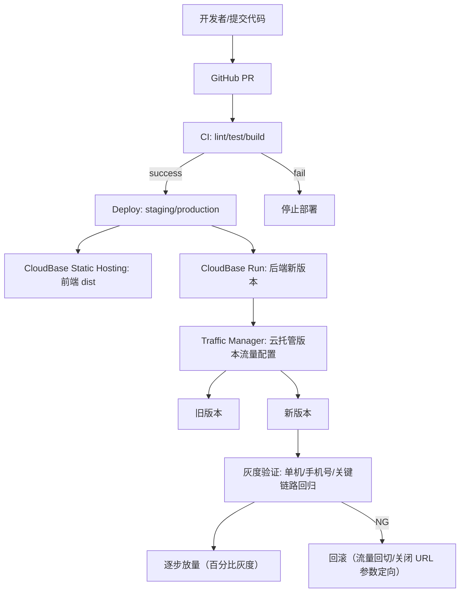
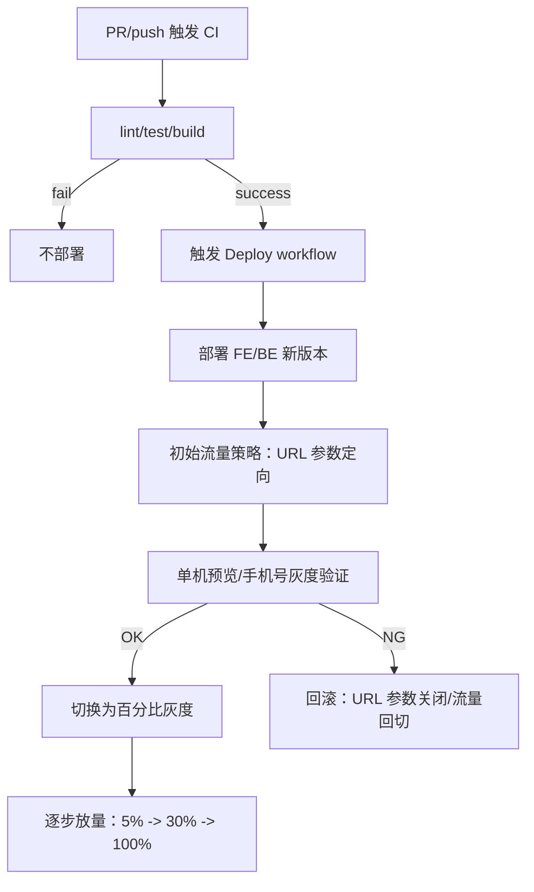

# 技术方案：GitHub Check 通过后自动部署 CloudBase，并支持单机预览/手机号灰度/百分比灰度

## 1. 背景
当前 `minicare-web`（前端静态托管）与 `minicare-server`（后端 CloudBase Run/CloudRun）已具备基本的手动部署能力，但缺少“CI 检查门禁通过后才部署”的自动化闭环；同时在上线/验证阶段需要更细粒度的灰度能力：

- 单机预览：让指定设备/账号先验证新版本。
- 按指定手机号灰度：让指定号码优先走新版本登录与关键链路。
- 百分比灰度：逐步扩大新版本流量比例，控制风险与观察指标。

本方案目标是将上述能力落地为可执行的 GitHub Actions 自动化流程，并明确灰度策略的工程实现方式。

## 2. 现状
### 2.1 部署方式现状
1. 前端部署（静态托管）
   - `minicare-web/package.json` 直接执行构建并部署：
     - `npm run build:staging`
     - `tcb hosting deploy dist -e minicare-cloud-6gqledlle0132cbe`
2. 后端部署（云托管/CloudRun）
   - `minicare-server/scripts/deploy.sh`：
     - 执行 `nest build` 生成 `dist/`
     - 做 `dist/` 大小阈值检查
     - 通过 `tcb run:deprecated version create` 创建新版本并“切换到新版本（文档描述 100% 流量）”
   - 部署前存在交互式 `read` 确认环境变量配置，这在 CI 场景会卡住。

### 2.2 环境与认证模式现状
- 前端通过 `VITE_AUTH_MODE` 控制登录行为：`test`（固定验证码）或 `sms`（真实短信）。
- 后端通过 `AUTH_TEST_MODE` 与 `NODE_ENV` 控制验证码行为：
  - `AUTH_TEST_MODE=true`：不发短信，固定验证码接受 `123456`。
  - `AUTH_TEST_MODE=false`：走真实短信/真实接口链路，测试接口返回 400。

### 2.3 灰度能力现状
- 当前灰度发布主要依赖“控制台手工配置流量策略”的能力。
- 缺少“灰度策略与 CI 结果自动绑定”的工程化流程（check 通过后自动进入灰度验证/放量步骤）。

## 3. 调研
### 3.1 CloudBase 云托管流量策略
CloudBase Run/云托管的流量配置支持两种灰度路由方式：
1. 按百分比（随机分配）
   - 适合实现“百分比灰度放量”。
2. 按 URL 参数（定向路由）
   - 适合实现“单机预览/按指定手机号灰度”（前提是路由所需信息必须出现在请求 URL 的 query/参数中，平台不会读取请求 body 里的字段）。

参考文档：
- 流量配置说明（按百分比/按 URL 参数）：
  - https://docs.cloudbase.net/run/deploy/traffic-setting

### 3.2 GitHub 与 CloudBase 自动化触发模型
CloudBase 官方给出了“CI/CD 与 Git 平台集成”的做法：
- 在 GitHub Actions 中执行构建与 `tcb ... deploy`。
- CloudBase 本身不自动理解你们的“check 流水线 gate 语义”，因此“check 通过后部署”需要在 GitHub 的 workflow 层实现门禁。

推荐实现方式：
- 使用 `workflow_run` 让部署 workflow 监听 CI workflow，并在 `conclusion == success` 时才部署。
- 或者用分支保护策略（Require status checks）+ 仅对合并到目标分支的 push 触发部署。

## 4. 目标
### 4.1 可验收的目标
1. CI gate 自动部署
   - 当且仅当 `lint/test/build` 全部通过时，才触发部署到 staging/production。
2. 灰度发布能力
   - 支持三种模式：
     - 单机预览：通过 URL 参数定向到新版本（100% 给 preview 命中请求）。
     - 按指定手机号灰度：通过 URL 参数定向到新版本（preview/灰度用户命中请求优先走新版本）。
     - 百分比灰度：按比例随机分配流量（逐步放量）。
3. 降低人为风险
   - 部署脚本在 CI 环境中不要求人工交互确认（消除 `read` 阻塞）。
   - 变更与回滚路径明确，减少误操作。

## 5. 整体设计
### 5.1 架构图

### 5.2 流程图（check 通过后部署 + 灰度验证/放量）

## 6. 详细设计
### 6.1 GitHub 工作流（模块化设计）
建议新增以下 workflow（路径固定在仓库根下）：
- `/.github/workflows/ci.yml`：只做 `lint/test/build`，不部署。
- `/.github/workflows/deploy.yml`：监听 `ci.yml`，仅在 CI 成功后部署。

#### 6.1.1 CI workflow：`ci.yml`
职责：
- 前端：安装依赖、运行（可选）lint、运行 `build:staging` 校验产物。
- 后端：安装依赖、运行 lint/test、运行 `npm run build`（或等价命令）。
- 上传构建产物（可选）供 deploy 使用（如果部署 workflow 也需要构建，可不上传）。

触发方式：
- PR：运行 CI（用于 gate）。
- push：运行 CI（用于合并后的验证）。

#### 6.1.2 部署 workflow：`deploy.yml`
触发方式：
- 使用 `workflow_run` 监听 `ci.yml` 完成。
- 条件：`github.event.workflow_run.conclusion == 'success'`。
- 只在目标分支（例如 `staging`/`main`）允许部署。

部署内容拆分：
- `deploy-frontend`：
  - 在 `minicare-web` 目录执行构建
  - `tcb hosting deploy` 部署到 CloudBase 静态托管环境
  - 默认建议：先不全量引入新后端流量（若你们前后端切换是协同的，需在灰度阶段协调配置）
- `deploy-backend`：
  - 在 `minicare-server` 目录执行：
    - `npm run migrate:dry-run`（可选）
    - `npm run migrate`（建议做增量迁移；失败则终止）
    - `npm run deploy`（但需改造交互式 `read` 为非交互）

Secrets 建议：
- `TCB_SECRET_ID` / `TCB_SECRET_KEY`
- `TCB_ENV_ID_STAGING` / `TCB_ENV_ID_PROD`
- 可选：如需要版本命名/参数化灰度规则，也可加灰度相关环境变量。

> 说明：生产环境建议使用 GitHub Environment + 审批（required reviewers），在“check 通过”基础上增加“人工放行”。

### 6.2 灰度发布（单机预览/手机号灰度/百分比灰度）
#### 6.2.1 通用前提：URL 参数路由
CloudBase 的“按 URL 参数定向”能力依赖请求 URL 的 query/参数。
因此为了实现：
- 单机预览
- 按指定手机号灰度
你们需要在“灰度相关请求”上确保携带对应 URL 参数。

建议约定：
- 单机预览参数：`previewId=<string>`
- 手机号灰度参数：`grayPhone=<phoneNumber>`

具体到你们的客户端实现：
1. 需要灰度生效的 API 调用，统一封装请求层。
2. 在请求 URL 上追加 `previewId/grayPhone` 的 query 参数。
3. CloudBase 在云托管版本流量配置中启用“按 URL 参数定向”规则：
   - 命中 `previewId` 或 `grayPhone` 的请求全部路由到新版本（100% 或极高比例）。
   - 未命中请求保留走旧版本（100% 或按百分比）。

#### 6.2.2 单机预览（操作策略）
目标：
- 新版本对特定 previewId 的请求可用性验证。

策略：
1. 部署 BE 新版本，但初始流量不全量。
2. 在 CloudBase 控制台配置“按 URL 参数”：
   - 新版本：`previewId=<你的预览ID>` -> 100%
   - 旧版本：不匹配 previewId -> 作为默认版本（或配为剩余流量）
3. 使用 preview 测试员发起关键链路请求验证：
   - 登录/获取 token
   - 基础读写接口
   - 照片上传/下载链路（如涉及临时 URL）
4. 验证通过后再进入百分比灰度。

#### 6.2.3 按指定手机号灰度（操作策略）
目标：
- 让特定手机号先走新版本认证与关键链路。

策略：
1. 同样通过 URL 参数完成路由：
   - 请求 URL 携带 `grayPhone=<手机号>`
2. CloudBase 配置“按 URL 参数定向”：
   - 新版本：`grayPhone=<白名单手机号>` -> 100%
   - 旧版本：其他请求保持旧版本
3. 灰度手机号登录并完成关键链路回归。

注意事项：
- 你们当前认证流程里手机号在请求 body 中时，平台不会读取 body 做路由。
- 因此需要在发起请求的 URL query 中携带灰度识别信息。

#### 6.2.4 百分比灰度（放量策略）
目标：
- 将新版本从小流量逐步放大到全量，期间观察回归指标。

策略：
1. 切换 CloudBase 的流量配置为“按百分比”模式。
2. 配置示例：
   - 新版本：5%
   - 旧版本：95%
3. 通过观测窗口后逐步提升，例如：
   - 5% -> 30% -> 100%
4. 任意阶段发现指标异常：
   - 直接回切新版本百分比为 0（或旧版本 100%）
   - 同时关闭 URL 参数定向（若两种模式并行配置需确保以预期方式覆盖）。

### 6.3 后端部署脚本改造（强制非交互 + 可控放量）
你们当前 `minicare-server/scripts/deploy.sh` 的关键问题是交互式确认：
- `read -p "已确认环境变量配置，继续部署？[y/N]" ...`
在 CI 中会阻塞。

改造建议（作为实现条目）：
1. 增加 CI 模式参数或自动检测：
   - 若 `CI=true` 则跳过 read，直接继续
   - 或提供 `--yes` 参数
2. 拆分“部署新版本”与“流量切换”：
   - 先部署新版本但保持低/零流量
   - 再由灰度模块设置流量策略（URL 参数/百分比）
3. 增加部署前校验：
   - 校验必填环境变量是否存在（在 CI 里读取 GitHub Secrets 注入的 env）
   - 校验 `JWT_SECRET` 格式/长度（防止弱密钥）

### 6.4 交付物清单（需要你们在代码仓库落实）
1. `.github/workflows/ci.yml`
2. `.github/workflows/deploy.yml`
3. 修改 `minicare-server/scripts/deploy.sh` 以支持非交互 CI
4. 在前端/请求封装层统一注入 `previewId/grayPhone` query 参数（若要用 URL 参数定向灰度）

## 7. 计划（建议里程碑）
1. 第 1 阶段（1-2 天）
   - 搭建 `ci.yml`：lint/test/build
   - 搭建 `deploy.yml`：`workflow_run` 门禁 + staging 部署
2. 第 2 阶段（1-2 天）
   - 改造后端 `deploy.sh` 去交互并支持“先部署后配置流量”
   - 部署链路打通（FE/BE）
3. 第 3 阶段（1-3 天）
   - 实现单机预览（URL 参数定向）
   - 实现手机号灰度（URL 参数定向）
4. 第 4 阶段（1-2 天）
   - 实现百分比灰度放量与回滚验证
   - 演练：至少一次“灰度成功”和一次“灰度失败回滚”
5. 第 5 阶段（可选，生产上线前）
   - 生产环境加 GitHub Environment 审批与回滚 runbook。

## 8. 问题与风险
### 8.1 关键问题
1. 手机号灰度的参数注入位置
   - URL 参数定向不读取 body，需要确认“用于路由的手机号”如何从业务请求层到达 URL。
2. CloudBase 流量配置自动化程度
   - 若你们希望完全自动化灰度规则，需要确认是否能通过 SDK/API 自动配置 URL 参数定向规则。
   - 若暂不支持全自动，可先采用“部署自动化 + 灰度配置半自动（控制台/脚本）”。
3. 现有后端部署脚本默认切流行为
   - `deploy.sh` 当前表现为“部署后切换新版本（文档描述 100% 流量）”，需要改为可控的灰度阶段策略。

### 8.2 风险清单
1. 误放量风险（高）
   - 部署脚本若默认 100% 切新，会跳过验证窗口。
2. 灰度路由失效风险（中高）
   - 若客户端未正确追加 query 参数，灰度用户可能仍走旧版本或不稳定命中。
3. 数据迁移一致性风险（中高）
   - 数据库迁移顺序与代码版本不一致会导致线上运行时错误。
4. 回滚能力不足风险（中）
   - 需要明确回滚路径：流量回切 +（可选）迁移策略（通常迁移不回滚，仅回切流量）。
5. 安全风险（中）
   - preview/gray 相关参数需要鉴权或限制，否则可能被滥用绕过验证。

## 9. 参考资料
1. CloudBase Run 流量配置说明（按百分比/按 URL 参数）：
   - https://docs.cloudbase.net/run/deploy/traffic-setting

