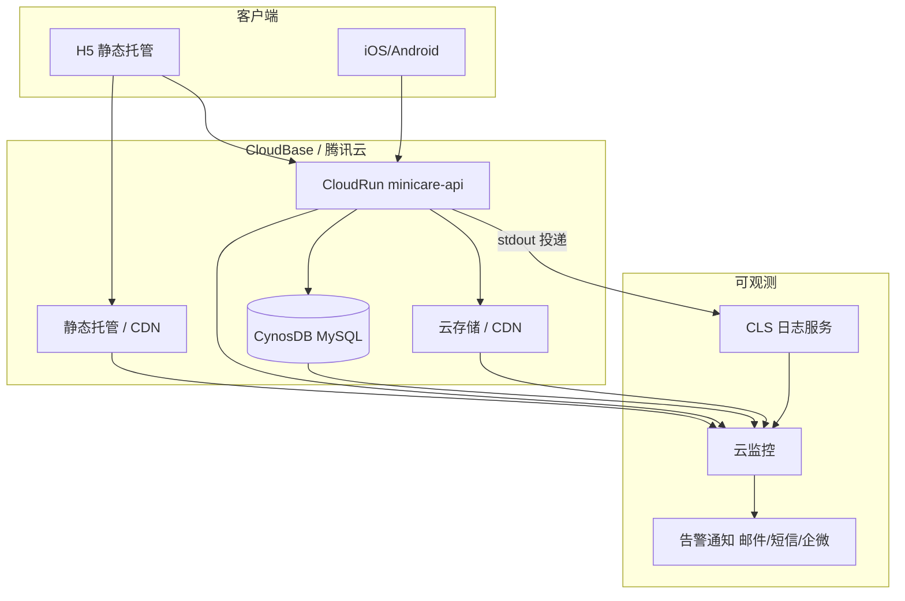
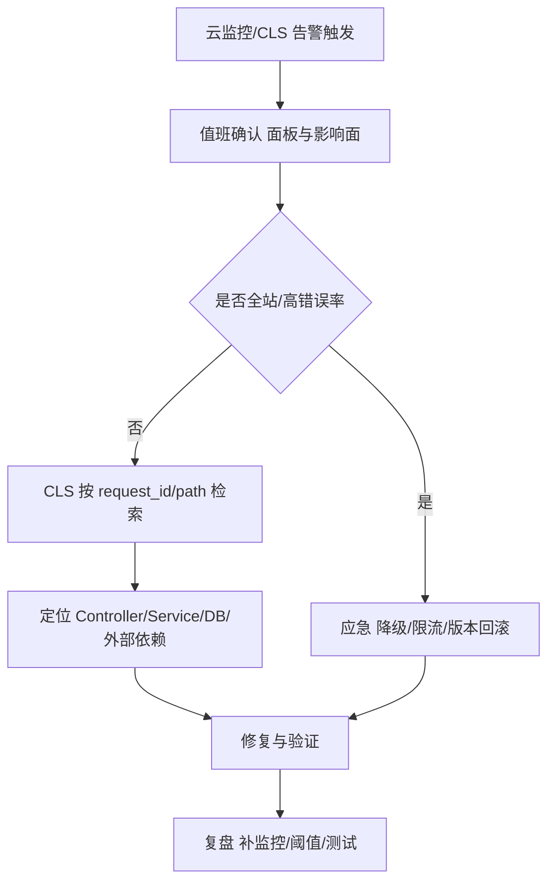

# 技术方案：minicare 运维监控体系（CloudBase + 腾讯云可观测）

> 范围：访问流量观测、服务稳定性监控告警、线上异常与审计日志（CLS）  
> 适用环境：当前 staging 共用 CloudBase 环境 `minicare-cloud-6gqledlle0132cbe`（上海 `ap-shanghai`）；生产环境独立后可复用同一套设计。  
> 关联文档：`INFRA-cloudbase.md`（基建清单）、`INFRA-cls-logging.md`（CLS 专项）、`INFRA-env-config.md`（环境变量与部署）  
> 最后更新：2026-03-30

---

## 1. 背景

`minicare` 线上形态为 **CloudBase 静态托管（H5）** + **云托管 CloudRun（NestJS：HTTP API / WebSocket / 定时任务）** + **CloudBase MySQL（CynosDB Serverless）** + **Auth** + **云存储 CDN**。进入真实用户阶段后，需要可复用的 **运维监控体系**：能看清访问与流量、能提前发现稳定性问题、能在故障时通过日志快速定位，并与告警闭环配合。

本方案在 CloudBase/腾讯云既有能力上落地，避免重复造轮子；应用层仅补充 **结构化日志、请求追踪、关键操作审计** 等缺口。

---

## 2. 现状

| 维度 | 状态 |
|------|------|
| 基建阶段 | `INFRA-cloudbase.md` 中 **阶段九「监控与运维」未执行** |
| CloudRun | 已部署（如 `minicare-api`），存在 `/health`，**无统一请求级访问日志、无全局异常 JSON 输出** |
| 日志 | Nest 默认 logger + 部分 `console.log`（如 WebSocket），**未对接 CLS 控制台绑定**（待执行） |
| 定时任务 | `@nestjs/schedule`：DB keepalive、睡眠超时修正，日志为文本级 |
| 前端 H5 | `fetch` 调用 API，**无前端错误/性能采集**（可选后续） |
| 数据库 | Serverless MySQL，文档已记录 **冷启动、备份、最小实例数** 等风险 |

---

## 3. 调研（CloudBase / 腾讯云能力映射）

| 需求 | 能力来源 | 说明 |
|------|----------|------|
| **访问流量** | 云托管监控指标、CLS 应用访问日志、静态托管/CDN 侧流量与请求 | API 以「指标 + 结构化访问日志」组合最可运营；静态资源看 CDN/托管面板 |
| **稳定性监控告警** | 云监控（CloudRun、CynosDB、CDN/存储等） | 错误率、延迟、资源水位、数据库连接与慢查询等；配阈值 + 通知渠道 |
| **异常与审计日志** | CLS（日志集/主题 + 索引 + 检索/仪表盘/日志告警） | CloudRun **stdout/stderr → 投递 CLS**；应用输出 **JSON 单行日志** 便于检索统计 |

**结论**：不在应用内强依赖 CLS SDK；以 **云托管绑定 CLS + 结构化 stdout 日志** 为主路径；告警以 **云监控为主、CLS 为辅**（按控制台实际能力勾选）。

---

## 4. 目标

1. **访问可观测**：能按域名/路径/状态码/耗时回溯请求，支撑容量与问题排查。  
2. **稳定性可量化**：建立最小 SLO 口径（可用性、错误率、P95 延迟）并与告警策略对齐。  
3. **异常可定位**：分钟级发现、通过 `request_id` 在 CLS 串联单次请求日志与异常栈。  
4. **可运维**：固定看板、Runbook、演练与复盘机制；成本可控（日志采样）。

---

## 5. 整体设计

### 5.1 架构图（观测数据流）

### 5.2 流程图（告警 → 定位）

---

## 6. 详细设计

### 6.1 模块一：云托管 CloudRun（minicare-api）

| 配置项 | 建议 | 操作步骤 |
|--------|------|----------|
| 健康检查 | 使用现有 `GET /health` | 控制台确认探活路径与超时；与 `main.ts` 一致 |
| 最小实例数 | 文档待办：设为 **1** 缓解冷启动 | 云托管 → 服务 → 实例配置 → 最小实例数（评估成本） |
| WebSocket | 长连接开关 | 控制台确认「长连接」已开启（`INFRA-cloudbase.md` 已列待确认项） |
| 日志投递 CLS | 绑定日志主题 | **按 [`INFRA-cls-logging.md`](INFRA-cls-logging.md) 执行** |

**应用实现（建议排期开发）**：

- 全局 **Interceptor**：记录 `method/path/status/latency_ms/request_id`（JSON 单行 stdout）。  
- 全局 **Exception Filter**：异常输出结构化字段，避免仅 `console.error` 纯文本。  
- **WebSocket**：`console.log` 改为 `Logger` 或 JSON，避免 CLS 中难以检索。  
- 定时任务：每条任务输出 `job_name`、成功/失败、影响行数。

### 6.2 模块二：CLS（日志）

| 配置项 | 说明 |
|--------|------|
| 日志集/主题 | 上海地域，与云托管一致；命名示例见 `INFRA-cls-logging.md` |
| 索引 | `level`、`path`、`status`、`latency_ms`、`request_id` 等 |
| 仪表盘 | 按 path 的 QPS、5xx、延迟分位（依赖日志字段） |
| 采样策略 | 成功请求可 1%～10% 采样；5xx/慢请求全量 |

**操作步骤**：以 [`INFRA-cls-logging.md`](INFRA-cls-logging.md) 第二节为准（创建 Topic → 云托管绑定 → 验收检索）。

### 6.3 模块三：云监控（稳定性告警）

| 对象 | 指标示例 | 初始阈值（可校准） |
|------|----------|-------------------|
| CloudRun | 5xx 比例、QPS、延迟 P95/P99、CPU、内存、实例重启 | 例：错误率 >1% 持续 5min → P0；P95 >1.5s 持续 10min → P1 |
| CynosDB | CPU、内存、连接数、慢查询 | 例：连接数 >80% 告警；慢查询突增 → P1 |
| 静态托管/CDN | 流量、4xx/5xx、命中率（以控制台为准） | 5xx 突增、流量异常 → P1/P2 |

**操作步骤**：

1. 打开 [云监控控制台](https://console.cloud.tencent.com/monitor)，选中对应地域与产品（云托管、TDSQL-C/CynosDB 等）。  
2. 为上述指标创建 **告警策略**，绑定 **通知组**（邮件 + 短信/企微）。  
3. 设置 **持续周期**（避免瞬时抖动误报）。  
4. 与发布窗口协调：大版本发布时可临时调高阈值或静默非核心告警。

### 6.4 模块四：静态托管（H5）

- 关注 **CDN 流量、请求数、状态码**；自定义域名上线后把域名维度纳入面板。  
- 发布异常（全站 404/5xx）多从托管/CDN 或回源侧暴露，与 CloudRun 告警互补。

### 6.5 模块五：关键操作审计（应用层）

- 对写入/删除/邀请/加入等操作打 **审计日志**（字段示例：`user_id`、`action`、`table`、`record_id`、`timestamp`），可与访问日志同一 Topic 用 `msg=audit` 区分，或独立 Topic（合规与成本权衡）。  
- 注意 **手机号等敏感字段脱敏**（单独评审）。

### 6.6 模块六：数据库备份与 RTO/RPO（与监控并列的运维基线）

- CynosDB **自动备份**、保留周期（`INFRA-cloudbase.md` 阶段九 9.3）。  
- 与「误删/批量写错」场景 Runbook 一起演练。

---

## 7. 计划

| 阶段 | 内容 | 产出 |
|------|------|------|
| **P1** | CLS：创建 Topic、云托管绑定、索引与基础检索验证 | 可在 CLS 搜到 CloudRun 日志 |
| **P2** | 云监控：CloudRun + DB 核心告警策略、通知组 | 告警可触达值班 |
| **P3** | 应用：请求日志 Interceptor + 异常 Filter + WS/定时任务日志规范 | 可统计 path 与错误 |
| **P4** | 审计日志字段与（可选）独立 Topic；静态托管/CDN 面板与告警 | 安全与成本可控 |
| **持续** | 阈值调优、告警演练、季度复盘 | Runbook 更新 |

---

## 8. 问题与风险

| 类型 | 描述 | 缓解 |
|------|------|------|
| **套餐限制** | 体验版对部分 API/规则有限制（项目文档已有记录） | 关键项走控制台；生产评估升级套餐 |
| **Serverless DB 冷启动** | 无连接暂停、唤醒延迟 | keepalive + 评估最小实例数与非 Serverless 规格 |
| **日志成本** | 全量访问日志推高 CLS 费用 | 采样、缩短热数据保留、索引只建必要字段 |
| **WebSocket 鉴权** | 当前网关仍有鉴权 TODO | 安全与监控噪声并存，应优先补齐鉴权 |
| **多环境** | 生产独立 envId 后需 **重复配置告警与 CLS**（或基础设施即代码） | 上线 checklist 固化 |

---

## 9. 文档索引

| 文档 | 用途 |
|------|------|
| [INFRA-cloudbase.md](INFRA-cloudbase.md) | 基建阶段总清单、阶段九勾选 |
| [INFRA-cls-logging.md](INFRA-cls-logging.md) | CLS 专项操作与 Nest 日志规范 |
| [INFRA-env-config.md](INFRA-env-config.md) | 环境变量、部署流程 |
| [INFRA-ci-cd-gray-release.md](INFRA-ci-cd-gray-release.md) | CI/CD 与灰度（与发布期监控联动） |
