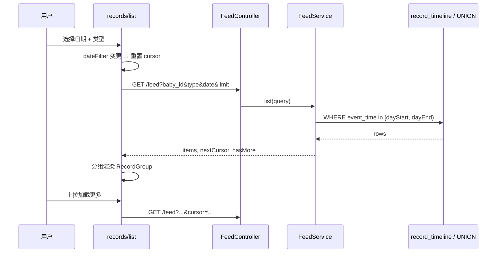
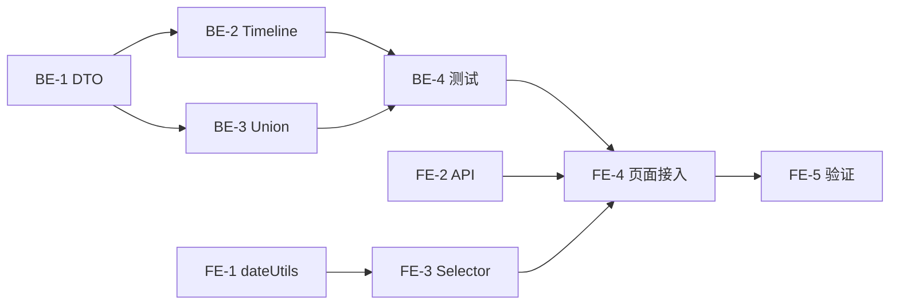

# 技术方案：记录列表按日期筛选（方案 C）

> **状态**：已实现  
> **关联**：`TECH-002-unified-record-feed-api.md`（Feed 分页基础）  
> **范围**：`minicare-mp` 记录列表页 + `minicare-server` Feed API（Web 维护模式，本期不强制同步）  
> **最后更新**：2026-05-24

---

## 1. 背景与目标

### 1.1 现状

小程序记录列表（`minicare-mp/src/pages/records/list`）已接入统一 Feed API，支持：

- 类型筛选（全部 / 单类型）
- 「全部」下的组内排序（按类型 / 按时间）
- Keyset 游标上拉加载
- 按自然日**展示分组**（`RecordGroup`）

**缺失**：无法按指定自然日查看记录。Web 版仅有「今天」客户端过滤；小程序在 Feed 迁移后连「今天」入口也一并移除（`index.scss` 仍保留 `.records-filter__today-toggle` 样式未使用）。

### 1.2 目标

| 编号 | 目标 |
|------|------|
| G1 | 用户可选择**全部日期**或**某一自然日**查看记录 |
| G2 | 日期筛选与类型筛选**正交**（如「昨天 + 饮食」） |
| G3 | 单日模式下分页正确，不出现「选了某日但列表为空/不全」 |
| G4 | 交互与首页 Dashboard 日期选择**一致**（今天/昨天/前天 + 日历） |
| G5 | 不破坏现有 Feed 游标分页与「全部日期」浏览体验 |

### 1.3 非目标（本期不做）

- 日期**范围**筛选（起止两日）
- 将筛选条件持久化到 Storage（关闭页面即重置）
- Web 端同步改造（可后续单独 PR）
- 修改各类型记录的创建/编辑接口

---

## 2. 产品需求与验收标准（EARS）

### 2.1 用户故事

> 作为照护者，我想在记录列表里按某一天查看宝宝的全部（或某一类）记录，以便快速回顾「那天发生了什么」，而不必在历史时间线里一直上拉翻找。

### 2.2 交互规格

#### 2.2.1 入口位置

在筛选区**标题行右侧**（与 Web「今天」按钮同层），放置日期选择控件：

```
┌──────────────────────────────────────────────────┐
│ 宝宝记录 · 共 12 条              [今天 ▼] [日历] │
├──────────────────────────────────────────────────┤
│ [全部][饮食][尿布][生长] ... [更多]               │
└──────────────────────────────────────────────────┘
```

- **左侧**：`宝宝记录` + `共 N 条`（N = 当前筛选条件下的记录条数，见 §2.2.4）
- **右侧**：
  1. `Picker mode='selector'`：快捷日期
  2. `Picker mode='date'`：日历选日（`end` = 今天，不可选未来）

#### 2.2.2 快捷选项（Selector）

| 选项 | 内部值 | 展示文案 |
|------|--------|----------|
| 全部日期 | `null` | `全部` |
| 今天 | `YYYY-MM-DD`（当天） | `今天` |
| 昨天 | 当天 -1 | `昨天` |
| 前天 | 当天 -2 | `前天` |

- 选中「全部」：`dateFilter = null`，恢复现有全量时间线 + 游标分页。
- 选中今天/昨天/前天或日历某日：`dateFilter = 'YYYY-MM-DD'`。
- 日历选中的自定义日：Selector 高亮索引回落为「全部」或保持非预设态，主按钮展示 `M月D日`（与 Dashboard `formatDateLabel` 一致）。

#### 2.2.3 与类型筛选、排序的关系

| 组合 | 行为 |
|------|------|
| 全部日期 + 全部类型 | 现状不变 |
| 指定日 + 全部类型 | 仅该日记录；排序条仍显示 |
| 指定日 + 单类型 | 仅该日该类型；排序条隐藏（与现逻辑一致，单类型强制按时间） |
| 切换日期 | **重置列表**：清空 `records`、重置 `cursor`、重新首屏请求 |
| 切换类型 | 同上（已有行为，保持不变） |

#### 2.2.4 计数与底部文案

| 场景 | 标题行计数 | 列表底部 |
|------|------------|----------|
| 全部日期 + 仍有下一页 | `共 N 条`（N = 已加载条数） | `上拉加载更多` |
| 全部日期 + 无下一页 | 同上 | `已加载全部记录` |
| 指定某日 + 仍有下一页 | `共 N 条` | `上拉加载更多` |
| 指定某日 + 无下一页 | 同上 | `该日记录已全部加载` |
| 指定某日 + 0 条 | `共 0 条` | 空状态（见下） |

#### 2.2.5 空状态

| 条件 | 主标题 | 副标题 |
|------|--------|--------|
| 全部日期、无任何记录 | `暂无记录` | `点击底部 + 按钮开始记录\n宝宝的每一天`（保持现状） |
| 指定某日、无记录 | `该日暂无记录` | `可切换日期或点击底部 + 新增记录` |

#### 2.2.6 列表分组展示（指定某日）

- 通常仅 **1 个** `RecordGroup`。
- **保留**日期分组标题（`getDateLabel`），便于与「全部日期」模式视觉一致。
- 单日模式下分组 key 统一使用 **`event_time` 所在自然日**（见 §4.4 边界说明），不再对睡眠跨天记录使用 `getRecordDateForGroup` 的「结束日」规则，避免「筛的是 3 月 2 日、标题却显示 3 月 1 日」。

### 2.3 验收标准（可测试）

1. **WHEN** 用户进入记录列表且未选日期 **THEN** 行为与现网一致（可上拉、多日期分组）。
2. **WHEN** 用户选择「今天」 **THEN** 仅展示今天 `00:00:00`～次日 `00:00:00`（左闭右开）内的记录；类型筛选生效。
3. **WHEN** 用户通过日历选择历史某日 **THEN** 仅展示该日记录；标题按钮显示 `M月D日`。
4. **WHEN** 用户从指定日切回「全部」 **THEN** 恢复游标分页，且 cursor 从首屏重新请求。
5. **WHEN** 指定某日记录数 > `limit` **THEN** 上拉可继续加载该日内更早记录直至 `hasMore=false`。
6. **WHEN** 指定某日 0 条 **THEN** 显示「该日暂无记录」空状态。
7. **WHEN** 用户切换类型或日期 **THEN** 不出现上一筛选条件的残留数据。
8. **WHEN** 生长/医疗记录的业务日期为某日 **THEN** 能通过日期筛选命中（依赖 Feed `event_time` 与 timeline 一致）。

---

## 3. 架构设计

### 3.1 数据流（目标态）



### 3.2 核心原则

1. **日期过滤在后端完成**，禁止仅靠前端 `filter` 已加载数据（与游标分页冲突）。
2. **筛选字段统一为 Feed `event_time`**（与 `record_timeline.event_time`、UNION 查询列一致）。
3. **前端展示分组**在「指定某日」模式下与 API 语义对齐，避免 `getRecordDateForGroup` 与 API 不一致。

### 3.3 模块改动一览

| 层级 | 文件 / 模块 | 改动 |
|------|-------------|------|
| 后端 DTO | `feed-query.dto.ts` | 新增可选 `date` |
| 后端 Service | `feed.service.ts` | timeline + union 查询链增加日期 WHERE |
| 前端 API | `minicare-mp/src/api/records.ts` | `FeedListParams.date` |
| 前端工具 | `minicare-mp/src/lib/dateUtils.ts`（新建） | 从 Dashboard 抽出日期工具 |
| 前端组件 | `RecordsDateSelector.tsx`（新建） | 日期选择 UI |
| 前端页面 | `records/list/index.tsx` | 状态、请求、空状态、分组逻辑 |
| 前端样式 | `records/list/index.scss` | 复用已有 today-toggle，补充 date 按钮 |
| 文档 | 本文 + `TECH-002` 附录 | API 参数补充 |

---

## 4. 后端详细设计

### 4.1 API 变更

**Endpoint**（不变）：`GET /api/family/:familyId/records/feed`

**新增 Query 参数**：

| 参数 | 类型 | 必填 | 说明 |
|------|------|------|------|
| `date` | `string` | 否 | 自然日，格式 `YYYY-MM-DD`（本地日历日，与业务时间字符串一致）；不传表示不限日期 |

**示例**：

```http
GET /api/family/{familyId}/records/feed?baby_id={uuid}&type=all&date=2026-05-20&limit=20
GET /api/family/{familyId}/records/feed?baby_id={uuid}&type=feeding&date=2026-05-20&limit=20&cursor=...
```

**响应**（不变）：`{ items, nextCursor, hasMore }`

### 4.2 DTO

```ts
// feed-query.dto.ts 新增
@ApiPropertyOptional({ description: '按自然日筛选，格式 YYYY-MM-DD' })
@IsOptional()
@IsString()
@Matches(/^\d{4}-\d{2}-\d{2}$/, { message: 'date 格式须为 YYYY-MM-DD' })
date?: string;
```

校验扩展（`FeedService` 或 DTO 自定义 validator）：

- `date` 不得晚于**服务器当前本地日**（与 `SET time_zone = '+08:00'` / 业务约定一致）。
- 可选：限制最早日期（如宝宝出生日前 30 天），本期可省略。

### 4.3 SQL 语义

对任意读取路径（`record_timeline` 或 `UNION` 子查询），在现有 `baby_id`、`type`、`cursor` 条件之上增加：

```sql
event_time >= :dayStart   -- 'YYYY-MM-DD 00:00:00'
AND event_time <  :dayEnd -- 次日 'YYYY-MM-DD 00:00:00'
```

辅助方法（可复用现有 `getNextDate`）：

```ts
private resolveDateRange(date: string): { dayStart: string; dayEnd: string } {
  return {
    dayStart: `${date} 00:00:00`,
    dayEnd: `${this.getNextDate(date)} 00:00:00`,
  };
}
```

### 4.4 各读取路径改造点

`FeedService.list()` 有两条路径，**均需**支持 `date`：

#### 路径 A：`listFromTimeline`（`FEED_READ_SOURCE !== 'union'` 且 timeline 表存在）

| 方法 | 改动 |
|------|------|
| `queryTimelineRows` | `if (query.date)` 追加 `event_time >= ? AND event_time < ?` |
| `queryTimelineSameDayRows` | 已有按日查询；当 `query.date` 存在时，**页尾补齐逻辑可跳过**（见 §4.5） |
| `checkTimelineHasMore` | 追加相同日期边界 |

#### 路径 B：`listFromUnion`

| 方法 | 改动 |
|------|------|
| `queryFeedRows` | 外层 `WHERE` 增加日期区间（注意与 cursor 条件 AND） |
| `querySameDayRows` | 当已有 `query.date` 时与 tail 补齐逻辑协调 |
| `checkHasMore` | 追加日期边界 |

**实现建议**：抽取 `appendDateFilter(whereClauses, params, date?: string)`，避免 timeline/union 两套逻辑漂移。

### 4.5 分页策略（有 `date` 时）

| 行为 | 全部日期（现状） | 指定 `date` |
|------|------------------|-------------|
| Keyset 排序 | `event_time DESC, id/timeline_id DESC` | 不变 |
| `limit+1` 判断 hasMore | 不变 | 不变 |
| 页尾「补齐同一天」 | 启用（跨日分页时保证日界完整） | **可禁用**（结果集已在单日内） |
| `hasMore` 含义 | 还有更早的历史日 | 该日内还有更早记录 |

禁用补齐可简化实现；**即使保留**补齐逻辑，在单日 filter 下也为空操作，无功能影响。

### 4.6 `event_time` 与各类型一致性（筛选依据）

| 类型 | Feed / Timeline `event_time` 来源 | 按 `date` 筛选含义 |
|------|-----------------------------------|-------------------|
| feeding | `record_time` | 记录发生时刻所在日 |
| sleep | `start_time` | 睡眠**开始日**（非结束日） |
| diaper / activity / health / symptom | `record_time` | 记录发生日 |
| growth | `record_date 00:00:00` | 测量日期 |
| medical | `visit_date 00:00:00` | 就诊日期 |

### 4.7 边界：睡眠跨天

**现状**：

- Timeline / Feed：`event_time = start_time`
- 前端「全部日期」分组：`getRecordDateForGroup` 对**已结束且跨天**的睡眠可能归到 **结束日**

**本期约定**：

- **API 筛选**始终按 `event_time`（开始日）。
- **前端在 `dateFilter != null` 时**，分组日期改用 `getRecordTime(rec)` / `event_time`，**不调用** `getRecordDateForGroup`，保证列表标题与筛选日一致。
- **「全部日期」模式**维持现有分组逻辑，避免大范围行为变化。

> 示例：睡眠 3/1 23:00 → 3/2 07:00。用户筛选「3/2」：**不会出现**该条；筛选「3/1」：**会出现**。与 Dashboard 按开始时刻聚合的习惯一致。若产品后续要求「按结束日筛选」，需单独扩展 SQL（本期不做）。

### 4.8 错误处理

| 场景 | HTTP |
|------|------|
| `date` 格式非法 | 400 Bad Request |
| `date` 为未来日期 | 400 Bad Request |
| `cursor` 与 `date` 组合非法（cursor 指向日外） | 400 或返回空页；建议 **400 `cursor 与 date 不匹配`**，前端切换 date 时已重置 cursor，正常不应触发 |

### 4.9 测试用例（后端）

| # | 用例 | 期望 |
|---|------|------|
| T1 | 无 `date`，首屏 | 与现网一致 |
| T2 | `date=今天`，type=all | 仅今天记录，按时间降序 |
| T3 | `date=昨天`，type=feeding | 仅昨天喂养 |
| T4 | 某日记录 > limit | `hasMore=true`，cursor 第二页仍在同日内 |
| T5 | 某日 0 条 | `items=[]`, `hasMore=false` |
| T6 | `date` 未来 | 400 |
| T7 | growth `record_date` 命中 | 在对应 `date` 请求中出现 |
| T8 | sleep 跨天 | 仅出现在 `start_time` 所在 `date` |

---

## 5. 前端详细设计（minicare-mp）

### 5.1 状态模型

```ts
/** null = 全部日期；'YYYY-MM-DD' = 指定自然日 */
type DateFilter = string | null

const [dateFilter, setDateFilter] = useState<DateFilter>(null)
```

**请求依赖**：`useEffect` / `loadMore` 依赖数组增加 `dateFilter`。

**重置规则**（与 `activeFilter` 相同）：

```ts
// dateFilter 或 activeFilter 变化时
nextCursorRef.current = null
setHasMore(false)
setRecords([])
// 然后 load()
```

### 5.2 API 层

```ts
// api/records.ts
export interface FeedListParams {
  baby_id: string
  limit?: number
  cursor?: string
  type?: 'all' | FeedType
  date?: string  // YYYY-MM-DD
}

// list() 内
if (params.date) query.push(`date=${encodeURIComponent(params.date)}`)
```

### 5.3 新建 `src/lib/dateUtils.ts`

从 `dashboard/HeaderBar.tsx` 抽出，供 Dashboard 与记录列表共用：

| 函数 | 说明 |
|------|------|
| `getTodayStr()` | `YYYY-MM-DD` |
| `offsetDate(dateStr, days)` | 日偏移 |
| `formatDateLabel(dateStr)` | 今天/昨天/前天/M月D日 |
| `buildQuickDateOptions()` | 含「全部」+ 今天/昨天/前天 |

`HeaderBar` 改为 import 上述工具（小重构，避免双份逻辑）。

### 5.4 新建 `RecordsDateSelector` 组件

**路径**：`minicare-mp/src/pages/records/list/RecordsDateSelector.tsx`

**Props**：

```ts
interface RecordsDateSelectorProps {
  value: string | null          // null = 全部日期
  onChange: (date: string | null) => void
}
```

**结构**（对齐 Dashboard）：

```tsx
<View className="records-date-selector">
  <Picker mode="selector" range={options} rangeKey="label" ...>
    <View className="records-filter__today-toggle [active]">
      <Text>{displayLabel}</Text>  {/* 全部 / 今天 / 昨天 / 前天 / M月D日 */}
    </View>
  </Picker>
  <Picker mode="date" value={pickerValue} end={todayStr} onChange={...}>
    <View className="records-date-selector__calendar">
      <Text>日历</Text>
    </View>
  </Picker>
</View>
```

**Selector 选项**（比 Dashboard 多一项）：

```ts
[
  { label: '全部', value: null },
  { label: '今天', value: todayStr },
  { label: '昨天', value: yesterdayStr },
  { label: '前天', value: dayBeforeStr },
]
```

**日历行为**：

- 选中后 `onChange('YYYY-MM-DD')`
- `pickerValue`：当 `value` 为 null 时用 `todayStr` 作为 Picker 受控值（仅用于打开日历默认值）

### 5.5 页面编排改动（`index.tsx`）

#### 5.5.1 标题行

```tsx
<View className="records-filter__head">
  <View className="records-filter__title-wrap">...</View>
  <RecordsDateSelector value={dateFilter} onChange={setDateFilter} />
</View>
```

#### 5.5.2 数据加载

```ts
const feedRes = await recordsApi.feed.list(family.id, {
  baby_id: baby.id,
  type,
  limit: 20,
  ...(dateFilter ? { date: dateFilter } : {}),
  ...(cursor ? { cursor } : {}),
})
```

#### 5.5.3 分组逻辑

```ts
function getGroupDateSource(rec: RecordItem, dateFilter: string | null): string {
  if (dateFilter) return getRecordTime(rec)
  return getRecordDateForGroup(rec)
}

// 构建 dateMap 时
const dk = getDateKey(getGroupDateSource(rec, dateFilter))
```

#### 5.5.4 空状态分支

```tsx
records.length === 0 ? (
  <View className="records-status">
    ...
    <Text>{dateFilter ? '该日暂无记录' : '暂无记录'}</Text>
    <Text className="records-status__subtitle">
      {dateFilter
        ? '可切换日期或点击底部 + 新增记录'
        : '点击底部 + 按钮开始记录\n宝宝的每一天'}
    </Text>
  </View>
) : ...
```

#### 5.5.5 底部文案

```tsx
hasMore ? '上拉加载更多' : dateFilter ? '该日记录已全部加载' : '已加载全部记录'
```

### 5.6 样式

- 复用 `.records-filter__today-toggle` / `--active`
- 新增 `.records-date-selector`：横向 flex、`gap: 6px`、与标题行对齐
- 日历按钮：次要样式（灰底描边），与主日期按钮区分（参考 `db-date-btn--calendar`）

### 5.7 游客模式

`GuestRecordsList` 不接入真实筛选；保持 Mock 展示，**不修改**。

---

## 6. 实施计划

### 6.1 任务拆分（推荐顺序）

| 阶段 | 任务 ID | 内容 | 预估 |
|------|---------|------|------|
| **B1** | BE-1 | `FeedQueryDto` 增加 `date` 校验 | 0.5h |
| **B2** | BE-2 | `FeedService` 抽取 `appendDateFilter`，接入 timeline 路径 | 1.5h |
| **B3** | BE-3 | `FeedService` union 路径接入 date | 1h |
| **B4** | BE-4 | 有 date 时调整/验证 hasMore + 单测或 e2e | 1h |
| **F1** | FE-1 | `dateUtils.ts` + 重构 `HeaderBar` | 0.5h |
| **F2** | FE-2 | `records.ts` 增加 `date` 参数 | 0.25h |
| **F3** | FE-3 | `RecordsDateSelector` + scss | 1h |
| **F4** | FE-4 | `index.tsx` 状态/请求/分组/空状态/底部文案 | 1h |
| **F5** | FE-5 | 真机验证 + `npm run build:weapp` | 0.5h |
| **D1** | DOC-1 | 更新 `TECH-002` §4.2 参数表；PRD 模块若有记录列表描述则补一句 | 0.25h |

**合计**：约 7～8h（单人）

### 6.2 依赖关系



后端 B4 完成后即可联调；前端 F1～F3 可与后端并行。

### 6.3 发布与迁移

- **无需新 migration**（复用 `record_timeline` 索引 `idx_timeline_baby_time_id`）。
- **部署顺序**：先后端 CloudRun → 再发小程序（旧版前端不传 `date`，兼容）。
- **回滚**：后端保留对无 `date` 请求的现有行为即可。

### 6.4 手工测试清单（QA）

- [ ] 全部日期：首屏、上拉、类型切换、排序切换
- [ ] 今天 / 昨天 / 前天：有数据、无数据
- [ ] 日历选 1 个月前某日
- [ ] 切回「全部」后游标正常
- [ ] 饮食 + 指定日
- [ ] 生长、医疗记录在对应业务日可搜到
- [ ] 跨天睡眠：开始日可搜到，结束日不出现（确认与文档一致）
- [ ] 删除记录后列表刷新（`useDidShow` 返回页面）
- [ ] iPad 布局（`is-ipad` class）日期按钮不换行异常

---

## 7. 风险与对策

| 风险 | 影响 | 对策 |
|------|------|------|
| timeline 表未部署环境走 union，两套逻辑不一致 | 部分环境筛选错误 | BE-2/BE-3 同步改；staging 验证 |
| 睡眠跨天产品预期与实现不符 | 用户困惑 | 文档明确；后续单独立项 |
| 标题行右侧控件过多（小屏） | 布局挤压 | 日期按钮缩短文案；必要时 `flex-shrink` + 略小字号 |
| 已加载条数当「共 N 条」在全部日期下非全量 | 误解 | 保持与现网一致；可选后续改为 `hasMore` 时展示「已加载 N 条」 |

---

## 8. 后续扩展（非本期）

| 扩展 | 说明 |
|------|------|
| 日期范围 | `from_date` + `to_date`，报告场景 |
| 记忆上次筛选 | `Taro.setStorageSync` |
| Web 同步 | `FilterBar` 接入同一 `date` API |
| 睡眠按结束日筛选 | 扩展 timeline `event_time` 或查询 OR 条件 |

---

## 9. 附录

### 9.1 `TECH-002` API 参数补丁（实施后写入）

在 §4.2 Query 参数表增加：

| 参数 | 说明 |
|------|------|
| `date` | 可选，`YYYY-MM-DD`，按 `event_time` 自然日过滤 |

### 9.2 文件清单（Checklist）

**后端**

- [ ] `minicare-server/src/records/feed/dto/feed-query.dto.ts`
- [ ] `minicare-server/src/records/feed/feed.service.ts`

**前端**

- [ ] `minicare-mp/src/api/records.ts`
- [ ] `minicare-mp/src/lib/dateUtils.ts`（新）
- [ ] `minicare-mp/src/pages/dashboard/HeaderBar.tsx`（重构 import）
- [ ] `minicare-mp/src/pages/records/list/RecordsDateSelector.tsx`（新）
- [ ] `minicare-mp/src/pages/records/list/index.tsx`
- [ ] `minicare-mp/src/pages/records/list/index.scss`

**文档**

- [ ] `docs/tech/TECH-002-unified-record-feed-api.md`（参数表）
- [ ] 本文状态改为「已实现」

---

## 10. 评审确认项

请产品/开发确认以下决策后开工：

1. **睡眠跨天**按开始日筛选（§4.7）是否接受？
2. **计数文案**「共 N 条」在分页未完成时表示已加载条数（非全量）是否保持现状？
3. **Selector 第一项「全部」**文案用「全部」还是「全部日期」？

确认后按 §6.1 任务顺序实施。
