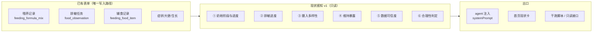

# TECH-014 现状感知 v1（进度推算与过程合理性）

| 项 | 值 |
|---|---|
| 状态 | **已实现并注入对话**（2026-09-20；可自验，见 §10） |
| 日期 | 2026-09-20 |
| 关联 | PRD-006 §4「状态感知能力」、§6 US-20、§12.4 第 1 期 |
| 上游 | `RESEARCH-20260920-转奶与排敏行业参考值.md`（参考值出处） |
| 下位 | `TECH-013-state-awareness-implementation.md`（完整感知层蓝图，本文是其最小可验证切片） |
| 实现 | `agent-poc/src/lib/perception.js`（算法，518 行）→ 注入 `prompts/system.js` |
| 验证 | `agent-poc/scripts/verify-perception.mjs`（52 项断言）、`scripts/perception-preview.mjs`（人眼核对）、`scripts/ask-agent.mjs`（实跑一轮对话） |

---

## 0. 结论摘要

| # | 结论 |
|---|---|
| C1 | **不设目标。** 行业只给"单步时长"，不给"全程倒计时"（Nutrients 2025 阶梯综述：无每阶最优时长、阶间隔、总时长共识）。家长设不出目标不是能力问题，是指南本身要求个体化。目标降级为"可选覆盖"，默认全用参考值 |
| C2 | **本期不建 `baby_goal` 表。** 目标管理的价值全部落在"进度推算 + 过程合理性"上，而这两件事都不需要家长输入 |
| C3 | 改动面收敛为 **0 张新表、0 处新录入、0 个新页面、0 个 migration**。数据全部来自已有表单，界面先复用首页卡 |
| C4 | 新增算法集中在 **3 组**：排敏进度、日常摄入多样性、维持暴露。奶粉阶段 / 生长分位 / 数据新鲜度**复用 `profile.js`**，不重算 |
| C5 | 交付一个**只读**干跑脚本 `perception-preview.mjs`，跑一遍即可逐个核对每个数字——这是本期的验收工具，也是下一步代码的原型 |
| C6 | 生产实测已产出 6 处"过程不合理"证据（见 §7.2），全部可从现有表单算出，无需任何新录入 |
| C7 | **已落地并注入对话**（2026-09-20）：算法在 `src/lib/perception.js`，每轮随 systemPrompt 注入，现状块 **825 字符**（约 300 token）。实测同一问题：注入后 **0 次工具调用、6.0 秒**直接答出全部结论；关掉注入则需自己查 30 天记录、口径退化为"从记录推断"（见 §10.4） |
| C8 | **回归全绿**：`verify-perception.mjs` 52/52、`verify-profile.mjs` 22/22、`eval-agent.mjs --group=l1` 8/8 |



---

## 1. 背景与定位

### 1.1 为什么放弃"先做目标管理"

上一轮方案把"设目标"作为第一个功能（转奶节奏 14 天 / 排敏目标 25 种）。调研后发现这个前提站不住：

| 依据 | 结论 |
|---|---|
| 中国指南（2022）「具体怎么转还需要个体化」 | 指南自己承认无法给统一目标 |
| NHS 标准阶梯：每阶 7 天＋进阶需"该阶食物每周至少 3 天能耐受" | 给的是**单步下限**，不是全程计划 |
| FPIAP：非 IgE 每阶 1-2 周 | 单步区间，跨度已达 2 倍 |
| Nutrients 2025 阶梯综述 | 明确"**无每阶最优时长、阶间隔、总时长共识**"，实践中按反应史/年龄/分型/严重度/家长焦虑度个体化 |

各来源的单步时长跨越 3 天到 12 周（两个数量级）。让家长在这种离散度下指定一个"计划"，只会产出伪精确。

### 1.2 定位重述

**产品要回答的不是"你要去哪"，而是"你现在到哪了、这样走合理吗"。**

前者需要家长输入一个行业自己都没共识的数；后者可以从已有表单直接算出来。所以本期把注意力整体移到后者，目标仅在家长主动想改节奏时作为"覆盖项"存在。

### 1.3 六个板块

| 板块 | 回答的问题 | 状态 |
|---|---|---|
| ① 奶粉阶段与进度 | 现在喝到哪一阶？离普通配方还有几阶？本阶待了多久？ | 复用 `profile.formula`，补 3 个派生量 |
| ② 排敏进度 | 已耐受几种？还在观察什么？卡在哪一项？ | **新增** |
| ③ 摄入多样性 | 一天吃了多少种、哪几类？ | **新增** |
| ④ 维持暴露 | 已判耐受的食物还在吃吗？ | **新增** |
| ⑤ 数据可信度 | 哪些数据久未更新，哪些结论不能下？ | 复用 `profile.freshness` |
| ⑥ 合理性判定 | 上面五项里，哪几条说明过程走得不对？ | **新增** |

---

## 2. 非目标

| # | 不做 | 原因 |
|---|---|---|
| N1 | 不建目标表、不做目标设置流程 | 见 §1.1；家长设不准，且设不准不影响进度准确性 |
| N2 | 不做里程碑地图（M0-M6 七级） | 需要目标作为锚点，本期无目标 |
| N3 | 不做护栏出口校验 | 属 TECH-013 §7.5，独立于现状感知，后置 |
| N4 | 不改排敏状态机 | 库表前后端**已是五态**（含 `paused`），无迁移必要 |
| N5 | 不改任何录入表单 | 录入只在界面，本期不动界面写路径 |
| N6 | 不新增 migration | 依赖 022 的机制分型字段本切片不用 |
| N7 | agent 不写库 | 硬原则：录入只在界面，agent 零写入 |
| N8 | 不产出建议文案 | 分析只在对话；本模块只输出**事实与判定**，建议由对话生成（建议类产出不落库） |

---

## 3. 现状基线（代码事实，2026-09-20 实测）

| 组件 | 现状 | 本文增量 |
|---|---|---|
| `agent-poc/src/lib/profile.js`（570 行） | 已实现 A 基本 / B 配方 / C 喂养 / E 生长 / I 新鲜度 5 组，进程内 5 分钟 TTL，`renderProfileBlock()` 已进 `systemPrompt` | 复用 B、I；**不改其逻辑** |
| `agent-poc/scripts/verify-profile.mjs` | 22 项断言，覆盖字段完整性、缓存命中、生长分位同源、配方空档兜底 | 保持为回归基线 |
| 排敏数据 | `food_observation` 五态 + `current_day`/`observation_days`/`retry_after_date`/`severity` + `intro_count`；另有 `food_observation_log` 逐日打卡 与 `feeding_food_item` 实际食用明细 | 首次被消费 |
| 摄入数据 | `feeding_food_item` 逐食材行（含 `amount_g`），已可算"一天几种" | 首次被消费 |
| 干跑脚本 | 本文新增 `agent-poc/scripts/perception-preview.mjs` | 新增 |

**关键判断**：排敏与摄入这两组数据**已经积累了足够密度**（生产 18 条建档 / 138 条食材明细 / 42 条打卡），长期缺的不是数据，而是"没人算过"。所以本期是纯计算工作，没有数据前置依赖。

---

## 4. 数据契约

### 4.1 ① 奶粉阶段与进度

复用 `profile.formula`（字段：`current` / `dominant` / `dominantLabel` / `ladderLevel` / `status` / `stalledDays` / `stalledAtLeast` / `direction` / `lactose` / `aaStoppedDays` / `staleDays`），仅新增 3 个派生量：

| 字段 | 算法 | 实测（生产旺仔） |
|---|---|---|
| `nextStage` | 阶梯路径 `aa → eh_lactose → ph → std` 的下一项 | `ph`（适度水解） |
| `stageGap` | `ladderLevel − 1`，即距普通配方还有几阶 | 2 阶 |
| `stageProgressPct` | 下一阶奶型在近 30 天勺数中的占比 | 0%（纯深度水解，尚未开始混入） |

阶梯位定义 `aa=4`、`eh_no_lactose`/`eh_lactose=3`、`ph=2`、`std=1`。

> **注意一个反直觉点**：纯阶时期 `stageProgressPct` 恒为 0%，直到家长主动开始混入下一阶。所以**进度百分比不能单独展示**，必须与"本阶稳定 N 天 / 参考 14 天"配对出现——前者说"阶内做了多少"，后者说"这个阶待得够不够久、能不能往前"。

### 4.2 ② 排敏进度

| 字段 | 算法 | 源 |
|---|---|---|
| `safeCount` | `status='safe'` 归一化去重后计数 | `food_observation` |
| `observing[]` | `status='observing'` 每项：食材 / `current_day` / `observation_days` / 静止天数 | 同上 |
| `suspected[]` | `status='suspected'` 含 `severity` | 同上 |
| `allergic[]` | `status='allergic'` 含复引入日期 `retry_after_date` | 同上 |
| `paused[]` | `status='paused'`（家长主动挂起） | 同上 |
| `dupGroups[]` | 归一化后同一食材对应多个建档名 | 计算得出 |
| `parallelCount` | 同时 `observing` 的项数（应为 1） | 同上 |

### 4.3 ③ 摄入多样性

| 字段 | 算法 | 源 |
|---|---|---|
| `days[]` | 近 14 天逐日：种类数（归一化后）/ 覆盖类别 | `feeding_food_record` × `feeding_food_item` |
| `avgKinds` | 有记录日的种类数均值 | 同上 |
| `hitDays` | 种类数 ≥ 参考下限（4 种）的天数 | 同上 |
| `categories[]` | 近 14 天出现过的七大类 | 同上 |
| `unclassified[]` | 未命中七大类关键词的食材 | 同上 |

### 4.4 ④ 维持暴露

| 字段 | 算法 | 源 |
|---|---|---|
| `eaten30[]` | 近 30 天实际食用过的食材（归一化去重） | `feeding_food_item` |
| `eaten14[]` | 近 14 天实际食用过的食材 | 同上 |
| `idleSafe[]` | `safe` 集合 − `eaten14` 集合 = "判了耐受但不再吃" | 两组交叉 |

这一组是"过程合理性"里最有价值的一项：**已耐受清单会随建档只增不减，但真实食用范围会缩**，两者之差就是"以为在吃、其实没在吃"。

### 4.5 ⑤ 数据可信度

复用 `profile.freshness`，逐源输出 `lastAt` / `staleDays`；额外派生一个结论字段：

| 字段 | 规则 |
|---|---|
| `symptomUsable` | 症状最近记录距今 > 14 天 → `false`，此时**只能写"信息缺失"，不能写"无症状"** |

### 4.6 ⑥ 合理性判定

见 §5。

---

## 5. 合理性判定规则

全部为**纯函数**（吃 §4 的输出，不额外查库），每条给 `key` / `命中条件` / `参考值来源`。

| key | 命中条件 | 参考值 | 说明 |
|---|---|---|---|
| `R1 排敏任务停滞` | 存在 `observing` 项，其静止天数 > `observation_days` | 观察期 3 天 | 建了任务但没往下走 |
| `R2 排敏并行` | `parallelCount > 1` | 串行为准 | 并行观察无法归因反应 |
| `R3 已耐受未维持` | `idleSafe.length > 0` | 每周 2-3 次 | 耐受需要持续暴露维持 |
| `R4 转奶可推进` | `ladderLevel > 1` 且 `stalledDays ≥ 14` | 每阶 14 天 | 本阶待够了，具备推进条件 |
| `R5 日常种类不足` | `hitDays < 天数 × 50%` | 每日 4 种 | **须排除排敏期单一种日**，见下 |
| `R6 症状数据陈旧` | `symptomUsable === false` | 14 天 | 相关阴性结论不可下 |

**R5 的例外（重要）**：排敏期按规矩就是"单一种连续观察 3 天"，此时当日种类数必然是 1-2 种。若不做排除，会把**正确执行**误判成"吃得不够杂"。排除规则：当日有 `observing` 任务处于活跃观察窗，且该日食材属于该任务 → 该日不计入 R5 分母。

**输出边界**：这 6 条只输出"判定 + 依据数字"，**不输出建议**（N8）。比如只输出「本阶已 34 天 ≥ 参考 14 天」，不输出「建议下周转适度水解」——后者属于对话的职责。

---

## 6. 参考值（单一出处在 RESEARCH-20260920）

| 参数 | 值 | 档位 | 依据 |
|---|---|---|---|
| 转奶·阶内转换步长 | 7 天 | 不暴露 | 中国指南 2022 七天第一瓶奶转换法 |
| 转奶·每阶稳定观察期 | **14 天** | 7 / 14 / 30 | NHS 7 天 + FPIAP 1-2 周 |
| 转奶·硬下限 | 7 天 | 不可调 | NHS：即使提前吃完规定量也须满 7 天 |
| 排敏·每种观察期 | **3 天** | 3 / 5 / 7 | 国家卫健委「2-3 日」；现有产品值无需改 |
| 排敏·每周引入 | 2 种 | 1 / 2 / 3 | 由观察期反推 |
| 一日辅食种类 | **4 种** | — | 含 1 动物性 + 1 蔬菜 + 1 谷薯 |
| 每日食物类别 | **4 类** | — | 七大类中至少 4 类 |
| 已耐受维持暴露 | 每周 2-3 次 | — | 取低值 2 |
| 症状结论有效期 | 14 天 | — | 与 `profile.js` 的 `STALE_DAYS.symptom` 同值 |

这些值集中在 `perception-preview.mjs` 的 `REF` 常量里，**是唯一出处**；搬进 `lib/` 后应由同一个常量对象导出，避免两处各写一遍。

---

## 7. 实测

### 7.1 dev 库（可复现：`node scripts/perception-preview.mjs`）

| 板块 | 输出 |
|---|---|
| ① 奶粉 | 深度水解（无乳糖）75% + 适度水解 25%；阶梯位 3/4；距终点 2 阶；阶内进度 **25%**；本阶稳定 34 天（至少）；`stalled`；配方数据 17 天未更新 |
| ② 排敏 | 建档 5 条（safe 2 / allergic 3）；无进行中任务 |
| ③ 多样性 | 近 14 天 0 天有记录（种子数据已被清理） |
| ④ 维持暴露 | 近 30 天真吃过 4 种；已耐受 2 种近 14 天未吃 |
| ⑤ 可信度 | 6 个源全部停在 2026-09-03（17 天前）；症状结论不可用 |
| ⑥ 判定 | 命中 `R3`、`R4`、`R6` |

dev 的价值是**能跑通含混合配比的路径**（阶内进度非 0），生产当前是纯阶，走的是另一条分支。

### 7.2 生产库（只读 SQL，2026-09-20；baby_id `a54c8980-2aac-473c-a26f-a150fce7ec70`）

**① 奶粉阶段与进度**

| 项 | 值 |
|---|---|
| 近 30 天构成 | `eh_lactose` 889 勺（94.3%）+ `aa` 15 勺（仅 08-20~08-21 残留） |
| 当前阶 | 深度水解（含乳糖），阶梯位 3/4 |
| 距终点 | 2 阶（适度水解 → 普通配方） |
| 阶内进度 | **0%**（尚未开始混入适度水解） |
| 本阶稳定 | **30 天**（最后一条氨基酸记录 08-21，距今 30 天） ≥ 参考 14 天 |
| 判定 | `R4 转奶可推进` 命中——**这是本期第一个可直接对话的结论** |

**② 排敏进度**

| 项 | 值 |
|---|---|
| 建档总数 | 18 条 |
| 状态分布 | observing 3 / safe 13 / suspected 2 / allergic 0 / paused 0 |
| 已耐受 | 13 条 → **归一化后 11 种** |
| 重复建档 | 2 组：西兰花 ← 西兰花 / 西兰花泥；鸡肉 ← 鸡肉 / 鸡肉泥 |
| 复合名 | 1 例：米粉+南瓜泥（拆为 米粉 + 南瓜 两种） |
| 命名疑似重复 | 1 对：纯米粉 / 小米粉（**待确认是否同一食材**，见 §12） |
| 进行中 | 小米粉 Day1/3（09-18 建，正常推进）；牛肉 Day1/3（09-14 建，**6 天未推进**）；火龙果 Day2/3（09-05 建，**15 天未推进**） |
| 疑似 | 芹菜(mild)、生菜(mild) |
| 判定 | `R1 排敏任务停滞`（2 项）、`R2 排敏并行`（3 项在观察）命中 |

**③ 摄入多样性**（近 14 天 = 09-07 ~ 09-20）

| 项 | 值 |
|---|---|
| 有记录天数 | 8 天 |
| 种类数逐日 | 09-07 3 / 09-08 3 / 09-09 3 / 09-10 3 / 09-11 1 / 09-13 2 / 09-14 1 / 09-18 2 |
| 均值 | 2.25 种（参考下限 4 种） |
| 达标天数 | **0 / 8** |
| 覆盖类别 | 谷薯、蔬菜、肉禽鱼（3 类） |

**④ 维持暴露**

| 项 | 值 |
|---|---|
| 近 30 天真吃过 | 6 种：纯米粉(18) / 青菜(14) / 鸡肉(7) / 胡萝卜泥(3) / 火龙果(1) / 牛肉(1) |
| 近 14 天真吃过 | 4 种：米粉 / 青菜 / 鸡肉 / 牛肉 |
| 已耐受但近 14 天未吃 | **8 种**：苹果 / 猪里脊 / 西兰花 / 小米 / 土豆 / 南瓜 / 菠菜 / 胡萝卜 |
| 典型 | 猪里脊泥最近 07-30（52 天前）、菠菜泥 07-11、西兰花 08-15、土豆泥 08-13 |
| 判定 | `R3 已耐受未维持` 命中 |

**⑤ 数据可信度**（近 7 天 = 09-13 ~ 09-20）

| 源 | 记录量 | 陈旧天数 |
|---|---|---|
| 配方奶 | 31 条 | 0 |
| 辅食 | 3 天有记录 | 2 |
| 大便 | 12 条 | 0 |
| 生长测量 | 最近 09-06 | 14 |
| 症状 | 最近 **08-19** | **32** |
| 判定 | `R6 症状数据陈旧` 命中 | 32 天无症状记录，**不能推断"近期没有过敏反应"** |

### 7.3 六条判定在生产的命中情况

| 判定 | 命中 | 依据 |
|---|---|---|
| R1 排敏任务停滞 | ✅ | 牛肉 6 天、火龙果 15 天 |
| R2 排敏并行 | ✅ | 3 项同时 observing |
| R3 已耐受未维持 | ✅ | 8 种 |
| R4 转奶可推进 | ✅ | 本阶 30 天 ≥ 14 天 |
| R5 日常种类不足 | ✅ | 0/8 天达标（须先排除排敏期单一种日） |
| R6 症状数据陈旧 | ✅ | 32 天无记录 |

**六条全中**——这恰好说明"不设目标"是对的：家长此刻不缺一个"还剩 62 天"的倒计时，缺的是"你卡在 3 个地方、有 8 种食物以为在吃其实没吃、还有 32 天没记症状"。

---

## 8. 归一化设计

"同一食材重复建档"是排敏数据质量的头号问题。生产 13 条 `safe` 里有 2 组真重复、1 例复合名，若不归一化，`safeCount` 会虚高 2。

### 8.1 三步规则


循环剥离（剥完后缀可能露出新后缀：`西兰花泥` → `西兰花`），剥离后长度须 > 1 才继续，避免把 `米` 削成空串。

### 8.2 实测效果

| 原始名 | 归一化 | 说明 |
|---|---|---|
| 西兰花泥 / 西兰花 | 西兰花 | 形态后缀 |
| 鸡肉泥 / 鸡肉 | 鸡肉 | 形态后缀 |
| 猪里脊泥 / 土豆泥 / 菠菜泥 / 胡萝卜泥 | 猪里脊 / 土豆 / 菠菜 / 胡萝卜 | 形态后缀 |
| 苹果水 | 苹果 | 形态后缀（汁/水同义） |
| 米粉+南瓜泥 | 米粉、南瓜 | 复合名拆分为 2 种 |
| 纯米粉 | 米粉 | 修饰前缀 |
| 小米粉 / 小米粥 | 小米 | 与"米粉"不同源，**不合并** |

13 条 → 11 种。规则能覆盖的全覆盖了。

### 8.3 规则盖不住的部分（必须承认）

dev 实测暴露了一个反例：`强化铁米`（建档名）与 `高铁米粉`（食用名）指的是同一个产品，但**规则剥不出来**——差异在品牌/描述性命名，不是形态。

| 情形 | 对策 |
|---|---|
| 形态差异（泥/粉/粥） | 规则覆盖，事后归一到 100% |
| 复合名 | 规则覆盖（拆分） |
| 品牌/描述命名差异 | **事后归一永远不完整 → 前移到建档时**：录入新食材时若归一化命中已有条目，提示"是否复用「西兰花」"，把问题挡在源头 |

本期只做规则层；建档时提示涉及改动录入界面，列入下一期（且必须遵守"录入只在界面"原则，只提示不自动改写）。

---

## 9. 落点与改动面

| 层 | 改动 | 规模 | 本期 |
|---|---|---|---|
| 数据库 | 无 | 0 | — |
| 服务端 | 无（本期感知只在 agent 进程内） | 0 | — |
| agent | 新增 `src/lib/perception.js`；`runtime.js` 取数并传入；`prompts/system.js` 追加现状块 | 518 行 | ✅ 已合 |
| 助手 | 注入后开口即带现状；`R1`-`R6` 每轮最多提 1 条 | prompt +825 字符 | ✅ 已合 |
| 小程序 | **零改动**（首页卡改造列为下一期） | 0 | — |
| 脚本 | `perception-preview.mjs`（人眼核对）/ `verify-perception.mjs`（58 断言）/ `ask-agent.mjs`（单轮实跑） | 420 行 | ✅ 已合 |

**实际改动清单（逐文件）**

| 文件 | 动作 | 说明 |
|---|---|---|
| `src/lib/perception.js` | 新增 | 六板块算法 + `REF` 参考值 + `getPerception()` / `renderPerceptionBlock()` |
| `src/prompts/system.js` | 改 | `buildSystemPrompt(ctx, history, profile, perception)`；把现状块插在画像块之后、规则之前 |
| `src/lib/runtime.js` | 改 | 画像之后取感知（**串行**，并行会各算一遍 5 条 SQL）；`PERCEPTION_INJECT=off` 可一键回滚 |
| `src/lib/profile.js` | 改（仅导出） | 把既有 `LADDER_LEVEL` / `LADDER_LABEL` / `addDays` / `dayDiff` / `toDateStr` 加 `export`，供 `perception.js` 复用；**逻辑一行未改**，避免第二份日期/阶梯实现 |
| `scripts/perception-preview.mjs` | 重写 | 原来内含一份算法，现改为 `import` 同一份实现后只做打印——否则"脚本对了、线上不对" |

**为什么 agent 侧先做**：现状感知的第一价值是"让助手别再说错话"（比如把已经停药 30 天的宝宝说成"还在混氨基酸"、把 32 天没记的症状说成"近期没反应"）。这不需要动界面就能验证，符合"先做能自己测出来的那一版"。

### 9.1 聚合归属

期 1 物理落在 `agent-poc` 进程内。判据是消费方数量：目前只有 agent 一个消费方；等首页要展示同一批数字（第二个消费方出现）时再下沉服务端——这正是 TECH-013 §4.1 ADR-001 的既有结论，本文不改。

**缓存实现（修正原稿的说法）**：`perception.js` 用**自己的**进程内 Map + 5 分钟 TTL，**不是**与 `profile.js` 共用同一个对象——两者数据不同、失效时机也不同，共用只会互相拖累。但 `getPerception(babyId, { profile })` 接受已取到的画像对象，因此**不会重复执行画像那 5 条 SQL**；`runtime.js` 里的取值顺序是"先画像（与 CLI 冷启动并行）→ 再感知（3 条只读 SQL）"，串行是刻意的：并行会让两份画像各算一遍（缓存要写入后才命中，不是预占）。

成本核对：画像 5 条 + 感知 3 条 = 8 条只读 SQL／宝宝／5 分钟，与 TECH-013 §10.1 的预算（聚合约 7 条 + 控制面 2 条）同量级。

---

## 10. 验收（可自验）

### 10.1 五步自验（已全部跑过）

| 步 | 动作 | 通过标准 | 实测 |
|---|---|---|---|
| 1 | `cd agent-poc && NODE_OPTIONS= node scripts/verify-perception.mjs` | 58 项断言全过（归一化 / 空值语义 / 计数自洽 / flag 与字段一致 / 注入效果 / 缓存 / 参数化参考值 / 边界：无配方记录不降级） | 58 PASS / 0 FAIL |
| 2 | `NODE_OPTIONS= node scripts/perception-preview.mjs` | 七段全部输出（含 §⑦ 实际注入文本），进程正常退出 | 通过 |
| 3 | `NODE_OPTIONS= node scripts/verify-profile.mjs` | 22 项断言仍全过（确认复用未破坏既有画像） | 22 PASS / 0 FAIL |
| 4 | `NODE_OPTIONS= node scripts/eval/eval-agent.mjs --group=l1 --no-judge` | 工具组用例不因注入而回归 | 8/8 通过 |
| 5 | `NODE_OPTIONS= node scripts/ask-agent.mjs --context "旺仔现在转奶到哪一步了？"` | 打印注入文本，且回答里的数字与 §7.1 逐项一致 | 见 §10.4 |

> 注意第 2 步的 `perception-preview.mjs` **不再含算法**，它 `import` 的是 `src/lib/perception.js`——脚本与线上是同一份实现，不存"脚本对了、线上不对"的空间。

### 10.2 边界用例（6 个）

| # | 场景 | 期望 |
|---|---|---|
| E1 | 无任何配方记录 | ① 显示"数据不足"，不显示 0% |
| E2 | 仅 1 天配方记录 | 阶内进度可算，但"本阶稳定"标 `至少` |
| E3 | 排敏 0 条建档 | ② 显示"未开始"，`safeCount` 不显示 0 误导为"都不过敏" |
| E4 | 全部 `observing` 均已完结 | `R1` 不命中 |
| E5 | 辅食记录全空 | ③ 显示"近 14 天无记录"，`R5` **不命中**（无数据 ≠ 不达标） |
| E6 | 排敏期单一种日 | 该日从 `R5` 分母剔除，不判为"种类不足" |

E5 是元信号的典型：**"没有记录"与"记录显示不达标"必须区分**，否则会在家长没记的时候指责他。

### 10.3 出口标准

| # | 标准 | 实测 |
|---|---|---|
| 1 | "已停母乳被建议母乳"类错误归零（沿用 `profile.js` 既有约束） | 未回归（22/22） |
| 2 | 助手不再出现"数据陈旧却下阴性结论"（`R6` 生效） | ✅ 见 §10.4-③ |
| 3 | 六条判定的生产命中与 §7.3 一致 | 待生产发版后核对 |
| 4 | ~~注入后 prompt 增量 ≤ 200 字~~ → **实测 825 字符**（约 300 token） | 见下 |

**关于第 4 条的修正（诚实记录）**：200 字是在内容未设计时拍的目标，实际做不到——现状块要装下"阶段 + 排敏 + 多样性 + 维持暴露 + 可信度 + 判定"六项，压到 825 字符已经是把每条压成一行的结果。判断依据不是绝对值，而是**换来什么**：注入前同一问题要 1-2 次工具调用、30 天明细进上下文；注入后为 0 次工具调用，且省掉了"从明细推断结论"这一步。**净成本是负的**。时延增量未单独测量（与画像共用同一轮、同一次请求），实测总时延仍在既有的 4.3-6.8s 区间内（本次 6.0s）。

### 10.4 实跑对照（同一问题，注入开 / 关）

问题：**"旺仔现在转奶到哪一步了？辅食排敏又排到哪了？"**（dev 库，`scripts/ask-agent.mjs`）

| 维度 | 注入开 | 注入关（`--no-perception`） |
|---|---|---|
| 工具调用 | **0 次** | 1-2 次（`query_baby_data(metric=feeding, days=30, list)`，有时追加 `search_knowledge`） |
| 耗时 | 6.0s | 4.8s / 33.8s（一次被看门狗收尾、答案为空） |
| 转奶口径 | "深度水解（无乳糖）75% + 适度水解 25%｜下一阶 适度水解｜距终点 2 阶｜阶内进度 25%｜本阶稳定 34 天（参考 14 天）" | "停在 75/25 这个配比上，已经有至少三十多天没有继续往下调了"（从记录反推，答对但含糊） |
| 排敏口径 | 直接用建档口径："建档 5 条，已耐受 2 种，已确认过敏 3 种：南瓜泥、土豆泥、燕麦粉" | 只看得到"近一个月吃过四种食材：高铁米粉、南瓜泥、苹果泥、西兰花泥"——**把已确认过敏的南瓜泥当普通食材列出** |
| 信息缺失 | 显式说"近 14 天无辅食记录（信息缺失，不等于种类不足）" | 无此判断 |

**③ 元信号实测**（问题："旺仔最近有没有出现过敏反应？"）——这是最能说明问题的一条：

> "表现记录到 9月3日为止，之后到现在（9月20日）这段时间没有新的记录，所以这段时间的情况我这边看不到，**不能据此说"没有过敏反应"**。"

同一回答里还主动带出了"已确认对南瓜泥、土豆泥、燕麦粉过敏"——这三个名字只存在于 `food_observation`，`query_baby_data` 的 `symptom` 维度取不到，说明确实来自本次注入。

---

## 11. 与 PRD-006 / TECH-013 的关系

| 对象 | 关系 |
|---|---|
| PRD-006 §12.4 第 1 期 | 本文**取代**其"以目标确权（US-20）打头"的顺序；US-20 降级为"目标可选覆盖"，不阻塞任何后续 |
| PRD-006 §12.5 MVS 切分 | 其"不可切出 4 项"（感知聚合 / 注入契约 / 元信号三态 / 护栏）中，本文覆盖前三项的**最小形态**，护栏仍归 TECH-013 |
| PRD-006 §4.3 信号清单 | 10 组 41 信号中，本文实现 **B / D / I 三组的全部 + C 组的多样性部分 + J 组的 6 条**；A / E / F / G / H 组维持现状或后置 |
| TECH-013 | 本文是其最小可验证切片。TECH-013 的护栏规则集 / flag 频控表 / migration 022 / 五态口径收敛 / 建议卡，**全部保持后置**，不被本期阻塞 |
| `profile.js` | 只读复用；本期仅把 5 个既有符号加 `export`（`LADDER_LEVEL` / `LADDER_LABEL` / `addDays` / `dayDiff` / `toDateStr`），**逻辑未改**。`perception.js` 用自己的 TTL 缓存，但接受已取到的画像对象，故不重复执行画像 SQL（见 §9.1） |

### 11.1 单一真相源核对

| 结论 | 产生地 | 是否唯一 |
|---|---|---|
| 奶粉阶段 / 阶梯位 / 稳定天数 | `profile.js::queryFormula` | ✅ 本文复用，不重算 |
| 生长分位 | `profile.js` → `growth.js::percentileOf` | ✅ |
| 数据新鲜度 | `profile.js::queryFreshness` | ✅ |
| 排敏计数 / 多样性 / 维持暴露 | 本文新增（`perception.js`） | ✅ 全产品唯一一处 |
| 参考值 | `REF` 常量对象 | ✅ 唯一出处 |

---

## 12. 遗留待确认

| # | 事项 | 影响 | 建议 |
|---|---|---|---|
| Q1 | **纯米粉 / 小米粉 是否同一食材** | 影响 `safeCount` 是 11 还是 12 | 需人工判断：若"小米粉"是另一品牌的大米粉，则同为 米粉；若有小米成分则为 小米。建议先在脚本里把这一对列出来，由你确认后进别名表 |
| Q2 | 排敏期"单一种日"的排除边界 | 影响 `R5` 是否误判 | 建议：当日食材属于活跃 `observing` 任务且该日不在任务窗口之后的维持期 → 排除 |
| Q3 | 排敏并行（`R2`）是否该判 | 若家长确实同时观察 2 种 | 建议：判但措辞降级为"提示"而非"异常" |
| Q4 | `R3` 未维持的暴露窗口取 14 天还是 30 天 | 命中数量从 8 变 3 | 建议 14 天（更贴近"还在吃"的直觉），30 天仅作参考 |
| Q5 | 首页是否展示这批数字 | 影响聚合是否需提前下沉服务端 | 本期不做；若要做，按 TECH-013 §4.1 ADR-001 提前下沉 |
| Q6 | **本地体验时看到的是 dev 库数据，窗口停在 09-03** | 直接跑会看到"近 14 天无辅食记录 / 已 17 天未更新"，像是功能坏了 | 不是故障，是 dev 种子数据没有滚到今天。要看到"活"的数字，先跑 `node minicare-server/scripts/seed-dev-data.mjs`（幂等，只重建 7 天内自己造的记录）；或把 dev 库指向生产快照 |
| Q7 | 现状块 833 字符是否还要压 | 每轮成本 | 观察到模型偶尔会复述条目（prompt 里已明令禁止）。若实际使用中仍偏多，优先砍"数据可信度"整行（信息密度最低）|

---

## 附录 A 文件清单（已全部落地）

| 路径 | 动作 | 说明 |
|---|---|---|
| `agent-poc/src/lib/perception.js` | 新增 518 行 | 六板块算法 + `REF` 参考值 + `getPerception()` / `renderPerceptionBlock()` / `invalidatePerception()` |
| `agent-poc/src/prompts/system.js` | 改 3 处 | 注入现状块（`buildSystemPrompt` 第 4 个参数） |
| `agent-poc/src/lib/runtime.js` | 改 2 处 | 取感知并传入；`PERCEPTION_INJECT=off` 一键回滚 |
| `agent-poc/src/lib/profile.js` | 改（仅加 `export`） | 5 个既有符号对外，避免第二份日期/阶梯实现 |
| `agent-poc/scripts/perception-preview.mjs` | 重写 159 行 | 人眼核对；算法改为 `import` 同一份实现 |
| `agent-poc/scripts/verify-perception.mjs` | 新增 168 行 | 52 项断言，失败退出码 1，可进 CI |
| `agent-poc/scripts/ask-agent.mjs` | 新增 93 行 | 单轮实跑对话，`--context` 打印注入文本，`--no-perception` 做对照 |
| `docs/tech/TECH-014-state-perception-v1.md` | 改 | 本文（状态 → 已实现） |
| `docs/prd/PRD-006/*.md` | 待同步 | 第 1 期范围指针指向本文（下一步） |

## 附录 B 命令速查

```bash
cd agent-poc

# ① 断言（最该先跑这个）
NODE_OPTIONS= node scripts/verify-perception.mjs        # 52 项

# ② 人眼核对：七段全摊开，含"实际注入对话的文本"
NODE_OPTIONS= node scripts/perception-preview.mjs
NODE_OPTIONS= node scripts/perception-preview.mjs 旺仔   # 指定宝宝
DB_NAME=minicare_dev NODE_OPTIONS= node scripts/perception-preview.mjs

# ③ 实跑一轮对话（真正回答"能不能体验"）
NODE_OPTIONS= node scripts/ask-agent.mjs --context "旺仔现在转奶到哪一步了？"
NODE_OPTIONS= node scripts/ask-agent.mjs --no-perception "…"   # 对照：关掉注入
NODE_OPTIONS= node scripts/ask-agent.mjs --multi "第一问" "第二问"  # 同会话多轮

# ④ 回归
NODE_OPTIONS= node scripts/verify-profile.mjs                    # 22 项
NODE_OPTIONS= node scripts/eval/eval-agent.mjs --group=l1 --no-judge

# ⑤ 总开关（不改代码，回滚用）
PERCEPTION_INJECT=off <任意启动命令>
```
